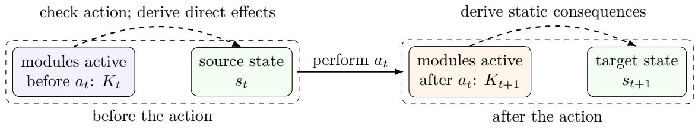
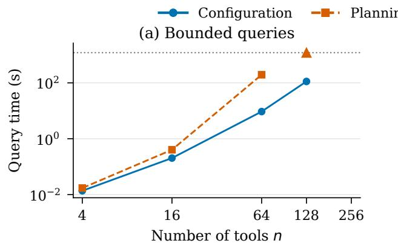
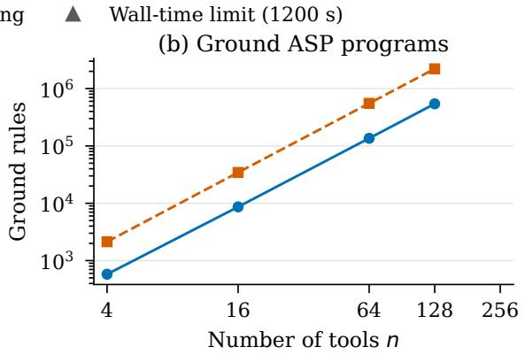
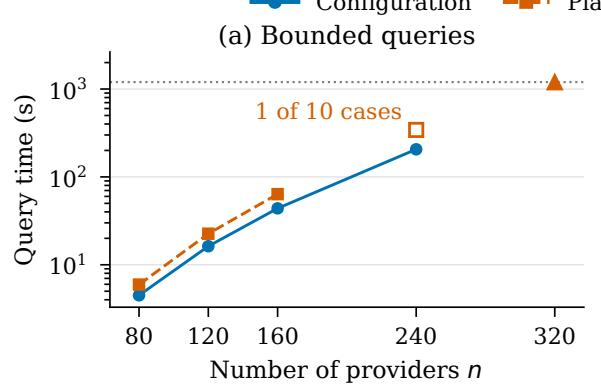
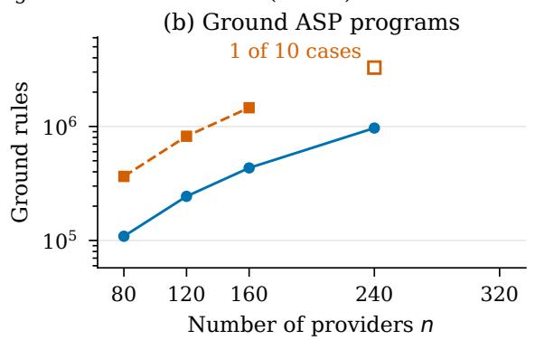
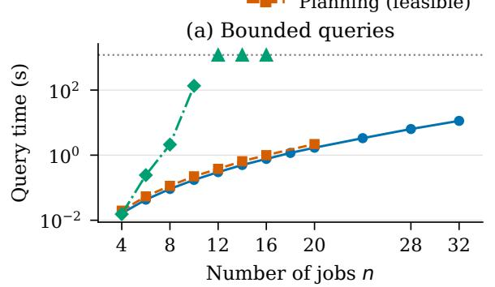
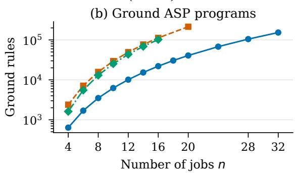

# Reconfigurable Action Theories: A Formal Foundation for Dynamically Composable Agent Harnesses

Jianmin Jia,∗

aUniversity of Science and Technology of China, Hefei, 230026, China

## Abstract

Action theories typically fix their vocabulary and causal laws, whereas agent harnesses can change their tools, providers, and policies during execution. We introduce Reconfigurable Action Theories (RAT), in which actions can change the action theory itself. A theory module in RAT contains a vocabulary, causal laws, and an initializer. A RAT configuration records the active modules and the world state. Module loading and unloading are represented by actions governed by ordinary causal laws. RAT retains the standard causal action semantics of its language fragment when the active module set is fixed. We give suficient conditions for at most one next configuration, preservation of existing behavior when a module is added, and equal results when modules are loaded in either order. We establish the computational complexity of reasoning tasks in RAT and translate finite RAT systems into nonmonotonic causal theories and Answer Set Programming (ASP), preserving bounded executions. Experiments compare finite RAT models with executions of oficial DeepSeek Harness, Pi, and OpenHands implementations. RAT provides a formal basis for checking how component changes afect a harness’s available actions, behavior, and reachable goals.

Keywords: Reasoning about Actions, Action Languages, Dynamic Reconfiguration, Agent Harnesses, Answer Set Programming

## 1. Introduction

Action theories describe how actions change a world. A conventional action description fixes a vocabulary of fluents, which represent changeable facts, and actions, together with the causal laws governing them, while states or histories evolve [1–5]. We study actions that also change the vocabulary and causal laws used to describe later actions.

Agentic AI provides a concrete setting for this problem. An agent repeatedly proposes actions, invokes tools, observes results, and updates its context while pursuing a goal [6–8]. The surrounding agent harness constructs model context, exposes and validates tools, selects providers, dispatches calls, maintains sessions, enforces policies, and records efects [9]. Several harnesses support runtime changes to components, tools, or provider bindings [10–13]. For example, loading a tool can introduce new calls, while replacing a provider or changing a policy can alter when a call is permitted and what it does. To reason about these changes, we need to represent both the current action description and the actions that change it.

Consider a ReAct agent [8] asked to compute 23 × 17 when no calculator tool is initially available. Loading a calculator module should introduce its multiplication action, causal laws, and private state. Removal should withdraw that contribution. A fixed description can encode availability through fluents and guarded, predeclared laws, but the vocabulary and laws themselves remain fixed. We make the module structure explicit: which action-description fragments are in force, and how actions change their selection.

We introduce Reconfigurable Action Theories (RAT), a minimal extension in which actions can change the action theory itself, using the ordinary nonmonotonic causal foundation [3, 14]. A theory module is a named action-description fragment. A configuration ${ \mathcal { C } } = \langle K , s \rangle$ records active optional modules K and world state s, alongside an always-active “core”. The actions load(M) and unload(M) select or deselect module M, without rewriting its laws. Ordinary causal laws govern their world efects and qualification, while RAT fixes their efect on K.

Runtime theory change itself is not new. Modular action languages assemble reusable descriptions, while evolving logic programs, domain update, and action-theory revision address changes of rules or theories [15–19]. RAT instead makes module selection explicit, distinguishes its roles before and after an action, and studies preservation and reordering of module changes. For a fixed execution bound, a causal theory can represent the same executions. RAT keeps module declarations and their changes explicit, so conditions for preserving behavior can be stated in terms of the modules rather than the auxiliary rules of an encoding. Section 9.1 discusses this role of RAT alongside its causal-theory translation.

The central semantic issue is which laws govern a step that changes the theory itself. Write $\mathcal { D } [ K ]$ for the ordinary action description formed by the core and the modules in K and $\langle K , s \rangle$ for its configuration. At time t, an action $a _ { t }$ labels a transition

$$
\langle K _ { t } , s _ { t } \rangle \stackrel { a _ { t } } { \longrightarrow } \langle K _ { t + 1 } , s _ { t + 1 } \rangle .
$$

We call the state before the action its source state and the state after it its target state. We check executability using the nonexecutability laws of $\mathcal { D } [ K _ { t } ]$ and the current module set $K _ { t }$ . Dynamic laws also come from $\mathcal { D } [ K _ { t } ]$ . Their efects depend on conditions evaluated in $s _ { t }$ and $s _ { t + 1 }$ . Loading or unloading changes $K _ { t }$ to $K _ { t + 1 }$ . The static laws of $\mathcal { D } [ K _ { t + 1 } ]$ determine within-state causal consequences, jointly with efects, inertia, and initialization. A newly loaded module contributes no executability or direct-efect law to its loading step, but its static laws already govern the resulting state and may cause indirect changes to existing fluents (Figure 1).

  
Figure 1: An action may change both the world state and the action theory. The description $\mathcal { D } [ K _ { t } ]$ , formed by the core and the modules in $K _ { t } ,$ supplies the executability and direct-efect laws for $a _ { t } .$ . Loading or unloading changes $K _ { t }$ to $K _ { t + 1 } ;$ the resulting description $\mathcal { D } [ K _ { t + 1 } ]$ supplies the static laws governing $s _ { t + }$ 1.

For finite ground RAT models whose initialization conditions are represented by propositional formulas, a proposed transition can be checked in polynomial time. Successor existence is NPcomplete, while unbounded reachability is PSPACE-complete. Thus finite module selection does not raise these worst-case bounds above ordinary finite-state causal reasoning and planning. For finite RAT systems, causal theories and Answer Set Programming (ASP) [20, 21] give bounded planning, diagnosis, and counterexample search.

RAT is a specification for reasoning about a harness, not a replacement for its scheduler or tool runtime. A designer can use it to ask whether a tool can be loaded, whether existing actions retain their behavior, or whether a goal remains reachable after a module change. Reproducible experiments compare finite RAT models with local executions of oficial DeepSeek Harness1, Pi2, and OpenHands [22] implementations. We also test ASP-based configuration computation and planning on generated models, measuring how running time and ground-program size grow with problem size.

The main contributions are:

(1) RAT and its properties. We define how actions change both world state and the modules forming an action description. For actions other than loading and unloading, RAT has the ordinary causal action semantics of the active description. We give suficient conditions for at most one successor, for preserving existing behavior when adding a module, including through a read-only shared interface, and for the same possible final configurations when loading two modules in either order. We also show why unloading and reloading need not restore the earlier state. Experiments compare RAT predictions with recorded tool calls and component changes in three harness implementations.

(2) Reasoning tasks and complexity. We define transition checking, successor existence, possible and necessary goal satisfaction, execution of a supplied action sequence, and reachability. We establish their complexity for finite ground inputs with formula-represented initialization conditions.

(3) Causal and ASP representations. For finite RAT systems, we give a bounded causal translation and prove that its explanations represent exactly the executions. An established causal-to-ASP translation then represents these executions as answer sets, for fixed action sequences or bounded action choice.

Section 2 fixes the logical foundations. Sections 3–6 give RAT’s language, semantics, properties, and translations. Section 7 reports executable checks. Section 8 compares related work, including Cordis. Section 9 discusses use in harnesses, limitations, and further work. The separate Supplementary Material3 supplies expanded proofs, implementation checks, and reproduction details.

## 2. Preliminaries

We first define the finite ground language used in the paper. We then review nonmonotonic causal theories, action descriptions, and Answer Set Programming (ASP). In this paper, we use variables in schematic expressions to abbreviate finite sets of ground instances.

## 2.1. Grounding convention

Let U be a finite nonempty set of object constants. We use function-free schematic expressions, whose variables are meta-level placeholders. For an expression E, let ${ \mathsf { V a r } } ( E )$ denote its variables. A grounding substitution $\theta : \mathsf { V a r } ( E ) \to \mathcal { U }$ replaces each variable x by $\theta ( x )$ . We write $E \theta$ for the expression obtained by applying this substitution to E. Define

$$
\mathsf { g r } _ { \mathcal { U } } ( E ) = \{ E \theta \mid \theta : \mathsf { V a r } ( E )  \mathcal { U } \} , \qquad \mathsf { g r } _ { \mathcal { U } } ( S ) = \bigcup _ { E \in S } \mathsf { g r } _ { \mathcal { U } } ( E )
$$

for a finite set S of expressions.

A variable may be restricted to a designated subset $D \subseteq { \mathcal { U } } ;$ in that case, only substitutions assigning it a constant from D are allowed. This restriction is meta-level and does not introduce a sort into the object language. All definitions below are over the resulting finite ground language.

## 2.2. Action signatures, formulas, and states

A finite ground action signature $\Sigma = \langle \mathcal { F } ^ { b } , \mathcal { F } ^ { d } , \mathcal { A } \rangle$ consists of pairwise disjoint finite sets of basic fluents, defined fluents, and actions. Intuitively, a basic fluent records a fact that can persist, such as whether a tool has been registered. Basic fluents obey inertia: their values normally persist between states, but dynamic or static causal laws may cause them to change. A defined fluent instead expresses a condition whose value must be explained by static laws in each state, such as whether a registered tool is currently ready for use. It has no inertia: a previous value alone does not justify its current value. The word defined specifies where causal support must come from.

For convenience, write $\mathcal { F } ^ { b } ( \Sigma ) = \mathcal { F } ^ { b } , \mathcal { F } ^ { d } ( \Sigma ) = \mathcal { F } ^ { d } , \mathcal { A } ( \Sigma ) = \mathcal { A }$ , and $\mathcal { F } ( \Sigma ) = \mathcal { F } ^ { b } \cup \mathcal { F } ^ { d }$ , omitting Σ when it is clear from context.

For a fluent set ${ \mathcal { F } } \subseteq { \mathcal { F } } ( \Sigma )$ , a fluent literal is either $f \ \mathrm { o r } \ \neg f ,$ where $f \in { \mathcal { F } }$ . Let $\operatorname { L i t } ( { \mathcal { F } } ) =$ $\{ f , \neg f \mid f \in { \mathcal { F } } \}$ . For a fluent literal $\ell ,$ let ${ \mathfrak { f l } } ( \ell )$ denote its underlying fluent, so $\mathsf { f l } ( f ) = \mathsf { f l } ( \lnot f ) = f$

We treat fluents as propositional atoms. More generally, for any finite set $\sigma$ of propositional atoms, let Form(σ) denote the formulas generated by

$$
\varphi : : = { \mathsf { T } } \mid \perp \mid p \mid \neg \varphi \mid ( \varphi \wedge \varphi ) \mid ( \varphi \vee \varphi ) , \qquad p \in \sigma .
$$

Here $\top$ and $\perp$ denote truth and falsity. For $F , G \in \mathsf { F o r m } ( \sigma )$ , implication $G  F$ abbreviates $\neg G \lor F$ , and equivalence $G  F$ abbreviates $( G \to F ) \land ( F \to G )$ . We use $\mathsf { L i t } ( \sigma )$ for literals over any atom set σ. A classical interpretation $I \subseteq \sigma$ makes exactly the atoms in I true. We write $I \models \varphi$ when it satisfies $\varphi .$ A state formula is a formula in Form(F). For a state formula $\varphi , \mathsf { F l } ( \varphi )$ denotes the set of fluents occurring in $\varphi _ { : }$ regardless of polarity.

A literal set $X \subseteq \mathsf { L i t } ( { \mathcal { F } } )$ is consistent if it does not contain both $f$ and $\neg f$ for any $f \in { \mathcal { F } }$ . It is complete over $\mathcal { F }$ if it contains exactly one of $f$ and $\neg f$ for every $f \in { \mathcal { F } }$

Define

$$
\mathsf { S t } ( \mathcal { F } ) = \{ s \subseteq \mathsf { L i t } ( \mathcal { F } ) \mid s \mathrm { ~ i s ~ c o n s i s t e n t ~ a n d ~ } s \mathrm { ~ i s ~ c o m p l e t e ~ o v e r ~ } \mathcal { F } \} ,
$$

a state in $\mathsf { S t } ( \mathcal { F } )$ assigns every fluent in $\mathcal { F }$ . For $s \in \mathsf { S t } ( \mathcal { F } )$ , let $I _ { s } = \{ f \in \mathcal { F } | f \in s \}$ . We write $s \models \varphi$ for a state formula $\varphi \in \mathsf { F o r m } ( \mathcal { F } )$ if the classical interpretation $I _ { s }$ satisfies $\varphi$

## 2.3. Nonmonotonic causal theories

A causal theory specifies not only which formulas are true, but also what causes them to be true [3, 14]. Fix a finite set $\sigma$ of propositional atoms. A causal rule $F \Leftarrow G$ , where $F , G \in \mathsf { F o r m } ( \sigma )$ states that its head $F$ is caused when its body G holds. A finite set $T$ of causal rules is a causal theory. Define its causal reduct at $I \subseteq \sigma$ and its causally explained interpretations by

$$
T ^ { I } = \{ F \mid ( F \Leftarrow G ) \in T , I \mid = G \} ,
$$

$$
\mathsf { C E } ( T ) = \{ I \subseteq \sigma \mid I \mathrm { ~ i s ~ t h e ~ u n i q u e ~ c l a s s i c a l ~ m o d e l ~ o f ~ } T ^ { I } \} .
$$

The reduct contains the heads whose bodies are true in I. They must determine I uniquely over $\sigma ;$ satisfying the implications $G  F$ is insuficient. For $\sigma = \{ p \}$ , the empty theory has no explanation, but $\{ p \Leftarrow \top \}$ explains $\{ p \}$ . Adding rules can create or remove explanations, so the semantics is nonmonotonic.

## 2.4. Causal action descriptions

An action description specifies constraints on states, efects of actions, and conditions that forbid actions. Our baseline is the Boolean, literal-headed, single-action fragment of $\mathcal { C } +$ , with its distinction between simple and statically determined fluent constants [14]. We call these basic and defined fluents, respectively, and declare every basic fluent inertial. Fix $\Sigma = \langle \mathcal { F } ^ { b } , \mathcal { F } ^ { d } , \mathcal { A } \rangle$ and $\mathcal { F } = \mathcal { F } ^ { b } \cup \mathcal { F } ^ { d }$ . For a step performing action $a ,$ , we call the state s before the action its source state and the state $s ^ { \prime }$ after it its target state. A static causal law

$$
\mathsf { c a u s e d } \ h \ \mathsf { i f } \ \psi , \qquad h \in \mathsf { L i t } ( { \mathcal { F } } ) \cup \{ \perp \} , \quad \psi \in \mathsf { F o r m } ( { \mathcal { F } } ) ,
$$

causes h when $\psi$ holds in the same state. If $h = \perp$ , it is a static constraint excluding such states. A dynamic causal law

$$
\mathsf { c a u s e d \ \ell \ i f \ \psi \ a f t e r \ } a \wedge \varphi , \qquad \ell \in \mathsf { L i t } ( \mathcal { F } ^ { b } ) , \quad a \in \mathsf { \mathcal { A } } , \quad \varphi , \psi \in \mathsf { F o r m } ( \mathcal { F } ) ,
$$

causes $\ell$ in the target state $s ^ { \prime } ,$ provided the action is $a , \varphi$ holds in $s ,$ and $\psi$ holds in $s ^ { \prime } .$ The abbreviation a causes ℓ if $\varphi$ sets $\psi = \top$ ; omitting the condition also sets $\varphi = \top$ . A nonexecutability law

$$
\mathsf { n o n e x e c u t a b l e  { a } i f } \varphi , \qquad { a } \in \mathcal { A } , \quad \varphi \in \mathsf { F o r m } ( \mathcal { F } ) ,
$$

forbids performing a in any state satisfying φ.

An action description $\mathcal { D } = \langle \Sigma , L ^ { s } , L ^ { d } , L ^ { x } \rangle$ consists of the signature and finite sets $L ^ { s } , L ^ { d } , L ^ { x }$ of static causal laws, dynamic causal laws, and nonexecutability laws, respectively. For $a \in { \mathcal { A } }$ and $s \in \mathsf { S t } ( \mathcal { F } )$ , put

$$
\begin{array} { r l } & { \mathsf { B l o c k e d } _ { \mathcal { D } } ( a , s ) \mathrm { ~ i f f ~ } \exists \varphi : ( \mathsf { n o n e x e c u t a b l e ~ } a \mathrm { ~ i f ~ } \varphi ) \in L ^ { x } \land s \vdash \varphi , } \\ & { \quad \mathsf { E n a b l e d } _ { \mathcal { D } } ( s ) = \{ a \in \mathcal { A } \mid \neg \mathsf { B l o c k e d } _ { \mathcal { D } } ( a , s ) \} . } \end{array}
$$

In this paper, exactly one ground action occurs at each step. We do not use the full language $\mathcal { C } + :$ our law heads are literals, except for ⊥ in constraints, and we do not allow concurrent action occurrences.

Causal theories for states and transitions. We define the state and transition semantics by causal theories, using CE from Section 2.3. For an action description $\mathcal { D } = \langle \Sigma , L ^ { s } , L ^ { d } , L ^ { x } \rangle$ , one theory specifies which states are possible, while another specifies the possible target states for a given source and action. Both are over the fluent atoms ${ \mathcal F }$

For a complete basic-fluent assignment $X \in \mathsf { S t } ( \mathcal { F } ^ { b } )$ , define the state theory

$$
\mathsf { C T } _ { \mathcal { D } } ( X ) = \{ \ell \Leftarrow \top | \ell \in X \} \cup \{ h \Leftarrow \psi | ( \mathsf { c a u s e d } h \mathsf { i f } \psi ) \in L ^ { s } \} .\tag{1}
$$

A complete state $s \in \mathsf { S t } ( \mathcal { F } )$ is causally admissible for D if

$$
I _ { s } \in \mathsf { C E } \bigl ( \mathsf { C T } _ { \mathcal { D } } \bigl ( s \cap \mathsf { L i t } ( \mathcal { F } ^ { b } ) \bigr ) \bigr ) .
$$

The first set of rules fixes the basic values of this candidate state, while the static laws must explain its defined-fluent values. All fluent values must also satisfy those laws. Fixing basic values here specifies which individual states are admissible.

For a causally admissible source s and an action $a \in { \mathcal { A } }$ , define the single-step causal theory

$$
\begin{array} { r l } & { T _ { \mathcal { D } , s , a } = \{ h \Leftarrow \psi \mid ( \mathsf { c a u s e d } h \mathsf { i f } \psi ) \in L ^ { s } \} } \\ & { \qquad \cup \{ \ell \Leftarrow \psi \mid ( \mathsf { c a u s e d } \ell \mathsf { i f } \psi \mathsf { a f t e r } a \land \varphi ) \in L ^ { d } , s \models \varphi \} } \\ & { \qquad \cup \{ \ell \Leftarrow \ell \mid \ell \in s \cap \mathrm { L i t } ( \mathcal { F } ^ { b } ) \} . } \end{array}\tag{2}
$$

Its three sets of rules represent static laws, dynamic laws for a whose formula $\varphi$ holds in $s ,$ and inertia, respectively. The remaining rule bodies are evaluated in the candidate target state. Unlike the facts in $\mathsf { C T } _ { \mathcal { D } } ( X )$ , the inertia rules in $T _ { \mathcal { D } , s , a }$ support source basic literals only if they remain true in the target. Static or dynamic laws may support a changed value.

For causally admissible states $s , s ^ { \prime }$ , the ordinary transition relation is

$$
s \stackrel { a } { \to } _ { \mathscr { D } } s ^ { \prime } \quad \mathrm { i f f } \quad a \in \mathsf { E n a b l e d } _ { \mathscr { D } } ( s ) \mathrm { a n d } I _ { s ^ { \prime } } \in \mathsf { C E } ( T _ { \mathscr { D } , s , a } ) .\tag{3}
$$

Thus a must not be blocked in $s ,$ and $T _ { \mathcal { D } , s , a }$ must causally explain $s ^ { \prime } .$ . This is the fixed-source form of the standard $\mathcal { C } +$ causal semantics [14, Sections 4.2 and 4.4].

## 2.5. Answer Set Programming

ASP is a form of nonmonotonic logic programming for knowledge representation and declarative problem solving, supported by eficient answer set solvers [23]. Its languages allow rules, constraints, and defaults to describe combinatorial search problems. We first recall ground normal rules and their answer set semantics [24, 25].

Fix a finite set σ of propositional atoms. $\mathrm { A }$ ground normal rule over $\sigma$ has the form

$$
h  \ell _ { 1 } , \ldots , \ell _ { m } , \mathsf { n o t } \ell _ { m + 1 } , \ldots , \mathsf { n o t } \ell _ { n } , \qquad 0 \leq m \leq n .
$$

Here $h \in \mathsf { L i t } ( \sigma ) \cup \{ \perp \}$ is the head, and the expressions to the right of ← form the body. Each body literal $\ell _ { i } \in \mathsf { L i t } ( \sigma )$ , for $1 \leq i \leq n$ , is either an atom p or its classical negation $\neg p ,$ for $p \in \sigma$ . Thus classical negation is allowed in both the head and the body; not denotes a diferent operation, default negation. A rule with $h = \perp$ is a constraint, usually written without a head. A finite set Π of such rules is a ground normal program.

An $A S P$ interpretation is a consistent set $X \subseteq \mathsf { L i t } ( \sigma )$ . For an atom $p \in \sigma .$ , it may omit both p and $\neg p ;$ unlike a state, it need not assign a truth value to every atom. For $\ell \in \mathsf { L i t } ( \sigma )$ , define

$$
X \vdash \ell { \mathrm { ~ i f f ~ } } \ell \in X , \qquad X \vdash { \mathsf { n o t } } \ell { \mathrm { ~ i f f ~ } } \ell \notin X , \qquad X \not \in \bot .
$$

In particular, $X \models \neg p$ requires $\neg p \in X$ , whereas $X \models$ not p requires only $p \not \in X$ . For a rule r of the displayed form, X satisfies r, written $X \models r .$ , if

$$
\{ \ell _ { 1 } , \ldots , \ell _ { m } \} \subseteq X { \mathrm { ~ a n d ~ } } \{ \ell _ { m + 1 } , \ldots , \ell _ { n } \} \cap X = \emptyset { \mathrm { ~ i m p l i e s ~ } } X \left. = h . \right.
$$

Thus a rule with a literal head requires that literal whenever its body is true. A constraint is satisfied exactly when its body is false. An empty body is true. An interpretation is a model of a program Π, written $X \models \Pi$ , if $X \models r$ for every $r \in \Pi$

For an ASP interpretation X, the Gelfond–Lifschitz reduct $\Pi ^ { X }$ is obtained by deleting every rule whose body contains not ℓ with $\ell \in X$ , and then removing all remaining default-negated literals from rule bodies. The interpretation X is an answer set of Π if it is a model of $\Pi ^ { X }$ and no proper subset of X is a model of $\Pi ^ { X }$ . In other words, X must be a subset-minimal model of its own reduct. We consider only consistent answer sets and write

$$
\mathsf { A S } ( \Pi ) = \{ X \subseteq \mathsf { L i t } ( \sigma ) \mid X \mathrm { { \ i s \ c o n s i s t e n t } } , X \vdash \Pi ^ { X } , \mathrm { \ a n d \ } \# Y \subset X : Y \vdash \Pi ^ { X } \} .
$$

Satisfaction alone is not enough: for example, both ∅ and $\{ p \}$ satisfy $p  p .$ The reduct is the same rule for either interpretation, and $\varnothing$ is its only subset-minimal model. Thus this program has only the answer set ∅.

Rules with nested bodies. The translation in Section 6.3 uses Boolean bodies and repeated default negation. These go beyond normal-rule syntax. We therefore also recall the standard extension to nested expressions [26], generated by

$$
B : : = \ell \mid { \mathsf { T } } \mid { \mathsf { \bot } } \mid ( B \wedge B ) \mid ( B \vee B ) \mid { \mathsf { n o t } } B , \qquad \ell \in { \mathrm { L i t } } ( \sigma ) .
$$

A rule $h  B$ keeps the head $h \in \mathsf { L i t } ( \sigma ) \cup \{ \perp \}$ . A finite set of these rules is a program with nested bodies. An ASP interpretation X evaluates literals as above, ⊤ as true, and conjunction and disjunction in the usual way. It satisfies not B if it does not satisfy $B { \mathrm { , } }$ and satisfies the rule if $X \models B$ implies $X \models h$

The reduct replaces each occurrence of not B that is not inside another default negation by $\bot { \mathrm { i f } } X \models B$ , and by ⊤ otherwise. Answer sets are again the consistent subset-minimal models of their own reducts. We still use $\mathsf { A S } ( \Pi )$ to denote the set of answer sets of a program Π with nested expressions. This definition agrees with the preceding one on normal programs. In particular,

$$
( \mathsf { n o t } \mathsf { n o t } B ) ^ { X } = { \left\{ \begin{array} { l l } { \top , } & { X \models B , } \\ { \bot , } & { X \models B . } \end{array} \right. }
$$

Double default negation cannot in general be removed. For example, $p $ not not $p$ has answer sets ∅ and $\{ p \}$ , whereas $p  p$ has only ∅.

ASP computation typically involves two stages: grounding and solving. A grounder, such as gringo [27], converts a finite-domain non-ground program into a ground program. A solver, such as clasp [28], computes answer sets of the resulting ground program. Literal-headed causal theories can be translated into ASP to compute their causally explained interpretations [21]. Furthermore, Ji and Lin [29] study related translations of Turner’s logic of universal causation into propositional logic and logic programs.

## 3. Reconfigurable Action Theories

In RAT, actions can load or unload modules of an action description. We define theory modules and configurations, and specify which action description each configuration uses. Section 4 defines their transitions.

## 3.1. Motivating example

Consider a ReAct-style agent [8] asked to compute $2 3 \times 1 7$ . It initially has no calculator, so the harness first loads one. After loading, the harness registers the calculator so that the agent can call it. A multiplication call then stores the answer 391, which can later be cleared. The harness can also unload the calculator, after which the agent can no longer use its actions. In this example, multiplication is allowed only while the calculator is registered and the task has not finished.

Loading changes what the agent can do: it adds calculator actions and the rules that describe when they can be used and what they do. These actions and rules were absent before loading. Unloading removes them again, along with the calculator’s registration and answer state. A fixed action description can simulate this behavior using predeclared availability flags; RAT instead represents the calculator as a module that is added to or removed from the current action description.

## 3.2. Theory modules and RAT systems

A module contains an action description and an initializer. Its vocabulary and laws become active together. Actions select from a fixed finite module set without changing their laws.

Let ${ \mathcal { M } } \subseteq { \mathcal { U } }$ be a finite set of optional module identifiers represented by object constants. Meta-variables M, N range over $\mathcal { M } ^ { 4 }$ . The always-present core $\mathcal { D } _ { \mathsf { c o r e } }$ , with core $\notin \mathcal { M }$ , and optional $\mathcal { D } _ { M } = \langle \Sigma _ { M } , L _ { M } ^ { s } , L _ { M } ^ { d } , L _ { M } ^ { x } \rangle$ are ordinary descriptions, each declaring all symbols used in its laws. Two signatures are compatible if every shared symbol has the same category in both: basic fluent, defined fluent, or action. We require pairwise compatibility and take signature unions componentwise. Define the ambient signature and each module’s private basic-fluent set by

$$
\Sigma ^ { * } = \Sigma _ { \mathsf { c o r e } } \bigcup \bigcup _ { M \in \mathcal { M } } \Sigma _ { M } , \qquad \mathcal { F } _ { M } ^ { b } = \mathcal { F } ^ { b } ( \Sigma _ { M } ) \setminus \mathcal { F } ^ { b } ( \Sigma _ { \mathsf { c o r e } } ) .
$$

We require $\mathcal { F } _ { M } ^ { b } \cap \mathcal { F } _ { N } ^ { b } = \emptyset$ for all distinct M, $N \in { \mathcal { M } }$ . Thus each noncore basic fluent has one declaring module, whose initializer supplies its values on loading. This ownership condition keeps the responsibility for initialization unambiguous. Core fluents remain visible; compatible actions and defined fluents may be shared. A defined fluent needs no initializing owner: its value requires support from the active static laws.

Loading a module introduces its private basic fluents into the state. These fluents have no values in the preceding state, so inertia cannot supply their initial values. An initializer specifies

the values they may have immediately after loading, possibly depending on the current state.   
For example, a newly loaded calculator may start unregistered and without a stored answer.

For a fluent set $V ,$ write $\mathsf { P V a l } ( V )$ for the set of consistent subsets of Lit(V). Such a partial valuation may leave some fluents unassigned.

Definition 1 (Theory module). For a module identifier $M \in \mathcal { M }$ , a RAT theory module is $\mathsf { M o d } ( M ) = \langle \mathcal { D } _ { M } , \mathsf { l n i t } _ { M } \rangle$ , with ordinary description $\mathcal { D } _ { M } = \langle \Sigma _ { M } , L _ { M } ^ { s } , L _ { M } ^ { d } , L _ { M } ^ { x } \rangle$ and an initializer

$$
\mathsf { l n i t } _ { M } : \mathsf { P V a l } ( \mathcal { F } ( \Sigma ^ { * } ) ) \longrightarrow 2 ^ { \mathsf { S t } ( \mathcal { F } _ { M } ^ { b } ) } .
$$

The input $v \in \mathsf { P V a l } ( \mathcal { F } ( \Sigma ^ { * } ) )$ records the fluent values available before loading. The output Init $_ M ( v )$ is a set of permitted initial assignments. Each member $Y \in \mathsf { l n i t } _ { M } ( v )$ is a complete assignment to $\mathcal { F } _ { M } ^ { b }$ . For every basic fluent $f \in \mathcal { F } _ { M } ^ { b } .$ , it contains exactly one of $f$ and $\neg f$ . A loading successor must be causally explained using one such assignment together with the applicable laws (Section 4). The selected assignment fixes the new basic values; the laws can reject it, but cannot replace those values. We allow several assignments because the same loading action from the same source state may initialize a module in diferent ways. Initialization may depend on external conditions, such as service availability, that are not represented in the source state.

As an example, consider loading a connector module M that attempts to connect to an external service. The connection attempt may succeed or fail without changing whether the connector itself is installed. If its outcome is not determined by the represented source state, we model both possibilities using the private basic fluent connected(M):

$$
\begin{array} { c } { { \mathcal { F } _ { M } ^ { b } = \{ c o n n e c t e d ( M ) \} , } } \\ { { { \mid } { \mathsf { n i t } } _ { M } ( v ) = \{ \{ c o n n e c t e d ( M ) \} , \{ \neg c o n n e c t e d ( M ) \} \} \quad \mathrm { f o r ~ e v e r y ~ i n p u t ~ } v . } } \end{array}
$$

Let the core basic fluent mustConnect record whether loading requires a successful connection. The module declares this shared fluent and has the static constraint

$$
\mathsf { c a u s e d \perp i f } \ m u s t C o n n e c t \wedge \neg { c o n n e c t e d ( M ) } .
$$

Take no other fluents or laws. Inertia preserves mustConnect. When it is false, loading has two successors, one connected and one disconnected; when it is true, only the connected successor is allowed.

Definition 2 (RAT system and module actions). A finite RAT system is

$$
\mathscr { R } = \left. \mathcal { M } , \mathcal { D } _ { \mathrm { c o r e } } , \left\{ \mathsf { M o d } ( M ) \right\} _ { M \in \mathcal { M } } \right. .
$$

For every module identifier $M \in { \mathcal { M } }$ , it reserves two ground action symbols, load(M) and unload(M), with

$$
\begin{array} { r } { \mathcal { A } ^ { \sf r } = \{ l o a d ( M ) , u n l o a d ( M ) \mid M \in \mathcal { M } \} \subseteq \mathcal { A } ( \Sigma _ { \mathsf { c o r e } } ) . } \end{array}
$$

Distinct identifiers give distinct loading actions and distinct unloading actions, and no loading action equals an unloading action.

Ordinary dynamic and nonexecutability laws specify these actions’ world efects and when they are blocked. RAT also specifies how they change the active module set (Section 4.2).

## 3.3. Active action descriptions

Let $K \subseteq { \mathcal { M } }$ be the set of active optional modules. The current signature and law sets are their unions with those of the core:

$$
\Sigma [ K ] = \Sigma _ { \mathsf { c o r e } } \cup \bigcup _ { M \in K } \Sigma _ { M } ,
$$

$$
L ^ { z } [ K ] = L _ { \mathsf { c o r e } } ^ { z } \cup \bigcup _ { M \in K } L _ { M } ^ { z } , \qquad z \in \{ s , d , x \} .
$$

The active action description is ${ \mathcal { D } } [ K ] = \langle \Sigma [ K ] , L ^ { s } [ K ] , L ^ { d } [ K ] , L ^ { x } [ K ] \rangle$ , with $\begin{array} { r } { \mathcal { F } ^ { b } [ K ] = \mathcal { F } ^ { b } ( \Sigma [ K ] ) } \end{array}$ $\mathcal F ^ { d } [ K ] = \mathcal F ^ { d } ( \Sigma [ K ] ) , \mathcal F [ K ] = \mathcal F ( \Sigma [ K ] )$ , and $\mathcal { A } [ K ] = \mathcal { A } ( \Sigma [ K ] )$

Exactly the modules in K are active; inactive modules contribute neither signatures nor laws. A symbol disappears only when no active fragment declares it.

## 3.4. RAT configurations

A world state records fluent values. RAT also records the active module set, which determines the current action description.

Definition 3 (RAT configuration). A RAT configuration is

$$
\begin{array} { r } { \mathscr { C } = \langle K , s \rangle , \qquad K \subseteq \mathcal { M } , \quad s \in \mathsf { S t } ( \mathcal { F } [ K ] ) . } \end{array}
$$

The ground actions $a \in \mathcal { A } [ K ]$ are those present in the active description. A present action may still be blocked or have no successor. This definition specifies the components of a configuration; Section 4 determines which states satisfy the causal semantics. RAT records only the active modules and the world state.

## 3.5. Formalization of the running example

We formalize the running example in Section 3.1. We specify the core first, then the calculator. The only optional module identifier is the object constant cal, so $\mathcal { M } = \{ c a l \}$ . The core basic fluent taskDone records task completion. The action finishTask marks the task complete; load(cal) and unload(cal) add and remove the calculator. Its signature is

$$
\Sigma _ { \mathsf { c o r e } } = \langle \{ t a s k D o n e \} , \emptyset , \{ l o a d ( c a l ) , u n l o a d ( c a l ) , f u n i s h T a s k \} \rangle .
$$

The core has the single dynamic law finishTask causes taskDone; its static and nonexecutability law sets are empty. Initially, the task is not finished and the calculator is not loaded:

$$
K _ { 0 } = \emptyset , \qquad \mathcal { C } _ { 0 } = \langle K _ { 0 } , \{ \neg t a s k D o n e \} \rangle , \qquad \Sigma [ K _ { 0 } ] = \Sigma _ { \mathsf { c o r e } } .
$$

The calculator’s private basic fluents are registered(cal) and answer(391): they record whether the calculator is registered and whether the answer 391 is stored. Its defined fluent ready(cal) records whether multiplication is allowed. Its three actions are register(cal), multiply(23, 17), and clearAnswer(391). All terms are ground; the numeral arguments are object constants. Its signature is

$$
\begin{array} { r l r } & { } & { \Sigma _ { c a l } = \big \langle \{ t a s k D o n e , r e g i s t e r e d ( c a l ) , a n s w e r ( 3 9 1 ) \} , \{ r e a d y ( c a l ) \} , } \\ & { } & { \{ r e g i s t e r ( c a l ) , m u l t i p l y ( 2 3 , 1 7 ) , c l e a r A n s w e r ( 3 9 1 ) \} \big \rangle . } \end{array}
$$

Registration and the stored answer persist until changed. Readiness must instead reflect the current registration and task status; it must not remain true merely because it was true before the task finished. The calculator reads taskDone but never changes it. In the notation of Section 2.4, the calculator’s static laws are

$$
\mathsf { c a u s e d \ r e a d y ( } c a l ) \mathrm { ~ i f ~ } r e g i s t e r e d ( c a l ) \land \lnot t a s k D o n e ,
$$

$$
\mathsf { c a u s e d } \neg r e a d y ( c a l ) \mathsf { i f } \neg r e g i s t e r e d ( c a l ) \vee t a s k D o n e .
$$

Its dynamic laws and nonexecutability law are

register(cal) causes registered(cal),

multiply(23, 17) causes answer(391),

clearAnswer(391) causes ¬answer(391),

nonexecutable multiply(23, 17) if ¬ready(cal).

These are exactly the laws in $L _ { c a l } ^ { s } , L _ { c a l } ^ { d } , L _ { c a l } ^ { x } .$ , respectively.

Loading the calculator starts it unregistered and without a stored answer. Its initializer therefore returns the same singleton set for every input $v \in \mathsf { P V a l } ( \mathcal { F } ( \Sigma ^ { * } ) )$ :

$$
| \mathsf { n i t } _ { c a l } ( v ) = \{ \{ \neg r e g i s t e r e d ( c a l ) , \neg a n s w e r ( 3 9 1 ) \} \} .
$$

The initializer assigns neither taskDone, which belongs to the core, nor $r e a d y ( c a l )$ , which is defined. The second static law makes $r e a d y ( c a l )$ false because the calculator is initially unregistered. This completes the RAT system $\mathcal { R } _ { \times } = \langle \{ c a l \} , \mathcal { D } _ { \mathrm { c o r e } } , \{ \mathsf { M o d } ( c a l ) \} \rangle$

Before loading, the calculator’s three fluents and its multiplication action are absent:

$$
\begin{array} { r l } & { \{ r e g i s t e r e d ( c a l ) , a n s w e r ( 3 9 1 ) , r e a d y ( c a l ) \} \cap \mathcal { F } [ K _ { 0 } ] = \emptyset , } \\ & { \qquad m u l t i p l y ( 2 3 , 1 7 ) \notin \mathcal { A } [ K _ { 0 } ] . } \end{array}
$$

With the calculator active, the selection $K _ { 1 } = \{ c a l \}$ instead gives

$$
\begin{array} { r } { \Sigma [ K _ { 1 } ] = \Sigma _ { \mathsf { c o r e } } \cup \Sigma _ { \mathsf { c o l } } , \qquad \mathcal { D } [ K _ { 1 } ] = \langle \Sigma [ K _ { 1 } ] , L _ { \mathsf { c o l } } ^ { s } , L _ { \mathsf { c o r e } } ^ { d } \cup L _ { \mathsf { c o l } } ^ { d } , L _ { \mathsf { c a l } } ^ { x } \rangle . } \end{array}
$$

Section 4.5 derives the transitions of this system.

## 4. RAT transition semantics

We now define when an action a takes a configuration $\langle K , s \rangle$ to $\langle K ^ { \prime } , s ^ { \prime } \rangle$ . We first specify which states satisfy the static causal laws of the core and active modules. We then specify which actions are enabled, how K changes to $K ^ { \prime }$ , and which fluent values can hold after the action. The definition uses the nonmonotonic causal semantics of Section 2.3. When loading introduces new basic fluents, their initial values come from the module’s initializer.

## 4.1. Static causal closure and admissibility

A complete assignment of fluent values need not be a possible state of the system. It must satisfy the static laws, and the truth value of each defined fluent must have causal support from those laws. Let $K \subseteq { \mathcal { M } }$ be the active module set in a RAT system R. The description $\mathcal { D } [ K ]$ has signature $\Sigma [ K ]$ , with basic and defined fluent sets $\mathcal { F } ^ { b } [ K ]$ and ${ \mathcal { F } } ^ { d } [ K ]$ . For $s \in \mathsf { S t } ( \mathcal { F } [ K ] )$ , its basic projection Base $\begin{array} { r } { \boldsymbol { \kappa } ( \boldsymbol { s } ) = \boldsymbol { s } \cap \mathop { \mathrm { L i t } } ( \mathcal { F } ^ { b } [ K ] ) } \end{array}$ keeps only the basic literals.

We treat the values of basic fluents as given when imposing these conditions on a state. For a complete assignment $X \in \mathsf { S t } ( \mathcal { F } ^ { b } [ K ] )$ , define the following causal theory over ${ \mathcal { F } } [ K ]$

$$
\mathsf { C T } _ { K } ( X ) = \{ \ell \in \mathsf { T } | \ell \in X \} \cup \{ h \in \psi | ( \mathsf { c a u s e d } h \mathrm { i f } \psi ) \in L ^ { s } [ K ] \} .\tag{4}
$$

The first set fixes the basic-fluent values to $X ;$ ; the second translates every static law of $\mathcal { D } [ K ]$ into a causal rule. Using the classical interpretation $I _ { s }$ for the state s from Section 2.2, define the causal static closure

$$
\complement \mathsf { l } _ { K } ( X ) = \{ s \in \mathsf { S t } ( \mathcal { F } [ K ] ) \mid \mathsf { B a s e } _ { K } ( s ) = X \mathrm { ~ a n d ~ } I _ { s } \in \mathsf { C E } ( \mathsf { C T } _ { K } ( X ) ) \} .\tag{5}
$$

Thus $\mathsf { C l } _ { K } ( X )$ contains the complete states causally explained by $\mathsf { C T } _ { K } ( X )$ : each $I _ { s }$ must be the unique model of its own causal reduct. The set can be empty, contain one state, or contain several states. A state s is causally admissible under K if $s \in \mathsf { C l } _ { K } ( \mathsf { B a s e } _ { K } ( s ) )$ ; we then call the configuration $\langle K , s \rangle$ causally admissible as well.

## 4.2. Executability and module change

An action is enabled only if no nonexecutability law of $\mathcal { D } [ K ]$ blocks it. Loading an already active module and unloading an inactive one are also excluded. For a causally admissible configuration $\langle K , s \rangle$ , with s over $\Sigma [ K ]$ , define the set of enabled actions by

$$
\begin{array} { r l } & { \mathsf { E n a b l e d } _ { K } ( s ) = \{ a \in \mathsf { E n a b l e d } _ { \mathcal { D } [ K ] } ( s ) \mid \forall M \in \mathcal { M } : } \\ & { \qquad ( a = l o a d ( M ) \mathrm { ~ i m p l i e s ~ } M \notin K ) \mathrm { ~ a n d ~ } ( a = u n l o a d ( M ) \mathrm { ~ i m p l i e s ~ } M \in K ) \} . } \end{array}\tag{6}
$$

Thus RAT uses the ordinary test $\mathsf { E n a b l e d } _ { \mathcal { D } [ K ] }$ from Section 2.4 and also checks the active status of the module being loaded or unloaded. Passing these tests does not guarantee a transition: the causal laws may allow no target state.

The action label determines the next module set. For $K \subseteq { \mathcal { M } }$ and $a \in \mathcal { A } [ K ]$ , define

$$
{ \mathsf { N e x t } } _ { K } ( a ) = { \left\{ \begin{array} { l l } { K \cup \{ M \} , } & { { \mathrm { i f ~ } } a = l o a d ( M ) , } \\ { K \setminus \{ M \} , } & { { \mathrm { i f ~ } } a = u n l o a d ( M ) , } \\ { K , } & { { \mathrm { i f ~ } } a \not \in { \mathsf { A } } ^ { \mathsf { r } } . } \end{array} \right. }\tag{7}
$$

Loading and unloading labels can occupy the action position in dynamic and nonexecutability laws, just like any other ground action. For example, fix $M \in \mathcal { M }$ and let the core basic fluents canLoad(M) and reserved(M) record permission to load M and whether a resource is reserved for it. The core may contain

$$
\begin{array} { r l } { l o a d ( M ) ~ { \mathsf { c a u s e s } } ~ r e s e r v e d ( M ) , } & { } \\ { { \mathsf { n o n e x e c u t a b l e } } ~ l o a d ( M ) ~ { \mathsf { i f } } ~ \lnot c a n L o a d ( M ) , } & { } \\ { u n l o a d ( M ) ~ { \mathsf { c a u s e s } } ~ \lnot r e s e r v e d ( M ) . } \end{array}
$$

Thus loading requires permission and causes a reservation, while unloading releases it.

## 4.3. Initialization and the single-step causal theory

Let $\langle K , s \rangle$ be a source configuration of the RAT system ${ \mathcal { R } } ,$ with active module set $K$ and state s. For a ground action $a \in \mathcal { A } [ K ]$ , let $K ^ { \prime } = \mathsf { N e x t } _ { K } ( a )$ be the target active module set. We construct a causal theory over $\mathcal { F } [ K ^ { \prime } ]$ whose explanations give the possible target states $s ^ { \prime } .$ . It describes one action from the fixed source, rather than a sequence of actions; we therefore call it a single-step causal theory.

Initialization. For each newly active module, choose an assignment allowed by its initializer. The set of combined assignments is

$$
\mathsf { I n i t } _ { K \to K ^ { \prime } } ( s ) = \left\{ \bigcup _ { M \in K ^ { \prime } \backslash K } Y _ { M } \Bigg | Y _ { M } \in \mathsf { I n i t } _ { M } ( s ) \mathrm { ~ f o r ~ e v e r y ~ } M \in K ^ { \prime } \setminus K \right\} .
$$

Each assignment $Y _ { M }$ gives the initial values of module $M \mathrm { { s } }$ private basic fluents. These fluent sets are disjoint, so the union of the assignments is consistent. If no module is new, Init $\cal { K } { \to } \cal { K ^ { \prime } }  ( s ) = \{ \emptyset \}$ One RAT step loads at most one module; the set-based form is also useful when discussing several module changes in the later proofs.

Selecting the laws. Loading or unloading can change both the laws and the fluents in the action description. We therefore need to specify which laws describe the action and which laws describe the resulting state. The target state uses all static laws of $\mathcal { D } [ K ^ { \prime } ]$ , giving

$$
\operatorname { S t a t i c } ( K ^ { \prime } ) = \{ h \Leftarrow \psi | ( \mathsf { c a u s e d } h \mathsf { i f } \ \psi ) \in L ^ { s } [ K ^ { \prime } ] \} .
$$

The action’s dynamic laws come from $\mathcal { D } [ K ]$ , the description in force before the action. In particular, a newly loaded module supplies static laws for the target state, but no dynamic law for its own loading. Likewise, its nonexecutability laws cannot block its own loading, but can block its unloading while the module is active. For the selected action $^ { a , }$ consider a dynamic law

$$
{ \mathsf { c a u s e d } } \ \ell \ { \mathsf { i f } } \ \psi \ { \mathsf { a f t e r } } \ a \wedge \varphi .
$$

The formula $\varphi$ is tested in the state s before the action, while $\psi$ is tested in the candidate state $s ^ { \prime }$ after the action. The law can cause $\ell$ in $s ^ { \prime }$ only when both conditions hold.

Unloading may remove fluents mentioned in the law. We call a dynamic law target applicable if the fluent in its head and all fluents written in $\psi$ belong to $\mathcal { F } [ K ^ { \prime } ]$ . This tests whether the law can be evaluated there, not whether $\psi$ is true. The formula $\varphi$ may still refer to a removed fluent, since its value is available in $s .$ No such additional test is needed for the static laws above: their symbols already belong to $\Sigma [ K ^ { \prime } ]$ . The selected dynamic laws give

$$
\mathtt { D y n a m i c } ( K , s , a , K ^ { \prime } ) = \{ \ell \Leftarrow \psi \mid ( \mathtt { c a u s e d } \ell \mathrm { ~ i f ~ } \psi \mathrm { ~ a f t e r ~ } a \land \varphi ) \in L ^ { d } [ K ] , \ s = \varphi ,
$$

$$
\mathsf { F I } ( \psi ) \subseteq \mathcal { F } [ K ^ { \prime } ] , \ \mathsf { f l } ( \ell ) \in \mathcal { F } ^ { b } [ K ^ { \prime } ] \} .
$$

Combining the causes. Let $S = \mathcal { F } ^ { b } [ K ] \cap \mathcal { F } ^ { b } [ K ^ { \prime } ]$ be the set of all basic fluents present before and after the action. For an allowed initialization assignment $Y \in { \mathsf { l n i t } } _ { K  K ^ { \prime } } ( s )$ , the single-step causal theory is

$$
T _ { K , s , a , K ^ { \prime } , Y } = 5 \mathsf { t a t i c } ( K ^ { \prime } ) \cup \mathsf { D y n a m i c } ( K , s , a , K ^ { \prime } ) \cup \{ \ell \in \ell | \ell \in s \cap \mathrm { L i t } ( S ) \} \cup \{ \ell \in \top | \ell \in Y \} .\tag{8}
$$

These are exactly four families of causal rules:

(i) Static rules. Each static law of $\mathcal { D } [ K ^ { \prime } ]$ contributes $h \Leftarrow \psi$ . Its body is evaluated in the candidate target state $s ^ { \prime } .$

(ii) Dynamic rules. Each target-applicable dynamic law for $a$ in $\mathcal { D } [ K ]$ with $s \models \varphi$ contributes $\ell \Leftarrow \psi$ . The formula $\varphi$ has already been tested in $s ,$ while $\psi$ remains in the rule body to be tested in $s ^ { \prime } .$

(iii) Inertia rules. For every basic fluent $f \in S$ , take its literal ℓ true in s and include $\ell \Leftarrow \ell .$ This includes all such fluents, even when a static or dynamic law may change their values. If ℓ remains true in $s ^ { \prime } .$ , the rule supplies a cause for it. If $\ell$ is false in $s ^ { \prime } .$ the rule’s body is false and contributes nothing to the causal reduct; the opposite value must have another cause.

(iv) Initialization rules. For every literal $\ell \in Y$ , include $\ell \Leftarrow \top$ . These facts assign the new basic fluents, which had no values in s to preserve by inertia. Incompatible laws reject this assignment rather than replace it.

Every fluent in $\mathcal { F } ^ { b } [ K ^ { \prime } ]$ is either in $S$ or newly introduced, so items (iii) and $( \mathrm { i v } )$ cover all of them. Fluents removed by the action do not belong to $\mathcal { F } [ K ^ { \prime } ]$ . Defined fluents have no inertia rules; their values must be supported by the static rules in item (i). All four families are evaluated together by causal explanation, without an order of application or a priority between them.

References to removed fluents. Target applicability checks the formula as written, not an equiva lent simplification. The written fluent set is part of the law’s interface. Removing a fluent needed in its head or after-state condition disables that efect rule, rather than blocking the whole action. For example, suppose unloading removes private basic $q$ but retains basic $p ,$ and the source is $\{ \neg p , \neg q \}$ . A dynamic law causing $p$ with $\psi = q \vee \neg q$ is omitted because it refers to the removed fluent. With no other laws, the successor is $\{ \neg p \}$ . Replacing that condition by ⊤ keeps the law and gives $\{ p \}$ instead.

The formula $\varphi$ is evaluated before unloading, so it may refer to private fluents that the action removes. We call a dynamic law for unload(M) target-safe if its head and formula $\psi$ mention only fluents in ${ \mathcal { F } } [ K \setminus \{ M \} ]$ for every active set K containing M in which the law is present. Since there are finitely many possible sets $K .$ , this condition can be checked directly from the module signatures.

RAT also allows laws that are not target-safe. Such a law is omitted from a step if its head or $\psi$ mentions a fluent absent after unloading. The translation in Section 6 makes the same check using the fluents in the head and the unsimplified formula $\psi .$

## 4.4. RAT transitions and executions

We can now define a transition for RAT.

Definition 4 (RAT transition). For causally admissible configurations $\langle K , s \rangle$ and $\langle K ^ { \prime } , s ^ { \prime } \rangle$

$$
\langle K , s \rangle \ { \overset { a } { \to } } _ { \mathrm { R A T } } \ \langle K ^ { \prime } , s ^ { \prime } \rangle
$$

if all of the following hold:

(i) $a \in \mathsf { E n a b l e d } _ { K } ( s ) ;$

(ii) $K ^ { \prime } = \mathsf { N e x t } _ { K } ( a ) ;$

(iii) for some initialization assignment $Y \in { \mathsf { I n i t } } _ { K \to K ^ { \prime } } ( s ) , I _ { s ^ { \prime } } \in { \mathsf { C E } } ( T _ { K , s , a , K ^ { \prime } , Y } )$ for the state $s ^ { \prime } .$

Static laws, dynamic laws, inertia, and initialization are solved jointly, including when a dynamic law’s formula $\psi$ depends on fluent values in the state after the action. This definition is declarative: the conditions are simultaneous semantic constraints, not an operational evaluation order.

The last condition also ensures that the target is causally admissible. In the causal reduct for a target state $s ^ { \prime } ,$ only static laws can support the truth values of defined fluents. If we replace the causes of basic literals by the facts Base $K ^ { \prime } { \left( s ^ { \prime } \right) }$ , the reduct still has the same unique model. This is exactly the static admissibility test. The truth values of basic fluents may nevertheless change indirectly during the step.

These transitions form a labeled transition system: its nodes are the causally admissible RAT configurations, and an edge labeled a connects two configurations exactly when they satisfy Definition 4 for action $a .$ For actions $a \in \mathcal { A } [ K ] \setminus \mathcal { A } ^ { \mathsf { r } }$ , that is, actions other than loading and unloading, K does not change. Their transitions coincide with those of the ordinary description $\mathcal { D } [ K ]$ . Proposition 1 in Section 5.1 proves this for one step; Corollary 1 in the same section extends it to finite executions.

An action occurs when the transition relation holds, not merely when its label is available or enabled. From a fixed source configuration, the same action may have several successors because of alternative initializations or causal explanations. All these successors have the same module set.

A finite action sequence is an ordered tuple $\alpha = \langle a _ { 1 } , \ldots , a _ { n } \rangle$ , where $a _ { i } \in \mathcal { A } ( \Sigma ^ { * } )$ for $1 \leq i \leq n$ $\mathrm { A }$ finite execution, or path, is a sequence

$$
{ \mathcal { C } } _ { 0 } \ { \xrightarrow { { a _ { 1 } } } } _ { \mathrm { R A T } } { \mathcal { C } } _ { 1 } \ { \xrightarrow { { a _ { 2 } } } } _ { \mathrm { R A T } } \cdots { \xrightarrow { { a _ { n } } } } _ { \mathrm { R A T } } { \mathcal { C } } _ { n } ,
$$

with causally admissible configurations $\mathcal { C } _ { i } = \langle K _ { i } , s _ { i } \rangle$ for $0 \leq i \leq n$ , and each step satisfying Definition 4. We write $\mathcal { C } \ \xrightarrow { \alpha } _ { \mathrm { R A T } } \mathcal { C } ^ { \prime }$ when such a path starts at $\mathcal { C }$ and ends at $\mathcal { C } ^ { \prime }$ . The empty sequence leaves its starting configuration unchanged.

## 4.5. Transitions for the running example

For the instance in Section 3.5, $\mathcal { C } _ { 0 } = \langle K _ { 0 } , \{ \neg t a s k D o n e \} \rangle$ , with $K _ { 0 } = \emptyset$ , is causally admissible over its core vocabulary {taskDone}. Loading is enabled because the core has no blocking law and cal is inactive, with ${ \sf N e x t } _ { K _ { 0 } } ( l o a d ( c a l ) ) = \{ c a l \} = K _ { 1 }$ . No dynamic law in $\mathcal { D } [ K _ { 0 } ]$ changes a fluent when cal is loaded. Inertia preserves ¬taskDone, and initialization supplies {¬registered(cal), ¬answer(391)}. The calculator’s static laws explain ¬ready(cal). Together these conditions give the unique target state

$$
\begin{array} { c } { s _ { 1 } = \{ \neg t a s k D o n e , \neg r e g i s t e r e d ( c a l ) , \neg a n s w e r ( 3 9 1 ) , \neg r e a d y ( c a l ) \} , } \\ { \qquad \quad \mathcal { C } _ { 1 } = \langle K _ { 1 } , s _ { 1 } \rangle . } \end{array}
$$

Hence $\mathcal { C } _ { 0 } \xrightarrow { l o a d ( c a l ) } _ { \mathrm { R A T } } \mathcal { C } _ { 1 }$ . No calculator law is active before loading; its static laws apply afterward. Multiplication is visible but disabled because $\lnot r e a d y ( c a l ) \in s _ { 1 }$

Registration causes registered(cal). Inertia preserves ¬answer(391), and the static laws explain ready(cal). Multiplication then causes answer(391). For the configurations

$$
\begin{array} { r l } & { \mathcal { C } _ { 2 } = \langle K _ { 1 } , \{ \neg t a s k D o n e , r e g i s t e r e d ( c a l ) , \neg a n s w e r ( 3 9 1 ) , r e a d y ( c a l ) \} \rangle , } \\ & { \mathcal { C } _ { 3 } = \langle K _ { 1 } , \{ \neg t a s k D o n e , r e g i s t e r e d ( c a l ) , a n s w e r ( 3 9 1 ) , r e a d y ( c a l ) \} \rangle , } \end{array}
$$

the remaining execution is

$$
\mathcal { C } _ { 1 } \xrightarrow { r e g i s t e r { ( c a l ) } } \mathrm { _ { R A T } } \mathcal { C } _ { 2 } \xrightarrow { m u l t i p l y ( 2 3 , 1 7 ) } \mathrm { _ { R A T } } \mathcal { C } _ { 3 } \xrightarrow { u n l o a d ( c a l ) } \mathrm { _ { R A T } } \mathcal { C } _ { 0 } .
$$

The first two steps preserve $K _ { 1 }$ ; unloading retains ¬taskDone by inertia. Multiplication stores the answer but does not mark the task complete. The return to $\mathcal { C } _ { 0 }$ occurs because no core fluent has changed. It does not make unloading and reloading inverse operations: reloading from $\mathcal { C } _ { 0 }$ gives $\mathcal { C } _ { 1 }$ , not $\mathcal { C } _ { 3 }$ , because initialization does not restore the earlier registration or stored answer. Section 5.5 gives a further example of why unloading and reloading need not restore the earlier state.

After multiplication, we can also finish the task instead of unloading the calculator. From $\mathcal { C } _ { 3 } ^ { \mathrm { ~ ~ } }$ the core action finishTask leads to

$$
\mathcal { C } _ { 4 } = \langle K _ { 1 } , \{ t a s k D o n e , r e g i s t e r e d ( c a l ) , a n s w e r ( 3 9 1 ) , \neg r e a d y ( c a l ) \} \rangle .
$$

The calculator remains loaded and registered, and the stored answer is unchanged. Its static laws make $r e a d y ( c a l )$ false because taskDone is now true, so further multiplication is blocked. If we then unload the calculator, inertia preserves the now-true core fluent taskDone, giving

$$
\mathcal { C } _ { 4 } \xrightarrow { u n l o a d ( c a l ) } \mathrm { R A T } \left. \emptyset , \left\{ t a s k D o n e \right\} \right. \ne \mathcal { C } _ { 0 } .
$$

With or without the calculator, finishTask still makes taskDone true. The module reads this core fluent without preventing the core action or changing its efect on that fluent. Theorem 2 in Section 5.4 gives suficient conditions for this preservation of existing behavior.

## 5. Properties of RAT

Changing a harness component can afect tasks that use other components. A designer may therefore want to know whether existing actions remain usable, whether the model determines one next configuration for a given action, and whether loading two tools in either order permits the same final configurations. For a RAT model, these questions can be answered by examining its causal laws and initializers. We give suficient conditions for these properties, then define the corresponding reasoning tasks and establish their computational complexity.

Throughout this section, we use a finite RAT system $\mathcal { R } = \langle \mathcal { M } , \mathcal { D } _ { \mathrm { c o r e } } , \{ \mathsf { M o d } ( M ) \} _ { M \in \mathcal { M } } \rangle$ as in Definition 2. Let $K \subseteq { \mathcal { M } }$ be the active module set in R. The symbols ${ \mathcal { D } } [ K ] , { \mathcal { F } } [ K ]$ , and $\ A [ K ]$ are its active description, fluents, and actions. All transition relations and initializers refer to $\mathcal { R }$ The properties hold for every such system.

The proofs use a simple fact about literal-headed causal theories. Let T be such a theory over atoms σ and $I \subseteq \sigma$ an interpretation. Its causal reduct $T ^ { I }$ , defined in Section 2.3, contains the heads of the rules whose bodies are true in I. Here those heads are literals $\mathrm { o r \perp }$ . Thus I is the unique classical model of $T ^ { I }$ if $T ^ { I } = \{ p \mid p \in I \} \cup \{ \neg p \mid p \in \sigma \setminus I \}$ . The reduct must therefore specify exactly the truth value assigned by I to each atom. We use this criterion to check causal explanations below.

## 5.1. Transitions without loading or unloading

Let K be the active module set in the RAT system R, and let $a \in \mathcal { A } [ K ] \setminus \mathcal { A } ^ { \mathsf { r } }$ be a ground action that neither loads nor unloads a module. The core and the modules in K form the ordinary action description $\mathcal { D } [ K ]$ . We compare its states and transitions, defined in Section 2.4, with those of RAT.

For a state $s \in \mathsf { S t } ( \mathcal { F } [ K ] )$ , its basic literals form the assignment Base $\kappa _ { } ( s )$ . The ordinary action description and RAT use exactly the same causal theory to determine whether the static laws explain s with this basic assignment. Equation (1) and Equation (4) give

$$
\mathsf { C T } _ { \mathcal { D } [ K ] } ( \mathsf { B a s e } _ { K } ( s ) ) = \mathsf { C T } _ { K } ( \mathsf { B a s e } _ { K } ( s ) ) .
$$

Both theories contain facts for the basic values in s and all static laws of $\mathcal { D } [ K ]$ . Thus s is a causally admissible state of the action description $\mathcal { D } [ K ]$ exactly when $\langle K , s \rangle$ is a causally admissible RAT configuration. We now show that executing a permits the same next states in both descriptions.

Proposition 1. Let $\langle K , s \rangle$ and $\langle K ^ { \prime } , s ^ { \prime } \rangle$ be causally admissible configurations of the RAT system R, and let $a \in \mathcal { A } [ K ] \setminus A ^ { \ r }$ be a ground action. Then

$$
\langle K , s \rangle \ { \overset { a } { \to } } _ { \mathrm { R A T } } \ \langle K ^ { \prime } , s ^ { \prime } \rangle \quad i f f \quad K ^ { \prime } = K \ a n d \ s \ { \overset { a } { \to } } _ { \mathscr D [ K ] } \ s ^ { \prime } .
$$

Proof. Since $a \notin { \mathcal { A } } ^ { \mathfrak { r } }$ , Next $\mathbf { \Psi } _ { K } ( a ) = K$ , Init $\quad \cdot K \to K  ( s ) = \{ \emptyset \}$ . No fluent is added or removed, so every selected dynamic law is target applicable and there are no initialization facts. Comparing Equation (8) with Equation (2) gives $T _ { K , s , a , K , \emptyset } = T _ { \mathcal { D } [ K ] , s , a } .$ . Ordinary executability, $\mathsf { E n a b l e d } _ { \mathcal { D } [ K ] } ( s )$ tests whether a nonexecutability law blocks the action. R $. \mathrm { A T } \mathrm { s }$ Enabled $\boldsymbol { \kappa } ( s )$ in Equation (6) adds the module-status tests for loading and unloading. Since a is neither, $a \in \mathsf { E n a b l e d } _ { K } ( s )$ if $a \in \mathsf { E n a b l e d } _ { \mathcal { D } [ K ] } ( s )$ . The ordinary transition test in Equation (3) and the RAT test in Definition 4 therefore impose the same conditions, proving both directions. □

Applying Proposition 1 to each action gives the following result for finite executions. No step changes $K ,$ and each step permits exactly the same next states in both systems. For an empty sequence, both executions consist of the initial state alone.

Corollary 1. Let K be the active module set in the RAT system $\mathcal { R } _ { : }$ , and let $\alpha = \langle a _ { 1 } , \ldots , a _ { n } \rangle$ be a finite action sequence with $a _ { i } \in \mathcal { A } [ K ] \backslash \mathcal { A } ^ { \sf r }$ for $1 \leq i \leq n$ . For any states $s _ { 0 } , \ldots , s _ { n } \in { \mathsf { S t } } ( { \mathcal { F } } [ K ] )$ that are causally admissible under $K$ , the chain

$$
\langle K , s _ { 0 } \rangle \stackrel { a _ { 1 } } { \longrightarrow } _ { \mathrm { R A T } } \langle K , s _ { 1 } \rangle \stackrel { a _ { 2 } } { \longrightarrow } _ { \mathrm { R A T } } \cdot \cdot \cdot \stackrel { a _ { n } } { \longrightarrow } _ { \mathrm { R A T } } \langle K , s _ { n } \rangle
$$

is a RAT execution $i f f$

$$
s _ { 0 } ~ { \overset { a _ { 1 } } { \longrightarrow } } { \mathcal { D } } [ K ] ~ s _ { 1 } \ { \overset { a _ { 2 } } { \longrightarrow } } { \mathcal { D } } [ K ] \ \cdots \ { \overset { a _ { n } } { \longrightarrow } } { \mathcal { D } } [ K ] ~ s _ { n }
$$

is an execution of the action description $\mathcal { D } [ K ]$

Thus, for sequences without loading or unloading actions, RAT and the action description $\mathcal { D } [ K ]$ have exactly the same paths, including all indirect efects permitted by its static laws.

## 5.2. When the next configuration is unique

After registering a tool or finishing a task, a harness needs updated status information before choosing its next action. If the model gives one next configuration, it can predict which tools are ready and which actions are enabled without maintaining several possible states. A designer can check suficient conditions for this uniqueness before using the action. The result below gives a way to compute this configuration, or determine that no successor exists, once the initialization assignment is supplied. We first give a uniqueness condition for defined values when the basic assignment is fixed. We then add conditions on initialization and on the dependencies among efects to determine a unique next configuration.

Let K be the active module set in the RAT system $\mathcal { R }$ . We record dependencies in the static dependency graph $G _ { K } = \langle \mathcal { F } ^ { d } [ K ] , E _ { K } \rangle$ , where

$$
E _ { K } = \{ ( f , g ) \in \mathcal { F } ^ { d } [ K ] \times \mathcal { F } ^ { d } [ K ] \ | \ \mathrm { t h e r e ~ e x i s t s } \left( \mathsf { c a u s e d } \ \ell \ \mathsf { i f } \ \psi \right) \in L ^ { s } [ K ] , \ell \in \{ g , - g \} , \ f \in \mathsf { F l } ( \psi ) \} .
$$

Here $f , g$ are defined fluents in ${ \mathcal { F } } ^ { d } [ K ]$ , ℓ is a literal on $^ { g , }$ and $\psi$ is the condition of the displayed static law. An edge $( f , g )$ means that a law defining g mentions $f$ in its condition. Only static laws with defined-fluent heads contribute edges. If this graph has no directed cycle, its fluents can be ordered so that each depends only on basic fluents and earlier defined fluents. We use such an order in the proof below. RAT also permits cyclic definitions. Acyclicity is only a suficient condition for uniqueness.

Proposition 2. Let K be the active module set in the RAT system $\mathcal { R }$ , and let $G _ { K }$ be the static dependency graph $\operatorname { \it ~ \cdot ~ } \operatorname { \it ~ \cdot ~ } \operatorname { \it ~ \cdot ~ } \operatorname { \it ~ \cdot ~ } \operatorname { \it ~ \cdot ~ } \operatorname { \it ~ \cdot ~ } \operatorname { \it ~ \cdot ~ } \operatorname { \it ~ \cdot ~ } \operatorname { \it ~ \cdot ~ } \operatorname { \it ~ \cdot ~ } \operatorname { \it ~ \cdot ~ } \operatorname { \it ~ \cdot ~ } \operatorname { \it ~ \cdot ~ } \operatorname { \it ~ \cdot ~ } \operatorname { \it ~ \cdot ~ } \operatorname { \it ~ \cdot ~ } \operatorname { \it ~ \cdot ~ } \operatorname { \it ~ \cdot ~ } \operatorname { \it ~ \cdot ~ } \operatorname { \it ~ \cdot ~ } \operatorname { \it ~ \cdot ~ } \operatorname { \it ~ \cdot ~ } \operatorname { \it ~ \cdot ~ } \operatorname { \it ~ \cdot ~ } \operatorname { \it ~ \cdot ~ } \operatorname { \cdot ~ } \operatorname { \it ~ \cdot ~ } \operatorname { \cdot ~ } \operatorname { \it ~ \cdot ~ } \operatorname { \cdot ~ } \operatorname { \it ~ \cdot ~ } \operatorname { \cdot ~ \it \cdot ~ } \operatorname { \it ~ \cdot \it ~ \cdot ~ } \operatorname { \cdot \it ~ \it ~ \cdot \it ~ \cdot ~ } \operatorname  \cdot \it ~ \it \cdot ~ \it \it ~ \cdot \it ~ \cdot \it ~ \it \cdot ~ \it \it ~ \cdot \it ~ \it \cdot \it ~ \it $ is acyclic, then $| \mathsf { C l } _ { K } ( X ) | \le 1$ for every complete assignment $X \in \mathsf { S t } ( \mathcal { F } ^ { b } [ K ] )$ to the basic fluents.

Proof. We show that any two states in $\mathsf { C l } _ { K } ( X )$ must be equal. Fix a complete basic assignment $X$ , and let $s _ { 1 } , s _ { 2 } \in \mathsf { C l } _ { K } ( X )$ be two states. Their classical interpretations are $I _ { s _ { 1 } } = s _ { 1 } \cap \mathcal { F } [ K ]$ and $I _ { s _ { 2 } } = s _ { 2 } \cap \mathcal { F } [ K ]$ . The states agree on all basic fluents because both contain X. Since $G _ { K }$ is acyclic, choose an ordering $g _ { 1 } , \ldots , g _ { r }$ of ${ \mathcal { F } } ^ { d } [ K ]$ in which every static law with head $g _ { i } { \mathrm { ~ o r ~ } } \lnot g _ { i }$ mentions only basic fluents and $g _ { 1 } , \ldots , g _ { i - 1 }$ in its condition.

Suppose the states difer, and let $g _ { j }$ be the first fluent in this order on which they difer. They agree on every fluent used in the conditions of laws with head $g _ { \mathcal { j } } \ \mathrm { o r } \ \lnot g _ { \mathcal { j } }$ . The reducts of $\mathsf { C T } _ { K } ( X )$ at $I _ { s _ { 1 } }$ and $I _ { s _ { 2 } }$ therefore contain exactly the same heads concerning $g _ { j }$ . The facts supplied by $X$ concern only basic fluents, so these static heads are the only possible support for $g _ { j } \mathrm { ^ { * } s }$ value. Each reduct must contain exactly one of $g _ { \mathcal { j } } , \neg g _ { \mathcal { j } }$ . With neither, it would not have a unique model. With both, it would have no model. The same literal must therefore belong to both $s _ { 1 }$ and $s _ { 2 }$ contrary to their assumed diference at $g _ { j }$ . Thus $s _ { 1 } = s _ { 2 }$ , which proves $| \mathsf { C l } _ { K } ( X ) | \le 1$ □

Proposition 2 concerns the defined fluents after all basic values have been fixed. To obtain a unique next configuration, we also need to determine the next basic values. The following result extends the same dependency-order argument to both basic and defined fluents in the state after the action. The conditions below also cover indirect changes to basic fluents and dynamic laws whose efects depend on values after the action.

Proposition 3. Let $\langle K , s \rangle$ be a causally admissible configuration of the RAT system $\mathcal { R }$ , and let $a \in \mathsf { E n a b l e d } _ { K } ( s )$ be an enabled ground action. Its target module set is $K ^ { \prime } = \mathsf { N e x t } _ { K } ( a )$ . Suppose the following conditions hold:

(i) The combined initializer supplies one assignment, i.e., Init $_ { \cdot K \to K ^ { \prime } } ( s ) = \{ Y \}$ for an assignment $Y$

(ii) There is an ordering of all fluents $f _ { 1 } , \ldots , f _ { m }$ in $\mathcal { F } [ K ^ { \prime } ]$ , so that for every literal-headed rule $\ell \Leftarrow \psi$ in Static $( K ^ { \prime } ) \cup \mathsf { D y n a m i c } ( K , s , a , K ^ { \prime } ) , \mathsf { f l } ( \ell ) = f _ { i }$ implies $\mathsf { F l } ( \psi ) \subseteq \{ f _ { 1 } , \dots , f _ { i - 1 } \}$

Then, in the RAT system $\mathcal { R }$ , there is at most one configuration $\langle K ^ { \prime } , s ^ { \prime } \rangle$ satisfying

$$
\langle K , s \rangle \ { \overset { a } { \to } } _ { \mathrm { R A T } } \ \langle K ^ { \prime } , s ^ { \prime } \rangle .
$$

Proof sketch. The enabled action a fixes $K ^ { \prime } { \mathrm { . } }$ , and assumption (i) fixes $Y$ . We assign the fluents in the order of (ii), show that every successor must have these values, and then check the static constraints.

(i) Construct a candidate state. Start with the empty assignment $s _ { 0 } ^ { \prime } = \emptyset$ . For each $f _ { i }$ , let $H _ { i } \subseteq \{ f _ { i } , \neg f _ { i } \}$ consist of the heads on $f _ { i }$ of rules in Static $( K ^ { \prime } ) \iota$ Dynamic $( K , s , a , K ^ { \prime } )$ whose bodies are true in $s _ { i - 1 } ^ { \prime }$ , together with any literal in $Y \cap \{ f _ { i } , \neg f _ { i } \}$ . By the ordering assumption, all these bodies use only fluents already assigned.

If $H _ { i } = \{ f _ { i } , \lnot f _ { i } \}$ , the reduct for any state extending $s _ { i - 1 } ^ { \prime }$ contains both literals and has no classical model, so the construction stops. If $| H _ { i } | = 1$ , its literal must belong to every successor extending $s _ { i - 1 } ^ { \prime }$ . If $H _ { i } = \emptyset$ , fi cannot be a newly introduced basic fluent, because Y assigns each such fluent a literal. For a defined fluent, neither $f _ { i }$ nor $\neg f _ { i }$ has causal support, so the reduct cannot determine its value uniquely and the construction also stops. The remaining case is a basic fluent present before and after the action. Only its inertia rule $\ell \Leftarrow \ell .$ , with $\ell \in s \cap \{ f _ { i } , \lnot f _ { i } \}$ , can supply a literal on $f _ { i } .$ . Changing its value makes this rule’s body false and leaves the new value without causal support. Thus its value must remain as in s.

After these checks, the only possible assignments are

$$
\begin{array} { r } { s _ { i } ^ { \prime } = \left\{ \begin{array} { l l } { s _ { i - 1 } ^ { \prime } \cup H _ { i } , } & { | H _ { i } | = 1 , } \\ { s _ { i - 1 } ^ { \prime } \cup \big ( s \cap \{ f _ { i } , \neg f _ { i } \} \big ) , } & { H _ { i } = \emptyset , \ f _ { i } \in \mathcal { F } ^ { b } [ K ] \cap \mathcal { F } ^ { b } [ K ^ { \prime } ] . } \end{array} \right. } \end{array}
$$

Each $s _ { i } ^ { \prime }$ assigns exactly $f _ { 1 } , \ldots , f _ { i }$ . If the construction reaches $i = m$ , the candidate state is $s ^ { \prime } = s _ { m } ^ { \prime }$

(ii) Prove uniqueness. Every successor agrees with $s _ { 0 } ^ { \prime }$ . If it agrees with $s _ { i - 1 } ^ { \prime }$ , the ordering assumption gives the same set $H _ { i }$ . The checks in (i) then either rule out a successor or force the assignment $s _ { i } ^ { \prime }$ . By induction, stopping excludes every successor, and completing the construction leaves $s _ { m } ^ { \prime }$ as the only possible successor state.

(iii) Check existence. If the construction yields a complete state $s ^ { \prime } { \mathrm { . } }$ , let $I _ { s ^ { \prime } } = s ^ { \prime } \cap \mathcal { F } [ K ^ { \prime } ]$ be its classical interpretation. Check every static constraint $\perp \Leftarrow \psi$ in $\mathsf { S t a t i c } ( K ^ { \prime } )$ . If $s ^ { \prime } \models \psi$ for any such rule, no transition is possible. Otherwise the static and dynamic rules whose bodies are true in $s ^ { \prime } .$ , together with the initialization facts, contribute exactly $\cup _ { i = 1 } ^ { m } H _ { i }$ . The inertia rules contribute exactly Base $\kappa ( s ) \cap s ^ { \prime }$ . Therefore $\left( T _ { K , s , a , K ^ { \prime } , Y } \right) ^ { I _ { s ^ { \prime } } } = \bigcup _ { i = 1 } ^ { m } H _ { i } \cup$ Base $\begin{array} { r } { \boldsymbol { \kappa } ( \boldsymbol { s } ) \cap \boldsymbol { s } ^ { \prime } ) = \boldsymbol { s } ^ { \prime } . } \end{array}$ This reduct has the unique model ${ \cal I } _ { s ^ { \prime } }$ . Every defined literal of $s ^ { \prime }$ comes from a static rule. Together with facts for its basic literals, these rules also give $\mathsf { C T } _ { K ^ { \prime } } ( \mathsf { B a s e } _ { K ^ { \prime } } ( s ^ { \prime } ) ) ^ { I _ { s ^ { \prime } } } = s ^ { \prime }$ so $\langle K ^ { \prime } , s ^ { \prime } \rangle$ is causally admissible. Definition 4 now gives the transition from $\langle K , s \rangle$ to $\langle K ^ { \prime } , s ^ { \prime } \rangle$ under $a .$ By the uniqueness argument in (ii), it is the only such transition. Thus a completed construction gives the unique successor exactly when $s ^ { \prime }$ satisfies all static constraints. □

The construction in the above proof either returns the unique successor configuration or establishes that no such transition exists in $\mathcal { R }$

In the running example in Section 3.5, order the fluents of $\mathcal { F } [ K ^ { \prime } ]$ as follows. If cal ∈/ $K ^ { \prime }$ , the only fluent is taskDone. If cal $\in K ^ { \prime }$ , use taskDone, registered(cal), answer(391), ready(cal). The combined initializer supplies one assignment, as required by (i). Every selected dynamic rule has body ⊤, and the two static laws for $r e a d y ( c a l )$ refer only to taskDone and registered(cal), which occur earlier in this order. Thus (ii) also holds, and Proposition 3 applies to every enabled action in the running example.

## 5.3. Adding a module without changing existing behavior

A harness may add an optional component while an existing task continues. It then needs to know whether loading changes the task state or prevents an action that was previously possible. We first give conditions for a module that shares no fluents or actions with the current description. Section 5.4 then considers modules whose laws also refer to fluents of the core or other active modules.

Let K be the active module set in the RAT system ${ \mathcal { R } } ,$ and let $M \in \mathcal { M } \backslash K$ be the module to be added. To check $M \mathrm { { s } }$ static laws separately, fix a complete assignment $Y \in { \mathsf { S t } } ( { \mathcal { F } } ^ { b } ( \Sigma _ { M } ) )$ and define the local causal theory over ${ \mathcal { F } } ( \Sigma _ { M } )$ by

$$
\mathsf { C T } ^ { M } ( Y ) = \{ \ell \Leftarrow \top | \ell \in Y \} \cup \{ h \Leftarrow \psi | ( \mathsf { c a u s e d } h \mathrm { i f } \psi ) \in L _ { M } ^ { s } \} .
$$

The states causally explained by this theory form the set

$$
\mathsf { C l } ^ { M } ( Y ) = \{ s _ { M } \in \mathsf { S t } ( \mathcal { F } ( \Sigma _ { M } ) ) \mid s _ { M } \cap \mathsf { L i t } ( \mathcal { F } ^ { b } ( \Sigma _ { M } ) ) = Y , \ I _ { s _ { M } } \in \mathsf { C E } ( \mathsf { C T } ^ { M } ( Y ) ) \} .
$$

Here $s _ { M }$ is a complete state of $M .$ , while ${ \cal I } _ { s _ { M } } = s _ { M } \cap \mathcal { F } ( \Sigma _ { M } )$ is its corresponding classical interpretation. The basic-projection equality is already enforced by the facts for Y in ${ \mathsf { C T } } ^ { M } ( Y )$ The causal explanation condition is the same as in Section 4.1.

We require M to share no symbols with $\mathcal { D } [ K ]$ , and loading M to have no dynamic efects specified by $\mathcal { D } [ K ]$ . We also require its initialization assignments to permit states under M’s static laws. The following definition states these conditions.

Definition 5. Let K be the active module set in the RAT system $\mathcal { R }$ An inactive module $M \in \mathcal { M } \backslash K$ is an independent extension of K if the following conditions hold.

(i) The fluent and action vocabularies of M are disjoint from those of $\mathcal { D } [ K ] , \mathrm { i . e . , } \mathcal { F } ( \Sigma _ { M } ) \cap$ $\mathcal { F } [ K ] = \emptyset , \ : A ( \Sigma _ { M } ) \cap \mathcal { A } [ K ] = \emptyset \quad$

(ii) There is no dynamic law (caused ℓ if ψ after load $( M ) \land \varphi ) \in L ^ { d } [ K ]$

(iii) For every state s such that $\langle K , s \rangle$ is causally admissible, Init $\boldsymbol { \mathscr { M } } ^ { ( s ) }$ is nonempty. Each assignment $Y \in { \mathsf { l n i t } } _ { M } ( s )$ to $M \mathrm { { s } }$ private basic fluents must permit at least one state under its static laws, $\mathrm { i . e . , } \mathsf { C l } ^ { M } ( Y ) \neq \emptyset$ , for every $Y \in { \mathsf { l n i t } } _ { M } ( s )$

Since the core fluents belong to ${ \mathcal { F } } [ K ]$ , condition (i) implies $\mathcal { F } ^ { b } ( \Sigma _ { M } ) = \mathcal { F } _ { M } ^ { b }$ Thus the initializer assigns all basic fluents of M, and condition (iii) requires that each assignment can be extended to a state of M. These are suficient conditions for the results below, not requirements on every RAT module.

Because M and $\mathcal { D } [ K ]$ share no fluents, their states can be checked separately and then combined by set union.

Lemma 1. Let K be the active module set in the $R A T$ system $\mathcal { R }$ , and let M be an independent extension of K. For complete basic assignments X over $\mathcal { F } ^ { b } [ K ]$ and $Y$ over ${ \mathcal { F } } ^ { b } ( { \boldsymbol { \Sigma } } _ { M } )$ ,

$$
\mathsf { C l } _ { K \cup \{ M \} } ( X \cup Y ) = \{ s \cup s _ { M } \mid s \in \mathsf { C l } _ { K } ( X ) , s _ { M } \in \mathsf { C l } ^ { M } ( Y ) \} .\tag{9}
$$

Proof. The laws of $\mathcal { D } [ K ]$ mention only ${ \mathcal { F } } [ K ]$ , while the laws of $M$ mention only ${ \mathcal { F } } ( \Sigma _ { M } )$ . The reduct of the combined theory is therefore the union of their reducts over disjoint atom sets. A model of this union consists of one model from each reduct. It is unique exactly when both models are unique. This gives Equation (9). □

When an independent module M is loaded, no dynamic rule assigns a fluent in ${ \mathcal { F } } [ K ]$ , and $M \mathrm { { s } }$ laws cannot mention fluents in ${ \mathcal { F } } [ K ]$ . Their values after loading are therefore determined by the static laws of $\mathcal { D } [ K ]$ and inertia from the state s before loading. Inertia does not fix the basic literals of s as facts. Static laws may still support diferent basic values. To determine whether loading preserves s, we therefore collect all states explained by these static laws and inertia. For a causally admissible state s under $K$ , define

$$
\mathsf { S u c c } _ { K } ^ { 0 } ( s ) = \{ v \in \mathsf { S t } ( \mathcal { F } [ K ] ) \mid I _ { v } \in \mathsf { C E } ( \mathsf { S t a t i c } ( K ) \cup \{ \ell \in \ell \mid \ell \in \mathsf { B a s e } _ { K } ( s ) \} ) \} .
$$

The superscript 0 indicates that no dynamic rules are included. The interpretation is $I _ { v } = v \cap \mathcal { F } [ K ]$ Since s is causally admissible, evaluating these rules at $I _ { s }$ gives exactly the literals of $s ,$ so $s \in \mathsf { S u c c } _ { K } ^ { 0 } ( s )$ . The equality $\mathsf { S u c c } _ { K } ^ { 0 } ( s ) = \{ s \}$ means that static laws and inertia permit only s. By contrast, $\mathsf { C l } _ { K } \big ( \mathsf { B a s e } _ { K } ( s ) \big )$ uses facts to fix the basic values and does not test whether they can change during loading.

For a causally admissible configuration $\langle K , s \rangle$ and a ground action $a \in \mathcal { A } [ K ]$ , define its possible successor states by

$$
\mathsf { S u c c } _ { K } ( s , a ) = \{ v \mid \langle K , s \rangle \stackrel { a } {  } _ { \mathrm { R A T } } \langle \mathsf { N e x t } _ { K } ( a ) , v \rangle \} .
$$

Each state in this set assigns the fluents in $\mathcal { F } [ \mathsf { N e x t } _ { K } ( a ) ]$ . The set is empty if no a-transition is possible from $\langle K , s \rangle$

Theorem 1(i) determines the possible values of ${ \mathcal { F } } [ K ]$ after loading M. Part (ii) compares execution of the same action a with M inactive and active, starting from states that agree on ${ \mathcal { F } } [ K ]$ . It shows that M does not change the possible next values of those fluents.

Theorem 1 (Preservation by an independent module). Let K be the active module set in the RAT system R, let M be an independent extension of K, and let s be a causally admissible state under K.

(i) If l $o a d ( M ) \in \mathsf { E n a b l e d } _ { K } ( s )$ , then $\{ v \cap \mathsf { L i t } ( \mathcal { F } [ K ] ) \mid v \in \mathsf { S u c c } _ { K } ( s , l o a d ( M ) ) \} = \mathsf { S u c c } _ { K } ^ { 0 } ( s )$

(ii) Let u be a causally admissible state under $K \cup \{ M \}$ $I f u \cap \mathsf { L i t } ( \mathcal { F } [ K ] ) = s .$ , then for every ground action $a \in \mathcal { A } [ K ] \setminus \mathcal { A } ^ { r } , \{ v \cap \mathrm { L i t } ( \mathcal { F } [ K ] ) \mid v \in \mathsf { S u c c } _ { K \cup \{ M \} } ( u , a ) \} = \mathsf { S u c c } _ { K } ( s , a )$

Proof sketch. We separate the rules over ${ \mathcal { F } } [ K ]$ from those over ${ \mathcal { F } } ( \Sigma _ { M } )$ . Since these fluent sets are disjoint, the unique-model test can be applied to the two sets of rules separately, as in Lemma 1.

(i) Assume $l o a d ( M ) \in \mathsf { E n a b l e d } _ { K } ( s )$ . During loading, the rules over ${ \mathcal { F } } [ K ]$ are exactly the static laws of $\mathcal { D } [ K ]$ and inertia from s. The rules over ${ \mathcal { F } } ( \Sigma _ { M } )$ form ${ \mathsf { C T } } ^ { M } ( Y )$ , for an assignment $Y \in \mathsf { l n i t } _ { M } ( s )$ . Hence Su $\mathsf { c c } _ { K } ( s , l o a d ( M ) ) = \{ v \cup s _ { M } \ | \ v \in \mathsf { S u c c } _ { K } ^ { 0 } ( s ) , \ Y \ \in$ Init ${ \bf \sigma } _ { M } ( s ) , s _ { M } \in \mathsf { C l } ^ { M } ( Y ) \}$ . Definition $5 ( \mathrm { i i i } )$ supplies at least one such Y and $s _ { M }$ . Therefore every $v \in \mathsf { S u c c } _ { K } ^ { 0 } ( s )$ occurs in a loading successor, and every loading successor restricts to such v. This proves (i).

(ii) The assumption on u gives $u = s \cup s _ { M }$ , where $s _ { M } = u \cap \mathsf { L i t } ( { \mathcal F } ( \Sigma _ { M } ) )$ . By Lemma $1 , s _ { M }$ is causally admissible under $M \mathrm { { s } }$ static laws. The module cannot mention $^ { a , }$ so it neither blocks a nor adds dynamic rules for a. If a is blocked by $\mathcal { D } [ K ]$ , both successor sets are empty. Otherwise the step theory separates into $T _ { K , s , a , K , \emptyset }$ and $M \mathrm { { s } }$ static laws with inertia from $s _ { M }$ . The latter rules permit $s _ { M }$ itself, because their reduct at $I _ { s _ { M } }$ is the same as for its admissibility test. Thus every $v \in \mathsf { S u c c } _ { K } ( s , a )$ gives an extended successor $v \cup s _ { M }$ Conversely, if w is an extended successor, its reduct over ${ \mathcal { F } } [ K ]$ must have a unique model. Therefore $w \cap { \mathrm { L i t } } ( { \mathcal { F } } [ K ] )$ belongs to $\mathsf { S u c c } _ { K } ( s , a )$ . This proves both inclusions in (ii).

The causal explanations used in both parts also give causally admissible configurations, as established after Definition 4. □

When loading is enabled, part (i) guarantees at least one successor because $s \in \mathsf { S u c c } _ { K } ^ { 0 } ( s )$ In that case, all loading successors retain the values in s exactly when $\mathsf { S u c c } _ { K } ^ { 0 } ( s ) = \{ s \}$ . Part (ii) compares configurations that already agree on ${ \mathcal { F } } [ K ]$ . If $u \cap \mathsf { L i t } ( \mathcal F [ K ] ) \neq s$ , the comparison instead uses that restricted state in place of s.

Why shared interfaces need separate conditions. Consider a harness that loads a policy module after a task has finished. Let $\mathcal { D } [ K ]$ have one basic fluent taskDone and no laws. Let $P \in \mathcal { M } \backslash$ K be the policy module. Its signature declares the shared basic fluent taskDone, but no private fluents. Its initializer returns {∅}, and its only law is caused ⊥ if taskDone. In the configuration $\langle K , \{ t a s k D o n e \} \rangle$ , load(P) is enabled because P is inactive and no nonexecutability law blocks loading. However, neither possible value of taskDone gives a successor. If it is true after loading, $P ^ { * } { \mathrm { s } }$ constraint contributes ⊥ to the reduct. If it is false, no rule supports ¬taskDone. Thus loading has no successor. The policy module P shares a fluent with $\mathcal { D } [ K ]$ , violating Definition 5(i). This example shows why merely refraining from assigning a shared fluent does not guarantee preservation. A constraint that reads the fluent can still prevent a transition.

## 5.4. Adding a module that reads existing fluents

A harness component may need to read the task state without changing which actions the task can perform or their possible results. In the running example, the calculator reads taskDone to determine ready(cal). Its vocabulary therefore cannot be disjoint from the core’s. We give conditions under which adding such a module preserves the possible transitions on the fluents already in $\mathcal { D } [ K ]$ . The module may still update its own private fluents.

Let $K \subseteq { \mathcal { M } }$ be the active module set in the RAT system R, and let $M \in \mathcal { M } \backslash K$ be a module to be added. Let $F _ { 0 }$ contain the fluents of $\mathcal { D } [ K ]$ , and let $A _ { 0 }$ contain its actions other than loading and unloading. The interface J consists of the fluents that M shares with $\mathcal { D } [ K ]$ . The sets $P , Q$ contain the basic and defined fluents introduced by loading M, while $J , P , Q$ are pairwise disjoint. Specifically, $F _ { 0 } = \mathcal { F } [ K ] , A _ { 0 } = A [ K ] \setminus A ^ { r } , J = \mathcal { F } ( \Sigma _ { M } ) \cap F _ { 0 } , P = \mathcal { F } ^ { b } ( \Sigma _ { M } ) \setminus F _ { 0 } , Q = \mathcal { F } ^ { d } ( \Sigma _ { M } ) \setminus F _ { 0 }$ and ${ \mathcal { F } } ( \Sigma _ { M } ) = J \cup P \cup Q$

We require the module not to cause or forbid a value in $F _ { 0 }$ , block an action in $A _ { 0 } .$ or prevent a transition because its private values cannot be assigned. The following suficient conditions ensure this. We call M a read-only extension over K when they hold:

(i) Static laws determine the new defined values. Every static head belongs to $\mathsf { L i t } ( Q )$ , so the module adds no static constraint or static cause for a fluent in $F _ { 0 } \cup P$ . There is an ordering for all fluents $q _ { 1 } , \ldots , q _ { m }$ in $Q$ , such that each law with head $q _ { i } \ \mathrm { o r } \ \lnot q _ { i }$ has a body ψ satisfying $\mathsf { F l } ( \psi ) \subseteq J \cup P \cup \{ q 1 , \dots , q _ { i - 1 } \}$ . For an assignment $X \in { \mathsf { S t } } ( F _ { 0 } \cup P \cup \{ q 1 , \dots , q _ { i - 1 } \} )$ ), put

$$
H _ { i } ( X ) = \{ \ell \in \{ q _ { i } , \neg q _ { i } \} \mid ( \mathsf { c a u s e d } \ell \mathsf { i f } \ \psi ) \in L _ { M } ^ { s } , \ X \mid = \psi \} .
$$

Require $| H _ { i } ( X ) | = 1$ for every such X and every i. For each fixed assignment X, these laws therefore support exactly one of $q _ { i }$ and $\neg q _ { i }$ . The supported literal may difer for diferent assignments X.

(ii) Dynamic laws update private basic fluents consistently. Every dynamic head belongs to $\mathsf { L i t } ( P )$ . For an action $a \in A _ { 0 } .$ , every dynamic law in $L _ { M } ^ { d }$ for a has the form a causes ℓ if $\varphi ,$ where $\varphi$ is tested before the action. For each state u $\in { \mathsf { S t } } ( F _ { 0 } \cup P \cup Q )$ , let

$$
E _ { a } ( u ) = \{ \ell \in \ L \mathrm { i t } ( P ) \mid ( a \ c a u s e s \ \ell \ \mathrm { i f } \ \varphi ) \in L _ { M } ^ { d } , \ u \models \varphi \} .
$$

Require $| E _ { a } ( u ) \cap \{ p , \neg p \} | \leq 1$ for every $a \in A _ { 0 }$ , state u above, and $p \in P$ . The efects may assign only some private basic fluents. Each unassigned fluent retains its value by inertia.

(iii) Existing actions are not blocked. No law nonexecutable a if $\varphi$ in $L _ { M } ^ { x }$ has $a \in A _ { 0 }$

(iv) Loading has an initialization choice. For every state $s \in \mathsf { S t } ( F _ { 0 } )$ for which $\langle K , s \rangle$ is causally admissible, Init $_ M ( s ) \neq \emptyset$ . By Definition 1, each allowed initial assignment $Y \in { \mathsf { l n i t } } _ { M } ( s )$ is a complete assignment to $P .$ It contains exactly one of $p$ and $\neg p$ for each $p \in P$ , and no literals outside $\mathsf { L i t } ( P )$

The four conditions defining a read-only extension are suficient for preservation, not restrictions on general RAT systems. Condition (i) permits several static laws to support the same literal, but requires the stated dependency order and exactly one supported value for each fixed assignment X. Condition (ii) permits conditional updates to only some fluents in $P ,$ provided the efects are consistent. The module must also permit initialization at every causally admissible state under K, add no static constraints, and introduce no blocking laws for actions in $A _ { 0 }$

For example, condition (i) permits the calculator’s readiness to be specified by three laws:

caused ready(cal) if registered(cal) ∧ ¬taskDone,

$$
{ \mathsf { c a u s e d } } \neg r e a d y ( c a l ) { \mathrm { ~ i f ~ } } \neg r e g i s t e r e d ( c a l ) ,
$$

caused ¬ready(cal) if taskDone.

The last two may both apply, but they support the same literal. These laws determine the same readiness value as the two laws in the running example. Condition (ii) likewise permits a single conditional efect without requiring a rule for its negation when the condition is false.

For an independent module, Section 5.3 uses ${ \mathsf { C l } } ^ { M } ( Y )$ to collect the local states permitted by the basic assignment Y. A read-only module also reads the interface $^ { J , }$ whose values must be supplied by a state $v \in \mathsf { S t } ( F _ { 0 } )$ . For each fixed v and $Y \in { \mathsf { S t } } ( P )$ , condition (i) determines exactly one assignment to $Q .$ . Using the stated dependency order, define

$$
\begin{array} { c } { { u _ { 0 } = v \cup Y , \qquad u _ { i } = u _ { i - 1 } \cup H _ { i } ( u _ { i - 1 } ) \quad ( 1 \leq i \leq m ) , } } \\ { { \mathrm { e x t } _ { M } ( v , Y ) : = u _ { m } = v \cup Y \cup \bigcup _ { i = 1 } ^ { m } H _ { i } ( u _ { i - 1 } ) . } } \end{array}
$$

Thus $\mathsf { e x t } _ { M } ( v , Y ) \in \mathsf { S t } ( F _ { 0 } \cup P \cup Q )$ extends v with basic assignment Y and the defined values supported by M’s static laws. It denotes one state, not a set of states. If $m = 0$ , the union is empty and ext $_ M ( v , Y ) = v \cup Y$

Theorem 2 (Preservation by a read-only module). Let K be the active module set in the RAT system R, let M be a read-only extension over K, and let s be a causally admissible state under K. Write $F _ { 0 } = \mathcal { F } [ K ] , A _ { 0 } = \mathcal { A } [ K ] \setminus \mathcal { A } ^ { r }$ , and let $P = \mathcal { F } ^ { b } ( \Sigma _ { M } ) \setminus F _ { 0 }$ denote the private basic fluents introduced by M.

(i) Actions of $\mathcal { D } [ K ]$ . For every basic assignment $Y \in { \sf S t } ( P ) , u = \sf { e x t } _ { { M } } ( s , Y )$ is causally admissible under $K \cup \{ M \}$ , and for every ground action $a \in A _ { 0 }$

$$
\{ v \cap \mathsf { L i t } ( F _ { 0 } ) \mid v \in \mathsf { S u c c } _ { K \cup \{ M \} } ( u , a ) \} = \mathsf { S u c c } _ { K } ( s , a ) .
$$

(ii) Loading. $I f l o a d ( M ) \in \mathsf { E n a b l e d } _ { K } ( s )$ and $L ^ { d } [ K ]$ contains no law of the form

$$
\mathsf { c a u s e d \textit { \ell i f } } \psi \mathsf { a f t e r \ } l o a d ( M ) \wedge \varphi ,
$$

then

$$
\mathsf { S u c c } _ { K } ( s , l o a d ( M ) ) = \{ \mathsf { e x t } _ { M } ( v , Y ) \mid v \in \mathsf { S u c c } _ { K } ^ { 0 } ( s ) , \ Y \in \mathsf { I n i t } _ { M } ( s ) \} .
$$

Proof sketch. We determine the private values and compare the reducts on $F _ { 0 }$ . The laws of $\mathcal { D } [ K ]$ mention only $F _ { 0 }$ , while the module’s heads belong to $\mathsf { L i t } ( P \cup Q )$ . For these literal-headed causal theories and a complete state $w ,$ its classical interpretation $I _ { w }$ is a causal explanation exactly when the reduct is the literal set w. Thus private heads cannot supply a missing literal on $F _ { 0 }$ or remove a conflicting literal or ⊥.

Part (i). Let $Y \in { \mathsf { S t } } ( P )$ and $u = \mathsf { e x t } _ { M } ( s , Y )$ . Since s is causally admissible, its static laws and basic facts give the reduct s. Adding Y and the heads $H _ { i } ( u _ { i - 1 } )$ gives exactly u, so u is causally admissible. Here $u _ { i }$ are the assignments in the construction of ext $M ( s , Y )$ . For $a \in A _ { 0 }$ , condition (iii) leaves executability unchanged. If a is blocked, both successor sets are empty. Otherwise, condition (ii) gives the consistent efects $E _ { a } ( u )$ . An efect fixes its fluent’s value. If it changes that value, the inertia rule for the previous value has a false body. Without an efect, inertia is the only rule that can support a value of that private basic fluent, since no static head belongs to $\mathsf { L i t } ( P )$ . The resulting complete assignment is $\begin{array} { r } { Y ^ { \prime } = E _ { a } ( u ) \cup \bigcup _ { p \in P , E _ { a } ( u ) \cap \{ p , \\\\neg p \} = \emptyset } \bigl ( u \cap \{ p , \neg p \} \bigr ) } \end{array}$

For every $s ^ { \prime } \in \mathsf { S u c c } _ { K } ( s , a )$ , condition (i) determines ext $\cdot _ { M } ( s ^ { \prime } , Y ^ { \prime } )$ . Its step reduct is exactly that state, so it is an extended successor. Conversely, every extended successor has the private basic assignment $Y ^ { \prime }$ . Removing its reduct heads on $P \cup Q$ leaves exactly the step reduct of $\mathcal { D } [ K ]$ evaluated at the restricted state on $F _ { 0 }$ . This reduct must equal that restricted state and contain no ⊥. The restricted state therefore belongs to $\mathsf { S u c c } _ { K } ( s , a )$ , proving both inclusions.

Part (ii). The step has no dynamic rules because $L ^ { d } [ K ]$ contains no dynamic law for $l o a d ( M )$ and M is not yet active. For each $Y \in { \mathsf { l n i t } } _ { M } ( s )$ , initializer facts fix the values in Y. On $F _ { 0 }$ , the step theory contains exactly the static laws of $\mathcal { D } [ K ]$ and inertia used to define $\mathsf { S u c c } _ { K } ^ { 0 } ( s )$ . For each state v explained by those rules, condition (i) determines ex $\dot { } _ { \cdot M } ( v , Y )$ . Conversely, every loading successor must use such a v and Y, and its values on $Q$ are fixed by the same construction. This proves the equality in (ii). The set is nonempty because Init $_ { M } ( s ) \neq \emptyset$ and $s \in \mathsf { S u c c } _ { K } ^ { 0 } ( s )$ . In both parts, these causal explanations also give causally admissible successor configurations, as shown after Definition 4. □

Part (i) says that the module neither removes nor adds a possible successor on $F _ { 0 }$ for an action in $A _ { 0 }$ . Starting from its extended state u, a harness can therefore perform the same action sequences over $A _ { 0 }$ as from s, with the same possible state sequences on $F _ { 0 }$ . Part (ii) describes loading itself. Under its hypotheses, loading has at least one successor. Every such successor agrees with s on $F _ { 0 }$ if $\mathsf { S u c c } _ { K } ^ { 0 } ( s ) = \{ s \}$ . Otherwise, the static laws already in $\mathcal { D } [ K ]$ may permit other values, as explained in Section 5.3.

## 5.5. Loading modules in either order

When a harness needs two new components, it may load either one first. We give conditions under which both orders are possible and lead to the same set of final configurations. Disjoint module vocabularies are not enough. An initializer may read fluents outside its module’s signature, and the first load may change the values read by the second initializer. The conditions below ensure that each module ofers the same initial assignments in either order.

Let ${ \mathcal { C } } = \langle K , s \rangle$ be a causally admissible configuration of the RAT system $\mathcal { R } _ { : }$ , and let α be a finite ground action sequence. Using the execution relation $\mathcal { C } \ \xrightarrow { \alpha } _ { \mathrm { R A T } } \mathcal { C } ^ { \prime }$ from Section 4, define the set of configurations reachable by this sequence as

$$
\mathsf { P o s t } _ { \alpha } ( \mathcal { C } ) = \{ \mathcal { C } ^ { \prime } \mid \mathcal { C } \overset { \alpha } {  } _ { \mathrm { R A T } } \mathcal { C } ^ { \prime } \} .
$$

Two distinct inactive modules M, $N \in \mathcal { M } \backslash K$ are jointly independent over K if each is an independent extension of K and $\mathcal { F } ( \Sigma _ { M } ) \cap \mathcal { F } ( \Sigma _ { N } ) = \emptyset , \ : A ( \Sigma _ { M } ) \cap \mathcal { A } ( \Sigma _ { N } ) = \emptyset$ . Loading N adds its fluent values to the input of $M \mathrm { { s } }$ initializer. We require that removing those values from the input leaves the initializer’s output unchanged, and impose the same requirement on $N ^ { : }$ ’s initializer when M is loaded. Formally, the initializers are unchanged by loading the other module over K if

$$
\mathsf { l n i t } _ { M } ( v ) = \mathsf { l n i t } _ { M } \big ( v \cap \mathsf { L i t } ( \mathcal { F } [ K ] ) \big ) , \qquad \mathsf { l n i t } _ { N } ( w ) = \mathsf { l n i t } _ { N } \big ( w \cap \mathsf { L i t } ( \mathcal { F } [ K ] ) \big ) .\tag{10}
$$

The first equality must hold for every state v causally admissible under $K \cup \{ N \}$ , and the second for every state w causally admissible under $K \cup \{ M \}$ . The intersections retain exactly the literals over ${ \mathcal { F } } [ K ]$ . Each initializer may still ofer several assignments or depend on values of these retained fluents.

Theorem 3 (Same final configurations in either loading order). Let ${ \mathcal { C } } = \langle K , s \rangle$ be a causally admissible configuration of the RAT system R, and let $M , N$ be jointly independent modules over the active module set K. Assume the following conditions.

(i) Unique state for the given basic assignment, $i . e . , \mathsf { C l } _ { K } ( \mathsf { B a s e } _ { K } ( s ) ) = \{ s \}$

(ii) Both loads are enabled, $i . e . , \{ l o a d ( M ) , l o a d ( N ) \} \subseteq \mathsf { E n a b l e d } _ { K } ( s )$

(iii) Unchanged initialization choices, i.e., both equalities in Equation (10) hold.

(iv) No basic-fluent heads in static laws, i.e., every static head in $L ^ { s } [ K ] \cup L _ { M } ^ { s } \cup L _ { N } ^ { s }$ is a defined literal $o r \perp$

Then both loading sequences have an execution and the same set of final configurations, i.e.,

$$
\mathsf { P o s t } _ { \langle l o a d ( M ) , l o a d ( N ) \rangle } ( \mathcal { C } ) = \mathsf { P o s t } _ { \langle l o a d ( N ) , l o a d ( M ) \rangle } ( \mathcal { C } ) \neq \emptyset .
$$

Proof sketch. We first show that either first load preserves s and permits the second load. We then describe the final configurations explicitly. Definition $5 ( \mathrm { i i } )$ excludes dynamic laws for $l o a d ( M )$ and $l o a d ( N )$ from $\mathcal { D } [ K ]$ . Together with condition (iv), this leaves inertia as the only support for basic fluents in ${ \mathcal { F } } [ K ]$ , so their values cannot change. With those values fixed, condition (i) leaves s as the only causally admissible state on ${ \mathcal { F } } [ K ]$ . Thus $\mathsf { S u c c } _ { K } ^ { 0 } ( s ) = \{ s \}$ , and either first load preserves s on ${ \mathcal { F } } [ K ]$ . Both loading actions belong to the core action set, while each module’s action signature is disjoint from $\ A [ K ]$ . Neither module can therefore add a dynamic or nonexecutability law for either loading action. The other module remains inactive, and the nonexecutability conditions in $\mathcal { D } [ K ]$ retain their truth values. Condition (ii) therefore keeps the second load enabled.

Equation (10) gives the second module the same initialization choices as at s, because the intermediate state agrees with s on ${ \mathcal { F } } [ K ]$ . Definition $5 ( \mathrm { i i i } )$ ensures that each of these choices permits a local admissible state. The final configurations are precisely $\langle K \cup \{ M , N \} , s \cup s _ { M } \cup s _ { N } \rangle$ ， where $Y _ { M } \in \mathsf { I n i t } _ { M } ( s ) , s _ { M } \in \mathsf { C l } ^ { M } ( Y _ { M } ) , Y _ { N } \in \mathsf { I n i t } _ { N } ( s )$ , and $s _ { N } \in { \mathsf { C l } } ^ { N } ( Y _ { N } )$

During the second load, the same argument preserves s on ${ \mathcal { F } } [ K ]$ . The first module’s basic assignment also persists by (iv), while its defined values must have causal support from its static laws. Its resulting local state therefore belongs to ${ \mathsf { C l } } ^ { M } ( Y _ { M } )$ or ${ \mathsf { C l } } ^ { N } ( Y _ { N } )$ , respectively. Every final configuration has the form above. Conversely, choose any configuration of that form. Load each module with its specified assignment and local state, retaining the first module’s state during the second load. At each step, the causal reduct separates over the disjoint fluent sets of the active descriptions and explains their union. Both orders therefore reach this configuration. Definition 5(iii) ensures that the initializer outputs and the required sets of local states are nonempty. □

Without condition (iv) of Theorem 3, order can matter even with disjoint vocabularies and constant initializers. Let the core state be empty. Let M introduce a basic fluent x, the static law caused x if $x ,$ and the constant initializer $\{ \{ \neg x \} \}$ . Let N introduce a basic fluent y, no laws, and initializer $\{ \{ \neg y \} \}$ . All the other hypotheses hold. Loading M and then N can end in either $\{ \neg x , \neg y \}$ or $\{ x , \lnot y \}$ , because M’s static law can support x on the second step. If N is loaded first, loading M last fixes ¬x, so only $\{ \neg x , \neg y \}$ is possible. Thus the two orders have diferent final states under standard causal semantics.

Reloading need not restore the previous state. Loading a module again uses its initializer, not its previous private state. For example, a module M may keep a private basic fluent connected, initialized to false. Take an empty core state, no static or nonexecutability laws, the action law connect causes connected, and $\mathsf { l n i t } _ { M } ( s ) = \{ \{ \neg c o n n e c t e d \} \}$ for every input. Then the following transitions exist,

$$
\langle \{ M \} , \{ c o n n e c t e d \} \rangle \xrightarrow { u n l o a d ( M ) } \mathrm { R A T } \langle \emptyset , \emptyset \rangle \xrightarrow { l o a d ( M ) } \mathrm { R A T } \langle \{ M \} , \{ \neg c o n n e c t e d \} \rangle .
$$

The displayed source can be reached by performing the action connect after an earlier load. Unloading removes the value of connected, and the next load again initializes it to false. A harness that needs to preserve a connection or other private state must specify how that information is retained and restored.

## 5.6. Reasoning tasks and their computational complexity

A harness can use RAT to check a proposed transition, determine whether an action can occur, or find an execution that achieves a goal. We define these reasoning tasks and compare their computational costs.

Decision tasks. We consider a finite ground RAT system ${ \mathcal { R } } ,$ with explicitly listed signatures and laws and propositional law conditions. Let ${ \mathcal C } = \langle K , s \rangle$ be a causally admissible configuration of R. A goal condition $Q$ is a propositional formula whose atomic tests ask whether a module is active, a fluent is present, or a fluent is true. A truth test is false when the fluent is absent. We write ${ \mathcal { C } } \models Q$ when these tests make $Q$ true at C. For example, a goal may require that the calculator module cal is active and registered(cal) is true. We consider the following five tasks.

(i) Transition checking. Given a ground action $a \in \mathcal { A } [ K ]$ and a candidate configuration $\mathcal { C } ^ { \prime }$ does $\mathcal { C } \overset { a } { \to } _ { \mathrm { R A T } } \mathcal { C } ^ { \prime }$ hold?

(ii) Successor existence. Given a ground action $a \in \mathcal { A } [ K ]$ , is there a configuration $\mathcal { C } ^ { \prime }$ such that $\mathcal { C } \stackrel { a } { \to } _ { \mathrm { R A T } } \mathcal { C } ^ { \prime } ?$

(iii) Possible and necessary goal satisfaction. Given a ground action $a \in \mathcal { A } [ K ]$ and a goal condition $Q ,$ , possible satisfaction asks whether some configuration $\mathcal { C } ^ { \prime }$ satisfies both $\mathcal { C } \stackrel { a } { \to } _ { \mathrm { R A T } }$ $\mathcal { C } ^ { \prime }$ and ${ \mathcal { C } } ^ { \prime } \left| = Q \right.$ . Necessary satisfaction asks whether every configuration $\mathcal { C } ^ { \prime }$ with $\mathcal { C } \overset { a } { \to } _ { \mathrm { R A T } } \mathcal { C } ^ { \prime }$ satisfies $Q$ . Note that, if no such configuration exists, then the necessary condition is still true.

(iv) Execution of a given action sequence. Given a sequence $\alpha = \langle a _ { 1 } , \ldots , a _ { n } \rangle$ of $n \geq 1$ ground actions from $\boldsymbol { \mathcal { A } } ( \Sigma ^ { * } )$ and a goal condition $Q ,$ can this sequence be executed from C and end at a configuration satisfying $Q ?$ Formally, does some $\mathcal { C } ^ { \prime }$ satisfy $\mathcal { C } \ \xrightarrow { \alpha } _ { \mathrm { R A T } } \mathcal { C } ^ { \prime }$ and $\begin{array} { r } { { \mathcal { C } } ^ { \prime } \left| = Q \right. } \end{array}$ Taking $Q = \top$ asks only whether the sequence can be executed.

(v) Reachability. Given a goal condition $Q ,$ can any finite action sequence, including the empty sequence, take C to a configuration satisfying $Q ?$ This is unbounded reachability. For bounded reachability, a nonnegative bound b is also supplied, and the sequence must contain at most b actions.

Theorem 4 (Complexity of finite-ground RAT reasoning). For the finite ground RAT systems above, with initializer membership represented by propositional formulas, the five tasks have the following complexity.

(i) Transition checking is in P.

(ii) Successor existence is NP-complete.

(iii) Possible goal satisfaction is NP-complete, while necessary goal satisfaction is coNPcomplete.

(iv) Execution of a given action sequence is NP-complete.

(v) Bounded reachability is NP-complete, while unbounded reachability is PSPACE-complete.

Proof sketch. The upper bounds use a polynomial test for a supplied transition. For the lower bounds of the finite search tasks, we use one reduction from propositional satisfiability. Given a propositional formula $\varphi ( p _ { 1 } , \ldots , p _ { r } )$ , take a core with no fluents or laws and one module M whose only fluents are the private basic fluents $p _ { 1 } , \ldots , p _ { r }$ . Its initializer permits every complete assignment, Init $\langle \boldsymbol { \mathscr { u } } ( \boldsymbol { v } ) = \mathsf { S t } ( \{ p 1 , \dots , p _ { r } \} )$ ). Its only law is caused $\perp \mathsf { i f } \mathsf { \Pi } \lnot \varphi$ . Loading from ⟨∅, ∅⟩ chooses an assignment Y. The initialization facts explain $Y .$ , and the constraint permits it exactly when $Y \models \varphi$ . Thus loading has a successor if $\varphi$ is satisfiable. This construction has polynomial size.

(i) Transition checking. For a proposed transition from $\langle K , s \rangle$ to $\langle K ^ { \prime } , s ^ { \prime } \rangle$ with action $^ { a , }$ check the state vocabularies, source admissibility, $a \in$ Enabled $\kappa ^ { ( s ) }$ , and $K ^ { \prime } = \mathsf { N e x t } _ { K } ( a )$ . The target state fixes the initialization assignment $Y = s ^ { \prime } \cap \mathsf { L i t } ( \mathcal { F } ^ { b } [ K ^ { \prime } ] \setminus \mathcal { F } ^ { b } [ K ] )$ . For loading $M$ , test whether $Y \in \mathsf { l n i t } _ { M } ( s )$ . Let ${ \cal I } _ { s ^ { \prime } }$ be the classical interpretation represented by $s ^ { \prime }$ Since every causal head is a literal $\mathrm { o r } \perp$ , the remaining test is $\left( T _ { K , s , a , K ^ { \prime } , Y } \right) ^ { I _ { s ^ { \prime } } } = s ^ { \prime }$ . It only evaluates rule bodies and compares literal sets. The same test on $\mathsf { C T } _ { K } \bigl ( \mathsf { B a s e } _ { K } ( s ) \bigr )$ checks source admissibility. Target admissibility follows as shown after Definition 4. All checks are polynomial.

(ii) Successor existence. Guess a configuration and verify the transition by (i), giving the NP upper bound. The loading construction above gives NP-hardness.

(iii) Possible and necessary goal satisfaction. For possible satisfaction, guess a configuration, check its transition by (i), and evaluate Q there. This gives membership in NP, and $Q = \top$ in the loading construction gives hardness. A counterexample to necessary satisfaction is a verified successor where $Q$ is false, giving membership in coNP. With $Q = \perp$ , necessary satisfaction holds exactly when the construction has no successor, or equivalently when $\varphi$ is unsatisfiable. This proves coNP-hardness.

(iv) Execution of a given action sequence. Guess the n successive configurations, check each transition by (i), and test Q at the final configuration. The explicitly listed sequence makes this a polynomial-size certificate, giving membership in NP. The loading construction with the one-action sequence $\langle l o a d ( M ) \rangle$ and $Q = \top$ proves hardness.

(v) Reachability. For the bound b, guess at most b actions and their successive configurations. Verify the transitions and the final goal. This gives membership in NP. For hardness, use the loading construction with $b = 1$ and let $Q$ require M to be active. The goal is false initially and reachable within one step exactly when $\varphi$ is satisfiable.

For unbounded reachability, let $m = | { \mathcal { M } } |$ and $f = | \mathcal { F } ( \Sigma ^ { * } ) |$ . There are at most $2 ^ { m } 3 ^ { f }$ configurations, since each module is active or inactive and each fluent is absent, true, or false. A reachable configuration has a path of at most $2 ^ { m } 3 ^ { f } - 1$ steps without repeated configurations. A nondeterministic search stores only the current and next configurations. Using (i) to verify each step gives membership in ${ \mathsf { N P S P A C E } } = { \mathsf { P S P A C E } }$

For hardness, encode propositional STRIPS planning, whose plan-existence problem is PSPACE-complete [30]. Use no optional modules and make the planning atoms core basic fluents. For each operator $^ { a , }$ with precondition $P _ { a }$ and consistent efect set $E _ { a }$ , add nonexecutable $a \ \mathrm { i f } \ \lnot P _ { a }$ and a causes ℓ for each $\ell \in E _ { a }$ . With no static laws, these efects and inertia give exactly the planning transitions. Reaching its goal is therefore the same problem in RAT.

## 6. From RAT to causal theories and answer set programs

A RAT execution may change which fluents and laws are present. To represent it by one causal theory, we keep an atom for every declared fluent and use additional atoms to record which modules are active. We first define this representation of a configuration. We then add time indices and causal rules to represent a finite execution. Finally, we apply the causal-theory translation of Ferraris et al. [21] to obtain an answer set program.

Throughout this section, let $\mathcal { R } = \langle \mathcal { M } , \mathcal { D } _ { \mathrm { c o r e } } , \{ \mathsf { M o d } ( M ) \} _ { M \in \mathcal { M } } \rangle$ be a finite ground RAT system. For an initial configuration $\mathcal { C } _ { 0 }$ and an action sequence α of length $h ,$ we denote the resulting causal theory by $\Gamma _ { h } ( \mathcal { R } , \mathcal { C } _ { 0 } , \alpha )$ and the answer set program by $\Pi _ { h } ( { \mathcal { R } } , { \mathcal { C } } _ { 0 } , \alpha )$ . Both represent exactly the RAT executions from $\mathcal { C } _ { 0 }$ with those action labels.

## 6.1. Representing active modules in a fixed vocabulary

In the running example, registered(cal) records whether the calculator has been registered for use. This fluent belongs to the RAT state only while the calculator module is active. The translation instead uses one fixed set of atoms for all configurations. It keeps registered(cal) in that set even before loading and uses the atom $a c t i v e _ { c a l }$ to record whether the fluent is currently part of the RAT state.

Atoms and interpretations. The signature $\Sigma ^ { * } = \Sigma _ { \mathsf { c o r e } } \cup \bigcup _ { M \in { \mathcal { M } } } \Sigma _ { M }$ contains all fluents and actions declared in the RAT system $\mathcal { R }$ . Introduce a fresh atom active for each module $M \in \mathcal { M }$ The fixed propositional vocabulary for configurations is

$$
\sigma ^ { * } = { \mathcal { F } } ( \Sigma ^ { * } ) \cup \{ a c t i v e { \cal M } \mid { \cal M } \in { \cal M } \} .
$$

Represent a configuration $\langle K , s \rangle$ by the classical interpretation

$$
J _ { K , s } = ( s \cap \mathcal { F } [ K ] ) \cup \{ a c t i v e _ { M } \mid M \in K \} \subseteq \sigma ^ { * } .
$$

As in Section $^ { 2 , }$ an interpretation is the set of atoms assigned true. Thus $J _ { K , s }$ records the values in $s ,$ makes exactly the modules in K active, and assigns false to every fluent outside ${ \mathcal { F } } [ K ]$

Testing whether a symbol is present. For a fluent or action symbol x declared in $\Sigma ^ { * }$ , define

$$
{ \mathsf { v i s } } ( x ) = \left\{ { \begin{array} { l l } { \mathsf { T } , } & { x \in \Sigma _ { \mathsf { c o r e } } , } \\ { \qquad \forall \quad } & { a c t i v e _ { M } , } \\ { \{ M \in \mathcal { M } | x \in \Sigma _ { M } \} } & { } \end{array} } \right.
$$

Here $x \in \Sigma _ { M }$ means that M declares $x ,$ and an empty disjunction is ⊥. The formula vis $( x )$ is true in $J _ { K , s }$ exactly when $x$ is present in $\Sigma [ K ]$ . For a state formula $\psi ,$ , define vis $\langle \psi \rangle = \bigwedge _ { f \in \mathsf { F } ^ { | ( \psi ) } } \mathsf { v i s } ( f )$ An empty conjunction is ⊤. This formula tests whether every fluent in $\psi$ is present. As discussed in Section 4, Fl(ψ) is taken before simplifying $\psi .$

The running example. The fixed vocabulary for the calculator example is

$$
\sigma ^ { * } = \{ t a s k D o n e , r e g i s t e r e d ( c a l ) , a n s w e r ( 3 9 1 ) , r e a d y ( c a l ) , a c t i v e _ { c a l } \} .
$$

For the configurations $\mathcal { C } _ { 0 } = \langle K _ { 0 } , s _ { 0 } \rangle$ before loading and $\mathcal { C } _ { 1 } = \langle K _ { 1 } , s _ { 1 } \rangle$ immediately after loading in Section 4.5, $J _ { K _ { 0 } , s _ { 0 } } = \emptyset , J _ { K _ { 1 } , s _ { 1 } } = \{ a c t i v e _ { c a l } \}$ . All fluent atoms are false in both interpretations. Nevertheless, vis $( r e g i s t e r e d ( c a l ) ) \ : = \ : a c t i v e _ { c a l }$ is false in the first and true in the second. It distinguishes an absent registration fluent from one that is present and false. The same test applies to answer(391) and ready(cal), whereas vis $( t a s k D o n e ) = \top$

This gives a fixed vocabulary and an interpretation for each configuration. It does not yet specify which transitions are possible. The following causal rules provide that part of the translation.

## 6.2. A causal theory for a finite execution

To represent h actions, we use a copy of $\sigma ^ { * }$ at each time $0 , \ldots , h$ . Causal rules relate these copies so that their interpretations describe successive RAT configurations. We first fix the action at each step. Corollary 3 then allows the actions to be chosen for planning.

Let $h \geq 0$ be an integer. Fix a causally admissible initial configuration $\mathcal { C } _ { 0 } = \langle K _ { 0 } , s _ { 0 } \rangle$ , and $\alpha = \langle a _ { 0 } , \ldots , a _ { h - 1 } \rangle$ with $a _ { t } \in \mathcal { A } ( \Sigma ^ { * } )$ . We use the following notation.

• For each atom $p \in \sigma ^ { * }$ , its fresh copy $p ^ { t }$ records its value at time t, where $0 \leq t \leq h$ . For a formula F over $\sigma ^ { * } , \tau _ { t } ( F )$ replaces each atom p by $p ^ { t }$ and preserves the Boolean connectives. In particular, $\tau _ { t } ( \lnot p ) = \lnot p ^ { t } , \tau _ { t } ( \top ) = \top$ , and $\tau _ { t } ( \perp ) = \perp$

• For each action $a \in \mathcal { A } ( \Sigma ^ { * } )$ and time $0 \leq t < h ,$ a fresh atom $a ^ { t }$ is true exactly when a occurs between time t and $t + 1$ . For fluents and actions written with arguments, we place the time index before the arguments, as in $r e g i s t e r e d ^ { t } ( c a l )$ and $l o a d ^ { t } ( M )$

• A law of module M applies only when $a c t i v e _ { M } ^ { t }$ holds. To write the same rule for core laws, we write $a c t i v e _ { \mathsf { c o r e } } ^ { t }$ for ⊤.

• For each causally admissible configuration ${ \mathcal { C } } = \langle K , s \rangle$ , inactive module $M \in \mathcal { M } \backslash K$ , assignment $Y \in { \mathsf { l n i t } } _ { M } ( s )$ , and time $0 \leq t < h$ , introduce a fresh selector atom $q _ { \mathcal { C } , M , Y } ^ { t }$ . It records the choice of Y when M is loaded from C at time t.

The translation below produces a causal theory. Each part adds a specified set of rules to it. Their bodies test conditions on a candidate execution, and their heads must causally explain all its atom values.

Definition 6 (Causal translation of a finite RAT execution). Let R be a finite ground RAT system, $\mathcal { C } _ { 0 } ~ = ~ \langle K _ { 0 } , s _ { 0 } \rangle$ a causally admissible initial configuration, and $\alpha = \langle a _ { 0 } , \ldots , a _ { h - 1 } \rangle$ a sequence of $h \geq 0$ actions in $\scriptstyle A ( \Sigma ^ { * } )$ . The theory $\Gamma _ { h } ( \mathcal { R } , \mathcal { C } _ { 0 } , \alpha )$ is the union of the seven sets of ground causal rules in $\mathrm { ( a ) - ( g ) }$ . Its atoms are

$$
\{ p ^ { t } \mid p \in \sigma ^ { * } , 0 \leq t \leq h \} \cup \{ a ^ { t } \mid a \in A ( \Sigma ^ { * } ) , 0 \leq t < h \} ,
$$

together with the selector atoms $q _ { \mathcal { C } , M , Y } ^ { t }$ for every possible causally admissible configuration ${ \mathcal { C } } = \langle K , s \rangle$ , inactive module $M \in \mathcal { M } \backslash \dot { K }$ , assignment $Y \in { \mathsf { l n i t } } _ { M } ( s )$ , and time $0 \leq t < h$

(a) Initial configuration. Fix the initial module set by

$$
a c t i v e _ { M } ^ { 0 } \Leftarrow \top \quad ( M \in K _ { 0 } ) , \qquad \neg a c t i v e _ { M } ^ { 0 } \Leftarrow \top \quad ( M \in \mathcal { M } \setminus K _ { 0 } ) .
$$

Include $\tau _ { 0 } ( \ell ) \ \Leftarrow \ \top$ for every $\ell \in \mathsf { B a s e } _ { K _ { 0 } } ( s _ { 0 } )$ . For each $\ell \in \mathfrak { s } _ { 0 } \cap \mathsf { L i t } ( \mathcal { F } ^ { d } [ K _ { 0 } ] )$ , include $\perp \Leftarrow \neg \tau _ { 0 } ( \ell )$ . These constraints require the specified defined-fluent values without supplying their causal support, which must come from (c). The rules in (f) assign false to fluents absent at time zero.

(b) Fixed action occurrences. These facts require exactly the action $a _ { t }$ specified by α at each time $0 \leq t < h$

$$
a _ { t } { } ^ { t } \gets \top , \qquad \neg a ^ { t } \gets \top \quad ( a \in \mathcal { A } ( \Sigma ^ { * } ) \setminus \{ a _ { t } \} ) .
$$

(c) Static causal laws. These rules express within-state causes from the core and the modules active at that time. For every $M \in \{ \mathsf { c o r e } \} \cup \mathcal { M }$ , law caused $h _ { 0 }$ if $\psi$ in $L _ { M } ^ { s }$ , and $0 \leq t \leq h$ include

$$
\tau _ { t } ( h _ { 0 } ) \Leftarrow \tau _ { t } ( \psi ) \wedge a c t i v e _ { M } ^ { t } .
$$

(d) Dynamic causal laws and executability. These rules express efects and blocked actions using the laws active before the action. For every $M \in \{ \mathsf { c o r e } \} \cup \mathcal { M }$ , law caused ℓ if $\psi$ after a $\wedge \varphi$ in $L _ { M } ^ { d }$ , and $0 \leq t < h$ , include

$$
\tau _ { t + 1 } ( \ell ) \Leftarrow a c t i v e _ { M } ^ { t } \wedge a ^ { t } \wedge \tau _ { t } ( \varphi ) \wedge \tau _ { t + 1 } ( \psi ) \wedge \tau _ { t + 1 } ( \mathsf { v i s } ( \psi ) ) \wedge \tau _ { t + 1 } ( \mathsf { v i s } ( \mathsf { f l } ( \ell ) ) ) .
$$

For the same range of M, each law nonexecutable a if $\varphi$ in $L _ { M } ^ { x }$ and $0 \leq t < h$ , include

$$
\perp \Leftarrow a ^ { t } \wedge \tau _ { t } ( \varphi ) \wedge a c t i v e _ { M } ^ { t } .
$$

Here $a c t i v e _ { M } ^ { t }$ requires the law’s module to be active before the action. The formula $\varphi$ is tested at time $t ,$ and ψ at time $t + 1$ . The two vis tests require all fluents in $\psi$ and the fluent of ℓ to be present after the action.

(e) Module changes and available actions. These rules implement ${ \mathsf { N e x t } } _ { K } ( a )$ and require the action to be present before it occurs. For each $M \in \mathcal { M }$ and $0 \leq t < h$ , include

$$
\begin{array} { r l } & { \quad _ { a c t i v e _ { M } ^ { t + 1 } } \gets l o a d ^ { t } ( M ) , } \\ & { \quad _ { - a c t i v e _ { M } ^ { t + 1 } } \gets u n l o a d ^ { t } ( M ) , } \\ & { \quad _ { a c t i v e _ { M } ^ { t + 1 } } \gets a c t i v e _ { M } ^ { t } \wedge a c t i v e _ { M } ^ { t + 1 } \wedge \neg u n l o a d ^ { t } ( M ) , } \\ & { \quad _ { - a c t i v e _ { M } ^ { t + 1 } } \gets \neg a c t i v e _ { M } ^ { t } \wedge \neg a c t i v e _ { M } ^ { t + 1 } \wedge \neg l o a d ^ { t } ( M ) , } \\ & { \quad _ { \perp } \gets l o a d ^ { t } ( M ) \wedge a c t i v e _ { M } ^ { t } , } \\ & { \quad _ { \perp } \gets u n l o a d ^ { t } ( M ) \wedge \neg a c t i v e _ { M } ^ { t } . } \end{array}
$$

For every $a \in \mathcal { A } ( \Sigma ^ { * } )$ and $0 \leq t < h$ , also include $\perp \Leftarrow a ^ { t } \wedge \neg \tau _ { t } ( \mathsf { v i s } ( a ) )$ . The third and fourth rules support the value of $a c t i v e _ { M }$ at time $t + 1$ when it agrees with the value at time t. Loading supplies support for becoming active, and unloading for becoming inactive. No rule supports any other change on active $M$

(f) Inertia and values for absent fluents. For each basic fluent $f \in \mathcal { F } ^ { b } ( \Sigma ^ { * } )$ , each $\ell \in \{ f , \lnot f \}$ }, and $0 \leq t < h$ , include

$$
\tau _ { t + 1 } ( \ell ) \Leftarrow \tau _ { t } ( \ell ) \wedge \tau _ { t + 1 } ( \ell ) \wedge \tau _ { t } ( \mathsf { v i s } ( f ) ) \wedge \tau _ { t + 1 } ( \mathsf { v i s } ( f ) ) .
$$

For a basic fluent present at both times, these rules support its value if it stays unchanged.   
A changed value instead needs support from a dynamic or static causal law.

For each fluent $f \in \mathcal { F } ( \Sigma ^ { * } ) \setminus \mathcal { F } ( \Sigma _ { \mathsf { c o r e } } )$ and $0 \leq t \leq h$ , also include

$$
\neg f ^ { t } \Leftarrow \neg \tau _ { t } ( \mathsf { v i s } ( f ) ) .
$$

These false values represent absence, not a value in the RAT state. The inertia rule requires f to be present at both times, so it cannot carry such a value into a newly loaded module.

(g) Initializer selection. These rules choose one assignment permitted by the initializer whenever a module is loaded, and require its new basic fluents to have those values. Enumerate every causally admissible configuration ${ \mathcal { C } } = \langle K , s \rangle$ of ${ \mathcal { R } } ,$ every inactive module $M \in \mathcal { M } \backslash K$ , and every time index t with $0 \leq t < h$ . We call a pair $( \mathcal { C } , M )$ a loading context. It specifies the source configuration and the module being loaded. For each such context, use the selectors $q _ { \mathcal { C } , M , Y } ^ { t }$ , where $Y \in { \mathsf { l n i t } } _ { M } ( s )$ , and define

$$
e _ { \mathcal { C } , M } ^ { t } = \bigwedge _ { N \in K } a c t i v e _ { N } ^ { t } \wedge \bigwedge _ { N \in \mathcal { M } \backslash K } \neg a c t i v e _ { N } ^ { t } \wedge \bigwedge _ { \ell \in s } \tau _ { t } ( \ell ) \wedge l o a d ^ { t } ( M ) .
$$

Here $e _ { \mathcal { C } , M } ^ { t }$ tests that the source is exactly C and this step loads M. The atom $q _ { \mathcal { C } , M , Y } ^ { t }$ records the choice of assignment Y . When $e _ { \mathcal { C } , M } ^ { t }$ is true, exactly one selector for this context must

be true. When it is false, every selector for the context must be false. Include the following rules, where the assignments $Y , Y ^ { \prime }$ range over Init $\boldsymbol { \mathbf { \mathit { \Pi } } } _ { M } ( s )$

$$
\begin{array} { l } { q _ { \mathcal { C } , M , Y } ^ { t }  q _ { \mathcal { C } , M , Y } ^ { t } \land e _ { \mathcal { C } , M } ^ { t } , } \\ { \quad \neg q _ { \mathcal { C } , M , Y } ^ { t }  \neg q _ { \mathcal { C } , M , Y } ^ { t } \land e _ { \mathcal { C } , M } ^ { t } , } \\ { \neg q _ { \mathcal { C } , M , Y } ^ { t }  \neg e _ { \mathcal { C } , M } ^ { t } , } \\ { \quad \quad \bot  e _ { \mathcal { C } , M } ^ { t } \land \quad \bigwedge \quad \qquad \neg q _ { \mathcal { C } , M , Y } ^ { t } , } \\ { \quad \quad \quad \quad \quad \quad \quad \quad \quad \quad \Gamma { \Longleftrightarrow \operatorname* { i n t } _ { M } ( s ) } } \\ { \quad \quad \bot  e _ { \mathcal { C } , M } ^ { t } \land q _ { \mathcal { C } , M , Y } ^ { t } \land q _ { \mathcal { C } , M , Y ^ { \prime } } ^ { t } \quad \quad ( Y \neq Y ^ { \prime } ) , } \\ { \quad \quad \quad \quad \quad \tau _ { t + 1 } ( \ell ) \neq q _ { \mathcal { C } , M , Y } ^ { t } \quad \quad ( \ell \in Y ) . } \end{array}
$$

The fourth line requires at least one choice and is included once per context, even if Init $\boldsymbol { \mathscr { M } } ( s ) = \boldsymbol { \mathscr { 0 } }$ . In that case its empty conjunction is ${ \top } .$ , so it becomes $\perp \Leftarrow e _ { \mathcal C , M } ^ { t }$ and forbids loading in that context.

Translation of the running example. Take $\mathcal { R } _ { \times }$ from Section 3.5, $\mathcal { C } _ { 0 } = \langle \emptyset , \{ \neg t a s k D o n e \} \rangle$ ⟩, and $\alpha = \langle l o a d ( c a l ) \rangle$ . The initializer supplies the single assignment

$$
Y = \{ \neg r e g i s t e r e d ( c a l ) , \neg a n s w e r ( 3 9 1 ) \} .
$$

The rules in $\mathrm { ( a ) , ( b ) }$ , and (f) fix the atom values at time zero and the action occurrence. The rules in (e) make $a c t i v e _ { c a l } ^ { 1 }$ true, and $\mathrm { ( g ) }$ makes $q _ { \mathcal { C } _ { 0 } , c a l , Y } ^ { 0 }$ true and every other selector false. After substituting these values and removing the resulting trivial rules, the causal theory for the four fluent atoms at time one is

$$
\begin{array} { r l r } & { } & { \neg t a s k D o n e ^ { 1 }  \neg t a s k D o n e ^ { 1 } , } \\ & { } & { \neg r e g i s t e r e d ^ { 1 } ( c a l ) \Leftarrow \top , } \\ & { } & { \neg a n s w e r ^ { 1 } ( 3 9 1 ) \Leftarrow \top , } \\ & { } & { r e a d y ^ { 1 } ( c a l ) \Leftarrow r e g i s t e r e d ^ { 1 } ( c a l ) \wedge \neg t a s k D o n e ^ { 1 } , } \\ & { } & { \neg r e a d y ^ { 1 } ( c a l ) \Leftarrow \neg r e g i s t e r e d ^ { 1 } ( c a l ) \vee t a s k D o n e ^ { 1 } . } \end{array}
$$

The first rule gives inertia for the core fluent. The next two rules give the initializer values, and the last two are the calculator’s static laws. The calculator contributes no dynamic law to this step because it is inactive before loading. The only causally explained interpretation assigns false to all four fluent atoms. Together with $\begin{array} { r } { { \boldsymbol { \imath } } c t i v e _ { c a l } ^ { 1 } . } \end{array}$ , it represents the configuration

$$
\mathcal { C } _ { 1 } = \left. \{ c a l \} , \{ \neg t a s k D o n e , \neg r e g i s t e r e d ( c a l ) , \neg a n s w e r ( 3 9 1 ) , \neg r e a d y ( c a l ) \} \right.
$$

derived in Section 4.5.

The initialization rules in (g) enumerate source configurations and assignment choices, so this finite translation may be exponentially large. For initializers that explicitly list assignments independently of the input state, the implementation in Section 7 uses selectors indexed only by module, assignment, and time. The Supplementary Material explains why this smaller encoding represents the same executions for that fragment.

To state correctness, we define how to recover a RAT execution from an interpretation of the translated theory. Activation atoms give the module set at each time, and literals over the resulting visible fluent set give its state. For an interpretation J of the translated signature, define

$$
K _ { t } ( J ) = \{ M \in \mathcal { M } \mid J \mid = a c t i v e _ { M } ^ { t } \} ,\tag{11}
$$

$$
s _ { t } ( J ) = \{ \ell \in \ L \mathrm { i t } ( \mathcal { F } [ K _ { t } ( J ) ] ) \mid J \mid = \tau _ { t } ( \ell ) \} .\tag{12}
$$

Theorem 5 (RAT–causal-theory correspondence). For the finite RAT system $\mathcal { R } _ { : }$ a causally admissible initial configuration $\mathcal { C } _ { 0 }$ , action sequence $\alpha = \langle a _ { 0 } , \ldots , a _ { h - 1 } \rangle$ , and configurations $\mathcal { C } _ { 1 } , \ldots , \mathcal { C } _ { h }$

$$
{ \mathcal { C } } _ { 0 } \ { \xrightarrow { { a } _ { 0 } } } _ { \mathrm { R A T } } { \mathcal { C } } _ { 1 } \cdots { \xrightarrow { { a } _ { h - 1 } } } _ { \mathrm { R A T } } { \mathcal { C } } _ { h }
$$

$i f f \Gamma _ { h } ( \mathcal { R } , \mathcal { C } _ { 0 } , \alpha )$ has a causally explained interpretation J with

$$
\mathcal { C } _ { t } = \langle K _ { t } ( J ) , s _ { t } ( J ) \rangle \qquad ( 0 \leq t \leq h ) .
$$

Proof sketch. We compare the rules that explain fluent values at each time with the single-step theory in Equation (8). A literal-headed causal reduct explains an interpretation exactly when it contains the literal true at each atom, contains no false literal, and does not contain ⊥. For a causal explanation J of $\Gamma _ { h }$ , abbreviate its decoded module set and state as $K _ { t } = K _ { t } ( J )$ and $s _ { t } = s _ { t } ( J )$

(i) Recover the initial configuration and action labels. The rules in (a) fix the values of $\mathcal { C } _ { 0 }$ while (c) explains its defined-fluent values. The rules in (f) set absent fluents to false. Thus decoding gives $\mathcal { C } _ { 0 }$ . The facts in (b) fix every action label. The rules in $\mathrm { ( d ) - ( e ) }$ exclude blocked or absent actions and require $K _ { t + 1 } = \mathsf { N e x t } _ { K _ { t } } ( a _ { t } )$

(ii) Recover each transition. Suppose the decoded $\mathcal { C } _ { t } = \langle K _ { t } , s _ { t } \rangle$ is causally admissible. If $a _ { t }$ loads M, the rules in (g) choose one $Y \in { \mathsf { l n i t } } _ { M } ( s _ { t } )$ . Otherwise put $Y = \emptyset$ . On the time-(t + 1) copies of fluents in $\mathcal { F } [ K _ { t + 1 } ]$ , the heads of $\Gamma _ { h } ^ { J }$ are exactly those of $\left( T _ { K _ { t } , s _ { t } , a _ { t } , K _ { t + 1 } , Y } \right) ^ { I _ { s _ { t + 1 } } }$ with time indices added. Here $I _ { s _ { t + 1 } } = s _ { t + 1 } \cap \mathcal { F } [ K _ { t + 1 } ]$ is the classical interpretation of the decoded state. The rules in (c), (d), (f), and (g) give, respectively, static rules, dynamic rules, inertia, and initializer facts. Hence this single-step theory explains $s _ { t + 1 }$ . Only static rules can explain its defined-fluent values, so $s _ { t + 1 }$ is also causally admissible under $K _ { t + 1 }$ Together with (i), these are the transition requirements of Definition 4. Induction gives the execution.

(iii) Represent a given execution. Conversely, assign the activation and present-fluent values from each $\mathcal { C } _ { t } .$ , set absent fluents to false, and fix the action labels to α. At every loading step, choose an initializer assignment used by that transition and make its selector true. Set every other selector false, including all selectors at steps without loading. The same comparison with the single-step reduct shows that $\mathrm { ( a ) - ( g ) }$ supply exactly the assigned literal for every atom and no ⊥. The resulting interpretation is therefore the unique model of its reduct, and it decodes to the given execution.

If no action loads or unloads a module, the construction represents executions of the one ordinary action description $\mathcal { D } [ K ]$

Corollary 2 (Executions with a fixed module set). Let $\mathcal { C } _ { 0 } = \langle K , s _ { 0 } \rangle$ be causally admissible in the RAT system R, and let $\alpha = \langle a _ { 0 } , \ldots , a _ { h - 1 } \rangle$ contain only actions in $\smash { \mathcal { A } [ K ] \setminus \mathcal { A } ^ { r } }$ . Every causal explanation J of $\Gamma _ { h } ( \mathcal { R } , \mathcal { C } _ { 0 } , \alpha )$ has $K _ { t } ( J ) = K$ for all $0 \leq t \leq h$ . As J ranges over these explanations, the decoded state sequences are exactly the sequences, i.e.,

$$
s _ { 0 } ( J ) \ { \overset { a _ { 0 } } { \longrightarrow } } _ { { \mathcal { D } } [ K ] } s _ { 1 } ( J ) \dotsb { \overset { a _ { h - 1 } } { \longrightarrow } } _ { { \mathcal { D } } [ K ] } s _ { h } ( J )
$$

under the ordinary causal transition relation of Section $\it { 2 . 4 } .$

Proof sketch. There is no loading or unloading, so the rules in (e) keep K fixed and all initializer selectors are false. Theorem 5 then gives exactly the RAT executions at this fixed K. Proposition 1 identifies each of their transitions with the ordinary transition under $\mathcal { D } [ K ]$ □

So far, the input specifies every action. Planning instead leaves the actions to be chosen. We replace only the occurrence facts, keeping all rules that determine which transitions are permitted.

Corollary 3 (Bounded planning encoding). Let R be a finite ground RAT system with a causally admissible initial configuration $\mathcal { C } _ { 0 }$ , and let $h \geq 0$ be an integer specifying the number of action steps. Replace (b) of Definition 6 by, for every $a \in \mathcal { A } ( \Sigma ^ { * } )$ and $0 \leq t < h$

$$
a ^ { t } \gets a ^ { t } , \qquad \neg a ^ { t } \gets \neg a ^ { t } ,
$$

and the exactly-one constraints, where $a , b$ range over $\boldsymbol { \mathcal { A } } ( \Sigma ^ { * } )$

$$
\perp \Leftarrow \bigwedge _ { a \in { \mathcal A } ( \Sigma ^ { * } ) } \neg a ^ { t } , \qquad \perp \Leftarrow a ^ { t } \wedge b ^ { t } \quad ( a \ne b ) .
$$

Call the resulting theory $\Gamma _ { h } ^ { \mathsf { p l a n } } ( \mathcal { R } , \mathcal { C } _ { 0 } )$ . Its decoded causal explanations are exactly all length-h RAT executions from $\mathcal { C } _ { 0 }$ , including the action at each step.

Proof. For each action atom, the two occurrence rules support the truth value assigned by the candidate interpretation. The constraints require exactly one action atom to be true at each step. Each resulting sequence α is covered by Theorem 5. Action visibility, nonexecutability tests, and all successor conditions remain unchanged. □

## 6.3. Translation to answer set programs

The theory $\Gamma _ { h }$ is now an ordinary nonmonotonic causal theory. Every head is a literal or ⊥, so we can apply the corresponding translation of Ferraris et al. [21, Sections 2.4 and 5.2]. We write the translation as a program with nested bodies, using the semantics in Section 2.5. The Supplementary Material gives the conversion to normal rules using auxiliary atoms and expands the proofs.

For a finite literal-headed causal theory T over atoms $\sigma _ { \mathrm { { ; } } }$ introduce two ASP atoms $p ^ { + }$ and $p ^ { - }$ for each $p \in \sigma$ . They represent its true and false values. In particular, $p ^ { - }$ is an ordinary ASP atom, not a negated expression. Write each Boolean body G with negations only on atoms, and let [G] replace $p$ by $p ^ { + }$ and $\neg p$ by $p ^ { - }$ , preserving $\tau , \bot , \land , \lor$ . The same notation applies to a literal head. The nested program Tr[T] contains

$$
\begin{array} { r l r } & { [ \ell ] \gets \mathsf { n o t } \mathsf { n o t } [ G ] } & { \mathrm { f o r ~ e a c h } ~ \ell \gets G \mathrm { ~ i n ~ } T , } \\ & { } & {  [ G ] } & { \mathrm { f o r ~ e a c h } ~ \bot \Leftarrow G \mathrm { ~ i n ~ } T . } \end{array}
$$

It also contains, for every $p \in \sigma$

$$
p ^ { + } , p ^ { - } , \qquad \mathsf { n o t } p ^ { + } , \mathsf { n o t } p ^ { - } .\tag{13}
$$

The body [G] may contain conjunctions and disjunctions, and not not [G] applies default negation twice to that entire expression. These bodies use the nested syntax, not the normal-rule syntax. Equation (13) requires exactly one truth value but does not provide support for either one. Double default negation tests the body in the candidate answer set. The rule becomes a fact in the reduct when that test is true, just as a true causal body contributes its head to the causal reduct. Replacing not not [G] by [G] would be incorrect. For example, $p \Leftarrow p$ explains $p ,$ whereas $p  p$ alone does not derive p.

For a classical interpretation $J \subseteq \sigma$ , the corresponding set of ASP atoms is

$$
J ^ { \pm } = \{ p ^ { + } \mid p \in J \} \cup \{ p ^ { - } \mid p \in \sigma \setminus J \} .
$$

The following is the Boolean literal-headed case of the cited result.

Theorem 6 (Causal-theory–ASP correspondence [21]). For every finite Boolean literal-headed causal theory $T$ and every classical interpretation J over its signature,

$$
J \in { \mathsf { C E } } ( T ) \quad i \iint \quad J ^ { \pm } \in { \mathsf { A S } } ( \mathsf { T r } [ T ] ) .
$$

Proof sketch. At $J ^ { \pm }$ , the translated nonconstraint rules give precisely the signed heads of $T ^ { J }$ as facts in the $\mathrm { A S P }$ reduct. The constraints reject conflicting or incomplete truth values and violated causal constraints. Minimality requires each chosen value to be supported by a fact. Thus the answer-set test holds exactly when $T ^ { J }$ uniquely determines $J .$ □

Apply this translation to $\Gamma _ { h } .$ , giving

$$
\Pi _ { h } ( { \mathcal R } , { \mathcal C } _ { 0 } , \alpha ) = { \sf T r } [ \Gamma _ { h } ( { \mathcal R } , { \mathcal C } _ { 0 } , \alpha ) ] .
$$

For an answer set $A _ { i }$ let $J _ { A } = \{ p \mid p ^ { + } \in A \}$ be its classical interpretation. Equation (11) and Equation (12) then recover the modules and state at each time.

Corollary 4 (RAT executions represented by answer sets). Let R be a finite ground RAT system, C0 a causally admissible initial configuration, and $h \in \{ 0 , 1 , \ldots \}$ the number of steps. Let $\alpha = \langle a _ { 0 } , \ldots , a _ { h - 1 } \rangle$ be a sequence of h ground actions in $\boldsymbol { \mathcal { A } } ( \Sigma ^ { * } )$ . The sequences

$$
\begin{array} { r } { \big \langle \langle K _ { 0 } ( J _ { A } ) , s _ { 0 } ( J _ { A } ) \rangle , \ldots , \big \langle K _ { h } ( J _ { A } ) , s _ { h } ( J _ { A } ) \big \rangle \big \rangle , \qquad A \in \mathsf { A S } ( \Pi _ { h } ( \mathcal { R } , \mathcal { C } _ { 0 } , \alpha ) ) , } \end{array}
$$

are exactly the RAT executions from $\mathcal { C } _ { 0 }$ with action sequence α, where $J _ { A } = \{ p \ | \ p ^ { + } \in A \}$ is the classical interpretation recovered from the answer set A. Translating $\Gamma _ { h } ^ { \mathsf { p l a n } }$ instead gives all length-h executions from $\mathcal { C } _ { 0 }$ , with their selected actions.

Proof. Combine Theorem 6 with Theorem 5 and Corollary 3.

Auxiliary-atom translations can eliminate nested expressions while preserving answer sets on the original atoms [31]. For the programs used here, auxiliary atoms allow us to express every translated rule as normal rules and constraints, without disjunctive heads. The resulting programs can be evaluated by ASP solvers such as clasp, with grounding supplied by gringo [32]. The Supplementary Material gives the construction and proves that removing the auxiliary atoms recovers exactly the answer sets of $\mathsf { T r } [ T ]$

## 7. Experiments with harness applications

We first compare RAT descriptions with recorded executions of DeepSeek Harness, Pi, and OpenHands. In these local tests, the finite RAT models predict the observed outcomes of tool calls and component changes in the three oficial implementations. We also examine which properties from Section 5 apply. We then use generated RAT models to test configuration computation and planning with ASP, measuring how grounding and search costs grow and when the implementation reaches its time or memory limit. The Supplementary Material lists the source repositories, tested commits, package versions, and test inputs. OpenAI Codex assisted with preparing and revising the instance-specific ASP encodings, test scenarios, and queries. Section S8 of the Supplementary Material describes the scope of this assistance and the verification procedures.

## 7.1. Three harness applications

A workflow here is a sequence of related tool calls and component changes. We give a complete RAT description of a DeepSeek file-editing workflow. Three Pi workflows and one OpenHands workflow illustrate other tool changes. For all examples, the Supplementary Material provides the complete RAT descriptions, ASP code, recorded test sequences, and detailed comparisons.

In the following tests, each counted operation is one attempt to call a tool, change a component, or write a file externally. A successful operation is carried out by the tested implementation. A rejected attempt is refused and leaves the represented configuration unchanged. From the configuration before each attempt, we compute the RAT successors by direct causal evaluation and by ASP. Each method must give exactly the next configuration obtained from the recorded observations for a successful operation, and no successor for a rejected attempt. Agreement on a rejection therefore counts as a correct prediction.

## 7.1.1. DeepSeek Harness: loading and unloading the observation-policy plugin

The workflow. An agent reads and changes an existing file through DeepSeek’s file-tool plugin. It provides three operations. A read returns the file contents without changing them. A write overwrites the entire contents with the supplied text. An edit changes specified matching text within the file and leaves the rest unchanged.

DeepSeek also provides an optional observation-policy plugin. This is a separate plugin that checks whether the agent has observed the file’s current version before allowing a write or edit.5 Reading the file establishes that observation. A successful write or edit updates the observation to the version it produces. A change made outside these tools makes the previous observation outdated.

Unloading the observation-policy plugin permits writes without this check. Reloading the observation-policy plugin starts a new observation record, so the agent must observe the file again. We use $\mathrm { R A T }$ to describe how loading and unloading the observation-policy plugin changes which writes are permitted.

The RAT representation. We represent the observation-policy plugin by the single module policy. The core records the file contents and describes the file operations, including those in the file-tool plugin.

Table 1 gives the recorded test sequence. Before Stage 1, the observation-policy plugin has not been loaded. The file document.txt contains one line, initially $" \mathtt { a l p h a } = 1 \ "$ . To test a change made outside the agent’s tool calls, the test program performs an external write. This operation overwrites the entire file directly through the filesystem, without calling the file-tool plugin.

The following description defines fluents, actions, laws, and initial values used for this case.

(1) Representing the file contents. We use seven basic fluents $c _ { 0 } , \ldots , c _ { 6 }$ for the file contents used in the test. Fluent $c _ { i }$ is true when the file contains the line "alpha=value", where value is entry i of the list (1, 2, 3, 4, 5, external, external-again), numbered from zero. For example, $c _ { 0 }$ means that the file contains $" \mathtt { a l p h a } = 1 \ "$ . Static constraints below require exactly one of these fluents to be true. The complete assignment for contents $c _ { i }$ is

$$
Y _ { i } = \{ c _ { i } \} \cup \{ \neg c _ { j } \mid 0 \leq j \leq 6 , \ j \neq i \} \qquad ( 0 \leq i \leq 6 ) .
$$

The executable model uses these same seven indicators.

(2) Actions, fluents, and modules. The action read reads the file without changing its contents. The action writei uses the file-tool plugin to overwrite the entire contents with the text represented by $c _ { i }$ . The action externali is an external write of that same text directly to disk, without calling the file-tool plugin. The action $e d i t _ { 0 }$ changes the unique occurrence of $" \mathtt { a l p h a } = 1 \ "$ to $" { \tt a l p h a } = 2 "$ and leaves the rest unchanged. The ordinary action set is

$$
A _ { 0 } = \{ r e a d , e d i t _ { 0 } \} \cup \{ w r i t e _ { i } , e x t e r n a l _ { i } \mid i = 0 , \ldots , 6 \} .
$$

We use $A _ { \mathsf { f i l e } } = \{ r e a d , e d i t _ { 0 } \} \cup \{ w r i t e _ { i } \mid i = 0 , \ldots , 6 \}$ for the file-tool calls and $A _ { \sf m u t } = A _ { \sf f i l e } \backslash \{ r e a d \}$ for those that change the file.

Table 1: Recorded DeepSeek sequence. The filesystem service and file-tool plugin remain available throughout. Initially, the observation-policy plugin is absent and the file contains "alpha=1".  
Stage Operations Observed result   
1 Load the observation-policy plugin, then Loading succeeds. Write rejected because   
write "alpha=2". the file has not been observed. File   
remains "alpha=1".   
2 Read, then edit "alpha=1" to "alpha=2". Both calls succeed. File becomes   
"alpha=2".   
3 External write of "alpha=external", External write succeeds, making the file   
then write "alpha=3". "alpha=external". The subsequent write   
is rejected as the observation is outdated.   
4 Read again, then write "alpha=3". Both calls succeed. File becomes   
"alpha=3".   
5 Unload the observation-policy plugin, Unloading succeeds. External write makes   
perform an external write of the file "alpha=external-again". The   
"alpha=external-again", then write subsequent write succeeds without another   
"alpha=4". read, making the file "alpha=4".   
6 Reload the observation-policy plugin, then Reloading clears the observation record.   
write "alpha=5". Write rejected. File remains "alpha=4".   
7 Read, then write "alpha=5". Both calls succeed. File becomes   
"alpha=5".

The private basic fluent seen of module policy records whether the agent has observed the file since the observation-policy plugin was loaded. The private basic fluent fresh records whether that observation is still current. The RAT system and its signatures are

$$
\begin{array} { r l } & { \quad \mathcal { R } _ { \mathsf { f s } } = \left. \left\{ p o l i c y \right\} , \mathcal { D } _ { \mathsf { c o r e } } , \left\{ \langle \mathcal { D } _ { p o l i c y } , \mathsf { l n i t } _ { p o l i c y } \rangle \right\} \right. , } \\ & { \quad \Sigma _ { \mathsf { c o r e } } = \left. \left\{ c _ { 0 } , \ldots , c _ { 6 } \right\} , \emptyset , A _ { 0 } \cup \left\{ l o a d ( p o l i c y ) , u n l o a d ( p o l i c y ) \right\} \right. , } \\ & { \quad \Sigma _ { p o l i c y } = \left. \left\{ s e e n , f r e s h \right\} , \emptyset , A _ { 0 } \right. . } \end{array}
$$

For $X \in \{ \mathsf { c o r e } , p o l i c y \}$ , let $\mathcal { D } _ { X } = \langle \Sigma _ { X } , L _ { X } ^ { s } , L _ { X } ^ { d } , L _ { X } ^ { x } \rangle$ . We give all the laws below.

(3) Laws for file operations. The static laws in $L _ { \mathsf { c o r e } } ^ { s }$ require exactly one file content.

$$
\begin{array} { r l } & { \mathsf { c a u s e d \perp i f } \mathsf { \neg { c } _ { 0 } } \wedge \mathsf { \cdots } \wedge \mathsf { \neg { c } _ { 6 } } , } \\ & { \mathsf { c a u s e d \perp i f } \mathsf { c } _ { i } \wedge \mathsf { c } _ { j } \qquad ( 0 \le i < j \le 6 ) . } \end{array}
$$

The dynamic laws in $L _ { \mathsf { c o r e } } ^ { d }$ assign every literal in $Y _ { i }$ when a write sets the file to $c _ { i } .$ . The edit action changes $c _ { 0 }$ to $c _ { 1 }$ .

$$
\begin{array} { r l } & { a \mathrm { ~ c a u s e s ~ } \ell \mathrm { ~ } \qquad \ ( i = 0 , \ldots , 6 , \mathrm { ~ } a \in \{ w r i t e _ { i } , e x t e r n a l _ { i } \} , \ \ell \in Y _ { i } ) , } \\ & { e d i t _ { 0 } \mathrm { ~ c a u s e s ~ } \ell \mathrm { ~ i f ~ } c _ { 0 } \mathrm { ~ } ( \ell \in Y _ { 1 } ) . } \end{array}
$$

The core has one nonexecutability law. The fixed edit arguments require content $c _ { 0 }$

$$
\sf { n o n e x e c u t a b l e \ e d i f _ { 0 } \ i f \ \mathrm { \ - } \ \mathrm { \ - } c _ { 0 } . }
$$

(4) Laws and initial values of the observation-policy plugin. The module policy has no static laws, so $L _ { p o l i c y } ^ { s } = \emptyset$ . Its dynamic laws in $L _ { p o l i c y } ^ { d }$ are

$$
\begin{array} { r l r } & { a \mathrm { ~ c a u s e s ~ } \ell } & { ( a \in A _ { \mathsf { f i l e } } , \ \ell \in \{ s e e n , f r e s h \} ) , } \\ & { e x t e r n a l _ { i } \mathrm { ~ c a u s e s ~ } \lnot f r e s h } & { ( i = 0 , \ldots , 6 ) . } \end{array}
$$

A successful file-tool call records the current version, while an external write makes that observation outdated. The laws in $L _ { p o l i c y } ^ { x }$ are

$$
\mathsf { n o n e x e c u t a b l e  { a } i f  { \ t }  { \ t }  { \ t }  { \ t }  { \ t }  { \ t }  { \ t } } | _ { \mathsf { n o n e } } \bigvee  { \ t } f r e s h \big (  { a } \in A _ { \mathsf { m u t } } \big ) .
$$

For every input partial valuation $v ,$ the initializer is

$$
\mathsf { l n i t } _ { p o l i c y } ( v ) = \{ \{ \neg s e e n , \neg f r e s h \} \} .
$$

(5) Initial configuration. The initial configuration is

$$
\begin{array} { r } { { \mathcal C } _ { 0 } ^ { \dagger s } = \langle \emptyset , Y _ { 0 } \rangle . } \end{array}
$$

The file contains "alpha=1", and the observation-policy plugin is absent. This is the configuration at the start of Table 1. Loading or unloading policy changes the restrictions on the core file actions, not the availability of the file-tool plugin itself.

Why the model gives the observed results. Loading or reloading the observation-policy plugin sets seen and fresh false, blocking the writes in Stages 1 and 6. Reading sets both true, permitting the edit in Stage 2 and the write in Stage 7. The external write in Stage 3 makes fresh false, blocking the subsequent write. In Stage 5, unloading the observation-policy plugin removes this blocking law, so the write succeeds even after an external write. Neither loading nor unloading the observation-policy plugin changes the file contents.

We compare four recorded DeepSeek sequences with the corresponding RAT descriptions in the Supplementary Material. One extends Table 1 with setup, file-tool removal, and a rejected read; another tests filesystem loss and restoration. The remaining two load the observation-policy and file-tool plugins in opposite orders. DeepSeek Harness carries out 31 of the 39 attempted operations and refuses eight calls. Direct causal evaluation and ASP each correctly predict every execution or rejection and the resulting configurations, including the file contents.

## 7.1.2. Pi: disabling tools, planning mode, and internal calls

We use three Pi workflows to distinguish disabling a tool, restricting file changes, and calling a tool that is not listed for direct use by the language model. Each workflow has its own RAT model.

1. Disabling a registered tool. Pi’s oficial dynamic-tool example registers an echo tool that returns a message containing the supplied text. The test calls the tool, disables it, and enables it again. Direct calls are rejected while the tool is disabled, but its registered definition remains.6

In RAT, registration loads module echo, whose private basic fluent echoEnabled is initialized true. Disabling sets this fluent false, and enabling sets it true. The action echo represents a call to the tool. The module contains the nonexecutability law

$$
\mathsf { n o n e x e c u t a b l e  { e c h o } i f  { \xi } } \neg e c h o E n a b l e d .
$$

The module stays loaded. Disabling the tool changes a fluent, rather than removing the action from the active description.

2. Restricting file changes in planning mode. Pi’s planning-mode extension permits reading and searching a task file but rejects a write and a shell command that would create another file. After leaving that mode, a write updates the task file.7

In RAT, module planPolicy remains loaded. Its basic fluent planMode is true in planning mode. Its nonexecutability laws then block the file-changing actions. For example, the action writeDone writes the updated task file and is blocked by

## nonexecutable writeDone if planMode.

Leaving planning mode sets planMode false, permitting the write without unloading planPolicy.

3. Calling a tool through another tool. We provide a local MCP search server and a query tool for this test. The query tool calls the search tool through Pi’s MCP client. Pi does not list the search tool among the tools the language model can call directly. Instead, its codemode setting permits the internal call. The internal call succeeds, while a direct search call is rejected. If the server withdraws the search tool, the internal call also fails. Restoring the tool permits the internal call again.8

In RAT, module search provides three ground search actions for two fixed query strings. We write directSearch for the direct query using the first string, and internalSearch1 and internalSearch2 for the internal queries using the first and second strings, respectively. Its private basic fluent declared records whether the search tool is listed for direct calls. For every input partial valuation v, initialization and the direct-call restriction are given by

$$
\mathsf { l n i t } _ { s e a r c h } ( v ) = \{ \{ \lnot d e c l a r e d \} \} ,
$$

nonexecutable directSearch if ¬declared.

Neither internal action has this restriction. Thus loading search permits internal queries but not direct ones. Server withdrawal is represented by unload(search), which removes all three search actions. Reloading restores the internal calls.

We test the echo-tool, planning-mode, and direct and internal search workflows in Pi and in the corresponding RAT descriptions. The three tests contain six, eight, and ten attempted operations, respectively. Pi carries out 18 operations and refuses six calls. Direct causal evaluation and ASP each correctly predict every execution or rejection and the resulting tool status and file contents.

## 7.1.3. OpenHands: removing a tool while retaining a report

The workflow. A task may use a temporary tool and save its result in a file. Removing the tool should prevent further calls, but need not delete the saved result. We test these two efects with an OpenHands MCP server that can add and remove an arithmetic tool during a session. The tool is named extra in the upstream test and returns twice its integer input.9

Our test creates REPORT.txt, registers this tool, and calls it with input 21, obtaining 42. A separate call to OpenHands’ file editor writes that result into the report.10 The server then removes the arithmetic tool. Calling its previously saved SDK definition reaches the server and fails, while reading the report still returns the saved result. Registering the tool again allows another successful call.

The RAT representation. The core’s basic fluents reportExists and reportHasResult record whether the report exists and contains the result. Registration loads module extra. The ground action extra21 represents the arithmetic call with the fixed input 21. The module’s private basic fluent resultReturned records whether this call has returned 42 since the module was last loaded.

It is initially false and becomes true when extra21 occurs. For every input partial valuation v, the signature, initializer, and efect law are

$$
\begin{array} { r l } & { \Sigma _ { e x t r a } = \langle \{ r e s u l t R e t u r n e d \} , \emptyset , \{ e x t r a \mathcal { Q } \} \} \rangle , } \\ & { \quad \mathsf { | n i t } _ { e x t r a } ( v ) = \{ \{ \neg r e s u l t R e t u r n e d \} \} , } \\ & { \quad \quad e x t r a \mathcal { Q } \boldsymbol { \mathrm { 1 } } \mathsf { \ c a u s e s \ r e s u l t R e t u r n e d } . } \end{array}
$$

This law records the returned result for the fixed input, rather than implementing integer multiplication. A separate file-editor action makes reportHasResult true. The file editor accepts supplied text, so the model does not require the arithmetic call before writing.

Why the report remains available. Unloading extra removes its action and the private fluent resultReturned. Inertia preserves both core report fluents, so the saved report can still be read. Reloading restores the action and initializes resultReturned to false. Unlike the DeepSeek observation-policy plugin example, this example removes an action rather than changing when it is permitted. We compare the registered tools after each change notification has been processed. The model does not describe notification delivery.

We test the same sequence in OpenHands and in the corresponding RAT description. It contains 13 attempts at tool calls and registration changes, including writing and reading the report. OpenHands carries out 12 and refuses the call to the removed tool. Direct causal evaluation and ASP each correctly predict every execution or rejection and the resulting configurations, including the record of the returned result and the saved report.

## 7.1.4. Using the RAT properties in these examples

The properties in Section 5 apply to the RAT descriptions above as follows. The Supplementary Material gives the checks of their conditions.

• Predicting one next configuration. The DeepSeek file-editing model, the three Pi models, and the OpenHands report model satisfy Proposition 3. Each initializer permits one assignment, and the laws satisfy the required dependency order. Thus each enabled action has at most one successor from a given configuration. Exhaustive evaluation of these finite models also confirms that every enabled action has a successor at every causally admissible configuration. A controller can therefore compute the next configuration predicted by the model before executing an enabled action.

• Adding a tool without changing existing behavior. The OpenHands module extra adds the action extra21 and the private fluent resultReturned. Its efect law changes only this private fluent. It satisfies the independent-extension conditions of Theorem 1. In this model, loading extra preserves the report state and the possible efects of the existing file-editor actions on the two report fluents.

• Restricting existing actions. The DeepSeek observation-policy plugin blocks writes without a current observation. Pi’s planning-mode extension blocks file changes while planning mode is active. Both add nonexecutability laws for actions already provided by the core, so the extension theorems do not guarantee that those actions remain executable. A designer must instead check calls against the added laws. With the observation-policy plugin loaded, the DeepSeek model requires another read before writing after an external file change. The Pi model requires leaving planning mode before a write.

Each application model has one optional module, so these tests do not illustrate the two-module loading-order result.

## 7.2. Configuration computation and planning on generated models

We implement the causal rules of Section 6 directly in ASP for explicitly listed, stateindependent initializer assignments. We test two reasoning tasks on generated RAT systems. For a RAT system ${ \mathcal { R } } ,$ , an initial configuration $\mathcal { C } _ { 0 }$ , and an integer $h \geq 0$ , the tasks are as follows.

1. Configuration computation. Given an action sequence $\alpha = \langle a _ { 0 } , \ldots , a _ { h - 1 } \rangle$ , find an execution $\mathcal { C } _ { 0 } \xrightarrow { a _ { 0 } } \cdots \xrightarrow { a _ { h - 1 } } \mathcal { C } _ { h }$ , or establish that none exists.

2. Planning. Given a goal and a set of allowed actions, find an execution from $\mathcal { C } _ { 0 }$ that reaches the goal in at most h actions. The goal specifies fluent values and may also require modules to be active or inactive in the final configuration.

In these models, the initial configuration and an executable action sequence uniquely determine the configuration after each action. For these models and the bounds below, one query with exactly h actions decides the bounded planning task. The Supplementary Material gives the argument. Timings measure that query, not incremental search over lengths.

Three model families. We increase n, the number of tools, providers, or jobs in the following models, so we can measure how computation time and ground-program size grow with the problem size. Complete laws and generation procedures are in the Supplementary Material.

• Tool sequences. A harness may collect data, analyze it, and write a report using diferent tools. We model n tools, each an initially unloaded module. Each tool must be loaded before use, and the tools must be used once each in a fixed order. Configuration computation follows a supplied sequence that loads, uses, and unloads each tool in that order. Planning must use all tools and leave them unloaded. Each tool requires a load, a use, and an unload, so we use $h = 3 n$ . Loading and unloading need not follow the supplied sequence.

• Provider choices. A harness may select optional services, such as search, translation, or storage, subject to compatibility requirements. We model n candidate providers as initially unloaded modules. For each provider in index order, an action either loads its module or records that it is not selected. Planning chooses all n decisions to satisfy a generated Boolean formula describing the allowed combinations, with $h = n$ . Configuration computation instead takes the choices as given and computes which modules are active after each action.

• Resource allocation. A harness may reserve a separate workspace for each job in a batch. Let n be the number of jobs and r the number of workspaces. Each workspace is represented by an initially unloaded resource module. Jobs are assigned in order to distinct loaded resources, with no unloading or reuse. With $r = n$ , a plan needs n loads and n assignments, so $h = 2 n$ Configuration computation follows a supplied load-and-assign sequence for this case. We also test planning with $r = n - 1$ and $h = 2 n - 1$ . There is then one fewer workspace than jobs, so no plan exists at any length.

Test cases and repetitions. A test case consists of a model and one of the two reasoning queries above. We use the following sizes and repetition counts.

• Tools. We test $n \in \{ 4 , 1 6 , 6 4 , 1 2 8 , 2 5 6 \}$ , with one case per size for each reasoning task. Each case is run three times, giving 5 cases and 15 runs per task.

• Providers. We test $n \in \{ 8 0 , 1 2 0 , 1 6 0 , 2 4 0 , 3 2 0 \}$ . At each size, 10 seeds generate 10 diferent instances. Each instance is tested once for configuration computation and once for planning, giving 50 cases and 50 runs per task.

• Resources. Configuration computation uses $n \in \{ 4 , 6 , 8 , 1 0 , 1 2 , 1 4 , 1 6 , 1 8 , 2 0 , 2 4 , 2 8 , 3 2 \}$ and $r = n ,$ , giving 12 cases. Feasible planning uses $n \in \{ 4 , 6 , 8 , 1 0 , 1 2 , 1 4 , 1 6 , 2 0 \}$ , giving 8 cases with $r = n$ . Infeasible planning uses $n \in \{ 4 , 6 , 8 , 1 0 , 1 2 , 1 4 , 1 6 \}$ , giving 7 cases with $r = n - 1$ Each case is run three times.

Measurement protocol. We used a Mac mini with an Apple M4 processor (10 CPU cores), 24 GiB RAM, macOS 26.2, Python 3.14.3, and clingo 5.8.2. Queries ran sequentially, each in a fresh process with one solver thread. Each query had a 1,200-second wall-clock budget and an 8 GiB worker resident-memory stopping threshold. The supplement gives monitoring details and observed memory overruns. Reported times cover model construction, ASP generation, parsing and grounding, search, and result decoding. We report a median query time only when every run in its group finishes. Program size is the number of ground rules, including choice rules and constraints, not file size in bytes. The project webpage11 provides the code, complete query inputs, per-run records, and reproduction instructions. The feasible planning case at n = 20 was added in a separate batch using the same machine, frozen code, and measurement settings.

Results. Table 2 summarizes the 137 test cases and 211 runs for the three model families. The Cases column counts distinct queries, and Repeats gives the number of runs per case. Thus Runs is their product. The four outcome columns count runs as follows. For SAT, the solver finds an execution satisfying the query. For UNSAT, it reports that no execution satisfies the query. Timeout and Memory count runs stopped at the time or memory limit without either answer. Each run has exactly one of these four outcomes, so Runs = SAT+UNSAT+Timeout+Memory. Figures 2–4 show how time and ground-program size change with problem size. Full numerical tables are in the Supplementary Material.

Table 2: Query and run counts for the three generated model families. C denotes configuration computation and P planning.
<table><tr><td>Family</td><td>Task</td><td>Cases Repeats</td><td></td><td>Runs</td><td>SAT</td><td>UNSAT</td><td>Timeout Memory</td></tr><tr><td>Tools</td><td>C</td><td>5</td><td>3</td><td>15</td><td>12</td><td>0 0</td><td>3</td></tr><tr><td>Tools</td><td>P</td><td>5</td><td>3</td><td>15</td><td>9</td><td>0 3</td><td>3</td></tr><tr><td>Providers</td><td>C</td><td>50</td><td>1</td><td>50</td><td>40</td><td>0</td><td>0 10</td></tr><tr><td>Providers</td><td>P</td><td>50</td><td>1</td><td>50</td><td>19</td><td>12 1</td><td>18</td></tr><tr><td>Resources, feasible</td><td>C</td><td>12</td><td>3</td><td>36</td><td>36</td><td>0</td><td>0 0</td></tr><tr><td>Resources, feasible</td><td>P</td><td>8</td><td>3</td><td>24</td><td>24</td><td>0</td><td>0 0</td></tr><tr><td>Resources, infeasible</td><td>P</td><td>7</td><td>3</td><td>21</td><td>0</td><td>12 9</td><td>0</td></tr><tr><td>Total</td><td></td><td>137</td><td></td><td>211</td><td>140</td><td>24</td><td>13 34</td></tr></table>

Figures 2–4 compare the two reasoning tasks as n increases.

1. Tool sequences require substantially more time for planning. Both tasks finish all three runs for $n = 4 , 1 6 , 6 4$ . For $n = 6 4$ , median times are 9.37 seconds for configuration computation and 194.84 seconds for planning. For $n = 1 2 8$ , configuration computation takes a median 112.18 seconds, while all three planning runs time out during search. For $n = 2 5 6$ , all runs stop during grounding at the memory threshold.

2. Provider choices are limited mainly by grounding. Both tasks finish all ten cases at each of n = 80, 120, 160. For $n = 2 4 0$ , configuration computation has median query and grounding times of 206.12 and 202.44 seconds. Only one planning case finishes (UNSAT), while nine stop during grounding at the memory threshold. The hollow points “1 of 10 cases” report the completed case’s 342.46 seconds and 3,282,605 ground rules, not group averages. No case finishes for $n = 3 2 0$ . Configuration-query SAT results concern execution of the given choices, not their compatibility.

3. Infeasible resource queries can require substantial search. All feasible cases finish all three runs. Median times are 2.19 seconds for planning at n = 20 and 11.31 seconds for configuration

Configuration (feasible) Planning (feasible)

Figure 2: Tool-sequence results, with horizon 3n. Each point summarizes three runs of one case. Bars show interquartile ranges. Triangles mark timeouts.  

  
Figure 3: Provider results, with horizon n. Each group has ten distinct cases, run once each. The hollow points at $n = 2 4 0$ show the time and ground-rule count of the only completed planning query, not ten-case medians.

  
Figure 4: Resource-allocation results for n jobs. Each point summarizes three runs of one case. Feasible instances use $h = 2 n$ , and infeasible instances use $h = 2 n - 1$ . Triangles mark timeouts.

computation at $n = 3 2$ . The three planning runs at $n = 2 0$ each produce 214,161 ground rules. With one fewer resource, all runs return UNSAT for $n = 4 , 6 , 8 , 1 0$ , taking a median 134.95 seconds at $n = 1 0$ . For $n = 1 2 , 1 4 , 1 6$ , all nine runs time out during search despite having at most 102,341 ground rules. Resource counting proves infeasibility, but these solver results remain timeouts. Even without the allocation goal, at most $2 ( n - 1 )$ actions can execute, fewer than the tested $h = 2 n - 1$ . These timings therefore do not isolate the cost of checking the allocation goal.

Checking the reported answers. A separate checker validated all 140 returned SAT executions in the reported study, comprising 12,756 transitions, directly against the RAT laws. The Supplementary Material describes these checks, the resource-allocation infeasibility argument, and the absence of independent certificates for the 12 provider UNSAT results. Runs stopped by time or memory limits remain without a solver answer.

## 8. Related work

RAT studies actions that change the modules forming an action description. The closest work concerns modular action languages, theory change, and runtime reconfiguration.

Action languages and modular descriptions. Action languages and situation calculus provide accounts of action efects, inertia, and executability [1–5, 14]. RAT retains the ordinary causal semantics of a fixed action description. Its diference from modular action languages concerns when modules are composed. MAD imports modules, with renaming and redefinition, to construct an action description [15]. ALM organizes reusable knowledge into module hierarchies and separates a theory from the structure specifying its objects [16, 33]. RAT instead represents the currently active modules in each configuration. Loading and unloading are actions that change which vocabulary and laws apply during an execution. A module also supplies initial assignments for its private basic fluents when it is loaded. Thus MAD and ALM provide modular descriptions of a domain, whereas RAT directly describes changes to the active modules within that domain.

Theory change and software reconfiguration. Action-domain update and action-theory revision or contraction change descriptions according to constraints, preferences, or minimal-change criteria [18, 19]. Evolp Action Programs allow rules to be asserted during execution, including rules governing further change [17]. Runtime architectures, self-adaptation, and dynamic software updating address component replacement and state migration [34–37]. RAT has a narrower purpose. It describes execution with a fixed catalogue of modules whose membership in the active theory can change. It does not revise laws to accommodate new information, generate arbitrary rules, or give later rules priority over earlier ones. Nor does it implement software replacement or state migration. Instead, its causal laws specify the permitted state changes when declared modules are loaded or unloaded. RAT inherits the fixed-description causal semantics. Its additional results concern private state introduced or removed by module changes and conditions for preserving behavior or changing loading order. These results make no claim of greater expressive power than evolving programs.

Cordis and the DeepSeek Harness theory. The context paradigm underlying Cordis and DeepSeek Harness [38] represents component efects by context transformations with associated inverse operations. It also records dependencies so that component lifecycles can respond to changes in their providers. Its central questions concern undoing efects and restoring dependent components under stated recovery assumptions. RAT modules instead contain vocabulary, causal laws, and initializers. They specify which actions and states are possible before and after a module change, without prescribing a recovery procedure. In particular, unloading a RAT module need not reverse its previous efects, and RAT does not automatically restart work that depended on it. Cordis therefore provides an account of dependency management and recovery, while RAT provides an action-theory account of the changing laws and their permitted executions. Relating the two requires a model of the relevant Cordis operations, not merely identifying each plugin with a RAT module.

## 9. Discussion and conclusion

## 9.1. Why use RAT if causal theories sufice?

For a finite module catalogue and execution bound, Section 6 translates RAT into an ordinary causal theory. RAT therefore does not add expressive power in this setting. Its purpose is to let a designer describe component changes in terms of modules, rather than encode all their consequences directly as causal rules.

In a direct encoding, the designer must represent module activation, guard the corresponding laws, and account for initialization and the removal of private fluents. In RAT, the designer declares each module’s vocabulary, laws, and initializer. The semantics and translation handle these consequences of loading and unloading uniformly. For example, removing the observation policy plugin in Section 7.1 removes its observation record and the associated blocking laws, but leaves the file and file actions in the core. The module declaration states this separation explicitly.

RAT also states conditions for preserving behavior and changing loading order in terms of these declarations, as shown in Section 5. A designer can apply a result after checking its hypotheses for the RAT system at hand, without reproving it for the causal encoding. The translation then makes the same model available to existing reasoners.

## 9.2. Relation to harness architectures

In a RAT configuration ⟨K, s⟩, K selects the active vocabulary and laws, while s records the current fluent values. The applications in Section 7.1 use this distinction to separate removing a tool or its blocking laws from changing its visibility or permission under fixed laws. Modeling another harness requires deciding which operations change K, possibly together with s, and which change only s. The designer then specifies the relevant vocabulary, laws, and initializers and checks the predicted transitions against the implementation.

## 9.3. LLM-assisted modeling and reasoning

We outline a possible workflow in which an LLM drafts RAT descriptions and proposes executions for formal checking. We have not evaluated its efect on modeling efort or planning time. Following LLM-assisted modeling and externally checked planning [39–41], we suggest three steps.

1. Describe the components. An LLM would draft fluents, actions, laws, and initializers from interfaces, documentation, and recorded executions. A developer would review these choices and test expected and forbidden transitions. Formal checks can detect inconsistent descriptions.

2. Propose and check an execution. For an approved RAT model and goal, the LLM would supply actions and complete configurations. A checker would verify every transition and the final goal. By Theorem 4, this takes polynomial time in the model, goal, and fully specified execution under the stated input representation. Supplying only the actions leaves an NP-complete problem of finding suitable configurations. A failed check can guide a revised proposal.

3. Compare with execution. In this proposed workflow, a runtime checker would compare each observed transition with the RAT model. If the successor is permitted but difers from the proposed configuration, it would check the remaining execution from the observed successor before deciding whether to replan. An observation outside the model would require reviewing the model.

## 9.4. Limitations

• Language and execution. RAT does not directly describe concurrent or overlapping tool calls. Each step contains one action, so representing a call that remains in progress requires explicit start and finish actions and additional state. RAT also cannot load a module outside the declared catalogue. It has no built-in account of unfinished requests, resource commitments, or recovery when a component disappears. Such behavior needs additional laws or an extension of the semantics.

• Modeling and reasoning cost. Writing a faithful RAT model requires identifying the relevant state, efects, blocking conditions, and initialization behavior. Tool interfaces alone do not provide this information, and formal checks cannot establish that the chosen laws match the software. Reasoning can also be expensive. Finding an execution remains hard even when checking a fully specified execution is eficient (Section 5.6). The experiments in Section 7.2 show that both grounding size and search time can limit the ASP implementation. These measurements evaluate this encoding and solver, without comparison against alternative encodings or solvers.

## 9.5. Future work

RAT describes how actions change an action theory. A proposed extension, Harness Action Theory (HAT), asks what happens to unfinished work when that theory changes. Replacing a provider, for example, does not complete a request already sent to it or release resources held by that request. HAT would record provider choices, performed actions, and recovery information, so that removal can account for work that must finish or be recovered first.

## 9.6. Conclusion

RAT is an action theory in which actions can change the action theory itself by loading and unloading declared modules. It retains ordinary causal semantics when the active modules remain fixed. Its results give suficient conditions for at most one next configuration, preservation of existing behavior, and the same possible final configurations under either loading order. For finite RAT systems, the complexity results and the causal and ASP translations provide a basis for execution checking and bounded plan search. RAT thus allows a designer to specify component changes and analyze their efects on a harness’s available actions, possible executions, and reachable goals.

## Data and code availability

The project webpage, http://staff.ustc.edu.cn/\~jianmin/rat/, provides the code, Supplementary Material, and experimental records. The downloads include RAT models, causal and ASP evaluators, harness observations, query inputs, returned executions, and checking and plotting scripts. Source hashes and pinned dependencies identify the tested versions. Instructions distinguish checking saved records from running the harnesses or measurements again. No production user data or authenticated service data were collected.

## Declaration of generative AI and AI-assisted technologies in the manuscript preparation process

During the preparation of this work, the author used OpenAI Codex to assist with manuscript organization, drafting and revision of text, improvement of language and readability, LATEX editing, and preparation and revision of the ASP encoding, scenarios, queries, and accompanying documentation. After using this tool, the author critically reviewed, verified, and edited all AI-assisted material as needed and takes full responsibility for the content of the publication.

## References

[1] M. Gelfond, V. Lifschitz, Action languages, Electron. Trans. Artif. Intell. 3 (1998) 195–210.

[2] E. Giunchiglia, V. Lifschitz, An action language based on causal explanation: Preliminary report, in: Proceedings of the 15th National Conference on Artificial Intelligence (AAAI 1998), 1998, pp. 623–630.

[3] N. McCain, H. Turner, Causal theories of action and change, in: Proceedings of the 14th National Conference on Artificial Intelligence (AAAI 1997), 1997, pp. 460–465.

[4] R. Reiter, Knowledge in Action: Logical Foundations for Specifying and Implementing Dynamical Systems, MIT Press, Cambridge, MA, 2001.

[5] C. Baral, Knowledge Representation, Reasoning and Declarative Problem Solving, Cambridge University Press, Cambridge, 2003.

[6] L. Wang, C. Ma, X. Feng, Z. Zhang, H. Yang, J. Zhang, et al., A survey on large language model based autonomous agents, Front. Comput. Sci. 18 (6) (2024) 186345.

[7] Y. Qin, S. Hu, Y. Lin, W. Chen, N. Ding, G. Cui, et al., Tool learning with foundation models, ACM Comput. Surv. 57 (4) (2025) 101:1–101:40.

[8] S. Yao, J. Zhao, D. Yu, N. Du, I. Shafran, K. Narasimhan, Y. Cao, ReAct: Synergizing reasoning and acting in language models, in: Proceedings of the 11th International Conference on Learning Representations (ICLR 2023), 2023.

[9] J. Li, X. Xiao, Y. Zhang, C. Liu, L. Zhao, X. Liao, et al., Agent harness engineering: A survey, Online preprint (May 2026). URL https://picrew.github.io/LLM-Harness/

[10] DeepSeek AI, DeepSeek harness architecture, Online documentation, Accessed 9 October 2026 (2026). URL https://github.com/deepseek-ai/deepseek-harness/blob/master/docs/arch itecture.md

[11] Earendil Inc., Pi coding agent SDK documentation, Online documentation, Accessed 9 October 2026 (2026). URL https://pi.dev/docs/latest/sdk

[12] OpenClaw Foundation, Gateway architecture, Online documentation, Accessed 9 October 2026 (2026). URL https://docs.openclaw.ai/concepts/architecture

[13] OpenAI, Codex app server, Online documentation, Accessed 9 October 2026 (2026). URL https://learn.chatgpt.com/docs/app-server

[14] E. Giunchiglia, J. Lee, V. Lifschitz, N. McCain, H. Turner, Nonmonotonic causal theories, Artif. Intell. 153 (1–2) (2004) 49–104.

[15] V. Lifschitz, W. Ren, A modular action description language, in: Proceedings of the 21st National Conference on Artificial Intelligence (AAAI 2006), 2006, pp. 853–859.

[16] D. Inclezan, M. Gelfond, Modular action language ALM, Theory Pract. Log. Program. 16 (2) (2016) 189–235.

[17] J. J. Alferes, F. Banti, A. Brogi, From logic programs updates to action description updates, in: Proceedings of the 5th International Workshop on Computational Logic in Multi-Agent Systems (CLIMA V), 2005, pp. 52–77.

[18] T. Eiter, E. Erdem, M. Fink, J. Senko, Updating action domain descriptions, Artif. Intell. 174 (15) (2010) 1172–1221.

[19] I. J. Varzinczak, On action theory change, J. Artif. Intell. Res. 37 (2010) 189–246.

[20] V. Lifschitz, H. Turner, Representing transition systems by logic programs, in: Proceedings of the 5th International Conference on Logic Programming and Nonmonotonic Reasoning (LPNMR 1999), 1999, pp. 92–106.

[21] P. Ferraris, J. Lee, Y. Lierler, V. Lifschitz, F. Yang, Representing first-order causal theories by logic programs, Theory Pract. Log. Program. 12 (3) (2012) 383–412.

[22] X. Wang, B. Li, Y. Song, F. F. Xu, X. Tang, M. Zhuge, et al., OpenHands: An open platform for AI software developers as generalist agents, in: Proceedings of the 13th International Conference on Learning Representations (ICLR 2025), 2025.

[23] G. Brewka, T. Eiter, M. Truszczyński, Answer set programming at a glance, Commun. ACM 54 (12) (2011) 92–103.

[24] M. Gelfond, V. Lifschitz, The stable model semantics for logic programming, in: Proceedings of the Joint International Conference and Symposium on Logic Programming (ICLP/SLP 1988), 1988, pp. 1070–1080.

[25] M. Gelfond, V. Lifschitz, Classical negation in logic programs and disjunctive databases, New Gener. Comput. 9 (3–4) (1991) 365–385.

[26] V. Lifschitz, L. R. Tang, H. Turner, Nested expressions in logic programs, Ann. Math. Artif. Intell. 25 (3–4) (1999) 369–389.

[27] M. Gebser, T. Schaub, S. Thiele, GrinGo: A new grounder for answer set programming, in: Proceedings of the 9th International Conference on Logic Programming and Nonmonotonic Reasoning (LPNMR 2007), 2007, pp. 266–271.

[28] M. Gebser, B. Kaufmann, A. Neumann, T. Schaub, clasp: A conflict-driven answer set solver, in: Proceedings of the 9th International Conference on Logic Programming and Nonmonotonic Reasoning (LPNMR 2007), 2007, pp. 260–265.

[29] J. Ji, F. Lin, Turner’s logic of universal causation, propositional logic, and logic programming, in: Proceedings of the 12th International Conference on Logic Programming and Nonmonotonic Reasoning (LPNMR 2013), 2013, pp. 401–413.

[30] T. Bylander, The computational complexity of propositional STRIPS planning, Artif. Intell. 69 (1–2) (1994) 165–204.

[31] D. Pearce, V. Sarsakov, T. Schaub, H. Tompits, S. Woltran, A polynomial translation of logic programs with nested expressions into disjunctive logic programs: Preliminary report, in: Proceedings of the 18th International Conference on Logic Programming (ICLP 2002), 2002, pp. 405–420.

[32] M. Gebser, R. Kaminski, B. Kaufmann, T. Schaub, Multi-shot ASP solving with clingo, Theory Pract. Log. Program. 19 (1) (2019) 27–82.

[33] D. Inclezan, A CLib-inspired library of commonsense knowledge in modular action language ALM, in: Proceedings of the 2015 AAAI Spring Symposium on Logical Formalizations of Commonsense Reasoning (Commonsense 2015), 2015, pp. 82–88.

[34] J. Kramer, J. Magee, The evolving philosophers problem: Dynamic change management, IEEE Trans. Softw. Eng. 16 (11) (1990) 1293–1306.

[35] P. Oreizy, N. Medvidovic, R. N. Taylor, Architecture-based runtime software evolution, in: Proceedings of the 20th International Conference on Software Engineering (ICSE 1998), 1998, pp. 177–186.

[36] D. Garlan, S.-W. Cheng, A.-C. Huang, B. Schmerl, P. Steenkiste, Rainbow: Architecturebased self-adaptation with reusable infrastructure, Computer 37 (10) (2004) 46–54.

[37] M. Hicks, J. T. Moore, S. Nettles, Dynamic software updating, in: Proceedings of the ACM SIGPLAN Conference on Programming Language Design and Implementation (PLDI 2001), 2001, pp. 13–23.

[38] Y. Shi, W. Zhang, T. Cui, A programming paradigm for spatiotemporal composability, arXiv preprint arXiv:2608.25512 (2026). URL https://arxiv.org/abs/2608.25512

[39] L. Guan, K. Valmeekam, S. Sreedharan, S. Kambhampati, Leveraging pre-trained large language models to construct and utilize world models for model-based task planning, in: Advances in Neural Information Processing Systems (NeurIPS 2023), 2023, pp. 79081–79094.

[40] S. Kambhampati, K. Valmeekam, L. Guan, M. Verma, K. Stechly, S. Bhambri, L. P. Saldyt, A. B Murthy, Position: LLMs can’t plan, but can help planning in LLM-modulo frameworks, in: Proceedings of the 41st International Conference on Machine Learning (ICML 2024), 2024, pp. 22895–22907.

[41] X. Lin, Y. Wu, H. Yang, Y. Huang, Y. Zhang, J. Ji, Y. Zhang, Improving eficiency of answer set planning with rough solutions from large language models for robotic task planning, in: Proceedings of the Thirty-Fourth International Joint Conference on Artificial Intelligence (IJCAI-25), 2025, pp. 4570–4578.