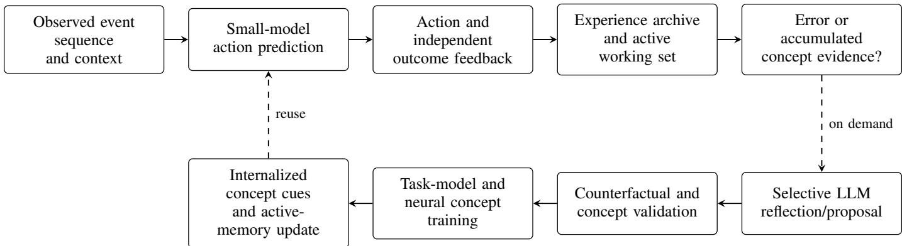
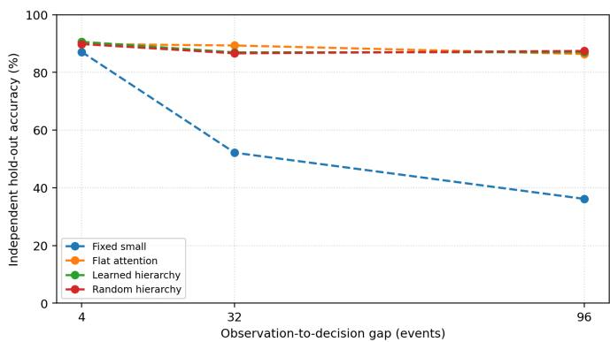
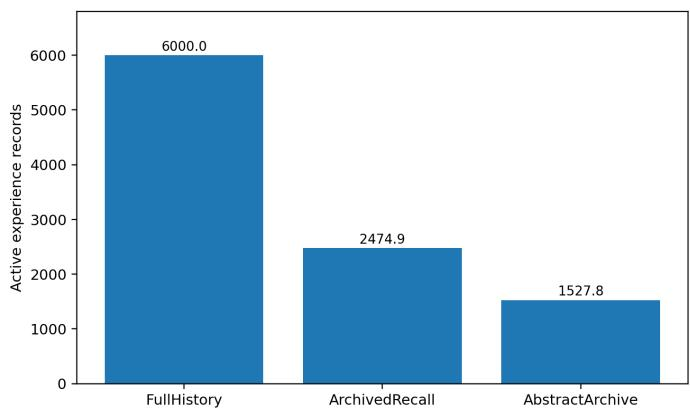
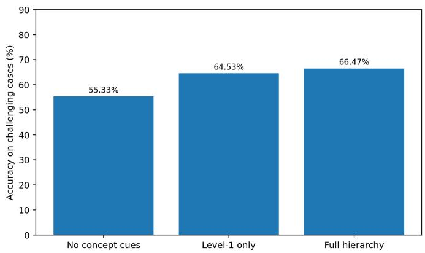

# SCALE: Small-Model-First Concept Abstraction with LLM-Guided Experience Internalization

Hong Su

Abstract—Autonomous agents must continually acquire reusable knowledge from experience without relying on costly large language model (LLM) reasoning for every decision. However, existing experience-based approaches often struggle to transform accumulated observations and reasoning into compact knowledge that lightweight models can independently apply. This paper proposes SCALE, a small-model-first framework that integrates selective LLM reasoning, experience-driven concept abstraction, and knowledge internalization. A lightweight model handles routine predictions, while prediction errors and accumulated cross-episode evidence selectively trigger LLM reflection. The LLM analyzes relevant historical experiences, generates positive and negative counterfactual examples, and proposes reusable concept hypotheses. Independently validated concepts are progressively incorporated into hierarchical neural representations, enabling lightweight models to exploit increasingly abstract knowledge. Meanwhile, mastered experiences are excluded from active memory while their original records remain available in a complete archive. Experiments across ten random seeds show that historical recall improves held-out accuracy from 87.11% to 98.28%, hierarchical concept knowledge increases difficult-case accuracy from 55.33% to 66.47%, and abstract archiving reduces active experience records from 6,000 to 1,528.

Index Terms—Small-Model-First Learning; On-Demand LLM Reasoning; Hierarchical Concept Abstraction; Experience Internalization.

## I. INTRODUCTION

Autonomous agents operating over long periods must make decisions from changing observations while accumulating knowledge that can improve future actions. Large language models (LLMs) provide flexible reasoning over individual situations and can synthesize lessons from experience [1] [2], whereas lightweight models offer a practical means of handling frequent decisions without repeated expensive inference. The central challenge is to combine these complementary capabilities so that experience produces lasting improvements in the agent’s own predictive knowledge, rather than merely providing more information for the next LLM request. This is especially relevant when important evidence is separated by long intervals, new object types share previously unseen conditions, and a continuing agent must retain useful history without allowing its active memory to grow without bound. Recent studies on efficient model selection, reflective agents, and concept-guided prediction establish promising foundations for this goal [3, 4].

However, these research directions do not by themselves provide a complete experience-to-knowledge pathway for a small-model-first agent. Cost-aware routing chooses which model should answer a query, but does not necessarily make the lightweight model more capable after the expensive intervention [3, 5]. Reflection and experience-memory methods can retrieve useful past events or textual insights, yet these insights often remain dependent on future LLM calls instead of becoming lightweight predictive parameters [6, 7]. Conversely, concept-based predictors can make abstract representations operational, but typically assume an available concept vocabulary or concept supervision rather than deriving candidate concepts from the agent’s own temporally dispersed experiences [8, 9]. Continual replay and organized external memory help preserve past information, but retaining or retrieving examples is not equivalent to discovering a shared condition that generalizes across situations [10, 11]. Moreover, an LLM-generated explanation or counterfactual cannot be assumed correct without independent checks. These limitations motivate a framework in which selective reasoning, validated abstraction, small-model learning, and long-term experience management form one continuing process.

In this paper, we propose SCALE (Small-model-first Concept Abstraction with LLM-guided Experience Internalization). Its ordinary decision pathway uses a lightweight task predictor, optionally assisted by concepts that the agent has already learned. The LLM is not required for every observation: an incorrect prediction identified through independent feedback may initiate reasoning about its cause, while accumulated evidence spanning different historical episodes may separately initiate a concept review. The agent retrieves relevant verified experiences, and the LLM proposes an observable explanation and positive/negative counterfactual learning examples. These proposals are admitted for training only after checking their consistency with independent task and event semantics. Thus, SCALE uses expensive reasoning to create reusable training knowledge rather than substituting an LLM answer for every small-model decision.

Beyond individual error-driven learning, SCALE uses retrospective evidence to form hierarchical concepts that can guide later predictions. A candidate concept describes common required and excluded observable conditions, is tested against independent positive and negative cases, and becomes a trainable neural parent only after validation. For example, risk experiences involving sharp glass and stone fragments may support an initial shared concept; later encounters with flexible sharp fragments may motivate a broader hypothesis that does not require rigidity. Such a hypothesis is not accepted simply because the LLM proposes it, nor is a higher abstraction assumed to be more accurate on every task. Accepted concepts supply cues to the small model, making learned abstractions available without repeatedly consulting the LLM. Meanwhile, complete original experiences remain in a cold archive, while redundant mastered cases can leave the active working set. This distinguishes internalizing experience into operational knowledge from merely summarizing or deleting historical records.

The main contributions of this work are summarized as follows:

• Small-model-first learning with selective LLM reasoning. We integrate feedback-triggered learning and evidence-triggered historical reviews into an ordinary lightweight prediction pathway, so successful routine processing does not inherently require LLM inference.

• Experience-driven, independently validated concept abstraction. We allow an LLM to propose shared observable conditions from temporally separated historical experiences and internalize accepted concepts as trainable hierarchical neural representations, rather than treating textual proposals as established knowledge.

• Long-term knowledge reuse with active–cold memory. We combine learned concept cues with selective activeexperience retention and complete archival preservation, and evaluate prediction, concept generalization, and memory costs in complementary simulated agent tasks.

The remainder of this paper is organized as follows. Section II reviews efficient model collaboration, experience-based reflection, and concept and memory learning. Section III presents the SCALE mechanisms. Section IV describes the experimental settings and verifies selective learning, delayedevidence reasoning, concept internalization, and retrospective abstraction. The final section V concludes the paper.

## II. RELATED WORK

## A. Efficient Small–Large Model Collaboration

Large language models offer flexible reasoning but can impose substantial inference cost when called for every observation or action. Prior work on cost-aware inference has consequently explored the allocation of different requests to models of different capabilities. FrugalGPT studies prompt adaptation, model approximation, and cascaded inference, demonstrating that selective access to more expensive language models can substantially reduce cost while maintaining task performance [5]. RouteLLM learns a router from preference data to choose between stronger and weaker language models [3]. These approaches establish an important operational principle: the most capable model need not process every input. Their principal decision, however, concerns which model should answer the current query, rather than what reusable knowledge should be learned from an intervention.

A complementary direction transfers knowledge from a powerful teacher to a compact student. Knowledge distillation replaces an expensive predictor or ensemble with a smaller network trained to reproduce informative teacher outputs [12]. DistilBERT illustrates the utility of this principle for language representations by producing a lighter model through a dedicated distillation procedure [13]. These methods offer efficient deployment and make a strong case for internalizing highcapacity knowledge into smaller parameters. Nevertheless, conventional distillation is usually organized around a prepared teacher–student training process; it does not, by itself, specify how an autonomous agent should retrieve temporally separated experiences, discover a new concept, and decide when the teacher needs to reason again.

SCALE combines these otherwise complementary perspectives without treating them as interchangeable. A lightweight task model is the ordinary decision path; independently observed errors and accumulated cross-episode concept evidence are separate reasons for selective LLM intervention. Instead of simply switching to the LLM’s answer or distilling its unconstrained output, the framework requests causal or conceptual hypotheses, subjects proposed training examples to independent environment validation, and incorporates accepted knowledge into lightweight task and concept networks. The distinction is thus between cost-aware answer selection and selective reasoning that changes the agent’s future smallmodel capabilities. This design does not assume that the LLM invocation rate must decrease monotonically or that model selection alone guarantees reliable knowledge.

## B. Experience-Based Reflection and Reusable Agent Skills

Experience-based LLM agents show how environmental feedback can become a resource for subsequent reasoning. Reflexion converts trial outcomes into verbal reflections stored in episodic memory, improving later attempts without updating the LLM’s weights [4]. ExpeL collects experiences from training tasks, extracts natural-language insights, and recalls both experiences and insights at inference time [6]. Their main advantage is that lessons from failure can be used with closed or otherwise non-trainable foundation models. A limitation for resource-constrained autonomous systems is that the knowledge is primarily consumed through retrieved text and renewed LLM inference, rather than becoming a compact neural decision mechanism that independently predicts routine actions.

More ambitious agents explicitly combine experience, abstraction, and long-horizon behavior. Generative Agents maintain a record of observations, synthesize higher-level reflections, and retrieve memories for planning, which supports coherent behavior across extended interactions [7]. Voyager uses environment feedback and an evolving executable skill library to reuse acquired behavior in an open-ended embodied environment [14]. These studies are particularly relevant because they show that experience need not remain an isolated example: it can be reorganized into reflections or reusable skills. Their representations nevertheless serve different purposes from SCALE’s neural concept cues. A textual reflection or retrieved program can guide an LLM agent, while a learned parent concept is intended to affect the predictions of the lightweight model itself.

A recurring methodological issue is that a plausible reflection is not automatically a valid rule. Summaries can omit boundary conditions, and a generated example can conflict with the environment it purports to describe. SCALE therefore separates LLM proposal from acceptance: error explanations and positive/negative counterfactual cases are checked against independent event semantics before they are used for training; proposed hierarchical concepts require additional held-out validation. Historical recall is used to compare observations separated by distractors or long delays, and evidence can trigger a concept review even in the absence of an immediate action error. This extends experience-based reflection toward validated knowledge acquisition, rather than presenting reflective text alone as evidence that the small model has learned.

## C. Concept Representation, Continual Learning, and Long-Term Memory

Concept-based neural models introduce structured intermediate knowledge between observations and decisions. Concept Bottleneck Models predict human-specified concepts before predicting a task label, making decisions more interpretable and allowing interventions on concept values [8]. Concept Embedding Models learn richer concept-conditioned representations and improve the flexibility of concept-based prediction, including settings with incomplete concept supervision [9]. These approaches provide useful precedents for making concepts computationally actionable rather than merely recording them in natural language. Their standard setting, however, assumes a provided concept vocabulary or some concept supervision. SCALE instead studies how an agent can propose candidate concepts from accumulated episodes and subsequently learn verified concept detectors and parent nodes. The approach remains dependent on observable features and validation; an LLM-generated concept is not accepted merely because it sounds plausible.

Long-term memory research addresses a different, closely related problem: how an agent can retain and access relevant history. MemoryBank uses memory updating and selective reinforcement to maintain personal conversational context over time [15]. HippoRAG organizes knowledge for efficient longrange retrieval with a graph-based approach [16]. More recently, A-Mem dynamically links and reorganizes structured memory notes as new experiences arrive [11]. These methods advance retrieval, organization, and the evolution of external memories; in particular, A-Mem already treats memory organization as an adaptive process. The distinction from SCALE is therefore not that earlier systems lack abstraction or dynamic memory. It is that their memory structures are chiefly consumed through retrieval-based LLM processing, whereas SCALE additionally tests whether validated experience-level relations can become reusable lightweight predictive parameters.

Continual-learning approaches provide another route to persistent knowledge. Gradient Episodic Memory, for example, retains selected past examples and constrains updates to reduce forgetting while learning new tasks [10]. Such methods are valuable for preserving past competence, but replaying examples and learning a shared concept are not equivalent operations: different object classes may support one abstract action condition, and a collection of correct predictions need not identify that condition explicitly. SCALE keeps a complete cold archive while selecting a smaller active working set; abstract concepts can represent repeated experience patterns, and the archive remains available for later retrieval. This design does not imply that compression always improves wallclock lookup latency or that concept generalization is errorfree.

Taken together, existing studies establish the benefits of economical inference, reflective experience reuse, concept-guided neural prediction, and adaptive memory. SCALE focuses on their intersection: small-model- first operation, on-demand LLM reasoning over historical evidence, independently validated hierarchical concept formation, and internalization into lightweight predictors with active–cold experience management. The experimental question is whether these mechanisms yield useful knowledge and reduced active-memory requirements, rather than whether every newly introduced concept layer must immediately outperform its predecessor on every metric.

## III. SMALL-MODEL-FIRST CONCEPT ABSTRACTION AND LLM-GUIDED EXPERIENCE INTERNALIZATION - THE SCALE MODEL

We propose SCALE (Small-model-first Concept Abstraction with LLM-guided Experience Internalization), a continuing learning framework in which the small model handles ordinary decisions and a large language model (LLM) is invoked selectively to reason about failures or accumulated evidence that may reveal reusable knowledge. Unlike an agent that repeatedly queries an LLM for each action, SCALE seeks to transfer the useful results of expensive reasoning into lightweight predictors. Unlike a method that stores every experience in its active context, SCALE also uses learned concepts to retain representative experiences actively while preserving all original records in an archive.

The model connects four functions: (i) small-model-first action prediction, (ii) feedback- and evidence-triggered LLM reflection, (iii) independently validated hierarchical concept formation, and (iv) concept internalization and active–cold memory management. A concept may progress from a relation among several concrete experiences to a more general relation supported by later observations. The emergence of a higherlevel concept is treated as knowledge-structure growth, not as a guarantee that every higher-level classifier must outperform its lower-level counterpart. Figure 1 illustrates the overall interaction.

## A. Small-Model-First Prediction and Experience Recording

At interaction step �, the agent receives an observable situation ${ \boldsymbol { s } } _ { t } ~ = ~ \left( { \boldsymbol { x } } _ { t , 1 : L _ { t } } , { \boldsymbol { z } } _ { t } \right)$ , where $x _ { t , 1 : L _ { t } }$ is an ordered event sequence and $z _ { t }$ contains available context or sensor features. Informative events and the eventual decision may be separated by distracting observations. The agent must select an action from A before the correct action is known. Its independently assessed outcome $a _ { t } ^ { * }$ becomes available only after the decision. We store an experience as $\boldsymbol { e } _ { t } ~ = ~ \left( s _ { t } , \hat { a } _ { t } , a _ { t } ^ { * } , q _ { t } \right)$ , where $q _ { t }$ denotes the predictor’s confidence or score summary. Historical records may also contain a short reasoning summary if an LLM intervention occurred; simulator-internal causes and future evaluation labels are never used as routine predictor inputs.

  
Fig. 1. Overview of SCALE. Every interaction is processed by the small model and subsequently recorded with independent feedback. Only selected errors or accumulated concept evidence activate the LLM. Candidate examples and concepts are validated before their effects are internalized into the small model; complete historical records remain available in cold storage.

The small task model $f _ { \theta }$ yields base logits $b _ { t }$ from the current situation. An optional concept network $h _ { \phi }$ produces learned cues $c _ { t } = h _ { \phi } ( s _ { t } ; G _ { t } )$ from an evolving concept graph $\mathcal { G } _ { t }$ . The task-model adapter $r _ { \theta }$ then combines both sources:

$$
\begin{array} { l } { b _ { t } = f _ { \theta } ( s _ { t } ) , \qquad p _ { t } ^ { 0 } = \mathrm { s o f t m a x } ( b _ { t } ) , } \\ { \ell _ { t } = b _ { t } + r _ { \theta } ( c _ { t } , p _ { t } ^ { 0 } ) - r _ { \theta } ( \mathbf { 0 } , p _ { t } ^ { 0 } ) , } \\ { \hat { a } _ { t } = \arg \underset { a \in \mathcal { A } } { \operatorname* { m a x } } [ \ell _ { t } ] _ { a } . } \end{array}\tag{1}
$$

The subtraction ensures that a zero cue vector leaves the base prediction unchanged. Therefore, before any concept has been accepted, the ordinary small-model pathway is still usable. Concept scores subsequently influence that pathway instead of replacing action prediction with an LLM response. The evaluated implementation uses a bidirectional GRU with temporal attention for $f _ { \theta }$ and a trainable cue-conditioned residual adapter; SCALE’s small-model-first principle does not require this particular network architecture.

## B. On-Demand LLM Reflection and Verified Learning

SCALE distinguishes two reasons to request LLM reasoning. First, when independent feedback reveals a wrong prediction $( \hat { a } _ { t } \neq a _ { t } ^ { * } )$ , the agent may ask the LLM to identify an observable cause and produce contrastive learning material. Second, a review may be initiated when the archive accumulates potentially shared positive and negative evidence across distinct situations, even if the latest action was not wrong. The latter path allows concept formation to arise from accumulated experience rather than requiring a task failure at the exact moment of abstraction. Both types of intervention are subject to finite budgets; a routine successful prediction does not inherently require an LLM call. The current experimental implementation evaluates feedback-driven repair and evidencedriven reviews, but does not establish a general uncertaintyonly trigger.

For error-driven reflection, the agent supplies the LLM with the observed sequence, the small-model decision, the independent feedback, and selected previously verified experiences. When enabled, retrieval searches the complete historical archive so that evidence separated by long time intervals can still be compared. The LLM proposes an explanatory factor, positive examples in which it is active, and negative examples that isolate its absence or a corrective condition. These outputs are hypotheses, not additional ground-truth labels. Let $\widetilde { \mathcal { D } } _ { t }$ be the proposed examples and � an independent consistency checker. The usable training set is restricted to

$$
{ \mathcal { D } } _ { t } ^ { \mathrm { v a l i d } } = \{ d \in { \widetilde { \mathcal { D } } } _ { t } \ | \ V ( d ) = 1 \} .\tag{2}
$$

The checker evaluates both positive and negative examples against the environment’s event semantics and rejects contradictory or unsupported labels. A response cannot train the model merely because the LLM returned syntactically valid text. When accepted training examples and learned cues are present, the task model is optimized using

$$
\mathcal { L } _ { \mathrm { t a s k } } = \frac { \mathrm { C E } ( \ell , a ^ { * } ) + \lambda \mathrm { C E } ( b , a ^ { * } ) } { 1 + \lambda } ,\tag{3}
$$

where CE denotes cross-entropy and $\lambda \geq 0$ weights the base prediction objective. The auxiliary base loss maintains a useful non-concept decision path; ordinary supervised learning is used in the absence of accepted concept cues. Consequently, the computationally expensive reasoning is converted into parameter updates that can be reused without rerunning the same LLM analysis for each subsequent observation.

## C. Experience-Driven Hierarchical Concept Formation

Repairing individual errors is not sufficient to create reusable knowledge: the system must also recognize conditions shared by episodes that originally appear unrelated. Consider a simulated agent that learns risk from contact with sharp glass and stone fragments. Their observed co-occurrence of sharp edges and likely contact may motivate a concept that applies across object types. Later experience with a flexible sharp fragment can motivate a broader hypothesis in which material rigidity is no longer required. Smooth edges, protected contact, and avoided contact are important negative cases. This example illustrates concept formation and extension, not an assumption that every generalized hypothesis is necessarily correct.

During a concept review, the LLM receives historical training-only examples with their observed event sequences and outcome feedback, together with any previously accepted concept signature. It proposes a named concept, a short mechanism explanation, references to actual historical cases, candidate necessary and excluded properties, and possible falsification cases. Let $O ( s )$ denote the observable property representation extracted from the situation, and let $P _ { C }$ and $N _ { C }$ denote respectively the required and excluded properties of a candidate concept �. Its interpretable signature is

$$
I _ { C } ( s ) = \mathbb { I } [ P _ { C } \subseteq O ( s ) ] \mathbb { I } [ N _ { C } \cap O ( s ) = \emptyset ] .\tag{4}
$$

The signature is restricted to the supplied observable-feature vocabulary; concrete object identities may identify source experiences but are not valid concept conditions. Importantly, $I _ { C }$ is a proposed explanatory condition, not a replacement for evaluating temporal order and action outcomes. The eventsequence model remains responsible for those temporal relationships.

A proposed signature is not immediately deployed. The evidence is separated into historical training and independent concept-validation portions, with positive and negative examples covering relevant categories and boundary cases. Candidate concepts are screened using discrimination criteria such as F1 and false-positive rate, sufficient distinct evidence patterns, and, for adaptive evidence reviews, conservative bounds on class-conditional reliability. A neural parent detector must also pass held-out validation. Unsuccessful proposals remain unaccepted; final hold-out and transfer cases are excluded from concept proposal, training, and acceptance. Thus the LLM proposes a generalization, while independent evidence and a learned small-model representation determine whether it becomes operational.

An accepted concept is added to a graph $\mathcal { G } _ { t }$ containing neural leaf detectors and trainable parent detectors. Let $u _ { i } ( s )$ be a learned leaf activation for factor �, and let $\nu _ { j } ( s )$ be a parent activation. For a leaf with immediate parent � (�), the hierarchy can provide the gated activation

$$
\widetilde { u } _ { i } ( s ) = u _ { i } ( s ) \nu _ { j ( i ) } ( s ) \prod _ { k \in \operatorname { A n c } ( j ( i ) ) } \nu _ { k } ( s ) ,\tag{5}
$$

where $\mathrm { A n c } ( j ( i ) )$ denotes accepted higher ancestors. Parent thresholds also permit conditional evaluation of child detectors, and parent-level action cues can be supplied directly to the task adapter in $\operatorname { E q . }$ (1). A newly learned parent need not erase an older parent: a later accepted higher-level concept can coexist with the earlier representation and provide another route to reusable action knowledge. In this sense, hierarchical abstraction is more than storing a list of related episodes, because the parent itself is trained on verified contrastive examples and is available at inference time.

## D. Knowledge Internalization and Active–Cold Memory

SCALE internalizes a validated concept in two complementary forms. Its interpretable signature and historical evidence references remain inspectable, while trainable concept detectors and the small-model adapter learn how the concept influences future predictions. This distinction is important: merely receiving a plausible LLM explanation does not mean that the small model has learned it. The learned cue must survive independent validation and be useful as part of subsequent lightweight inference.

For long-term operation, the model maintains a complete archive $\bar { \mathcal { M } } _ { t } ^ { \mathrm { a r c h i v e } }$ and an active experience set $\begin{array} { r l } { M _ { t } ^ { \mathrm { a c t i v e } } } & { { } \subseteq } \end{array}$ $\boldsymbol { \mathscr { M } } _ { t } ^ { \mathrm { a r c h i v e } }$ . Every completed interaction is preserved, including incorrect decisions and counterexamples. Repeated confidently mastered cases may be retired from the active set; after a concept has been validated, additional redundant cases matching the learned conditions can also be made inactive. However, representative positive examples, informative errors, and negative boundary cases are retained to avoid making the working set consist only of easy positives. Retired experiences are not deleted: retrieval can access the complete archive and temporarily reactivate relevant cold records when future learning or reasoning needs them.

The representation used for memory abstraction need not be identical in every experiment. A feedback-mined, singletier concept predicate can supply useful cues and support active-memory reduction, whereas the integrated SCALE configuration additionally evaluates LLM-proposed signatures and neural parent concepts. This distinction prevents memory compression from being attributed to an LLM-produced hierarchy where that hierarchy was not actually used. Memory efficiency is characterized by the active-record count, effective active storage, and retrieval-candidate count; these are reported separately from measured wall-clock retrieval latency, because reducing active storage does not by itself guarantee faster search.

Overall, SCALE establishes an experience-to-knowledge path: the small model acts first; feedback enriches the permanent historical archive; selected errors or cross-experience evidence call for deeper LLM reasoning; independently validated examples and concepts are learned by small models; and mastered experiences can move from active memory to cold storage. Section IV evaluates these elements through selective error learning, delayed-evidence attention, conceptbased memory reduction, and LLM-guided hierarchical concept formation. The goal is autonomous growth of reusable small-model knowledge, rather than continuous reliance on LLM predictions or the requirement that each newly formed abstraction immediately improve every evaluation metric.

## IV. VERIFICATION

## A. Experimental Environment and Evaluation Protocol

Objectives and simulated scenarios. We evaluate a smallmodel-first autonomous learning system in which a compact predictor acts on routine observations, while an LLM is selectively invoked to investigate errors and synthesize experiencebased abstractions. The goal is not to make every newly formed higher-level concept immediately more accurate than its lower-level components. Instead, we ask whether the system can learn from feedback, recall temporally separated evidence, form and validate reusable concepts, internalize them into neural predictors, and manage accumulated experiences more economically.

The environment is a symbolic, event-based robot-agent simulation, not a physical-robot or raw-image recognition experiment. Every example contains ordered observations, an action decision, and independent outcome feedback. The simulator covers (i) contact safety, (ii) low-friction grasp adjustment, and (iii) uncertain visual observation. In the safety scenario, a sharp glass or stone fragment may require AVOID\_SHARP\_CONTACT when contact is likely, whereas smooth edges, avoided contact, or protective gear are negative/boundary cases. Ceramic and metal fragments are reserved for transfer. In the grasp scenario, a wet cup or polished box with low friction and a planned grasp may require ADJUST\_GRIP; high-friction objects and unplanned grasps provide negatives, while oily bottles and smooth cans are unseen subtypes. In the perception scenario, glare and shadows can justify REOBSERVE when a visual decision is necessary; adequate contrast or a nonvisual task does not. Fogged and backlit scenes serve as unseen subtypes. Some observations and their consequences are separated by distracting events, so the correct response need not be recoverable from the final event alone. These scenarios measure whether concepts capture combinations of properties rather than merely object names. The environment oracle produces independent feedback and validates proposed counterfactuals, but is never used as a predictor input.

Methods and configurations. The default task predictor is a bidirectional gated recurrent neural network (GRU) with a trainable concept-cue adapter. Candidate attention and parent concept models are neural, with a Transformer-style attention mechanism. A live DeepSeek-compatible LLM is invoked when the configured error or concept-evidence policy requests additional thinking; it is not used for every routine prediction. A candidate LLM proposal specifies observable necessary/absent conditions, historical evidence references, and possible positive/negative tests. Generated learning materials must agree with an independent environment validator, and a proposed parent becomes deployable only after held-out neural validation.

The Formal evaluation comprises 10 seeds, using 320 initial training examples, 96 validation examples, 360 online events, and 180 hold-out instances in the task experiments. Exp. 2 uses observation–decision gaps of 4, 32, and 96 intervening events. Exp. 3 uses 6000 historical experiences, with the initial 0.55 fraction devoted to known subtypes; later online blocks vary new-subtype proportions. Exp. 4 uses gap 96, introducing a flexible sharp polymer fragment only after initial glass/stone evidence; independent ceramic/metal and difficult negative combinations are not used to train or accept the concept. A separate final concept probe contains 150 challenging samples per seed, with standard cases excluded. Memory timing is evaluated on 4000 episodes using identical frozen weights and observations.

The task\_matched setting equalizes the task-model update protocol but allows extra neural attention/concept optimizer steps and LLM calls. We therefore report optimizer steps, logical requests, actual HTTP attempts, and storage/timing separately. All reported averages use independent seeds as the unit of replication. Accuracy is the fraction of correct action decisions; transfer accuracy measures independently constructed unseen subclasses and condition combinations. Macro-F1 measures class-balanced performance where relevant. Concept depth and verified concept count quantify representation growth; active memory includes routinely accessible history, whereas the full cold archive remains available. Effective active bytes account for record/index data plus shared learned weights, not process RSS. Retrieval P50/P95 denote measured latency percentiles. The paired confidence intervals are Student-� intervals on the ten seed-level differences at 95% confidence.

TABLE I  
EXP. 1: INDEPENDENT ACTION ACCURACY AND LOGICAL LLM CALLS, MEANS OVER TEN SEEDS.
<table><tr><td>Method</td><td>Hold-out (%)</td><td>Transfer (%)</td><td>LLM calls</td></tr><tr><td>FixedSmallModel</td><td>87.11</td><td>84.67</td><td>0.0</td></tr><tr><td>ContinualReplay</td><td>95.39</td><td>96.28</td><td>0.0</td></tr><tr><td>OursRepairOnly</td><td>97.39</td><td>96.28</td><td>14.8</td></tr><tr><td>OursRepairWithRecall</td><td>98.28</td><td>96.50</td><td>13.0</td></tr><tr><td>OursFlatAttention</td><td>97.17</td><td>96.89</td><td>13.5</td></tr></table>

## B. Exp. 1: Selective Reasoning and Experience Reuse

The initial hypothesis is that errors can drive selective LLM reasoning and small-model retraining, without forwarding every ordinary input to an LLM. The simulation presents a sequence of object/contact, grasp, and visual conditions. The small model predicts first and receives independent feedback; incorrect outcomes can trigger reasoning and verified counterfactual material. FixedSmallModel is the unadapted predictor; ContinualReplay performs ordinary experience replay without LLM; OursRepairOnly reasons about the current error; OursRepairWithRecall additionally consults related verified history; and OursFlatAttention learns flat condition attention.

Table I shows that recalling past experiences yields 98.28% hold-out accuracy versus 95.39% with continual replay and 87.11% with the fixed model. The 2.89-percentage-point gain over replay has a paired interval entirely above zero (Table VIII). Recall improves current-error-only repair from 97.39% to 98.28%, but the smaller paired difference has an interval crossing zero. These results support selective LLMassisted learning and show a benefit of retained experience in this setting; they do not prove that the intervention rate decreases autonomously as knowledge grows, since the policy also imposes an invocation budget.

## C. Exp. 2: Learning with Long Delays and Distractors

Here we ask whether the predictor can associate an early observation with a later consequence. We construct otherwise comparable event sequences with gaps of 4, 32, and 96; irrelevant events intervene between the informative condition and the decision. A fixed small model, flat learned attention, learned hierarchical attention, and a random hierarchy are compared using independent hold-out episodes. The random hierarchy tests whether merely organizing detectors in a tree is enough, rather than learning meaningful parent structure.

TABLE II  
EXP. 2: HOLD-OUT ACTION ACCURACY (%) AT THREE DELAYED-EVIDENCE GAPS.
<table><tr><td>Method</td><td>Gap 4</td><td>Gap 32</td><td>Gap 96</td></tr><tr><td>FixedSmallModel</td><td>87.11</td><td>52.17</td><td>36.17</td></tr><tr><td>FlatAttention</td><td>89.83</td><td>89.33</td><td>86.39</td></tr><tr><td>HierarchicalAttention</td><td>90.61</td><td>86.94</td><td>87.00</td></tr><tr><td>RandomHierarchy</td><td>89.83</td><td>86.61</td><td>87.44</td></tr></table>

  
Fig. 2. Exp. 2 delay sensitivity. All line plots use dashed strokes; points reproduce Table II.

As Table II and Fig. 2 show, fixed-model accuracy falls from 87.11% at gap 4 to 36.17% at gap 96, whereas learned hierarchical attention retains 87.00%. This supports learning from delayed evidence. However, the learned hierarchy reaches 86.94% at gap 32, below the flat method’s 89.33%, and the random hierarchy marginally exceeds the learned hierarchy at gap 96 (87.44% against 87.00%). Hierarchical structure is therefore feasible, but its independent accuracy advantage over flat or random organization is not universal.

## D. Exp. 3: Internalized Concepts and Active-Memory Reduction

When similar decisions repeat over a long lifetime, an agent should be able to use the learned common-condition relation without keeping every training example in active memory. After known-subclass warm-up, the simulator introduces newsubclass fractions of 0%, 25%, 50%, and 75% in successive online blocks. The first frozen transfer probe precedes all feedback on the new categories; later blocks permit online adaptation and are not zero-shot tests. Protected contact, smooth edges, high friction, and unnecessary reobservation make negative decisions nontrivial. We compare FullHistory (all records active), OursArchivedRecall (cold archival and selective recall without concept compression), and OursAbstractArchive (train common-condition cues, internalize them, remove redundant mastered items from active storage, and retain the original archive). An active-only policy and archive-without-recall are additional information-retention controls, but not all are needed in the representative table.

TABLE III  
EXP. 3: INDEPENDENT TASK PERFORMANCE AND ACTIVE-MEMORY FOOTPRINT. MB IS DECIMAL MB; ORIGINAL ARCHIVES REMAIN COMPLETE FOR THESE METHODS.
<table><tr><td>Method</td><td>Active records</td><td>Archive</td><td>Active MB</td><td>Hold-out (%)</td></tr><tr><td>FullHistory</td><td>6000.0</td><td>6000</td><td>8.965</td><td>91.89</td></tr><tr><td>OursArchivedRecall</td><td>2474.9</td><td>6000</td><td>5.044</td><td>93.72</td></tr><tr><td>OursAbstractArchive</td><td>1527.8</td><td>6000</td><td>3.975</td><td>94.83</td></tr></table>

  
Fig. 3. Exp. 3 active episode counts computed from the ten raw per-seed records. Cold archived episodes are retained.

Table III and Fig. 3 show that abstraction keeps 1527.8 routinely active records instead of 6000.0 (a 74.5% reduction), with 3.975 rather than 8.965 MB of effective active memory. Independent hold-out accuracy increases from 91.89% to 94.83%, an improvement of 2.94 percentage points, while all 6000 original experiences remain archived. Relative to archived recall, the active subset is 38.3% smaller. The very high frozen novel-subclass transfer values (100.00% for the abstract method versus 99.94% for full history) indicate that this particular benchmark is near saturation.

The more difficult probe (Table IV) raises the measured challenging accuracy from 35.33% without a learned concept cue to 42.53% with one, but its hazard false-positive rate also rises from 60.43% to 70.97%. Thus learning generalized knowledge can broaden coverage while leaving imperfect boundaries. This is reported as a limitation, without making future concept self-correction an additional experimental contribution.

## E. Exp. 4: Retrospective LLM Concept Formation

Exp. 4 asks whether the LLM can propose a genuinely revised common observable condition by reconsidering several past experiences, rather than the program simply counting shared attributes. Sharp glass and stone cases are encountered first; a later flexible sharp polymer subclass supplies evidence that material rigidity may not be a necessary condition of risk. Ceramic, metal, and difficult condition combinations remain independent test cases. The trained model is also evaluated on long-gap, object-switch, state-reversal, sensor-conflict, partialevidence, and contact-boundary negative episodes. Only proposed concepts that pass independent positive/negative and held-out validation become neural parent nodes. Suggested falsification descriptions are retained as hypotheses, not represented as executed physical experiments.

TABLE IV  
EXP. 3: SEPARATE CHALLENGING FROZEN-MODEL CONCEPT PROBE, SHOWING BOTH USEFUL CUES AND DIFFICULT NEGATIVE BOUNDARIES.
<table><tr><td>Cue mode</td><td>Challenging accuracy (%)</td><td>Hazard FPR (%)</td></tr><tr><td>No concept cue</td><td>35.33</td><td>60.43</td></tr><tr><td>Internalized concept cue</td><td>42.53</td><td>70.97</td></tr></table>

OursFull combines small-model-first error repair, historical recall, adaptive evidence review, LLM-proposed semantic concept signatures, independent validation, and neural internalization. With the same broad evidence mechanism, OursRuleMiningAdaptive proposes signatures through programmed attribute mining rather than LLM reasoning. OursFixedEvidence uses a fixed evidence schedule; OursNoRecall omits historical recall, and OursFullHistoryContext retains a much larger active history. OursHierarchicalAttention offers neural hierarchy without the complete memory mechanism; OursRepairWithRecall uses error-driven reasoning and history but no abstract neural parent induction.

A traceable LLM abstraction case. In seed 9, the verified hazard concept at episode 119 contains required properties RIGID\_FRAGMENT, SHARP\_EDGE, and CONTACT\_LIKELY. A later verified proposal at episode 224 removes the rigid-fragment requirement while retaining sharpness and contact likelihood; it excludes protective gear, contact avoidance, and smooth edges. The original recorded proposals explicitly link the latter signature to the earlier one. Thus a live LLM proposed a semantically more general condition and the learned parent passed the existing independent validation protocol. This is evidence of hypothesis formation in the predefined observable feature space, not discovery of new latent physical properties from raw pixels.

Table V reports 2.2 verified OursFull concepts per run (total 22), with second-level abstraction reached by 8 of the ten seeds. OursFull obtains 89.22% routine hold-out accuracy versus 91.11% for rule mining, a -1.89-point difference (Table VIII). The sign of this difference is negative: forming LLM-generated abstractions does not automatically imply higher routine classification accuracy. The new-category transfer accuracies (99.00% and 98.44%, respectively) are near saturation and should not replace independent difficult probes.

Testing use of internalized concepts. With task weights frozen, we switch between disabled concept cues, first-level cues, and the full learned hierarchy on the same 150 difficult nonstandard episodes per seed. This is a within-model intervention; the rule-mining and other method comparisons use their separately trained models but the same evaluation construction.

As Table VI and Fig. 4 show, internalized concept cues increase challenging accuracy from 55.33% without cues to 66.47% with the full hierarchy, a gain of 11.13 points. The 1.93-point gain from first to full hierarchy is small and its paired confidence interval includes zero. OursFull reaches 66.47% on the same challenging subset, versus 62.27% for rule mining, but its 4.20-point difference is not stable across seeds. These outcomes demonstrate that learned abstract cues participate in prediction while avoiding the stronger, unsupported claim that LLM abstraction wins every accuracy comparison.

  
Fig. 4. Exp. 4: frozen OursFull task-model accuracy on challenging cases, comparing no concept cues, first-level cues, and full learned hierarchy (first three rows of Table VI).

## F. Resource Costs, Statistical Comparisons, and Scope

Matched frozen-memory benchmark. We replay 4000 historical events under identical input sequences and identical frozen neural weights. The control and full method differ in active-memory management, not in the learned predictor. All original episodes remain in the archive, and retrieval latencies are measured rather than inferred from the number of candidates examined.

Table VII shows that OursFull decreases the active subset by 9.3%, effective active memory by 5.3%, and examined candidates by 9.4%. The median measured retrieval time, however, rises from 1.0668 to 1.1192 ms (a 4.9% increase), and the P95 decreases by only 2.0%. Hence the evidence supports smaller active memory and candidate lists, not a general retrieval-latency speedup.

LLM requests and statistical uncertainty. OursFull issues 145 logical task-error diagnosis requests and 111 logical history/concept requests across all completed runs, for 256 logical requests and 336 HTTP attempts including validation retries. This corresponds to 25.6 logical requests per 360-event run, or 7.11 requests per 100 task events when normalized by the total event count; this is not a percentage of unique events that triggered LLM calls. The number of requests is affected by configured budgets and past schema retries.

Evidence limits. The four experiments substantiate selective reasoning, measurable small-model learning, memory abstraction, and verified hierarchical concept formation, but do not demonstrate open-ended concept invention from raw imagery or physical-robot interaction. The task-matched budget is not equal total computation, and the trained learned hierarchy does not outperform flat or random controls consistently. The archived experiences are not destroyed; memory reduction is the size of the active working subset. Some concept generalizations produce false positives. Finally, an LLM-output schema compatibility correction was applied during checkpoint recovery; the completed cohort is usable for mechanism analysis, but a strictly uniform LLM-prompt protocol is advisable when interpreting fine-grained request-cost differences in subsequent reproductions.

TABLE V  
EXP. 4 INDEPENDENT ACTION RESULTS: TEN-SEED MEANS. ADDITIONAL OPTIMIZER STEPS FOR CONCEPT/ATTENTION TRAINING ARE INCLUDED.
<table><tr><td>Method</td><td>Hold-out (%)</td><td>Novel transfer (%)</td><td>Verified parents</td><td>Mean max. depth</td><td>Optimizer steps</td></tr><tr><td>OursFull</td><td>89.22</td><td>99.00</td><td>2.2</td><td>1.8</td><td>1859.2</td></tr><tr><td>RuleMiningAdaptive</td><td>91.11</td><td>98.44</td><td>2.9</td><td>1.7</td><td>1873.6</td></tr><tr><td>FixedEvidence</td><td>86.00</td><td>97.56</td><td>3.6</td><td>1.9</td><td>1931.2</td></tr><tr><td>HierarchicalAttention</td><td>90.67</td><td>96.56</td><td>1.8</td><td>1.7</td><td>1644.0</td></tr><tr><td>NoRecall</td><td>90.78</td><td>96.94</td><td>0.4</td><td>0.4</td><td>1597.6</td></tr><tr><td>FullHistoryContext</td><td>90.17</td><td>99.06</td><td>1.0</td><td>0.9</td><td>1608.0</td></tr><tr><td>RepairWithRecall</td><td>88.11</td><td>98.17</td><td>一</td><td></td><td>800.0</td></tr><tr><td>ContinualReplay</td><td>84.22</td><td>98.17</td><td>一</td><td></td><td>1107.2</td></tr></table>

TABLE VI

EXP. 4 INDEPENDENT CHALLENGING-PROBE ACCURACY. THE FIRST THREE ROWS SHARE IDENTICAL FROZEN OURSFULL WEIGHTS; OTHER ROWS ARE DIFFERENT TRAINED METHODS.
<table><tr><td>Method / inference setting</td><td>Accuracy (%)</td></tr><tr><td>OursFull, no concept cues OursFull, level-1 only</td><td>55.33 64.53</td></tr><tr><td>OursFull, full hierarchy</td><td>66.47</td></tr><tr><td>RuleMiningAdaptive, full hierarchy</td><td>62.27</td></tr><tr><td>FixedEvidence, full hierarchy</td><td>63.40</td></tr><tr><td>HierarchicalAttention, full hierarchy</td><td>60.47</td></tr></table>

TABLE VII

EXP. 4 PAIRED ACTIVE-MEMORY EVALUATION, TEN SEEDS. EQUAL FROZEN ACCURACY IS AN EXPERIMENTAL CONTROL, NOT A LONGITUDINAL LEARNING RESULT.
<table><tr><td>Metric</td><td>Hierarchy control</td><td>OursFull</td></tr><tr><td>Active records</td><td>3813.8</td><td>3459.9</td></tr><tr><td>Effective active MB</td><td>9.143</td><td>8.658</td></tr><tr><td>Examined active records</td><td>1961.8</td><td>1777.3</td></tr><tr><td>Retrieval P50 (ms)</td><td>1.0668</td><td>1.1192</td></tr><tr><td>Retrieval P95 (ms)</td><td>2.1168</td><td>2.0753</td></tr><tr><td>Frozen accuracy (%)</td><td>86.34</td><td>86.34</td></tr></table>

## V. CONCLUSION

This paper presented SCALE, a small-model-first framework that selectively uses large language model (LLM) reasoning to transform accumulated experiences into reusable lightweight knowledge. Routine decisions are handled by a small predictor, while verified errors and evidence distributed across historical episodes trigger reflection, counterfactual example generation, and concept proposals. Independently validated concepts are internalized as hierarchical neural representations, and redundant mastered experiences are removed from active memory without discarding their original records. Across ten random seeds, historical recall increased held-out accuracy from 95.39% for continual replay to 98.28%, while learned concept cues improved accuracy on challenging cases from 55.33% to 66.47%. Abstract archiving reduced active experience records from 6,000 to 1,528. These results support experience-driven knowledge formation and more compact active memory, although LLM-guided abstraction did not consistently outperform rule-based concept mining and smaller active memory did not guarantee faster retrieval.

## REFERENCES

[1] H. Naveed, A. U. Khan, S. Qiu, M. Saqib, S. Anwar, M. Usman, N. Akhtar, N. Barnes, and A. Mian, “A comprehensive overview of large language models,” ACM Transactions on Intelligent Systems and Technology, vol. 16, no. 5, pp. 1–72, 2025.

[2] W. X. Zhao, K. Zhou, J. Li, T. Tang, Z. Dong, Y. Hou, B. Zhang, Y. Min, J. Zhang, P. Liu et al., “A survey of large language models,” Frontiers of Computer Science, vol. 20, no. 12, p. 2012627, 2026.

[3] I. Ong, A. Almahairi, V. Wu, W.-L. Chiang, T. Wu, J. E. Gonzalez, M. Kadous, and I. Stoica, “Routellm: Learning to route llms from preference data,” in International Conference on Learning Representations, vol. 2025, 2025, pp. 34 433–34 448.

[4] N. Shinn, F. Cassano, A. Gopinath, K. Narasimhan, and S. Yao, “Reflexion: Language agents with verbal reinforcement learning,” Advances in neural information processing systems, vol. 36, pp. 8634–8652, 2023.

[5] Q. Xin, “Hybrid cloud architecture for efficient and costeffective large language model deployment,” Journal of Information Systems and Informatics, vol. 7, no. 3, pp. 2182–2195, 2025.

[6] A. Zhao, D. Huang, Q. Xu, M. Lin, Y.-J. Liu, and G. Huang, “Expel: Llm agents are experiential learners,” in Proceedings of the AAAI Conference on Artificial Intelligence, vol. 38, no. 17, 2024, pp. 19 632–19 642.

[7] J. S. Park, Generative Agent Simulations of Human Behavior. Stanford University, 2025.

[8] P. W. Koh, T. Nguyen, Y. S. Tang, S. Mussmann, E. Pierson, B. Kim, and P. Liang, “Concept bottleneck models,”

TABLE VIII  
TEN-SEED PAIRED MEAN ACCURACY DIFFERENCES AND 95% STUDENT-� CONFIDENCE INTERVALS, COMPUTED FROM ORIGINAL RAW PER-SEED MEASUREMENTS. UNITS ARE PERCENTAGE POINTS.
<table><tr><td>First minus second</td><td>Mean difference</td><td>Lower CI</td><td>Upper CI</td></tr><tr><td>Exp. 1: RepairWithRecall – ContinualReplay</td><td>2.89</td><td>1.92</td><td>3.86</td></tr><tr><td>Exp. 1: RepairWithRecall – RepairOnly</td><td>0.89</td><td>-0.86</td><td>2.64</td></tr><tr><td>Exp. 3: AbstractArchive – FullHistory</td><td>2.94</td><td>1.59</td><td>4.30</td></tr><tr><td>Exp. 4: OursFull – RuleMiningAdaptive (hold-out)</td><td>-1.89</td><td>-3.64</td><td>-0.14</td></tr><tr><td>Exp. 4: OursFull – RuleMiningAdaptive (challenging)</td><td>4.20</td><td>-5.86</td><td>14.26</td></tr><tr><td>Exp. 4: OursFull full hierarchy – level 1 (same model)</td><td>1.93</td><td>-1.07</td><td>4.94</td></tr></table>

in Proceedings of the 37th International Conference on Machine Learning, ser. Proceedings of Machine Learning Research, H. D. III and A. Singh, Eds., vol. 119. PMLR, 13–18 Jul 2020, pp. 5338–5348.

[9] M. Espinosa Zarlenga, P. Barbiero, G. Ciravegna, G. Marra, F. Giannini, M. Diligenti, Z. Shams, F. Precioso, S. Melacci, A. Weller et al., “Concept embedding models: Beyond the accuracy-explainability tradeoff,” Advances in neural information processing systems, vol. 35, pp. 21 400–21 413, 2022.

[10] D. Lopez-Paz and M. Ranzato, “Gradient episodic memory for continual learning,” Advances in neural information processing systems, vol. 30, 2017.

[11] W. Xu, Z. Liang, K. Mei, H. Gao, J. Tan, and Y. Zhang, “A-mem: Agentic memory for llm agents,” Advances in Neural Information Processing Systems, vol. 38, pp. 17 577–17 604, 2026.

[12] Y. Yan, S. Qian, Q. Zhao, and X. Zhang, “Distilling the knowledge with quantum neural networks,” arXiv preprint arXiv:2603.21586, 2026.

[13] V. Sanh, L. Debut, J. Chaumond, and T. Wolf, “Distilbert, a distilled version of bert: smaller, faster, cheaper and lighter,” arXiv preprint arXiv:1910.01108, 2019.

[14] G. Wang, Y. Xie, Y. Jiang, A. Mandlekar, C. Xiao, Y. Zhu, L. Fan, and A. Anandkumar, “Voyager: An openended embodied agent with large language models,” arXiv preprint arXiv:2305.16291, 2023.

[15] W. Zhong, L. Guo, Q. Gao, H. Ye, and Y. Wang, “Memorybank: Enhancing large language models with longterm memory,” in Proceedings ofthe AAAI conference on artificial intelligence, vol. 38, no. 17, 2024, pp. 19 724– 19 731.

[16] B. J. Gutiérrez, Y. Shu, Y. Gu, M. Yasunaga, and Y. Su, “Hipporag: Neurobiologically inspired long-term memory for large language models,” Advances in neural information processing systems, vol. 37, pp. 59 532– 59 569, 2024.

Hong Su received the MS and PhD degrees, in 2006 and 2022, respectively, from Sichuan University, Chengdu, China. He is currently a researcher of Chengdu University of Information Technology Chengdu, China. His research interests include LLM and autonomous robots.