# Sage-Taiyi: A Metacognitive Architecture for Scientific Discovery

Sage-Taiyi Team, Shanghai Artificial Intelligence Laboratory

We introduce Sage-Taiyi, a metacognition-inspired architecture that uses accumulated scientific understanding to guide what to investigate next and how to investigate it. Through explicit monitoring and control, the system revises its understanding of evidence, assumptions, and unresolved questions, then uses these assessments to adapt research targets and select reusable reasoning methods. On Taiyi-Bench, an AI co-scientist ideation benchmark comprising 265 tasks from 50 papers across ten disciplines, Sage-Taiyi ranks first on all eight metrics of historical rediscovery and open-ended ideation, achieving an Overall score of 54.0 compared with 47.9 for the strongest baseline, AI Scientist-v2. It also performs well on two external scientific ideation benchmarks. Five expert-guided collaborations further connect its proposals to experimental and computational validation across chemistry, materials science, and engineering. In chemistry, reaction-condition optimization raises the yield of cobalt-catalyzed carbonylation from trace amounts to 84% and photocatalytic allylic amination from 13% to 69%. These results support metacognitive regulation as an approach to scientific ideation and its progression toward practical validation.

## Homepage

## Contents

Introduction 1   
2 Method 2   
2.1 System Overview 3   
2.2 Object-Level Scientific Search .   
2.3 Meta-Level Representations and Resources   
2.4 Regulating Search through Monitoring and Control . . 8   
2.5 Grounding Scientific Ideation in Real-World Feedback . . 9   
3 Experiments . 10   
3.1 Evaluating Scientific Ideation with Taiyi-Bench . 10   
3.2 Evaluation on AgentIdeaBench and IG-Arena 17   
3.3 Real-World Scientific Discovery . 18   
3.3.1 Metal Catalysis: Earth-Abundant Metal-Catalyzed Carbonylation . 19   
3.3.2 Photoredox Catalysis: Site-Selective Allylic Amination with Heteroaryl Amines 21   
3.3.3 Metamaterials: Revising Constraints in Electromagnetic Filter Design 24   
3.3.4 Alloy Design: Composition and Heat Treatment for Cast Magnesium 27   
3.3.5 Compressor Engineering: Centrifugal Compressor Optimization . 29   
4 Related Work 31   
5 Conclusion 32   
References. 32   
A Contributions and Acknowledgments 37

## 1. Introduction

As Carl Sagan observed, “Science is a way of thinking much more than it is a body of knowledge.” Scientific discovery involves more than producing new hypotheses or accumulating findings. It unfolds through an iterative loop: scientific search generates and tests ideas, scientific understanding develops through the interpretation of the resulting findings, and this understanding guides subsequent search [1]. Researchers move within and between hypothesis and experiment spaces around a scientific question, proposing explanations, designing tests, and interpreting experimental, computational, or observational feedback [2]. Interpreting this feedback develops a working understanding of the problem: which judgments are supported, which conflicts remain unresolved, under which conditions findings apply, and which regularities may transfer across cases. As understanding changes, researchers revise hypotheses, reformulate questions, redesign experiments, and reassess which di rection merits further efort. Classical problem-solving research describes how representations, operators, and heuristics organize this search and guide subsequent action [3, 4]. The central design question is how to retain the understanding developed during search and use it to select and adapt representations, operators, and heuristics, so that search experience informs subsequent research decisions.

Recent AI systems have extended one-shot idea generation into iterative scientific workflows. The AI Scientist connects ideation with experiments, analysis, and paper writing [5]; Co-Scientist organizes hypothesis generation, critique, and improvement [6]; and Robin combines multi-agent reasoning with experimental feedback [7]. Iteration alone, however, does not ensure that findings from different branches are retained with their evidence and applicability conditions, or that these findings afect later method selection. When iteration depends mainly on feedback from the current round, earlier failures, unresolved conflicts, and shared dependencies can be overlooked, leading to repeated errors or further search along unproductive paths. Search can also become overly responsive to recent outcomes, delaying recognition of key uncertainties or a change in targets, representations, or reasoning methods. A scientific agent therefore needs to preserve understanding across the search and use it to regulate what to investigate next and how to investigate it.

This need motivates drawing on metacognition, a concept rooted in the study of human cognition. Often described as “thinking about thinking,” metacognition involves monitoring, and regulation of one’s own cognitive processes [8]. Nelson and Narens distinguish an object level that performs a task from a meta level that maintains a dynamic model of the object-level cognition and regulates its process through monitoring and control [9]. Prior work examines how artificial systems can monitor and adjust their own problem-solving processes [10], complementary research on strategy selection motivates matching reasoning methods to the task and current state [11]. Viewed through the lens of metacognition, object-level search develops scientific understanding, while the meta level selectively represents this understanding and assesses its implications for further search, guiding decisions about which premises to examine, representations to revise, methods to apply, or branches to stop. We adopt this functional distinction as architectural inspiration for explicit search regulation.

We introduce Sage-Taiyi, a metacognition-inspired architecture that uses accumulated scientific understanding to guide what to investigate next and how to investigate it. Through explicit monitoring and control, the system revises its understanding of evidence, assumptions, and unresolved questions, then uses these assessments to adapt research targets and select reusable reasoning methods. Sage-Taiyi achieves leading performance on Taiyi-Bench, AgentIdeaBench, and IG-Arena. On Taiyi-Bench, an AI co-scientist ideation benchmark comprising 265 tasks from 50 papers across ten disciplines, it ranks first on all eight metrics of historical rediscovery and open-ended ideation, achieving an Overall score of 54.0 compared with 47.9 for the strongest baseline, AI Scientist-v2. Five expertguided collaborations further connect its proposals to experimental and computational validation across chemistry, materials science, and engineering. In chemistry, reaction-condition optimization raises the yield of cobalt-catalyzed carbonylation from trace amounts to 84% and photocatalytic allylic amination from 13% to 69%. These results support metacognitive regulation as an approach to scientific ideation and its progression toward practical validation.

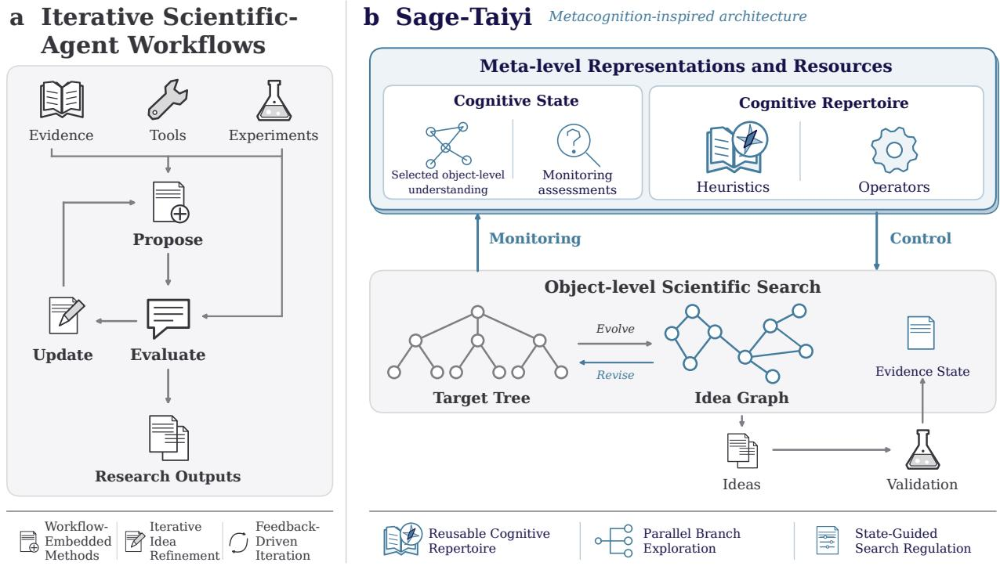  
Figure 1 | (a) Iterative scientific-agent workflows organize discovery through cycles of proposing, evaluating, and updating ideas, using evidence, tools, and experiments to guide refinement and produce research outputs. (b) Sage-Taiyi connects object-level scientific search with meta-level cognitive regulation through monitoring and control. At the object level, a Target Tree organizes search targets, while an Idea Graph captures ideas as they are generated and refined. At the meta level, a Cognitive Repertoire supplies methodological heuristics and Cognitive Operators, while a Cognitive State maintains a selective representation of object-level scientific understanding alongside monitoring-derived assessments that guide subsequent search. Monitoring updates the Cognitive State from search outcomes; control uses the updated state to select targets and methods that guide subsequent scientific search. Selected ideas can proceed to validation, whose results return to the Evidence State. The two panels highlight diferent architectural emphases rather than mutually exclusive capabilities.

## 2. Method

Sage-Taiyi is a metacognition-inspired architecture for scientific discovery in which the search for ideas and the understanding of the scientific problem develop together. Section 2.1 defines the object and meta levels and how they interact. At the object level, scientific search constructs and transforms ideas across target branches (Section 2.2). At the meta level, a Cognitive State selectively represents object-level scientific understanding and records monitoring assessments, while a Cognitive Repertoire retains reusable methods (Section 2.3). Monitoring and control connect the two levels (Section 2.4), and a research harness links ideas to planning, tool use, and external validation (Section 2.5).

## 2.1. System Overview

Sage-Taiyi organizes scientific discovery into two levels, drawing on accounts of discovery as problem solving [3, 12] and of metacognition as monitoring and control of thinking [13, 14].

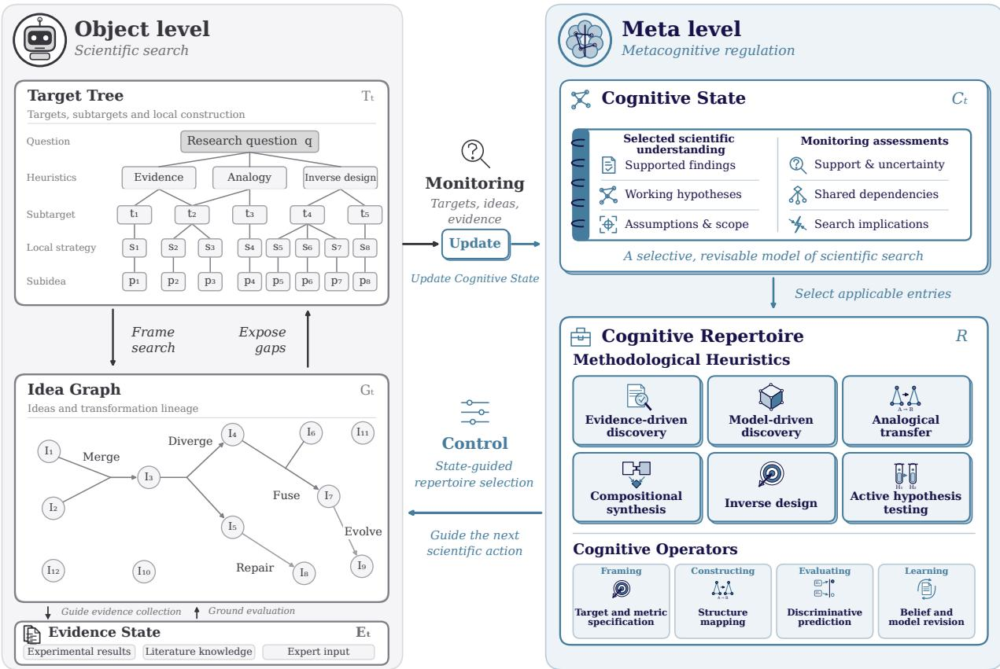  
Figure 2 | Sage-Taiyi’s two-level scientific search and monitoring–control loop. The architecture comprises object-level scientific search and meta-level metacognitive regulation. The object level includes a Target Tree that organizes targets, subtargets, local strategies, and subideas; an Idea Graph that records ideas and their lineage; and an Evidence State that retains experimental results, literature knowledge, and expert input. The meta level includes a Cognitive State that maintains a selective representation of object-level scientific understanding alongside monitoring-derived assessments, and a Cognitive Repertoire that provides reusable methodological heuristics and Cognitive Operators. Monitoring and control coordinate the two levels: the Target Tree guides idea exploration, the Idea Graph reveals gaps encountered during exploration, and the Evidence State grounds evaluation. Monitoring uses these inputs to update the Cognitive State, assessing evidential support, uncertainty, shared dependencies, and their implications for search. Control uses the Cognitive State to select applicable heuristics and operators and guide subsequent scientific actions, enabling scientific understanding and the search for novel ideas to evolve together.

The object level addresses the scientific problem itself, carrying out scientific search for a research question �. As in problem-space accounts of discovery, this search moves between knowledge states through local transformations [3, 1]. Its state is $X _ { t } ~ = ~ ( T _ { t } , G _ { t } , E _ { t } )$ : the Target Tree $T _ { t }$ organizes targets and subtargets, the Idea Graph $G _ { t }$ records ideas and their lineage, and the Evidence State $E _ { t }$ retains experimental and computational results, literature knowledge, and expert input with their sources. Decomposing targets, generating, transforming, and evaluating ideas, and judging what the evidence supports are object-level operations, as is the integration of these judgments into scientific

## understanding.

The meta level assesses how scientific search is proceeding and decides how it should be adjusted [8]. It maintains two resources. The task-specific Cognitive State $C _ { t }$ records what the search has established about the problem and what this implies for further search (Section 2.3.1). The reusable Cognitive Repertoire R contains methodological heuristics, which organize research paths, and Cognitive Operators, which perform local reasoning transformations between knowledge states (Sections 2.3.2–2.3.3). Selecting methods to regulate scientific search is a meta-level decision; applying them to develop targets or ideas is object-level search.

Monitoring and control connect the two levels [9]. Monitoring interprets search outcomes and new evidence to update $C _ { t }$ and assess their implications for further search. Control uses $C _ { t }$ to decide which target or idea to address, whether to continue, revise, redirect, or stop a branch, and which entries $\mathcal { R } _ { t } \subseteq \mathcal { R }$ to use. Applying these decisions and selected methods updates the object-level search state:

$$
q \longrightarrow \left[ \underbrace { X _ { t } = ( T _ { t } , G _ { t } , E _ { t } ) } _ { \mathrm { O b j e c t - l e v e l ~ s e a r c h } } \underbrace { \overbrace { \Theta \mathrm { o n i t o r i n g } } ^ { \mathrm { M o n i t o r i n g } } } _ { \mathrm { C o n t r o l ~ u s i n g } \ \mathcal { R } _ { t } } \underbrace { ( C _ { t } , \mathcal { R } ) } _ { \mathrm { M e t a \mathrm { - l e v e l ~ r e s o u r c e s } } } \right] \xrightarrow { \mathrm { R e v i e w ~ \& ~ E x e c u t i o n } } \underbrace { o } _ { \mathrm { O u t p u t } } .\tag{1}
$$

The index � marks logical state changes rather than fixed-duration rounds. A task ends with reviewed ideas or executable plans, or continues to execution and validation, whose results return to the Evidence State (Figure 2).

## 2.2. Object-Level Scientific Search

## 2.2.1. Target Tree: Decomposing the Research Question

The Target Tree decomposes the research question into more specific targets and subtargets. Its root is $q ,$ and each node is a target or subtarget that records its scientific requirements and completion criteria. Under a methodological heuristic selected by control, a target is decomposed into subtargets; each subtarget is paired with local strategies for addressing it, and each strategy yields subideas, partial solutions that can later be assembled into complete ideas. This structure follows problemspace accounts in which a problem is reduced to subproblems that are solved by applying operators [3, 12]. The tree is not fixed at the outset: as ideas develop, subtargets are added or revised while the root question and its constraints are retained (Section 2.2.2).

## 2.2.2. Idea Graph: Developing Ideas across Branches

Ideas are the units that Sage-Taiyi evaluates, transforms, and outputs. An idea is a complete proposal specifying a mechanism or design, supporting references, constraints, testable consequences, and the uncertainties to be examined. The Idea Graph records ideas as nodes and their transformations as edges. Ideas enter the graph by assembling subideas from the Target Tree or by direct generation from the research question, with or without a selected heuristic. Because the graph spans target branches, ideas developed for diferent targets can be compared and recombined.

Five transformations, informed by population-based search and conceptual combination [15, 16, 17, 18], produce new ideas. Merge consolidates ideas that take similar approaches; Fuse combines complementary mechanisms from diferent ideas after checking that their assumptions and interfaces are compatible; Diverge keeps an idea and opens a substantively diferent branch from it; Repair fixes a defective dependency or a missing interface; and Evolve improves an idea while retaining its core mechanism. Over successive iterations, these transformations can refine ideas and combine strengths developed for diferent targets. As ideas develop, they can expose requirements that no current target covers, motivating new subtargets in the Target Tree. To keep this development traceable, each new idea is linked to its parents and to the evaluation that motivated it.

## 2.2.3. Evidence State: Grounding Scientific Understanding

The Evidence State grounds scientific search in external information. It records experimental and computational results, literature knowledge, and expert input, linking each to its source, relevant ideas, and conditions. Using this evidence, the object level forms scientific judgments, for example which mechanisms are supported, under which conditions findings hold, and which explanations conflict. Each judgment retains its evidential grounds, allowing new evidence to inform revisions to relevant judgments and their dependencies while preserving unafected alternatives. Judgments formed in one branch can also inform reasoning in others. Integrated across branches, these evidencegrounded judgments and their relations form the system’s current scientific understanding of the problem [19, 20].

## 2.3. Meta-Level Representations and Resources

While the object level develops targets and ideas, the meta level keeps track of how this search is proceeding and adjusts its course. The meta level regulates scientific search with two resources. The Cognitive State represents the current search and is revised by monitoring as new findings or assessments warrant an update. The Cognitive Repertoire retains reusable method knowledge: methodological heuristics, which organize research paths, and Cognitive Operators, which transform knowledge states.

## 2.3.1. Cognitive State: Representing the Current Search

Following Nelson and Narens’ account of the meta level as maintaining a dynamic model of objectlevel cognition [9], the Cognitive State models the current search. It contains two kinds of content. The first is a selective, source-linked representation of object-level scientific understanding, retaining key findings, competing explanations, necessary assumptions, applicability conditions, and unresolved questions. The second consists of monitoring-derived assessments of the evidential status of key judgments, unresolved conflicts and uncertainties, and dependencies shared across ideas. The former selectively represents what the system currently understands about the scientific problem; the latter assesses how this understanding should guide further search. For example, when several ideas propose diferent mechanisms but depend on the same untested premise, monitoring records that they share a potential failure condition and that their agreement does not provide independent support.

The two kinds of content describe functions of the state rather than separate storage modules. Monitoring revises both as new evidence and evaluations of ideas emerge (Section 2.4.1), preserving sources and keeping working hypotheses distinct from external evidence. Control uses the revised state to select methods from the repertoire and determine subsequent research actions; their application updates targets and ideas (Section 2.4.2).

## 2.3.2. Methodological Heuristics: Organizing Research Paths

Methodological heuristics organize complete research workflows. Since the space of possible research paths is too large to search exhaustively, scientists in diferent disciplines develop characteristic research paradigms that lead them to workable solutions more eficiently [3, 4, 21, 22]. Drawing on these accounts, Sage-Taiyi organizes related reasoning principles into ten methodological heuristics for reusable research workflows (Figure 3 and Table 1). Each heuristic specifies when it applies, how it decomposes a target into subtargets and local strategies, coordinates cognitive operators, and evaluates the resulting ideas.

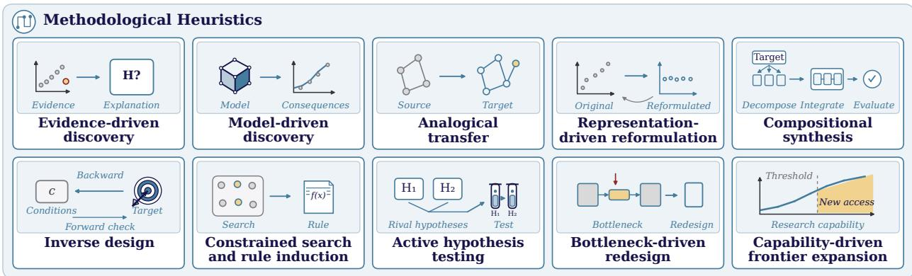  
Figure 3 | Methodological heuristics. The ten heuristics organize recurring strategies for scientific research grounded in evidence, models, analogies, representations, goals, and practical constraints.

These general heuristics are further instantiated with discovery methods summarized from the literature of specific research domains (Section 2.3.4). Control selects heuristics according to the research question and the current Cognitive State [11], and the selected heuristics guide the construction of the Target Tree (Section 2.2.1).

Table 1 | Methodological heuristics and their roles in scientific search.
<table><tr><td>Methodological heuristic</td><td>Methodological role</td></tr><tr><td>Evidence-driven discovery</td><td>Construct explanations from observations, anomalies, or failed predictions, and identify subsequent tests [1, 4].</td></tr><tr><td>Model-driven discovery</td><td>Vary assumptions or conditions in a theory or model, derive new consequences, and examine their scope and testable predictions [23].</td></tr><tr><td>Analogical transfer</td><td>Align the relational structures of source and target problems, and transfer mecha- nisms under target-domain constraints [24, 25].</td></tr><tr><td>Representation-driven reformulation</td><td>Reformulate entities, variables, or relations to open new solution paths, then map results back to the original problem [26, 27, 28].</td></tr><tr><td>Compositional synthesis</td><td>Decompose a target into functions, select and integrate compatible components, and evaluate the resulting system [29, 17].</td></tr><tr><td>Inverse design</td><td>Infer conditions and subtargets from a required outcome, construct a design, and validate it through forward evaluation [3].</td></tr><tr><td>Constrained search and rule induction</td><td>Explore ideas in a feasible space, and induce testable regularities from successful and unsuccessful instances [4, 1].</td></tr><tr><td>Active hypothesis testing</td><td>Select observations or interventions that distinguish competing explanations, and revise hypotheses using the results [30, 31].</td></tr><tr><td>Bottleneck-driven redesign</td><td>Identify the active constraint on overall system performance, redesign around it, and examine whether the bottleneck shifts [32].</td></tr><tr><td>Capability-driven frontier expansion</td><td>Use advances in measurement, experimentation, or computation to investigate previously inaccessible questions [33, 34].</td></tr></table>

## 2.3.3. Cognitive Operators: Transforming Knowledge States

Drawing on problem-space accounts of human problem solving [3], Sage-Taiyi defines Cognitive Operators as local reasoning transformations reusable across methodological workflows. Backward reasoning infers conditions or subgoals from an outcome; inverse design also constructs and validates a design. Mechanism integration aligns existing mechanisms’ interfaces and assumptions to form a candidate; compositional synthesis also decomposes the target and evaluates the system. Operators act on targets in the Target Tree, ideas and evaluations in the Idea Graph, representations and assessments in the Cognitive State, and methods in the Cognitive Repertoire. Informed by process accounts of creative thinking [35, 36], we organize operators by their principal function: Framing specifies targets and their requirements; Constructing develops and transforms ideas; Evaluating examines their evidential support and testable consequences; and Learning uses search outcomes to revise the Cognitive State and refine reusable methodological knowledge in the Cognitive Repertoire. These categories allow overlap, and an operator may act on multiple structures. Each operator specifies applicability conditions, a reasoning procedure, and expected outputs; control selects applicable operators using the task and Cognitive State. Figure 4 illustrates selected operators and their specialization in chemistry and theoretical physics.

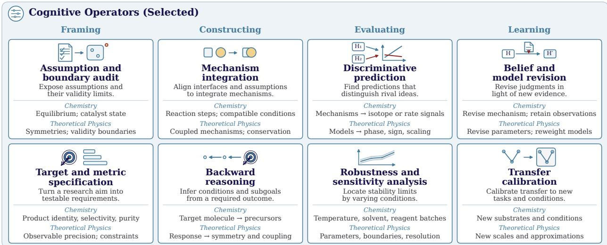  
Figure 4 | Selected Cognitive Operators. Eight representative operators illustrate local reasoning transformations across Framing, Constructing, Evaluating, and Learning. Each card states the operator’s function and gives examples of its specialization in chemistry and theoretical physics.

## 2.3.4. Domain Instantiation and Feedback Learning

The Cognitive Repertoire combines general heuristics and operators inspired by cognitive science [3] and the science of science [18] with domain-specific research methods. Figure 5 summarizes their development through domain instantiation and feedback learning.

Domain instantiation analyzes classic and representative papers to map general reasoning procedures to domain objects, mechanisms, constraints, and validation requirements. This mapping preserves relational structures while grounding their application in disciplinary knowledge and experimental conditions [24, 34]. For example, active hypothesis testing becomes a concrete chemistry procedure when two mechanisms predict diferent sources for a product atom: isotope-labeling one reactant and examining the product provides a test of their predictions. Entries retain their sources and applicability conditions, distinguishing reported procedures from analytical reconstruction.

Feedback learning uses successes, failures, and validation outcomes to refine these entries, drawing inspiration from case-based learning through reuse, testing, revision, and retention [37]. Comparisons across cases and disciplines identify recurring reasoning patterns that inform revisions to general heuristics and operators, following the principle of schema induction from concrete examples [19]. Revised methods can then be instantiated in further domains, with their operating conditions re-examined during transfer, closing the loop.

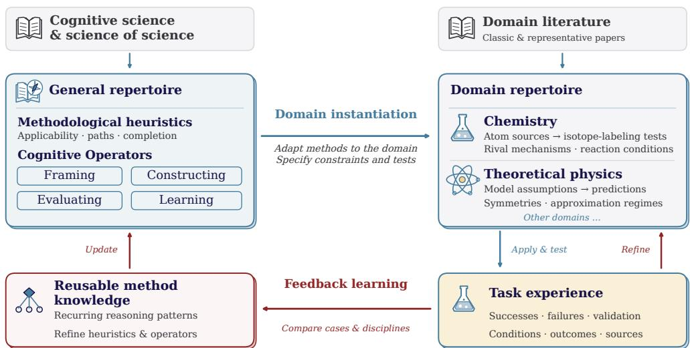  
Figure 5 | Domain instantiation and feedback learning. General heuristics and operators are specialized using domain literature. Task feedback refines domain entries; comparisons across cases and disciplines yield reusable knowledge that revises the general repertoire. Transferred experience retains its sources and scope and is re-examined in each new domain.

## 2.4. Regulating Search through Monitoring and Control

Inspired by the monitoring–control framework of Nelson and Narens [9] and its extension to reasoning and problem solving [13], Sage-Taiyi uses monitoring to update the Cognitive State from search progress and feedback, and control to decide what to investigate next and how. The resulting decisions guide object-level search and, through the research harness, execution and validation.

## 2.4.1. Monitoring

When targets, ideas, evaluations, or evidence change, monitoring reads the current Cognitive State together with relevant object-level judgments, evaluations, and evidence. It updates the selective representation of scientific understanding and assesses what the changes imply for subsequent search, such as whether current support is suficient or further work would repeat an unresolved limitation. This provides ongoing verification of evidential support and assumptions, with the assessments recorded in the Cognitive State. Applicable operators from the repertoire support these updates:

$$
C _ { t + 1 } = \mathrm { M o n i t o r } ( q , X _ { t } , C _ { t } ; \mathcal { R } ) .\tag{2}
$$

Updates retain sources, assumptions, applicability conditions, and unresolved alternatives, keeping working hypotheses distinct from external evidence. When no revision is warranted, $C _ { t + 1 } = C _ { t }$

## 2.4.2. Control

Inspired by work on strategy selection as metareasoning [11], control combines the Cognitive State’s assessments with the repertoire’s applicability conditions to decide which target or idea to address, whether to continue, revise, redirect, or stop a branch, and which methods to use. For scientific ideation, method selection and the subsequent object-level search update are summarized as:

$$
\mathcal { R } _ { t } = \mathrm { S e l e c t } ( q , X _ { t } , C _ { t + 1 } ; \mathcal { R } ) , \qquad X _ { t + 1 } = \mathrm { S e a r c h } ( q , X _ { t } , C _ { t + 1 } ; \mathcal { R } _ { t } ) .\tag{3}
$$

Select formalizes method selection within meta-level control; Search denotes the subsequent objectlevel application of the selected entries to the chosen target or idea, retaining changes and their rationale in the Target Tree, Idea Graph, and associated evaluations. Decisions that call for execution or validation are carried out through the harness (Section 2.5); the requested output, stopping rule, and budget govern task termination.

For example, the Cognitive State may indicate that several ideas share an untested premise, so further development along those branches could preserve a common failure condition. Control therefore selects Assumption and boundary audit and Discriminative prediction and calls for a subtarget to examine the premise. Object-level search makes the premise explicit and derives predictions that distinguish whether it holds, providing a basis for validation. Validation results enter the Evidence State and return to monitoring, which revises the state to inform subsequent decisions.

Algorithm 1 Scientific Discovery through Monitoring and Control in Sage-Taiyi   
Input: Research question �, evidence $E _ { 0 } ,$ , Cognitive Repertoire R, stopping rule, and budget   
Output: Research outputs with supporting evidence and unresolved questions   
1: Initialize $T _ { 0 }$ with root question $q , G _ { 0 }$ with no ideas, and $C _ { 0 }$ from $q , E _ { 0 }$   
2: Set $X _ { 0 } = \left( T _ { 0 } , G _ { 0 } , E _ { 0 } \right)$ and $t \gets 0$   
3: while the stopping rule is unmet and resources remain do   
4: $C _ { t + 1 } \gets \mathrm { M o n i t o r } ( q , X _ { t } , C _ { t } ; \mathcal { R } )$   
5: Control chooses the next research task and focus using $q , X _ { t }$ , and $C _ { t + 1 }$   
6: if the task requires scientific ideation then   
7: $\mathscr { R } _ { t } \gets \mathrm { S e l e c t } ( q , X _ { t } , C _ { t + 1 } ; \mathscr { R } )$   
8: $X _ { t + 1 }  \mathrm { S e a r c h } ( q , X _ { t } , C _ { t + 1 } ; \mathcal { R } _ { t } )$   
9: Retain target and idea updates, evaluations, and lineage   
10: else   
11: Refine the task into an execution or validation plan; select tools and skills   
12: Execute the planned task and collect results and feedback   
13: Form $X _ { t + 1 }$ by linking results to targets and ideas; preserve evidence in $E _ { t + 1 }$   
14: end if   
15: Assess progress against the requested output; set $t \gets t + 1$   
16: end while   
17: Monitor final outcomes and assess outputs against evidence and applicability conditions   
18: return outputs, supporting evidence, and unresolved questions

## 2.5. Grounding Scientific Ideation in Real-World Feedback

The research harness translates control decisions into research tasks, invoking ideation when a new explanation or design is needed and otherwise proceeding to execution or validation. It refines the selected task into an executable plan with specified inputs, constraints, and evaluation methods, and selects appropriate tools and skills (Figure 6).

During ideation, the Target Tree and Idea Graph guide subagents to explore multiple promising reasoning paths in parallel. Returned results are linked to relevant targets, ideas, and conditions in the Evidence State. Monitoring uses this evidence to verify intermediate conclusions and update the Cognitive State, which then guides control over subsequent search. This combination of parallel exploration and ongoing verification aligns with the Agentic Orchestration and Agentic Verification capabilities of Sage-A1.5 [38].

In our research collaborations, this loop connects Sage-Taiyi’s candidate solutions and search formulations to experiments and simulations, with domain experts participating in idea selection and validation. Tools such as Taiyi-Optimizer support searches within the specified condition or design spaces, while measurements and simulation results inform subsequent research decisions. Detailed experimental results are presented in Section 3. Algorithm 1 summarizes the logical loop; a task ends with reviewed ideas or executable plans, or continues to execution and validation, according to its requested output and resource budget.

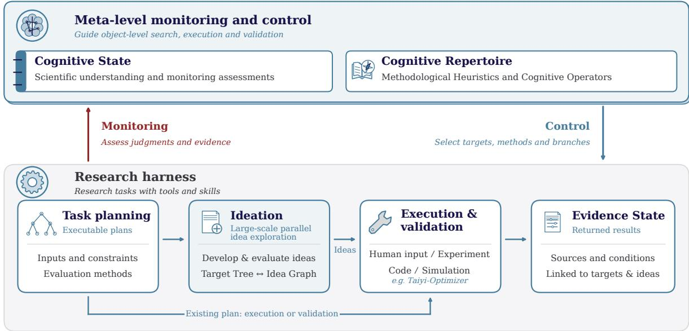  
Figure 6 | Monitoring and control across research execution. Control uses the Cognitive State and Cognitive Repertoire to guide research tasks, method selection, and branch decisions. The harness invokes ideation when a new explanation or design is needed; existing plans can proceed directly to execution or validation. Results enter the Evidence State, while monitoring reads relevant object-level judgments, evaluations, and evidence together with the current Cognitive State to update it. Physical experiments and expert participation follow the corresponding research workflow.

## 3. Experiments

We study Sage-Taiyi through benchmark comparisons and real-world research applications. Taiyi-Bench assesses its scientific ideation capabilities as an AI co-scientist at diferent knowledge states, through historical rediscovery and open-ended evaluation of idea quality and diversity (Section 3.1). We also evaluate ideation quality and the use of prior research on AgentIdeaBench and IG-Arena (Section 3.2). We then present five applications in metal catalysis, photochemistry, metamaterials, alloy design, and compressor engineering, showing how Sage-Taiyi helps address practical scientific and engineering problems (Section 3.3).

## 3.1. Evaluating Scientific Ideation with Taiyi-Bench

## 3.1.1. Experiment Setup

Taiyi-Bench. Taiyi-Bench examines AI co-scientists’ ability to propose complete, testable research routes given a scientist’s current knowledge. It reconstructs key scientific decisions and their prerequisites from recent published studies\* as directed acyclic graphs (DAGs), then captures nontrivial decision points central to each study’s key innovations, and creates tasks that progressively disclose established decisions.Nodes are selected to capture nontrivial decision points central to each study’s key innovations. Tasks are constructed by progressively disclosing established decisions. At $L _ { 0 } ,$ systems identify the root scientific problem from broad context; subsequent levels specify the problem and disclose preceding decisions. Our evaluation covers 50 papers and 265 case–level tasks across 10 research domains (i.e., earth science, neuroscience, economics, management, physics, biology, chemistry, environmental science, materials science, and communication engineering). Each task requires � self-contained ideas with supporting rationales and discriminating tests. Requesting multiple ideas reflects researchers’ need to compare alternative routes before committing experimental resources and tests whether a system can ofer substantively diferent mechanisms rather than variants of one solution.

Metrics. Evaluation combines historical rediscovery and open-ended evaluation. For Rediscovery, (1) Finding measures identification of the reference root problem at $L _ { 0 }$ . At subsequent levels, (2) Exact tests whether one proposal completely recovers the reference decisions evaluated at the given information level. (3) Coverage measures the fraction recovered by the proposal set, while (4) Lookahead measures the largest fraction of eligible target and downstream decisions recovered by an individual proposal. Recovery requires necessary prerequisites to be disclosed or established within the same proposal. For Open-ended Evaluation, (5) Novelty assesses scientific content beyond prior literature. (6) Efectiveness assesses whether the proposed mechanism and discriminating tests address the stated research gap. (7) Feasibility assesses necessary capabilities, scientific constraints, and design validity. (8) Diversity measures distinct relevant mechanism classes across the proposed ideas. A literature-grounded verifier applies decision-level rubrics and mechanism-equivalence criteria to score these dimensions. Its assessments show good agreement with human expert judgments. Scores are reported on a 0–100 scale, with higher values indicating better performance. The Rediscovery and Open-ended scores each average their four constituent metrics. Overall is the mean of these two scores. We also report ELO ratings [39] from a Bradley–Terry model [40] of task-level pairwise outcomes.

Baselines. We compare Sage-Taiyi with ten baseline configurations in three groups: (1) Direct generation, comprising GPT-5.6-Sol [41], Claude-Opus-5 [42], and Gemini-3.7-Flash [43]; (2) Generalpurpose harnesses, comprising Codex [44] with GPT-5.6-Sol at high and ultra reasoning settings, and Claude Code [45] with GPT-5.6-Sol or Claude-Opus-5; and (3) Scientific discovery harnesses, comprising EvoScientist [46], AI Scientist-v2 [47], and Robin [7]. Since this comparison focuses on scientific ideation, we retain the ideation stages of the scientific discovery harnesses and omit their subsequent experiment-execution and report-generation stages.

Implementation Details. Sage-Taiyi uses GPT-5.6-Sol at high reasoning efort to facilitate comparison with baseline harnesses using the same base model and reasoning setting. Each system is evaluated on � = 10 ideas per task. Base models and reasoning settings are summarized in Table 2.

Table 2 | Configurations used in the Taiyi-Bench evaluation. Parentheses indicate reasoning efort; “/” denotes direct generation without a harness.
<table><tr><td>Category</td><td>Harness</td><td>Model</td><td>Category</td><td>Harness</td><td>Model</td></tr><tr><td>Direct</td><td>/</td><td>GPT-5.6-Sol (high)</td><td>General-</td><td>Codex</td><td>GPT-5.6-Sol (ultra)</td></tr><tr><td>generation</td><td>1</td><td>Claude-Opus-5 (high)</td><td>purpose</td><td>Codex</td><td>GPT-5.6-Sol (high)</td></tr><tr><td></td><td>1</td><td>Gemini-3.7-Flash (high)</td><td>harnesses</td><td>Claude Code</td><td>GPT-5.6-Sol (high)</td></tr><tr><td>Scientific</td><td>EvoScientist</td><td>GPT-5.6-Sol (high)</td><td></td><td>Claude Code</td><td>Claude-Opus-5 (high)</td></tr><tr><td>discovery</td><td>AI Scientist-v2</td><td>GPT-5.6-Sol (high)</td><td>Ours</td><td>Sage-Taiyi</td><td>GPT-5.6-Sol (high)</td></tr><tr><td>harnesses</td><td>Robin</td><td>GPT-5.6-Sol (high)</td><td></td><td></td><td></td></tr></table>

## 3.1.2. Experimental Results

Leading performance across all metrics. Sage-Taiyi achieves the highest Overall score of 54.0, exceeding the strongest baseline, AI Scientist-v2, by 6.1 points (Table 3). It ranks first across all eight metrics, with Rediscovery and Open-ended scores of 44.6 and 63.3, respectively.

Table 3 | Taiyi-Bench results across 50 articles and 265 case–level tasks. Finding uses � ; the other seven metrics use subsequent levels. Avg. (average) denotes the mean of the four metrics within each evaluation group; Overall averages the two group scores. Scores are reported on a 0–100 scale with two decimal places. Bold and underlining mark the highest and second-highest unrounded values in each column, respectively. Abbreviations: Find., Finding; Cover., Coverage; Look., Lookahead; Nov., Novelty; Efect., Efectiveness; Feas., Feasibility; Div., Diversity.

<table><tr><td rowspan="2">System</td><td colspan="4">Rediscovery</td><td colspan="4">Open-ended</td><td rowspan="2"></td><td rowspan="2">Overall</td></tr><tr><td>Find.</td><td>Exact Cover. Look.</td><td></td><td></td><td>Avg.</td><td>Nov.</td><td>Effect. Feas.</td><td>Div.</td></tr><tr><td colspan="10">Direct generation</td></tr><tr><td>GPT-5.6-Sol</td><td>72.48</td><td>9.30</td><td>25.27</td><td>23.28 32.58 39.17</td><td></td><td>66.02</td><td>49.32</td><td>31.63</td><td>46.54</td><td>39.56</td></tr><tr><td>Claude-Opus-5</td><td>72.32</td><td>8.02</td><td>23.35</td><td>21.34</td><td>31.26</td><td>42.66 58.18</td><td>45.78</td><td>28.70</td><td>43.83</td><td>37.54</td></tr><tr><td>Gemini-3.7-Flash</td><td>66.18</td><td>7.44</td><td>17.90</td><td>17.59</td><td>27.28</td><td>41.01 56.05</td><td>41.13</td><td>28.89</td><td>41.77</td><td>34.53</td></tr><tr><td colspan="10">General-purpose harnesses</td></tr><tr><td>S Codex (GPT-5.6-Sol, ultra)</td><td>74.68</td><td>11.63 30.18</td><td></td><td></td><td></td><td></td><td></td><td></td><td></td><td>42.18</td></tr><tr><td>G Codex (GPT-5.6-Sol)</td><td>71.86</td><td>9.30</td><td>25.16</td><td>27.22 35.93 43.74 23.30</td><td>32.41</td><td>67.88 39.82 65.81</td><td>49.99 49.55</td><td>32.11 30.51</td><td>48.43 46.42</td><td>39.41</td></tr><tr><td>米 Claude Code (GPT-5.6-Sol)</td><td>78.30</td><td>13.95</td><td>35.87</td><td>33.04</td><td>40.29</td><td>43.10 67.56</td><td>50.21</td><td>31.07</td><td>47.98</td><td>44.14</td></tr><tr><td>Claude Code (Claude-Opus-5)</td><td>70.90</td><td>9.30</td><td>23.21</td><td>21.88</td><td>31.32</td><td>43.54 56.95</td><td>43.91</td><td>27.67</td><td>43.02</td><td>37.17</td></tr><tr><td colspan="9">Scientific discovery harnesses</td></tr><tr><td>當 EvoScientist (GPT-5.6-Sol)</td><td>73.62</td><td>8.88</td><td>26.70</td><td>24.23 33.36 40.92</td><td></td><td>65.33</td><td>51.05</td><td>28.06</td><td>46.34</td><td>39.85</td></tr><tr><td>品 AI Scientist-v2 (GPT-5.6-Sol)</td><td>72.54</td><td>16.74</td><td>32.37</td><td>31.62</td><td>38.32</td><td>55.20 87.23</td><td>47.73</td><td>39.40</td><td>57.39</td><td>47.85</td></tr><tr><td>2 Robin (GPT-5.6-Sol)</td><td>73.31 79.70 19.53</td><td>7.91 40.69 38.55 44.62 70.54 87.81</td><td>24.88</td><td>23.07</td><td>32.29</td><td>42.17 65.26</td><td>49.90</td><td>27.47</td><td>46.20</td><td>39.24</td></tr><tr><td colspan="9">Sage-Taiyi (GPT-5.6-Sol)</td></tr></table>

Pairwise comparisons support this aggregate ranking: Sage-Taiyi obtains the highest Elo rating of 1,322.5 and wins 66.3% of comparisons against AI Scientist-v2 (Figure 7). These results show advantages in both recovering established scientific decisions and proposing alternative solutions.

Stronger recovery of scientific decisions. Sage-Taiyi shows stronger recovery of established scientific decisions from the knowledge disclosed in each task. Its Coverage and Lookahead scores reach 40.7 and 38.6, exceeding the strongest baseline scores of 35.9 and 33.0; its Exact score is also the highest at 19.5 (Table 3). Because recovered decisions require their prerequisites to be disclosed or established within the same proposal, these results indicate an ability to connect scientific choices with the reasoning needed to support them. Its stronger responses link task constraints, proposed

(a) ELO ranking

(b) Pairwise win rates (%)  
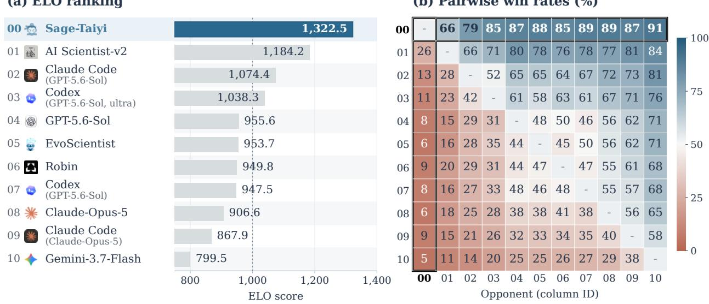  
Figure 7 | ELO ranking and pairwise win rates. (a) ELO scores for all 11 systems. (b) Empirical win percentages of the row system against the column system, with ties retained in the denominator. Both panels use descending ELO order and shared IDs; black outlines mark Sage-Taiyi (00).

mechanisms, and subsequent design decisions into coherent research routes. Section 3.1.3 provides a detailed example.

More novel and diverse ideas. Sage-Taiyi’s clearest advantage is Novelty: its score of 70.5 exceeds AI Scientist-v2’s 55.2 by 27.8% (Table 3). Its leading Diversity score of 42.3 further indicates a broader range of mechanism-level alternatives. Qualitatively, its stronger proposals reconsider assumptions or combine complementary mechanisms, explaining how the resulting ideas address the research gap and what predictions could distinguish them. Sage-Taiyi also ranks first in Efectiveness (87.8) and Feasibility (52.4). Together, these results are consistent with Sage-Taiyi’s structured search: the Target Tree tracks scientific requirements, while the Cognitive Repertoire and Idea Graph support the development of diverse alternatives. Monitoring and control use updated assessments to guide subsequent target and method selection.

Higher quality in less time. Sage-Taiyi achieves higher scores in both evaluation groups with 29.9 minutes of recorded generation time, compared with 39.3 minutes for AI Scientist-v2 and 44.8 minutes for Codex (ultra) (Figure 8). Its quality advantage therefore accompanies shorter generation times than these two baselines. Parallel exploration of independent research branches allows diverse alternatives to be developed concurrently, helping limit wall-clock generation time. Direct generation and several other harnesses finish faster but achieve lower scores.

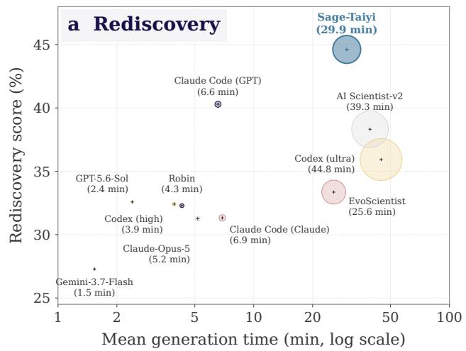

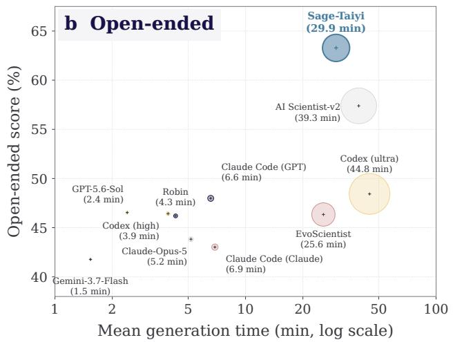  
Figure 8 | Scientific ideation quality and generation time on Taiyi-Bench. (a) Rediscovery and (b) Open-ended scores, each averaging four metrics. Both panels report mean generation time over all tasks. Crosses mark time–score coordinates; circle diameters scale with time. Generation time is plotted on the horizontal logarithmic axis and score on the vertical linear axis.

Performance across fields and knowledge states. Among the four systems shown, Sage-Taiyi achieves the highest Overall score in all ten disciplines, with leads of 1.9 to 9.4 points over the strongest baseline in each discipline (Figure 9a). It also achieves the highest score at every level, from $L _ { 0 }$ to $L _ { 8 }$ (Figure 9b).

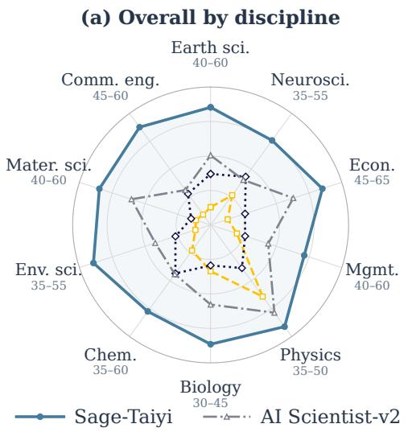

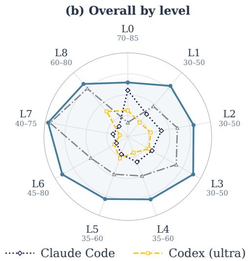  
Figure 9 | Scientific ideation across disciplines and information levels. (a) Overall across ten disciplines, calculated as the mean of Rediscovery and Open-ended scores. (b) Overall across $L _ { \mathrm { 0 } }  – L _ { 8 } .$ using Finding at $L _ { 0 }$ and the seven-metric mean thereafter. Later levels difer in task count and targets. In both panels, the gray labels give each spoke’s linear score range from center to rim, shared by all four systems. All four systems use GPT-5.6-Sol.

## 3.1.3. Case Study

We use Sage-Taiyi’s trajectory on a communication engineering task at $L _ { \mathrm { 2 } }$ in Taiyi-Bench to illustrate how its key design components organize scientific exploration (Figure 10). The question � is how to recover baseband data in an approximately 200 GHz link under terminal device, bandwidth, and real-time processing constraints [48]. The decision targeted at $L _ { 1 }$ is supplied as background at $L _ { \mathrm { 2 } } { \mathrm { : } }$ residual-carrier single-sideband modulation (RC-SSB) retains a same-pump carrier that co-propagates with the data sideband, giving them correlated phase disturbances. The remaining challenge is to turn this shared phase history into a stable, economical receiver. The figure connects object-level search $X _ { t } = \left( T _ { t } , G _ { t } , E _ { t } \right)$ , the Cognitive State $C _ { t s }$ and the Cognitive Repertoire R, highlighting how scientific search and scientific understanding develop together through monitoring and control.

Object-Level Scientific Search. Three methodological heuristics are selected to guide research paths and target decomposition: Representation-driven reformulation, Compositional synthesis, and Bottleneck-driven redesign. The Target Tree decomposes the receiver problem into where carrier–data phase noise should cancel, how residual phase ambiguity should be resolved, and how to allocate power between carrier and data (Figure 10a). Local strategies lead to balanced detection of carrier–data cross terms (I29), decoder-assisted phase inference (I51), and experimental carrier-to signal power ratio (CSPR) selection using BER and locking range (I61). Compositional synthesis organizes these complementary branches toward a complete receiver; individual operators perform local transformations along this path. The proposals have retained subidea-composition sources; the displayed subtarget and strategy wording provides a readable reconstruction of those sources.

The Idea Graph compares digital conjugation (I01), analog carrier multiplication (I06), and diferential delay interference (I08) with injection-locked carrier regeneration (I02). I02 uses the weak residual carrier to seed a slave distributed-feedback laser, then beats the regenerated reference with the data sideband on one photodiode. The figure uses Diverge to illustrate this change of reference function. Its subsequent Repair adds the sideband-reflection interface to I02 (I11), and Fuse combines I11 and I61 into I12: single-PD detection via injection locking and sideband reflection, with CSPR optimized for signal quality and locking margin. These links are reconstructed; I02 was generated directly from the question and exported as F02.

Monitoring and Control. Monitoring updates the Cognitive State as ideas develop, assessing both the scientific understanding represented by the proposals and its implications for further search. At � = 0, the comparison concerns how the initial alternatives use the residual carrier: digital and analog multiplication use an extracted reference, while balanced detection requires suficient reference power. Assumption and boundary audit assesses their shared dependence on a passive reference and whether further development would preserve that limitation. At � = 1, monitoring examines the regenerated-reference route, retaining suficient seed power, appropriate detuning, and polarization matching as applicability conditions and identifying the cost of a separate filtering path. These successive updates retain task-specific understanding, unresolved dependencies, and their evidential status in $C _ { t }$

Control uses these assessments, together with the applicability conditions of entries in ${ \mathcal { R } } ,$ , to select the next search focus and reasoning methods. At � = 0, Representation-driven reformulation directs attention to using the residual carrier as a seed for an actively regenerated reference, motivating a new subtarget. $\mathrm { ~ A t ~ } t ~ = ~ 1$ , control selects Mechanism integration to align the interfaces and operating assumptions of reference regeneration, sideband reflection, and experimental CSPR selection using BER and locking range in one receiver candidate. The corresponding target and idea transformations are object-level applications of these decisions. Discriminative prediction and

Robustness and sensitivity analysis guide tests involving broad- versus narrow-linewidth sources, beatnote and relative-phase stability, and removal of frequency-ofset and carrier-phase estimation. This connects assessments of the current search to specific requirements for subsequent idea construction and testing, making the respective roles of monitoring and control concrete.

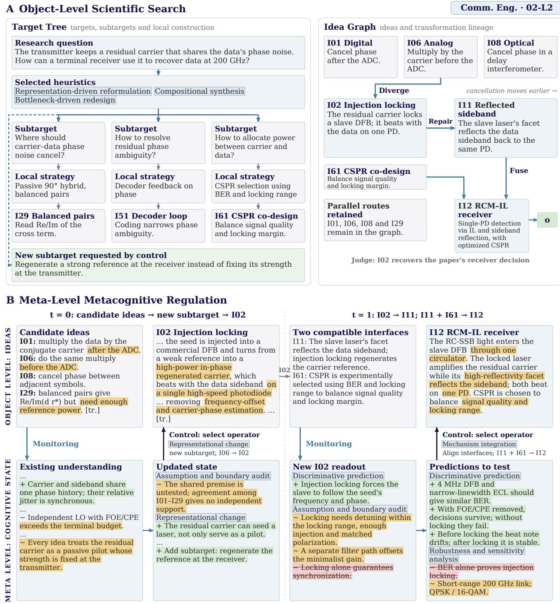  
Figure 10 | Scientific search and metacognitive regulation on a communication engineering task (�2). (a) Target Tree and Idea Graph; (b) monitoring and control. I: idea; �: output. Target/strategy wording, I11/I12, state updates and evolution links are reconstructed; I02 was question-direct and exported as F02. Green (+): added understanding; Yellow (∼): scope/uncertainty; Red (−): excluded inferences, struck through but retained. Boxes mark heuristics/operators; blue/navy inter-level arrows mark monitoring/control. RCM/RC-SSB: residual-carrier modulation/single-sideband form; IL: injection locking; PD: photodiode; CSPR: carrier-to-signal power ratio; BER: bit-error rate; [tr.]/ellipses: translated/omitted text.

## 3.2. Evaluation on AgentIdeaBench and IG-Arena

Benchmarks. We also evaluate Sage-Taiyi’s scientific ideation capabilities on two recently introduced benchmarks, AgentIdeaBench [49] and IG-Arena [50], and report results using their respective scoring frameworks. AgentIdeaBench combines ratings of originality, impact, feasibility, clarity, and specificity into a weighted score. IG-Arena uses the Population-Evolution Score (PES) to assess how well a proposal builds on prior research and opens a productive direction for follow-up through three dimensions, Heredity, Variation, and Selection.

Evaluation setup. We evaluate Sage-Taiyi on 40 AgentIdeaBench subfields with agent-controlled literature search and on all 30 IG-Arena frontier questions across ten scientific domains using Question-setting inputs. In both evaluations, Sage-Taiyi chooses its own search queries and which papers to consult. For IG-Arena, it submits its top-ranked proposal for each question. The benchmark’s reference library and lineage graph are withheld during generation.

Table 4 | Local AgentIdeaBench results. All systems use GPT-5.6-Sol. The weighted mean uses the dimension weights from Mo et al. [49]. Bold and underlining indicate the highest and second-highest scores in each column, respectively.
<table><tr><td>System</td><td>Originality</td><td>Impact</td><td>Feasibility</td><td>Clarity</td><td>Specificity</td><td>Weighted mean</td></tr><tr><td>AI Scientist-v2</td><td>6.900</td><td>6.275</td><td>6.625</td><td>7.950</td><td>7.750</td><td>6.852</td></tr><tr><td>Codex</td><td>6.897</td><td>6.256</td><td>6.205</td><td>8.000</td><td>7.872</td><td>6.786</td></tr><tr><td>Claude Code</td><td>6.850</td><td>6.150</td><td>5.825</td><td>7.800</td><td>7.675</td><td>6.634</td></tr><tr><td>Sage-Taiyi</td><td>7.300</td><td>6.525</td><td>7.050</td><td>8.100</td><td>8.175</td><td>7.195</td></tr></table>

Results. On AgentIdeaBench, Sage-Taiyi achieved a weighted mean of 7.195, compared with 6.852 for AI Scientist-v2, the strongest local baseline in the current results (Table 4). Sage-Taiyi had the highest mean on all five dimensions, with originality and feasibility scores 0.400 and 0.425 points higher than AI Scientist-v2, respectively. On IG-Arena, Sage-Taiyi obtained a mean PES of 87.634 in our evaluation. Figure 11a also shows four published reference scores from the Question setting.

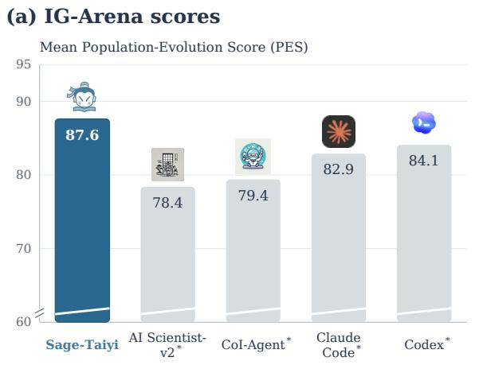

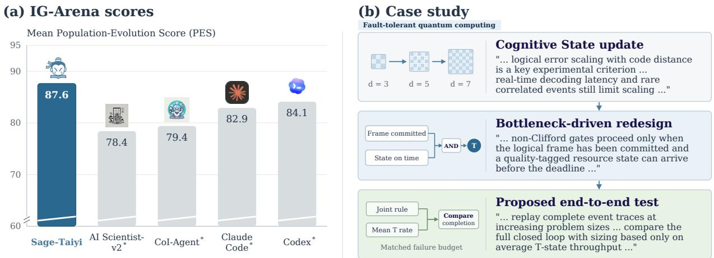  
Figure 11 | IG-Arena results and fault-tolerant quantum computing case. (a) Mean PES on a truncated axis. All systems use GPT-5.5. Asterisks mark published Question-setting scores [50, Fig. 6b]. (b) Sage-Taiyi uses surface-code evidence to propose a gate scheduling rule that coordinates decoding and resource-state delivery, with an end-to-end test at a matched failure budget.

Case study on fault-tolerant quantum computing. Sage-Taiyi independently retrieved key papers from the IG-Arena reference library (Figure 11b). In updating its Cognitive State, it organized the evidence around a key progression in surface-code research, from observing lower logical error rates at larger code distances to demonstrating sustained error suppression below threshold [51, 52]. It distinguished the evidence for logical memory from the additional requirements of executing a full fault-tolerant algorithm. Bottleneck-driven redesign focused the search on whether real-time decoding and the supply of quantum resource states could both keep pace with gate operations. Compositional synthesis then brought them into a single scheduling rule. A gate that consumes a resource state can proceed only when the relevant decoding result has been committed and the state can arrive by the gate deadline. The proposal specifies an end-to-end comparison with a design sized by average resource-state throughput, testing whether the scheduling rule improves the probability of completing the computation within the same failure budget.

## 3.3. Real-World Scientific Discovery

We apply Sage-Taiyi to five real-world research challenges spanning metal catalysis, photochemistry, metamaterials, alloy design, and compressor engineering, translating scientific ideas into new reaction routes, experimentally realized materials, and improved engineering designs. Across these collaborations, Sage-Taiyi helps develop catalytic transformations, overcome restrictive design constraints, and identify efective combinations of composition, processing, and geometry. These advances connect scientific exploration to measurable outcomes, from higher reaction yields and material strength to improved electromagnetic and aerodynamic performance (Table 5).

Following the research harness described in Section 2.5, Sage-Taiyi develops candidate solutions and specifies the variables, objectives, and constraints needed for execution. Domain experts participate in selecting promising ideas and validating their implementation, while Taiyi-Optimizer searches the resulting condition or design spaces. Experimental measurements and simulation results return as evidence, informing subsequent revisions to ideas, conditions, and constraints. This workflow extends Sage-Taiyi’s monitoring–control loop to practical research: experimental and simulation results inform assessments of research progress and guide subsequent decisions about what to investigate and how to proceed.

Table 5 | Scientific contributions and outcomes across five real-world research collaborations.
<table><tr><td>Research area</td><td>Scientific contribution and outcome</td></tr><tr><td>Metal catalysis</td><td>Developed a cobalt-catalysed route to tetrasubstituted allenyl ketones, raising the model-reaction yield from trace amounts to 84% through reaction-condition opti- mization.</td></tr><tr><td>Photochemistry</td><td>Developed a photocatalytic route to site-selective allylic amination with heteroaryl amines, increasing the model-reaction yield from 13% to 69%.</td></tr><tr><td>Metamaterials</td><td>Designed a multilayer electromagnetic filter and relaxed a restrictive thickness constraint, achieving simulated average transmission of 6.2% in the stopband and 94.5% in the passband.</td></tr><tr><td>Alloy design</td><td>Jointly designed and optimized magnesium-alloy composition and heat treatment, producing an alloy with a mean measured tensile strength of 342 MPa.</td></tr><tr><td>Compressor engineering</td><td>Developed and refined a centrifugal-compressor design, achieving a CFD-evaluated impeller efficiency of 91.5% at a pressure ratio of 4.0.</td></tr></table>

## 3.3.1. Metal Catalysis: Earth-Abundant Metal-Catalyzed Carbonylation

Problem statement. Unsymmetrical ketones are widespread in pharmaceuticals, agrochemicals and functional materials, and carbonylation with carbon monoxide ofers an atom-economical route to assemble them from two diferent carbon fragments and a C1 unit. The central challenge is chemoselectivity, because the two fragments must be joined at the same carbonyl carbon in a cross-selective manner while the formation of symmetrical ketones is suppressed. Earth-abundant metal catalysts would improve the practicality of this approach, but achieving high cross-selectivity with such catalysts remains dificult when both carbon partners are activated through similar pathways at the same metal centre.

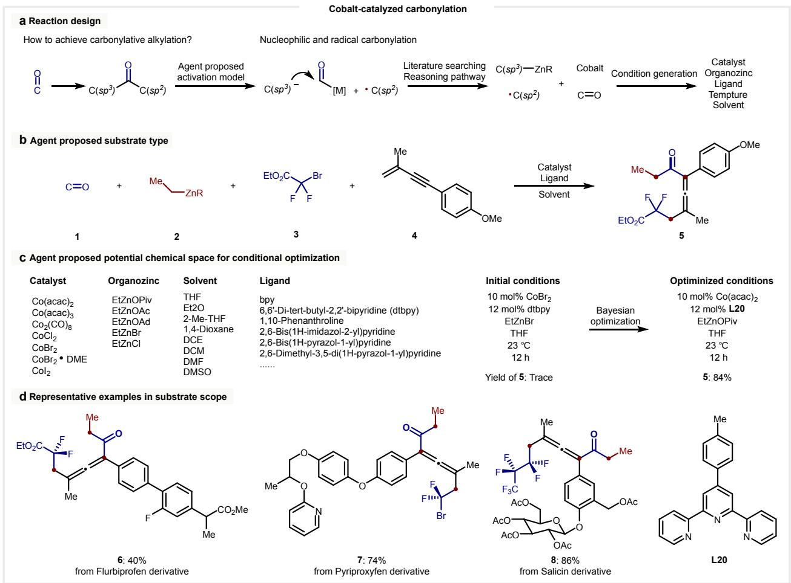  
Figure 12 | Cobalt-catalysed carbonylation: reaction design and experimental outcomes. Panels a–d show the activation model, model reaction, condition space and initial/optimized conditions, and bioactivemolecule derivatives with ligand L20. Yields are isolated.

Implementation. For this scientific question, Sage-Taiyi proposed several activation strategies (Figure 13a). One of them adapts the synchronous recognition strategy previously reported for the synthesis of unsymmetrical ureas [53], in which the two coupling partners are diferentiated by distinct activation modes. Sage-Taiyi proposed that metal-mediated carbonylation and radical carbonylation could operate cooperatively at a cobalt centre to achieve this diferentiation in ketone synthesis. In the metal-mediated branch, a carbon nucleophile such as an organometallic reagent attacks a CO-ligated Co(III) centre, forming an acyl–cobalt intermediate through nucleophilic carbonylation. In the radical branch, a carbon radical generated from the second coupling partner couples with this intermediate to deliver the unsymmetrical ketone.

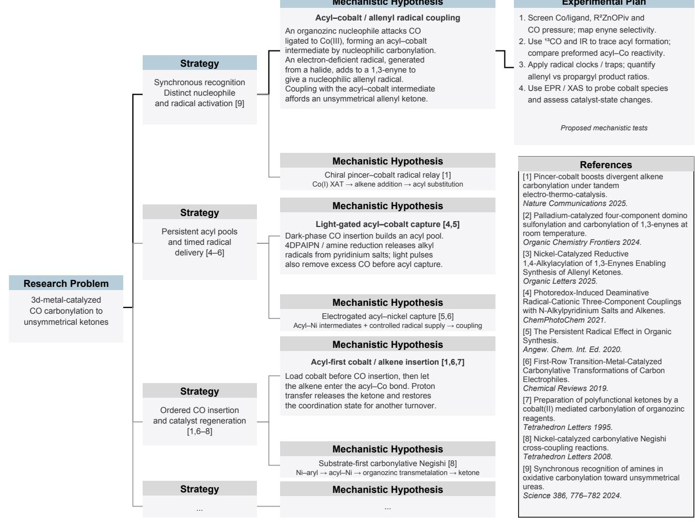  
(a)

## Mechanistic HypothesisMechanistic Hypothesis

## Experimental PlanExperimental Plan

(b)  
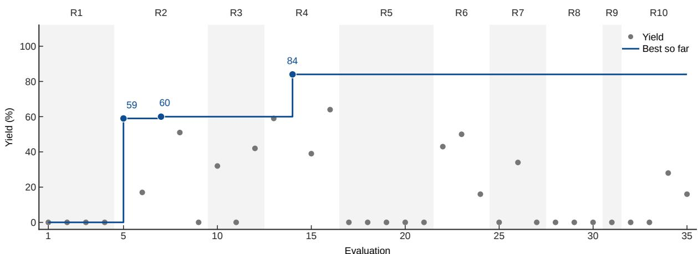  
Figure 13 | Cobalt-catalysed carbonylation: workflow and optimization. (a) Strategies, mechanistic hypotheses and proposed tests. The highlighted synchronous-recognition route combines nucleophilic carbonylation with polarity reversal and acyl–cobalt/allenyl-radical coupling. Branches group candidate mechanisms; tests remain prospective. Workflow references are numbered locally. (b) Thirty-five evaluations across ten rounds; points show yields and the line tracks the cumulative best, reaching 84%. The reaction and conditions appear in Figure 12.

To access the carbon radical required in the radical branch, Sage-Taiyi further proposed a polarityreversal strategy, in which an electron-deficient radical adds to an alkene to generate a nucleophilic alkyl radical. A subsequent literature analysis by Sage-Taiyi showed that 1,3-enynes, which form C(sp2)-centred allenyl radicals upon radical addition, have rarely been employed as radical acceptors in oxidative carbonylation. On this basis, Sage-Taiyi recommended a cobalt-catalysed redox-neutral carbonylation in which organozinc reagents serve as nucleophiles, 1,3-enynes as radical acceptors and electron-deficient halides as radical precursors, afording allenyl ketones (Figure 12). This case illustrates how Sage-Taiyi narrows a general activation strategy to a specific, underexplored reaction design through successive rounds of literature comparison.

Literature searching and mechanistic reasoning mapped the proposed activation model onto an alkylzinc reagent, an allenyl-radical pathway, a cobalt catalyst and CO, and identified the catalyst, organozinc reagent, ligand, solvent and temperature as the variables for condition generation. The resulting model reaction couples CO (1), an ethylzinc reagent (2), ethyl bromodifluoroacetate (3) and the 1,3-enyne 4 to form the tetrasubstituted allenyl ketone 5 (Figure 12, subpanel b). Sage-Taiyi then defined a chemical space for condition optimization comprising seven cobalt sources, five ethylzinc reagents with diferent counteranions, eight solvents and a series of nitrogen-donor ligands (Figure 12, subpanel c).

The resulting condition space was explored using Taiyi-Optimizer through the workflow described in Section 2.5, with measured yields from each batch of reactions guiding subsequent condition selection (Figure 13b).

Results. Under the initial conditions (10 mol% CoBr , 12 mol% dtbpy, EtZnBr, THF, 23 ◦C, 12 h), only trace amounts of 5 were formed. Bayesian optimization within this space identified Co(acac) , the terpyridine ligand L20 and EtZnOPiv as the optimal combination, increasing the yield of 5 to 84% while the solvent, temperature and reaction time remained unchanged. The key changes were the replacement of the bidentate dtbpy with the tridentate L20 and of EtZnBr with EtZnOPiv (Figure 12, subpanel c). The optimization curve reaches the same 84% yield (Figure 13b). The optimized conditions were applicable to enynes derived from bioactive molecules and to diferent electron-deficient halides, delivering the allenyl ketones 6, 7 and 8 from flurbiprofen, pyriproxyfen and salicin derivatives in 40%, 74% and 86% yield, respectively (Figure 12, subpanel d).

## 3.3.2. Photoredox Catalysis: Site-Selective Allylic Amination with Heteroaryl Amines

Problem statement. Allylic amines are prevalent in bioactive molecules and serve as versatile intermediates, as the alkene handle allows further elaboration after C–N bond formation. Dehydrogenative C–H/N–H coupling between an alkene and an amine is the most direct route to these motifs, since it avoids prefunctionalization of either partner and releases only hydrogen. The dificulty lies in site selectivity: the alkene presents several allylic C–H bonds of comparable strength, and the intermediate allylic radical can be functionalized at either terminus, so both regio- and positional selectivity must be controlled.

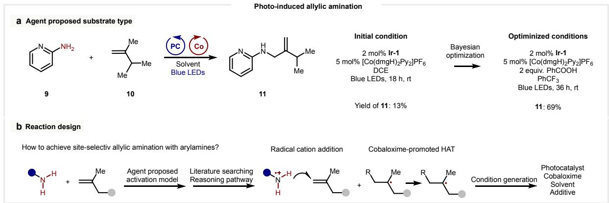  
Figure 14 | Photocatalytic allylic amination: reaction design and experimental outcomes. (a) The 2- N NH Me HPC Co Bayesianaminopyridine model reaction, including initial and optimized conditions. (b) The activation model. PC, + 5 photocatalyst; Co, cobaloxime; HAT, hydrogen atom transfer.

Yield of 11: 13% 11: 69%Implementation. Sage-Taiyi addressed site-selective allylic amination as the scientific question. Its literature analysis showed that photocatalytic dehydrogenative allylic amination has been established for aliphatic amines, whereas the corresponding coupling of alkyl alkenes with anilines and heteroaryl amines has not been reported. Sage-Taiyi attributed this gap to the lower nucleophilicity and higher oxidation potential of aromatic amines, and designed an activation mode in which singleelectron oxidation of the amine generates an aminium radical cation that adds to the alkene, followed by cobaloxime-mediated hydrogen atom transfer from the resulting carbon radical to install the alkene and release hydrogen (Figure 15a).

Literature searching and mechanistic reasoning identified the photocatalyst, cobaloxime, solvent and additive as the variables for condition generation. The proposed model reaction couples 2- aminopyridine (9) with the 1,1-disubstituted alkene 10 under photoredox and cobalt dual catalysis to give the allylic amine 11 (Figure 14, subpanel a).

Taiyi-Optimizer explored this condition space using the workflow described in Section 2.5. Measured yields from each batch of experiments guided the selection of subsequent photocatalyst, cobaloxime, solvent and additive combinations (Figure 15b).

Results. Under the initial conditions (2 mol% Ir-1, 5 mol% $\mathrm { [ C o ( d m g H ) _ { 2 } P y _ { 2 } ] P F _ { 6 } , }$ DCE, blue LEDs, 18 h, room temperature), 11 was formed in 13% yield. Bayesian optimization raised the yield to 69%, with the key changes being a switch of solvent from DCE to PhCF , the addition of 2 equiv. PhCOOH and an extension of the reaction time to 36 h (Figure 14, subpanel a). The optimization curve records a best yield of 68.7%, rounded to 69% in the reaction scheme and text (Figure 15b).

(a)  
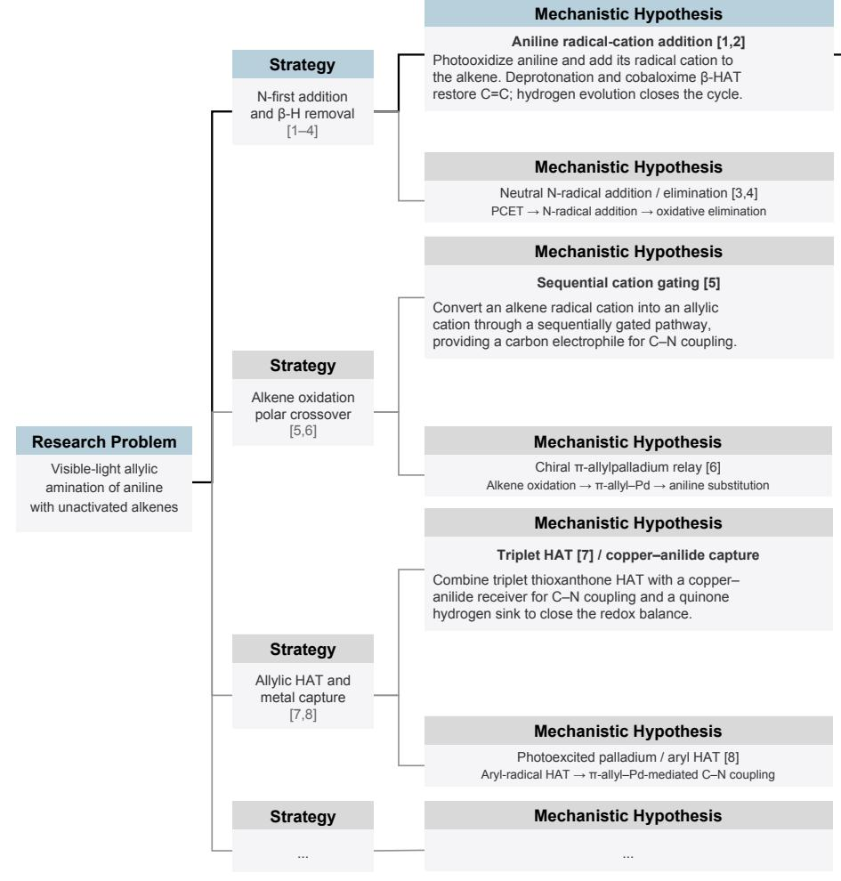

## Experimental PlanExperimental Plan

1. Acid/base interventions; quenching1. Acid/base interventions; quenching and transient spectroscopy.and transient spectroscopy.

2. β-D labeling and hydrogen/isotope2. β-D labeling and hydrogen/isotope analysis by online GC/TCD.analysis by online GC/TCD.

3. Radical clock and EPR; XAS checks.3. Radical clock and EPR; XAS checks.

4. Cobalt omission and ligand tests.4. Cobalt omission and ligand tests.

Proposed tests for the radical-cation routeProposed tests for the radical-cation route

## ReferencesReferences

[1] Site-selective amination towards tertiary[1] Site-selective amination towards tertiary aliphatic allylamines.aliphatic allylamines.   
Nature Catalysis 2022.Nature Catalysis 2022.

[2] Efficient Unimolecular Deprotonation of[2] Efficient Unimolecular Deprotonation of Aniline Radical Cations.Aniline Radical Cations. The Journal of Organic Chemistry 2005.The Journal of Organic Chemistry 2005.

[3] Intermolecular Anti-Markovnikov[3] Intermolecular Anti-Markovnikov Hydroamination of Unactivated AlkenesHydroamination of Unactivated Alkenes with Sulfonamides Enabled bywith Sulfonamides Enabled by

[4] Intermolecular oxidative amination of[4] Intermolecular oxidative amination of unactivated alkenes by dual photoredoxunactivated alkenes by dual photoredox and copper catalysis.and copper catalysis.   
Chemical Science 2021.Chemical Science 2021.

[5] Allylic Amination of Highly Substituted[5] Allylic Amination of Highly Substituted Alkenes Enabled by Photoredox CatalysisAlkenes Enabled by Photoredox Catalysis and Cu(II)-Mediated Radical–Polarand Cu(II)-Mediated Radical–Polar Crossover.Crossover.

[6] Merging of Light/Dark Palladium[6] Merging of Light/Dark Palladium   
Catalytic Cycles Enables MulticomponentCatalytic Cycles Enables Multicomponent Tandem Alkyl Heck/Tsuji–TrostTandem Alkyl Heck/Tsuji–Trost   
Homologative Amination Reaction towardHomologative Amination Reaction toward Allylic Amines.Allylic Amines.   
J. Am. Chem. Soc. 2023.J. Am. Chem. Soc. 2023.

[7] Hydrogen Atom Transfer (HAT): A[7] Hydrogen Atom Transfer (HAT): A Versatile Strategy for Substrate ActivationVersatile Strategy for Substrate Activation in Photocatalyzed Organic Synthesis.in Photocatalyzed Organic Synthesis. Eur. J. Org. Chem. 2017.Eur. J. Org. Chem. 2017.

(b)  
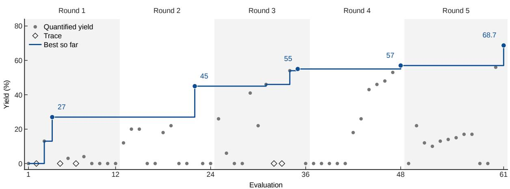  
Figure 15 | Photocatalytic allylic amination: workflow and optimization. (a) Candidate mechanisms and proposed tests; the highlighted aniline-based route combines radical-cation addition with cobaloximemediated HAT. Tests remain prospective. Workflow references are numbered locally; the model reaction uses 2-aminopyridine. (b) Sixty-one evaluations across five rounds; points show quantified yields, open diamonds denote trace amounts, and the line tracks the cumulative best. The maximum, 68.7%, rounds to the 69% reported in Figure 14 and the text.

## 3.3.3. Metamaterials: Revising Constraints in Electromagnetic Filter Design

Problem statement. The metamaterial collaboration targets a multilayer electromagnetic band-stop filter made from patterned copper on ceramic substrates. The design must suppress transmission over 8–12 GHz while preserving high transmission over 14.5–15.5 GHz. Achieving both objectives requires coordinated choices of structural topology and geometric parameters within fabrication constraints, making the definition of the design space central to the search.

Implementation. Sage-Taiyi proposed five configurations: (A) anisotropic strips and patches with an outer Jerusalem cross; (B) Drude wires with an I-shaped Lorentz ceramic-matrix-composite (CMC) half-wave wall and an outer Jerusalem cross; (C) a Babinet-complementary loop-and-slot structure; (D) an in-plane paired four-split-ring-resonator assembly with an outer Jerusalem cross; and (E) mirrored Jerusalem crosses on opposite sides, an embedded Drude wire grid, and a 6 mm half-wave feature. Experts selected design B for electromagnetic simulation and optimization. Figure 16a–d shows the alternatives A, C, D, and E, while panel e shows design B, whose patterned metal masks are interleaved with three quartz-ceramic substrates.

Fabrication considerations initially fixed the substrate thicknesses while the remaining parameters were optimized. The first optimization did not produce satisfactory passband performance. Optimization feedback led Sage-Taiyi to identify fixed substrate thickness as a bottleneck and recommend relaxing this constraint. The team then allowed substrate thickness to vary and repeated the search with Taiyi-Optimizer in the expanded design space. This sequence illustrates the monitoring–control loop described in Section 2.4: optimization feedback informs an assessment of the current search constraints, which guides their revision and subsequent exploration.

Following the research harness in Section 2.5, Taiyi-Optimizer searched ten continuous geometric variables for the symmetric design. Table 6 defines the variables and their search ranges. The dielectric-layer thicknesses satisfy $h _ { 1 } \ = \ h _ { 3 } .$ , with total thickness $h _ { \mathrm { t o t a l } } = h _ { 1 } + h _ { 2 } + h _ { 3 }$ and middlelayer fraction $f _ { \mathrm { m i d } } = h _ { \mathrm { 2 } } / h _ { \mathrm { t o t a l } } ; $ � and � are orthogonal in-plane directions. The objective maximizes high passband transmission while penalizing stopband transmission:

$$
R _ { \mathrm { m e t a } } = \overline { { T } } _ { \mathrm { p a s s } } - 1 . 5 \overline { { T } } _ { \mathrm { s t o p } } ,\tag{4}
$$

where $\overline { { T } } _ { \mathrm { p a s s } }$ and $T _ { \mathrm { s t o p } }$ are the dimensionless band averages of power transmission $| S _ { 2 1 } | ^ { 2 }$ , and $S _ { 2 1 }$ is the forward transmission scattering parameter.

Results. The optimized filter achieved reported average stopband and passband transmissions of 6.2% and 94.5%, respectively. Figure 16f shows a frozen-thickness reference reward of 0.253 and a final best reward of 0.822 after ten optimization rounds. The optimized configuration and simulated performance are summarized in Table 6.

Table 6 | Metamaterial search ranges, optimized configuration, and simulated performance. Ranges specify continuous variables; transmission values are reported band averages.
<table><tr><td>Quantity / variable</td><td>Search range</td><td>Unit / context</td><td>Best value</td></tr><tr><td>Optimization reward  $R _ { \mathrm { m e t a } }$ </td><td></td><td>Dimensionless</td><td>0.822</td></tr><tr><td>Unit-cell period  $p$ </td><td>[5.0,9.0]</td><td>mm</td><td>6.5</td></tr><tr><td>Jerusalem-cross arm length  $a _ { \mathrm { j c } }$ </td><td>[3.0,5.5]</td><td>mm</td><td>3.95</td></tr><tr><td>T-bar end-load length  $b _ { \mathrm { j c } }$ </td><td>[0.4,1.8]</td><td>mm</td><td>0.95</td></tr><tr><td>Jerusalem-cross linewidth  $\boldsymbol { w } _ { \mathrm { j c } }$ </td><td>[0.2,0.5]</td><td>mm</td><td>0.30</td></tr><tr><td>Drude wire-grating pitch  $p _ { w }$ </td><td>[1.0, 3.0]</td><td>mm</td><td>2.15</td></tr><tr><td>Drude wire width  $\omega _ { w }$ </td><td>[0.2,0.5]</td><td>mm</td><td>0.255</td></tr><tr><td>I-shaped inclusion neck length along  $x , l _ { \mathrm { n e c k } }$ </td><td>[0.8,3.5]</td><td>mm</td><td>0.81</td></tr><tr><td>I-shaped inclusion pad length along  $y , b _ { \mathrm { p a d } }$ </td><td>[0.5, 2.5]</td><td>mm</td><td>1.60</td></tr><tr><td>Total dielectric stack thickness  $h _ { \mathrm { t o t a l } }$ </td><td>[3.0,6.0]</td><td>mm</td><td>3.60</td></tr><tr><td>Middle-layer thickness fraction  $f _ { \mathrm { m i d } }$ </td><td>[0.15, 0.60]</td><td>Dimensionless</td><td>0.435</td></tr><tr><td>Average stopband transmission</td><td></td><td>%; 8–12 GHz</td><td>6.2</td></tr><tr><td>Average passband transmission</td><td></td><td> $\% ;$  14.5–15.5 GHz</td><td>94.5</td></tr></table>

The expert-designed simple fishbone configuration had corresponding reported stopband and passband averages of 9.5% and 87.4%, compared with 6.2% and 94.5% for the Sage-Taiyi-assisted design. The transmission spectra in Figure 16g show stopband suppression and high passband transmission across the five evaluated incidence angles. This case connects topology design with feedback-guided revision of the optimization space: the initial optimization exposed a restrictive thickness constraint, and the revised formulation enabled further exploration toward the two spectral objectives.

(a) Design A  
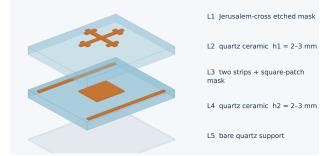  
(c) Design D

(b) Design C  
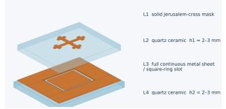

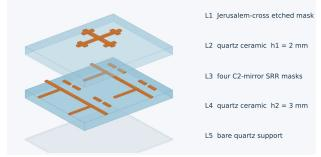

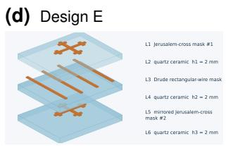

(e) Selected design B  
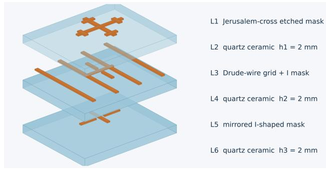

(f) Optimization reward  
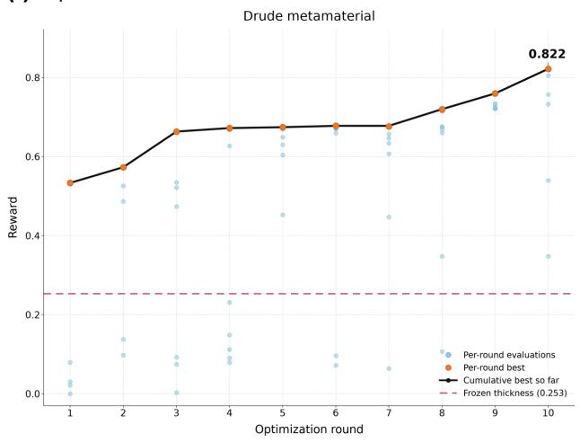

(g) Power transmission at TE incidence  
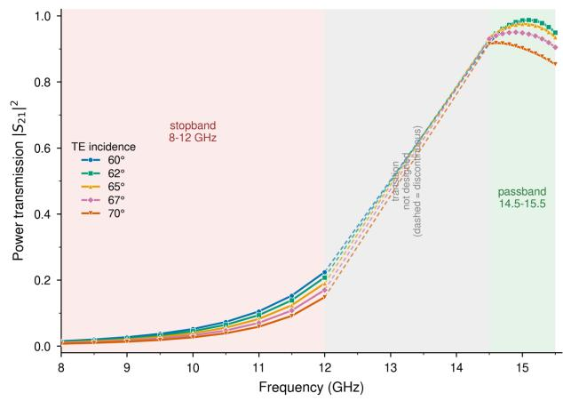  
Figure 16 | Metamaterial topology selection and optimization. (a–d) Alternative designs $\mathrm { A } , \mathrm { C } ,$ D, and E, with source mask labels and nominal ceramic thicknesses: 2–3 mm for A and $\mathrm { C } , 2$ and 3 mm for D, and three 2 mm layers for E. (e) Selected design B: a Jerusalem-cross mask, a Drude-wire grid with an I-shaped mask, and a mirrored I-shaped mask interleaved with three quartz-ceramic substrates, each nominally labelled 2 mm; optimized dimensions are given in Table 6. (f) Ten-round reward history. Light-blue points show per-round evaluations, orange points show per-round best values, and the black line shows the cumulative best. The dashed line marks the frozen-thickness reference of 0.253; the final best reward is 0.822. (g) Power transmission $| S _ { 2 1 } | ^ { 2 }$ for transverse-electric (TE) incidence at $6 0 ^ { \circ } , 6 2 ^ { \circ } , 6 5 ^ { \circ } , 6 7 ^ { \circ }$ , and 70◦. Shaded target bands are $8 { - } 1 2$ and 14.5–15.5 GHz. The intervening region is labelled as not designed, with dashed connections denoting discontinuous spectra.

## 3.3.4. Alloy Design: Composition and Heat Treatment for Cast Magnesium

Problem statement. The alloy collaboration seeks a high-tensile-strength magnesium alloy suitable for sand casting. The problem couples composition with solution treatment, quenching, and ageing: a promising nominal composition is useful only if a practical processing route can realize the desired mechanical properties. Cost also enters candidate selection, making the search a joint problem of performance, processing, and material economy.

Implementation. Sage-Taiyi proposed four composition–processing candidates with diferent design priorities: strength-priority A, cost/ductility-priority B, lowest-cost C, and experiment-supported baseline D (Figure 17a). Experts selected design B, Mg–4Y–1Nd–3Gd–0.4Zr, as the starting point for experimentation. Its proposed heat treatment comprised solution treatment at $5 0 0 ^ { \circ } \mathrm { C }$ for 14 h followed by ageing at $2 0 0 ^ { \circ } \mathrm { C }$ for 120 h. Compositions are expressed in mass percentages (wt.%), with Mg as the balance.

Following the research harness described in Section 2.5, Taiyi-Optimizer jointly explored alloy composition and heat-treatment conditions, with physical synthesis and mechanical testing providing feedback for subsequent experimental choices. Cost and ductility informed the initial expert selection; the subsequent optimization maximized a fixed composite objective combining yield strength (YS), ultimate tensile strength (UTS), and elongation (EL):

$$
R _ { \mathrm { a l l o y } } = 0 . 3 5 n ( \mathrm { Y S ; 1 1 0 , 2 1 0 } ) + 0 . 4 0 n ( \mathrm { U T S ; 2 1 0 , 3 4 5 } ) + 0 . 2 5 n ( \mathrm { E L ; 3 , 1 9 } ) ,\tag{5}
$$

where

$$
n ( x ; l , h ) = \mathrm { c l i p } \left( \frac { x - l } { h - l } , 0 , 1 \right) .\tag{6}
$$

The function $n ( x ; l , h )$ normalizes a measured property � using fixed lower and upper reference bounds � and ℎ, with clip limiting the result to [0, 1]. YS and UTS are measured in megapascals (MPa), and EL in percent. The objective is maximized, with $R _ { \mathrm { a l l o y } } \in [ 0 , 1 ]$ . The search varied the nominal yttrium (�), neodymium (��), gadolinium (��), and zirconium (��) contents together with solution-treatment and ageing temperatures and durations. Table 7 lists the discrete search choices, units, and final configuration.

Results. The best saved nominal configuration, its heat-treatment sequence, and the experimental outcomes are summarized in Table 7:

(a) Proposed compositions and heat treatments
<table><tr><td rowspan="2">ID</td><td rowspan="2">Design priority</td><td rowspan="2">Nominal composition (wt.%)</td><td colspan="2">Solution treatment</td><td rowspan="2">Aging temperature / time (°C / h)</td></tr><tr><td>Temperature (°C)</td><td>Time (h)</td></tr><tr><td>A</td><td>Strength-priority</td><td>Mg-9Gd-3Y-0.5Zr</td><td>515-520</td><td>6-8</td><td>225 / ～16 (peak-aged); 200 / longer duration</td></tr><tr><td>B*</td><td>Cost / ductility-priority</td><td>Mg-4Y-1Nd-3Gd-0.4Zr</td><td>500</td><td>14</td><td>200/120</td></tr><tr><td>C</td><td>Lowest-cost</td><td>Mg-4Y-0.5Nd–2.5Gd-0.4Zr</td><td>510</td><td>14</td><td>200/120</td></tr><tr><td>D</td><td>Experiment-supported baseline</td><td>Mg-4Y-1Nd-2Gd-0.5Zr</td><td>500</td><td>14</td><td>200/120</td></tr></table>

Notes: Mg is the balance in all compositions. Conditions are transcribed from the Sage-Taiyi recommendation. ∗Scheme B was selected in this work.

## (b) Optimization reward

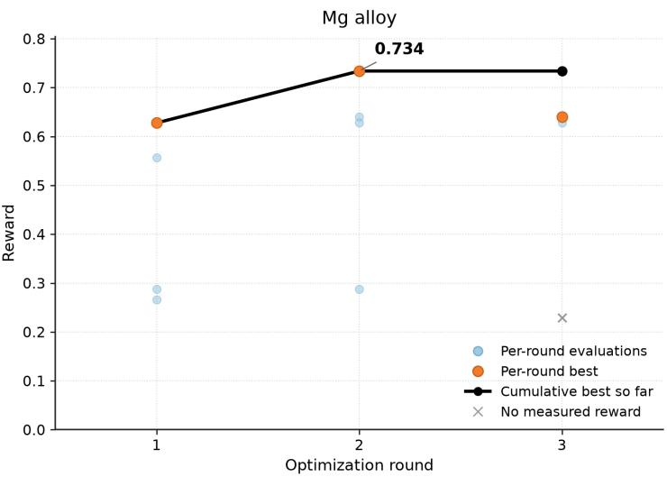

(c) Stress–strain curve  
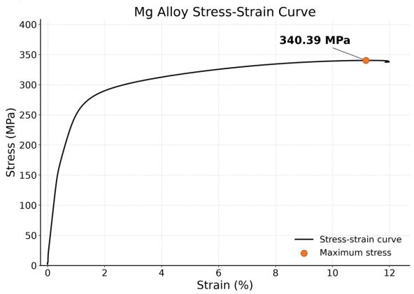

(d) Photographed alloy pieces  
  
Figure 17 | Magnesium-alloy proposals, material, and evaluation. (a) Four proposed compositions (wt.%, Mg balance), design priorities, and heat-treatment schedules; the blue row and asterisk identify selected design B. The table records proposals. (b) Three-round reward history for the frozen composite objective in Eq. 5; the best reward, 0.734, occurs in round two. The grey cross marks “No measured reward”, not a measured value at its plotted height. (c) Supplied stress–strain curve from a representative test, with an annotated maximum of 340.39 MPa. (d) Photograph of the supplied alloy pieces. The collaboration reports 342 MPa as the mean tensile strength across repeated experiments; panel (c) shows one representative test at 340.39 MPa.

Table 7 | Magnesium-alloy search choices, best recorded composition and processing conditions, and experimental outcomes. Discrete choices are shown as sets; nominal and measured compositions, and repeated-test and single-test results, are distinguished.
<table><tr><td>Quantity / variable</td><td>Search range</td><td>Unit / context</td><td>Best value</td></tr><tr><td>Optimization reward  $R _ { \mathrm { a l l o y } }$ </td><td></td><td>Dimensionless</td><td>0.734</td></tr><tr><td>Nominal yttrium content Y</td><td>{1, 2, 3, 4, 5}</td><td>wt.%</td><td>4</td></tr><tr><td>Nominal neodymium content Nd</td><td>{1, 2, 3, 4, 5}</td><td>wt.%</td><td>1</td></tr><tr><td>Nominal gadolinium content Gd</td><td>{1, 2, 3, 4, 5}</td><td>wt.%</td><td>2</td></tr><tr><td>Nominal zirconium content Zr</td><td>{0.1, 0.2, 0.3, 0.4, 0.5}</td><td>wt.%; Mg balance</td><td>0.5</td></tr><tr><td>Solution-treatment temperature</td><td>{490, 495, 500, 505, 510, 515, 520, 525}</td><td> $^ \circ \mathrm { C }$ </td><td>500</td></tr><tr><td>Solution-treatment duration</td><td>{8, 10, 12, 14}</td><td>h</td><td>14</td></tr><tr><td>Subsequent ageing temperature</td><td>{0, 200}</td><td> $^ \circ \mathrm { C }$ </td><td>200</td></tr><tr><td>Ageing duration</td><td>{0, 24, 48, 78, 102, 120, 144, 168, 192, 216, 312, 336}</td><td>h</td><td>120</td></tr><tr><td>Measured composition</td><td></td><td>wt.%; Mg balance</td><td>Mg-4.01Y -0.98Nd -1.95Gd</td></tr><tr><td>Mean tensile strength</td><td></td><td>MPa; repeated tests</td><td>–0.5Zr 342</td></tr><tr><td>Representative maximum stress</td><td></td><td>MPa; single test</td><td>340.39</td></tr></table>

The final nominal composition was Mg–4Y–1Nd–2Gd–0.5Zr, refined from the selected design B, with solution treatment at $5 0 0 ^ { \circ } \mathrm { C }$ for 14 h and ageing at $2 0 0 ^ { \circ } \mathrm { C }$ for 120 h. Physical synthesis and testing yielded a mean tensile strength of 342 MPa across repeated experiments; the representative stress– strain curve reaches 340.39 MPa (Figure 17c). The composite reward reached its best value of 0.734 in the second optimization round (Figure 17b). This case connects joint composition–processing design and expert selection to a physically realized alloy, with experimental feedback supporting further refinement.

## 3.3.5. Compressor Engineering: Centrifugal Compressor Optimization

Problem statement. The compressor-engineering collaboration targets an eficiency improvement for an existing centrifugal compressor design. The relevant choices couple impeller aerodynamics, difuser matching, and mechanical margins. A design that improves one objective can make another constraint more restrictive, so the initial ideation stage explored diferent tradeofs before focusing on geometric optimization.

Implementation. Sage-Taiyi proposed five routes addressing diferent aerodynamic and mechanical tradeofs. The first combined a boreless Ti–6Al–4V backswept splitter impeller with a hybrid difuser, targeting an eficiency greater than 0.76 while retaining aerodynamic and mechanical margins. The second combined a high-solidity impeller with � = 18 blades, a larger vaneless difuser gap, and a boreless architecture to prioritize slip and structural margin. The third combined stronger backsweep and high solidity to reduce impeller-exit absolute Mach number and improve matching to a vaned difuser. The fourth used inlet prewhirl, a wide-range vaneless or long-gap difuser, and collectorgap injection to broaden the stable operating range, with tradeofs in peak eficiency and mechanical margins. The fifth reduced the impeller outlet tip speed, $U _ { 2 } ,$ to reduce centrifugal loading and fatigue risk, while accounting for difuser matching and surge margin. Experts selected the first route for further development.

Initial design considerations covered outlet diameter and width, inlet shroud diameter, blade angles, and main-blade count. Following the workflow in Section 2.5, Taiyi-Optimizer searched the permitted geometric combinations, with computational fluid dynamics (CFD) evaluations informing subsequent parameter refinement. The final CFturbo search focused on four variables: outlet blade angle $\beta _ { 2 b . }$ , inlet blade angle $\beta _ { 1 b } ,$ main-blade count $Z _ { m } ,$ and inlet shroud diameter $D _ { 1 s }$ . Blade angles follow the CFturbo convention and are expressed in degrees; $D _ { 1 s }$ is expressed in millimetres. Table 8 gives their search ranges and optimized values. Rotational speed and design mass flow were retained as design-point context. The resulting refinement reduced blade count and rebalanced the inlet and outlet angles.

(a) Optimized compressor geometry  
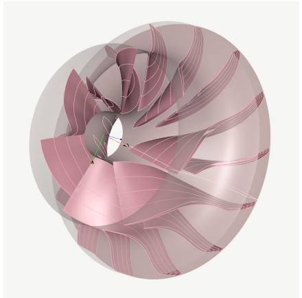

(b) Optimization reward  
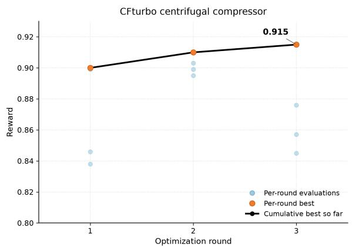

(c) Blade-to-blade total pressure (Pa)  
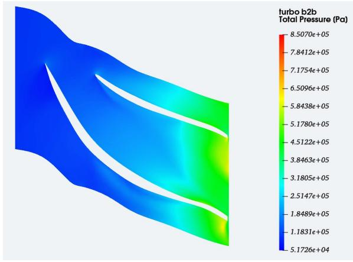

(d) Blade-to-blade velocity (m/s)  
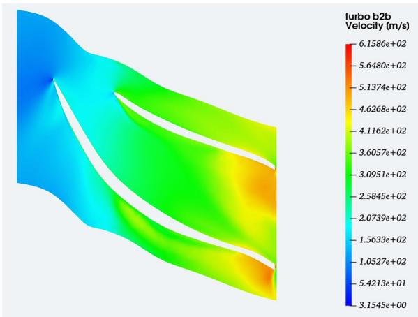

(e) Meridional total pressure (Pa)  
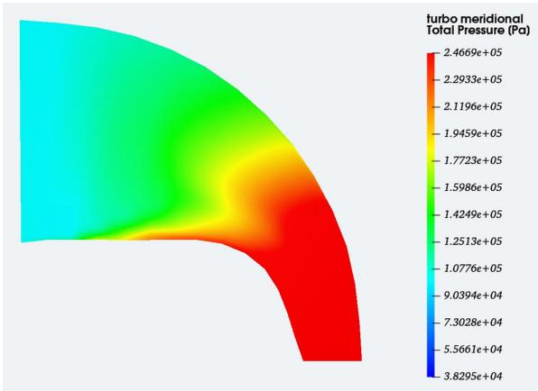

(f) Meridional static pressure (Pa)  
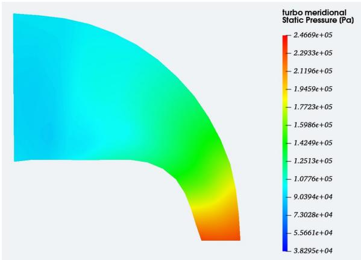  
Figure 18 | Centrifugal-compressor geometry, optimization, and CFD fields. (a) Rendering of the optimized compressor geometry. (b) Three-round reward history, reaching an annotated best of 0.915. $( \mathbf { c } , \mathbf { d } )$ Blade-to-blade total pressure (Pa) and velocity (m/s). (e,f) Meridional total and static pressure (Pa). The revised source panels retain the complete colour scales and units. These panels contain a geometry rendering and simulation/optimization outputs; the reward is the impeller eficiency, with a final value of 0.915 (91.5%) at $\mathrm { P R } = 4 . 0$

Results. The best saved configuration and reported CFD performance are summarized in Table 8:  
Table 8 | Compressor search ranges, best recorded configuration, and CFD performance. Blade count is discrete. The reward is impeller eficiency expressed as a fraction.
<table><tr><td>Quantity / variable</td><td>Search range</td><td>Unit / context</td><td>Best value</td></tr><tr><td>Optimization reward</td><td></td><td>Efficiency fraction</td><td>0.915</td></tr><tr><td>Outlet blade angle  $\beta _ { 2 b }$ </td><td>[115.6, 135.6]</td><td>0</td><td>117.0</td></tr><tr><td>Inlet blade angle  $\beta _ { 1 b }$ </td><td>[145.9,161.9]</td><td>0</td><td>153.0</td></tr><tr><td>Main-blade count  $Z _ { m }$ </td><td>{12, 13, 14, 15, 16}</td><td>Blades</td><td>12</td></tr><tr><td>Inlet shroud diameter  $D _ { 1 s }$ </td><td>[118, 132]</td><td>mm</td><td>129.0</td></tr><tr><td>CFD pressure ratio  $\mathrm { P R }$ </td><td></td><td>Dimensionless</td><td>4.0</td></tr><tr><td>CFD impeller efficiency</td><td></td><td> $\% ;$  CFD result</td><td>91.5</td></tr></table>

Across three optimization rounds, the cumulative best CFD impeller eficiency increased from approximately 90.0% to 91.0% and then 91.5%, corresponding to a final reward of 0.915 (Figure 18b). The final design achieved a pressure ratio PR = 4.0, defined as the ratio of outlet to inlet pressure. Figure 18a shows the optimized geometry, while panels c–f show blade-to-blade total pressure and velocity, followed by meridional total and static pressure. This case develops system-level design alternatives into a selected compressor geometry, with CFD feedback guiding parameter refinement.

Cross-case interpretation. Across the five collaborations, Sage-Taiyi develops scientific ideas and executable search formulations, while the research harness connects them to expert selection, optimization, and experimental or simulation-based evaluation. The resulting feedback guides subsequent research decisions, linking scientific exploration to practical advances in reactions, materials, and engineering designs.

## 4. Related Work

AI Scientists. AI research agents connect literature review, hypothesis generation, and experimentation in workflows that span computational research [54, 47, 55, 56] and laboratory discovery [7, 57, 58, 59, 60]. These systems refine hypotheses or intermediate results through critique [6, 61], carry findings forward through persistent memory and shared representations [46, 62, 63, 64, 65], and use execution results or surrogate models fitted to experimental observations to guide further search [16, 66, 67]. Work focused on scientific ideation integrates evidence from prior research, retrieves and recombines concepts, and checks proposals against existing work [68, 69, 70, 71, 72]. Search methods further develop promising ideas by exploring the literature, tracking evolving idea lineages, or progressively specifying experimental details [73, 74, 75]. Evaluations examine complementary aspects of this process, including the breadth of exploration [76], how experts assess ideas before and after implementation [77, 78], and how new proposals build on prior research [50]. Sage-Taiyi focuses on how scientific judgments formed along one branch can inform decisions elsewhere in the search. Its revisable Cognitive State retains these judgments together with their supporting evidence and the conditions under which they apply, allowing the agent to revisit them when choosing research targets and methods.

Cognitive Science-Inspired Agent Design. Classical research describes problem solving as search over representations and operators [3]; metacognition concerns how this process is monitored and controlled [9, 10]. CoALA organizes memory, internal and external actions, and decision cycles into a cognitive architecture for language agents [79]. Generative Agents uses experience retrieval and reflection to support planning [80]. Reflexion retains task feedback as verbal reflections to improve subsequent attempts [81]. Recent work also studies which reasoning methods agents use and how they select them. Cognitive Foundationsfor Reasoning and Their Manifestation in LLMs analyzes reasoning in terms of cognitive elements, including metacognitive controls, knowledge representations, and transformation operations, and finds that models underuse some elements associated with successful reasoning [82]. Chain of Mindset uses a meta-agent to select spatial, convergent, divergent, or algorithmic reasoning modes according to the evolving reasoning state [83]. Together with cognitive-science research on creative thinking, metacognition, and scientific reasoning [35, 36, 24, 19, 8, 9, 13, 11, 14, 1, 12, 21], these approaches inform the design of Sage-Taiyi’s Cognitive Repertoire and state-dependent method selection. Sage-Taiyi maintains methodological heuristics and Cognitive Operators in a Cognitive Repertoire and instantiates them for research domains. Monitoring updates the Cognitive State from search outcomes; control uses that state and the repertoire to select targets and methods, revise the Target Tree, and guide idea evolution in the Idea Graph.

## 5. Conclusion

We presented Sage-Taiyi, a metacognition-inspired architecture that uses accumulated scientific understanding to regulate scientific search. Through monitoring and control, a revisable Cognitive State and a reusable Cognitive Repertoire guide target selection, idea development, and validation. On Taiyi-Bench, Sage-Taiyi leads all eight metrics, achieving an Overall score of 54.0 compared with 47.9 for the strongest baseline. Five expert-guided collaborations further illustrate how its ideas and search formulations connect to experimental and computational validation across chemistry, materials science, and engineering.

Future work will refine the Cognitive Repertoire through accumulated research experience and examine its reuse across domains. Building on this repertoire, Sage-Taiyi will scale multi-agent collaboration to explore a broader range of high-value solutions within limited time and iteration budgets, aiming to improve the eficiency and quality of scientific discovery.

## References

[1] David Klahr and Kevin Dunbar. “Dual space search during scientific reasoning”. In: Cognitive science 12.1 (1988), pp. 1–48.

[2] David Klahr. Exploring science: The cognition and development of discovery processes. The MIT Press, 2000.

[3] Allen Newell, Herbert Alexander Simon, and Herbert Alexander Simon. Human problem solving. Vol. 104. 9. Prentice-hall, Englewood Clifs, NJ, 1972.

[4] Pat Langley. Scientific discovery: Computational explorations of the creative processes. MIT press, 1987.

[5] Chris Lu et al. “Towards end-to-end automation of AI research”. In: Nature 651.8107 (2026), pp. 914–919.

[6] Juraj Gottweis et al. “Accelerating scientific discovery with Co-Scientist”. In: Nature (2026), pp. 1–3.

[7] Ali Essam Ghareeb et al. “A multi-agent system for automating scientific discovery”. In: Nature (2026), pp. 1–3.

[8] John H Flavell. “Metacognition and cognitive monitoring: A new area of cognitive– developmental inquiry.” In: American psychologist 34.10 (1979), p. 906.

[9] Thomas O Nelson. “Metamemory: A theoretical framework and new findings”. In: Psychology of learning and motivation. Vol. 26. Elsevier, 1990, pp. 125–173.

[10] Michael T Cox. “Metacognition in computation: A selected research review”. In: Artificial intelligence 169.2 (2005), pp. 104–141.

[11] Falk Lieder and Thomas L Grifiths. “Strategy selection as rational metareasoning.” In: Psychological review 124.6 (2017), p. 762.

[12] David Klahr and Herbert A Simon. “Studies of scientific discovery: Complementary approaches and convergent findings.” In: Psychological Bulletin 125.5 (1999), p. 524.

[13] Rakefet Ackerman and Valerie A Thompson. “Meta-reasoning: Monitoring and control of thinking and reasoning”. In: Trends in cognitive sciences 21.8 (2017), pp. 607–617.

[14] Stephen M Fleming. “Metacognition and confidence: A review and synthesis”. In: Annual Review of Psychology 75.1 (2024), pp. 241–268.

[15] John H Holland. “Genetic algorithms”. In: Scientific american 267.1 (1992), pp. 66–73.

[16] Alexander Novikov et al. “Alphaevolve: A coding agent for scientific and algorithmic discovery”. In: arXiv preprint arXiv:2506.13131 (2025).

[17] Ronald A Finke, Thomas B Ward, and Steven M Smith. Creative cognition: Theory, research, and applications. The MIT Press, 1992.

[18] Jacob G Foster, Andrey Rzhetsky, and James A Evans. “Tradition and innovation in scientists’ research strategies”. In: American sociological review 80.5 (2015), pp. 875–908.

[19] Mary L Gick and Keith J Holyoak. “Schema induction and analogical transfer”. In: Cognitive psychology 15.1 (1983), pp. 1–38.

[20] Paul Thagard. “Explanatory coherence”. In: Behavioral and brain sciences 12.3 (1989), pp. 435–467.

[21] Deepak Kulkarni and Herbert A Simon. “The processes of scientific discovery: The strategy of experimentation”. In: Cognitive science 12.2 (1988), pp. 139–175.

[22] Lindley Darden. Theory change in science: Strategiesfrom Mendelian genetics. Oxford University Press, 1991.

[23] Nancy J Nersessian. “Model-based reasoning in conceptual change”. In: Model-based reasoning in scientific discovery. Springer, 1999, pp. 5–22.

[24] Dedre Gentner. “Structure-mapping: A theoretical framework for analogy”. In: Cognitive science 7.2 (1983), pp. 155–170.

[25] Keith J Holyoak and Paul Thagard. Mental leaps: Analogy in creative thought. The MIT Press, 1994.

[26] Saul Amarel. “On representations of problems of reasoning about actions”. In: Readings in artificial intelligence. Elsevier, 1981, pp. 2–22.

[27] Stellan Ohlsson. “Information-processing explanations of insight and related phenomena”. In: (1992).

[28] Günther Knoblich et al. “Constraint relaxation and chunk decomposition in insight problem solving.” In: Journal ofExperimental Psychology: Learning, memory, and cognition 25.6 (1999), p. 1534.

[29] William Bechtel and Robert C Richardson. Discovering complexity: Decomposition and localization as strategies in scientific research. The MIT Press, 2010.

[30] Mike Oaksford and Nick Chater. “A rational analysis of the selection task as optimal data selection.” In: Psychological review 101.4 (1994), p. 608.

[31] Mark Steyvers et al. “Inferring causal networks from observations and interventions”. In: Cognitive science 27.3 (2003), pp. 453–489.

[32] Nathan Rosenberg. “The direction of technological change: inducement mechanisms and focusing devices”. In: Economic development and cultural change 18.1, Part 1 (1969), pp. 1–24.

[33] Derek deS Price. “The science/technology relationship, the craft of experimental science, and policy for the improvement of high technology innovation”. In: Research policy 13.1 (1984), pp. 3–20.

[34] Nancy J Nersessian. “Model-based reasoning in distributed cognitive systems”. In: Philosophy of science 73.5 (2006), pp. 699–709.

[35] Michael D Mumford and Tristan McIntosh. “Creative thinking processes: The past and the future”. In: The Journal of Creative Behavior 51.4 (2017), pp. 317–322.

[36] Mathias Benedek et al. “The role of memory in creative ideation”. In: Nature Reviews Psychology 2.4 (2023), pp. 246–257.

[37] Agnar Aamodt and Enric Plaza. “Case-based reasoning: Foundational issues, methodological variations, and system approaches”. In: AI communications 7.1 (1994), pp. 39–59.

[38] Wenjie Lou et al. “Sage-A1.5: From Long-Horizon Execution to Scientific Exploration with Capability Composition”. In: arXiv preprint arXiv:2610.28578 (2026).

[39] Arpad E Elo. “The rating of chessplayers, past and present”. In: (No Title) (1978).

[40] Ralph Allan Bradley and Milton E Terry. “Rank analysis of incomplete block designs: I. the method of paired comparisons”. In: Biometrika 39.3/4 (1952), pp. 324–345.

[41] OpenAI. Models. Oficial model documentation. OpenAI API documentation. URL: https:// developers.openai.com/api/docs/models.

[42] Anthropic. The AI for problem solvers. Claude by Anthropic. URL: https://claude.com/product/ overview (visited on 10/08/2026).

[43] Google. Models. Gemini API, Google AI for Developers. URL: https://ai.google.dev/geminiapi/docs/models (visited on 10/08/2026).

[44] OpenAI. Codex CLI. Oficial product documentation. OpenAI developer documentation. URL: https://developers.openai.com/codex/cli.

[45] Anthropic. Overview. Claude Code Docs. URL: https://code.claude.com/docs/en/overview (visited on 10/08/2026).

[46] Yougang Lyu et al. “Evoscientist: Towards multi-agent evolving ai scientists for end-to-end scientific discovery”. In: arXiv preprint arXiv:2603.08127 (2026).

[47] Yutaro Yamada et al. “The ai scientist-v2: Workshop-level automated scientific discovery via agentic tree search”. In: arXiv preprint arXiv:2504.08066 (2025).

[48] Yijun Guo et al. “Minimalist terahertz wireless transceiver in integrated photonics”. In: Nature Communications (2026).

[49] Yunxiang Mo et al. “AgentIdeaBench: Benchmarking Scientific Ideation in the Agent Era”. In: arXiv preprint arXiv:2609.07611 (2026).

[50] Yifan Zhou et al. “Ideas Have Genomes: Benchmarking Scientific Lineage Reasoning and Lineage-Grounded Idea Generation”. In: arXiv preprint arXiv:2607.08758 (2026).

[51] Google Quantum AI. “Suppressing quantum errors by scaling a surface code logical qubit”. In: Nature 614 (2023), pp. 676–681. DOI: 10.1038/s41586-022-05434-1.

[52] Google Quantum AI and Collaborators. “Quantum error correction below the surface code threshold”. In: Nature 638 (2025), pp. 920–926. DOI: 10.1038/s41586-024-08449-y.

[53] Jinhui Wang et al. “Synchronous recognition of amines in oxidative carbonylation toward unsymmetrical ureas”. In: Science 386.6723 (2024), pp. 776–782.

[54] Chris Lu et al. “The ai scientist: Towards fully automated open-ended scientific discovery”. In: arXiv preprint arXiv:2408.06292 (2024).

[55] Jiabin Tang et al. “Ai-researcher: Autonomous scientific innovation”. In: Advances in Neural Information Processing Systems 38 (2026), pp. 9481–9520.

[56] Shiyang Feng et al. “Internagent-1.5: A unified agentic framework for long-horizon autonomous scientific discovery”. In: arXiv preprint arXiv:2602.08990 (2026).

[57] Shuxing Yang et al. “End-to-end autonomous scientific discovery on a real optical platform”. In: arXiv preprint arXiv:2604.27092 (2026).

[58] Kyle Swanson et al. “The Virtual Lab of AI agents designs new SARS-CoV-2 nanobodies”. In: Nature 646.8085 (2025), pp. 716–723.

[59] Wanhao Liu et al. “Large language models as designers for autonomous research of anisotropic polymer thermocells”. In: Cell Reports Physical Science 7.9 (2026).

[60] JINSHI LI et al. “Large Language Models in Chemistry and Materials Science: A Comprehensive Survey”. In: (2026).

[61] Ruofeng Yang, Yongcan Li, and Shuai Li. “Aris: Autonomous research via adversarial multiagent collaboration”. In: arXiv preprint arXiv:2605.03042 (2026).

[62] Xiaoyu Xiong, Yuqi Ren, and Deyi Xiong. “EvoSci: A Bio-Inspired Multi-Agent Framework for the Evolution of Scientific Discovery”. In: Proceedings of the 64th Annual Meeting of the Association for Computational Linguistics (Volume 1: Long Papers). 2026, pp. 9846–9878.

[63] Ludovico Mitchener et al. “Kosmos: An ai scientist for autonomous discovery”. In: arXiv preprint arXiv:2511.02824 (2025).

[64] Yixuan Weng et al. “Deepscientist: Advancing frontier-pushing scientific findings progressively”. In: International Conference on Learning Representations. Vol. 2026. 2026, pp. 47981– 48037.

[65] Yigeng Jiang et al. “Deep Research in Physical Sciences: A Multi-Agent Framework and Comprehensive Benchmark”. In: arXiv preprint arXiv:2606.18648 (2026).

[66] Zhongwei Yu et al. “Large Discovery Models: Empirically-grounded Model-Based Open-Ended Search”. In: arXiv preprint arXiv:2608.15669 (2026).

[67] Chenglei Si et al. “Towards execution-grounded automated AI research”. In: arXiv preprint arXiv:2601.14525 (2026).

[68] Baixuan Li et al. UniScientist: Advancing Universal Scientific Research Intelligence. Online technical report. UniPat AI. 2026. URL: https://www.unipat.ai/blog/UniScientist.

[69] Qingyun Wang et al. “Scimon: Scientific inspiration machines optimized for novelty”. In: Proceedings of the 62nd annual meeting of the association for computational linguistics (volume 1: long papers). 2024, pp. 279–299.

[70] Jinheon Baek et al. “Researchagent: Iterative research idea generation over scientific literature with large language models”. In: Proceedings of the 2025 conference of the nations of the Americas chapter of the association for computational linguistics: human language technologies (volume 1: long papers). 2025, pp. 6709–6738.

[71] Alireza Ghafarollahi and Markus J Buehler. “SciAgents: automating scientific discovery through bioinspired multi-agent intelligent graph reasoning”. In: Advanced Materials 37.22 (2025), p. 2413523.

[72] Qihao Zhao et al. “ResearchStudio-Idea: An Evidence-Grounded Research-Ideation Skill Suite from ML Conference Outcomes”. In: arXiv preprint arXiv:2607.04439 (2026).

[73] Qiyao Wang et al. “FlowPIE: Test-Time Scientific Idea Evolution with Flow-Guided Literature Exploration”. In: arXiv preprint arXiv:2603.29557 (2026).

[74] Varun Gumma et al. “IDEAgent: Agentic Quality-Diversity Search for Research Idea Generation”. In: arXiv preprint arXiv:2607.22375 (2026).

[75] Zonglin Yang et al. “Moose-chem2: Exploring llm limits in fine-grained scientific hypothesis discovery via hierarchical search”. In: Advances in Neural Information Processing Systems 38 (2026), pp. 89045–89076.

[76] Yixuan Tang and Yi Yang. “AI Research Agents Narrow Scientific Exploration”. In: arXiv preprint arXiv:2605.27905 (2026).

[77] Chenglei Si, Diyi Yang, and Tatsunori Hashimoto. “Can llms generate novel research ideas? a large-scale human study with 100+ nlp researchers”. In: International Conference on Learning Representations. Vol. 2025. 2025, pp. 94003–94092.

[78] Chenglei Si, Tatsunori Hashimoto, and Diyi Yang. “The ideation-execution gap: Execution outcomes of llm-generated versus human research ideas”. In: International conference on learning representations. Vol. 2026. 2026, pp. 74195–74240.

[79] Theodore R Sumers et al. “Cognitive architectures for language agents”. In: arXiv preprint arXiv:2309.02427 (2023).

[80] Joon Sung Park et al. “Generative agents: Interactive simulacra of human behavior”. In: Proceedings of the 36th annual acm symposium on user interface software and technology. 2023, pp. 1–22.

[81] Noah Shinn et al. “Reflexion: Language agents with verbal reinforcement learning, 2023”. In: URL https://arxiv. org/abs/2303.11366 1 (2023), p. 5.

[82] Priyanka Kargupta et al. “Cognitive foundations for reasoning and their manifestation in llms”. In: arXiv preprint arXiv:2511.16660 (2025).

[83] Tianyi Jiang et al. “Chain of Mindset: Reasoning with Adaptive Cognitive Modes”. In: arXiv preprint arXiv:2602.10063 (2026).

## A. Contributions and Acknowledgments

## Lead authors

Weida Wang, Benteng Chen, Yigeng Jiang, Shuchen Pu, Weiping Shen, Zichao Liu, Yulin Su, Zitong Wang, Siyu Zhou, Zifu Wang

## Contributors

Yizhi Li, Xin Zong, Yuning Yang, Jixiang Bi, Yuan Wang, Chuyi Peng, Shiyao Geng, Qi Zhang, Kuan Lu, Mengzhu Li, Weiwang Xu, Peishan Xiang, Chengjun Liu, Chengrui Wei, Fangchen Yu, Shengji Tang, Yichen Jiang, Jingqi Ye, Cheng Yang, Tao Hu, Jianbiao Mei, Qinglong Cao, Kun Li, Yixin Chen, Shengyuan Xu, Juncheng Xiao, Yiheng Wang, Ruizhe Chen, Shiyang Feng, Runmin Ma, Xiangchao Yan, Zongsheng Cao, Haomeng Hu, Yu Ke, Taihui Wu, Meng Dai, Xu Guo, Haoyang Peng, Yinglong Ni, Pingsen Shi

## Scientific Directors

Xiaosong Wang, Shuyue Hu, Haijun Li, Sherry Dongqi Bao, Yang Yang, Chao Yang, Jie Hou, Tianfan Fu, Yi Gong, Jin Zeng, Mao Su, Hongxia Hao, Fanyang Mo, Fenghua Ling, Tianshu Yu, Yunqi Cai, Baihong Chi, Jingwei Wang, Lei Wang, Chuncheng Bu, Shide Lv, Guangyu Wang, Yuqiang Li, Chunfeng Song, Lei Bai, Hui Wang, Xujun Fu

## Advisors

Li Cao, Lei Chen, Dahua Lin, Xing Xie, Bowen Zhou

## Core Directors

Wenlong Zhang, Pinlong Cai, Peng Ye, Aiwen Lei, Jie Li, Shengchun Wang

## Project Leader

Bo Zhang, Shufei Zhang