# Steering Emergent Behavior in Multi-Agent LLM Systems via Information Networks

Sepehr Ilami1, Babak Heydari1,2

1Department of Mechanical and Industrial Engineering, Northeastern University, Boston, MA, USA 2Network Science Institute, Northeastern University, Boston, MA, USA ilami.a@northeastern.edu, b.heydari@northeastern.edu

## Abstract

Large language model (LLM) agents increasingly operate in groups, each pursuing an individual objective while jointly determining the performance of the overall system. This raises a governance question: if an operator can control which agent observes which other agent—but not their payoffs or their messages—how should these observations be structured so that the group attains higher collective welfare? We make the information network—who observes whom—a design object, decoupled from the fixed interaction network over which the agents act. Ten identical LLM agents play repeated groupdecision games; by default each observes only an anonymous summary of the group's previous-round outcome, and a manager with a fixed budget then adds directed observation links, where a link from i to j lets i observe j’s past actions. Across 1,080 episodes and six games spanning coordination, anticoordination, social dilemmas, and discovery, we ask two questions in sequence: how much information to share, and at a fixed budget—who should observe whom. The organizing mechanism is that disclosure creates behavioral coupling: agents condition their choices more strongly on what others have done, so observation acts as a contagion channel whose welfare effect depends on the alignment between individually attractive behavior and the collective objective. First, the value of information is alignment-contingent: more peer information tends to improve or leave welfare unchanged when individual behavior is broadly aligned with the collective goal, but under free-riding or congestion externalities it amplifies individually attractive yet collectively harmful behavior, so more is no longer better—in a public-goods game the group does best with no information at all. This sign separation holds across all six games within a single controlled LLM population; we read it as a cross-game empirical regularity rather than a model-invariant law. Second, at a fixed budget who observes whom matters primarily when coupling is harmful: architecture is nearly irrelevant in the aligned games but consequential under free-riding and congestion, where a modular “barbell" that lets sub-populations entrench harmful behavior is reliably the worst wiring—reversing the network-reciprocity intuition from human evolutionary game theory, while a well-mixed network is safer. These results argue against a default of full transparency for agent collectives: before deciding how much information to reveal or how to route it, an operator should ask what behavior greater visibility will amplify.

## Introduction

LLM-based agents increasingly act on behalf of people and organizations, and increasingly act together: negotiating, allocating resources, coordinating, and competing, both within a single system and across systems operated by different parties (Park et al. 2023; Wu et al. 2024; Guo et al. 2024). When many such agents interact, they form a small society whose collective behavior no one has designed directly, and recent work shows that conventions, biases, and cooperation can emerge in such populations (Ashery, Aiello, and Baronchelli 2025; Riedl 2026; Ren et al. 2024). Ensuring that this society behaves well—so that self-interested local choices yield acceptable system-level outcomes—is becoming a central problem in agentic AI.

A large literature asks how to govern multi-agent AI systems so that decentralized, self-interested behavior yields good outcomes for the system as a whole (Wang et al. 2024; Xi et al. 2025; Guo et al. 2024). Many of the available levers reshape the agents or their coupling: designing personas and roles (Park et al. 2023; Hong et al. 2024), training or fine-tuning the underlying policies (Subramaniam et al. 2025), engineering the communication protocol (Du et al. 2024; Madmoun and Lahlou 2026), or tuning incentives and payoffs. The most studied structural lever is the interaction network—who acts on, or transacts with, whom—because network structure strongly shapes cooperation, learning, and how behavior spreads (Lazer and Friedman 2007; Mason and Watts 2012; Centola and Macy 2007). Rewiring that network, however, is often impractical or simply unavailable to an operator: the interaction topology is usually an exogenous feature of the task or environment—a market's set of counterparties, a supply chain, an established division of labor—and, much as ties between human organizations and institutions cannot be created or severed at will, it cannot be freely redrawn. This motivates a lever that operates on top of a fixed interaction structure and that has drawn comparatively little attention: information—what each agent is permitted to observe about the others (Chen et al. 2026).

Information is appealing precisely because it is decoupled from the interaction network: it remains available even when that networkand the agents' incentives—are fixed. Who observes whom—the information network, as distinct from the interaction network—determines how behavior propagates through the group. This makes observation a design object, and a constrained one, since it consumes privacy, bandwidth, and attention. It also raises a possibility that runs counter to intuition: more information need not be better. For a single decision-maker, additional information can only help; in strategic settings, however, revealing more can reduce welfare for every participant (Hirshleifer 1978; Morris and Shin 2002).

The reason, in our setting, is that observation creates behavioral coupling: as agents see more of what others have done, they condition their own choices more strongly on it, so a behavior that takes hold in part of the group tends to spread through the rest. Whether that coupling helps or hurts is not a property of information as such but of alignment: when the behavior that is individually attractive also serves the collective objective, coupling accelerates the group toward a good outcome; when private and collective incentives diverge— free-riding in a public-goods dilemma, over-attendance in a congestion game—the same coupling propagates the individually attractive but collectively harmful behavior. Information is thus a lever whose sign is set by the strategic environment, not a uniformly beneficial resource.

We treat the operator of an agent collective as an information architect and ask the two questions such an architect faces, in the order they arise. The first concerns the amount of information: when does more peer information improve collective welfare—and when can it make things worse? Once the value—and, as we find, the sign—of information is known, a second, relational question follows: holding the amount of information fixed, does it matter who observes whom—and under what strategic conditions? At a fixed budget, does the topology of the observation network matter, and does the best topology depend on the alignment between private and collective incentives (architecture)? We pose these as RQ1 (amount) and RQ2 (architecture). A third question—when, at a fixed budget, information should be disclosed—is a natural extension; our exploratory analysis of it finds only fragile effects, so we report it as a supplementary finding rather than a headline result (SI, §Supplementary Timing Analysis).

Collectives of identical LLM agents are a suitable testbed. First, the agents are interchangeable—the same model with the same prompt and no individual personas—so any structure in their collective behavior is attributable to the information network rather than to differing preferences. Second, classical games each isolate a single strategic tension with well-understood theory: coordination rewards agreement, anti-coordination rewards divergence, and social dilemmas set private incentives against the common good. Crucially, we allow only observation of past actions—never agent-to-agent messages—which isolates the effect of information structure from the effect of communication studied elsewhere (Madmoun and Lahlou 2026; Du et al. 2024).

Our contributions answer the two questions and, together, yield a compact design rule. (i) For amount, we establish that the value of information is alignment-contingent: across six games the rank correlation between welfare and the information budget is non-negative for every game in which individual behavior is broadly aligned with the collective objective and negative for every game with a free-riding or congestion externality—a consistent sign separation across the six, including a public-goods game in which full information is strictly worse than none. We find this as a cross-game empirical regularity within one controlled LLM population, not a model-invariant law. (ii) For architecture, we show topology is a conditional lever: it is statistically irrelevant in the aligned games but consequential in every misaligned game, where a modular bottleneck is reliably the worst wiring—reversing the network-reciprocity intuition from human evolutionary game theory. Timing, an exploratory extension at a fixed budget, produces only effects that do not survive multiplecomparison correction; we summarize it as a supplementary finding. All statistical tests and tables, and the full game specifications and prompts, are in the Supplementary Information (SI) appended to this paper.

## Related Work

Multi-agent LLM systems. A rapidly growing body of work builds LLM agents that collaborate through structured communication—debate (Du et al. 2024), role-based software teams (Hong et al. 2024; Qian et al. 2024), conversational frameworks (Wu et al. 2024), and society simulations (Park et al. 2023; Gao et al. 2023)—surveyed in Wang et al. (2024); Xi et al. (2025); Guo et al. (2024). These systems treat messages as the medium of coordination. We instead hold the agents' communication channel closed and make the observation network—who can see whose past actions— the sole design object, isolating information structure from message content.

Emergent collective behavior in LLM populations. Recent studies document emergent conventions and collective bias (Ashery, Aiello, and Baronchelli 2025), emergent coordination (Riedl 2026), norm formation (Ren et al. 2024), sustainable cooperation under scarcity (Piatti et al. 2024) and characteristic departures from human group behavior (Maini, Goldstone, and Tiganj 2026). This work establishes that LLM collectives exhibit genuine emergence; we ask the complementary design question of how to shape the information substrate on which that emergence rides.

Value of information and social learning on networks. That more public information can lower welfare in strategic settings is a classical result (Hirshleifer 1978; Morris and Shin 2002). On the mechanism side, we draw on models of imitation and social influence on networks (DeGroot 1974; Golub and Jackson 2010; Friedkin and Johnsen 1990; Flache et al. 2017) and on findings that social influence can synchronize error and undermine collective accuracy (Lorenz et al. 2011; Centola and Macy 2007). Networked exploration/exploitation trades off the speed of information spread against diversity (Lazer and Friedman 2007; Mason and Watts 2012), and group-decision research shows that what information is shared shapes collective performance (Stasser and Titus 1985; Woolley et al. 2010; Roberts and Goldstone 2011). We port these ideas to LLM collectives and make the network the controlled variable.

Information-network design for agentic AI. Closest to our framing is work that treats information flow as a governance mechanism for multi-agent AI—adaptively modulating what agents observe (Chen et al. 2026) and studying how network opacity drives strategic escalation (Ebrahimi et al. 2026). We contribute a controlled, game-spanning characterization of how the amount and topology of observation map to welfare, with the timing of disclosure examined as an exploratory extension.

## Model and Methods

## Setup and Objective

There are N=10 identical agents, all able in principle to interact, playing $T { = } 2 0$ rounds. In each round agent i selects an action $a _ { i } ^ { t }$ and receives a payoff $u _ { i } ^ { t }$ . By default an agent observes very little: only its own history and a single anonymous summary of the group's outcome in the previous round (for example, "the group sum was too high"), never any specific peer's play. The manager augments this by adding observation links. Formally, the manager selects a directed network $G = ( N , E )$ in which a link $i  j$ denotes “i observes $j ^ { \flat } ($ the link reveals $j ^ { \prime } { \bf s }$ past actions, subject to a budget of at most $K$ links. Two constraints preserve the intended structure: links reveal actions only, never payoffs, and only from completed rounds. Because all agents are identical in round 1, the manager commits the network after round 1 and holds it fixed thereafter. The base prompt is identical across all agents and conditions except the information block populated from each agent's in-edges; all prompts are reproduced verbatim in the SI.

We deliberately hold the underlying agent policy fixed and use identical instances of a single open-weight model. Our objective is causal identification of the information-network effect: varying model families, capabilities, personas, and roles simultaneously with the observation network would introduce additional sources of behavioral heterogeneity. The model therefore serves as a controlled stochastic policy substrate rather than as a representative sample of all LLMs. Generalization in this study is sought across strategic environments and information interventions; transport across model families remains a separate empirical question.

The manager maximizes the group's discounted cumulative welfare, with discount $\gamma { = } 0 . 9 5 \colon$

$$
W ( G ) = \operatorname { E } \left[ \sum _ { t = 1 } ^ { T } \gamma ^ { t - 1 } \sum _ { i \in N } u _ { i } ^ { t } ( G ) \right] , \qquad \operatorname * { m a x } _ { G : | E | \leq K } W ( G ) .\tag{1}
$$

Because $\gamma < 1$ , attaining high welfare sooner is rewarded. For games without a natural per-round payoff (pure coordination, such as sum-guessing), welfare is measured by proximity to the target, $\quad \ : u _ { i } ^ { t } = - \left| \mathrm { s u m } ^ { t } - \theta ^ { \star } \right|$ , so that faster convergence scores higher.

## A Behavioral-Coupling Account of the Value of Information

To reason about the effect of a given network, we adopt a standard model of imitation on a graph (DeGroot 1974; Golub and Jackson 2010). Each agent adjusts toward the average action of the peers it observes, while also being drawn toward a game-specific target by the feedback signal.

Writing M for the row-normalized observation matrix, a linear caricature of this dynamic is

$$
\mathbf { a } ^ { t + 1 } = \eta \theta ^ { \star } \mathbf { 1 } + \left[ \left( 1 - \eta - \kappa \right) I + \kappa M \right] \mathbf { a } ^ { t } ,\tag{2}
$$

with imitation strength κ and feedback strength $\eta .$ The observation network thus induces behavioral coupling: it is a contagion channel along which disclosing more of a fixed budget, or wiring it to mix faster, spreads whatever the population is currently doing. This yields one qualitative hypothesis that unifies both questions and that we test rather than assume—the welfare effect of information is approximately (how fast behavior mixes) × (the sign of whether the spreading behavior is aligned with the collective objective). The mixing rate is governed by the spectral gap of M; the sign is set by the alignment between individually attractive behavior and the collective goal in the game at hand. Because these can act in opposite directions across games, the value of information is neither monotone nor generically maximized at full disclosure (Hirshleifer 1978; Morris and Shin 2002). We stress that the sign is an emergent property of how this agent population actually behaves under coupling, not a deduction from the game's label: coupling could in principle spread cooperation as readily as free-riding, and which one it spreads is an empirical question we answer below. That observation induces this coupling at all is not merely assumed: in a direct log-level test, an agent's action change is significantly predicted by the prior actions of the peers it observes—over and above the population trend, and with the game-appropriate sign (imitation in five games, avoidance in the anti-coordination game)—in every one of the six games (SI, §Direct Test of Behavioral Coupling; Table S7, Fig. S6).

## The Games

Our six games span the strategic tensions the study requires, and we group them not by an a priori “cooperative/competitive" label but by the property that our account makes decisive: the alignment between the behavior an individual agent finds attractive and the collective objective. Relatively aligned environments are those in which imitating the prevailing action is broadly consistent with collective welfare: bandit, a discovery game in which one agent's trial of an unknown option informs everyone (so exploring is a public good); and sum-guessing and stag-hunt, coordination games in which the group wins by agreeing. Misaligned environments—those with a private-collective conflict or a negative externality—are those in which the individually attractive action is collectively harmful: pgg, a public-goods dilemma in which each agent is tempted to free-ride; and elfarol, an anti-coordination/congestion game in which a venue is enjoyable only if uncrowded, so the group must spread out. threshold-pgg is a deliberate hybrid: a free-riding dilemma wrapped around a coordination problem, since the group earns nothing unless it jointly clears a contribution threshold, so coupling can spread free-riding (harmful) or help the group coordinate the push over the threshold (helpful). stag-hunt is a deliberate saturated control: under a unanimity threshold the model coordinates on the good equilibrium under essentially any disclosure, so its information gradient is flat by construction. In every game an agent chooses without seeing others' current actions, so the manager's links— which reveal only past actions—are the sole route by which one agent learns what the others are doing. Full action spaces, payoffs, feedback signals, parameters, and verbatim prompts are given in the SI (Table S1 and §Game Specifications).

## Experimental Design

Each research question isolates one property of the network; the space of feasible networks is combinatorially large (\~ 1023 at N=10, K=30), so we do not search it exhaustively. RQ1 (amount). We sweep the quantity of information by adding random observation links up to a budget K ∈ {0, 10, 25, 40, 55, 70, 90}. The endpoints are the natural extremes: K=0 is the no-information baseline and K=90=N(N−1) is the complete directed graph (full information). Drawing links at random isolates the effect of quantity from that of any particular structure.

RQ2 (architecture). At a matched budget of E=40 directed edges we compare four structural extremes. The design is organized by the two structural properties that a contagion account and the collective-behavior literature identify as governing how a behavior spreads or is contained, and that remain independent on a small graph: modularity (community structure) and degree heterogeneity (hubs). Modularity determines whether behavior stays local or spreads globally—a highly modular graph is a set of “incubation zones" weakly coupled by bridges, and it is precisely the property that collapses the spectral gap of Eq. (2), creating a mixing bottleneck. Degree heterogeneity determines whether the network has hub amplifiers that can broadcast a behavior to many neighbors at once. We realize the extremes of each axis as four canonical graphs: a degree-heterogeneous hub and a regular graph (degree heterogeneity max/min), and a modular barbell—two communities joined by a bridge— and a well-mixed expander (modularity max/min). Their spectral gaps are 0.34/0.44/0.40/0.07 and modularities 0.12/0.19/0.10/0.45 (hub/regular/expander/barbell), so the barbell is a pronounced bottleneck. Because modularity, spectral gap, clustering, and degree structure co-vary across only four architectures, we treat these as jointly varying probes of local entrenchment rather than as separable causes; the SI (§Structural Metrics) gives the full rationale and reports that we therefore never attribute an effect to a single metric.

An exploratory timing analysis. Holding the total edgeround budget fixed, we also compare three disclosure schedules—constant,front-loaded, and back-loaded—at two budget anchors, to ask whether when information is disclosed matters independently of how much. Because its effects prove statistically fragile, we report it as a supplementary finding rather than a formal RQ; the design and full results are in the SI (§Supplementary Timing Analysis).

Data, scale, and statistics. In total we conducted 1,080 episodes—the RQ1 budget sweep (7 budgets), the RQ2 architecture comparison (4 architectures), and the exploratory timing analysis (2 schedules × 2 anchors)—each crossed with the six games and 12 seeds—on qwen2 .5 : 7b (temperature 0.7), served locally, comprising roughly 216k model calls. All figures show mean ±1 SEM across seeds. Tests are matched to each question and reported in full in the SI: a Spearman trend and Cliff's δ for amount (Table S2); a Kruskal–Wallis (KW) omnibus with per-architecture rankings for architecture (Table S4); and, for the timing analysis, a seed-paired bootstrap CI with Benjamini-Hochberg (BH) FDR correction and a TOST equivalence test (Table S6). Sample size is a genuine limitation and is reported per cell.

## Results

## RQ1 (Amount): When Does More Information Help? The Alignment-Contingent Value of Information

In our experiments, more peer information tends to improve or leave collective welfare unchanged when individual behavior is broadly aligned with the collective objective. Under free-riding or congestion externalities, however, additional information can amplify individually attractive but collectively harmful behavior, so more information is no longer necessarily better.

The behavioral-coupling account of Eq. (2) organizes this: disclosing more of a fixed budget couples agents' choices more tightly and spreads whatever the population is doing, so where the prevailing behavior is aligned with the collective goal (discovery, coordination) coupling accelerates convergence and raises welfare, whereas where it is misaligned it propagates free-riding (dilemmas) or synchronizes over-/under-attendance (congestion) and lowers it. Figure 1 makes the flip visible: welfare rises with the budget K for the three aligned games (top) and falls for the three misaligned games (bottom), and every curve is non-monotone (“more is not better"). The result we report is an overall cross-game rank pattern, not pointwise monotonicity within any game (the curves have interior peaks and valleys) and not a universal law: the rank correlation between welfare and K is non-negative for every aligned game and negative for every misaligned game—a consistent sign separation across all six games within this single controlled LLM population (game-level Mann-Whitney one-sided p=0.05), with five of six games individually significant and large Cliff's δ in both directions (full statistics in Table S2). We read this as a cross-game empirical regularity; whether it transports to other model families is a separate question (see Limitations).

The most striking case is the public-goods game PGG, whose welfare is highest with no information and erodes as the budget grows. In principle coupling in a public-goods game could spread either cooperation or free-riding; in this population it mainly spreads low contributions, so observation lets agents imitate one another downward. This is what makes the sign an emergent property of the interaction between the game's incentives and the agents' endogenous behavior, not a consequence of the game label alone. The only non-significant cell is the saturated control sTAG-HuNT, whose gradient is flat by design. Because the direction of the effect is what a designer most needs to know, this is the paper's primary result. Its development over the episode—the K-driven gap opening progressively rather than at any single round—is shown in the SI (Fig. S1).

The most structured departure from a clean decline is THREsHoLD-PGG, whose curve traces a shallow valley rather than a straight line: welfare falls from its no-information 1evel (3628) to a trough near K=40 (3057), recovers through K=55–70 (to 3572, essentially its K=0 value), then drops to its minimum at full disclosure (2793). This non-monotonicity is what the game's hybrid structure predicts. Threshold public goods is a dilemma wrapped around a coordination problem—each agent is tempted to free-ride, yet the group earns nothing unless it jointly clears the contribution threshold—so information pulls in opposite directions: it spreads free-riding (harmful, as in PGG) but also helps agents coordinate the collective push over the threshold (helpful, as in a coordination game). The early dip is free-riding contagion taking hold; the mid-budget recovery is the coordination benefit briefly gaining the upper hand; full disclosure tips the balance back, saturating defection. The between-seed variance spikes in exactly this mid-budget region (SEM roughly quadruples), so we read the valley as a qualitative signature of the game's dual nature rather than a sharply located extremum—the net trend remains negative (Table S2).

## RQ2 (Architecture): Who Should Observe Whom?

Holding the information budget fixed, who observes whom matters primarily when behavioral coupling is potentially harmful. When private and collective objectives are broadly aligned, the population is relatively robust to how information is routed. Under free-riding and congestion, network structure becomes consequential because it determines where harmful behavior is amplified or exposed to broader correction.

We compare four canonical topologies at E=40 (Fig. 2, top), and two findings emerge.

Architecture matters only where coupling is harmful. The KW omnibus is significant in all three misaligned games—PGG (p=0.0008), EL-FAROL (p=0.004), and THRESHoLD-PGG (p=0.015)—and non-significant in the two coordination games (sUM-GUESSING p=0.79, STAG-HUNT p=0.076), which converge to the good equilibrium regardless of wiring. (BANDIT is nominally significant, p=0.019, but the welfare spread across topologies is under 2% and negligible.) This mirrors RQ1: structure is a lever only in the regime where the spread of behavior is harmful, and is inert where the collective is robust. Per-game rankings are in Table S4.

The barbell penalty. The robust empirical result is the poor performance of the modular barbell: where architecture matters, it is reliably the worst wiring, costing 13- 33% of welfare in the misaligned games relative to the best topology. This ranking is what the data show and is stable across all three misaligned games. The explanation we favor—consistent with, though not uniquely identified by, the evidence—is local entrenchment: the barbell is the graph in which modularity, clustering, and the spectral gap all move together toward a mixing bottleneck (its spectral gap collapses to 0.07), so each sub-population independently entrenches free-riding (dilemmas) or mis-coordinates congestion, with the single bridge starving the population-level signal that would otherwise average the harm away; a wellmixed network keeps that signal intact. Because these four structural metrics co-vary across only four architectures, we do not attribute the penalty to modularity or the spectral gap in isolation—we report the KW omnibus and the barbell contrast, not single-metric regressions, and give the full metric profiles and this caveat in the SI (Table S5, §Structural Metrics). Notably, the sign of the barbell penalty reverses the intuition from human evolutionary game theory, where modular, clustered structure sustains cooperation through network reciprocity—clustered cooperators out-earn peripheral defectors and resist invasion (Centola and Macy 2007). That mechanism relies on fitness-based selection among strategies; our agents instead follow a softer, feedback-driven coupling with no such selection, so modular incubation zones amplify the prevailing behavior, which in a misaligned game is the harmful one. The degree-heterogeneous hub tends to be the best wiring, consistent with a well-connected amplifier broadcasting the (feedback-corrected) population signal though this secondary tendency is less cleanly separated than the barbell penalty.

## Synthesis: A Two-Part Information-Engineering Playbook

The two questions resolve into a two-part design framework in which the levers act at decreasing importance and increasing uniformity. (1) Amount (primary; alignmentcontingent). Ask what behavior greater visibility would amplify: is the individually attractive action broadly aligned with the collective objective, or does a free-riding or congestion externality set them against each other? Disclose generously in the former, sparingly in the latter—where behavior is misaligned, less is more. (2) Architecture (secondary; conditional). Where coupling is harmful, keep the network well-mixed and avoid modular bottlenecks that let harmful behavior entrench locally; where it is benign, topology can be ignored. The unifying asymmetry is that the more harmful the coupling that information would create, the more both its amount and its routing matter; where the coupling is benign, the collective is robust to both. The transferable claim is the alignment-contingent value of information for amount, reinforced by the conditional sensitivity of architecture.

An exploratory analysis in the SI examines whether the timing of peer information matters when its total amount is fixed. Timing has little effect in the relatively aligned games but produces more noticeable differences under free-riding and congestion. Because these effects do not remain significant after multiple-comparison correction, we treat them as preliminary evidence that timing may matter more when individual and collective interests are misaligned. These results motivate adaptive, state-dependent timing interventions that respond to emerging collective behavior rather than following a predetermined schedule.

## Discussion

The design implication. The first question for an information architect should not be simply how much information can be shared, but what behavior additional visibility will amplify. When that behavior supports the collective objective, greater observability is comparatively safe; when individual and collective incentives diverge, both the amount and routing of information require deliberate design.

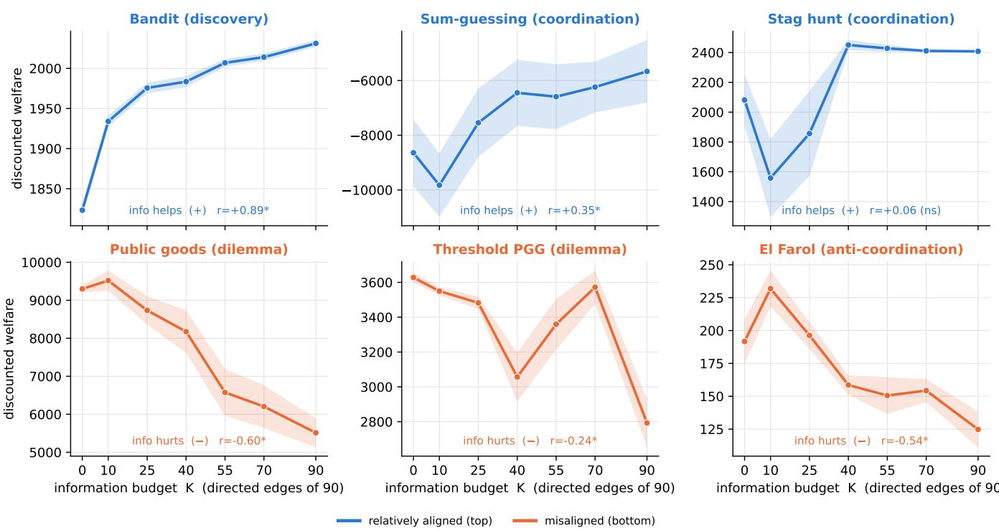  
Figure 1: RQ1 — is more information better? Discounted welfare (mean ±1 SEM over 12 seeds) against the information budget K. Top: relatively aligned games—more information helps. Bottom: misaligned games (free-riding and congestion)—more information hurts. All effects are non-monotone; the sign tracks the alignment between individually attractive behavior and the collective objective. Full trend statistics are in Table S2.

Implications. Treating the observation network as the design object positions multi-agent LLM systems as a testbed for emergent behavior, with relevance to network science, computational social science, and any setting in which interacting AI agents influence one another's decisions while pursuing both individual and system-level goals. The central conclusion is that information is a genuine governance lever, but its direction and magnitude depend on the game and the budget. This argues against a default of full transparency: in some regimes the welfare-maximizing choice is to reveal less information, or to reveal it in a more well-mixed pattern.

Bridging the two questions. The two levers are one mechanism seen from two angles, and the behavioral-coupling account—roughly, mixing speed × the sign of what is coupled—connects them. The amount of information is the dominant lever and acts in every game, because it fixes both the sign and the strength of the coupling (RQ1). Architecture is not a separate mechanism but a spatial composite of amount: at a fixed budget, a topology acts on welfare through the rate and reach with which behavior propagates across the population—its spectral gap—and choosing a topology is choosing where to concentrate that coupling. This lens resolves an apparent puzzle. If slow spread simply meant “less" information, the modular barbell should help the misaligned games (where less information helps); instead it is the worst wiring. The resolution, consistent with the localentrenchment reading, is that the bottleneck does not reduce the harmful coupling—it localizes it: each community mixes quickly internally and saturates the bad behavior, while the single bridge starves the population-level signal that would otherwise average the harm away. Architecture is thus coupling made heterogeneous across the network, and that is why it is a lever only in the misaligned regime—mirroring RQ1, where the spreading behavior is benign, neither its amount nor its spatial arrangement matters.

Theory versus behavior. Where the contagion account and the a priori game labels disagree, the behavior is informative: both public-goods variants behave as dilemmas in which more information hurts, which we regard as a strength of the testbed—mechanistic theory and LLM-agent experiments can inform and correct one another.

Limitations. Four limitations bound our claims. (i) Single model. The experiments establish the information-network effect within one controlled LLM population, not a model-

RQ2 — Architecture at matched budget (E=40): the modular 'barbell' is the worst wiring for the misaligned games

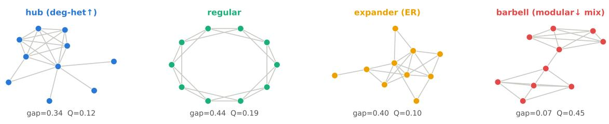

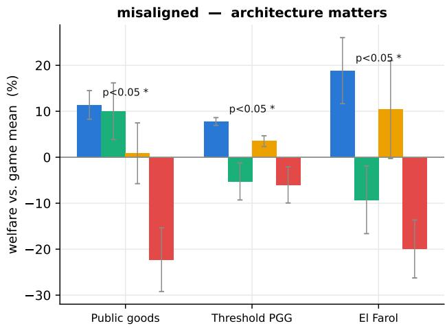

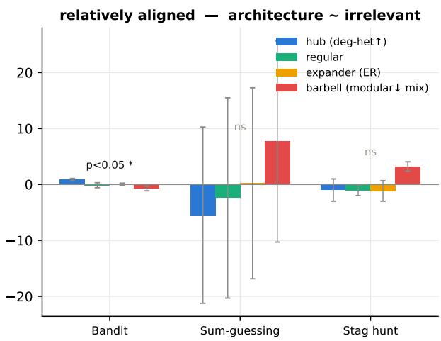  
Figure 2: RQ2 — who observes whom, at matched budget (E=40). Top: the four canonical topologies (undirected skeletons) with spectral gap and modularity Q. Bottom: welfare relative to each game's mean (mean ±1 SEM); misaligned games (left) vs. aligned games (right). The modular barbell (red) is the worst wiring for the misaligned games; for the aligned games topology is effectively irrelevant. Per-game rankings and metric profiles are in Tables S4–S5.

invariant law. The proposed contagion account predicts transfer to agent populations that exhibit comparable observationconditioned imitation, but cross-model transport requires direct testing. Even a limited replication of RQ1 with a second model on a few representative games and budgets would sharpen the scope of the regularity. (ii) We included one anti-coordination game, so the congestion side of the sign pattern is a single point rather than a family. (iii) The timing results are exploratory: with 12 seeds per cell no schedule contrast survives FDR correction, so they are reported with equivalence caveats rather than as proven effects or absences of effect. (iv) Because several structural metrics co-move at N=10, we report architecture effects against the KW omnibus and the barbell contrast and refrain from single-metric attribution. Each is a natural target for higher-replication, multi-model follow-up work.

## References

Ashery, A. F.; Aiello, L. M.; and Baronchelli, A. 2025. Emergent Social Conventions and Collective Bias in LLM Popu-1ations. Science Advances, 11(20): eadu9368.

Centola, D.; and Macy, M. 2007. Complex Contagions and

the Weakness of Long Ties. American Journal of Sociology, 113(3): 702–734.

Chen, Q.; Ilami, S.; Lore, N.; and Heydari, B. 2026. Adaptive Information Modulation: Designing Governance Mechanisms for Multi-Agent Artificial Intelligence Systems. Journal of Mechanical Design, 148(4): 041708.

DeGroot, M. H. 1974. Reaching a consensus. Journal of the American Statistical Association, 69(345): 118–121.

Du, Y.; Li, S.; Torralba, A.; Tenenbaum, J. B.; and Mordatch, I. 2024. Improving Factuality and Reasoning in Language Models through Multiagent Debate. In Proceedings of the 41st International Conference on Machine Learning (ICML).

Ebrahimi, R.; Ilami, S.; Heydari, B.; Trevino, I.; and Franceschetti, M. 2026. The Architecture of Illusion: Network Opacity and Strategic Escalation. arXiv preprint arXiv:2602.10053.

Flache, A.; Mäs, M.; Feliciani, T.; Chattoe-Brown, E.; Deffuant, G.; Huet, S.; and Lorenz, J. 2017. Models of social influence: Towards the next frontiers. Journal of Artificial Societies and Social Simulation, 20(4).

Friedkin, N. E.; and Johnsen, E. C. 1990. Social influence and opinions. Journal of Mathematical Sociology, 15(3-4): 193-206.

Gao, C.; Lan, X.; Lu, Z.; Mao, J.; Piao, J.; Wang, H.; Jin, D.; and Li, Y. 2023. S3: Social-network Simulation System with Large Language Model-Empowered Agents. arXiv:2307.14984.

Golub, B.; and Jackson, M. O. 2010. Naive learning in social networks and the wisdom of crowds. American Economic Journal: Microeconomics, 2(1): 112–149.

Guo, T.; Chen, X.; Wang, Y.; Chang, R.; Pei, S.; Chawla, N. V.; Wiest, O.; and Zhang, X. 2024. Large Language Model Based Multi-Agents: A Survey of Progress and Challenges. arXiv preprint arXiv:2402.01680. IJCAI 2024 Survey Track.

Hirshleifer, J. 1978. The private and social value of information and the reward to inventive activity. In Uncertainty in Economics, 541–556. Elsevier.

Hong, S.; Zhuge, M.; Chen, J.; Zheng, X.; Cheng, Y.; Zhang, C.; Wang, J.; Wang, Z.; Yau, S. K. S.; Lin, Z.; Zhou, L.; Ran, C.; Xiao, L.; Wu, C.; and Schmidhuber, J. 2024. MetaGPT: Meta Programming for a Multi-Agent Collaborative Framework. In International Conference on Learning Representations (ICLR).

Lazer, D.; and Friedman, A. 2007. The Network Structure of Exploration and Exploitation. Administrative Science Quarterly, 52(4): 667–694.

Lorenz, J.; Rauhut, H.; Schweitzer, F.; and Helbing, D. 201 1. How Social Influence Can Undermine the Wisdom of Crowd Effect. Proceedings of the National Academy of Sciences, 108(22): 9020–9025.

Madmoun, H.; and Lahlou, S. 2026. Communication Enables Cooperation in LLM Agents: A Comparison with Curriculum-Based Approaches. In Proceedings of the 18th Conference of the European Chapter of the Association for Computational Linguistics (EACL).

Maini, S. S.; Goldstone, R. L.; and Tiganj, Z. 2026. High Volatility and Action Bias Distinguish LLMs from Humans in Group Coordination. arXiv:2604.02578.

Mason, W. A.; and Watts, D. J. 2012. Collaborative Learning in Networks. Proceedings of the National Academy of Sciences, 109(3): 764–769.

Morris, S.; and Shin, H. S. 2002. Social value of public information. American Economic Review, 92(5): 1521–1534.

Park, J. S.; O'Brien, J. C.; Cai, C. J.; Morris, M. R.; Liang, P.; and Bernstein, M. S. 2023. Generative Agents: Interactive Simulacra of Human Behavior. In Proceedings of the 36th Annual ACM Symposium on User Interface Software and Technology (UIST).

Piatti, G.; Jin, Z.; Kleiman-Weiner, M.; Schölkopf, B.; Sachan, M.; and Mihalcea, R. 2024. Cooperate or Collapse: Emergence of Sustainable Cooperation in a Society of LLM Agents. In Advances in Neural Information Processing Systems (NeurIPS). GovSim.

Qian, C.; Liu, W.; Liu, H.; Chen, N.; Dang, Y.; Li, J.; Yang, C.; Chen, W.; Su, Y.; Cong, X.; Xu, J.; Li, D.; Liu, Z.; and Sun, M. 2024. ChatDev: Communicative Agents for Software Development. In Proceedings of the 62nd Annual Meeting of the Association for Computational Linguistics (ACL).

Ren, S.; Cui, Z.; Song, R.; Wang, Z.; and Hu, S. 2024. Emergence of Social Norms in Generative Agent Societies: Principles and Architecture. In Proceedings of the 33rd International Joint Conference on Artificial Intelligence (IJCAI).

Riedl, C. 2026. Emergent Coordination in Multi-Agent Language Models. In International Conference on Learning Representations (ICLR).

Roberts, M. E.; and Goldstone, R. L. 2011. Adaptive Group Coordination and Role Differentiation. PLoS ONE, 6(7): e22377.

Stasser, G.; and Titus, W. 1985. Pooling of Unshared Information in Group Decision Making: Biased Information Sampling During Discussion. Journal of Personality and Social Psychology, 48(6): 1467–1478.

Subramaniam, V.; Du, Y.; Tenenbaum, J. B.; Torralba, A.; Li, S.; and Mordatch, I. 2025. Multiagent Finetuning: Self Improvement with Diverse Reasoning Chains. In International Conference on Learning Representations (ICLR).

Wang, L.; Ma, C.; Feng, X.; Zhang, Z.; Yang, H.; Zhang, J.; Chen, Z.; Tang, J.; Chen, X.; Lin, Y.; Zhao, W. X.; Wei, Z.; and Wen, J.-R. 2024. A Survey on Large Language Model Based Autonomous Agents. Frontiers of Computer Science, 18(6): 186345.

Woolley, A. W.; Chabris, C. F.; Pentland, A.; Hashmi, N.; and Malone, T. W. 2010. Evidence for a Collective Intelligence Factor in the Performance of Human Groups. Science, 330(6004): 686–688.

Wu, Q.; Bansal, G.; Zhang, J.; Wu, Y.; Li, B.; Zhu, E.; Jiang, L.; Zhang, X.; Zhang, S.; Liu, J.; Awadallah, A. H.; White, R. W.; Burger, D.; and Wang, C. 2024. AutoGen: Enabling Next-Gen LLM Applications via Multi-Agent Conversation. In First Conference on Language Modeling (COLM).

Xi, Z.; Chen, W.; Guo, X.; He, W.; Ding, Y.; Hong, B.; Zhang, M.; Wang, J.; Jin, S.; Zhou, E.; et al. 2025. The Rise and Potential of Large Language Model Based Agents: A Survey. Science China Information Sciences, 68(2): 121101.

This appendix provides the supplementary information (SI) referenced in the main text. It contains (i) the full game specifications—action spaces, payoffs, feedback signals, parameters, and the verbatim prompts presented to the language-model agents in every game—together with the prompt-assembly template and the observation block through which the manager's network operates; and (ii) the complete statistical results behind each research question: the density-welfare trend tests (RQ1, amount) and the per-game architecture rankings and metric profiles (RQ2, architecture), together with an exploratory timing analysis at a matched information budget—schedule contrasts with bootstrap confidence intervals, FDR correction, and equivalence tests. A further section gives the theoretical rationale for the two structural axes used in RQ2 (architecture) and explains why the four architectures are the right probes for contagion and collective behavior, and a final section reports a direct, log-level test that confirms the behavioral-coupling mechanism the main text posits. All numbers are computed from the 1,080-episode dataset (model qwen2.5: 7b, N=10, T=20, γ=0.95, 12 seeds per cell) reported in the main text.

## Prompt Assembly and Disclosure

Every agent, in every game and every condition, receives the same two-part prompt. A fixed system prompt states the game's rules and payoffs (§Game Specifications). A perround user message is then assembled from a common template; only the information block differs across conditions:

{information\_block}   
Game history:   
{history}   
{question}   
{output\_instruction}

history is the agent's own past actions and outcomes (never a peer's). The information\_block is the sole channel through which one agent learns about another, and it is exactly what the manager's directed network controls. With no in-edges (the default / budget K=0), it is the baseline string; under the manager's committed network it lists, for each peer the agent observes, that peer's past action(s) only. Payoffs and current-round actions never appear.

```markdown
# baseline (no peer observed):
No additional information is available.
# under the manager's network (agent's
observed peers):
Additional information:
You can observe the recent actions of some
other agents in the group:
- Agent <j>: <peer j's past action(s)>
- Agent <k>: <peer k's past action(s)>
```

Because an agent's observed-peer set is unique, each peer appears at most once in its prompt; a mutually observed pair (agent i observes j and j observes i) simply means each agent's separate prompt names the other. Agents reply with a single JSON object giving their action and a short rationale; the rationale is stored for analysis but is not the primary signal. All prompts below are the exact strings used rendered at the default parameters (N=10, T=20).

## Game Specifications

Table S1 summarizes the six games; the subsections below give the exact prompts. Two games were re-tuned relative to naive defaults so that information has dynamic range: sTAG-HuNT uses a unanimity threshold (10/10), the only setting under which the model does not trivially coordinate; EL-FARoL uses capacity 70% with the bar framed as the desirable default, which yields textbook attendance flapping rather than a home-herding collapse.

## sum\_guessing (coordination)

Structure. Each agent privately picks an integer in [0, 50]; the group succeeds when the sum of all guesses equals a hidden target θ\* ∈ [0, 500]. Welfare is proximity to the target, —|sum — θ\*|. Feedback reveals only the direction of the last error.

You are one agent in a multi-agent sum   
guessing game. You cannot communicate   
with other agents. Each round, every   
agent privately picks an integer from 0   
to 50; the group's goal is for the sum   
of all agents' guesses to equal a   
hidden mystery number. After each round   
you are told only whether the group's   
sum was too high, too low, or correct.   
Other agents are also adapting. Use   
only the information shown to you; do   
not assume anything that was not   
revealed.   
Question: What is your guess this round?   
Response: Reply with only a JSON object: {"   
guess": <integer 0-50>,"rationale": <   
one short sentence, max 12 words>}.

## stag\_hunt (coordination)

Structure. Each round an agent hunts sTAG or HARE. Hare pays a guaranteed 12. The stag hunt succeeds only if all 10 agents choose stag, paying each stag-hunter 20; a failed hunt pays stag-hunters 0. Coordinating on stag is efficient but fragile, and the unanimity threshold is what gives information a decisive role.

You are one agent in a repeated stag hunt.   
You cannot communicate with other   
agents. Each round you choose to hunt   
STAG or HARE. Hare gives you a   
guaranteed reward of 12. The Stag hunt   
succeeds when enough agents cooperate -   
specifically, at least 10 agents must

<table><tr><td>Game</td><td>Class</td><td>Action</td><td>Payoff / welfare</td><td>System-level feedback (peer-anonymous)</td></tr><tr><td>sum_guessing</td><td>coordination (coop.)</td><td>integer 0–50</td><td>− | sum − θ*| (proximity to a hidden target θ* ∈ [0, 500])</td><td>the group sum was too high / too low / correct</td></tr><tr><td>stag_hunt</td><td>coordination (coop.)</td><td>stag / hare</td><td>stag 20, hare 12, failed stag 0; hunt succeeds only if all 10 choose stag</td><td>the hunt succeeded or failed, and how many chose hare</td></tr><tr><td>bandit</td><td>discovery (coop.)</td><td>explore / exploit</td><td>exploit safe 10; explore H—8 (hidden H=24), value shared across all agents</td><td>the best reward discovered so far, or that no arm is yet explored</td></tr><tr><td>pgg</td><td>dilemma (comp.)</td><td>contribute 0–20</td><td>keep remainder + 5 · pool/N (per-token private return 0.5, social return 5)</td><td>the shared pool&#x27;s total and its shortfall below the maximum</td></tr><tr><td>threshold_pgg</td><td>dilemma (comp.)</td><td>contribute 0–20</td><td>0 until cumulative ≥800, then reward 400 (R/N=40/agent) split every remaining round</td><td>the threshold was met (unlocked), or how many tokens short</td></tr><tr><td>el_farol</td><td>anti-coordination (comp.) bar / home</td><td></td><td>bar 10 if uncrowded, home 1, bar −2 if crowded (≥7/10 attend)</td><td>the bar was overcrowded or under capacity, and the attendance</td></tr></table>

Table S1: The six games. Each isolates a distinct strategic tension. By default an agent sees only its own history and the peer-anonymous feedback in the final column—never a specific peer's action or payoff.

choose Stag. When it succeeds, every   
Stag hunter gets 20; if too few choose   
Stag, the hunt fails and Stag hunters   
get 0. When the group coordinates on   
Stag, everyone earns far more than by   
hunting Hare. You play many rounds with   
the same group. Use only the   
information shown to you.   
Question: Do you hunt "stag" or "hare" this   
round?   
Response: Reply with only a JSON object: {"   
choice": <"stag" or "hare">, "rationale   
": <one short sentence, max 12 words>}.

## el\_farol (anti-coordination)

Structure. Each round an agent goes to the BAR or stays HoME. If fewer than 70% attend, each attendee earns 10; staying home earns 1; if 70% or more attend, the bar is overcrowded and attendees earn —2. The group is rewarded for anti-correlated behavior.

You are one agent repeatedly deciding   
whether to go to a popular BAR or stay   
HOME. You cannot communicate with other   
agents. Going to the bar is usually   
the better choice: if fewer than 70% of   
agents attend, each attendee gets a   
reward of 10 -well above the 1 you get   
for staying home. The only risk is a   
crowd: if 70% or more attend, the bar   
is overcrowded and each attendee gets   
-2. So you generally want to go, and   
should stay home only when you expect   
too many others to show up. The group   
does best when close to (but just under   
) 70% attend each round. You play many   
rounds with the same group. Use only

the information shown to you.   
Question: Do you go to the "bar" or stay"   
home" this round?   
Response: Reply with only a JSON object: {"   
choice": <"bar" or "home">, "rationale   
": <one short sentence, max 12 words>}.

## pgg — public goods (social dilemma)

Structure. Each round an agent contributes 0–20 tokens to a shared pool; the pool is multiplied by 5.0 and split equally, so a contributed token returns 5.0/N=0.5 to its owner but 5.0 to the group. Contributing is collectively optimal yet individually dominated (free-riding).

You are one agent in a repeated public   
goods game. You cannot communicate with   
other agents. Each round you privately   
contribute between 0 and 20 tokens to   
a shared pool; you keep the tokens you   
do not contribute. The pool is   
multiplied by 5.0 and split equally   
among all agents, so your payoff is (   
tokens you kept) + 5.0 \* (total pool) /   
(number of agents). Because the pool   
is multiplied before it is shared, the   
group earns more when contributions are   
high, and everyone ends up better off   
than in rounds where everyone keeps all   
their tokens. You play many rounds   
with the same group, so consider how   
this round's choice shapes what follows   
. Use only the information shown to you   
Question: How many tokens do you contribute   
this round?   
Response: Reply with only a JSON object: {"

contribution": <integer 0-20>,"   
rationale": <one short sentence, max 12   
words>}.

## threshold\_pgg — threshold public goods (social dilemma)

Structure. As in pgg, agents contribute 0-20 tokens per round, but the project pays nothing until cumulative contributions cross a hidden threshold (4EN=800). Once crossed it stays unlocked and pays a large reward (R=400, i.e. R/N=40 per agent) every remaining round. Early contributions are an investment that pays off only if enough others also contribute.

You are one agent in a repeated threshold   
public goods game. You cannot   
communicate with other agents. Each   
round you privately contribute between   
0 and 20 tokens toward a shared project   
; you keep what you do not contribute.   
The project pays nothing until the   
cumulative contributions of all agents   
across rounds reach a hidden threshold.   
Once reached, it stays unlocked and   
pays a large reward, split equally   
among all agents, every remaining round   
-so the sooner the group reaches it,   
the more everyone earns over the game.   
You play many rounds with the same   
group. Use only the information shown   
to you.   
Question: How many tokens do you contribute   
this round?   
Response: Reply with only a JSON object: {"   
contribution": <integer 0-20>,"   
rationale": <one short sentence, max 12   
words>}.

## bandit (discovery)

Structure. Each round an agent chooses ExPLoIT (take the safe arm's known reward 10) or EXPLoRE (pay a cost of 8 to pull an unknown arm of fixed, shared value H). At H=24, exploring nets 24—8=16 > 10, so the unknown arm is worth discovering; because H is the same for everyone, one agent's exploration reveals it to any observer, making exploration a public good.

You are one agent in a repeated bandit game   
. You cannot communicate with other   
agents. Each round you choose EXPLOIT -   
take the safe arm's known reward of 10   
-or EXPLORE -pay a cost of 8 to pull an   
unknown arm and receive its reward.   
The unknown arm's value is fixed (the   
same every round and the same for every   
agent), but you learn it only by   
pulling it yourself or from information   
you are shown. Exploring is a gamble   
until its value is known: it may pay   
much more than the safe arm, or less.   
You play many rounds with the same

group. Use only the information shown   
to you.   
Question: Do you "exploit" or "explore"   
this round?   
Response: Reply with only a JSON object: {"   
choice": <"exploit" or "explore">, "   
rationale": <one short sentence, max 12   
words>}.

## Parameters, Configuration, and Computing Infrastructure

Fixed simulation parameters. Every episode uses N=10 agents, T=20 rounds, and discount γ=0.95, held constant across all conditions. N=10 is large enough for non-trivial group dynamics while keeping the complete directed information graph (N(N—1)=90 edges) small enough to sweep the budget densely; T=20 gives the imitation/contagion dynamics enough rounds to develop while keeping the run affordable (≈216k model calls in total); γ=0.95 is a standard discount that rewards reaching good outcomes sooner and gives the timing contrasts something to bite on. None of the three was tuned to the results.

Decoding parameters. All agents use the same decoding configuration in every game and condition: temperature 0.7 and a 256-token cap. Temperature was fxed a priori, not tuned to outcomes: 0.7 is a moderate value that gives the population genuine behavioral heterogeneity across the 12 seeds—so that emergent, information-driven differences can appear—without the incoherent or malformed outputs that near-greedy (→ 0) decoding would make deterministic and that very high temperatures (→ 1.5) would make noisy; the results are averaged over seeds precisely to integrate over this stochasticity. Critically, because temperature (and every other decoding setting) is identical across the K sweep, the timing schedules, and the architectures, it is a constant rather than a treatment and cannot confound any within-game comparison. The 256-token cap comfortably fits the required JSON action plus the one-sentence rationale. We deliberately did not search over decoding parameters: holding them fixed keeps the information network the only manipulated variable.

Design variables and how their ranges were chosen. The experiment varies only the information network. RQ1 sweeps the budget $K \in \{ 0 , 1 0 , 2 5 , 4 0 , 5 5 , 7 0 , 9 0 \}$ : the endpoints are the two natural extremes (no information; the complete directed graph), and the five interior points were placed to trace the shape of the welfare curve and to bracket the non-monotone regions (e.g. the THREsHoLD-PGG valley near K=40 and the EL-FAROL early peak). RQ2 (architecture) fixes E=40 directed edges and four architectures at the extremes of the two structural axes (§Structural Metrics and the Choice of Architectures). The exploratory timing analysis uses two budget anchors (K=25, 70) and three schedules (constant, front-, back-loaded) with the largest budget-preserving front/back asymmetry available at each anchor. Every cell uses 12 seeds, chosen to exceed the ≥ 8-replicate threshold behind

the trend and rank tests.

Game parameters. The per-game payoffs and thresholds (Table S1) are the one set of parameters we actively selected. The selection criterion was dynamic range: each game's parameters were adjusted and validated on short pilot runs until information had room to move welfare in either direction, avoiding floor/ceiling regimes where every condition collapses to the same outcome—for example, sTAG-HuNT's unanimity threshold (10/10), the only setting under which the model does not trivially coordinate, and EL-FARoL's 70% capacity with the bar framed as the desirable default, which yields attendance flapping rather than a home-herding collapse. Parameters were frozen before the reported 1,080- episode runs.

Computing infrastructure. The language-model inference for all 1,080 episodes (≈216k calls to qwen2 .5 : 7b) was served with Ollama through its OpenAI-compatible endpoint, running on NVIDIA A100 GPUs on Northeastern University's high-performance-computing cluster. All data aggregation, statistical analysis, and figure generation are CPU-only and were run on a commodity workstation; the analysis code has no GPU, PyTorch, or CUDA dependency. The software stack is Python 3 with pandas, NumPy, and SciPy (statistics), NetworkX (graph construction and metrics), PyArrow and DuckDB (run storage and aggregation), and Matplotlib (figures); exact pinned versions are provided in the released code's environment specification.

## Statistical Results: RQ1 (Amount)

Table S2 reports, per game, the discounted welfare at the extreme budgets, the signed shape of the welfare-vs-K curve, the Spearman rank correlation and its p-value, the Jonckheere-Terpstra (JT) trend test, the Kruskal–Wallis (KW) omnibus across budgets, and Cliff's δ between the lowest and highest budget. The sign of the Spearman correlation $\mathrm { i s } \geq 0$ for all three relatively aligned games and < 0 for all three misaligned games: a consistent sign separation (game-level Mann-Whitney one-sided p=0.05, the smallest attainable with 3 vs. 3 games), with five of six games individually significant. We read this as a cross-game empirical regularity within a single controlled LLM population rather than a model-invariant law. The lone exception, sTAG-HuNT, is the saturated control: it reaches near-optimal coordination even at K=0, so its gradient is flat.

Why the fixed-budget designs are needed (mechanism under random-K). Under the random-K sweep, the network's structural metrics (spectral gap, observation concentration, neighborhood overlap) are strongly collinear with K itself, so their raw correlations with welfare mostly reproduce the K effect. Table S3 reports partial correlations that control for K: once density is held fixed, almost no single structural metric retains an independent, significant association with welfare (the only nominal signals are PGG\~spectral gap, partial $r { = } { - } 0 . 2 2 , p { = } 0 . 0 4 7 .$ and EL-FARoL\~concentration, r=+0.26, p=0.016, neither surviving correction). This collinearity is exactly why architecture (RQ2) and the exploratory timing analysis must be studied at fxed budget, where structure varies while density does not.

## Statistical Results: RQ2 (Architecture)

Table S4 reports, per game, the KW omnibus p-value across the four architectures and the mean ± SEM discounted welfare of each architecture. Architecture is significant in all three misaligned games (PGG, EL-FAROL, THRESHOLD-PGG) and non-significant in the two coordination games; BANDIT is nominally significant but the welfare range across architectures is under 2%. Where architecture matters, the modular barbell (modularity max, spectral gap 0.07) is the worst wiring in every case, and the degree-heterogeneous hub is the best in every misaligned game. Table S5 gives the structuralmetric profile of the four architectures.

Why single-metric attribution is not identifiable here. With only four architectures, a per-metric Spearman correlation of welfare against any structural quantity has n=4 and is trivially saturated: any metric that happens to be monotone in the welfare ranking attains |r|=1. For instance, degree assortativity is monotone with welfare across the four graphs in most games, giving a spurious r= ± 1. We therefore do not report per-metric regressions as evidence; the defensible claims are the KW omnibus (Table S4) and the barbell contrast, and the metrics enter only through the two design axes (below).

## Structural Metrics and the Choice of Architectures

RQ2 (architecture) asks which topology best routes a fixed information budget. The relevant structural properties are those that classical work on contagion and collective behavior identifies as governing how a behavior spreads or is contained on a network. Four are standard.

1. Clustering (the engine of network reciprocity). In social dilemmas, cooperators are vulnerable to defectors. High clustering enables network reciprocity (Centola and Macy 2007): cooperators form dense triads that mutually reinforce and insulate one another, whereas at zero clustering (e.g. a random tree) cooperators are easily invaded. Clustering is thus the classical protector of beneficial behavior.

2. Degree heterogeneity (hub influence vs. vulnerability). High degree variance creates hubs, which act as amplifiers: a cooperative hub broadcasts its behavior widely, but a hub that adopts the harmful action exploits many neighbors at once. The net effect depends on the update rule (imitation-of-the-successful vs. softer feedbackdriven adjustment).

3. Modularity / community structure (incubation zones). Modularity determines whether the network is a single well-mixed “hairball" or a set of weakly coupled communities. High modularity lets minority behaviors survive and incubate locally before, potentially, being exported across bridges (Golub and Jackson 2010). It is the property that most directly throttles global mixing.

<table><tr><td>game</td><td>class</td><td> $W ( K { = } 0 )$ </td><td> $W ( K { = } 9 0 )$ </td><td>shape</td><td>Spearman r (p)</td><td> $\operatorname { J T } p$ </td><td>Cliff δ</td><td>verdict</td></tr><tr><td>BANDIT</td><td>discovery</td><td>1823</td><td>2031</td><td>increasing</td><td> $+ 0 . 8 9 \left( < . 0 0 1 \right)$ </td><td>.0001</td><td>+1.00</td><td>sig. (+)</td></tr><tr><td>SUM-GUESSING</td><td>coordination</td><td>-8640</td><td>-5665</td><td>increasing</td><td>+0.35 (.001)</td><td>.001</td><td> $+ 0 . 4 4$ </td><td>sig. (+)</td></tr><tr><td>STAG-HUNT</td><td>coordination</td><td>2082</td><td>2408</td><td>rise then plateau</td><td>+0.06 (.58)</td><td>.44</td><td>-0.17</td><td>ns (control)</td></tr><tr><td>PGG</td><td>dilemma</td><td>9299</td><td>5514</td><td>peak (best at  $K { = } 0 { - } 1 0 )$ </td><td>−0.60 (&lt; .001)</td><td>.0001</td><td>-0.85</td><td>sig. (−)</td></tr><tr><td>THRESHOLD-PGG</td><td>dilemma</td><td>3628</td><td>2793</td><td>valley (K≈40); net —</td><td>−0.24 (.029)</td><td>.013</td><td>-0.78</td><td>sig. (−)</td></tr><tr><td>EL-FAROL</td><td>anti-coord.</td><td>192</td><td>125</td><td>peak then decline</td><td> $- 0 . 5 4 ( < . 0 0 1 )$ </td><td>.0001</td><td>-0.62</td><td>sig. (−)</td></tr></table>

Table S2: RQ1 (amount): welfare-vs-budget trend tests. Discounted welfare at the extreme budgets, the signed curve shape, Spearman r (with p), Jonckheere-Terpstra trend $p ,$ and Cliff's δ between lowest and highest K. Sign is $\geq 0$ for every relatively aligned game and < 0 for every misaligned game.

<table><tr><td>game</td><td>spectral gap partial r (p)</td><td>concentration partial r (p)</td><td>overlap partial r (p)</td></tr><tr><td>BANDIT</td><td>+0.10 (.35)</td><td>+0.12 (.27)</td><td>−0.05 (.64)</td></tr><tr><td>SUM-GUESSING</td><td>+0.12 (.27)</td><td>−0.08 (.49)</td><td>-0.07 (.50)</td></tr><tr><td>STAG-HUNT</td><td>−0.09 (.40)</td><td>−0.17(.12)</td><td>-0.07 (.53)</td></tr><tr><td>PGG</td><td>−0.22 (.047)</td><td>+0.15 (.17)</td><td>-0.09 (.44)</td></tr><tr><td>THRESHOLD-PGG</td><td>−0.11 (.31)</td><td>−0.16 (.16)</td><td>−0.05 (.67)</td></tr><tr><td>EL-FAROL</td><td>+0.02 (.89)</td><td>+0.26 (.016)</td><td>-0.00 (.98)</td></tr></table>

Table S3: RQ1 mechanism: partial correlations of welfare with three directed structural metrics, controlling for the budget K, under the random-K sweep. Holding density fixed removes almost all single-metric structure signal, motivating the fixed-budget architecture (RQ2) and timing designs.

4. Assortativity (core-periphery dynamics). Assortativity dictates whether hubs interconnect into a stabilizing core (assortative) or are separated and mediated by lowdegree nodes (disassortative, as in a star), which makes global coordination fragile to a single central node.

Collapse to two independent axes. On a graph as small as N=10 with E=40 directed (20 undirected) edges, these four metrics are not independent: clustering co-moves with modularity (a two-clique caveman graph maximizes both), and assortativity co-moves with degree heterogeneity (the star motif is simultaneously maximally disassortative and maximally degree-heterogeneous). The two axes that remain genuinely independent, and that most directly control the contagion dynamics of the main-text Eq. (2), are modularity and degree heterogeneity. We therefore realize the max and min of each as four canonical graphs (Table S5): the hub and regular graphs (degree-heterogeneity extremes) and the barbell and expander (modularity extremes). Crucially, the modularity axis is exactly the axis that sets the spectral gap: the barbell's community bottleneck collapses the gap to 0.07, whereas the low-modularity expander mixes quickly (0.40). Because the contagion model predicts that behavior spreads at a rate governed by the spectral gap, these four graphs are the sharpest available probes of whether locally incubated behavior helps or harms a given game.

The network-reciprocity reversal. The clustering rationale above predicts that modular, clustered structure should protect cooperation. Our misaligned-game result is the opposite: the modular barbell is the worst wiring (Table S4). The resolution is that network reciprocity in evolutionary game theory relies on fitness-based selection among strategies, under which clustered cooperators out-earn and resist peripheral defectors. Our LLM agents do not undergo such selection; they follow a softer, feedback-driven contagion. Under that dynamic a modular structure incubates the prevailing behavior—which in a social dilemma or a congestion game is the harmful one—while a well-mixed network lets the peer-anonymous population signal average it out. Incubation zones therefore amplify harm rather than shelter cooperation, exactly reversing the human-evolutionary intuition and consistently across all three misaligned games.

## Supplementary Timing Analysis at a Matched Information Budget

We conducted an exploratory analysis of whether the temporal allocation of peer information matters independently of its total amount. Holding the total edge-round exposure fixed, we compared constant, front-loaded, and back-loaded schedules at two information budgets. This design isolates the effect of coarse disclosure timing from information quantity and network composition.

Table S6 gives the full analysis. For each game and budget anchor we report the mean discounted welfare under constant (A), front-loaded (B), and back-loaded (C) disclosure; the seed-paired contrasts B—A and C—A with their permutation p-values; the front-minus-back contrast B—C with its BH-FDR q-value (family of 12 cells); and whether a twoone-sided-tests (TOST) equivalence test declares the three schedules equivalent within a game-specific bound.

The results reveal a strategic asymmetry. In the relatively aligned environments, the schedules produce largely overlapping welfare trajectories, suggesting that coarse temporal redistribution adds little once the total information exposure is fixed. Larger trajectory differences appear in the publicgoods and congestion environments, where the timing of behavioral coupling can affect when harmful patterns begin to spread. These differences are statistically fragile—none survives FDR correction—and should therefore be interpreted as exploratory rather than definitive.

Three cells show a raw effect worth naming, none typeconsistent as a general timing law. (i) EL-FARoL (anticoordination) is hurt by back-loading at both budgets (C—A negative and significant: —41, $\scriptstyle { p = 0 . 0 0 5 }$ at K=25; −51, $\scriptstyle { p = 0 . 0 0 9 }$ at $K { = } 7 0 )$ —congestion needs an early population signal, the one interpretable and mechanism-consistent temporal effect. (ii) THRESHOLD-PGG at $K { = } 7 0$ is hurt by any deviation from constant disclosure $( \mathrm { B } { - } \mathrm { A } = - 8 4 4 , p { = } 0 . 0 0 2 ;$ $\mathbf { C } \mathbf { - } \mathbf { A } = \mathbf { - } 6 3 7 , p \mathbf { = } 0 . 0 1 2 )$ , suggesting that a steady signal best sustains the coordinated over-threshold push. (iii) BAN-DIT at $K { = } 7 0$ marginally favors front-loading $( \mathbf { B } - \mathbf { A } = + 1 6$ $\scriptstyle { p = 0 . 0 1 6 } )$ , consistent with earlier discovery helping, but the magnitude is tiny $( < 1 \% )$ . The two dilemmas disagree in direction, confirming that timing is not governed by strategic type the way amount is. The discounted cumulative (runningwelfare) view is shown in Fig. S2; the per-round trajectories are in Fig. S3.

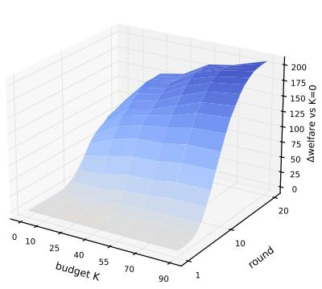

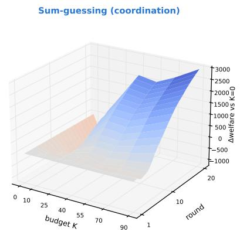

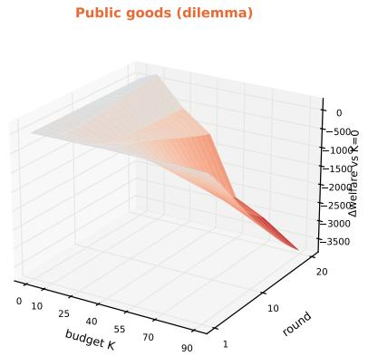

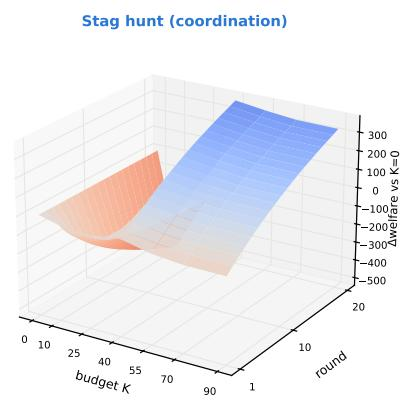

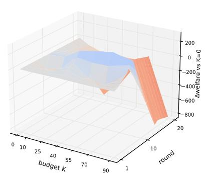

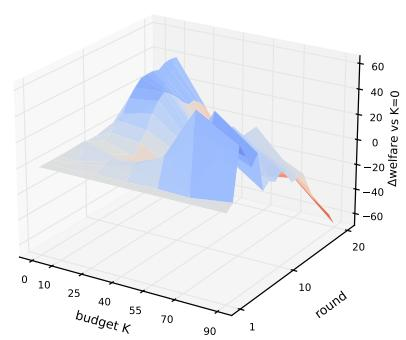  
Figure S1: RQ1 (time-resolved): cumulative discounted welfare over (round, K) per game (mean over 12 seeds). The K-driven welfare gap, and its sign, opens progressively over the episode: aligned surfaces (top) tilt up with K, misaligned surfaces (bottom) tilt down. The round-20 slice of each surface is the corresponding curve in main-text Fig. 1.

Two further views of the same timing runs are provided for completeness. Figure S4 plots the undiscounted running total of per-round welfare (the literal “cumulative welfare"), the companion to the per-round view above and to the discounted cumulative figure (Fig. S2); because the manager optimizes discounted welfare, the discounted figure is the decision-relevant one, but the undiscounted total shows that the schedules' near-coincidence is not an artifact of discounting. Figure S5 collapses each run to the round-20 endpoint the manager actually optimizes, as grouped bars by schedule and budget; it is the bar-chart summary of Table ${ \mathrm { S } } 6 ,$ and makes visually explicit where schedule leaves the endpoint unchanged (three equal bars) versus where it moves it (a gap, marked by a per-cell Kruskal–Wallis test).

## Direct Test of Behavioral Coupling

The main-text mechanism (Eq. (2)) assumes that observation induces behavioral coupling: each agent adjusts toward the actions of the peers it observes. Because every prompt, action, and committed network is logged, we can test this assumption directly, at the level of individual decisions, rather than infer it from welfare.

A movement regression. For every agent i and round $t \geq 2$ we form the one-step action change $\check { \Delta } a _ { i } ^ { \mp } = a _ { i } ^ { t } - a _ { i } ^ { t - 1 }$ and ask what it tracks. Let $\overline { { a } } _ { \mathrm { o b s } } ^ { t - 1 }$ be the mean previous-round action of the peers i observes (its in-neighbors in the committed network, which reveal exactly their past actions), and $\overline { { a } } _ { \mathrm { n o n } } ^ { t - 1 }$ the mean previous-round action of the non-neighbors (everyone ¿ does not observe). We fit, per game,

$$
\Delta a _ { i } ^ { t } = \alpha + b _ { \mathrm { o b s } } \overline { { a } } _ { \mathrm { o b s } } ^ { t - 1 } + b _ { \mathrm { n o n } } \overline { { a } } _ { \mathrm { n o n } } ^ { t - 1 } + b _ { \mathrm { o w n } } a _ { i } ^ { t - 1 } + \varepsilon ,\tag{S1}
$$

with standard errors clustered by run (episode). Including $a _ { i } ^ { t - 1 }$ absorbs mean reversion, and including $\overline { { a } } _ { \mathrm { n o n } } ^ { t - 1 }$ separates strategic structure—imitation where alignment rewards it, avoidance where anti-coordination rewards it—precisely the behavioral-coupling reading the main text places on Eq. (2).

<table><tr><td>game</td><td>KW p</td><td>hub (deg-het max)</td><td>regular (deg-het min)</td><td>expander (mod min)</td><td>barbell (mod max)</td><td>best / worst</td></tr><tr><td>PGG</td><td>.0008</td><td> $\mathbf { 8 8 7 0 \pm 2 4 8 }$ </td><td> $8 7 6 1 \pm 4 9 1$ </td><td> $8 0 3 2 { \pm } 5 2 6$ </td><td> ${ \bf 6 1 8 9 \pm 5 5 2 }$ </td><td>hub / barbell</td></tr><tr><td>EL-FAROL</td><td>.0037</td><td> ${ \bf 1 6 3 \pm 1 0 }$ </td><td> $1 2 4 \pm 1 0$ </td><td> $1 5 1 { \pm } 1 5$ </td><td> $\mathbf { 1 1 0 } \pm 9$ </td><td>hub / barbell</td></tr><tr><td>THRESHOLD-PGG</td><td>.015</td><td> ${ \bf 3 5 6 7 \pm 2 8 }$ </td><td> $3 1 3 5 { \pm } 1 3 3$ </td><td> $3 4 2 5 { \pm } 3 9$ </td><td> $\mathbf { 3 1 1 0 \pm 1 3 0 }$ </td><td>hub / barbell</td></tr><tr><td>BANDIT</td><td>.019</td><td> $2 0 0 7 \pm 4$ </td><td> $1 9 8 7 \pm 9$ </td><td> $1 9 9 0 { \pm } 5 $ </td><td> $1 9 7 6 { \pm } 8$ </td><td> $( \mathrm { n e g l i g i b l e } , < 2 \% )$ </td></tr><tr><td>STAG-HUNT</td><td>.076</td><td> $2 4 3 2 { \pm } 4 9$ </td><td> $2 4 3 1 \pm 2 4$ </td><td> $2 4 2 8 \pm 4 5$ </td><td> $2 5 3 6 { \pm } 2 0 $ </td><td>ns</td></tr><tr><td>SUM-GUESSING</td><td>.79</td><td> $- 7 5 9 0 { \pm } 1 1 3 3$ </td><td> $- 7 3 6 9 \pm 1 2 8 8$ </td><td> $- 7 1 8 1 \pm 1 2 2 8$ </td><td> $- 6 6 4 4 \pm 1 2 9 4$ </td><td>ns</td></tr></table>

Table S4: RQ2 (architecture): Kruskal-Wallis omnibus across the four architectures and $\mathrm { m e a n } \pm \mathrm { S E M }$ discounted welfare of each (n=12 seeds). Bold marks the best (hub) and worst (barbell) in the misaligned games. Architecture is a lever only in the misaligned games; the barbell is uniformly the worst wiring where it matters.

<table><tr><td>architecture</td><td>clus.</td><td>deg. var.</td><td>Gini</td><td>mod. Q</td><td>assort.</td><td>sp. gap</td></tr><tr><td>hub</td><td>0.60</td><td>6.40</td><td>0.34</td><td>0.12</td><td>-0.66</td><td>0.34</td></tr><tr><td>regular</td><td>0.50</td><td>0.00</td><td>0.00</td><td>0.19</td><td>n/a</td><td>0.44</td></tr><tr><td>expander</td><td>0.65</td><td>3.60</td><td>0.27</td><td>0.10</td><td>-0.29</td><td>0.40</td></tr><tr><td>barbell</td><td>0.86</td><td>0.20</td><td>0.05</td><td>0.45</td><td>-0.01</td><td>0.07</td></tr></table>

Table S5: RQ2: structural-metric profile of the four architectures at $E { = } 4 0$ directed edges (20 undirected). Architectures realize, respectively, degree-heterogeneity max (hub) / min (regular) and modularity min (expander) / max (barbell). Classical metrics (clustering, degree variance, degree Gini, modularity $Q ,$ degree assortativity) are computed on the undirected skeleton; the spectral gap is the directed mixing rate of Eq. (2) in the main text. The barbell's high modularity co-occurs with the lowest spectral gap—a mixing bottleneck.

a genuine observation-specific channel from any populationwide drift; we restrict to $\mathrm { ~ 0 ~ < ~ } K < 9 0$ so that both the observed and the non-neighbor sets are non-empty. Binaryaction games are coded {0, 1}, so $\Delta a$ is a linear-probability movement. Coupling predicts $b _ { \mathrm { o b s } }$ significant with $b _ { \mathrm { o b s } } \ >$ $b _ { \mathrm { n o n } }$

Result: coupling is real and observation-specific. Table S7 and Fig. S6 report the fits. The observed-peer coefficient $b _ { \mathrm { o b s } }$ is highly significant in all six games, and the contrast $b _ { \mathrm { o b s } } - b _ { \mathrm { n o n } }$ is positive and significant in all six (p from $8 \times 1 0 ^ { - 4 } ~ \mathrm { t o } ~ 2 \times 1 0 ^ { - 5 9 } )$ : agents’ choices respond to the peers they actually observe, over and above the population trend. In the five imitation-type games $b _ { \mathrm { o b s } } > 0 -$ agents move toward observed peers—and most strongly in STAG-HUNT $( b _ { \mathrm { o b s } } { = } 0 . 6 6 )$ and sUM-GUESsING (0.49), the games whose good outcome requires agreement. The one apparent exception is mechanism-confirming rather than contradictory: in EL-FAROL $b _ { \mathrm { o b s } }$ is negative (—0.10), i.e. agents move away from what their observed peers did, exactly the avoidance an anti-coordination game rewards. (Its non-neighbor coefficient is more negative still, —0.46; because the peeranonymous congestion feedback is broadcast to all agents regardless of the network, the non-neighbor term partly proxies that global signal, and $b _ { \mathrm { o b s } }$ conservatively isolates the additional network-specific channel.) Coupling is therefore present in every game, with the sign set by the game's

<table><tr><td>game</td><td>K</td><td>A</td><td>B</td><td>C</td><td>B−A (p)</td><td>C−A (p)</td><td>B−C(q)</td><td>TOST equiv.?</td></tr><tr><td>BANDIT</td><td>25</td><td>1976</td><td>1962</td><td>1969</td><td>-14 (.064)</td><td>-7(.27)</td><td>-7(.47)</td><td>yes</td></tr><tr><td>BANDIT</td><td>70</td><td>2014</td><td>2030</td><td>2016</td><td>+16 (.016)</td><td>+2 (.97)</td><td>+14 (.19)</td><td>yes</td></tr><tr><td>SUM-GUESSING</td><td>25</td><td>-7545</td><td>-7910</td><td>-7432</td><td>-365 (.85)</td><td>+112 (.79)</td><td>-477 (1.0)</td><td>no</td></tr><tr><td>SUM-GUESSING</td><td>70</td><td>-6239</td><td>-6150</td><td>-6407</td><td>+89 (.91)</td><td>-168 (1.0)</td><td>+257 (1.0)</td><td>no</td></tr><tr><td>STAG-HUNT</td><td>25</td><td>1857</td><td>2019</td><td>1247</td><td>+163 (.65)</td><td>-609 (.10)</td><td>+772 (.19)</td><td>no</td></tr><tr><td>STAG-HUNT</td><td>70</td><td>2411</td><td>2405</td><td>2353</td><td>-6 (.09)</td><td>−58 (.75)</td><td>+52 (1.0)</td><td>yes</td></tr><tr><td>PGG</td><td>25</td><td>8735</td><td>8562</td><td>9339</td><td>-173 (.91)</td><td>+604 (.34)</td><td>-777 (.47)</td><td>no</td></tr><tr><td>PGG</td><td>70</td><td>6204</td><td>7020</td><td>7618</td><td>+816 (.41)</td><td>+1414 (.08)</td><td>–598 (1.0)</td><td>no</td></tr><tr><td>THRESHOLD-PGG</td><td>25</td><td>3482</td><td>3506</td><td>3499</td><td>+23 (.34)</td><td>+17(.73)</td><td>+7 (1.0)</td><td>yes</td></tr><tr><td>THRESHOLD-PGG</td><td>70</td><td>3572</td><td>2728</td><td>2935</td><td>-844 (.002)</td><td>-637 (.012)</td><td>-207 (.98)</td><td>no</td></tr><tr><td>EL-FAROL</td><td>25</td><td>196</td><td>202</td><td>155</td><td>+6 (.91)</td><td>-41 (.005)</td><td>+47 (.10)</td><td>no</td></tr><tr><td>EL-FAROL</td><td>70</td><td>154</td><td>141</td><td>104</td><td>-14(.27)</td><td>−51 (.009)</td><td>+37 (.10)</td><td>no</td></tr></table>

Table S6: Timing analysis: mean discounted welfare for constant (A), front- (B), and back-loaded (C) disclosure at matched budget, with seed-paired contrasts. p-values are permutation tests over 12 seed-pairs; q is BH-FDR over the 12-cell family for the B—C contrast. No B—C contrast survives FDR. The only mechanism-consistent effect is that anti-coordination (EL-FARoL) is hurt by delay $( { \bf C } - { \bf A } < 0$ at both budgets).

<table><tr><td>game</td><td>class</td><td> $b _ { \mathrm { o b s } } \left( p \right)$ </td><td> $b _ { \mathrm { n o n } } \left( p \right)$ </td><td> $b _ { \mathrm { o b s } } - b _ { \mathrm { n o n } } ( p )$ </td></tr><tr><td>BANDIT</td><td>aligned</td><td> $+ 0 . 1 6 ( 1 0 ^ { - 1 5 } )$ </td><td> $+ 0 . 0 7 ( 1 0 ^ { - 8 } )$ </td><td> $+ 0 . 0 9 ( 1 0 ^ { - 3 } )$ </td></tr><tr><td>SUM-GUESSING</td><td>aligned</td><td> $+ 0 . 4 9 ( 1 0 ^ { - 5 0 } )$ </td><td> $+ 0 . 1 4 ( 1 0 ^ { - 7 } )$ </td><td> $+ 0 . 3 5 ( 1 0 ^ { - 1 0 } )$ </td></tr><tr><td>STAG-HUNT</td><td>aligned</td><td> $+ 0 . 6 6 ( 1 0 ^ { - 7 3 } )$ </td><td> $- 0 . 0 4 ( 1 0 ^ { - 2 } )$ </td><td> $+ 0 . 7 0 ( 1 0 ^ { - 5 9 } )$ </td></tr><tr><td>PGG</td><td>misaligned</td><td> $+ 0 . 3 8 ( 1 0 ^ { - 3 8 } )$ </td><td> $- 0 . 0 1 \left( . 5 7 \right)$ </td><td> $+ 0 . 3 9 ( 1 0 ^ { - 2 2 } )$ </td></tr><tr><td>THRESHOLD-PGG</td><td>misaligned</td><td> $+ 0 . 4 9 ( 1 0 ^ { - 3 1 } )$ </td><td> $+ 0 . 1 0 ( 1 0 ^ { - 4 } )$ </td><td> $+ 0 . 3 9 ( 1 0 ^ { - 9 } )$ </td></tr><tr><td>EL-FAROL</td><td>misaligned</td><td> $- 0 . 1 0 ( 1 0 ^ { - 1 1 } )$ </td><td> $- 0 . 4 6 ( 1 0 ^ { - 1 2 4 } )$ </td><td> $+ 0 . 3 5 ( 1 0 ^ { - 3 0 } )$ </td></tr></table>

Table S7: Direct coupling test: OLS coefficients of Eq. (S1), per game, SEs clustered by run (\~26k agent-rounds and 156 runs per game; $0 < \bar { K } < \mathsf { \bar { g } } 0 ) . \ : b _ { \mathrm { o b s } }$ is the response to observed peers’ prior actions, $b _ { \mathrm { n o n } }$ to non-neighbors', controlling for the agent's own prior action. $b _ { \mathrm { o b s } }$ is significant and $b _ { \mathrm { o b s } } > b _ { \mathrm { n o n } }$ in every game; the sign of $b _ { \mathrm { o b s } }$ is positive (imitation) except in the anti-coordination game EL-FARoL, where it is negative (avoidance).

Timing analysis at matched budget: cumulative discounted welfare (A/B/C converge → schedule is second-order)

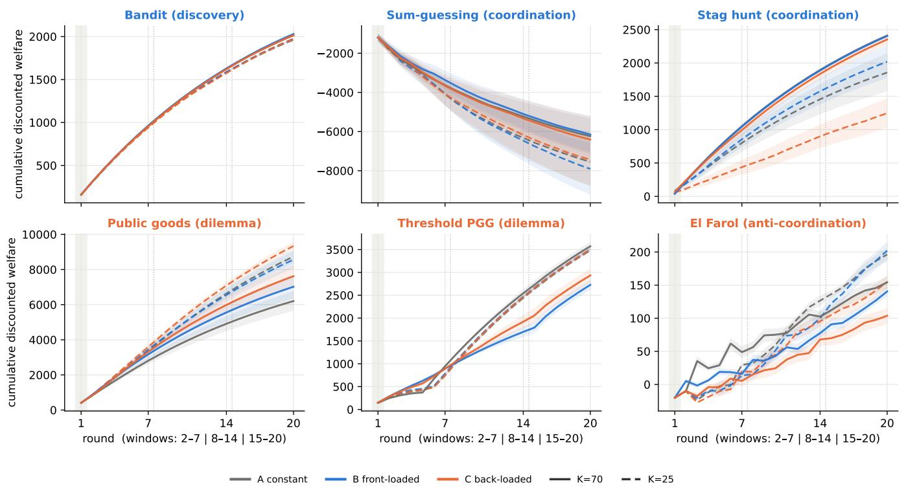

Figure S2: Timing (discounted cumulative): running (cumulative) discounted welfare (mean ±1 SEM over 12 seeds) under constant (A), front-loaded (B), and back-loaded (C) disclosure at matched budget (K=70 solid, K=25 dashed); the shaded round-1 column is the homogeneous baseline. This is the discounted running total the manager optimizes. In the coordination and discovery games (top) the three schedules are nearly indistinguishable; separation appears only in the public-goods and congestion games (bottom) and, at the low budget, in sTAG-HuNT. Per-round trajectories are in Fig. S3 and full contrasts in Table S6.

Timing analysis at matched budget: per-round welfare for constant (A), front- (B) and back-loaded (C) disclosure

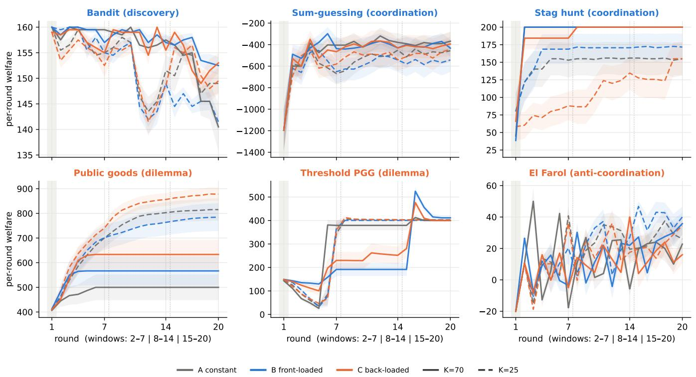  
Figure S3: Timing (per-round): per-round welfare (mean ±1 SEM over 12 seeds) under constant (A), front- (B), and back-loaded (C) disclosure at matched budget (K=70 solid, K=25 dashed). The shaded round-1 column is the homogeneous baseline; dotted lines mark the window boundaries (rounds $\left. 2 - 7 \right| 8 - 1 4 \mid 1 5 - 2 0 )$ . Within its active window a schedule briefly separates, but the per-round differences are small and largely cancel; the discounted cumulative view (Fig. S2) is the integrated result.

Timing analysis at matched budget: cumulative (undiscounted) welfare over the episode (A/B/C converge → schedule is second-order)

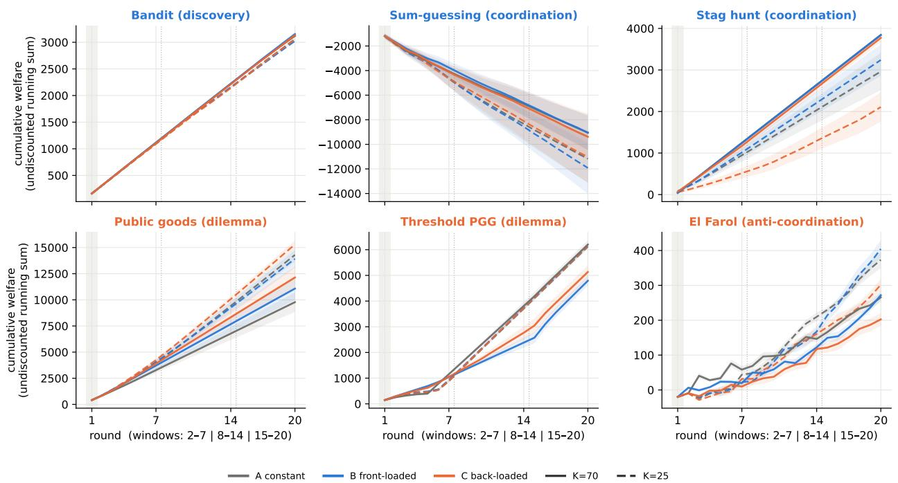

Figure S4: Timing (undiscounted cumulative): running, undiscounted total of per-round welfare through round t (cumulative sum of the per-round welfare), for constant (A), front-loaded (B), and back-loaded (C) disclosure at matched budget $( K { = } 7 0$ solid, K=25 dashed; mean ±1 SEM over 12 seeds). This is the un-discounted companion to Fig. S2, which shows the discounted cumulative welfare the manager optimizes. Within each game panel the three schedules share the same accrual baseline, so any A/B/C separation is the pure timing effect; per-panel y-axes keep that separation visible despite the common downward accumulation of the negative-welfare games. As in every other view, the schedules nearly coincide except in the misaligned games (bottom), confirming that timing is second-order and that this is not a discounting artifact.

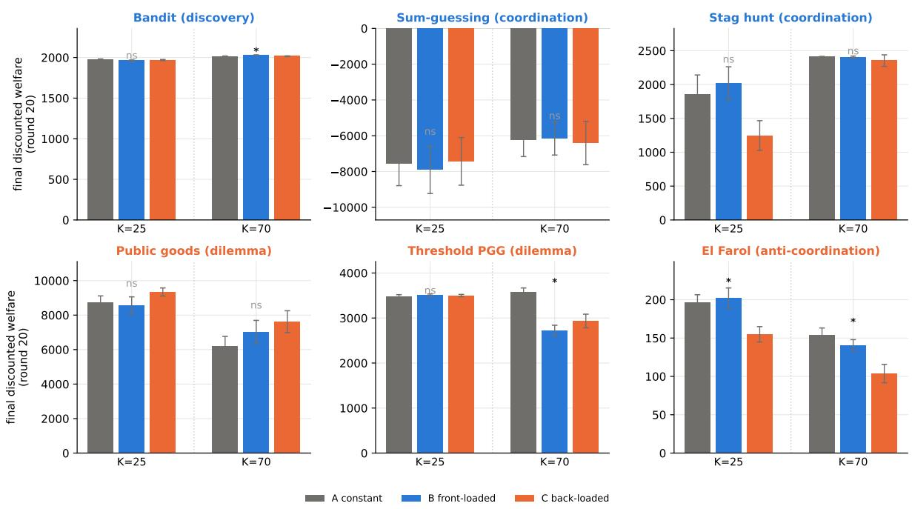  
Figure S5: Timing (endpoint summary): final (round-20) discounted welfare by disclosure schedule — constant (A, the reused RQ1 run), front-loaded (B), back-loaded (C) — at each budget (K=25 left group, $K { = } 7 0$ right group) within every game panel (mean ±1 SEM over 12 seeds). This collapses the trajectories of Fig. S2 and Fig. S3 to the single quantity the manager optimizes, so where timing is second-order the three bars are equal, and where it moves the outcome a gap appears; the per-cell mark is a Kruskal-Wallis test across the three schedules $( * = p < 0 . 0 5 , \mathrm { ~ \ddot { \prime } n s ^ { \ 3 } }$ otherwise). The bars are the graphical form of the A/B/C columns of Table S6: the few visible gaps (sTAG-HUNT at $K { = } 2 5$ , EL-FAROL, THRESHOLD-PGG at $K { = } 7 0 )$ are exactly the cells flagged there, and none survive FDR correction.

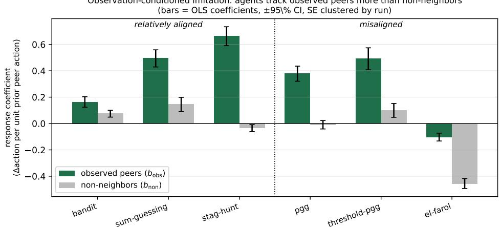  
Figure S6: Direct coupling test: per-game response coefficients to observed peers $( b _ { \mathrm { o b s } } ,$ green) vs. non-neighbors $( b _ { \mathrm { n o n } } , \mathrm { g r e y } )$ from Eq. (S1), ±95% CI (SEs clustered by run). The observed-peer response dominates in every game; it is positive (imitation) everywhere except the anti-coordination game EL-FAroL, where it is negative (avoidance)—the game-appropriate sign of coupling.