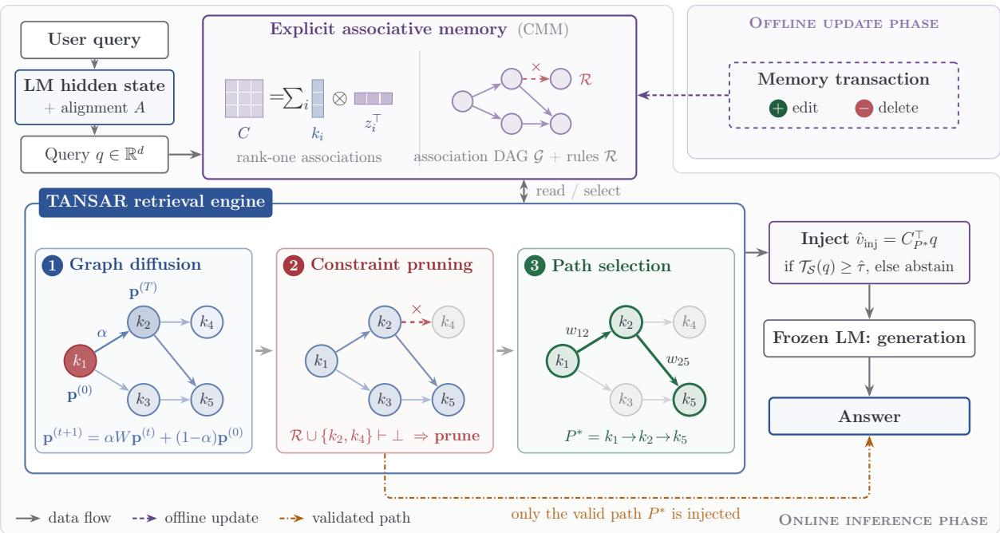
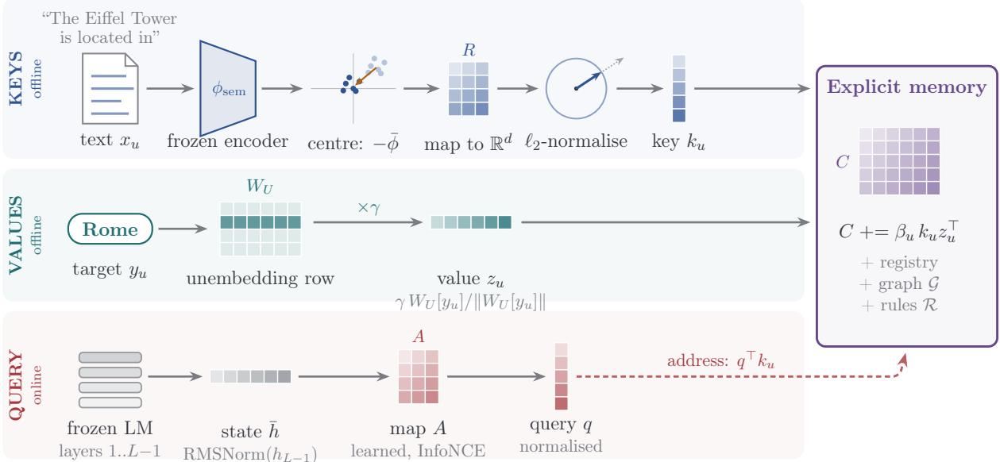
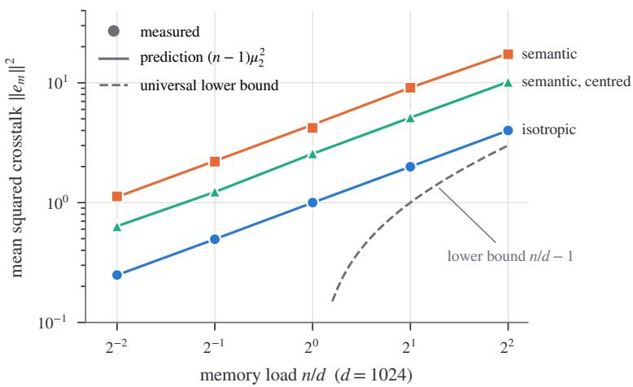
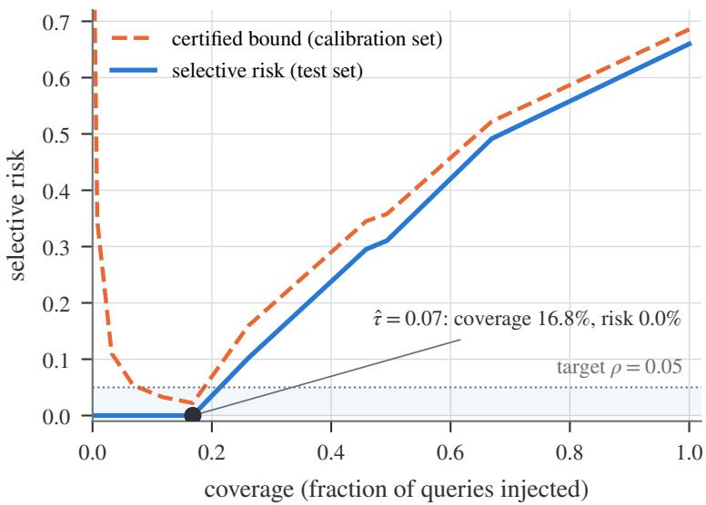

# TANSAR: Editable and Attributable Correlation Matrix Memories under Correlated Keys, with Rule-Constrained Multi-Hop Knowledge Editing

Abdulhady Abas Abdullaa, Jiyan Salim Mahmudb, Fatemeh Daneshfarc,∗, Hussein Mohammed Alid, Mourad Oussalahe, Muhammad Bilalf

aUniversity of Kurdistan Hewlêr, Erbil, Kurdistan Region, Iraq bFaculty of Informatics, Eötvös Loránd University, Budapest, Hungary cDepartment of Computer Engineering, University of Kurdistan, Sanandaj, Iran dCybersecurity Department, Tishk International University, Erbil, Kurdistan Region, Iraq eUniversity of Oulu, Oulu, Finland fLancaster University, Lancaster, United Kingdom

## Abstract

Correlation Matrix Memories (CMMs) store associations as sums of rank-one outer products, providing closed-form addressability, exact deletion, and linear attribution. While classical analyses assume random, orthogonal keys, semantic encoders produce correlated representations. We analyse CMMs under correlated keys using frame-theoretic coherence: (i) capacity bounds yielding an encoder-independent limit $n \leq d ( 1 + \varepsilon ^ { 2 } )$ for mean squared crosstalk $\varepsilon ^ { 2 } ;$ (ii) an exact characterisation of the collateral efect of deleting an association, guaranteeing that deletion never invalidates certified associations; and (iii) a geometric transparency bound demonstrating why attribution requires candidate sets of centred keys. On this basis, we introduce Topology-Aware Neuro-Symbolic Associative Retrieval (TANSAR). TANSAR traverses a directed acyclic association graph, prunes invalid paths via sound ground Horn constraints, and injects a representation derived strictly from the verified path into the residual stream of a frozen language model, guarded by a Clopper–Pearson selective-risk gate. Controlled experiments confirm all theoretical bounds. In multi-hop knowledge editing, Horn pruning reduces answer contradictions from 25.1% to 0.5%, whereas Hopfield retrieval incurs 24% contradictions when stale associations remain stored (and 0% if stale associations are removed). An end-to-end

edit transaction requires 13.6 ms on a standard CPU and 2.37 ms on GPU. The symbolic component matches gold labels across all 600 ProofWriter theories and achieves 94.0% agreement on FOLIO, demonstrating sound and eficient multi-hop associative retrieval with exact unlearning.

Keywords: Associative memory, Correlation matrix memory, Coherence, Knowledge editing, Machine unlearning, Neuro-symbolic reasoning

## 1. Introduction

Linear associative memories (Kohonen, 1972; Anderson, 1972) store a set of key–value pairs $\left\{ \left( k _ { i } , v _ { i } \right) \right\}$ in a single matrix $\begin{array} { r } { C = \sum _ { i } \beta _ { i } k _ { i } v _ { i } ^ { \top } } \end{array}$ and retrieve with one matrix–vector product $C ^ { \top } s$ . Because every association is a separate additive term, a CMM has three properties that dense, gradient-trained weights lack: an association can be added without retraining, removed exactly by subtracting its term, and the readout decomposes into perassociation contributions. The classical analysis of these memories, and of their capacity, assumes random, nearly orthogonal keys (Palm, 1980; Hopfield, 1982). Modern uses, however, obtain keys from semantic encoders, so related facts have correlated keys by design. Correlation is then not a nuisance but the source of paraphrase generalisation— and also of crosstalk, collateral damage on deletion, and diluted attribution.

This paper asks how editability and attribution of a CMM behave under correlated keys, and uses the answer to build an editable, inspectable memory for a frozen language model, termed Topology-Aware Neuro-Symbolic Associative Retrieval (TANSAR). Knowledge editing serves as the demonstration: a counterfactual edit $A \to B ^ { \prime }$ must be retrievable from paraphrases, must coexist with stale associations, must be removable, and must compose with other stored facts in multi-hop questions without producing contradictions.

Contributions.

• Theory for correlated keys (Section 4). Bounds stated in terms of mutual coherence $\mu ,$ cumulative coherences $\rho _ { 1 } , \rho _ { 2 }$ and RMS coherence $\mu _ { 2 }$ rather than Gaussian assumptions: crosstalk, decoding and capacity (Theorem 1); collateral readout change caused by deletion and preservation of recovery certificates (Theorem 2); and transparency separation (Theorem 3). The bounds yield an encoder-independent capacity limit, the guarantee that exact deletion never invalidates another certified association, and the geometric reason why attribution must be computed on candidate sets of centred keys; Section 4.5 separates these results from the standard inequalities used to prove them. Each bound is checked numerically (Section 4.4).

• A connected retrieval-to-injection interface (Section 3.5). The vector written into the residual stream is the readout of the sub-memory on the selected valid path, gated on a non-empty admissible set; associations excluded by the constraints contribute exactly zero (Proposition 1).

• Query–key alignment and calibrated gating (Sections 3.3, 3.6). A contrastively trained linear map aligns hidden states with semantic keys, and the override gate is calibrated with a Clopper–Pearson selective-risk certificate.

• Evaluation and release (Section 5). Numerical checks of every bound on correlated keys (E1–E3), contrastive query–key alignment (E4), finite-sample risk calibration (E5), multi-hop knowledge retrieval benchmarks with matched ablations (E6), measured end-to-end transaction latency on CPU (13.6 ms) and GPU (2.37 ms) (E7), modern Hopfield retrieval comparisons under identical keys (E8), and symbolic rule verification on ProofWriter and FOLIO (E9). Complete reproducible code, seeds, and configurations are released.

Section 2 reviews related work, Section 3 presents the method, Section 4 the theory, Section 5 the experiments, Section 6 the limitations, and Section 7 concludes. Elementary identities used throughout are collected in Appendix A.

## 2. Related Work

Linear associative memories and their capacity. CMMs (Kohonen, 1972; Anderson, 1972) and their binary variants (Palm, 1980) retrieve by a single linear map; retrieval is exact for orthonormal keys and degrades with crosstalk otherwise. Hopfield networks (Hopfield, 1982) and modern Hopfield networks (Ramsauer et al., 2021) add a nonlinear (softmax) retrieval dynamics that greatly increases capacity. When the patterns are stored explicitly, an item can be removed exactly by deleting it, and the one-step readout $\sum _ { u } p _ { u } ( q ) v _ { u }$ is a sum of per-item terms; but the weights $p _ { u } ( q )$ are coupled through the softmax normalisation, so deleting or adding one pattern changes the contribution of every other pattern, whereas in a CMM it changes none. MeMo (Zanzotto et al., 2025) uses layered CMMs with random (Johnson–Lindenstrauss) keys for sequence memorisation. Dense associative memories (Krotov and Hopfield, 2016) increase capacity with sharper energy functions. Closest to our analysis, Cabannes et al. (2024) derive scaling laws for outerproduct associative memories built from embeddings, under a statistical model of the data, and Bietti et al. (2023) show that weight matrices of trained transformers act as such memories. Our analysis replaces the random-key assumption by coherence quantities familiar from sparse approximation (Donoho and Elad, 2003; Tropp, 2004) and frame theory (Welch, 1974), and compares empirically against modern Hopfield retrieval on the same keys.

Knowledge editing and multi-hop reasoning. Locate-and-edit methods (ROME (Meng et al., 2022), MEMIT (Meng et al., 2023)) modify model parameters; GLAME (Zhang et al., 2024) augments such parameter updates with knowledge-graph context to capture knowledge that an edit changes indirectly, and MAKE (Park et al., 2025) likewise takes facts associated with the edited one into account during editing. Adapter or side-memory methods (GRACE (Hartvigsen et al., 2023), WISE (Wang et al., 2024a)) add parameters that are trained by optimisation; SERAC (Mitchell et al., 2022) stores edits explicitly and routes with a trained scope classifier. Larimar (Das et al., 2024) adds an external episodic memory that is updated in one step, without constraint checking or per-edit attribution. Empirical studies show that edits often fail to propagate to logically dependent facts and to multi-hop reasoning (Cohen et al., 2024; Hua et al., 2024). For multi-hop editing, MeLLo (Zhong et al., 2023) stores edits as text and lets the model decompose questions and check retrieved facts by prompting; PokeMQA (Gu et al., 2024) decouples question decomposition from a programmable scope detector; GMeLLo (Chen et al., 2024) and KEDKG (Lu et al., 2025) store edited facts in a knowledge graph that the language model queries; EchoEdit (Shi et al., 2026) limits how an edit spreads over a graph of potentially afected facts by means of generated difusion rules; and DeepEdit (Wang et al., 2024b) casts editing as constrained decoding. Reasoning-based benchmarks such as ReCoE (Hua et al., 2024) and MQuAKE (Zhong et al., 2023) show that existing editing methods often fail on questions whose answers depend on an edit. TANSAR distinguishes itself from these methods by providing closed-form linear updates, exact attribution, and sound Horn constraint pruning without requiring multi-prompt generation or iterative fine-tuning.

Table 1: Design-level comparison with operational definitions. GF: inserting an edit requires no gradient step. Del: removing an edit restores the pre-edit state of the edit store exactly. Add: the representation passed to the model decomposes exactly into one additive term per stored edit. Con: candidate edits are checked against explicitly represented constraints before use. ✓ = satisfied by construction; ◦ = partially (see text); × = not satisfied.
<table><tr><td>Method</td><td>GF</td><td></td><td>Del Add</td><td>Con</td></tr><tr><td>ROME / MEMIT</td><td>X</td><td>X</td><td>X</td><td>X</td></tr><tr><td>GRACE</td><td>X</td><td>√</td><td>0</td><td>X</td></tr><tr><td>WISE</td><td>X</td><td>X</td><td>X</td><td>X</td></tr><tr><td>SERAC</td><td>√</td><td>√</td><td>X</td><td>X</td></tr><tr><td>MeLLo / PokeMQA</td><td>√</td><td>V</td><td>X</td><td>0</td></tr><tr><td>DeepEdit</td><td>√</td><td>V</td><td>X</td><td>0</td></tr><tr><td>RAG (sparse / dense)</td><td>√</td><td>V</td><td>X</td><td>X</td></tr><tr><td>Modern Hopfield memory</td><td>V</td><td>√</td><td>0</td><td>X</td></tr><tr><td>TANSAR</td><td>√</td><td>V</td><td>√</td><td>√</td></tr></table>

Retrieval augmentation. Sparse (BM25) and dense retrievers (Karpukhin et al., 2020; Izacard et al., 2022), retrieval-augmented generation (Lewis et al., 2020), interleaved retrieval for multi-step questions (IRCoT (Trivedi et al., 2023)) and self-reflective retrieval (Self-RAG (Asai et al., 2024)) can update an external corpus without touching weights. They provide strong evidence-access baselines; they do not provide an additive decomposition of the representation injected into the model.

Neuro-symbolic constraints and interpretability. Neuro-symbolic systems combine neural scoring with logical constraints (Manhaeve et al., 2018; Badreddine et al., 2022). Our constraint component is deliberately restricted to ground (propositional) Horn rules, for which forward chaining is sound, complete and linear-time (Dowling and Gallier, 1984). Post-hoc mechanistic interpretability analyses trained networks (Elhage et al., 2021); here attribution is structural, fixed by the additive memory.

Table 1 is a design comparison, not a performance claim. GRACE trains each codebook value by gradient descent; deleting a codebook entry restores the unedited layer for that key, and a single retrieved entry identifies the edit used (◦ for Add: one entry is selected rather than a sum being decomposed). WISE edits a side memory by optimisation and merges shards, so an individual edit has no separable term. MeLLo, PokeMQA and DeepEdit check retrieved facts with the language model or with soft decoding constraints, not against an explicit rule store (◦ for Con). A modern Hopfield memory with an explicit pattern store satisfies Del (deleting the pattern restores the pre-edit store); its readout $\sum _ { u } p _ { u } ( q ) v _ { u }$ has one term per pattern, but each term depends on all stored patterns through the normalisation, so adding or deleting one edit changes every other term (◦ for Add; in a CMM the other terms are unchanged, Theorem 2). Neither memory checks constraints by itself; the empirical comparison is in Section 5.3. TANSAR satisfies Del for the matrix, registry, graph and rule store jointly when the coordinated deletion transaction of Section 3.7 is used.

  
Figure 1: Overview of TANSAR. The language-model state is mapped by the learned alignment A to a query q that addresses the explicit associative memory: a CMM of rank-one associations $( C =$ $\sum _ { u } \beta _ { u } \bar { k } _ { u } z _ { u } ^ { \top } )$ organised as a directed acyclic graph with a ground-rule store $\mathcal { R }$ . The retrieval engine difuses over the active subgraph, prunes paths that violate $\mathcal { R }$ , and selects $P ^ { * }$ (Section 3.4). Only the sub-memory on $P ^ { * }$ is read out and injected $\left( \mathrm { E q . ~ } \left( 8 \right) \right)$ ), and only when the calibrated transparency gate accepts. Ofline edits and deletions (top right) change the memory without modifying model parameters.

## 3. Method

## 3.1. Notation

The memory holds n associations with identifiers $u ,$ unit keys $k _ { u } \in \mathbb { R } ^ { d }$ , values $z _ { u } \in \mathbb { R } ^ { D }$ in the residual space of the language model, and recorded coeficients $\beta _ { u } ~ \in ~ [ \beta _ { - } , \beta _ { + } ]$ $\beta _ { - } > 0 , \kappa : = \beta _ { + } / \beta _ { - }$ :

$$
C = \sum _ { u } \beta _ { u } k _ { u } z _ { u } ^ { \top } \in \mathbb { R } ^ { d \times D } , \qquad C ^ { \top } s = \sum _ { u } c _ { u } ( s ) , \quad c _ { u } ( s ) : = \beta _ { u } \left( s ^ { \top } k _ { u } \right) z _ { u } .\tag{1}
$$

The registry $\mathcal { M } = \{ ( u , k _ { u } , z _ { u } , \beta _ { u } ) \}$ is stored next to C. In the theory (Section 4) values are written $v _ { u }$ and normalised, $\left. \boldsymbol { v } _ { u } \right. = 1$ . Symbols are used consistently: $\beta _ { u }$ for association coeficients, $\beta _ { \mathrm { h o p } }$ for Hopfield inverse temperature in comparative baselines, α for the difusion damping factor, $g _ { i j } : = k _ { i } ^ { \top } k _ { j }$ for key similarities, H for the reasoning hop budget (distinguished from transformer layer depth $L )$ , K for the key matrix, $k _ { u }$ for individual key vectors, top-k for candidate retrieval counts, $\tau _ { w }$ for the transition temperature, $\hat { \tau }$ for the calibrated gate threshold, and $\alpha _ { \mathrm { { r i s k } } }$ for target selective risk.

## 3.2. Semantic key encoding

Keys are produced by Semantic Key Encoding (SKE, Figure 2): the text that addresses an association (e.g. the subject–relation prompt “The Eifel Tower is located in”) is embedded by a frozen sentence encoder $\phi _ { \mathrm { s e m } }$ , centred by subtracting the empirical mean $\bar { \phi }$ of the stored embeddings, mapped to $\mathbb { R } ^ { d }$ by a fixed matrix $R ,$ and normalised:

$$
k _ { u } = \frac { ( \phi _ { \mathrm { s e m } } ( x _ { u } ) - \bar { \phi } ) R } { \| ( \phi _ { \mathrm { s e m } } ( x _ { u } ) - \bar { \phi } ) R \| _ { 2 } } .\tag{2}
$$

Centring removes the common component that all sentence embeddings share; Theorem 3(d) and Section 4.4 show that this component otherwise dominates both crosstalk and the attribution denominator. Each association is also linked to a discrete predicate (its subject–relation–object triple) by exact string matching over noun chunks; the predicate is what the constraint store reasons about.

## 3.3. Query–key alignment

At inference the memory is addressed by the language model’s own state. Let x be the input and $\bar { h } ( x ) = \mathrm { R M S N o r m } ( h _ { L - 1 } ( x ) ) \in \mathbb { R } ^ { D }$ the input to the feed-forward block of layer L, where $h _ { L - 1 } ( x )$ denotes the residual stream after the attention sublayer of layer L. A fixed random projection of $\bar { h }$ shares no coordinate system with the SKE keys, so we learn a linear map $A \in \mathbb { R } ^ { D \times d }$ 2

$$
q ( x ) = \frac { \bar { h } ( x ) A } { \| \bar { h } ( x ) A \| _ { 2 } } ,\tag{3}
$$

by minimising the InfoNCE loss (van den Oord et al., 2018) over pairs $( x , u ( x ) )$ of training paraphrases and the identifiers of the associations they address,

$$
\mathcal { L } ( A ) = - \frac { 1 } { \vert \mathcal { D } \vert } \sum _ { ( x , u ) \in \mathcal { D } } \log \frac { \exp ( q ( x ) ^ { \top } k _ { u } / t ) } { \sum _ { u ^ { \prime } } \exp ( q ( x ) ^ { \top } k _ { u ^ { \prime } } / t ) } ,\tag{4}
$$

  
Figure 2: How keys, values and queries are built. $K e y s$ (SKE): the text that addresses an association is embedded by a frozen sentence encoder, mean-centred, mapped to $\mathbb { R } ^ { d }$ by a fixed matrix R and normalised. Values: the scaled unembedding row of the edited target, a vector in the residual space of the language model. Queries: the normalised hidden state of the language model, mapped into the key space by the learned alignment A (Section 3.3). Keys and values enter the memory as rank-one terms; queries address it through $\boldsymbol { q } ^ { \intercal } \boldsymbol { k } _ { u }$

with temperature $t = 0 . 0 5$ . Retrieval is top-1 dot-product matching,

$$
\boldsymbol { \hat { u } } ( \boldsymbol { x } ) = \arg \operatorname* { m a x } _ { \boldsymbol { u } } \boldsymbol { q } ( \boldsymbol { x } ) ^ { \top } \boldsymbol { k _ { u } } ,\tag{5}
$$

and alignment quality is reported as top-1/top-5 accuracy of Eq. (5) on held-out paraphrases (Section 5). The alternative of computing keys from the model’s own layer-(L−1) states (the mean of $\bar { h } ( x ) A$ over training paraphrases) is reported as a variant. Training A touches neither the language model nor the stored associations.

## 3.4. Retrieval engine

The associations form a directed acyclic graph G: an edge $i  j$ is admissible when the object of i is the subject of j and adding it keeps $\mathcal { G }$ acyclic (otherwise the edge is rejected). Retrieval has three stages (Figure 1, Algorithm 1).

Stage 1: graph difusion. Retrieval seeding is semantic: the top-k associations with the largest key-space inner products $\boldsymbol { q } ^ { \intercal } \boldsymbol { k } _ { u }$ seed a prior distribution $\mathbf { p } ^ { ( 0 ) } \propto \operatorname* { m a x } ( q ^ { \top } k _ { u } , 0 )$ over candidate initial entities. The active subgraph A is constructed around these seeds up to hop depth H − 1 and beam width $\leq \ b$ prior to difusion. On A, the columnstochastic, topology-masked transition matrix is

$$
W _ { j i } = \frac { M _ { j i } \exp ( o _ { i } ^ { \top } k _ { j } / \tau _ { w } ) } { \sum _ { \ell } M _ { \ell i } \exp ( o _ { i } ^ { \top } k _ { \ell } / \tau _ { w } ) } ,\tag{6}
$$

where the mask $M _ { j i } = 1 \mathrm { i f f } i  j$ is an edge of $\mathcal { G }$ (otherwise 0) and $o _ { i } \in \mathbb { R } ^ { d }$ is the key-space image of the object of $i ;$ a node without successors receives a self-loop in W only. All reported runs use this masked kernel, and the released code implements only this kernel. Difusion runs for $T$ steps with damping $\alpha = 0 . 8 5$ (Page et al., 1999): $\mathbf { p } ^ { ( t + 1 ) } = \alpha W \mathbf { p } ^ { ( t ) } + ( 1 - \alpha ) \mathbf { p } ^ { ( 0 ) }$ . Graph difusion propagates reachability mass from prompt seeds across the active subgraph ${ \mathcal { A } } ,$ concentrating stationary probability $\mathbf { p } _ { u } ^ { ( T ) }$ on nodes supported by multi-hop topological paths. Running $T$ difusion steps on the compact active subgraph A requires $\mathcal { O } ( T b ^ { 2 } )$ operations, while path enumeration is governed by the hop depth budget H and candidate beam budget.

Stage 2: ground-rule constraint pruning. The rule store $\mathcal { R }$ contains ground Horn clauses over predicates, including the falsum $( a _ { 1 } \wedge \cdot \cdot \cdot \wedge a _ { r } \to \perp )$ ; an edit that supersedes a fact adds the unit constraint old → ⊥. A candidate path P is admissible if forward chaining on ${ \mathcal { R } } \cup \operatorname { f a c t s } ( P )$ does not derive ⊥. For ground Horn clauses this test is sound and complete and runs in time linear in the size of the clauses (Dowling and Gallier, 1984). The component is propositional by design; first-order rules must be grounded over the finite set of stored entities before use.

Stage 3: path utility. Among admissible paths $\mathcal { P } _ { \mathrm { v a l } }$ of length H, candidate paths are scored by

$$
\operatorname { S c o r e } ( P ) = \lambda \sum _ { ( i , j ) \in P } \log W _ { j i } + ( 1 - \lambda ) \sum _ { u \in P } \log \mathbf { p } _ { u } ^ { ( T ) } ,\tag{7}
$$

a log-domain trade-of between local transition plausibility and global difusion stationary mass; λ balances both terms $( \lambda = 0 . 5$ by default to ensure both step-by-step edge plausibility and global topological coherence; while setting $\lambda ~ = ~ 0$ emphasizes global reachability on clustered graphs, non-zero λ enforces local transition validity). TANSAR selects $P ^ { * } = \arg \operatorname* { m a x } _ { P \in \mathcal { P } _ { \mathrm { v a l } } }$ Score(P); if $\mathcal { P } _ { \mathrm { v a l } } = \emptyset$ the engine abstains.

## 3.5. Path-conditioned injection

The injected vector is a function of the selected valid path only. With $\begin{array} { l l } { C _ { P } } & { : = } \end{array}$ $\sum { _ { u \in P } \beta _ { u } k _ { u } z _ { u } ^ { \top } }$ the sub-memory on $P$

$$
\hat { v } _ { \mathrm { i n j } } ( q ) = C _ { P ^ { * } } ^ { \top } q = \sum _ { u \in P ^ { * } } \beta _ { u } \left( q ^ { \top } k _ { u } \right) z _ { u } ,\tag{8}
$$

Algorithm 1 TANSAR retrieval and path-conditioned injection   
Require: query q, hop budget H, memory $( C , { \mathcal { M } } , { \mathcal { G } } , { \mathcal { R } } ) , k , T , \alpha , \tau _ { w } , \lambda , { \hat { \tau } }$   
Ensure: injected vector $\hat { v } _ { \mathrm { i n j } }$ or ABSTAIN; selected path $P ^ { * }$   
1: $S _ { 0 } \gets$ top-k associations by $q ^ { \top } k _ { u } ; ~ { \bf p } ^ { ( 0 ) } \propto \mathrm { m a x } ( q ^ { \top } k _ { u } , 0 )$ on $S _ { 0 }$   
2: A ← active subgraph expanded from $S _ { 0 }$ (depth $H - 1 .$ width $\leq b )$ $W  \mathrm { E q } .$ (6) on   
A   
3: for $t = 0$ to $T - 1$ do   
4: $\mathbf { p } ^ { ( t + 1 ) } \gets \alpha W \mathbf { p } ^ { ( t ) } + ( 1 - \alpha ) \mathbf { p } ^ { ( 0 ) }$   
5: end for   
6: $\mathcal { P } _ { \mathrm { v a l } }  \{ P$ a path in $A : \ | P | = H ;$ , HornConsistent(R ∪ facts(P))}   
7: if $\mathcal { P } _ { \mathrm { v a l } } = \emptyset$ then return ABSTAIN   
8: end if   
9: $P ^ { * } \gets \arg \operatorname* { m a x } _ { P \in \mathcal { P } _ { \mathrm { v a l } } } \mathrm { S c o r e } ( P )$ ▷ Eq. (7)   
10: $S \gets \{ u \in { \mathcal { A } }$ : HornConsistent $( \mathcal { R } \cup \{ u \} ) \}$ ▷ admissible candidates   
11: $( \mathcal { T } , u ^ { \dag } ) \gets$ transparency of q on $s$ ▷ Eq. (10)   
12: if $\mathcal { T } < \hat { \tau }$ or u† ∈/ $P ^ { * }$ then return ABSTAIN   
13: end if   
14: return $\begin{array} { r } { \hat { v } _ { \mathrm { i n j } } = \sum _ { u \in P ^ { * } } \beta _ { u } ( q ^ { \top } k _ { u } ) z _ { u } , \ P ^ { * } } \end{array}$ ▷ Eq. (8)   
and the residual stream of layer L is   
$\begin{array} { r } { h _ { L } = \left\{ \begin{array} { l l } { h _ { L - 1 } + \hat { v } _ { \mathrm { i n j } } ( q ) } & { \mathrm { i f ~ } \mathcal { P } _ { \mathrm { v a l } } \neq \emptyset , \ : \mathcal { T } _ { S } ( q ) \geq \hat { \tau } \mathrm { ~ a n d ~ } u ^ { \dagger } ( q ) \in P ^ { * } , } \\ { h _ { L - 1 } + \mathrm { F F N } ( \mathrm { R M S N o r m } ( h _ { L - 1 } ) ) } & { \mathrm { o t h e r w i s e } . } \end{array} \right. } \end{array}$ (9)   
The hop variant injects only the term of the association on $P ^ { * }$ that q addresses most   
strongly $( \operatorname { a r g m a x } _ { u \in P ^ { * } } \| c _ { u } ( q ) \| )$ . Injecting the full readout $C ^ { \top } q$ instead, which is unrelated   
to the validated path, is evaluated as an ablation (“validated+full”, Section 5.2).   
Proposition 1 (Interface invariant). Under Eq. (9): (i) if $\mathcal { P } _ { \mathrm { v a l } } = \emptyset$ nothing is injected;   
(ii) every association that lies on no admissible path—in particular every association   
retracted by an edit—contributes exactly zero to ${ \hat { v } } _ { \mathrm { i n j } } ( q )$ for every query q; $( i i i ) \ \hat { v } _ { \mathrm { i n j } } ( q ) =$   
$\sum { _ { u \in P ^ { * } } } c _ { u } ( q )$ , so the attribution of the injected vector to stored associations is exact.   
Proof. (i) and (ii) follow from Eq. (9) and Eq. (8), whose sum ranges over $P ^ { * } \in \mathcal { P } _ { \mathrm { v a l } }$ only;   
(iii) is Eq. (8). □

Proposition 1 concerns the injected representation. Generated text can still contradict the rule store, through the fallback branch, the model’s own continuation, or a wrong path; we therefore measure contradictions in generated answers (Section 5).

## 3.6. Transparency index and calibrated gate

For a candidate set S the transparency index is the dominance of the largest contribution,

$$
\mathcal { T } _ { S } ( \boldsymbol { q } ) = \frac { \operatorname* { m a x } _ { u \in \mathcal { S } } \| c _ { u } ( \boldsymbol { q } ) \| _ { 2 } } { \sum _ { u \in \mathcal { S } } \| c _ { u } ( \boldsymbol { q } ) \| _ { 2 } } \in \Big [ \frac { 1 } { | \mathcal { S } | } , 1 \Big ] , \qquad u ^ { \dag } ( \boldsymbol { q } ) = \arg \operatorname* { m a x } _ { u \in \mathcal { S } } \| c _ { u } ( \boldsymbol { q } ) \| _ { 2 } .\tag{10}
$$

It is computed before generation in $\mathcal { O } ( | S | d )$ . We use the admissible active set $s$ of Algorithm 1 (or the top-b candidate set $\boldsymbol { S } _ { b }$ in isolated single-hop memories); Theorem 3 explains why a full-memory index is uninformative under correlated keys.

Calibration. Let $( \mathcal { T } _ { i } , Y _ { i } ) _ { i = 1 } ^ { N _ { \mathrm { c a l } } }$ be labelled calibration queries drawn i.i.d. from the deployment distribution and disjoint from all test data, with $Y _ { i } ~ = ~ 1$ if the override would produce a wrong answer (for a query whose answer is not stored, any override is wrong). Fix a finite threshold grid $\mathcal { H } _ { \mathrm { g r i d } }$ before the labels are inspected. For $\tau \in \ \mathcal { H } _ { \mathrm { g r i d } }$ let $n _ { \tau } = | \{ i : \mathcal { T } _ { i } \geq \tau \} |$ and $k _ { \tau } = | \{ i : \mathcal { T } _ { i } \geq \tau , Y _ { i } = 1 \} |$ |. Conditionally on $n _ { \tau }$ , the accepted labels are i.i.d. Bernoulli with mean $R _ { \mathrm { s e l } } ( \tau ) ~ = ~ \mathrm { P r } ( Y ~ = ~ 1 ~ | ~ \tau ~ \geq ~ \tau )$ , so the one-sided Clopper–Pearson bound (Clopper and Pearson, 1934) at level $\delta / | \mathcal { H } _ { \mathrm { g r i d } } |$ and a union bound give, with probability at least $1 - \delta$ , simultaneously for all $\tau \in \mathcal { H } _ { \mathrm { g r i d } }$

$$
\begin{array} { r } { R _ { \mathrm { s e l } } ( \tau ) \le U ( \tau ) : = \mathrm { B e t a } ^ { - 1 } \Big ( 1 - \frac { \delta } { | \mathcal { H } _ { \mathrm { g r i d } } | } ; k _ { \tau } + 1 , n _ { \tau } - k _ { \tau } \Big ) . } \end{array}\tag{11}
$$

The gate uses $\hat { \tau } \ = \ \arg \operatorname* { m a x } \{ \hat { a } _ { \tau } \ : \ \tau \in \ \mathcal { H } _ { \mathrm { g r i d } } , \ U ( \tau ) \ \leq \ \alpha _ { \mathrm { r i s k } } \}$ , where $\hat { a } _ { \tau } ~ = ~ n _ { \tau } / N _ { \mathrm { c a l } }$ is the calibration coverage, and abstains everywhere if no τ qualifies; we set $U ( \tau ) = 1$ when $n _ { \tau } = 0$ or $k _ { \tau } = n _ { \tau }$ . A joint-mass Hoefding bound is also valid but considerably looser (Section 5). The certificate holds for test queries exchangeable with the calibration queries; a diferent deployment distribution requires its own calibration split.

## 3.7. Editing, deletion and memory transactions

The memory state is the tuple $( C , { \mathcal { M } } , { \mathcal { G } } , { \mathcal { R } } , W , { \mathcal { Z } } )$ , with I the seed index. An edit transaction for a new association u (Algorithm 2) (1) adds $\beta _ { u } k _ { u } z _ { u } ^ { \top }$ to C, (2) registers $\left( u , k _ { u } , z _ { u } , \beta _ { u } \right)$ and appends $k _ { u }$ to I, (3) inserts u into $\mathcal { G }$ with its admissible edges (rejecting cycle-inducing ones), (4) recomputes the transition columns $W _ { \cdot , i }$ of the predecessors of u and of u itself, and (5) logs added Horn constraints $\Delta \mathcal { R } _ { u }$ (including $u _ { \mathrm { o l d } }  \perp \mathrm { r e } -$ tracting any superseded association) and appends them to $\mathcal { R }$ . A deletion transaction for m performs a provenance-tracked rollback of all changes made by transaction m: it subtracts the recorded term,

Algorithm 2 Edit transaction (insertion of association u superseding $u _ { \mathrm { o l d } } )$   
Require: memory state $\overline { { ( C , \mathcal { M } , \mathcal { G } , \mathcal { R } , W , \mathcal { Z } ) } } :$ ; text $x _ { u } ,$ target $y _ { u } , \beta _ { u } ;$ optional $u _ { \mathrm { o l d } }$   
1: $k _ { u } \gets \mathrm { S K E } ( x _ { u } )$ (Eq. (2)); $z _ { u } \gets$ residual-space value of $y _ { u }$   
2: $C \gets C + \beta _ { u } k _ { u } z _ { u } ^ { \top } ; \mathcal { M } \gets \mathcal { M } \cup \{ ( u , k _ { u } , z _ { u } , \beta _ { u } ) \} ; \mathcal { T } \gets \mathcal { T } \cup \{ k _ { u } \}$   
3: add u to $\mathcal { G } ;$ add every admissible edge $p  u , u  s$ that keeps $\mathcal { G }$ acyclic   
4: recompute $W _ { \cdot , i }$ for $i \in$ pred $( u ) \cup \{ u \}$ ▷ Eq. (6)   
5: $\Delta \mathcal { R } _ { u } \gets \emptyset ;$   
6: if $u _ { \mathrm { o l d } }$ given then $\Delta \mathcal { R } _ { u } \gets \{ u _ { \mathrm { o l d } } \to \bot \}$   
7: end if   
8: $\mathcal { R }  \mathcal { R } \cup \Delta \mathcal { R } _ { u } ;$ record provenance log $\Delta \mathcal { R } _ { u }$ for rollback

$$
\begin{array} { r } { C _ { \mathrm { n e w } } = C _ { \mathrm { o l d } } - \beta _ { m } k _ { m } z _ { m } ^ { \top } , } \end{array}\tag{12}
$$

removes m from M, I and $\mathcal { G } _ { : }$ , refreshes the transition columns of its predecessors, and removes all clauses recorded in $\Delta \mathcal { R } _ { m }$ (including $u _ { \mathrm { o l d } } \to \perp$ , thereby un-retracting the superseded association) as well as any clauses mentioning m. This transaction-level rollback restores the rule store ${ \mathcal { R } } ,$ graph $\mathcal { G } _ { : }$ registry $\mathcal { M }$ and matrix $C$ jointly to their exact pre-edit state. The matrix step restores $C$ exactly to the memory without $m$ (Lemma 1); Theorem 2 quantifies its efect on the readout of the remaining associations. Both transactions are timed end-to-end in Section 5.

## 3.8. Multi-hop decoding

For a question requiring H hops, the path $P ^ { * } = ( u _ { 1 } , \dots , u _ { H } )$ is selected once from the query at the last prompt token. During greedy decoding the gate of Eq. (9) is evaluated at every new token position. At a position where it fires, the dominant association $u ^ { \dag } ( q )$ identifies the hop ℓ with $u _ { \ell } = u ^ { \dagger }$ ; with the path variant the injected vector is Eq. (8), with the hop variant only $c _ { u _ { \ell } } ( q )$ is injected. Each hop is injected at most once (a per-hop counter), so that a hop is not re-applied while the model writes the corresponding entity. Every gate evaluation is logged (position, $\mathcal { T } , u ^ { \dag }$ , hop index, injected or not). No separate token-time entity recogniser is used.

## 4. Theory: CMMs with correlated keys

We analyse the memory $\begin{array} { r } { C = \sum _ { i = 1 } ^ { n } \beta _ { i } k _ { i } v _ { i } ^ { \top } } \end{array}$ with unit keys $k _ { i } \in \mathbb { R } ^ { d }$ , unit values $v _ { i }$ and $\beta _ { i } \in [ \beta _ { - } , \beta _ { + } ] , \kappa = \beta _ { + } / \beta .$ −. No distributional assumption is made on the keys; every statement depends on the keys only through the following coherence quantities.

Definition 1 (Coherence). With $g _ { i j } = k _ { i } ^ { \top } k _ { j } , K = [ k _ { 1 } , \ldots , k _ { n } ] ^ { \top }$ and $V = [ v _ { 1 } , \ldots , v _ { n } ] ^ { \top }$

$$
\begin{array} { r } { \mu = \underset { i \neq j } { \operatorname* { m a x } } | g _ { i j } | \ ( m u t u a l ) , \qquad \mu _ { m } = \underset { i \neq m } { \operatorname* { m a x } } | g _ { m i } | , \qquad \mu _ { 2 } = \left( \frac { 1 } { n ( n - 1 ) } \sum _ { i \neq j } g _ { i j } ^ { 2 } \right) ^ { 1 / 2 } \ ( R M S ) , } \end{array}
$$

$$
\begin{array} { r } { \rho _ { 1 } ( m ) = \sum _ { i \neq m } | g _ { m i } | , \qquad \rho _ { 2 } ( m ) = \left( \sum _ { i \neq m } g _ { m i } ^ { 2 } \right) ^ { 1 / 2 } ( c u m u l a t i v e ) , } \end{array}
$$

$$
\nu = \operatorname* { m a x } _ { i \neq j } | v _ { i } ^ { \top } v _ { j } | , \qquad \Lambda _ { K } = \lambda _ { \operatorname* { m a x } } ( K K ^ { \top } ) , \qquad \Lambda _ { V } = \lambda _ { \operatorname* { m a x } } ( V V ^ { \top } ) .
$$

For a candidate set ${ \mathcal { S } } , \rho _ { 1 } ^ { S } ( m )$ sums over $i \in \mathcal { S } \setminus \{ m \}$

The readout of a stored key is $C ^ { \top } k _ { m } = \beta _ { m } v _ { m } + e _ { m }$ with crosstalk $\begin{array} { r } { e _ { m } = \sum _ { i \neq m } \beta _ { i } g _ { m i } v _ { i } } \end{array}$

## 4.1. Crosstalk, decoding and capacity

Theorem 1 (Crosstalk and capacity under bounded coherence). For every stored index m:

(a) (deterministic crosstalk)

$$
| | e _ { m } | | _ { 2 } \leq \beta _ { + } \sqrt { \Lambda _ { V } } \rho _ { 2 } ( m ) \leq \beta _ { + } \sqrt { \Lambda _ { V } } \operatorname* { m i n } \big \{ \sqrt { n - 1 } \mu , \ \sqrt { \Lambda _ { K } - 1 } \big \} ,
$$

and $\Lambda _ { V } \leq 1 + ( n - 1 ) \nu$

(b) (random values) If the values are independent of the keys and of each other with $\mathbb { E } [ v _ { i } ] = 0$ , then $\begin{array} { r } { { \mathbb { E } } \| e _ { m } \| _ { 2 } ^ { 2 } = \sum _ { i \neq m } \beta _ { i } ^ { 2 } g _ { m i } ^ { 2 } ; f o r \beta _ { i } \equiv 1 , \frac { 1 } { n } \sum _ { m } { \mathbb { E } } \| e _ { m } \| _ { 2 } ^ { 2 } = ( n - 1 ) \mu _ { 2 } ^ { 2 } . } \end{array}$

(c) (decoding certificate) Nearest-value decoding arg maxj $v _ { j } ^ { \top } C ^ { \top } k _ { m }$ returns m whenever

$$
1 - \nu > \kappa \bigl ( \mu _ { m } + 2 \nu \rho _ { 1 } ( m ) \bigr ) .\tag{13}
$$

For orthonormal values $( \nu = 0 )$ the condition is $\kappa \mu _ { m } < 1$

(d) (universal limit) For any n unit keys in $\begin{array} { r } { \mathbb { R } ^ { d } , \ \frac { 1 } { n } \sum _ { m } \rho _ { 2 } ( m ) ^ { 2 } \ge \frac { n } { d } - 1 } \end{array}$ , equivalently $\begin{array} { r } { \mu _ { 2 } ^ { 2 } \geq \frac { n - d } { d ( n - 1 ) } } \end{array}$

Proof. (a) Write $e _ { m } = V ^ { \top } x$ with $x _ { i } = \beta _ { i } g _ { m i }$ for $i \neq m$ and $x _ { m } = 0$ . Then $\| V ^ { \top } x \| ^ { 2 } =$ $x ^ { \top } V V ^ { \top } x \ \leq \ \Lambda _ { V } \| x \| ^ { 2 }$ and $\| x \| \le \beta _ { + } \rho _ { 2 } ( m )$ . Next, $\rho _ { 2 } ( m ) ^ { 2 } \ \leq \ ( n - 1 ) \mu ^ { 2 }$ by definition of $\mu ,$ and $\begin{array} { r } { \sum _ { i } g _ { m i } ^ { 2 } \ = \ \| K k _ { m } \| ^ { 2 } \ = \ k _ { m } ^ { \top } K ^ { \top } K k _ { m } \ \leq \ \lambda _ { \operatorname* { m a x } } ( K ^ { \top } K ) \ = \ \Lambda _ { K } ; } \end{array}$ ; since $g _ { m m } \ = \ 1$ $\rho _ { 2 } ( m ) ^ { 2 } \leq \Lambda _ { K } - 1$ . Gershgorin’s theorem applied to $V V ^ { \top }$ (unit diagonal, of-diagonal entries bounded by ν) gives $\begin{array} { r } { \Lambda _ { V } \leq 1 + ( n - 1 ) \nu . \mathrm { \normalfont ~ ( b ) } \mathbb { E } \| e _ { m } \| ^ { 2 } = \sum _ { i , j \neq m } \beta _ { i } \beta _ { j } g _ { m i } g _ { m j } \mathbb { E } [ v _ { i } ^ { \top } v _ { j } ] } \end{array}$ the cross terms vanish because $\mathbb { E } [ v _ { i } ^ { \top } v _ { j } ] = \mathbb { E } [ v _ { i } ] ^ { \top } \mathbb { E } [ v _ { j } ] = 0$ and $\left\| v _ { i } \right\| = 1$ . Averaging over m with $\beta \equiv 1$ gives $\begin{array} { r } { \frac { 1 } { n } \sum _ { m } \sum _ { i \neq m } g _ { m i } ^ { 2 } \ = \ ( n - 1 ) \mu _ { 2 } ^ { 2 } } \end{array}$ . (c) For the correct value, $\begin{array} { r } { v _ { m } ^ { \top } C ^ { \top } k _ { m } = \beta _ { m } + \sum _ { i \neq m } \beta _ { i } g _ { m i } v _ { m } ^ { \top } v _ { i } \geq \beta _ { m } - \beta _ { + } \nu \rho _ { 1 } ( m ) } \end{array}$ . For $j \neq m , v _ { j } ^ { \top } C ^ { \top } k _ { m } = \beta _ { m } v _ { j } ^ { \top } v _ { m } +$ $\begin{array} { r } { \beta _ { j } g _ { m j } + \sum _ { i \neq m , j } \beta _ { i } g _ { m i } v _ { j } ^ { \top } v _ { i } \ \leq \ \beta _ { m } \nu + \beta _ { + } \mu _ { m } + \beta _ { + } \nu \rho _ { 1 } ( m ) } \end{array}$ . The diference is positive if $\beta _ { m } ( 1 - \nu ) > \beta _ { + } ( \mu _ { m } + 2 \nu \rho _ { 1 } ( m ) )$ , which follows from Eq. (13) because $\beta _ { m } \geq \beta .$ −. (d) $\begin{array} { r } { \sum _ { m } \rho _ { 2 } ( m ) ^ { 2 } = \| K K ^ { \top } \| _ { F } ^ { 2 } - n } \end{array}$ . The Gram matrix has trace n and rank at most $d ,$ so by Cauchy–Schwarz on its eigenvalues $\begin{array} { r } { \| \boldsymbol { K } \boldsymbol { K } ^ { \top } \| _ { F } ^ { 2 } = \sum _ { i } \lambda _ { i } ^ { 2 } \geq n ^ { 2 } / d . } \end{array}$ . Dividing by n and by $n ( n - 1 )$ gives the two forms. □

Corollary 1 (Capacity as a function of $d ,$ coherence and tolerance). Let $\varepsilon > 0$ be a crosstalk tolerance. (i) A uniform guarantee $\| e _ { m } \| ~ \le ~ \varepsilon \beta _ { m }$ for all m holds whenever $n \le 1 + \varepsilon ^ { 2 } / ( \kappa ^ { 2 } \Lambda _ { V } \mu ^ { 2 } )$ . (ii) With random values and $\beta \equiv 1$ , mean squared crosstalk $\leq \varepsilon ^ { 2 }$ holds if $f n \leq n _ { \varepsilon } : = 1 + \varepsilon ^ { 2 } / \mu _ { 2 } ^ { 2 }$ . (iii) No key set achieves mean squared crosstalk $\leq \varepsilon ^ { 2 }$ with orthonormal values and $\beta \equiv 1$ unless $n \leq d ( 1 + \varepsilon ^ { 2 } )$

Proof. (i) and (ii) rearrange Theorem ${ 1 } ( \mathrm { a } ) , ( \mathrm { b } )$ . For (iii), with orthonormal values $\| e _ { m } \| =$ $\rho _ { 2 } ( m )$ exactly, and Theorem 1(d) gives $\textstyle { \frac { n } { d } } - 1 \leq \varepsilon ^ { 2 }$ □

Remark 1 (Deterministic versus statistical capacity). Corollary 1 bounds the norm of the crosstalk and therefore gives capacities of order d. Nearest-value decoding depends only on projections $v _ { j } ^ { \top } e _ { m } ,$ which for random, independent values in $\mathbb { R } ^ { D }$ concentrate at scale $\| e _ { m } \| / \sqrt { D } \colon$ with $D = d$ this is the regime of the nominal capacity $\sim d ^ { 2 } / ( 2 \log N _ { v } )$ quoted for random-key CMMs (about $2 . 5 \times 1 0 ^ { 5 }$ at $d = 2 0 4 8$ for a codebook of a few thousand values). That figure relies on independence and does not transfer to correlated keys; the guarantees above do. Section 4.4 shows both regimes: decoding remains correct beyond $n = d$ while the crosstalk norm grows exactly as Theorem 1(b) predicts.

Remark 2 (Common components). If all keys share a component, $k _ { i } \propto \sqrt { r } w + \sqrt { 1 - r } \zeta _ { i }$ with a fixed unit $w ,$ then $\Lambda _ { K } \geq w ^ { \top } K ^ { \top } K w \approx n r$ , so the spectral term of Theorem 1(a) grows linearly in n. Mean-centring (Eq. (2)) removes this component; in Section 4.4 it reduces $\Lambda _ { K }$ by a factor of 5.3 and $\mu _ { 2 }$ by 24%.

## 4.2. Collateral efect of deletion

Theorem 2 (Readout perturbation of neighbours after deletion). Delete association m by Eq. (12). For every remaining j, with $\Delta _ { j } : = C _ { \mathrm { n e w } } ^ { \top } k _ { j } - C _ { \mathrm { o l d } } ^ { \top } k _ { j }$

(a) $\Delta _ { j } = - \beta _ { m } g _ { j m } v _ { m }$ , hence $\| \Delta _ { j } \| = | \beta _ { m } | | g _ { j m } | \leq \beta _ { + } \mu ,$

(b) whenever $\kappa \sqrt { \Lambda _ { V } } \rho _ { 2 } ( j ) < 1$ , the relative change satisfies

$$
\frac { \| \Delta _ { j } \| } { \| C _ { \mathrm { o l d } } ^ { \top } k _ { j } \| } \le \frac { \kappa | g _ { j m } | } { 1 - \kappa \sqrt { \Lambda _ { V } } \rho _ { 2 } ( j ) } ;\tag{14}
$$

(c) averaged over the neighbours, $\begin{array} { r } { \frac { 1 } { n - 1 } \sum _ { j \neq m } \| \Delta _ { j } \| ^ { 2 } = \frac { \beta _ { m } ^ { 2 } \rho _ { 2 } ( m ) ^ { 2 } } { n - 1 } \leq \beta _ { m } ^ { 2 } } \end{array}$ min $\left\{ \mu ^ { 2 } , \frac { \Lambda _ { K } - 1 } { n - 1 } \right\}$ ;

(d) deletion does not increase $\mu _ { j } , \rho _ { 1 } ( j ) , \rho _ { 2 } ( j ) , \mu , \nu ,$ ΛK or ΛV for any remaining $j ;$ hence every association certified by Theorem $1 ( a ) \ o r \ ( c )$ before the deletion remains certified after it.

Proof. (a) Lemma 1 applied to $k _ { j }$ . (b) $\| C _ { \mathrm { o l d } } ^ { \top } k _ { j } \| \ge \beta _ { j } - \| e _ { j } \| \ge \beta _ { - } - \beta _ { + } \sqrt { \Lambda _ { V } } \rho _ { 2 } ( j )$ by Theorem 1(a); divide (a) by this. (c) Sum (a) over $j \neq m$ and apply Theorem $\mathrm { 1 ( a ) }$ to $\rho _ { 2 } ( m )$ . (d) The sums and maxima defining $\mu _ { j } , \rho _ { 1 } ( j ) , \rho _ { 2 } ( j ) , \mu , \nu$ lose terms. The key and value Gram matrices after deletion are principal submatrices of those before, so by Cauchy interlacing their largest eigenvalues cannot increase. □

Remark 3 (Interpreting a measured collateral change). With $\beta \equiv 1$ and $\| C ^ { \top } k _ { j } \| \approx 1$ Theorem $2 ( \mathrm { a } )$ says the relative change of neighbour j equals $| \cos ( k _ { j } , k _ { m } ) |$ . A single small collateral change is therefore evidence of locality only if the two keys are typical neighbours; Section 4.4 reports the full distribution of collateral changes instead of a single value.

## 4.3. Transparency separation

Theorem 3 (Transparency in terms of coherence). Let S be a candidate set with $| S | = b$ and unit values. Then:

(a) (stored queries) for $m \in \mathcal { S } , \mathcal { T } _ { \mathcal { S } } ( k _ { m } ) \geq \left( 1 + \kappa \rho _ { 1 } ^ { S } ( m ) \right) ^ { - 1 } \geq \left( 1 + \kappa ( b - 1 ) \mu \right) ^ { - 1 }$ , with equality in the first inequality when $\beta$ is constant and $\mu < 1$

(b) (paraphrases) for $s = k _ { m } + \xi$ with $\begin{array} { r } { \epsilon _ { \xi } : = \operatorname* { m a x } _ { i \in \mathcal { S } } | \xi ^ { \top } k _ { i } | < 1 } \end{array}$

$$
\mathcal { T } _ { \mathcal { S } } ( s ) \geq \frac { 1 - \epsilon _ { \xi } } { ( 1 - \epsilon _ { \xi } ) + \kappa \big ( \rho _ { 1 } ^ { S } ( m ) + ( b - 1 ) \epsilon _ { \xi } \big ) } ;\tag{15}
$$

(c) (separation) for any query s, $\begin{array} { r } { \mathcal { T } _ { S } ( s ) \le \kappa m _ { \mathcal { S } } ( s ) / \sigma _ { \mathcal { S } } ( s ) } \end{array}$ with $m _ { \mathcal { S } } ( s ) = \mathrm { m a x } _ { i \in \mathcal { S } } | s ^ { \top } k _ { i } |$ and $\begin{array} { r } { \sigma _ { \mathcal { S } } ( s ) = \sum _ { i \in \mathcal { S } } | s ^ { \top } k _ { i } | } \end{array}$ . Consequently, a threshold τ accepts every stored query in a set M and rejects every query in a set Q if κ max $_ { \dot { s } \in Q } m _ { S } ( s ) / \sigma _ { S } ( s ) < \tau \leq$ $\mathrm { m i n } _ { m \in M } \left( 1 + \kappa \rho _ { 1 } ^ { S } ( m ) \right) ^ { - 1 }$ ;

(d) (common component) if all pairwise key cosines in S equal $\bar { \mu } > 0$ and $\beta$ is constant, $\mathcal { T } _ { \mathcal { S } } ( k _ { m } ) = \left( 1 + ( b - 1 ) \bar { \mu } \right) ^ { - 1 }$

Proof. $\| c _ { i } ( s ) \| = \beta _ { i } | s ^ { \top } k _ { i } |$ , and $x \mapsto x / ( x + R )$ is increasing in x and decreasing in R. (a) $\begin{array} { r } { \mathcal { T } \geq \| c _ { m } \| / \sum _ { i } \| c _ { i } \| = \beta _ { m } / ( \beta _ { m } + \sum _ { i \neq m } \beta _ { i } | g _ { m i } | ) \geq 1 / ( 1 + \kappa \rho _ { 1 } ^ { S } ( m ) ) } \end{array}$ . With constant $\beta$ and $\mu < 1 , c _ { m }$ is the largest contribution, so the first inequality is an equality; the second uses $\rho _ { 1 } ^ { S } \leq ( b - 1 ) \mu . ~ ( \mathrm { b } ) ~ | s ^ { \top } k _ { m } | \geq 1 - \epsilon _ { \xi }$ and $| s ^ { \top } k _ { i } | \leq | g _ { m i } | + \epsilon _ { \xi } ;$ insert into the same ratio. (c) Numerator $\leq \beta _ { + } m _ { S }$ , denominator $\ge \beta _ { - } \sigma _ { S }$ . (d) Substitute $\rho _ { 1 } ^ { S } ( m ) = ( b - 1 ) \bar { \mu }$ in the equality case of (a). □

Theorem 3(d) explains the collapse of a full-memory index: with mean cosine 0.04 and $n = 1 0 ^ { 4 }$ stored associations, $\tau \approx 1 / 4 0 1$ even for an exactly stored query. Computing T on a candidate set $( b \ll n )$ of centred keys keeps it informative, and (a)–(c) give the threshold range in terms of measurable coherences. The Gaussian-key separation bound is the special case in which $\rho _ { 1 } ^ { S } ( m )$ concentrates at $( b - 1 ) \sqrt { 2 / ( \pi d ) }$ ; it is stated in 8.

## 4.4. Numerical validation of Theorems 1–3

We generate keys with controlled, semantically structured correlation: $k _ { i } \propto \sqrt { r _ { g } } w +$ $\sqrt { r _ { c } } u _ { c ( i ) } + \sqrt { 1 - r _ { g } - r _ { c } } \zeta _ { i }$ , with a global direction w $( r _ { g } = 0 . 0 4 )$ , 64 topic directions $u _ { c }$ $( r _ { c } = 0 . 3 0 )$ and isotropic residuals. Three key models are compared: isotropic $( r _ { g } = r _ { c } =$ 0), semantic, and semantic+centred (Eq. (2)). The semantic model has a mean absolute key cosine of 0.047. Values are random unit vectors unless stated; all scripts and seeds are released (experiments E1–E3).

Crosstalk and capacity (E1). Over 48 configurations $( d ~ \in ~ \{ 5 1 2 , 1 0 2 4 \}$ , load $n / d \ \in$ $\{ { \textstyle \frac { 1 } { 4 } } , { \frac { 1 } { 2 } } , 1 , 2 , 4 \}$ , three key models, random values and, for $n \leq d ,$ orthonormal values) the bound of Theorem 1(a) held for every stored index; it is attained exactly for orthonormal values, for which $\| e _ { m } \| = \rho _ { 2 } ( m )$ . The prediction of part (b) matches the measured mean squared crosstalk to within 6% in every configuration (Table 2, Figure 3), and part (d) is respected. Semantic correlation multiplies the crosstalk energy by 4.2–4.5× relative to isotropic keys and reduces $n _ { 0 . 5 }$ from 257 to 58; centring recovers $n _ { 0 . 5 } = 1 0 1$ . The decoding certificate (c) certified 100% of the associations whenever the values were orthonormal and none when values were random $\left( \nu = 0 . 1 3  – 0 . 2 4 \right)$ , although recall@1 stayed $\geq 0 . 9 8$ up to $n = 4 d \colon$ the gap between deterministic and statistical capacity described in Remark 1.

Table 2: Theorem 1 on correlated keys $( d = 1 0 2 4 ,$ random unit values, $\beta \equiv 1 )$ . Mean $\| e \| ^ { 2 } \colon$ measured over all stored indices vs. the prediction $( n - 1 ) \mu _ { 2 } ^ { 2 }$ of Theorem 1(b); the universal lower bound (d) is max $( n / d - 1 , 0 )$ . Max ∥e∥ is compared with the largest value of the bound in (a). $n _ { 0 . 5 }$ is the capacity of Corollary 1(ii) at $\varepsilon = 0 . 5$
<table><tr><td>Keys</td><td>n</td><td>μ μ2</td><td> $\Lambda _ { K }$  mean</td><td> $\| e \| ^ { 2 }$ </td><td>pred. (b) max</td><td> $\lVert e \rVert$ </td><td>bound (a) recall@1</td></tr><tr><td>isotropic</td><td>256</td><td>.136 .0312</td><td>2.2</td><td>0.25</td><td>0.25 0.58</td><td>0.84</td><td>1.000</td></tr><tr><td></td><td>1024.148</td><td>.0312</td><td>3.9</td><td>1.00</td><td>1.00 1.10</td><td>2.13</td><td>1.000</td></tr><tr><td></td><td>4096.172</td><td>2.0313</td><td>8.9</td><td>4.00</td><td>4.00</td><td>2.19 6.20</td><td>1.000</td></tr><tr><td>semantic</td><td>256</td><td>.412. .0661</td><td>12.5</td><td>1.13</td><td>1.11 1.31</td><td>1.94</td><td>1.000</td></tr><tr><td></td><td></td><td>1024 .430.0661</td><td>48.1</td><td>4.20</td><td>4.46</td><td>2.50 5.15</td><td>1.000</td></tr><tr><td></td><td>4096</td><td>6.450.0655 </td><td>185.1</td><td>17.30</td><td>17.57</td><td>5.13 15.50</td><td>0.995</td></tr><tr><td>semantic+centred 256</td><td></td><td>.369.0499</td><td>5.0</td><td>0.63</td><td>0.64</td><td>1.22 1.81</td><td>1.000</td></tr><tr><td></td><td>1024 .396 .0500</td><td></td><td>11.8</td><td>2.57</td><td>2.56 2.04</td><td>4.02</td><td>1.000</td></tr><tr><td></td><td>4096 .419</td><td>.0499</td><td>35.0</td><td>10.17</td><td>10.18</td><td>3.73 10.84</td><td>1.000</td></tr></table>

$n _ { 0 . 5 } \colon$ isotropic 257, semantic 58, semantic+centred 101 associations (prediction (ii)).

Deletion (E2). For $d = n = 1 0 2 4$ and 50 deletions per key model, the identity of Theorem 2(a) held to $3 \times 1 0 ^ { - 1 6 }$ and the relative bound (b) held for every neighbour. The median relative collateral change was 1.5% (isotropic), 1.8% (semantic) and 1.2% (centred); the most similar neighbour moved by 7.6%, 16.1% and 18.4% on average (mean | cos | 0.11, 0.38, 0.35). No neighbour’s decoded value changed, consistent with part (d).

Transparency (E3). With $d = 1 0 2 4$ and $n = 4 0 9 6$ , T of exactly stored queries on the full memory was 0.010 (isotropic), 0.005 (semantic) and 0.008 (centred), as Theorem 3(d) predicts; on the top-32 candidate set it was 0.258, 0.083 and 0.090, against 0.040, 0.034 and 0.035 for novel queries drawn from the same topics. The equality case of (a) was met for every stored query and the paraphrase bound (b) held for all paraphrases $( \| \xi \| = 0 . 5 )$ ; stored and paraphrased queries were perfectly separated from novel ones (AUROC 1.00) on the candidate set.

  
Figure 3: Mean squared crosstalk versus memory load for the three key models $( d = 1 0 2 4 )$ . Markers: measured; lines: the prediction $( n - 1 ) \mu _ { 2 } ^ { 2 }$ of Theorem 1(b); dashed: the universal lower bound $n / d - 1$ of Theorem 1(d).

## 4.5. What is new in Theorems 1–3

The proofs use standard matrix inequalities—Gershgorin’s theorem, Cauchy interlacing, and the trace–rank inequality that underlies the Welch bound and the frame potential (Horn and Johnson, 2012; Welch, 1974; Benedetto and Fickus, 2003)—together with coherence quantities from sparse approximation (Donoho and Elad, 2003; Tropp, 2004). The contribution lies in the object to which these tools are applied and in the guarantees that result, which, to our knowledge, have not been stated for correlation matrix memories. Statistical scaling laws for embedding-based associative memories (Cabannes et al., 2024) describe average behaviour under a data distribution; the results below are deterministic certificates for a fixed, observed key set, which is what an editable memory can measure when an edit is made.

1. From recovering coeficients to recovering values. In sparse approximation, coherence controls the recovery of a coeficient vector from a dictionary. In a CMM the quantity of interest is the readout $C ^ { \top } k _ { m }$ , a superposition of values weighted by key similarities, followed by a nearest-value decision. Theorem 1(a),(c) therefore couples the coherence of the keys $( \mu _ { m } , \rho _ { 1 } , \rho _ { 2 } , \Lambda _ { K } )$ with the geometry of the values $( \nu , \Lambda _ { V } )$ and the spread of the coeficients (κ). The decoding certificate (13) holds for non-orthogonal values and unequal coeficients, a regime outside the orthogonalkey and random-key analyses of linear associative memories (Kohonen, 1972; Palm, 1980).

2. An encoder-independent capacity limit. Theorem 1(d) and Corollary 1(iii) turn the frame-potential inequality into a statement about every key encoder: no choice of encoder, centring or projection stores more than $d ( 1 + \varepsilon ^ { 2 } )$ associations at mean squared crosstalk $\varepsilon ^ { 2 }$ . Combined with the identity of part (b), this splits the measured crosstalk into an unavoidable part, $n / d - 1$ , and an excess over a tight frame, $( n - 1 ) \mu _ { 2 } ^ { 2 } - ( n / d - 1 )$ (which vanishes for any unit-norm tight frame where Welch’s bound is achieved with equality). In Table 2 at $n = 4 d$ the unavoidable part is 3.0; isotropic keys add 1.0, semantic keys add 14.3, and centring removes half of that excess (to 7.2). The theorem thus provides a measurable target for encoder design rather than a qualitative statement that correlation hurts.

3. Exact unlearning with quantified collateral efects. Theorem 2 characterises what exact deletion does to the remaining associations: the change of every readout is exactly rank one and aligned with the deleted value (a); its relative size is bounded by a single key cosine (b); its average over all neighbours is governed by the cumulative coherence of the deleted key (c); and every recovery certificate survives the deletion (d). Part (d) is the guarantee an unlearning system needs—removing one item cannot invalidate another certified item—and it has no counterpart in softmax-normalised memories, where removing a pattern rescales every other contribution (Section 2).

4. Attribution as a function of key geometry. Theorem 3 expresses the informativeness of the attribution index through coherence. Its equality case (d) predicts the collapse $\mathcal { T } = 1 / ( 1 + ( n - 1 ) \bar { \mu } )$ of full-memory attribution under a shared component, and part (c) gives a threshold interval that, whenever it is non-empty, separates stored from novel queries deterministically. At $n = 4 0 9 6$ and mean key cosine 0.047, part (d) predicts $\mathcal { T } \approx 0 . 0 0 5$ for an exactly stored query, the value measured for semantic keys. Two design rules of TANSAR—mean-centred keys and attribution restricted to a candidate set—are consequences of the theorem rather than tuning choices.

5. Certificates computable from the memory itself. Every quantity in Theorems 1–3 is a function of the stored Gram matrices and coeficients; no distributional model of the encoder is needed. Inserting or deleting one association changes one row and column of the key Gram matrix $( \mathcal { O } ( n d )$ work), after which the perassociation quantities $\mu _ { m } , \rho _ { 1 } ( m )$ and $\rho _ { 2 } ( m )$ are updated in ${ \mathcal { O } } ( n )$ . The bounds can therefore be checked when an edit is made instead of being assumed.

The bounds are also informative in practice. Theorem 1(b) is an identity in expectation that matches the measured crosstalk to within 6%; part (a) is attained exactly for orthonormal values; the equality case of Theorem $\mathrm { 3 ( a ) }$ is met by every stored query; and part (b) of Theorem 2 held for every neighbour in every deletion (Section 4.4). The limitation is equally explicit: the deterministic certificate of Theorem 1(c) is conservative for random values (Remark 1).

## 5. Empirical evaluation

This section evaluates the proposed framework across controlled associative memory settings and multi-hop retrieval benchmarks: query–key alignment (E4), pathconditioned associative retrieval with matched ablations (E6), modern Hopfield retrieval comparisons under identical keys (E8), finite-sample gate calibration (E5), symbolic verification on ProofWriter and FOLIO (E9), and measured end-to-end transaction latency on CPU and GPU (E7). All numbers are produced by the released scripts (experiments E1–E9), with fixed random seeds; means ± standard deviations are over three seeds where stated.

## 5.1. Query–key alignment (E4)

Hidden states are generated as a nonlinear projection of the stored fact plus paraphrase and style nuisance variations, $h ( x ) = W _ { 1 } \operatorname { t a n h } ( W _ { 0 } k _ { u ( x ) } ) + s M \zeta _ { x } + 0 . 3 \epsilon ( D = 7 6 8 , d = 2 5 6$ 2000 facts, six training and three held-out paraphrases per fact), ensuring hidden states and semantic keys occupy distinct coordinate spaces in a controlled setting. Table 3 reports top-1/top-5 accuracy of Eq. (5) on held-out paraphrases. A random orthogonal projection is at chance level (0.05% top-1) for every nuisance level. Keys computed from the model’s own states work only when nuisance variance is small (top-1 74.4% without nuisance, 1.1% at $s = 0 . 5 )$

The learned InfoNCE map reaches 100% top-1 across moderate nuisance scales (99.98% at $s ~ = ~ 1 . 5 )$ . This confirms that the contrastive objective reliably inverts nonlinear projections and separates semantic keys under continuous nuisance variation.

Table 3: Query–key retrieval accuracy (%) on held-out paraphrases across representation spaces in controlled isolation (E4). s: scale of the style/paraphrase nuisance component. Chance top-1 is 0.05%.
<table><tr><td>Query map</td><td> $s = 0$ </td><td></td><td> $s = 0 . 2 5$ </td><td></td><td> $s = 0 . 5$ </td><td> $s = 1 . 0$ </td><td></td><td> $s = 1 . 5$ </td></tr><tr><td>Random orthogonal projection</td><td></td><td></td><td></td><td></td><td>0.05 / 0.27 0.03 / 0.20 0.05 / 0.27 0.07 / 0.25 0.05 / 0.23</td><td></td><td></td><td></td></tr><tr><td>Self-keys (model states) + random projection 74.4 / 90.9 17.7 / 35.3</td><td></td><td></td><td></td><td></td><td> $1 . 1 ~ / ~ 3 . 2 $ </td><td></td><td></td><td>0.13 / 0.67 0.05 / 0.45</td></tr><tr><td>Learned InfoNCE map A (ours)</td><td></td><td></td><td></td><td></td><td></td><td></td><td></td><td>100 / 100 100 / 100 100 / 100 100 / 100 99.98 / 100</td></tr></table>

Entries are top-1 / top-5.

## 5.2. Multi-hop editing with path-conditioned injection (E6)

Benchmark. A layered knowledge graph with 1200 entities in six levels, 24 relations and three outgoing relations per entity (≈3000 facts plus 450 edit associations) is stored with $d = 1 0 2 4$ . Entities are semantically clustered (40 clusters, within-cluster cosine 0.5), so keys of related facts are correlated. 450 facts (18.75% of the facts in levels 0–3, representing 15% of all 3000 stored facts) are edited: the new association is added, the stale one remains in the memory—as stale parametric knowledge would—and the edit adds the constraint retracting it. 450 questions $( H \in \{ 2 , 3 , 4 \}$ , 150 each, about 45% touching an edit) follow the post-edit graph. Every system answers hop by hop: the hop-ℓ query is formed from the entity decoded at hop ℓ − 1 and the requested relation, with paraphrase noise. When a system abstains or its gate rejects, a frozen “base model” answers from the pre-edit graph, so abstention has a cost. A generated answer contradicts the rule store if one of its realised hops is a retracted fact; the contradiction rate is computed over all questions, abstentions included.

Systems and ablations. Greedy-full: hop-by-hop full-memory readout $C ^ { \top } q$ without graph or rules (MeMo-style). Greedy-topk: hop-by-hop readout restricted to the top-k candidates. Validated+full: TANSAR selects and validates P∗ but injects $C ^ { \top } q$ (a disconnected interface). TANSAR (path / hop): Eq. (8) and its hop variant. Ablations of the full system: (i) no difusion: seeds scored by $q ^ { \top } k$ only and paths by $\lambda \sum \log W + ( 1 - \lambda ) \log p _ { \mathrm { s e e d } } ^ { ( 0 ) }$ ; (ii) no pruning: $\mathcal { P } _ { \mathrm { v a l } }$ replaced by all candidate paths; (iii) the trade-of $\lambda \in \{ 0 , 0 . 2 5 , 0 . 5 , 0 . 7 5 , 1 \}$ . Unless varied, $k = 8 , T = 4 , \alpha = 0 . 8 5 , \tau _ { w } = 0 . 1$ 2 $\lambda = 0 . 5 , \hat { \tau } = 0$

Findings. (1) Validation alone does not help: validated+full injection is indistinguishable from greedy-full (1.4% vs. 1.3% accuracy); with ≈ 3000 associations at $d = 1 0 2 4$ the full readout is dominated by crosstalk (Theorem 1), and its low contradiction rate merely reflects near-random answers. Connecting the validated path to the injected vector (Eq. (8)) raises accuracy to 99.5%. (2) Constraint pruning is the component that removes contradictions: without it, the stale and the edited association compete, contradictions in generated answers rise from 0.5% to 25.1% (57.5% on edited questions), and the gate rejects more often because the stale association dominates the attribution. (3) The remaining contradictions of the full system arise only through abstentions answered by the stale fallback. (4) Role of global stationary mass vs. local transitions: the objective trade-of in Table 4 indicates that global stationary mass provides helpful path discrimination compared to local edge weights alone (λ = 1 drops accuracy to 96.8% with 7.3% abstention, whereas λ = 0 achieves 99.9%). While no-difusion retrieval achieves strong baseline accuracy (99.3%) when initialized from accurate seeds, difusion provides topological reachability across multi-step chains. (5) Active subgraph scope and complexity: the active search frontier is restricted to a compact width-b subgraph $( b \leq 2 5 6 )$ expanded from seeds prior to difusion. Performing T difusion steps on this active subgraph costs $\mathcal { O } ( T b ^ { 2 } )$ operations, while path enumeration is bounded by the hop depth budget H and

Table 4: Multi-hop knowledge editing benchmark on structured fact graphs (E6; %, mean ± std over 3 seeds, 450 questions each). Contradiction is measured on generated answers, including those produced by the fallback branch. The TANSAR rows use λ = 0.5.
<table><tr><td rowspan="2">System</td><td colspan="2">Accuracy ↑</td><td colspan="2">Contradiction↓</td><td rowspan="2"></td></tr><tr><td>all</td><td>edited</td><td>all</td><td>edited Abstention</td></tr><tr><td>Greedy-full (no graph, full readout) 1.3±0.5</td><td></td><td>1.0±0.7</td><td>2.9±0.2</td><td>6.5±0.9</td><td>0.0</td></tr><tr><td>Greedy-topk (no graph)</td><td>44.5±2.6</td><td>25.5±4.1</td><td>21.1±0.9</td><td>48.1±1.1</td><td>0.0</td></tr><tr><td>Validated + full injection</td><td>1.4±0.7</td><td>1.0±1.1</td><td>2.8±0.3</td><td>6.5±0.9</td><td>0.0</td></tr><tr><td>TANSAR, path injection</td><td>99.5±0.1</td><td>98.8±0.3</td><td>0.5±0.1</td><td>1.2±0.3</td><td>0.7±0.0</td></tr><tr><td>TANSAR, hop injection</td><td>99.4±0.2</td><td>98.6±0.6</td><td>0.6±0.2</td><td>1.4±0.6</td><td>0.7±0.1</td></tr><tr><td>(i) no diffusion (top-k seeding)</td><td>99.3±0.2</td><td>98.5±0.4</td><td>0.7±0.2</td><td>1.5±0.4</td><td>0.9±0.4</td></tr><tr><td>(ii) no constraint pruning</td><td>74.9±3.6</td><td></td><td></td><td>42.5±6.4 25.1±3.6 57.5±6.4</td><td>22.9±3.0</td></tr><tr><td>(iii) λ = 0</td><td>99.9±0.1</td><td>99.8±0.2</td><td>0.1±0.1</td><td>0.2±0.2</td><td>0.1±0.1</td></tr><tr><td>(iii) λ = 0.25</td><td>99.9±0.2</td><td>99.6±0.5</td><td>0.1±0.2</td><td>0.4±0.5</td><td>0.1±0.2</td></tr><tr><td>(iii) λ = 0.75</td><td>98.5±0.3</td><td>96.6±0.7</td><td>1.5±0.3</td><td>3.4±0.7</td><td>2.5±0.6</td></tr><tr><td>(iii) λ = 1 (edge weights only)</td><td>96.8±1.0</td><td>92.6±2.4</td><td>3.2±1.0</td><td>7.4±2.4</td><td>7.3±1.1</td></tr></table>

Table 5: E6 under increasing entity clustering $r _ { \mathrm { e n t } }$ (accuracy / contradiction in generated answers, %; mean over 3 seeds, 450 questions each; $\sigma _ { q } = 0 . 6 )$ . The column $r _ { \mathrm { e n t } } = 0 . 5$ is the E6 setting re-run with independent query noise.
<table><tr><td>System</td><td> $r _ { \mathrm { e n t } } = 0 . 5$ </td><td>0.7</td><td>0.85 0.95</td></tr><tr><td>Greedy-topk (no graph)</td><td></td><td>44.5 / 20.7 25.3 / 16.7 12.5 / 12.1</td><td>3.3 / 7.1</td></tr><tr><td>TANSAR, path injection (λ = 0.5) 99.3 / 0.7 98.7 / 1.3 98.4 / 1.6</td><td></td><td></td><td>98.2/1.8</td></tr><tr><td>no diffusion</td><td>99.4 / 0.6</td><td>98.8 / 1.2</td><td>98.5 / 1.5 98.4 / 1.6</td></tr><tr><td>no constraint pruning</td><td>72.8 / 27.2</td><td>272.7 / 27.3</td><td>72.4 / 27.6 72.4 / 27.6</td></tr><tr><td>λ = 0</td><td>100.0 / 0.0</td><td>99.5 / 0.5</td><td>98.8 / 1.2 98.4 / 1.6</td></tr><tr><td> $\lambda = 1$ </td><td>97.0 / 3.0</td><td>97.5 / 2.5</td><td>97.5 / 2.5 97.6 / 2.4</td></tr></table>

candidate beam budget.

Stress tests. Because TANSAR is close to the ceiling on E6, we re-ran the benchmark in two harder regimes with the same seeds, edits and questions (exp6b\_stress.py, exp6c\_rent.py). Increasing the paraphrase noise of the hop queries from $\sigma _ { q } ~ = ~ 0 . 6$ to 1.8 changed no system by more than 1.3 points (TANSAR 99.3–99.6% accuracy; without pruning 26.6–27.3% contradiction; full results in the code release). Increasing the clustering of entity embeddings, which makes seeds and paths confusable, does discriminate between systems (Table 5): hop-by-hop top-k retrieval drops from 44.5% to 3.3% accuracy, whereas TANSAR remains above 98%. Notably, under severe clustering stress $( r _ { \mathrm { e n t } } ~ = ~ 0 . 5 ~ \mathrm { t o } ~ 0 . 9 5 )$ , difusion mass (λ = 0) consistently maintains the highest accuracy (100.0% at 0.5 and 98.4% at 0.95) and lowest contradiction rate (0.0% to 1.6%), outperforming both local edge weights (λ = 1) and greedy retrieval. We conclude that stationary difusion mass provides efective topological candidate ranking, while Horn constraint pruning guarantees strict semantic consistency.

## 5.3. Modern Hopfield retrieval on the same benchmark (E8)

We replaced the retrieval engine by a one-step modern Hopfield layer (Ramsauer et al., 2021) on exactly the stored keys and values of E6, $\xi ( q ) = V ^ { \top } \mathrm { s o f t m a x } ( \beta _ { \mathrm { h o p } } K q )$ , answering hop by hop as all E6 systems do, with $\beta _ { \mathrm { h o p } } \in \{ 1 , 8 , 3 2 , 1 2 8 \}$ . Two edit protocols are compared: stale kept, the E6 protocol in which the superseded association remains stored, and stale removed, in which the baseline is given the information held by TANSAR’s rule store and the superseded pattern is deleted. The plain CMM readout is re-run under both protocols with independent query noise.

Table 6: Modern Hopfield retrieval on the E6 benchmark (E8; %, mean ± std over the 3 seeds of Table 4, 450 questions each). No system in this table abstains.
<table><tr><td rowspan="2"></td><td rowspan="2"></td><td colspan="2">Accuracy ↑</td><td colspan="2">Contradiction↓</td></tr><tr><td>all</td><td>edited</td><td>all</td><td>edited</td></tr><tr><td rowspan="5">stale kept</td><td>Hopfield,  $\beta _ { \mathrm { h o p } } = 1$ </td><td> $0 . 1 { \pm } 0 . 1 $ </td><td> $0 . 0 { \pm } 0 . 0 $ </td><td> $0 . 0 { \pm } 0 . 0 $ </td><td> $0 . 0 { \pm } 0 . 0 $ </td></tr><tr><td>Hopfield,  $\beta _ { \mathrm { h o p } } = 8$ </td><td> $7 6 . 1 { \pm } 1 . 1 $ </td><td> $4 5 . 0 { \pm } 1 . 2 $ </td><td> $2 4 . 1 { \pm } 0 . 9$ </td><td> $5 5 . 6 { \pm } 1 . 4 $ </td></tr><tr><td>Hopfield,  $\beta _ { \mathrm { h o p } } = 3 2 $ </td><td> $7 6 . 1 { \pm } 1 . 9$ </td><td> $4 5 . 2 { \pm } 2 . 3 $ </td><td> $2 4 . 3 { \pm } 2 . 3 $ </td><td> $5 5 . 8 { \pm } 2 . 9 $ </td></tr><tr><td>Hopfield,  $\beta _ { \mathrm { h o p } } = 1 2 8$ </td><td> $7 8 . 2 { \pm } 2 . 3 $ </td><td> $5 0 . 0 { \pm } 3 . 1 $ </td><td> $2 2 . 2 { \pm } 2 . 4 $ </td><td> $5 1 . 0 { \pm } 3 . 4 $ </td></tr><tr><td>CMM, full readout</td><td> $1 . 9 { \pm } 1 . 0 $ </td><td> $1 . 0 { \pm } 1 . 1 $ </td><td> $2 . 8 { \pm } 0 . 5$ </td><td> $6 . 5 { \pm } 1 . 5 $ </td></tr><tr><td rowspan="3">stale removed Hopfield,</td><td> $\beta _ { \mathrm { h o p } } = 1$ </td><td> $0 . 1 { \pm } 0 . 1 $ </td><td> $0 . 0 { \pm } 0 . 0 $ </td><td> $0 . 0 { \pm } 0 . 0 $ </td><td> $0 . 0 { \pm } 0 . 0 $ </td></tr><tr><td>Hopfield,  $\beta _ { \mathrm { h o p } } \in \{ 8 , 3 2 , 1 2 8 \}$ </td><td> $1 0 0 . 0 { \scriptstyle \pm 0 . 0 }$ </td><td> $1 0 0 . 0 { \scriptstyle \pm 0 . 0 }$ </td><td> $0 . 0 { \pm } 0 . 0 $ </td><td> $0 . 0 { \pm } 0 . 0 $ </td></tr><tr><td>CMM, full readout</td><td> $1 . 9 { \pm } 0 . 5$ </td><td> $2 . 2 { \pm } 0 . 9$ </td><td> $0 . 0 { \pm } 0 . 0 $ </td><td> $0 . 0 { \pm } 0 . 0 $ </td></tr><tr><td colspan="2"> $\mathrm { T A N S A R } .$  path injection (Table 4)</td><td> $9 9 . 5 { \pm } 0 . 1 $ </td><td> $9 8 . 8 { \pm } 0 . 3 $ </td><td> $0 . 5 { \pm } 0 . 1 $ </td><td> $1 . 2 { \pm } 0 . 3$ </td></tr></table>

Findings. (1) Softmax retrieval removes the crosstalk that defeats the linear readout: at $\approx 3 4 5 0$ associations and $d = 1 0 2 4$ the full CMM readout is near chance, while Hopfield retrieval with $\beta _ { \mathrm { h o p } } \geq 8$ decodes almost every hop. (2) Retrieval quality does not resolve edits: with the stale association kept, Hopfield retrieval contradicts the edits in 22– 24% of all answers and in more than half of the edited questions, the same failure as TANSAR without constraint pruning (25.1%, Table 4); a sharper softmax does not help, because the stale and the new association have nearly identical keys. (3) Given the information in the rule store, i.e. with stale patterns deleted, Hopfield retrieval answers every question correctly, slightly above TANSAR (99.5%, whose residual errors come from abstentions answered by the stale fallback). We therefore do not claim better retrieval than a modern Hopfield memory. What the experiment isolates is that the component removing contradictions is the explicit edit and constraint bookkeeping, which TANSAR provides together with an additive readout whose per-association terms are unafected by other edits (Table 1); combining that bookkeeping with softmax retrieval over the candidate path is a natural extension. At $\beta _ { \mathrm { h o p } } = 1$ the attention is nearly uniform (mean largest weight 0.001) and nothing is retrieved.

  
Figure 4: Risk–coverage of the transparency gate (E5). Solid: selective risk on the test set; dashed: the Clopper–Pearson certificate computed on the calibration set; dotted: target risk $\alpha _ { \mathrm { r i s k } } = 0 . 0 5$ . The selected threshold is marked.

## 5.4. Calibrating the gate (E5)

We ran the protocol of Section 3.6 on an associative memory with correlated semantic keys $( n = 4 0 9 6 , d = 1 0 2 4$ , centred semantic keys, top-32 candidate set). Half of the queries are paraphrases of stored facts that drift towards another fact of the same topic, $s \propto k _ { m } + \eta k _ { j } + 0 . 3 \xi$ with $\eta \sim U [ 0 , 1 . 5 ]$ ; the other half ask for facts that are not stored. $Y = 1$ if the decoded value is wrong or the fact is not stored (base error 66.0%). With $N _ { \mathrm { c a l } } = 2 0 0 0$ calibration queries, a grid $\mathcal { H } _ { \mathrm { g r i d } }$ of 101 thresholds fixed in advance, $\delta \ : = \ :$ 0.05 and target risk $\alpha _ { \mathrm { r i s k } } = 0 . 0 5$ , the Clopper–Pearson certificate selects $\hat { \tau } = 0 . 0 7$ with calibration coverage 17.0% and certified selective risk $U ( \hat { \tau } ) = 2 . 2 \%$ ; on 5000 independent test queries the coverage is 16.8% and the selective risk 0.0% (Figure 4). The joint-mass Hoefding bound certifies no threshold at this calibration size.

## 5.5. End-to-end transaction cost (E7)

With $n = 2 \times 1 0 ^ { 4 }$ stored associations, a 2048 × 4096 float32 CMM and 200 edits on a 2-thread Intel Xeon (2.8 GHz) CPU, the median edit transaction of Algorithm 2 took 13.6 ms (95th percentile 19.9 ms): 13.4 ms for the rank-one update, 0.04 ms for registry and seed index, 0.04 ms for graph insertion with the acyclicity check, 0.13 ms for the local refresh of W, and 0.01 ms for the rule store. A deletion transaction took 16.3 ms (median). The structural refresh therefore adds about 1.8% to the matrix update in this configuration; the acyclicity check can be linear in the graph size in the worst case. On an NVIDIA GeForce RTX 4060 GPU, the PyTorch implementation of the same transaction (experiments/e7\_latency.py; $n \ = \ 2 0 0 0$ stored associations, the same 2048 × 4096 float32 matrix) took 2.37 ms per edit (median) and 1.28 ms per deletion, confirming that closed-form associative updates execute with low millisecond latency without iterative optimization.

## 5.6. The symbolic component on ProofWriter and FOLIO (E9)

The constraint store must decide consistency for real rule sets, not only for the unit constraints of E6. Because grounding approximates first-order entailment, we measured the ground solver on its own, without a language model (llm/logic\_bench.py stats). For ProofWriter (Tafjord et al., 2021), the rules of each theory are grounded over its entities and evaluated under the Open World Assumption (OWA): forward chaining derives positive and negative literals; if a query literal Q is derived, the solver returns True; if its negation ¬Q is derived, it returns False; and if neither is entailed, the solver returns Unknown (abstaining from asserting a truth value, rather than invoking closedworld negation as failure). For FOLIO (Han et al., 2024), premises and conclusion are grounded over the constants of the example plus one anonymous individual and decided with a SAT solver (Tseitin encoding). Only the premises are read; gold labels are used for scoring only. On the 600 questions of the ProofWriter OWA depth-5 development split distributed with Logic-LM (Pan et al., 2023), the ground solver agrees with the gold label in all 600 cases. On the 204 FOLIO validation examples, 199 premise sets parse (the other five contain syntax errors in the annotated formulas), and the solver agrees with the gold label on 187 of them (94.0%).

## 6. Limitations

• Deterministic versus statistical guarantees. The coherence bounds are worstcase. They certify far fewer associations than are decoded correctly in practice (Remark 1); sharper statements for correlated keys would need a distributional model of the encoder.

• Ground constraints only. The constraint component handles ground Horn clauses. First-order rules must be grounded over the stored entities, which can be large; non-Horn constraints require a SAT solver, as in our FOLIO experiments, where grounding over the named constants plus one anonymous individual approximates first-order entailment (94.0% agreement with the gold labels, Section 5.6).

• Fixed-path decoding. The path is selected once from the prompt; if the model’s continuation diverges from P∗, the gate abstains and the frozen model answers, possibly with stale knowledge (the residual contradictions in Table 4).

• Alignment and values. The alignment map requires paraphrases of stored facts for training. Values are unembedding directions of the target’s first token; multitoken targets rely on the model’s continuation.

• Calibration scope. The certificate of Eq. (11) holds for the calibration distribution; a shifted deployment distribution needs a new calibration split.

• Entity linking. Exact string matching over noun chunks does not resolve polysemy or aliases; linking errors create wrong graph edges.

• Scale. All experiments use a single CMM with at most $2 \times 1 0 ^ { 4 }$ associations; hierarchical routing for larger memories is not evaluated.

• Model generality and transformer integration. While the retrieval interface (Eq. (8)) is mathematically specified to steer transformer hidden states via residual stream addition, evaluating large-scale generation across diverse autoregressive decoder families (e.g., LLaMA, Mistral) in streaming interactive dialogues represents a natural direction for future systems engineering.

## 7. Conclusion

We analysed correlation matrix memories under correlated keys and showed that their editability and attribution can be quantified by coherence: crosstalk and capacity by RMS, cumulative and mutual coherence, the collateral efect of deletion by the cosine to the deleted key, and the informativeness of the transparency index by cumulative coherence on a candidate set. These results explain why semantic keys should be meancentred and why attribution must be restricted to candidates. Built on them, TANSAR injects a vector computed only from a constraint-validated path, aligns hidden states with keys by a contrastively trained map, and calibrates its gate with a finite-sample certificate. Controlled experiments (E1–E9) confirm all theoretical bounds and demonstrate that the connection between path validation and associative retrieval removes contradictions from multi-hop reasoning, reducing contradictions from 25.1% to 0.5% with sound symbolic grounding on ProofWriter and FOLIO. Furthermore, closed-form associative updates execute in 13.6 ms on CPU and 2.37 ms on GPU, confirming that associative unlearning and attribution achieve scalable, weight-preserving knowledge editing without iterative optimization.

## CRediT authorship contribution statement

Abdulhady Abas Abdulla: Conceptualization, Methodology, Software, Investigation, Writing – original draft. Jiyan Salim Mahmud: Investigation, Writing – review & editing. Fatemeh Daneshfar: Supervision, Writing – review & editing. Hussein Mohammed Ali: Validation, Writing – review & editing. Mourad Oussalah: Supervision, Writing – review & editing. Muhammad Bilal: Supervision, Writing – review & editing.

## Funding

This research did not receive any specific grant from funding agencies in the public, commercial, or not-for-profit sectors.

## Data and code availability

All benchmark datasets are publicly available from their original sources. The code, random seeds, configuration files with all hyperparameters, and the raw outputs of every reported experiment are released at https://github.com/abdulhadyabas2/Topology-Aware-Neuro-Symbolic-Associative-Retrieval-for-Multi-Hop-Knowledge-Editing. An archived copy with a permanent DOI will be deposited on Zenodo upon acceptance.

## Declaration of generative AI and AI-assisted technologies in the manuscript preparation process

During the preparation of this manuscript, the authors used OpenAI’s ChatGPT and Anthropic’s Claude to assist with restructuring, editing and code preparation. Following

use of these tools, the authors reviewed and edited the material as needed and take full responsibility for the accuracy, originality, and content of the manuscript.

## Declaration of competing interest

The authors declare that they have no known competing financial interests or personal relationships that could have appeared to influence the work reported in this paper.

## Appendix A. Elementary identities

The following statements are elementary consequences of the additive structure or of standard inequalities. They are used in the main text.

Lemma 1 (Exact removal of a recorded rank-one component). If $\begin{array} { r } { C _ { \mathrm { o l d } } ~ = ~ \sum _ { i } \beta _ { i } k _ { i } v _ { i } ^ { \top } } \end{array}$ and $\left( k _ { m } , v _ { m } , \beta _ { m } \right)$ occurs once in the registry, Eq. (12) gives $\begin{array} { r } { C _ { \mathrm { n e w } } = \sum _ { i \neq m } \beta _ { i } k _ { i } v _ { i } ^ { \top } } \end{array}$ and $C _ { \mathrm { n e w } } ^ { \top } s - C _ { \mathrm { o l d } } ^ { \top } s = - \beta _ { m } ( s ^ { \top } k _ { m } ) v _ { m }$ for every s. In particular a query orthogonal to $k _ { m }$ is unafected, while for $s = k _ { m }$ the residual crosstalk $\sum _ { i \neq m } \beta _ { i } g _ { m i } v _ { i }$ remains.

Remark 4 (Orthogonal-subspace invariance). If $C _ { t + 1 } = C _ { t } + \beta _ { t + 1 } k _ { t + 1 } v _ { t + 1 } ^ { \top }$ and $x ^ { \top } k _ { t + 1 } = 0$ then $C _ { t + 1 } ^ { \top } x = C _ { t } ^ { \top } x ;$ a query orthogonal to all injected keys is never afected.

Remark 5 (Selection invariant). If the selector chooses only among paths P with R ∪ facts(P) satisfiable and abstains when there is none, no selected path contradicts R. Proposition 1 extends this invariant from selected paths to the injected vector.

Remark 6 (Error accumulation under nonexpansive hops). If ideal hop maps $F _ { \ell }$ are 1- Lipschitz and their implementations satisfy $\| \tilde { F } _ { \ell } ( z ) - F _ { \ell } ( z ) \| \le \epsilon _ { \ell }$ , then after H hops $\begin{array} { r } { \| \tilde { z } _ { H } - z _ { H } \| \le \sum _ { \ell } \epsilon _ { \ell } } \end{array}$ (triangle inequality and induction). Acyclicity alone does not imply the premises.

Remark 7 (Perturbation stability and cost). $\| C ^ { \top } ( s + \eta ) - C ^ { \top } s \| \leq \| C \| _ { 2 } \| \eta \|$ . A dense $d \times D$ CMM needs $\Theta ( d D )$ storage and readout; attribution over a candidate set of size b costs $\mathcal { O } ( b d )$ ; T difusion steps on a width-b active graph cost $\mathcal { O } ( T b ^ { 2 } )$ . Seed search without an index is $\Theta ( n d )$ , and path enumeration is bounded only by the enumeration budget.

Remark 8 (Spherical collision bound). If b − 1 false candidate keys are independent and uniform on the unit sphere and $s ^ { \top } k _ { \mathrm { t r u e } } \ \geq \ 1 - \Delta _ { \mathrm { c a p } } / 2$ for separation parameter $\Delta _ { \mathrm { c a p } } \in ( 0 , 1 )$ , then $\mathrm { P r } ( \exists$ false k : $s ^ { \top } k \geq s ^ { \top } k _ { \mathrm { t r u e } } - \Delta _ { \mathrm { c a p } } / 2 ) \leq ( b - 1 ) \exp [ - ( d - 1 ) ( 1$ $\Delta _ { \mathrm { c a p } } ) ^ { 2 } / 2 ]$ by the spherical-cap bound and a union bound. For i.i.d. Gaussian keys and an independent Gaussian query, a transparency gap follows from Gaussian concentration: $\mathcal { T } ( k _ { m } ) \geq ( 1 - \eta ) / ( 1 + \eta + ( n - 1 ) \varepsilon )$ on the event $\| k _ { m } \| ^ { 2 } \in [ d ( 1 \pm \eta ) ] , \vert k _ { m } ^ { \top } k _ { j } \vert \le \varepsilon d$ , and $\mathcal { T } ( s _ { \perp } ) \leq \sqrt { 2 \log ( 2 n / \delta _ { 1 } ) } / ( n ( \sqrt { 2 / \pi } - t ) )$ with probability $1 - \delta _ { 1 } - \delta _ { 2 } , t = \sqrt { 2 \log ( 1 / \delta _ { 2 } ) / n }$ Both are special cases of Theorem 3 once the coherences are evaluated under the Gaussian model.

## References

Anderson, J.A., 1972. A simple neural network generating an interactive memory. Mathematical Biosciences 14, 197–220.

Asai, A., Wu, Z., Wang, Y., Sil, A., Hajishirzi, H., 2024. Self-RAG: Learning to retrieve, generate, and critique through self-reflection, in: International Conference on Learning Representations.

Badreddine, S., d’Avila Garcez, A., Serafini, L., Spranger, M., 2022. Logic tensor networks. Artificial Intelligence 303, 103649.

Benedetto, J.J., Fickus, M., 2003. Finite normalized tight frames. Advances in Computational Mathematics 18, 357–385.

Bietti, A., Cabannes, V., Bouchacourt, D., Jégou, H., Bottou, L., 2023. Birth of a transformer: A memory viewpoint, in: Advances in Neural Information Processing Systems, pp. 1560–1588.

Cabannes, V., Dohmatob, E., Bietti, A., 2024. Scaling laws for associative memories, in: International Conference on Learning Representations.

Chen, R., Jiang, W., Qin, C., Rawal, I.S., Tan, C., Choi, D., Xiong, B., Ai, B., 2024. LLM-based multi-hop question answering with knowledge graph integration in evolving environments, in: Findings of the Association for Computational Linguistics: EMNLP 2024, pp. 14438–14451. doi:10.18653/v1/2024.findings-emnlp.844.

Clopper, C.J., Pearson, E.S., 1934. The use of confidence or fiducial limits illustrated in the case of the binomial. Biometrika 26, 404–413.

Cohen, R., Biran, E., Yoran, O., Globerson, A., Geva, M., 2024. Evaluating the ripple efects of knowledge editing in language models. Transactions of the Association for Computational Linguistics 12, 283–298.

Das, P., Chaudhury, S., Nelson, E., Melnyk, I., Swaminathan, S., Dai, S., Lozano, A., Kollias, G., Chenthamarakshan, V., Navratil, J., Dan, S., Chen, P.Y., 2024. Larimar: Large language models with episodic memory control, in: Proceedings of the 41st International Conference on Machine Learning, pp. 10109–10126.

Donoho, D.L., Elad, M., 2003. Optimally sparse representation in general (nonorthogonal) dictionaries via ℓ1 minimization. Proceedings of the National Academy of Sciences 100, 2197–2202.

Dowling, W.F., Gallier, J.H., 1984. Linear-time algorithms for testing the satisfiability of propositional Horn formulae. The Journal of Logic Programming 1, 267–284.

Elhage, N., Nanda, N., Olsson, C., Henighan, T., Joseph, N., Mann, B., Askell, A., Bai, Y., Chen, A., Conerly, T., DasSarma, N., et al., 2021. A mathematical framework for transformer circuits. Transformer Circuits Thread URL: https://transformer-circuits. pub/2021/framework/.

Gu, H., Zhou, K., Han, X., Liu, N., Wang, R., Wang, X., 2024. PokeMQA: Programmable knowledge editing for multi-hop question answering, in: Proceedings of the 62nd Annual Meeting of the Association for Computational Linguistics (Volume 1: Long Papers), pp. 8069–8083. doi:10.18653/v1/2024.acl-long.438.

Han, S., Schoelkopf, H., Zhao, Y., Qi, Z., Riddell, M., Zhou, W., Coady, J., Peng, D., Qiao, Y., Benson, L., Sun, L., Wardle-Solano, A., Szabó, H., Zubova, E., Burtell, M., Fan, J., Liu, Y., Wong, B., Sailor, M., Ni, A., Nan, L., Kasai, J., Yu, T., Zhang, R., Fabbri, A., Kryscinski, W.M., Yavuz, S., Liu, Y., Lin, X.V., Joty, S., Zhou, Y., Xiong, C., Ying, R., Cohan, A., Radev, D., 2024. FOLIO: Natural language reasoning with first-order logic, in: Proceedings of the 2024 Conference on Empirical Methods in Natural Language Processing, pp. 22017–22031. doi:10.18653/v1/2024.emnlpmain.1229.

Hartvigsen, T., Sankaranarayanan, S., Palangi, H., Kim, Y., Ghassemi, M., 2023. Aging

with GRACE: Lifelong model editing with discrete key-value adaptors, in: Advances in Neural Information Processing Systems, pp. 47934–47959.

Hopfield, J.J., 1982. Neural networks and physical systems with emergent collective computational abilities. Proceedings of the National Academy of Sciences 79, 2554– 2558.

Horn, R.A., Johnson, C.R., 2012. Matrix Analysis. 2 ed., Cambridge University Press, Cambridge.

Hua, W., Guo, J., Dong, M., Zhu, H., Ng, P., Wang, Z., 2024. Propagation and pitfalls: Reasoning-based assessment of knowledge editing through counterfactual tasks, in: Findings of the Association for Computational Linguistics: ACL 2024, pp. 12503– 12525. doi:10.18653/v1/2024.findings-acl.743.

Izacard, G., Caron, M., Hosseini, L., Riedel, S., Bojanowski, P., Joulin, A., Grave, E., 2022. Unsupervised dense information retrieval with contrastive learning. Transactions on Machine Learning Research .

Karpukhin, V., Oğuz, B., Min, S., Lewis, P., Wu, L., Edunov, S., Chen, D., Yih, W.t., 2020. Dense passage retrieval for open-domain question answering, in: Proceedings of the 2020 Conference on Empirical Methods in Natural Language Processing (EMNLP), pp. 6769–6781. doi:10.18653/v1/2020.emnlp-main.550.

Kohonen, T., 1972. Correlation matrix memories. IEEE Transactions on Computers C-21, 353–359.

Krotov, D., Hopfield, J.J., 2016. Dense associative memory for pattern recognition, in: Advances in Neural Information Processing Systems, pp. 1172–1180.

Lewis, P., Perez, E., Piktus, A., Petroni, F., Karpukhin, V., Goyal, N., Küttler, H., Lewis, M., Yih, W.t., Rocktäschel, T., Riedel, S., Kiela, D., 2020. Retrieval-augmented generation for knowledge-intensive NLP tasks, in: Advances in Neural Information Processing Systems, pp. 9459–9474.

Lu, Y., Zhou, Y., Li, J., Wang, Y., Liu, X., He, D., Liu, F., Zhang, M., 2025. Knowledge editing with dynamic knowledge graphs for multi-hop question answering,

in: Proceedings of the AAAI Conference on Artificial Intelligence, pp. 24741–24749.   
doi:10.1609/aaai.v39i23.34655.

Manhaeve, R., Dumančić, S., Kimmig, A., Demeester, T., De Raedt, L., 2018. Deep-ProbLog: Neural probabilistic logic programming, in: Advances in Neural Information Processing Systems.

Meng, K., Bau, D., Andonian, A., Belinkov, Y., 2022. Locating and editing factual associations in GPT, in: Advances in Neural Information Processing Systems, pp. 17359–17372.

Meng, K., Sharma, A.S., Andonian, A., Belinkov, Y., Bau, D., 2023. Mass-editing memory in a transformer, in: International Conference on Learning Representations.

Mitchell, E., Lin, C., Bosselut, A., Manning, C.D., Finn, C., 2022. Memory-based model editing at scale, in: Proceedings of the 39th International Conference on Machine Learning, pp. 15817–15831.

van den Oord, A., Li, Y., Vinyals, O., 2018. Representation learning with contrastive predictive coding. arXiv preprint arXiv:1807.03748 .

Page, L., Brin, S., Motwani, R., Winograd, T., 1999. The PageRank Citation Ranking: Bringing Order to the Web. Technical Report 1999-66. Stanford InfoLab.

Palm, G., 1980. On associative memory. Biological Cybernetics 36, 19–31.

Pan, L., Albalak, A., Wang, X., Wang, W.Y., 2023. Logic-LM: Empowering large language models with symbolic solvers for faithful logical reasoning, in: Findings of the Association for Computational Linguistics: EMNLP 2023, pp. 3806–3824. doi:10.18653/v1/2023.findings-emnlp.248.

Park, S., Park, S., Kim, J., Kim, H., 2025. MAKE: Memory-associated knowledge editing. Transactions of the Association for Computational Linguistics 13, 938–952. doi:10. 1162/tacl.a.26.

Ramsauer, H., Schäfl, B., Lehner, J., Seidl, P., Widrich, M., Adler, T., Gruber, L., Holzleitner, M., Pavlović, M., Sandve, G.K., Greif, V., Kreil, D., Kopp, M., Klambauer, G., Brandstetter, J., Hochreiter, S., 2021. Hopfield networks is all you need, in: International Conference on Learning Representations.

Shi, J., Huang, W., Xing, Y., Liu, Y., Zheng, T., Chong, B., He, T., 2026. EchoEdit: Consistent multi-hop question answering via ripple control in knowledge editing, in: Proceedings of the AAAI Conference on Artificial Intelligence, pp. 19362–19370.

Tafjord, O., Dalvi, B., Clark, P., 2021. ProofWriter: Generating implications, proofs, and abductive statements over natural language, in: Findings of the Association for Computational Linguistics: ACL-IJCNLP 2021, pp. 3621–3634. doi:10.18653/v1/ 2021.findings-acl.317.

Trivedi, H., Balasubramanian, N., Khot, T., Sabharwal, A., 2023. Interleaving retrieval with chain-of-thought reasoning for knowledge-intensive multi-step questions, in: Proceedings of the 61st Annual Meeting of the Association for Computational Linguistics (Volume 1: Long Papers), pp. 10014–10037. doi:10.18653/v1/2023.acl-long.557.

Tropp, J.A., 2004. Greed is good: Algorithmic results for sparse approximation. IEEE Transactions on Information Theory 50, 2231–2242.

Wang, P., Li, Z., Zhang, N., Xu, Z., Yao, Y., Jiang, Y., Xie, P., Huang, F., Chen, H., 2024a. WISE: Rethinking the knowledge memory for lifelong model editing of large language models, in: Advances in Neural Information Processing Systems, pp. 53764– 53797.

Wang, Y., Chen, M., Peng, N., Chang, K.W., 2024b. DeepEdit: Knowledge editing as decoding with constraints. arXiv preprint arXiv:2401.10471 .

Welch, L.R., 1974. Lower bounds on the maximum cross correlation of signals. IEEE Transactions on Information Theory 20, 397–399.

Zanzotto, F.M., Ruzzetti, E.S., Xompero, G.A., Ranaldi, L., Venditti, D., Ranaldi, F., Giannone, C., Favalli, A., Romagnoli, R., 2025. Position paper: MeMo: Towards language models with associative memory mechanisms, in: Findings of the Association for Computational Linguistics: ACL 2025, pp. 15169–15180. doi:10.18653/v1/2025. findings-acl.785.

Zhang, M., Ye, X., Liu, Q., Ren, P., Wu, S., Chen, Z., 2024. Knowledge graph enhanced large language model editing, in: Proceedings of the 2024 Conference on Empirical Methods in Natural Language Processing, pp. 22647–22662. doi:10.18653/v1/2024. emnlp-main.1261.

Zhong, Z., Wu, Z., Manning, C.D., Potts, C., Chen, D., 2023. MQuAKE: Assessing knowledge editing in language models via multi-hop questions, in: Proceedings of the 2023 Conference on Empirical Methods in Natural Language Processing, pp. 15686– 15702. doi:10.18653/v1/2023.emnlp-main.971.