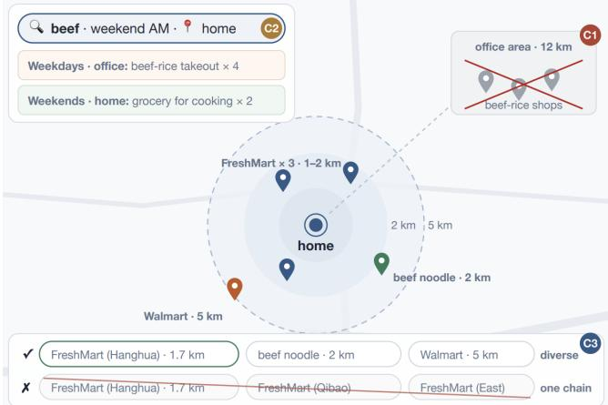
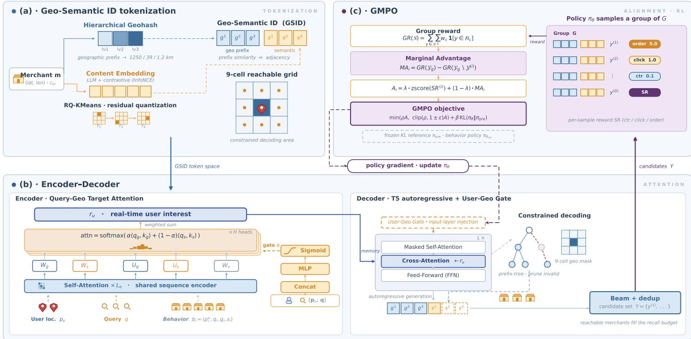
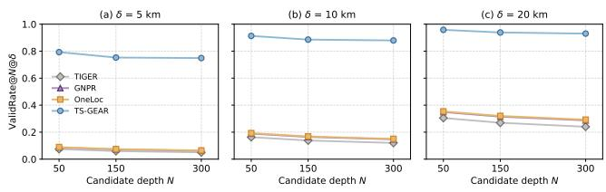
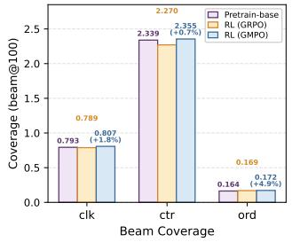
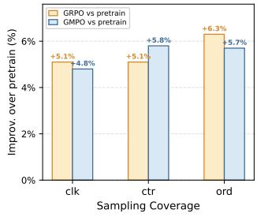
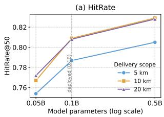
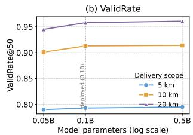

# TS-GEAR: Taobao Shangou GEnerative Ad Retrieval

Guofeng Tong\*, Xu Zhang, Guangliang Yu, Haiqiang Wang, Guannan Cong, Xing Guo

Yang Zhou, Jingjing Duan, Shuang Li\*, Feng Shi, Hualei Liu

Alibaba Group

Shanghai, China

{guofengtong.tgf,shoucai.zx,yuguangliang.ygl,wang.whq,congguannan.cgn,danghu.gx}@alibaba-inc.com {liaowu.zy,duan.djj,reubenli.ls,sam.sf}@alibaba-inc.com, jianglang@taobao.com

## Abstract

On-demand delivery platforms such as DoorDash and Uber Eats impose a constraint absent in traditional e-commerce: merchants beyond the user’s delivery range are invalid candidates rather than merely low-ranked. Generative retrieval has recently shown strong potential in large-scale retrieval systems. Adapting it to this setting, however, poses three challenges. First, existing semantic IDs encode geography only as a soft signal, so reachability can only rely on a non-diferentiable post-generation hard truncation. Second, user preferences vary substantially across both regions and queries, so aggregating historical behaviors without conditioning on geogra phy and the current query yields biased interest estimates. Third, the retrieved candidate set is evaluated by its collective value, yet autoregressive training scores each sequence independently, with no set-level signal to discourage redundant near-duplicates. To ad dress these challenges, we propose TS-GEAR, a unified generative retrieval framework for on-demand delivery: (1) Geo-Semantic ID splits merchant identifiers into geographic prefixes and semantic sufixes, making reachability a prediction target rather than a posthoc filter; (2) Query-Geo Target Attention aggregates historical behaviors using the real-time query and location as dual targets, while encoding each behavior’s own location into its attention key; (3) GMPO (Group Marginal Policy Optimization) rewrites advantages using a deduplicated group reward and a Marginal Advantage within GRPO, avoiding auxiliary diversity objectives. Deployed online with a lightweight 0.1B backbone, TS-GEAR serves over 150 million queries per day in the search advertising pipeline of Taobao Shangou, consistently outperforming state-of-the-art generative retrieval methods on both HitRate and geographic validity, and achieving 3.8% gains in ad impressions and 4.2% in ad revenue.

## Keywords

generative retrieval, reinforcement learning, on-demand delivery, search advertising

## 1 Introduction

Taobao Shangou is an on-demand delivery platform that connects users with nearby merchants through a local logistics network, ofering services such as food delivery and instant retail (e.g., groceries and electronics). Specifically, the merchants available to a user are limited to those within delivery range of the user’s real- time location, and orders are typically fulfilled by a courier within an hour. Reachability is thus a hard constraint in Taobao Shangou search: the system must not only understand the user’s query intent but also assess, in real time, whether a merchant can deliver to the user. This fundamentally distinguishes it from general e-commerce search.

  
Figure 1: A motivating request in on-demand delivery search. The same query “beef” maps to hot ready-to-eat dishes near the ofice on weekdays, but to fresh ingredients at home on weekends, illustrating the three challenges.

In recent years, retrieval has been shifting from the traditional two-tower paradigm to generative retrieval. This new paradigm represents each item as a semantic ID (SID) and directly generates candidate SIDs with an autoregressive model, naturally unifying multi-source signals (query semantics, user behavior, etc.) under a single objective. It can further be aligned to business objectives via reinforcement learning, and has been validated in industry by works such as TIGER [18], OneRec [5], and OneSug [8]. However, deploying generative retrieval in Taobao Shangou’s sponsored search poses three key challenges. We illustrate them with a con- crete example (Figure 1): user A frequently orders food delivery near his ofice on weekdays, with his order history dominated by hot-food shops (e.g., beef rice). On weekends he typically cooks at home. One weekend morning, at home, he opens Taobao Shangou and searches “beef”.

Challenge 1: geographic reachability is not structurally enforced. Existing SIDs are derived solely from content or collab-orative signals, so high-probability candidates are biased toward the beef-rice shops near user A’s ofice, semantically relevant yet beyond the home delivery range. Such candidates can only be re- moved by a non-diferentiable post-generation filter, which wastes beam budget and lies outside end-to-end optimization.

Challenge 2: interest bias in behavior aggregation. For the same query “beef”, the user’s intent is ready-to-eat dishes at the ofice but fresh ingredients at home. When behaviors are aggregated without geographic conditioning, the representation is dominated by the more frequent ofice-vicinity preference, causing the system to retrieve hot-food merchants instead of the fresh-grocery ones the user actually wants. To model user interest accurately, the system must condition on the real-time query–location pair and account for the geographic context in which each past behavior occurred.

Challenge 3: mismatch between token-level training and set-level objective. Autoregressive training scores each sequence independently, so the beam is easily filled by near-duplicate mer- chants from a single fresh-grocery chain, each correct on its own but redundant as a set, crowding out alternatives such as beef rolls or noodles. Retrieval is essentially next-set prediction, whose quality lies in the whole set’s cumulative value and diversity; token-level likelihood also cannot diferentiate strong signals (e.g., orders) from weak ones (e.g., clicks).

To address these challenges, we propose TS-GEAR, a gener-ative retrieval framework for on-demand delivery, built on an encoder–decoder architecture and optimized through supervised pre-training followed by RL alignment. We introduce three designs, each targeting one challenge: (1) the Geo-Semantic ID splits a merchant identifier into a geographic prefix and a semantic suf fix, so that a prefix-level constrained decoding turns reachability from a post-filter into a structural generation target, while a User Geo Gate inside the decoder injects the user’s real-time location to condition the order in which reachable grids are generated; (2) Query-Geo Target Attention aggregates behaviors with the realtime query and location as dual targets, enabling location-aware interest modeling and cross-region behavior transfer; (3) GMPO (Group Marginal Policy Optimization) reformulates the GRPO ad-vantage with a deduplicated group reward and a Marginal Advantage, aligning set-level value without any auxiliary diversity objective.

Our contributions are summarized as follows:

• We propose a unified generative retrieval framework designed for on-demand delivery, unifying geographic hard-constraint modeling and set-level value alignment within a single encoder–decoder architecture.

• We design the Geo-Semantic ID that, via a prefix-level constrained decoding, moves geographic reachability from a post-filter into the generation process, and incorporate a User-Geo Gate inside the decoder that injects the user’s real- time location to condition the order of the generated grids.

• We propose Query-Geo Target Attention, which jointly con ditions on geographic context and query semantics in the encoder, enabling cross-region user interest modeling.

• We propose the GMPO alignment algorithm, which reformulates GRPO’s advantage with a deduplicated group reward and a leave-one-out Marginal Advantage, directly optimizing the cumulative value and diversity of the retrieved set while suppressing policy collapse.

• Experiments on industrial and public datasets show that our method consistently outperforms state-of-the-art generative retrieval methods on HitRate and geographic validity. In a 7-day online A/B test, the framework achieves +3.8% ad impressions and +4.2% ad revenue.

## 2 Related Work

## 2.1 Generative Retrieval

Generative retrieval reformulates the traditional two-tower “en- code + ANN” pipeline as a sequence generation task that directly decodes item identifiers, circumventing the representational bot- tleneck of a single inner product and the encoding–indexing mismatch [4, 10]. The paradigm was established for document retrieval by DSI [22] and NCI [26]; TIGER [18] introduced RQ-VAE [12] residual quantization, built on the discrete codebooks of VQ-VAE [23], to obtain SIDs whose hierarchical codebook structure enables coarse- to-fine generation, and the approach was scaled to production by OneRec [5], OneSug [8], and OneSearch [1]. TSGR [29] further introduced value-aware SIDs with query-conditioned token orderings, while LLM-based variants such as P5 [7] and LC-Rec [32] leverage pre-trained language models to unify recommendation tasks as prompted text generation. HierGR [30], targeting food-delivery search, uses an LLM backbone but only performs ofline inference with cached reuse, modeling neither the user’s real-time location nor the behavior history. All these works derive identifiers solely from content or collaborative signals, and their tokens encode no explicit spatial structure, so geographic reachability can only be imposed as a post-filter on already generated candidates, discarding a large fraction of the beam in location-based service (LBS) settings and precluding end-to-end optimization.

## 2.2 Geo-Aware Recommendation

Spatial-context modeling has a long history in next-POI tasks, evolving from early Markov models and metric embeddings to RNN- and attention/graph-based methods such as DeepMove [6], STAN [14], and GETNext [28], and more recently to LLM-based next-POI models such as LLM4POI [13]; their commonality is injecting distance or regional features into the scoring function. Mainstream sequential recommenders such as GRU4Rec [9], SASRec [11], and BERT4Rec [21] encode interaction histories efectively but are location-agnostic. Recent work has begun to introduce geographic information into the generative paradigm: GNPR [24] couples geographic and semantic signals within RQ-VAE quantization, and One-Loc [27] biases decoding toward nearby merchants via geographic soft guidance. However, both model geography as a soft signal (fused features or decoding bias), which can encourage proximity but cannot structurally enforce reachability; on-demand delivery is stricter: merchants beyond the courier’s delivery range are invalid results. Moreover, these methods operate in a query-free recom- mendation setting, and their public POI datasets lack query signals, so geo-aware modeling has rarely been studied in a search setting, leaving the joint treatment of query intent and spatial reachability largely open.

## 2.3 Reinforcement Learning Alignment

Since the introduction of RLHF [3], aligning generative models with downstream objectives via reinforcement learning has become standard practice. PPO [19] established the RL pipeline; subsequent variants progressively reduce training cost: the critic-free

  
Figure 2: Overall architecture of TS-GEAR. (a) Geo-Semantic ID tokenization, which builds hierarchical merchant identifiers. (b) The geo-aware search-interest encoder–decoder: a Query-Geo Target Attention encoder paired with a geo-constrained decoder that applies the User-Geo Gate. (c) GMPO alignment of the decoder policy.

GRPO [20], preference-based DPO [17], and its reference-free vari ant SimPO [15]. These techniques have been adapted to generative retrieval: OneSug [8] applies DPO with hierarchical behavior rewards; OneSearch-V2 [2] refines GRPO with a Token-Position Marginal Advantage that assigns position-aware credit to each SID token, respecting the coarse-to-fine causal structure; GFlowGR [25] applies GFlowNet to decompose item-level reward into token-wise flow supervision, training generation probability proportional to terminal reward. However, all these methods reward each sequence independently, ignoring that retrieval delivers a set: two relevant but near-duplicate merchants contribute far less than their sum. Single-sequence optimization thus drives the beam to collapse into a narrow region of the item space.

## 3 Method

## 3.1 Problem Formulation

Let the user set be U and the merchant set be M. Each merchant � ∈ M has a geographic location $\left( \mathrm { l a t } _ { m } , \mathrm { l o n } _ { m } \right)$ and content features $\mathbf { c } _ { m } \in \mathbb { R } ^ { d _ { c } } \left( \mathrm { e . g } \right.$ ., images and region). A search request is characterized by a triple $( q , p _ { u } , \mathcal { B } )$ , where � is the query text, $\mathcal { P } u$ is the user’s real-time location, and $\mathcal { B } = \left\{ b _ { i } \right\} _ { i = 1 } ^ { L _ { b } }$ is the user’s behavior history. Each behavior $b _ { i } = ( p _ { i } ^ { u } , q _ { i } , g _ { i } , s _ { i } )$ records the user’s location $\mathbf { \nabla } _ { \mathcal { P } _ { i } ^ { u } }$ the query $q _ { i }$ (a default placeholder in non-search contexts), and $g _ { i } , s _ { i }$ identifying the location and semantic attributes of the target merchant. Throughout, �-symbols denote user-side locations and �-symbols merchant-side geographic codes, and boldface $( \mathrm { e . g . , } \mathrm { p } _ { u } )$ denotes the corresponding embedding.

We represent each merchant as a Geo-Semantic ID (GSID) sequence $\hat { \mathbf { y } } = [ g ^ { ( 1 ) } , g ^ { ( 2 ) } , g ^ { ( 3 ) } , s ^ { ( 1 ) } , s ^ { ( 2 ) } , s ^ { ( 3 ) } ]$ , with three eo ra hic tokens followed by three semantic tokens. Retrieval is then a con- strained set-generation problem: to learn a policy $\pi _ { \theta }$ that generates a deduplicated candidate set $\mathcal { Y } = \{ \mathbf { y } ^ { ( 1 ) } , . . . , \mathbf { \bar { y } } ^ { ( B ) } \}$ maximizing the whole set’s cumulative business value, subject to the hard con-straint that the geographic tokens of every candidate fall in the user-centric delivery range $\mathcal { N } _ { u }$ :

$$
\begin{array} { r l } { } & { \underset { \theta } { \operatorname* { m a x } } ~ \mathbb { E } y _ { \sim \pi _ { \theta } ( \cdot | q , p _ { u } , \mathcal { B } ) } \left[ \mathrm { V a l u e } ( y ) \right] } \\ & { \mathrm { s . t . } ~ ( g ^ { ( 1 ) } , g ^ { ( 2 ) } , g ^ { ( 3 ) } ) \in N _ { u } , \forall \mathbf { y } \in y . } \end{array}\tag{1}
$$

Unlike the token-wise likelihood maximization of language mod- eling, Value(Y) is defined at the candidate-set level; this set-level property motivates our subsequent alignment design.

## 3.2 Overall Architecture

Our method follows an encoder–decoder architecture with a three- stage design. The first stage, Geo-Semantic ID tokenization, builds a hierarchical merchant representation tailored to on-demand de- livery, decoupling geographic location from content semantics. The second stage, autoregressive pre-training, trains the encoder– decoder with Query-Geo Target Attention and User-Geo Gate to jointly model user interest and real-time geographic context. The third stage, set-level alignment, aligns the generation policy with set-level business objectives via GMPO. The overall architecture is shown in Figure 2.

## 3.3 Geo-Semantic ID Tokenization

A merchant’s delivery range is not a fixed radius but a dynamic re- gion that depends on real-time fulfillment capacity (courier supply, weather, distance); reachability therefore cannot be precomputed as a static attribute. Meanwhile, naively embedding geographic information into the SID cannot structurally enforce reachabil ity during generation. Our design rationale is to discretize space into fine-grained geographic cells and let the model, at generation time, locate the nearest cells that jointly cover the user’s delivery range, so that reachability is expressed as an explicit, decodable prefix rather than a post-hoc filter. We accordingly introduce the Geo-Semantic ID, which augments the SID with an explicit spatial hierarchy and adaptively captures fulfillment constraints by generating a geographic prefix code.

Geographic prefix code. The geographic prefix code is obtained via hierarchical geohash [16] encoding. Balancing spatial gran-ularity against codebook size for on-demand delivery, we select the 6-digit geohash (geohash-6) as the finest geographic unit: for merchant �, we take its 6-digit base-32 geohash (spanning roughly 1.2 km×0.6 km grid) and split it into three chunks of two characters each to obtain the hierarchical geographic code:

$$
g _ { m } ^ { ( k ) } = \mathrm { C h u n k } _ { k } \big ( \mathrm { G e o h a s h } _ { 6 } ( \mathrm { l a t } _ { m } , \mathrm { l o n } _ { m } ) \big ) .\tag{2}
$$

Each chunk $g _ { m } ^ { ( k ) }$ consists of two base-32 characters, with a vo- cabulary of size $| \mathcal { V } _ { q } | ~ = ~ 3 2 \times 3 2 ~ = ~ 1 0 2 4 ;$ as � increases, the re- gion encoded by the first 2� characters narrows from roughly 1250 km → 39 km → 1.2 km. Note that geohash cells are not a strictly regular grid. Cell dimensions vary with latitude and the aspect ratio changes across digit positions, so all grid sizes above are approximate.

Content semantic code. The content semantic code is obtained by quantizing the merchant embedding with a residual quantizer. To specialize the embedding space for on-demand delivery, we construct structured prompts incorporating region, brand, category, and frequent queries, and fine-tune a pre-trained Qwen3- Embedding [31] model via contrastive learning with in-domain positive/negative pairs. Following OneRec, we then apply RQ-KMeans for multi-level residual quantization to produce the three-token content semantic code:

$$
s _ { m } ^ { ( k ) } = \mathrm { R Q - K M e a n s } _ { k } ( \mathbf { c } _ { m } ) , \quad k \in \{ 1 , 2 , 3 \} .\tag{3}
$$

Concatenating the two hierarchical sequences yields the Geo-Semantic ID:

$$
\mathrm { G S I D } ( m ) = \bigl [ g _ { m } ^ { ( 1 ) } , g _ { m } ^ { ( 2 ) } , g _ { m } ^ { ( 3 ) } , s _ { m } ^ { ( 1 ) } , s _ { m } ^ { ( 2 ) } , s _ { m } ^ { ( 3 ) } \bigr ] \ \in \ \mathcal { V } _ { g } ^ { 3 } \times \mathcal { V } _ { s } ^ { 3 } .\tag{4}
$$

This representation has two properties. First, prefix similarity implies spatial proximity: geohash preserves lexicographic locality, so merchants sharing a geographic prefix naturally cluster in space; this prefix distance can serve directly as the reward signal for RL alignment. Second, the geographic hierarchy enables inference acceleration: the user’s 4-digit geohash identifies an ≈ 39 km cell; to-gether with its 8 surrounding cells this 3×3 grid essentially covers the platform’s maximum delivery radius. The first two geographic tokens are therefore constrained to these ≤ 9 prefixes $N _ { u } ,$ , reducing full 6-token generation to 4 free tokens; only the third geographic token is generated freely to locate the specific ≈ 1.2 km cell within the reachable neighborhood.

## 3.4 Encoder–Decoder Architecture

3.4.1 Encoder. In on-demand delivery, user behaviors span diverse contexts and regions, with preferences shifting across locations; in search, the user’s current query intent is especially important. Ag- gregating historical behaviors directly with standard self-attention is easily dominated by interactions that are frequent but irrelevant to the current query and the user’s geographic preference. We therefore design a two-level encoder: the bottom level models the context of the behavior sequence at the token level with self- attention, and the top level filters and aggregates at the field level using the current request as the target.

Query-Geo Target Attention. Given the user location $\phi _ { u } ,$ the query $q ,$ and the behavior sequence $\begin{array} { r c l } { \mathcal { B } } & { = } & { \left\{ b _ { i } \right\} _ { i = 1 } ^ { L _ { b } } } \end{array}$ with $b _ { i } = ( p _ { i } ^ { u } , q _ { i } , g _ { i } , s _ { i } )$ , the raw tokens are concatenated and encoded by $L _ { e }$ layers of self-attention, then mean-pooled per field to obtain the four-field representation $( \mathbf { p } _ { i } ^ { u } , \mathbf { q } _ { i } , \mathbf { g } _ { i } , \mathbf { s } _ { i } )$ of behavior �, serving as the key/value source of the upper level attention. The request-side real-time location representation $\mathbf { p } _ { u }$ and query representation q jointly form the target; the geographic path uses $\mathbf { p } _ { u }$ as query and $\left[ \mathbf { p } _ { i } ^ { u } ; \mathbf { g } _ { i } \right]$ as key, and the semantic path uses q as query and [s�; q�] as key. The two paths are dynamically weighted by a gate � and normalized:

$$
e _ { i } = \frac { 1 } { \sqrt { d } } \Big ( \alpha \left. \mathbf { W } _ { g } \mathbf { p } _ { u } , \mathbf { U } _ { g } [ \mathbf { p } _ { i } ^ { u } ; \mathbf { g } _ { i } ] \right. + \left( 1 - \alpha \right) \left. \mathbf { W } _ { s } \mathbf { q } , \mathbf { U } _ { s } [ \mathbf { s } _ { i } ; \mathbf { q } _ { i } ] \right. \Big ) ,\tag{5}
$$

$$
\mathbf { r } _ { \mathrm { i n t } } = \sum _ { i = 1 } ^ { L _ { b } } \mathrm { s o f t m a x } _ { i } ( e ) \mathbf { v } _ { i } ,\tag{6}
$$

where $\begin{array} { r } { \alpha = \sigma ( \mathbf { w } _ { \alpha } ^ { \top } [ \mathbf { p } _ { u } ; \mathbf { q } ] ) , \mathbf { v } _ { i } } \end{array}$ is a linear projection of the concate-nated four-field representation, and $\mathbf { W } _ { g } , \mathbf { W } _ { s } , \mathbf { U } _ { g } , \mathbf { U } _ { s }$ are learnable matrices. The geographic key carries the user location at the time of each past interaction, so that interactions made far from the user’s current position are down-weighted; the semantic key fuses merchant semantic content and past queries, so intent matching does not rely solely on the interacted merchant.

Query Fusion. For behavior-sparse users, rint is noisy and prone to representation collapse, so we fuse it with the query representation via a gate, falling back to q when the behavior signal is weak:

$$
\pmb { \eta } = \sigma \big ( \mathbf { W } _ { \eta } \left[ \mathbf { r } _ { \mathrm { i n t } } ; \mathbf { q } \right] \big ) ,\tag{7}
$$

$$
\mathbf { r } _ { u } = \pmb { \eta } \odot \mathbf { r } _ { \mathrm { i n t } } + \left( \pmb { 1 } - \pmb { \eta } \right) \odot \mathbf { q } ,\tag{8}
$$

where $\mathbf { r } _ { u }$ is the memory for the decoder cross-attention. Compared with standard self-attention, this module splits geographic and semantic similarity into two independent query/key projections and explicitly decouples them via a cross-attention; the gate weight � is interpretable and adjustable. With a lightweight structure, it simultaneously addresses cross-context and cross-region interest transfer and provides a fallback for sparse users.

3.4.2 Decoder. We adopt an autoregressive T5-style Transformer decoder to generate the 6-token Geo-Semantic ID $\hat { \mathbf { y } } = [ \hat { y } _ { 1 } , \dots , \hat { y } _ { 6 } ]$ step by step, with the user representation ${ \bf r } _ { u } ~ ( \mathrm { E q } . ~ ( 8 ) )$ as crossattention memory. We decompose the generation at a single step � into three stages: input-side gated injection, per-layer attention, and output-side constrained decoding.

User-Geo Gate. Since the merchant geographic tokens depend only on the user’s current geohash and are independent of the se- mantic tokens, we inject the user’s position-aligned location embed- ding $\mathbf { p } ^ { ( k ) }$ only when decoding a geographic token $( t = k \in \{ 1 , 2 , 3 \} )$ and use a learnable gate $\gamma _ { t }$ to modulate the injection strength per dimension; the semantic tokens $( t \in \{ 4 , 5 , 6 \} )$ ) remain unchanged to avoid polluting content generation:

$$
\begin{array} { r l } & { { \boldsymbol \gamma } _ { t } = \sigma \big ( { \mathbf W } _ { \gamma } [ { \mathbf h } _ { t } ^ { ( 0 ) } ; { \mathbf p } ^ { ( k ) } ] + { \mathbf b } _ { \gamma } \big ) , } \\ & { \tilde { { \mathbf h } } _ { t } ^ { ( 0 ) } = \left\{ \mathbf h _ { t } ^ { ( 0 ) } + { \boldsymbol \gamma } _ { t } \odot { \mathbf p } ^ { ( k ) } , \quad t = k \in \{ 1 , 2 , 3 \} , \right. } \\ & { \left. \mathbf h _ { t } ^ { ( 0 ) } , \qquad t \in \{ 4 , 5 , 6 \} . \right. } \end{array}\tag{9}
$$

The learned gate $\gamma _ { t } \in ( 0 , 1 ) ^ { d }$ , with learnable $\mathbf { W } _ { \gamma }$ and ${ \bf b } _ { \gamma } .$ is expected to approach 1 when the location embedding is informative, and to decay when the target lies in a neighboring cell, allowing cross- boundary exploration, thus injecting proximity as a soft bias rather than imposing it as a hard constraint. The fused $\tilde { \mathbf { h } } _ { t } ^ { ( 0 ) }$ is fed into � decoder blocks, each performing causal masked self-attention, cross-attention to the memory $\mathbf { r } _ { u } ,$ and a feed-forward network, all with residuals and Pre-Norm (RMSNorm):

$$
\begin{array} { r l } & { \mathbf { a } ^ { ( l ) } = \mathbf { h } ^ { ( l - 1 ) } + \mathrm { M H A } _ { \mathrm { s e l f } } \big ( \mathrm { N o r m } ( \mathbf { h } ^ { ( l - 1 ) } ) , \mathrm { m a s k } _ { \le t } \big ) , } \\ & { \mathbf { c } ^ { ( l ) } = \mathbf { a } ^ { ( l ) } + \mathrm { M H A } _ { \mathrm { c r o s s } } \big ( \mathrm { N o r m } ( \mathbf { a } ^ { ( l ) } ) , \mathbf { r } _ { u } \big ) , } \\ & { \mathbf { h } ^ { ( l ) } = \mathbf { c } ^ { ( l ) } + \mathrm { F F N } \big ( \mathrm { N o r m } ( \mathbf { c } ^ { ( l ) } ) \big ) , \quad l = 1 , \ldots , L . } \end{array}\tag{10}
$$

On the output side, the final-layer output $\mathbf { h } _ { t } ^ { ( L ) }$ is projected by the output matrix to logits over the codebook of the current field, and a softmax yields the token distribution from which beam search expands candidates:

$$
P ( \hat { y } _ { t } \mid \hat { y } _ { < t } , \mathbf { r } _ { u } ) = \mathrm { s o f t m a x } \big ( \mathbf { W } _ { o } \mathbf { h } _ { t } ^ { ( L ) } \big ) .\tag{11}
$$

Decoding proceeds autoregressively for $t = 1 , \ldots , 6 ,$ producing a valid GSID token by token; the beam retains the top-� deduplicated sequences, forming the retrieved candidate set for the request.

3.4.3 Training Objective. The encoder–decoder is pre-trained from scratch with next-token prediction. Training samples are drawn from real click logs: the request context $( q , p _ { u } , \mathcal { B } )$ is the input, and the GSID $\mathbf { y } ^ { * } = [ y _ { 1 } ^ { * } , \ldots , y _ { 6 } ^ { * } ]$ of the clicked merchant is the target sequence, optimized token by token via teacher forcing:

$$
\mathcal { L } _ { \mathrm { N T P } } = - \mathbb { E } _ { ( q , p _ { u } , \mathcal { B } , \mathbf { y } ^ { * } ) \sim \mathcal { D } } \sum _ { t = 1 } ^ { 6 } \log P \big ( \boldsymbol { y } _ { t } ^ { * } \mid \mathbf { y } _ { < t } ^ { * } , \mathbf { r } _ { u } \big ) .\tag{12}
$$

The geographic and semantic tokens share a single cross-entropy; position-specific weights can be assigned to emphasize certain token positions based on business priorities, though we use uniform weights for simplicity. The converged model is denoted $\pi _ { \mathrm { p r e } } ,$ serving both as the initialization of the RL in §3.5 and as its KL-regularization reference model.

## 3.5 GMPO Alignment

The supervision above is token-level and fits only online exposure data, but, constrained by exposure bias and this local objective, it cannot capture group-level coverage or the business-value hierar- chy of retrieval. Therefore, in the alignment stage we introduce set-level prediction: the whole deduplicated candidate set from beam search is served to the user as a unit, and its business value is measured by a composite reward over set-level coverage. The policy $\pi _ { \theta }$ samples � sequences into a deduplicated GSID set per query, with $\pi _ { \mathrm { p r e } }$ as the reference model. Compared with the pre- training stage, we augment the behavior data with order sequences and high-ad-value sequences (filtered from online advertising logs), denoted $\mathcal { B } = \mathcal { B } _ { \mathrm { c l k } } \cup \mathcal { B } _ { \mathrm { c t r } } \cup \mathcal { B } _ { \mathrm { o r d } }$ , corresponding to click, high-CTR, and order sequences respectively, with the three reward classes de- noted $C = \{ \mathrm { c l k , c t r , o r d } \}$ . The single-sample reward (SR) measures the weighted hit score of the �-th sampled output $y ^ { ( i ) }$ against the behavior set B:

$$
\mathrm { S R } ^ { ( i ) } = \sum _ { y \in \mathcal { Y } ^ { ( i ) } } \sum _ { c \in C } w _ { c } \cdot 1 [ y \in \mathcal { B } _ { c } ] .\tag{13}
$$

The weights follow the advertising business-value hierarchy: order $> \mathrm { c l i c k } > \mathrm { h i g h \mathrm { - } C T R }$

Group Reward (GR). On the deduplicated union $\textstyle \mathcal { Y } _ { g } = \bigcup _ { i } \mathcal { Y } ^ { ( i ) }$ of � samples, we measure the overall coverage of any candidate set $s \colon$

$$
\mathrm { G R } ( S ) = \sum _ { y \in S } \sum _ { c \in C } w _ { c } \cdot { 1 } \big [ y \in { \mathcal { B } } _ { c } \big ] .\tag{14}
$$

Marginal Advantage (MA). By computing the group-reward difference between including and excluding the current sample, we quantify the marginal gain of the �-th sample to the overall cover- age; the final advantage combines the z-scored SR (standardized across the � samples) and MA, reducing to the standard GRPO advantage when $\lambda = 1 { : }$

$$
\begin{array} { r } { \mathrm { M A } ^ { ( i ) } = \mathrm { G R } ( \boldsymbol { \mathcal { Y } } _ { g } ) - \mathrm { G R } \big ( \boldsymbol { \mathcal { Y } } _ { g } \setminus \boldsymbol { \mathcal { Y } } ^ { ( i ) } \big ) , \quad } \\ { \boldsymbol { A } _ { i } = \lambda \cdot \mathrm { z s c o r e } ( \mathrm { S R } ^ { ( i ) } ) + \big ( 1 - \lambda \big ) \cdot \mathrm { M A } ^ { ( i ) } . } \end{array}\tag{15}
$$

MA directly penalizes homogenization: a sample that merely du-plicates others adds no coverage and receives $\mathrm { M A } = 0 ,$ so only sequences that contribute new coverage are reinforced, which discourages policy collapse before it sets in. The final training objective follows the GRPO formulation with importance ratio $\rho _ { i } = \pi _ { \theta } ( y ^ { ( i ) } ) / \pi _ { \theta _ { \mathrm { o l d } } } ( y ^ { ( i ) } )$ and KL regularization to anchor the policy near the pre-trained reference:

$$
\begin{array} { r } { \mathcal { L } ( \theta ) = - \mathbb { E } \big [ \operatorname* { m i n } \big ( \rho _ { i } A _ { i } , \mathrm { c l i p } ( \rho _ { i } , 1 \pm \epsilon ) A _ { i } \big ) \big ] + \beta \mathrm { K L } ( \pi _ { \theta } | | \pi _ { \mathrm { p r e } } ) . } \end{array}\tag{16}
$$

In this way the policy is optimized toward set-level business value while staying close to the pre-trained distribution.

## 4 Experiments

## 4.1 Experimental Setup

4.1.1 Datasets. We evaluate on one industrial dataset and two public datasets (Table 1). The industrial dataset (TS-Delivery) is drawn from real user behavior logs of Taobao Shangou search advertising, spanning 12 uniformly sampled days, with the first 10 days used for training, the 11th for validation, and the 12th for testing. Each sample carries the query text, the user’s real-time coordinates, and the global behavior sequence, aligned one-to-one with the problem definition in §3.1. The public datasets use the NYC and TKY subsets of Foursquare check-in data. Following GNPR [24], we preprocess the data, organize each user’s behavior sequence chronologically, and split the data 80%/10%/10% for training/validation/testing. Note that since current public POI data lack real search queries, we adopt the same non-search preprocessing used for the industrial dataset and set the query to a default placeholder, testing model generality under a unified protocol. Since the public datasets provide only per-POI coordinates and no real-time user location, we take the coordinates of each user’s most recent check-in POI as a proxy for the user’s current location.

Table 1: Dataset statistics.
<table><tr><td colspan="2">Dataset</td><td>#Users</td><td>#Items</td><td>#Interactions</td></tr><tr><td colspan="2">TS-Delivery</td><td>0.1B</td><td>4.8M</td><td>0.5B</td></tr><tr><td rowspan="3">Foursquare</td><td>NYC</td><td>1083</td><td>5135</td><td>147938</td></tr><tr><td>TKY</td><td>2293</td><td>7873</td><td>447570</td></tr><tr><td></td><td></td><td></td><td></td></tr></table>

4.1.2 Evaluation Metrics. HitRate@�@� (HR). Hit rate over reachable candidates. It simulates the recall ability of the online pipeline, where distance filtering precedes top-� truncation: following the beam order, keep only reachable $( d \leq \delta )$ deduplicated merchants, retain up to � merchants to form the reachable candidate list $\mathcal { L } _ { u } ^ { \delta , N }$ , and mark the sample as a hit if it intersects the ground-truth clicked-merchant set $\mathcal { G } _ { u } \colon$

$$
\mathrm { H i t R a t e } @ N @ \delta = \frac { 1 } { | \mathcal { U } ^ { \prime } | } \sum _ { u \in \mathcal { U } ^ { \prime } } \mathbf { 1 } \big [ \mathcal { L } _ { u } ^ { \delta , N } \cap \mathcal { G } _ { u } \neq \emptyset \big ] .\tag{17}
$$

Here $\mathcal { U } ^ { \prime }$ is the test set of samples having both a user location and a clicked merchant, 1[·] is the indicator function, and � is the spherical distance between merchant and user.

ValidRate@�@� (VR). Measures the geographic validity of the raw retrieval set: take the top-� deduplicated merchants of the candidate set (no distance filtering), compute the fraction within � of the user, and average over samples:

$$
\mathrm { V a l i d R a t e } @ N @ \delta = \frac { 1 } { | \mathcal { U } | } \sum _ { u \in \mathcal { U } } \frac { \left| \{ s \in S _ { u } ^ { 1 : N } : d ( s , \hat { p } _ { u } ) \leq \delta \} \right| } { | S _ { u } ^ { 1 : N } | } .\tag{18}
$$

Here $S _ { u } ^ { 1 : N }$ is the top-� merchants of $s _ { u } ,$ and U is the test set of samples with a user location. A higher value means the model’s retrieval results are inherently closer to the user’s current location. Coverage @� (average group coverage). For GMPO evaluation, measures the average number of ground-truth hits within a deduplicated group of generated sequences (beam or sampling, group width �) against a class of ground-truth behaviors:

$$
\mathrm { C o v e r a g e } _ { c } @ W = \frac { 1 } { | \mathcal { U } | } \sum _ { u \in \mathcal { U } } \big | y _ { u } \cap \mathcal { B } _ { c } ^ { u } \big | ,\tag{19}
$$

where $c \in \{ \mathrm { c l k , c t r , o r d } \}$

4.1.3 Baselines. TIGER [18] is a pioneering generative-retrieval method that quantizes item content into hierarchical SIDs with RQ-VAE and autoregressively generates target SIDs. Its identifiers carry no spatial structure and thus represent the “plain SID + post-hoc geo-filter” approach. GNPR [24] builds content-semantic hierarchical SIDs for POIs with a diversity objective and fuses geographic information into the quantization input, a soft-modeling approach to spatial awareness. OneLoc [27] is a geo-aware generative recommender for local-life services combining geo-aware SID, geo-aware self-attention, and a geo/GMV dual-reward DPO; it is the closest baseline to our work and represents the strongest soft geo-guidance scheme.

For comparability, the three baselines are implemented under the same data, model size, and beam configuration. TIGER does not natively accept user location as input; we preserve its origi-nal input format and apply the same online geo post-filter to its output, reflecting the real deployment overhead. Since prior work such as OneLoc has demonstrated that generative retrieval substan- tially surpasses traditional dense two-tower retrieval, we focus on the generative direction and likewise exclude methods that model neither geography nor user personalization.

4.1.4 Implementation Details. We train with the AdamW optimizer on 20 PPU-ZW810E GPUs, using an initial learning rate of1.5×10−4 and a weight decay of 0.1. The quantization module comprises six codebook levels: the geographic codebook has $K _ { g } = 1 0 2 4$ geohash cells per level across $L _ { g } = 3$ levels, and the content codebook has $K _ { c } = 2 5 6$ clusters per level across $L _ { c } = 3$ levels, so each merchant is represented by 6 tokens (3 geographic + 3 content). The encoder stacks 2 token-level Transformer blocks and one dual-path target- attention module, and the decoder stacks 12 blocks, with a hidden dimension of 512, 8 attention heads, and a feed-forward (FFN) dimension of 2048. The user historical behavior sequence length �� is set to 100. Ofline evaluation and online serving both decode with a beam width of 300, from which the top-� deduplicated candidates are taken. In the RL stage, the group size � is set to 8, the advantage weight � to 0 (so the deployed advantage is the pure marginal advantage), the KL coeficient � to 0.01, and the clip threshold � to 0.2; the per-behavior reward weights �clk, $w _ { \mathrm { c t r } } .$ , and $w _ { \mathrm { o r d } }$ are set to 1.0, 0.1, and 5.0, respectively. These weights are not tuned on the test set but follow the business-value hierarchy of on-demand delivery: an order is worth far more than a click, and a click more than an impression-level CTR signal.

## 4.2 Experimental Results

4.2.1 Industrial Dataset. Table 2 summarizes results on TS-Delivery under three delivery radii (� ∈ {5, 10, 20} km) and three candidate depths (� ∈ {50, 150, 300}). Note that in production, candidates are retrieved within a 20 km radius.

Reading the table across radii, we observe that the gap between TS-GEAR and the baselines is small at � = 5 km but widens sharply as � grows: on HR@50 the improvement over the strongest baseline OneLoc is 1.2% at 5 km (0.7778→0.7869), 14.1% at 10 km (0.7092→0.8090), and 36.3% at 20 km (0.5929→0.8080). This pattern correlates with the size of the reachable set. At a small � the set is limited, so the first 50 reachable merchants already cover much of it and all methods approach saturation; as $\delta$ grows the reachable set expands, and the task shifts toward selecting, within this larger set, the nearby merchants a user is likely to click. Because TS-GEAR constrains generation to the user’s reachable neighborhood (§4.2.4), its candidates stay concentrated in this region, which is where the larger 10 km and 20 km margins come from. TS-GEAR still takes the best HR under every $N { - } \delta$ combination; at the operational setting (� = 20 km, the production retrieval radius) the gains over OneLoc reach 36.3%/17.4%/11.5% on HR@50/150/300.

4.2.2 Public Datasets. Table 3 summarizes hit-rate results on the Foursquare dataset under three candidate depths $( N \in \{ 5 , 1 0 , 2 0 \} )$ .

Table 2: Main results on the industrial dataset TS-Delivery. HR denotes HitRate@�@�. Best in bold.
<table><tr><td></td><td colspan="3">δ=5 km</td><td colspan="3">δ=10 km</td><td colspan="3">δ=20 km</td></tr><tr><td>Model</td><td>HR@50</td><td>HR@150</td><td>HR@300</td><td>HR@50</td><td>HR@150</td><td>HR@300</td><td>HR@50</td><td>HR@150</td><td>HR@300</td></tr><tr><td>TIGER</td><td>0.7659</td><td>0.8512</td><td>0.8814</td><td>0.6959</td><td>0.8293</td><td>0.8858</td><td>0.5796</td><td>0.7464</td><td>0.8257</td></tr><tr><td>GNPR</td><td>0.7678</td><td>0.8526</td><td>0.8849</td><td>0.6986</td><td>0.8319</td><td>0.8893</td><td>0.5834</td><td>0.7501</td><td>0.8283</td></tr><tr><td>OneLoc</td><td>0.7778</td><td>0.8582</td><td>0.8844</td><td>0.7092</td><td>0.8410</td><td>0.8945</td><td>0.5929</td><td>0.7596</td><td>0.8370</td></tr><tr><td>TS-GEAR</td><td>0.7869</td><td>0.8593</td><td>0.8876</td><td>0.8090</td><td>0.8925</td><td>0.9313</td><td>0.8080</td><td>0.8920</td><td>0.9336</td></tr></table>

Table 3: Results on the public Foursquare dataset. Best in bold.
<table><tr><td rowspan="2">Model</td><td colspan="3">NYC</td><td colspan="3">TKY</td></tr><tr><td>HR@5</td><td>HR@10</td><td>HR@20</td><td>HR@5</td><td>HR@10</td><td>HR@20</td></tr><tr><td>TIGER</td><td>0.5146</td><td>0.6288</td><td>0.7189</td><td>0.4658</td><td>0.5623</td><td>0.6313</td></tr><tr><td>GNPR</td><td>0.5279</td><td>0.6431</td><td>0.7345</td><td>0.4978</td><td>0.5991</td><td>0.6716</td></tr><tr><td>OneLoc</td><td>0.6238</td><td>0.7246</td><td>0.7868</td><td>0.5186</td><td>0.6116</td><td>0.6812</td></tr><tr><td>TS-GEAR</td><td>0.6464</td><td>0.7472</td><td>0.8246</td><td>0.5388</td><td>0.6414</td><td>0.7218</td></tr></table>

Across both public subsets we observe that TS-GEAR again ranks first on every metric, improving over OneLoc by 3.1%–4.8% on NYC and 3.9%–6.0% on TKY. The ordering TIGER < GNPR < OneLoc < TS-GEAR reproduces the industrial result on a very diferent data distribution, which suggests that the link between stronger geographic modeling and better recall is not an artifact of one dataset. The margin here (≈3%–6%) is much smaller than the 14.1%– 36.3% seen at 10 km/20 km on TS-Delivery; this is expected, since Foursquare has no delivery radius and � only reaches 20, so the structural reachability constraint is largely inactive, and the placeholder query leaves no query–geo signal to exploit. The remaining gain therefore comes from jointly modeling user interest and POI geography. The TKY numbers sit below NYC throughout, which we attribute to its larger item set (7.9K vs. 5.1K), denser per-user interactions, and more concentrated POI distribution.

## 4.2.3 Ablation Study. Table 4 summarizes the ablation results of each sub-module on TS-Delivery.

We analyze Table 4 one component at a time. Removing the geo prefix (rows 1–2) pulls HR@50 at 10 km and 20 km back to baseline levels (0.7111 vs. 0.7092 for OneLoc at 10 km; 0.5947 vs. 0.5929 at 20 km), while the 5 km numbers barely move. Without the structural constraint the generated candidates spread across the whole ID space; at narrow radii the post-hoc filter still recovers most hits, but at wide radii the lost geographic concentration leaves the model on par with a pure-semantic baseline, so the geo prefix accounts for most of the large-radius gain (§4.2.4). Comparing the two rows also shows that the prefix and the gate act jointly rather than additively: once the prefix is gone, row 1 is uniformly better than row 2, because a gate conditioned on the user’s real-time location can only reorder cells that the prefix has already restricted to be reachable; without that restriction it reweights an unconstrained ID space and merely injects noise into the decoding order.

Dropping the User-Geo Gate alone (row 3) lowers HR@50 by 0.96/1.29/1.46 percentage points across the three radii, and the damage grows with the radius as the reachable set expands. We interpret this as a division of labor: the prefix code fixes which geographic tokens are admissible, whereas the gate, conditioned on the user’s real-time location, decides which reachable cell to generate first.

  
Figure 3: Geographic validity (ValidRate@�@�) across candidate depths. TS-GEAR keeps validity roughly in the 75%– 96% range across depths and radii, whereas baselines remain around 35% or lower.

The two interest-modeling components behave very diferently. Removing Query-Geo Target Attention (row 4) reduces HR@50 by 2.08/2.54/2.60 percentage points across the three radii. The drop is larger than for the User-Geo Gate and grows more slowly with the radius in relative terms. This relative flatness suggests that it works on the interest representation rather than on reachability: whatever the size of the reachable set, aligning the attention target with the current query and location helps the encoder pick the merchant the user actually wants, so its benefit does not fade at small radii the way the geo prefix does. Query fusion (row 5) is by contrast almost invisible on the full population (within 0.05 percentage points); it is a fallback path for behavior-sparse users, whose efect is diluted over all trafic and should matter more on the sparse-user segment.

## 4.2.4 Geographic Validity. We separately report VR@�@�, the fraction of generated candidates within the delivery radius, for all models (Figure 3).

We center the analysis on � = 20 km, the radius used in production. There TS-GEAR keeps 95.8% of its top-50 candidates within the delivery radius, against 35.4% for the strongest baseline OneLoc, and the margin persists as the beam deepens: 93.9% at � = 150 and 93.0% at � = 300, versus 32.0% and 29.3%. Validity is uniformly high at the smaller radii as well: TS-GEAR never drops below 74.9% at any depth or radius, while every baseline stays at or below 35.4% (Figure 3).

Placed next to Table 2, these numbers show why validity and hit rate do not move in lockstep. At 20 km the reachable set is large, and the 95.8% validity of TS-GEAR is what turns into the 36.3% HR@50 gain, since keeping most candidates within the delivery radius leaves fewer slots spent on unreachable merchants. At smaller radii the reachable set saturates quickly, so the same validity advantage yields only a 1.2% HR gain at 5 km.

Table 4: Ablation study on TS-Delivery. HR denotes HitRate@�@�. The full model is in bold.
<table><tr><td></td><td colspan="3">δ=5 km</td><td colspan="3"> $\delta { = } 1 0 \mathrm { k m }$ </td><td colspan="3">δ=20km</td></tr><tr><td>Model</td><td>HR@50</td><td>HR@150</td><td>HR@300</td><td>HR@50</td><td>HR@150</td><td>HR@300</td><td>HR@50</td><td>HR@150</td><td>HR@300</td></tr><tr><td>w/o geo prefix &amp; u-geo gate</td><td>0.7819</td><td>0.8614</td><td>0.8860</td><td>0.7124</td><td>0.8451</td><td>0.8989</td><td>0.5960</td><td>0.7632</td><td>0.8403</td></tr><tr><td>w/o geo prefix</td><td>0.7794</td><td>0.8580</td><td>0.8835</td><td>0.7111</td><td>0.8416</td><td>0.8945</td><td>0.5947</td><td>0.7606</td><td>0.8371</td></tr><tr><td>w/o u-geo gate</td><td>0.7773</td><td>0.8497</td><td>0.8775</td><td>0.7961</td><td>0.8807</td><td>0.9203</td><td>0.7934</td><td>0.8798</td><td>0.9224</td></tr><tr><td>w/o query-geo attention</td><td>0.7661</td><td>0.8462</td><td>0.8789</td><td>0.7836</td><td>0.8750</td><td>0.9211</td><td>0.7820</td><td>0.8735</td><td>0.9230</td></tr><tr><td>w/o query fusion</td><td>0.7865</td><td>0.8588</td><td>0.8871</td><td>0.8092</td><td>0.8922</td><td>0.9308</td><td>0.8080</td><td>0.8919</td><td>0.9331</td></tr><tr><td>full model</td><td>0.7869</td><td>0.8593</td><td>0.8876</td><td>0.8090</td><td>0.8925</td><td>0.9313</td><td>0.8080</td><td>0.8920</td><td>0.9336</td></tr></table>

We note that reachability is a necessary condition, not the objective: what ultimately matters is the ranking within the reachable set. A post-hoc filter, or an inference-time distance mask over the unreachable candidates decoded from plain SIDs, could also push validity toward 100%, but such masking only renormalizes a dis- tribution trained without geography: the surviving beam stays reachable, yet its ordering is location-agnostic, so validity rises while HR does not follow. Because geography is instead gener-ated end-to-end, the model learns a location-conditioned ordering within the reachable set. The User-Geo Gate makes this concrete: removing it still costs 0.96–1.46 percentage points of HR@50 even though the nine-cell prefix constraint of §3.3 is left untouched. The gain we care about thus comes less from being reachable and more from being correctly ordered inside the reachable neighborhood. Although the prefix distance could also serve as a reward signal for RL (§3.3), the structural prefix constraint already yields over 95% validity, making a separate geographic reward unnecessary; GMPO therefore focuses exclusively on business-value coverage.

## 4.2.5 RL Alignment Analysis. Under the production decoding setting (beam@100 with deduplication), we compare the coverage of the pre-trained baseline, standard GRPO, and GMPO (Figure 4(a)).

Here we observe that GRPO underperforms the pre-trained baseline on coverage (−0.6% on clk, −2.9% on ctr), with its only gain on ord (+3.3%). The cause lies in the data distribution of on-demand delivery search: up to 70% of queries yield only a single click, so pre-training and RL samples overlap heavily and the initial policy is highly concentrated. Once all beam outputs collapse to the same GSID, the importance ratios become identical and the z-score- normalized advantage sums to zero, so the gradient vanishes and remains zero indefinitely; the policy stays locked onto a few high- reward modes. The ord reward, carrying the highest weight, still improves, but at the expense of within-beam diversity and overall coverage. In efect GRPO optimizes the expected reward of an indi-vidual sample, which is misaligned with retrieval, where the unit of value is a set.

GMPO breaks this deadlock, raising clk/ctr/ord by 1.8%/0.7%/4.9% over the pre-trained baseline and by 2.4%/3.7%/1.6% over GRPO. The gains are largest on ord, in line with $w _ { \mathrm { o r d } } = 5 . 0 ;$ the uniform improvement across the three signals shows that the marginal advantage restores within-beam diversity, while the ordering of the gains still follows the business-value hierarchy. The clearest sign of this shift is ctr, which moves from −2.9% to +0.7%: high-CTR merchants that were shown but never clicked are exactly the class a collapsed policy crowds out first.

  
Figure 4: RL alignment analysis. (a) Cumulative coverage under the beam@100 protocol: standard GRPO declines on clk/ctr coverage, while GMPO improves all three signals (relative gains over pretrain-base in parentheses). (b) Relative improvement over pretrain-base under the sampling protocol: GRPO and GMPO are close and both clearly outperform pretrain-base, masking the policy collapse that the beam protocol exposes.

GRPO and GMPO are nearly indistinguishable under the sam-pling protocol, where both clearly outperform pretrain-base (Fig- ure 4(b)), and they separate only under beam search. We attribute this to the randomness injected by the sampling protocol, which sustains within-beam diversity and thereby masks the policy col- lapse, whereas beam search deterministically takes the top-� and exposes the collapse. Since production serving decodes with beam search, judging RL gains from the sampling protocol alone would overstate the gains realized online.

4.2.6 Scaling-Law Study. We vary the Transformer hidden size to-gether with the number of encoder and decoder layers, comparing 0.05B / 0.1B / 0.5B backbones under the same data and training configuration (Figure 5). We observe that HitRate rises roughly linearly with capacity, whereas geographic validity stays comparatively flat; the latter is determined primarily by the prefix constraint rather than by model size. Under the online latency constraint we deploy the 0.1B version.

  
Figure 5: Scaling-law study across 0.05B / 0.1B / 0.5B backbones. HitRate scales roughly linearly with capacity, while geographic validity stays comparatively flat.

Table 5: Online A/B test results of TS-GEAR on the Taobao Shangou search advertising platform (7-day online experiment serving 20% of trafic; all metrics statistically significant with $\textstyle p < 0 . 0 1$ under two-tailed t-tests).

<table><tr><td>Online Metric</td><td>Improvement</td></tr><tr><td>Ad Impressions</td><td>+3.8%</td></tr><tr><td>Ad Efficiency</td><td>+0.4%</td></tr><tr><td>Ad Revenue</td><td>+4.2%</td></tr></table>

## 4.3 Online A/B Test

TS-GEAR is deployed on NVIDIA A10 GPUs (latency budget 70 ms) with TensorRT, mixed precision, and geographic-prefix-based de-coding acceleration: given the user’s real-time location, a nine-cell lookup determines ≤ 9 reachable geographic prefixes as a forced prefill, skipping the first two geo-tokens and reusing the KV cache. The module serves as one incremental recall path in parallel with existing multi-channel retrieval (keyword, vector, etc.), with results fed jointly into advertising ranking and bidding.

On the main Taobao Shangou search advertising pipeline, we ran a continuous 7-day online experiment serving 20% of trafic. Compared with the existing baseline, TS-GEAR (0.1B backbone) improved ad impressions by 3.8%, ad eficiency by 0.4%, and ad revenue by 4.2% (Table 5; all $p \ < \ 0 . 0 1$ under two-tailed t-tests). TS-GEAR is now fully deployed in production, serving over 150M search requests per day.

## 5 Conclusion

This paper proposes TS-GEAR, a generative retrieval framework for on-demand delivery that addresses three key challenges: geographic hard constraints, geographic-interest modeling, and set-level value alignment. Geo-Semantic ID encodes geography as a prefix code so that the vast majority of generated candidates are naturally within the delivery radius; Query-Geo Target Attention conditions behavior aggregation on the current query and location, enabling cross-region interest transfer; GMPO aligns the policy with business value via group reward and marginal advantage while suppressing policy collapse. Extensive ofline and online experiments demon-strate the efectiveness of these designs, and TS-GEAR is now fully deployed in production. In the future, we plan to enrich the reward structure of GMPO with incrementality and relevance rewards, and to advance the engineering of larger-scale models together with the inference acceleration required to serve them.

## Ethical Considerations

Location privacy. TS-GEAR conditions retrieval on the user’s realtime coordinates, one of the most sensitive signals a search system consumes. Location enters the model only as geohash prefixes whose finest cell spans roughly 1.2 km × 0.6 km, so the model reads and generates coarse regions rather than points, and the generated GSIDs identify merchants rather than users. Training uses historical logs collected under the platform’s existing user agreement. Coarse quantization is not anonymization, however: repeated cell-level observations across sessions can still expose where a user lives or works, so access control on the request-time location, retention limits on logged coordinates, and opt-out oflocation personalization remain necessary.

Merchant fairness and fulfillment load. Because decoding is restricted to the nine reachable cells and the reward is dominated by business value, exposure concentrates on nearby, historically high- converting merchants. Newly onboarded merchants and merchants in sparsely covered areas therefore appear less often in the gener- ated candidate set and must spend more on advertising to obtain comparable exposure. The geographic prefix constrains reachability rather than popularity, and the module is one incremental path among several retrieval channels, so exposure floors, ad load caps (limiting the fraction of ad slots in overall trafic), and concentration monitoring at the ranking stage remain necessary complements. The same concentration has an operational side: higher order vol- ume becomes courier workload in the peak hours and dense areas that the constraint favors, so retrieval gains should be reviewed alongside dispatch capacity.

## References

[1] Ben Chen, Xian Guo, Siyuan Wang, Zihan Liang, Yue Lv, Yufei Ma, Xinlong Xiao, Bowen Xue, et al. 2025. OneSearch: A preliminary exploration of the unified end-to-end generative framework for e-commerce search. arXiv preprint arXiv:2509.03236 (2025).

[2] Ben Chen, Siyuan Wang, Yufei Ma, Zihan Liang, Xuxin Zhang, Yue Lv, Ying Yang, Huangyu Dai, et al. 2026. OneSearch-V2: The latent reasoning enhanced self-distillation generative search framework. arXiv preprint arXiv:2603.24422 (2026).

[3] Paul F. Christiano, Jan Leike, Tom B. Brown, Miljan Martic, Shane Legg, and Dario Amodei. 2017. Deep reinforcement learning from human preferences. Advances in Neural Information Processing Systems 30 (2017), 4299–4307.

[4] Paul Covington, Jay Adams, and Emre Sargin. 2016. Deep neural networks for YouTube recommendations. In Proceedings ofthe 10th ACM Conference on Recommender Systems (RecSys ’16). 191–198.

[5] Jiaxin Deng, Shiyao Wang, Kuo Cai, Lejian Ren, Qigen Hu, Weifeng Ding, Qiang Luo, and Guorui Zhou. 2025. OneRec: Unifying retrieve and rank with generative recommender and iterative preference alignment. arXiv preprin arXiv:2502.18965 (2025).

[6] Jie Feng, Yong Li, Chao Zhang, Funing Sun, Fanchao Meng, Ang Guo, and De-peng Jin. 2018. DeepMove: Predicting human mobility with attentional recurrent networks. In Proceedings ofthe 2018 World Wide Web Conference (WWW ’18). 1459–1468.

[7] Shijie Geng, Shuchang Liu, Zuohui Fu, Yingqiang Ge, and Yongfeng Zhang. 2022. Recommendation as language processing (RLP): A unified pretrain, personalized prompt & predict paradigm (P5). In Proceedings of the 16th ACM Conference on Recommender Systems (RecSys ’22). 299–315.

[8] Xian Guo, Ben Chen, Siyuan Wang, Ying Yang, Mingyue Cheng, Chenyi Lei, Yuqing Ding, and Han Li. 2026. OneSug: The unified end-to-end generative framework for e-commerce query suggestion. In Proceedings of the AAAI Conference on Artificial Intelligence (AAAI-26), Vol. 40. 14774–14782.

[9] Balázs Hidasi, Alexandros Karatzoglou, Linas Baltrunas, and Domonkos Tikk. 2016. Session-based recommendations with recurrent neural networks. In Proceedings of the 4th International Conference on Learning Representations (ICLR ’16).

[10] Po-Sen Huang, Xiaodong He, Jianfeng Gao, Li Deng, Alex Acero, and Larry Heck. 2013. Learning deep structured semantic models for web search using clickthrough data. In Proceedings of the 22nd ACM International Conference on Information and Knowledge Management (CIKM ’13). 2333–2338.

[11] Wang-Cheng Kang and Julian McAuley. 2018. Self-attentive sequential recommendation. In Proceedings of the 2018 IEEE International Conference on Data Mining (ICDM ’18). 197–206.

[12] Doyup Lee, Chiheon Kim, Saehoon Kim, Minsu Cho, and Wook-Shin Han. 2022. Autoregressive image generation using residual quantization. In Proceedings of the IEEE/CVF Conference on Computer Vision and Pattern Recognition (CVPR ’22). 11513–11522.

[13] Peibo Li, Maarten de Rijke, Hao Xue, Shuang Ao, Yang Song, and Flora D. Salim. 2024. Large language models for next point-of-interest recommendation. In Proceedings of the 47th International ACM SIGIR Conference on Research and Development in Information Retrieval (SIGIR ’24). 1463–1472.

[14] Yingtao Luo, Qiang Liu, and Zhaocheng Liu. 2021. STAN: Spatio-temporal attention network for next location recommendation. In Proceedings ofthe Web Conference 2021 (WWW ’21). 2177–2185.

[15] Yu Meng, Mengzhou Xia, and Danqi Chen. 2024. SimPO: Simple preference optimization with a reference-free reward. Advances in Neural Information Processing Systems 37 (2024), 124198–124235.

[16] Gustavo Niemeyer. 2008. geohash.org is public! Retrieved August 24, 2026 from https://blog.labix.org/2008/02/26/geohashorg-is-public

[17] Rafael Rafailov, Archit Sharma, Eric Mitchell, Christopher D. Manning, Stefano Ermon, and Chelsea Finn. 2023. Direct preference optimization: Your language model is secretly a reward model. Advances in Neural Information Processing Systems 36 (2023), 53728–53741.

[18] Shashank Rajput, Nikhil Mehta, Anima Singh, Raghunandan Hulikal Keshavan, Trung Vu, Lukasz Heldt, Lichan Hong, Yi Tay, et al. 2023. Recommender systems with generative retrieval. Advances in Neural Information Processing Systems 36 (2023), 10299–10315.

[19] John Schulman, Filip Wolski, Prafulla Dhariwal, Alec Radford, and Oleg Klimov. 2017. Proximal policy optimization algorithms. arXiv preprint arXiv:1707.06347 (2017).

[20] Zhihong Shao, Peiyi Wang, Qihao Zhu, Runxin Xu, Junxiao Song, Xiao Bi, Haowei Zhang, Mingchuan Zhang, et al. 2024. DeepSeekMath: Pushing the limits of math ematical reasoning in open language models. arXiv preprint arXiv:2402.03300 (2024).

[21] Fei Sun, Jun Liu, Jian Wu, Changhua Pei, Xiao Lin, Wenwu Ou, and Peng Jiang. 2019. BERT4Rec: Sequential recommendation with bidirectional encoder rep- resentations from transformer. In Proceedings of the 28th ACM International Conference on Information and Knowledge Management (CIKM ’19). 1441–1450.

[22] Yi Tay, Vinh Q. Tran, Mostafa Dehghani, Jianmo Ni, Dara Bahri, Harsh Mehta, Zhen Qin, Kai Hui, et al. 2022. Transformer memory as a diferentiable search index. Advances in Neural Information Processing Systems 35 (2022), 21831–21843.

[23] Aäron van den Oord, Oriol Vinyals, and Koray Kavukcuoglu. 2017. Neural discrete representation learning. Advances in Neural Information Processing Systems 30 (2017), 6306–6315.

[24] Dongsheng Wang, Yuxi Huang, Shen Gao, Yifan Wang, Chengrui Huang, and Shuo Shang. 2025. Generative next POI recommendation with semantic ID. In Proceedings ofthe 31st ACM SIGKDD Conference on Knowledge Discovery and Data Mining (KDD ’25), Vol. 2. 2904–2914.

[25] Yejing Wang, Shengyu Zhou, Jinyu Lu, Qidong Liu, Xinhang Li, Wenlin Zhang, Feng Li, Pengjie Wang, et al. 2026. GFlowGR: Fine-tuning generative recommendation frameworks with generative flow networks. In Proceedings ofthe 49th International ACM SIGIR Conference on Research and Development in Information Retrieval (SIGIR ’26). 1925–1936.

[26] Yujing Wang, Yingyan Hou, Haonan Wang, Ziming Miao, Shibin Wu, Qi Chen, Yuqing Xia, Chengmin Chi, et al. 2022. A neural corpus indexer for document retrieval. Advances in Neural Information Processing Systems 35 (2022), 25600– 25614.

[27] Zhipeng Wei, Kuo Cai, Junda She, Jie Chen, Minghao Chen, Yang Zeng, Qiang Luo, Wencong Zeng, et al. 2026. OneLoc: Geo-aware generative recommender systems for local life service. In Proceedings ofthe 19th ACM International Conference on Web Search and Data Mining (WSDM ’26). 735–744.

[28] Song Yang, Jiamou Liu, and Kaiqi Zhao. 2022. GETNext: Trajectory flow map enhanced transformer for next POI recommendation. In Proceedings of the 45th International ACM SIGIR Conference on Research and Development in Information Retrieval (SIGIR ’22). 1144–1153.

[29] Tianyu Zhan, Gui Ling, Tong Xiong, Kunhai Lin, Yang Wang, Kaixuan Zhang, Zhihong Chen, Yuliang Yan, et al. 2026. TSGR: Taobao search generative retrieval. arXiv preprint arXiv:2607.18796 (2026).

[30] Fuwei Zhang, Xiaoyu Liu, Xinyu Jia, Yingfei Zhang, Zenghua Xia, Fei Jiang, Fuzhen Zhuan , Wei Lin, et al. 2025. HierGR: Hierarchical semantic re resenta- tion enhancement for generative retrieval in food delivery search. In Proceedings of the 63rd Annual Meeting of the Association for Computational Linguistics (ACL ’25), Volume 6: Industry Track. 444–455.

[31] Yanzhao Zhang, Mingxin Li, Dingkun Long, Xin Zhang, Huan Lin, Baosong Yang, Pengjun Xie, An Yang, et al. 2025. Qwen3 Embedding: Advancing text embedding and reranking through foundation models. arXiv preprint arXiv:2506.05176 (2025).

[32] Bowen Zheng, Yupeng Hou, Hongyu Lu, Yu Chen, Wayne Xin Zhao, Ming Chen, and Ji-Rong Wen. 2024. Adapting large language models by integrating collaborative semantics for recommendation. In Proceedings of the 40th IEEE International Conference on Data Engineering (ICDE ’24). 1435–1448.