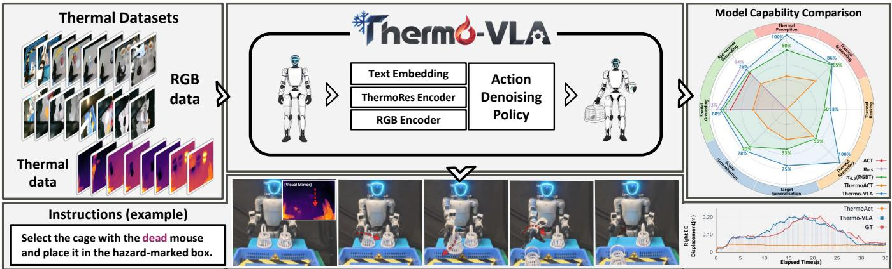
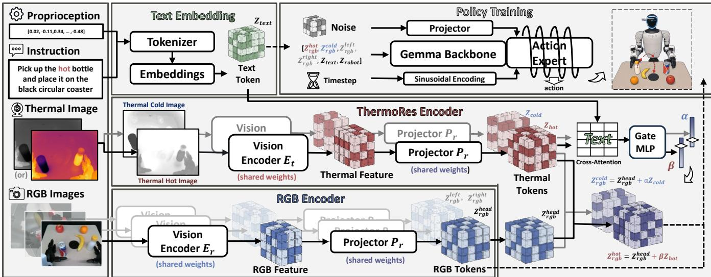
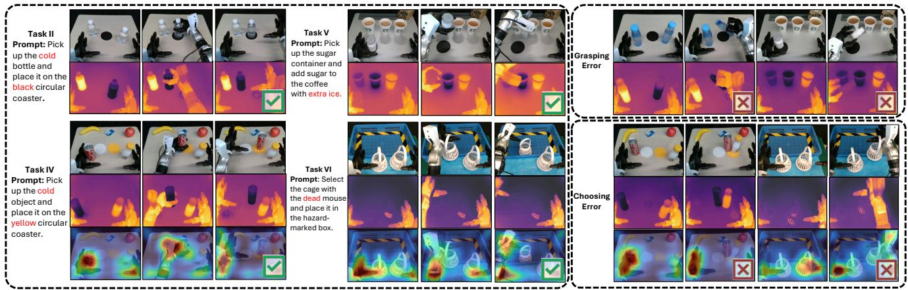
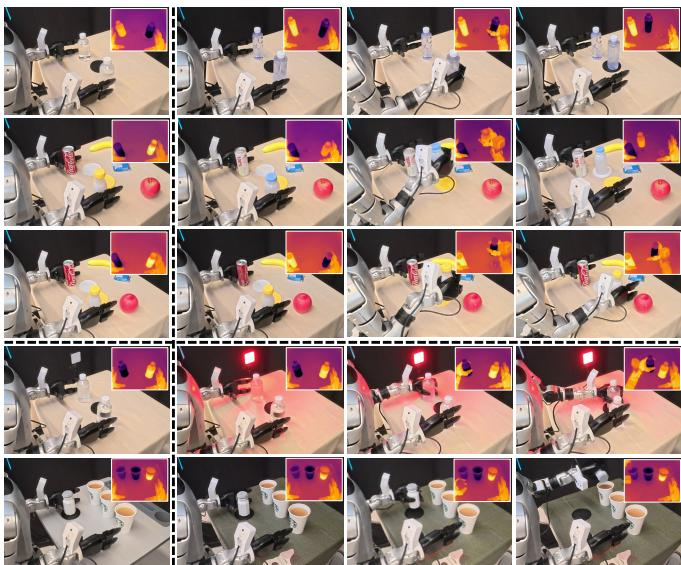
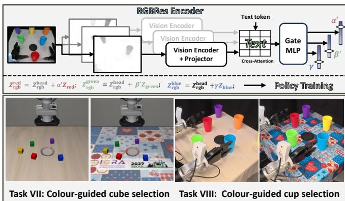

# Thermo-VLA: A Thermal-Aware Vision-Language-Action Model with Gated Residual Modulation for Robotic Manipulation

Jingxuan Chen, Junshi Luo, Chencheng Dong, Xiaojian Nie, Tongge Huang, Qiang Huang

  
Fig. 1. Overview of the Thermo-VLA framework and results. Left: real-world RGB and thermal manipulation data. Centre: the Thermo-VLA framework for multimodal encoding and continuous action generation. Right: performance across RGB capability, thermal perception, thermal reasoning, and generalisation. Bottom: a Task VI example, where Thermo-VLA successfully removes the simulated dead-mouse target and produces arm motion closely aligned with the ground truth.

Abstract— Recent Vision–Language–Action (VLA) models have begun incorporating thermal sensing, but existing approaches typically treat thermal images as ordinary visual inputs, providing limited support for temperature-aware relational reasoning in manipulation. To address this limitation, we propose Thermo-VLA with a ThermoRes Encoder, which decomposes thermal images into cold and hot attribute representations and injects them into the RGB token through languageconditioned residual modulation, enabling temperature-driven target selection and continuous manipulation. We further construct six real-world robotic tasks on a dual-arm Unitree G1 platform, spanning basic grounding to relational reasoning. Experiments show that Thermo-VLA achieves an average success rate of 0.86 across four thermal-dependent tasks, outperforming a π0.5 [1] baseline that directly incorporates RGB–thermal observations by 18 percentage points. Under unseen-object and scene variations, Thermo-VLA maintains an average success rate of 0.78, achieving the best generalisation performance among the compared methods. Beyond thermal sensing, we transfer the same residual modulation mechanism to colour attributes and observe consistent improvements in both simulation and real-robot experiments, indicating its potential to generalise beyond thermal attributes. Project Website

## I. INTRODUCTION

Instruction-driven robotic manipulation aims to generate continuous actions that are consistent with task goals based on language instructions and environmental observations. In recent years, Vision-Language-Action (VLA) models [1]–[6] have substantially advanced language-driven robotic manipulation through heterogeneous pretraining and downstream fine-tuning. However, existing VLAs still rely predominantly on RGB observations for perception. When language instructions involve invisible physical attributes such as temperature, RGB-based policies are not natively equipped to perceive and model such attributes, limiting both target selection and subsequent action generation.

Recent VLA studies [7]–[9] have begun incorporating physical modalities such as thermal sensing to support manipulation beyond RGB-only perception. Nevertheless, existing thermal research [10]–[13] remains largely focused on perceptual and understanding tasks, including image fusion, detection and segmentation, grounding, and visual question answering. Thermal manipulation in robotics also remains limited in several aspects. First, existing studies have primarily demonstrated thermal-aware manipulation in relatively straightforward settings like recognising and grasping thermally salient targets, whereas more complex thermaldependent capabilities, such as relative temperature comparison, conditional selection, and exclusion-based reasoning, remain less explored [8]. Second, even when temperaturerelated targets can be accurately identified, improper integration of thermal information can introduce instability, leading to manipulation failures. Finally, existing systems [7], [8] are predominantly evaluated on fixed-viewpoint, single-arm platforms, leaving their effectiveness in bimanual egocentric manipulation insufficiently studied.

To address these limitations, we propose Thermo-VLA, an end-to-end thermal-aware VLA framework that integrates RGB, thermal, and language information for temperaturedriven manipulation. At its core, Thermo-VLA introduces a dedicated ThermoRes Encoder to incorporate instructionrelevant thermal information while preserving the original RGB representation. Specifically, the ThermoRes Encoder consists of Dual-Branch Attribute Decomposition and Gated Residual Injection. The former decomposes thermal observations into complementary temperature-attribute features, while the latter adaptively injects thermal residuals into RGB tokens under language guidance. As illustrated in the centre of Fig.1, the resulting multimodal tokens then condition the action generation module, enabling temperature-driven target selection, grasping, and continuous manipulation.

We systematically evaluate Thermo-VLA on a Unitree G1 bimanual humanoid robot across six real-world manipulation tasks of varying difficulty, covering basic RGB spatial and appearance grounding, thermal perception, thermal grounding, relative temperature ranking, and thermal reasoning. Thermo-VLA outperforms ThermoAct [8] and the $\pi _ { 0 . 5 }$ baseline that directly incorporates RGB-thermal observations, achieving the best overall performance among the compared methods on the proposed benchmark. As illustrated in the example in Fig.1, Thermo-VLA activates the correct right arm and closely follows the ground-truth trajectory, whereas ThermoAct uses the wrong arm and shows little movement in the required right arm. Thermo-VLA also maintains more stable performance under unseen objects, attribute recombination, illumination changes, and scene variations. Ablation studies verify the effectiveness of the ThermoRes Encoder in injecting task-relevant temperature information into visual representations through text-guided residual modulation. Further representation analysis suggests that these residuals provide compact complementary corrections to the RGB representation.

Our main contributions are summarised as follows:

• We introduce a real-world benchmark for thermal-aware robotic manipulation, comprising four temperaturerelated tasks and two RGB-based tasks for evaluating representative VLA methods under RGB and thermal settings.

• We propose Thermo-VLA with a ThermoRes Encoder that combines temperature-attribute decomposition and text-conditioned residual injection for temperaturedriven manipulation.

• Thermo-VLA achieves the best overall performance on the proposed benchmark and demonstrates strong generalisation to unseen objects and scene variations.

## II. RELATED WORK

## A. Generalist Robotic Manipulation Methods

Early end-to-end imitation learning methods [14]–[16] demonstrated the ability to directly generate continuous actions from visual observations for simple manipulation tasks like grasping and placing. Vision–Language–Action (VLA) models subsequently introduced large-scale vision language priors into robotic control. RT-2 [5] represents actions as text tokens, allowing vision-language knowledge to directly contribute to action prediction, while OpenVLA [6] enables efficient adaptation of pretrained vision-language representations to downstream robotic manipulation tasks. The π series [1]–[3] and GR00T series [4] further improve cross-task, cross-embodiment, and long-horizon manipulation through large-scale heterogeneous robot data and generative action modelling. More recently, world-model-based approaches [17]–[21] enhance temporal decision-making and closed-loop control by predicting future environment states. Nevertheless, they remain predominantly RGB-based.

## B. Multisensory Vision-Language-Action Models

Recent studies have begun to extend VLA models beyond RGB-centric perception toward richer sensing of the physical world. DepthVLA [22] introduces explicit depth representations to enhance spatial reasoning, while ForceVLA [23] and TA-VLA [24] augment VLA models with force/torque feedback. Tactile-VLA [25], VTLA [26], and TacVLA [27] leverage tactile sensing for adaptive physical interaction, while Audio-VLA [28] and E-VLA [29] further extend VLA perception with acoustic and event-based signals, respectively. Beyond individual physical modalities, recent approaches have explored unified multisensory VLA frameworks. Safe-Night VLA [9] combines thermal and depth information to support temperature-conditioned manipulation and safetyaware control. OmniVLA [30] and MuseVLA [7] integrate multiple physical modalities, including thermal, acoustic, and mmWave sensing; the former emphasises unified sensor representations, while the latter dynamically selects required modalities according to the instruction.

## C. Thermal Perception, Understanding, and Action

Recent studies have investigated effective thermal representations and cross-modal fusion [11], [31], [32]. AnyThermal [10] learns a general-purpose thermal backbone through distillation from visual foundation models and transfers it to downstream vision tasks such as segmentation and depth estimation. IRGPT [13] and Thermo-VL [12] further align thermal representations with the language space, supporting infrared image recognition, captioning, and grounding, as well as text-guided RGB-thermal visual question answering and cross-spectral reasoning. More recent work has further incorporated thermal information into robotic manipulation. ThermoAct [8] adopts a hierarchical architecture with a Gemini 2.0 Flash [33] planner and a $\pi _ { 0 }$ executor. However, within the executor, thermal images are converted to pseudocolour and processed by the generic visual encoder, leaving their temperature-specific information insufficiently integrated into action-relevant representations.

## III. THERMO-VLA FRAMEWORK

## A. Problem Formulation

Existing VLA models typically predict continuous robot actions conditioned on visual observations, language instructions, and robot states. In this work, we introduce Thermo-VLA and use $\pi _ { 0 . 5 }$ as the baseline model. As illustrated in Fig. 2, given RGB observations $x _ { r }$ , a thermal observation $x _ { t } ,$ a language instruction l, and the current robot state $s _ { t } .$ Thermo-VLA predicts a continuous action chunk of horizon

  
Fig. 2. Overview of the Thermo-VLA framework. RGB observations are encoded by the RGB visual encoder, while language instructions and robot states are mapped to textual embeddings. ThermoRes Encoder decomposes thermal observations into cold and hot attributes and injects them into RGB tokens through context-gated residuals. The resulting multimodal prefix is used for flow-matching policy training and continuous action generation.

H, $A _ { t } \ = \ [ a _ { t } , \ldots , a _ { t + H - 1 } ] \ \in \ \mathbb { R } ^ { H \times 2 d _ { a } }$ with conditional distribution

$$
A _ { t } \sim \pi _ { \theta } ( \cdot \mid x _ { r } , x _ { t } , l , s _ { t } ) .\tag{1}
$$

In our setup, $d _ { a } = 8 .$ , comprising seven arm-joint dimensions and one hand open/close dimension.

## B. ThermoRes Encoder

As shown in Fig.2, for each RGB observation $x _ { r } ^ { i } ,$ the visual encoder $E _ { r }$ extracts patch-level features, which are projected into the token space by $P r \colon Z _ { \mathrm { r g b } } ^ { i } = P r ( E _ { r } ( x _ { r } ^ { i } ) ) \in$ ${ \mathbb R } ^ { B \times N \times D } , i \in \{ \mathrm { h e a d } , \mathrm { l e f t } , \mathrm { r i g h t } \}$ , where B, N, and D denote the batch size, number of visual tokens, and token dimensionality, and the left and right RGB observations are captured by wrist-mounted cameras. Since conventional visual encoding is insufficient to explicitly capture temperature attributes in thermal observations, as demonstrated in Sec. IV-A.2, we further introduce the ThermoRes Encoder, consisting of Dual-Branch Attribute Decomposition and Gated Residual Injection for attribute extraction and context-conditioned integration, respectively.

1) Dual-Branch Attribute Decomposition: Unlike RGB images, whose visual statistics are primarily characterised by colour, texture, and appearance, thermal images mainly reflect scene-dependent temperature distributions. However, cold objects, hot objects, and heat emitted by the robot itself may coexist within a single frame, making it difficult to explicitly identify the required temperature attribute and its response strength from mixed thermal responses.

To address this issue, we introduce Thermal Dual-Branch Attribute Decomposition. Since thermal responses depend on both the target and the background temperature, the same object may exhibit different absolute intensities across scenes. We first sample multiple patches near the upper image boundary, compute their mean intensities, and take the mode of these values as the background reference b for each frame and calibrate the original thermal image $x _ { t }$ such that the background is mapped to a fixed grayscale intensity $\mu .$ The calibrated observation is then decomposed into complementary cold and hot attribute views according to its deviation from the background:

$$
\begin{array} { c } { k = \mathrm { c l i p } ( x _ { t } - b + \mu , 0 , I _ { \mathrm { m a x } } ) , } \\ { x _ { \mathrm { c o l d } } = I _ { \mathrm { m a x } } \displaystyle \frac { \mathrm { m i n } ( k , \mu ) } { \mu } , \ : x _ { \mathrm { h o t } } = I _ { \mathrm { m a x } } \displaystyle \frac { I _ { \mathrm { m a x } } - \mathrm { m a x } ( k , \mu ) } { I _ { \mathrm { m a x } } - \mu } , } \end{array}\tag{2}
$$

where $I _ { \mathrm { m a x } }$ denotes the upper bound of the grayscale range. This transformation uses the background as a common reference, such that $x _ { \mathrm { c o l d } }$ and $x _ { \mathrm { h o t } }$ emphasise responses below and above the background, respectively. Both branches adopt a shared SigLIP-based thermal encoder $E _ { t }$ , with the background close to white and larger temperature deviations appearing darker. The two branches further share the RGB projector $P _ { r } \colon Z _ { \mathrm { c o l d } } = P _ { r } ( E _ { t } ( x _ { \mathrm { c o l d } } ) ) , Z _ { \mathrm { h o t } } = P _ { r } ( E _ { t } ( x _ { \mathrm { h o t } } ) )$ This yields temperature attribute tokens with the same dimensionality as the RGB tokens, facilitating subsequent residual injection.

2) Gated Residual Injection: After Dual-Branch Attribute Decomposition, the cold and hot branches produce separate temperature attribute tokens. Rather than directly concatenating them with other modalities, which increases the burden on downstream multimodal modelling, we introduce Gated Residual Injection to incorporate task-relevant thermal information into the RGB token selectively. It consists of two steps: (1) Text-Gate Cross-Attention estimates the relevance of the cold and hot attributes to the current textual context; and (2) the weighted temperature tokens are injected into the RGB tokens through residual connections.

Text-Gate Cross-Attention. Different task contexts may require different levels of attention to the cold and hot attributes. We therefore use the text token $Z _ { \mathrm { t e x t } }$ as the query and the cold and hot thermal tokens as branch-specific keys and values, producing the cross-attention outputs $O _ { c }$ and $O _ { h }$ respectively. The two branches share the attention parameters. We then construct the gating feature from the pooled text token, cross-attention outputs, and their representation differences. Let $u _ { t } : = [ \bar { Z } _ { \mathrm { t e x t } } ; \bar { O } _ { c } ; \bar { O } _ { h } ; \bar { O } _ { c } - \bar { Z } _ { \mathrm { t e x t } } ; \bar { O } _ { h } - \bar { Z } _ { \mathrm { t e x t } } ] .$ where the overbar denotes token-wise pooling. A lightweight Gate MLP directly predicts dynamic weights for the cold and hot branches:

TABLE I  
DATASET SPECIFICATIONS. THE SIX REAL-WORLD TASKS, THEIR KEY CHALLENGES, AND THE NUMBER OF EXPERT DEMONSTRATIONS.
<table><tr><td>No.</td><td>Task Name</td><td>Difficulty</td><td>Episodes</td></tr><tr><td>I</td><td>Position-guided bottle selection</td><td>Spatial Grounding</td><td>156</td></tr><tr><td>ⅡI</td><td>Temperature-guided bottle selection</td><td>Thermal Perception</td><td>303</td></tr><tr><td>III</td><td>Identity-guided object selection</td><td>Appearance Grounding</td><td>236</td></tr><tr><td>IV</td><td>Temperature-guided object selection</td><td>Thermal Grounding</td><td>340</td></tr><tr><td>V</td><td>Temperature-aware coffee service</td><td>Thermal Ranking</td><td>173</td></tr><tr><td>VI</td><td>Abnormal-animal cage removal</td><td>Thermal Exclusion</td><td>99</td></tr></table>

$$
[ \alpha , \beta ] = \operatorname { s o f t m a x } \left( \operatorname { M L P } \left( \operatorname { L N } ( u _ { t } ) \right) \right) .\tag{3}
$$

The contributions of the temperature attributes are thereby adaptively adjusted according to the current textual context.

Residual Injection. The RGB token primarily provides the appearance, spatial grounding, and visual semantics required for action prediction, while thermal observations provide temperature cues unavailable from RGB. Inspired by the residual learning principle of ResNet [34], we preserve the RGB token as an identity path and inject the temperature attributes using the predicted dynamic weights:

$$
Z _ { \mathrm { r g b } } ^ { \mathrm { c o l d } } = Z _ { \mathrm { r g b } } ^ { \mathrm { h e a d } } + \alpha Z _ { \mathrm { c o l d } } , \ Z _ { \mathrm { r g b } } ^ { \mathrm { h o t } } = Z _ { \mathrm { r g b } } ^ { \mathrm { h e a d } } + \beta Z _ { \mathrm { h o t } } .\tag{4}
$$

As the RGB and thermal branches are mapped into a compatible feature space, $Z _ { \mathrm { r g b } } ^ { \mathrm { h e a d } } , ~ Z _ { \mathrm { c o l d } }$ , and $Z _ { \mathrm { { h o t } } }$ share the same token layout and token dimensionality, enabling token-wise residual modulation of the RGB representation. Independently modulated by the textual context, $Z _ { \mathrm { r g b } } ^ { \mathrm { c o l d } }$ and $Z _ { \mathrm { r g b } } ^ { \mathrm { h o t } }$ are combined with the remaining conditioning tokens to form the multimodal prefix for subsequent action generation.

## C. Action Generation

After Gated Residual Injection, the enhanced visual tokens are combined with the text token $Z _ { t e x t } .$ , which is formed from the language instruction l and the discretised robot state $s _ { t }$ by tokenisation and embedding. Together, they form the temperature-conditioned prefix $Z _ { T } : =$ $\overline { { [ } } Z _ { \mathrm { r g b } } ^ { \mathrm { c o l d } } ; Z _ { r g b } ^ { \mathrm { h o t } } ; Z _ { \mathrm { r g b } } ^ { \mathrm { l e f t } } ; Z _ { \mathrm { r g b } } ^ { \mathrm { r i g h t } } ; \overline { { Z } } _ { \mathrm { t e x t } } ]$ . The resulting prefix $Z _ { T }$ is then processed by the Gemma-based multimodal backbone and provided as conditioning information to the action expert. We retain the base model’s flow-matching action generation mechanism. Given the action chunk A and Gaussian noise $\epsilon \sim \mathcal { N } ( 0 , I )$ , we construct $x _ { \tau } = ( 1 - \tau ) A _ { t } + \tau \epsilon$ , where the flow-matching time step τ is encoded using sinusoidal encoding as the temporal condition. During inference, the action variable is initialised from Gaussian noise and evolved along the predicted velocity field to generate a continuous action chunk.

TABLE II  
SUCCESS RATES ON THE SIX REAL-WORLD MANIPULATION TASKS. BEST RESULTS ARE HIGHLIGHTED IN BOLD.
<table><tr><td rowspan="2">Task Instruction</td><td colspan="2">RGB</td><td colspan="3">RGBT</td></tr><tr><td>ACT</td><td></td><td>π0.5 π0.5(RGBT)ThermoAct Ours</td><td></td><td></td></tr><tr><td colspan="6">Task I: Position-guided bottle selection</td></tr><tr><td>Left bottle → black coaster</td><td>0.75</td><td>0.95</td><td>0.95</td><td>0.80</td><td>0.95</td></tr><tr><td>Right bottle → black coaster</td><td>0.75</td><td>0.90</td><td>0.75</td><td>0.10</td><td>0.80</td></tr><tr><td>Avg.</td><td>0.75</td><td>0.93</td><td>0.85</td><td>0.45</td><td>0.88</td></tr><tr><td colspan="6">Task II: Temperature-guided bottle selection</td></tr><tr><td>Cold bottle → black coaster</td><td>1</td><td>1</td><td>0.80</td><td>0.45</td><td>1.00</td></tr><tr><td colspan="6">Task III: Identity-guided object selection</td></tr><tr><td>Milk → yellow coaster</td><td>0.65</td><td>0.85</td><td>0.75</td><td>0.55</td><td>0.80</td></tr><tr><td>Milk → white coaster</td><td>0.75</td><td>0.85</td><td>0.70</td><td>0.45</td><td>0.85</td></tr><tr><td>Coke → yellow coaster</td><td>0.65</td><td>0.80</td><td>0.70</td><td>0.45</td><td>0.70</td></tr><tr><td>Coke → white coaster</td><td>0.70</td><td>0.85</td><td>0.70</td><td>0.50</td><td>0.70</td></tr><tr><td>Avg.</td><td>0.69</td><td>0.84</td><td>0.71</td><td>0.49</td><td>0.76</td></tr><tr><td colspan="6">Task IV: Temperature-guided object selection</td></tr><tr><td>Hot object → yellow coaster</td><td>/</td><td>1</td><td>0.85</td><td>0.60</td><td>0.90</td></tr><tr><td>Hot object → white coaster</td><td>1</td><td>1</td><td>0.90</td><td>0.55</td><td>1.00</td></tr><tr><td>Cold object → yellow coaster</td><td>1</td><td>1</td><td>0.75</td><td>0.50</td><td>0.70</td></tr><tr><td>Cold object → white coaster</td><td>1</td><td>1</td><td>0.90</td><td>0.55</td><td>0.85</td></tr><tr><td>Avg.</td><td>1</td><td>1</td><td>0.85</td><td>0.55</td><td>0.86</td></tr><tr><td colspan="6">Task V: Temperature-aware coffee service</td></tr><tr><td>Sugar → Less ice</td><td>1</td><td>1</td><td>0.50</td><td>0.00</td><td>0.60</td></tr><tr><td>Sugar → Extra ice</td><td>1</td><td>1</td><td>0.50</td><td>0.00</td><td>0.55</td></tr><tr><td>Avg.</td><td>1</td><td>1</td><td>0.50</td><td>0.00</td><td>0.58</td></tr><tr><td colspan="6">Task VI: Abnormal-animal cage removal</td></tr><tr><td>Dead-mouse cage → hazard box /</td><td></td><td>1</td><td>0.55</td><td>0.50</td><td>1.00</td></tr></table>

## IV. EXPERIMENTS

## A. Comparative Experiments

1) Task Description: We design six real-world robotic manipulation tasks, with rigidly mounted head RGB and thermal cameras at a fixed relative pose; detailed hardware specifications are provided in Appendix II on the project website. Tasks I and III are RGB-only baseline tasks, in which the robot selects and manipulates targets based on left-right position and object identity, respectively. Tasks II and IV replace the selection criterion with temperature attributes, extending the evaluation to temperature-dependent manipulation. Tasks V and VI further adopt settings inspired by practical applications in drink service and laboratory handling. Specifically, Task V requires the robot to distinguish among iced, mildly cool, and hot states and add sugar to the specified coffee, while Task VI requires the robot to identify and transfer a target exhibiting an abnormal thermal response(e.g., the dead mouse). Table I summarises the task settings, key challenges, and the 1,307 expert demonstrations collected for training. During evaluation, Tasks I–IV are considered successful only when the correct target is placed in the correct coaster; Task V requires pouring sugar over the specified coffee, and Task VI requires transferring the cage containing the mouse without thermal response to the hazard-marked box. Each instruction is evaluated over 20 trials. After each trial, an operator wearing thermal-insulating gloves resets the objects, with approximately matched positions across methods for the same trial, while object layouts vary across trials. Liquid weights are kept consistent within each test group.

  
Fig. 3. Representative successful and failed executions. Left: successful executions of Thermo-VLA. Right: representative failure cases of competing RGB–thermal methods. The bottom row shows the corresponding attention maps.

2) Comparison Results: We compare the RGB-only methods $\mathbf { A C T }$ [14] and $\pi _ { 0 . 5 }$ [1] with three RGB–thermal methods: $\pi _ { 0 . 5 }$ (RGBT), ThermoAct [8], and Thermo-VLA. All baselines follow the hyperparameter settings in their original papers. For $\pi _ { 0 . 5 }$ (RGBT), the thermal image is directly introduced as an additional visual observation. On the RGBonly Tasks I and III, both $\pi _ { 0 . 5 }$ and Thermo-VLA maintain strong visual grounding and manipulation performance, although Thermo-VLA is slightly lower than the original $\pi _ { 0 . \mathrm { i } }$ . Nevertheless, Thermo-VLA shows the smallest degradation among the RGB–thermal methods, suggesting that the additional thermal modality causes greater interference with RGB-based manipulation in the competing methods. On the temperature-dependent Tasks II and IV, Thermo-VLA achieves success rates of 1.00 and 0.86, respectively, showing only a modest advantage over $\pi _ { 0 . 5 }$ (RGBT) on these relatively simple thermal tasks, while ThermoAct exhibits a more evident unilateral action bias. As the tasks require thermal reasoning, the advantage of Thermo-VLA becomes more apparent. On Task V, which involves relative temperature reasoning, Thermo-VLA achieves a success rate of 0.58, outperforming $\pi _ { 0 . 5 }$ (RGBT). The difference becomes most pronounced on Task VI, where Thermo-VLA succeeds in all trials, while the other RGB-thermal methods achieve success rates of only around 0.5 and frequently select the wrong target. Fig. 3 also illustrates representative failure cases. ThermoAct occasionally suffers from unstable grasping, while $\pi _ { 0 . 5 }$ (RGBT) may either manipulate both objects simultaneously or incorrectly select the salient heated object. In contrast, the attention maps show that Thermo-VLA focuses on the non-heated target rather than the dominant heat sources in Task VI.

Overall, Thermo-VLA remains competitive on RGB-only manipulation despite performing slightly below $\pi _ { 0 . 5 } .$ , which may reflect the large-scale RGB pretraining of $\pi _ { 0 . 5 }$ and the absence of comparable thermal pretraining for Thermo-VLA. More importantly, Thermo-VLA achieves clear advantages on temperature-dependent tasks, more consistently exploiting thermal evidence for target selection and higher-level temperature reasoning.

## B. Generalization Experiments

1) Task Description: The generalisation experiments examine whether the model can transfer its learned temperature-grounding capability to unseen objects and scenes. We consider four settings: (1) reassigning temperature states to seen objects, such as changing hot milk to cold milk and cold cola to warm cola, to test whether object appearance and temperature are rigidly coupled; (2) replacing training targets with unseen containers or object categories, including a cold water bottle, a wider milk bottle, an energy drink bottle, and coffee cups from unseen brands; (3) introducing red illumination to perturb RGB appearance; and (4) replacing the tablecloth with two unseen variants, including a more realistic coffee-shop-style setting. For Task VI, we only replace the simulated mouse with a smaller unseen target to reduce the visible thermal region. Since laboratory environments are typically more visually stable, no additional illumination or tablecloth variations are introduced for this task. All methods follow the same evaluation protocol as in the main experiments.

2) Generalization Results: Using the same checkpoints as in the main experiments, we compare ThermoAct, π0.5 (RGBT), and Thermo-VLA. Thermo-VLA achieves the best overall performance across the four generalisation settings. As shown in Table III and Fig.4, its average success rate on unseen objects reaches 0.79, exceeding $\pi _ { 0 . 5 }$ (RGBT) and ThermoAct by 0.15 and 0.41, respectively, while maintaining an overall advantage under attribute reassignment, unseen tablecloths, and illumination changes. In detail, under temperature-attribute reassignment in Task IV, the success rate of Thermo-VLA drops to 0.60, indicating that swapping the temperature states of seen objects remains challenging. In comparison, $\pi _ { 0 . 5 }$ (RGBT) is more strongly affected by the appearance–temperature associations learned during training.

TABLE III  
GENERALISATION PERFORMANCE UNDER TARGET AND SCENE VARIATIONS. FOR ”SEEN OBJECTS”, TEMPERATURE ATTRIBUTES ARE REASSIGNED TO PREVIOUSLY SEEN OBJECTS. RESULTS ARE REPORTED AS SUCCESS RATES.
<table><tr><td rowspan="3">Task</td><td colspan="6">Target Generalisation</td><td colspan="6">Scene Generalisation</td></tr><tr><td colspan="3">Seen Objects</td><td colspan="3">Unseen Objects</td><td colspan="3">Illumination Change</td><td colspan="3">Unseen Tablecloth</td></tr><tr><td>ThermoAct</td><td>π0.5(RGBT)</td><td>Ours</td><td>ThermoAct</td><td>π0.5(RGBT)</td><td>Ours</td><td>ThermoAct</td><td>π0.5(RGBT)</td><td>Ours</td><td>ThermoAct</td><td>π0.5(RGBT)</td><td>Ours</td></tr><tr><td>ⅡI</td><td>1</td><td>1</td><td>1</td><td>0.55</td><td>0.85</td><td>1.00</td><td>0.50</td><td>0.70</td><td>0.90</td><td>0.45</td><td>0.80</td><td>0.90</td></tr><tr><td>IV</td><td>0.50</td><td>0.10</td><td>0.60</td><td>0.45</td><td>0.70</td><td>0.73</td><td>0.55</td><td>0.85</td><td>0.83</td><td>0.58</td><td>0.85</td><td>0.88</td></tr><tr><td>V</td><td>1</td><td>1</td><td>1</td><td>0.00</td><td>0.50</td><td>0.58</td><td>0.00</td><td>0.50</td><td>0.55</td><td>0.00</td><td>0.50</td><td>0.58</td></tr><tr><td>VI</td><td>1</td><td>1</td><td>1</td><td>0.50</td><td>0.50</td><td>0.85</td><td>1</td><td>1</td><td>1</td><td>1</td><td>1</td><td>1</td></tr><tr><td>Avg.</td><td>0.50</td><td>0.10</td><td>0.60</td><td>0.38</td><td>0.64</td><td>0.79</td><td>0.35</td><td>0.68</td><td>0.76</td><td>0.34</td><td>0.72</td><td>0.79</td></tr></table>

  
Fig. 4. Generalisation settings and representative successful executions of Thermo-VLA. The first two columns show the original and modified scenes, with only the corresponding generalisation factor changed; the remaining columns show successful executions. From top to bottom: unseen bottle, unseen objects, temperature reassignment, illumination change, and unseen tablecloth.

A different trend is observed in the unseen-object setting. In Task II, Thermo-VLA maintains perfect performance on the wider unseen water bottle, whereas its performance decreases in Task VI as the target and visible thermal region become smaller. This suggests that, beyond object novelty, the spatial extent and morphology of thermal evidence also affect generalisation. Scene variations have a comparatively limited effect on Thermo-VLA. Its average success rates under illumination changes and unseen tablecloths are 0.76 and 0.79, respectively. This indicates limited sensitivity to RGB colour changes and tabletop backgrounds. In addition, Task V changes only slightly across these settings, suggesting that this trend is consistent with relative-temperature discrimination remaining a bottleneck rather than scene variation.

## C. Ablation Studies

We conduct ablation studies on Tasks II, IV, and VI together with their corresponding generalisation settings, covering temperature-based selection, cross-object thermal grounding, scene perturbations, and small-scale thermal targets. Removing Gated Residual Injection leads to the largest performance drop on Task $\mathrm { \ v I ^ { O b j e c t } }$ (smaller unseen target), where the success rate decreases from 0.85 to 0.60. This suggests that text-conditioned residual modulation is particularly important when thermal evidence is weak or spatially limited. Replacing the dual-branch attribute views with direct pseudocoloured thermal input reduces performance under scene perturbations, from 0.90 to 0.85 on Task $\Pi ^ { L i g h t }$ and from 0.88 to 0.80 on Task $\operatorname { I V } ^ { T a b l e }$ . This supports the robustness of the proposed temperature-attribute representation. When both components are removed, the model is close to π0.5 (RGBT), and the advantage introduced by the ThermoRes Encoder is correspondingly reduced.

TABLE IV  
ABLATION STUDY
<table><tr><td>Method\Task</td><td>Task II</td><td>Task IV</td><td>Task IILight Task IVTable Task VIObject</td></tr><tr><td>Thermo-VLA (Ours)</td><td>1.00</td><td>0.86 0.90</td><td>0.88 0.85</td></tr><tr><td>w/o Gated Res. Inj.</td><td>1.00</td><td>0.80</td><td>0.90 0.85 0.60</td></tr><tr><td>w/o Dual-Branch Split</td><td>1.00</td><td>0.85</td><td>0.85 0.80 0.85</td></tr><tr><td>w/o Both</td><td>0.80</td><td>0.85</td><td>0.70 0.85 0.50</td></tr><tr><td>Thermal Res. = 0</td><td>0.50</td><td>0.45</td><td>0.50 0.45 0.50</td></tr></table>

Finally, we force the thermal residual to zero to examine its role within the policy. Under this setting, Thermo-VLA achieves success rates close to 0.5 across temperaturedependent tasks. The model can still perform basic reaching, grasping, and placing motions, but can no longer reliably select targets according to temperature information. This indicates that the original visual-action representation retains basic manipulation, whereas the thermal residual mainly provides temperature-conditioned target modulation.

## V. DISCUSSION

From a more general perspective, the residual formulation in our framework can be expressed as

$$
y = x + f ( a ; l ) ,\tag{5}
$$

where x denotes the original RGB visual representation, a denotes an attribute observation associated with the current visual observation, l denotes the language condition, and f(·) denotes the resulting attribute-conditioned residual. Spectral analysis shows that most residual variation is concentrated in a small number of principal components, exhibiting an approximately low-rank structure. According to the Eckart– Young–Mirsky theorem [35], such residuals can be well approximated within a low-dimensional subspace; detailed analysis is provided in Appendix VII on the project website. Intuitively, this indicates that attribute modulation is concentrated along a small set of dominant directions rather than arbitrary high-dimensional perturbations. We further investigate whether these directions are thermal-specific or attribute-dependent by transferring the same residual mechanism to pure-RGB colour-conditioned tasks.

  
Fig. 5. RGBRes Encoder and representative scenes from the additional colour-conditioned tasks. Task VII is shown in simulation and Task VIII in the real world.

## A. RGBRes Encoder

As illustrated in Fig.5, RGBRes preserves the overall residual architecture of the ThermoRes Encoder while replacing temperature attributes with colour attributes. Given a normalised RGB image, we construct three colour attribute maps from red, green, and blue channels, respectively. Following the same attribute rendering scheme as ThermoRes, these maps are converted into the corresponding black-onwhite attribute views $x _ { j } ^ { c o l } , j \in$ {red, green, blue}. The three colour attributes share the same colour visual encoder $E _ { \mathrm { c o l } }$ and projector $P _ { \mathrm { c o l } }$ , yielding $Z _ { j } ~ = ~ P _ { \mathrm { c o l } } \big ( E _ { \mathrm { c o l } } \big ( x _ { j } ^ { c o l } \big ) \big )$ . The remaining cross-modal pooling and gating operations follow ThermoRes. The Text-Gate directly predicts three dynamic weights, $\alpha ^ { \prime } , \beta ^ { \prime } ,$ , and $\gamma _ { \mathrm { : } }$ for the red, green, and blue branches, respectively. The corresponding colour attributes are then injected into the original RGB tokens as weighted additive residuals:

$$
\begin{array} { r l } & { Z _ { \mathrm { r g b } } ^ { \mathrm { r e d } } = Z _ { \mathrm { r g b } } ^ { \mathrm { h e a d } } + \alpha ^ { \prime } Z _ { \mathrm { r e d } } , } \\ & { Z _ { \mathrm { r g b } } ^ { \mathrm { g r e e n } } = Z _ { \mathrm { r g b } } ^ { \mathrm { h e a d } } + \beta ^ { \prime } Z _ { \mathrm { g r e e n } } , } \\ & { Z _ { \mathrm { r g b } } ^ { \mathrm { b l u e } } = Z _ { \mathrm { r g b } } ^ { \mathrm { h e a d } } + \gamma Z _ { \mathrm { b l u e } } . } \end{array}\tag{6}
$$

The contributions of the three colour attributes are thereby adaptively adjusted according to the current textual context.

## B. Additional Experiments

To examine whether this structure extends to other attributes, we apply RGBRes to four pure-RGB colourconditioned tests in simulation and the real world, as shown in Fig. 5. Task VII is built on LIBERO with a Franka manipulator, where the robot is instructed to pick a specified red, blue, or green cube from five coloured cubes and place it on a plate. Each of the three target-colour subtasks contains 50 training trajectories and 50 testing trajectories. Task $\mathrm { V I I ^ { T a b l e } }$ replaces the original tabletop with a visually complex tablecloth containing dense red and blue patterns to evaluate robustness against background colour interference. Task VIII is a real-world bimanual manipulation task in which the robot selects either a red or blue cup from six coloured cups and places it on a black coaster. The training set contains 124 demonstrations. Task $\mathrm { \Delta V I I I ^ { T a b l e } }$ uses a similar red-blue patterned tablecloth during evaluation. As shown in Table V, RGBRes consistently improves performance across all four tests, increasing the average success rate from 0.572 to 0.775. The improvement remains consistent across simulation, real-world manipulation, and visually complex backgrounds.

TABLE V  
SUCCESS RATES ON THE ADDITIONAL COLOUR-CONDITIONED MANIPULATION TASKS.
<table><tr><td>Method</td><td>Task VII Task VIITable Task VIII Task</td><td></td><td></td><td> $\mathrm { V I I I } ^ { T a b l e }$ </td></tr><tr><td>π0.5</td><td>0.707</td><td>0.307</td><td>0.600</td><td>0.675</td></tr><tr><td>π0.5 + RGBRes Encoder 0.873</td><td></td><td>0.453</td><td>0.900</td><td>0.875</td></tr></table>

Building on (1) the residual-zero ablation, (2) the approximately low-rank structure revealed by spectral analysis, and (3) the colour-transfer experiments, we arrive at a functional interpretation of the proposed mechanism: (1) task-relevant attribute information is primarily carried by the residual; (2) this information is concentrated along a small set of dominant correction directions; and (3) this low-dimensional directional structure may generalise to represent a broader range of task-relevant physical attributes. Together, these findings suggest that the residual-form representation can be functionally separated into a base component that preserves generic vision–action capability and an additive residual component that carries additional task-relevant physical attributes.

## VI. CONCLUSION

We propose Thermo-VLA, which introduces a ThermoRes Encoder to inject temperature attributes from thermal images into RGB visual representations as text-conditioned residuals, enabling temperature-driven target selection and continuous manipulation while preserving fundamental vision–action capabilities. We establish a real-world benchmark on the Unitree G1 platform, covering RGB-only grounding, temperature-dependent manipulation, and thermal reasoning. Experiments show that Thermo-VLA achieves superior performance across the benchmark and diverse generalisation settings. Beyond thermal sensing, our results support low-dimensional attribute-conditioned residual modulation as a broader representation principle for augmenting generic vision–action representations with additional physical attributes.

Limitations and Future Work. A natural next step is to further explore the residual formulation with other modalities, for example, creating a DepthRes Encoder with complementary near/far attribute maps, to further support residual modulation as a general mechanism for attribute injection. At the same time, we will return to Thermo-VLA itself and address its remaining limitations. We plan to pretrain the thermal encoder on larger-scale thermal data to better preserve RGB-only capabilities, and augment the current cold/hot decomposition with temperature-magnitude information, enabling the model to distinguish finer differences such as cold versus cool objects in Task V.

## REFERENCES

[1] K. Black, N. Brown, J. Darpinian, K. Dhabalia, D. Driess et al., “π0.5: A vision-language-action model with open-world generalization,” in Proceedings of the 9th Conference on Robot Learning (CoRL), ser. Proceedings of Machine Learning Research, vol. 305. PMLR, 2025, pp. 17–40.

[2] K. Black, N. Brown, D. Driess, A. Esmail, M. R. Equi et al., “π0: A vision-language-action flow model for general robot control,” in Proceedings of Robotics: Science and Systems (RSS). Robotics: Science and Systems Foundation, June 2025.

[3] Physical Intelligence, B. Ai, A. Amin, R. Aniceto, A. Balakrishna et al., “π : A steerable generalist robotic foundation model with emergent capabilities,” arXiv preprint arXiv:2604.15483, 2026.

[4] NVIDIA, J. Bjorck, F. Casta¨ neda, N. Cherniadev, X. Da˜ et al., “GR00T N1: An open foundation model for generalist humanoid robots,” arXiv preprint arXiv:2503.14734, 2025.

[5] B. Zitkovich, T. Yu, S. Xu, P. Xu, T. Xiao et al., “RT-2: Visionlanguage-action models transfer web knowledge to robotic control,” in Proceedings of the 7th Conference on Robot Learning (CoRL), ser. Proceedings of Machine Learning Research, vol. 229. PMLR, 2023, pp. 2165–2183.

[6] M. J. Kim, K. Pertsch, S. Karamcheti, T. Xiao, A. Balakrishna et al., “OpenVLA: An open-source vision-language-action model,” in Proceedings of the 8th Conference on Robot Learning (CoRL), ser. Proceedings of Machine Learning Research, vol. 270. PMLR, 2025, pp. 2679–2713.

[7] X. Liu, R. Ma, H. Guo, Q. Li, Q. Yang et al., “MuseVLA: An adaptive multimodal sensing vision-language-action model for robotic manipulation,” arXiv preprint arXiv:2606.17598, 2026.

[8] Y.-C. Son, D.-K. Ko, Y.-J. Choi, and S.-C. Lim, “ThermoAct: Thermal-aware vision-language-action models for robotic perception and decision-making,” IEEE Robotics and Automation Letters, vol. 11, no. 5, pp. 6106–6113, May 2026.

[9] D. Yu, Q. Zhou, B. Huang, M. Khadiv, and Z. Yang, “Safe-Night VLA: Seeing the unseen via thermal-perceptive vision-language-action models for safety-critical manipulation,” in 2026 IEEE/RSJ International Conference on Intelligent Robots and Systems (IROS). IEEE, 2026.

[10] P. Maheshwari, J. Karhade, Y. Chawla, I. Adu, F. Heisen et al., “AnyThermal: Towards learning universal representations for thermal perception,” in 2026 IEEE International Conference on Robotics and Automation (ICRA). IEEE, 2026.

[11] J. Zhang, H. Liu, K. Yang, X. Hu, R. Liu et al., “CMX: Cross-modal fusion for RGB-X semantic segmentation with transformers,” IEEE Transactions on Intelligent Transportation Systems, vol. 24, no. 12, pp. 14 679–14 694, 2023.

[12] R. Thushara, Y. Ranasinghe, J. Paranjape, and V. M. Patel, “Thermo-VL: Extending vision-language models to thermal infrared perception,” arXiv preprint arXiv:2605.21882, 2026.

[13] Z. Cao, J. Zhang, and R. Zhang, “IRGPT: Understanding real-world infrared image with bi-cross-modal curriculum on large-scale benchmark,” in Proceedings of the IEEE/CVF International Conference on Computer Vision (ICCV). IEEE, 2025, pp. 166–176.

[14] T. Z. Zhao, V. Kumar, S. Levine, and C. Finn, “Learning fine-grained bimanual manipulation with low-cost hardware,” in Proceedings of Robotics: Science and Systems (RSS). Robotics: Science and Systems Foundation, July 2023.

[15] C. Chi, S. Feng, Y. Du, Z. Xu, E. Cousineau et al., “Diffusion policy: Visuomotor policy learning via action diffusion,” in Proceedings of Robotics: Science and Systems (RSS). Robotics: Science and Systems Foundation, July 2023.

[16] S. Lee, Y. Wang, H. Etukuru, H. J. Kim, N. M. M. Shafiullah et al., “Behavior generation with latent actions,” in Proceedings of the 41st International Conference on Machine Learning (ICML), ser. Proceedings of Machine Learning Research, vol. 235. PMLR, 2024, pp. 26 991–27 008.

[17] S. Zhou, Y. Du, J. Chen, Y. Li, D.-Y. Yeung et al., “RoboDreamer: Learning compositional world models for robot imagination,” in Proceedings of the 41st International Conference on Machine Learning (ICML), ser. Proceedings of Machine Learning Research, vol. 235. PMLR, 2024, pp. 61 885–61 896.

[18] H. Wu, Y. Jing, C. Cheang, G. Chen, J. Xu et al., “Unleashing largescale video generative pre-training for visual robot manipulation,” in International Conference on Learning Representations (ICLR), 2024.

[19] C.-L. Cheang, G. Chen, Y. Jing, T. Kong, H. Li et al., “GR-2: A generative video-language-action model with web-scale knowledge for robot manipulation,” arXiv preprint arXiv:2410.06158, 2024.

[20] L. Li, Q. Zhang, Y. Luo, S. Yang, R. Wang et al., “Causal world modeling for robot control,” arXiv preprint arXiv:2601.21998, 2026.

[21] S. Ye, Y. Ge, K. Zheng, S. Gao, S. Yu et al., “World action models are zero-shot policies,” arXiv preprint arXiv:2602.15922, 2026.

[22] T. Yuan, Y. Liu, C. Lu, Z. Chen, T. Jiang et al., “DepthVLA: Enhancing vision-language-action models with depth-aware spatial reasoning,” in 2026 IEEE International Conference on Robotics and Automation (ICRA). IEEE, 2026.

[23] J. Yu, H. Liu, Q. Yu, J. Ren, C. Hao et al., “ForceVLA: Enhancing VLA models with a force-aware MoE for contact-rich manipulation,” in Advances in Neural Information Processing Systems (NeurIPS), vol. 38. Neural Information Processing Systems Foundation, Inc., 2025, pp. 103 609–103 639.

[24] Z. Zhang, H. Xu, Z. Yang, C. Yue, Z. Lin et al., “TA-VLA: Elucidating the design space of torque-aware vision-language-action models,” in Proceedings of the 9th Conference on Robot Learning (CoRL), ser. Proceedings of Machine Learning Research, vol. 305. PMLR, 2025, pp. 4019–4037.

[25] J. Huang, S. Wang, F. Lin, Y. Hu, C. Wen et al., “Tactile-VLA: Unlocking vision-language-action model’s physical knowledge for tactile generalization,” arXiv preprint arXiv:2507.09160, 2025.

[26] C. Zhang, P. Hao, X. Cao, X. Hao, S. Cui et al., “VTLA: Visiontactile-language-action model with preference learning for insertion manipulation,” Biomimetic Intelligence and Robotics, p. 100333, 2026.

[27] K. Zhang, H. Zhang, Z. Xu, Z. Zhang, M. R. I. Prince et al., “TacVLA: Contact-aware tactile fusion for robust vision-languageaction manipulation,” in 2026 IEEE/RSJ International Conference on Intelligent Robots and Systems (IROS). IEEE, 2026.

[28] X. Wei, H. Zhang, X. Cao, S. Xie, W. Ge et al., “Audio-VLA: Adding contact audio perception to vision-language-action model for robotic manipulation,” in 2026 IEEE International Conference on Robotics and Automation (ICRA). IEEE, 2026.

[29] J. Zhai, H. Shi, S. Guo, K. Yang, and K. Wang, “E-VLA: Eventaugmented vision-language-action model for dark and blurred scenes,” in European Conference on Computer Vision (ECCV), 2026.

[30] H. Guo, S. Wang, R. Ma, S. Jiang, Y. Ghasempour et al., “OmniVLA: Physically-grounded multimodal VLA with unified multi-sensor perception for robotic manipulation,” in 2026 IEEE International Conference on Robotics and Automation (ICRA). IEEE, 2026.

[31] F. Peng, Z. Ding, Z. Chen, G. Wang, T. Hui et al., “Region-adaptive and context-complementary cross modulation for RGB-T semantic segmentation,” Pattern Recognition, vol. 147, p. 110092, 2024.

[32] I. E. Canitez and O. Erkent, “Frequency-guided fusion for RGBthermal semantic segmentation,” in Proceedings of the IEEE/CVF Conference on Computer Vision and Pattern Recognition Workshops (CVPR Workshops). IEEE, 2026, pp. 7018–7026.

[33] Google DeepMind, “Gemini 2.0 flash,” Model Card, 2025.

[34] K. He, X. Zhang, S. Ren, and J. Sun, “Deep residual learning for image recognition,” in Proceedings of the IEEE Conference on Computer Vision and Pattern Recognition (CVPR). IEEE, 2016, pp. 770–778.

[35] C. Eckart and G. Young, “The approximation of one matrix by another of lower rank,” Psychometrika, vol. 1, no. 3, pp. 211–218, 1936.