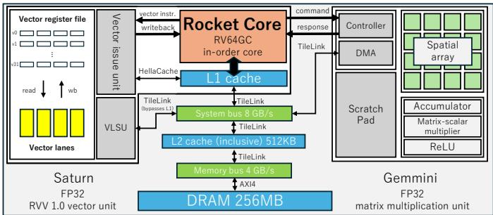
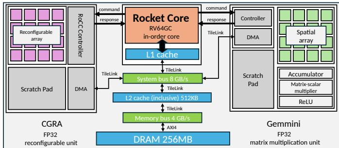
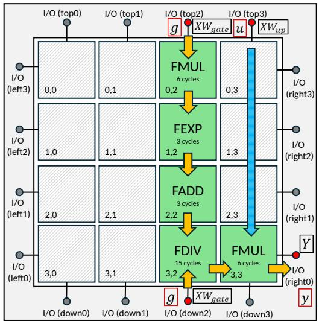
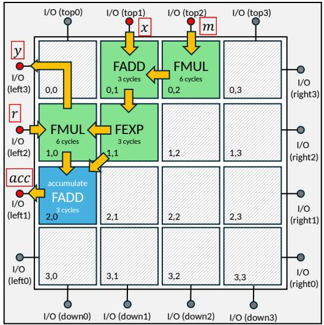
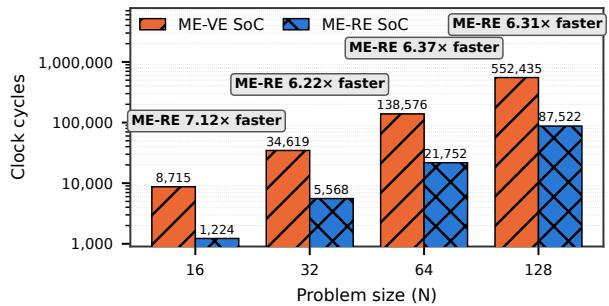
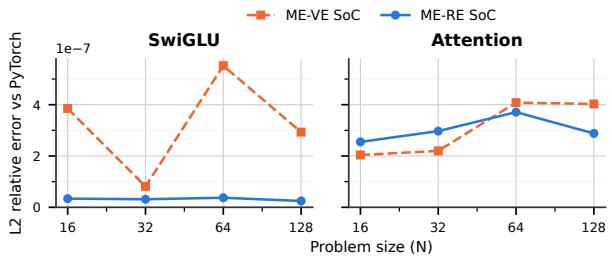
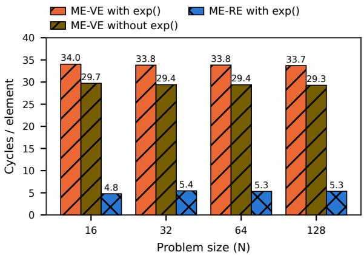
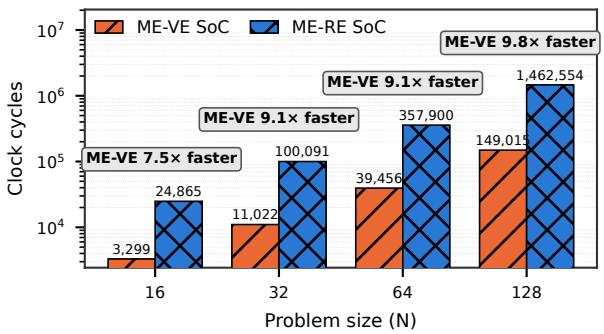
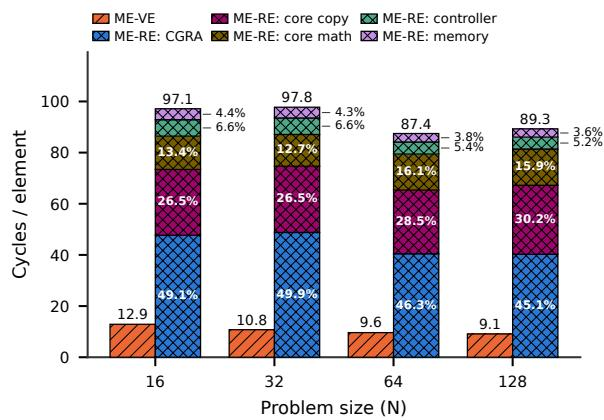

# To SIMD or Not to SIMD: Comparing RVV vs. CGRA SoCs for Non-Linear Functions in AI

Sameer Deshmukh   
Fujitsu Research of Japan   
Fujitsu Limited   
Kawasaki, Japan   
deshmukh.sameer@fujitsu.com   
Naoya Mizuki   
Fujitsu Research of Japan   
Fujitsu Limited   
Kawasaki, Japan   
mizuki.naoya@fujitsu.com   
Takumi Honda   
Fujitsu Research of Japan   
Fujitsu Limited   
Kawasaki, Japan   
honda.takumi@fujitsu.com

Abstract—Non-linear functions are an important class of operations in modern large language models. However, chip vendors building for AI have so far relied on traditional vector or scalar processing units for non-linear functions. The performance of these units has not kept pace with matrix multiplication units (MMUs), which can be found in both high-performance and edgecomputing devices from almost every vendor. Reconfigurable units such as FPGAs and CGRAs have been proposed in the literature, but have not been systematically compared with traditional units backed by MMUs. In this paper, we build two SoCs: one using an RVV vector processor and the other using a latency-insensitive (elastic) CGRA, both coupled with an MMU and driven by a single-core CPU. We then propose mappings for common feed-forward networks on our SoCs and find that the CGRA reaches a maximum speedup in clock cycles of 7.12x over RVV on the activation stage of simple point-wise nonlinear functions like SiLU, whereas the RVV reaches a maximum speedup of 9.8x over the CGRA on complex non-linear functions such as softmax. Over the enclosing feed-forward block the corresponding maxima are 3.16x and 4.24x.

## I. INTRODUCTION

The death of Moore’s law has opened up new frontiers for computer architects to build designs for improved power and efficiency to serve the growing demands of artificial intelligence (AI) and scientific computing. AI models such as LLMs and CNNs are dominated by the dense general matrix multiplication (GEMM), which has led an increasing number of hardware vendors to include dedicated matrix multiplication units on their hardware [2], [6], [28], [55], [58].

While GEMM is the most dominant routine in common AI models [35], [38], [71], non-linear functions such as SiLU [19] and softmax [70] play a pivotal role in their accuracy. These non-linear functions and others like them [8], [15], [24], [54], [80] require the application of functions such as exponential, logarithm, division, inequalities, extrema and trigonometric functions, which the design of a typical matrix multiplication unit [20], [35], [43] is not able to support. Therefore, a nonlinear function must be computed by a separate compute unit such as a vector or scalar processing unit. Examples of such complementary designs include SFU units [56] on Nvidia GPUs and SIMD vector processing units on Intel Granite Rapids [4], [29].

GEMM performance has seen a significant increase over the past decade compared to non-GEMM performance [52], especially for low precision data types such as fp8 [53] and bfloat16 [37]. The computation of the non-linearity, on the other hand, is still typically performed in single-precision 32- bit floating-point data types [53]. The gap between matrix multiplication units using low precision and other arithmetic units on modern GPUs has become so significant that FlashAttention 4 [79] simulates the exponential in software because of the performance difference between the tensor cores and the SMs. Clearly, there is a need for a hardware unit for nonlinear function computation that is able to stay in step with advances in matrix multiplication performance.

Reconfigurable hardware units such as FPGAs [25], [26], [31], [47], [48], [51] and CGRAs [45], [59], [63] have been proposed as alternative ways to compute non-linear functions by taking advantage of their superior pipelining. PICACHU [59] combines a CGRA with a matrix multiplication unit to test deep learning workloads, showing improved performance compared to just a CGRA. However, a proper comparison showing the pros and cons of a CGRA coupled with a matrix multiplication unit vs. a traditional vector or scalar processing unit combined with a matrix multiplication unit is lacking in the literature. A fair comparison against existing computer architectures can show the specific strengths and weaknesses of a CGRA companion in terms of achieved performance, programmability and mapping effort. Comparing against an existing architecture from a major vendor does not allow for a fair comparison due to barriers posed by vendor-specific proprietary IP and the highly complex nature of commercially available hardware. Moreover, one cannot easily compare implementations of equivalent functionality in the CGRA and in a traditional vector or scalar processing unit to deeply understand the advantages or disadvantages of either.

This paper aims to fill this gap by proposing two SoCs: Matrix Engine-Vector Engine (ME-VE) and Matrix Engine-Reconfigurable Engine (ME-RE). The ME-VE combines a Saturn [81] RISC-V vector processor [22] with a Gemmini matrix multiplication [20] unit, whereas the ME-RE combines an elastic RIKEN CGRA [1] with the same Gemmini matrix multiplication unit. Both SoCs are driven by a single-core, inorder RISC-V Rocket CPU [7] and feature exactly the same memory hierarchy. Both SoCs make use of fully open-source hardware stacks — CGRA-ME [60] for building interfaces to the CGRA and Chipyard [3] for building all other SoC components such as memory controllers, CPU and buses.

TABLE I  
COMBINATIONS OF LINEAR AND NON-LINEAR OPERATORS THAT WE TEST.
<table><tr><td>Name</td><td>Equation</td></tr><tr><td>SwiGLU [21], [66], [78] Attention [21], [42], [73]</td><td> $( \mathrm { S i L U } ( X W _ { g a t e } ) \odot X W _ { u p } ) W _ { d o w n }$   $\left( \frac { ( \breve { X } W _ { Q } ) ( X W _ { K } ) ^ { \dagger } } { \sqrt { N } } \right)$  softmax XWv</td></tr></table>

In this paper, we compare commonly used feed-forward network (FFN) blocks from the latest model architectures [21], [42], [78] that combine a linear function (matrix multiplication) with a non-linear function on our proposed SoCs. Specifically, we make the following contributions:

1) Build two SoCs using identical memory hierarchies and CPU drivers, differing only in their use of a vector processing unit or a reconfigurable unit for a fair comparison between a vector processor and a CGRA.

2) Show that on the non-linear stage in isolation the CGRA reaches a maximum speedup of 7.12x over the vector processor for SiLU(), whereas the vector processor reaches a maximum speedup of 9.8x over the CGRA for softmax. Amortised over the enclosing FFN block, which also contains the matrix multiplications, these maxima become 3.16x and 4.24x respectively.

3) Provide detailed benchmarks of the SoCs to study the trade-offs between a vector processor and a CGRA.

## II. BACKGROUND

Linear functions such as matrix multiplication are frequently combined with a non-linear function such as SiLU [19] or softmax [9] in the latest AI models [21], [42]. Our goal is to find the performance differences between a vector processor and a reconfigurable array for combinations of such linear and non-linear functions. Table I shows the functions we benchmark in this paper. The SwiGLU contains 3 matrix multiplications and a single non-linear function SiLU. It is characterized by element-wise looping over the input values where every value is accessed exactly O(1) times. Attention, on the other hand, consists of 5 matrix multiplications and a softmax() function call. The softmax function consists of a reduction loop, followed by a scalar reciprocal and finally an element-wise division. Thus, these two non-linear functions have very different computational characteristics, showing distinct memory access patterns and amounts of computation.

The matrix multiplications with the $W _ { g a t e } , W _ { u p }$ and $W _ { d o w n }$ weight matrices are performed on Gemmini. The non-linear functions such as SiLU() and softmax() are computed on the other accelerator, which can either be a vector processor or a CGRA depending on the SoC being tested.

Our testbed consists of two SoCs: ME-VE and ME-RE, using the vector processing unit and the reconfigurable array, respectively. Both SoCs are driven by an in-order, single-core

  
Fig. 1. The “ME-VE” SoC. We combine a Saturn RISC-V vector processor with Gemmini using a Rocket CPU to simulate the combination of a matrix multiplication accelerator with a vector processor.

RISC-V Rocket CPU [7]. They also use exactly the same memory hierarchy, consisting of a 256 MB DRAM (simulated using DRAMSim2 [62]), a 512 kB, 8-way SiFive inclusive L2 cache [3], [68] and an L1 cache of size 32 kB within the Rocket CPU core. The SoC components connect with their respective buses using TileLink [14], and the interface between the memory bus and the DRAM uses the AXI4 protocol [5]. Specific details of the ME-VE and ME-RE are elaborated in Section III and Section IV, respectively.

## III. MATRIX ENGINE WITH VECTOR PROCESSOR (ME-VE)

Figure 1 shows the structure of the ME-VE SoC. The vector unit is the Saturn vector unit [81] using the RVV 1.0 instruction set [22]. It is coupled with a Gemmini [20] matrix multiplication processor. Unlike Gemmini, Saturn is not a memory-mapped or RoCC-attached accelerator; it is bound to the CPU core, so the vector instructions are fetched, decoded and committed by the scalar core’s own pipeline. Saturn coexists with the CPU on the same tile.

Saturn is configured to be a 128-bit wide vector processor. It contains 32 128-bit registers to store a total of 512 bytes. It is fed by a 128-bit wide datapath from the registers into the compute units. It has two independent datapaths into memory: the first is a dedicated TileLink [14] interface that bypasses the L1 cache and attaches directly to the system bus, and the second is a connection to the L1 cache through a HellaCache [7] port. Although the Rocket CPU is an inorder CPU, the vector instructions committed by the CPU to Saturn are executed out of order using a separate out-of-order execution pipeline. It features a 4-stage pipeline.

The RVV specification allows for flexibility in configuration. We configure the datapath between the registers and the compute ports to be 128 bits to make full utilization of the SIMD units. We tried different configurations of the register grouping parameter LMUL [67] and set it to 4, so that a single vector instruction operates on a group of four architectural registers rather than one. With a 128-bit VLEN this makes one vle32.v move 16 FP32 elements; the datapath itself remains 128 bits wide, so the access is spread over four cycles rather than widened. A large LMUL shows significant performance benefits for a small problem size but no noticeable change as the problem size becomes larger.

  
Fig. 2. The “ME-RE” SoC. We combine a CGRA-ME elastic RIKEN architecture with Gemmini using a Rocket CPU to simulate the combination of a matrix multiplication accelerator with a reconfigurable array.

This setting is experimentally found to be the fastest because it can saturate the load pipeline of the vector unit and significantly reduce the number of instructions, thus reducing the fixed cost per instruction.

## IV. MATRIX ENGINE WITH CGRA (ME-RE)

Figure 2 shows our SoC architecture combining a matrix multiplication unit (Gemmini [20]) with a reconfigurable array (CGRA).

## A. Gemmini specifications

Gemmini is configured as a 4x4 spatial array for FP32 computation. It is directly connected to an inclusive L2 cache which is shared with the Rocket core CPU and the CGRA. The DMA engine in Gemmini [20] allows it to directly access memory via the L2 cache. The Rocket CPU can control Gemmini using the RoCC protocol [7]. The Rocket CPU and Gemmini connections use the default configuration provided by Chipyard [3].

## B. CGRA specification

The CGRA accelerator is generated with CGRA-ME [60] using the RIKEN elastic architecture [1] as the underlying CGRA architecture. An algorithm is first mapped onto the CGRA fabric using an appropriate mapping algorithm, and the generated mapped CGRA fabric is connected to Chipyard via the RoCC controller. The Rocket CPU [7] sends commands to the RoCC controller [3], which controls the scratchpad and reconfigurable array. The scratchpad and reconfigurable array are internal to the CGRA unit and do not have their own bus. A DMA unit (controlled by the RoCC controller) issues load / store commands to the inclusive L2 cache over a TileLink bus [14]. The RIKEN CGRA architecture used throughout this study consists of a 4x4 grid of PEs using pipelined FloPoCo [17] FP32 cores. Each PE features a multiplication (FMUL), addition (FADD), division (FDIV), exponential (FEXP) and square root (FSQRT) unit.

Per-operator latencies are read from the generated cores rather than assumed: each operator’s pipeline depth was obtained by counting its registered stages in the Verilog produced by FloPoCo [17] (stage registers are named \_dN, so the maximum N is the depth), giving 3 cycles for FADD and

FEXP, 6 for FMUL, 10 for FSQRT and 15 for FDIV. These agree exactly with the latency table CGRA-ME [13], [60] uses to schedule the dataflow graph, and are independently corroborated by the per-opcode taps in the functional unit’s valid-shadow shift register. FloPoCo pipelines an operator to meet a target frequency rather than to a specified depth, inserting registers wherever the accumulated combinational delay would exceed the per-stage budget [30]; a higher target therefore yields a deeper pipeline for identical logic, and FEXP is shallow because it is evaluated as a table-driven polynomial rather than iteratively [18]. The cores are pregenerated FloPoCo artifacts vendored from prior work, and their generation banners record four different device-andfrequency targets—Kintex7 at 200 MHz for FADD, StratixV at 500 MHz for FMUL, StratixV at 350 MHz for FDIV, and Virtex6 at 400 MHz for FSQRT—so pipeline depth reflects the per-stage timing budget each core was generated against rather than relative operator complexity or a uniform budget for this fabric. All four are FPGA delay models, whose characteristics differ substantially from the ASIC technologies this SoC targets [44].

This affects our results principally through depth, and that effect is bounded. The two softmax paths of Section IV-B4 share the prefix FMUL→FADD→FEXP, which accounts for 6 + 3 + 3 = 12 cycles; the reduction path adds a terminal FADD for 15 cycles in total and the element-wise path a terminal FMUL for 18. Of these operators only FADD and FEXP were generated below 500 MHz, so the sub-500 MHz depth is 9 of 15 cycles on the reduction path and 6 of 18 on the element-wise path. Regenerating them against a 2 ns rather than a 5 ns per-stage budget can at most scale that depth by the budget ratio of 2.5, adding 13.5 and 9 cycles to the two paths respectively, or 11.25 cycles averaged over the two passes an element makes. Because the fabric sustains an initiation interval of one [61], additional depth is paid once per fabric invocation as pipeline fill rather than per token— the standard latency-versus-period trade [46]. One invocation is one chunk streamed once, so a row of N elements costs 2⌈N/24⌉ invocations and the whole problem 2N⌈N/24⌉: 32, 128, 384 and 1536 invocations at N = 16, 32, 64 and 128. The total cost is therefore 11.25 cycles times the invocation count, or under 1.5% of the softmax stage at every problem size measured (1.45%, 1.44%, 1.21% and 1.18%). A second channel is not covered by that argument, and we state it here as a limitation of this study. The generation targets fix the ratio of depths between operators, not only their absolute values, and it is the ratio that makes the two branches of the SiLU DFG 27 and 6 cycles deep. That imbalance is what sets the elastic buffer depth, and it is also the origin of the operandduplication workaround of Section V-B1, which costs a factor of two on the softmax fabric rather than a per-invocation fill. Because the effect is multiplicative rather than additive, the pipeline-fill bound above does not contain it: a fabric whose operators were all generated against one uniform target could exhibit a different branch imbalance and therefore a different duplication cost. Quantifying this would require regenerating all five operators against a single target and repeating the sweep, which we have not done. Both SoCs are configured at the same clock and we report cycle counts rather than wallclock time, so no other channel exists by which the generation targets could affect the comparison. Synthesis and static timing analysis, which would establish the achieved frequency of each SoC, are left as future work.

Because the fabric is elastic, a longer path in a mapped DFG exerts back pressure on any shorter path it joins [34], [49], so an elastic buffer of an appropriate depth must be placed on the shorter path to drain it. We use an elastic buffer depth of 32 throughout this study, for both the SiLU and the softmax mappings. The mapping is done using a simulated annealing mapper that comes built-in with CGRA-ME [13].

1) Data streaming: The CGRA uses a DMA unit to directly stream data to and from the DRAM using the inclusive L2 cache. The DMA unit loads the data from the L2 into the scratchpad for use by the reconfigurable array. It uses a scratchpad as a staging area for the data before and after processing. Three buffers in the scratchpad are used for storing two operands and a result, each of size 512 bytes. The total scratchpad size is 1536 bytes. The CGRA computation adopts a chunking approach for streaming data from the memory. Although each buffer of 512 bytes is capable of storing up to 128 FP32 numbers, it is split into two halves of 64 FP32 numbers, so that one half can in principle be refilled while the other is being streamed. Within a half, each element occupies two slots in order to account for the fork-skew [11] in the SiLU DFG, which fixes the chunk at $6 4 / 2 = 3 2 $ operand positions. Eight of those positions are consumed by the run prologue described in Section V-B1, so a chunk carries 32 operand positions of which 24 are payload elements; “chunk of 24” throughout Section V refers to this payload count. The Gemmini scratchpad has a size of 256 kB and the accumulator within Gemmini has a capacity of 64 kB.

2) Controlling the CGRA from the CPU: The RISC-V specification reserves 4 major opcodes specifically for userdefined, application-specific hardware accelerators [74] (custom0, custom1, custom2 and custom3). Gemmini [3], [20] is controlled using the custom3 opcode (0x7b) and the CGRA using the custom2 opcode (0x5b).

The RISC-V R-type assembly instruction used for this custom2 opcode has the form “. $\cdot \mathrm { i n s n ~ \textit ~ { ~ r ~ } ~ } 0 { \bf x } 5 \mathrm { b }$ funct3, funct7, rd, rs1, rs2”. Here, 0x5b denotes the custom2 instruction [74], funct3 is a 3-bit sub-field that selects between different variants of the major opcode, and funct7 is a 7-bit field which specifies the precise action that this instruction must perform. rd, rs1 and rs2 denote the destination register, operand1 and operand2, respectively. We use a simple instruction set of 8 instructions to control the CGRA from the CPU, encoded in the funct7 values. Table II shows the value carried by funct7 and a description of the corresponding instruction for the SiLU mapping.

3) Mapping the SiLU: Figure 3a shows the SiLU() function of Equation (1) mapped onto our 4x4 CGRA. The g in Equation (1) corresponds to a single value of the matrix product $X W _ { g a t e } ,$ , and u is the corresponding single value of $X W _ { u p }$ from Table I.

TABLE II  
R-TYPE C U S T O M2 INSTRUCTION ENCODING USED TO DRIVE THE CGRA ACCELERATOR.
<table><tr><td>funct7</td><td>Name</td><td>Purpose</td></tr><tr><td>0</td><td>CFG</td><td>Scan the configuration bitstream into the fabric — run once before any compute.</td></tr><tr><td>1</td><td>SET</td><td>Write one configuration register (scratchpad pointer, collector latency, or a DMA base address).</td></tr><tr><td>2</td><td>FILL</td><td>Start a non-blocking DMA read that fills one scratchpad half with operands.</td></tr><tr><td>3</td><td>PUSH2</td><td>Fill the scratchpad from core registers, two operand pairs per instruction.</td></tr><tr><td>4</td><td>RUN</td><td>Arm the streaming engine over one scratchpad half and return immediately.</td></tr><tr><td>5</td><td>WAIT</td><td>Ask whether the engine or the DMA has finished, either blocking or polling.</td></tr><tr><td>6</td><td>STAT</td><td>Read one counter, one trace entry, or one staged result via a single readout port.</td></tr><tr><td>7</td><td>PUSH1</td><td>Fill the scratchpad one operand pair per instruction.</td></tr></table>

The CGRA is surrounded by 32-bit I/O pins, 4 on each side. Only the I/O pins in red, i.e., top2, top3, down2 and right0, are active, whereas the gray pins are grounded to zero. Only 5 PEs are active in this mapping, whereas the rest are idle.

The yellow arrows indicate values that are passed from one PE to another after computation, whereas the blue arrow shows that the value is passed directly to the FMUL PE at position (3,3). Constants such as −1 are stored in the Imm register of the PE when the mapping bitstream is loaded into the CGRA using the CFG instruction from Table II.

$$
y = \frac { g } { 1 + \exp ( - g ) } \cdot u\tag{1}
$$

Notice that the DFG has two major branches: one branch going through the top2→FMUL→FEXP→FADD→FDIV to compute $\frac { g } { 1 + \exp ( - g ) }$ and the other going through top3→FMUL to compute the final multiplication with u. The left branch requires $6 + 3 + 3 + 1 5 = 2 7$ cycles, whereas the right one takes only 6 cycles. While a static CGRA such as HyCube [39] or ADRES [10] would have required inserting extra registers / PEs on the path of the right branch, elastic CGRAs [27] such as this one do not have this limitation.

The elastic buffer described in Section IV is what drains the back pressure that the 27-cycle branch exerts on the 6-cycle one.

4) Mapping the softmax: Figure 3b shows the mapping of the softmax DFG on our reconfigurable array. This mapping computes both the reduction and element-wise division loop within the same CGRA context. Here, m is the maximum value of the input data that is used for normalizing the data to prevent overflow. The maximum computation must iterate over the entire input data, which will require the projection of a third loop on the CGRA. Therefore, we choose to compute the maximum value on the Rocket CPU core, and send the value to the CGRA using the SET instruction shown in Table II.

The reduction loop accumulates a value acc in the internal register of the (2,0) PE, and then makes that value available to the RoCC controller via the left1 I/O pin. The exact computation performed by this accumulator DFG is shown by Equation (2). The acc is read by the Rocket CPU using the STAT instruction. A single accumulation follows the path FMUL→FADD→FEXP→FADD, and therefore has a latency of 15 clock cycles.

  
(a) SiLU

  
(b) Softmax  
Fig. 3. Mapping of non-linear operators onto our 4x4 elastic RIKEN CGRA: (a) the SiLU activation from the SwiGLU, which executes on the CGRA while the matrix multiplication executes on Gemmini; and (b) softmax, mapped as two DFGs on the CGRA for the reduction and division steps.

$$
a c c = \sum _ { k } \exp ( x _ { k } - m )\tag{2}
$$

Every PE carries an FDIV unit, so the reciprocal could in principle be evaluated on the fabric. It is not, because r depends on a reduction that has already completed: evaluating it in place would require a third mapped context, and re-arming the fabric between contexts costs more than the scalar division it would replace. We therefore treat both max() and the reciprocal as mapping choices rather than fabric limitations, and compute them on the Rocket CPU. The CPU computes $r = 1 / a c c$ using a standard scalar division operation, and sends the value r back to the $\tt 1 e f t 2$ pin using the SET instruction. This triggers the computation of the elementwise multiplication with r, given by Equation (3). A single element-wise exponential and multiplication follows the path FMUL→FADD→FEXP→FMUL and therefore has a latency of 18 clock cycles.

$$
y _ { k } = \exp ( x _ { k } - m ) \cdot r\tag{3}
$$

For an $N \times N$ input, softmax normalizes each row independently: every row needs its own maximum and its own sum of exponentials. On this design the sum accumulates in a register on the fabric at the PE position $( 2 , 0 )$ , and because that accumulator is FP32, letting it run as a total across rows makes each row’s sum a difference of large, nearly equal numbers — measured at $1 . 5 \times 1 0 ^ { - 5 }$ relative error. Zeroing it instead, so each partial sum starts from zero, reduces the error to $3 . 8 \times 1 0 ^ { - 7 }$ but requires a full fabric reset (the accumulatorread clear bit does not reach the fabric’s copy), and a rearm of the fabric configuration at every chunk boundary. All results reported in Section V use the zeroed accumulator. The softmax figures therefore carry the accuracy of the $3 . 8 \times 1 0 ^ { - 7 }$ configuration and pay for it in the per-chunk RESET and ARM of Table IV: 4.50 of the 89.3 cycles per element at $N = 1 2 8$ or 5.0% of the softmax stage. This is a genuine accuracyfor-performance trade rather than an incidental overhead — running the accumulator freely would return those cycles and cost roughly 40x in relative error.

## V. RESULTS

We report our benchmarks for various functions tested on the architectures shown in Section III and Section IV. Cycle-accurate measurements are obtained using Verilator [69]. DRAMSim2 [62] is run at a clock frequency of 0.66 GHz and the CPU at 0.5 GHz. To make a fair comparison and keep simulation time manageable, we assume that all the matrices from Table I are square matrices of size $N \times N$ . To test different problem sizes and scalability, we only vary the N dimension for each test as 16, 32, 64 and 128. The default data type for all computation is IEEE-754 32-bit floating-point numbers (FP32).

Fixing every unit at FP32, the matrix engine included, deserves comment, because production matrix engines increasingly operate at bf16 [37] or fp8 [53]. We do so for two reasons. First, the non-linearity itself is normally evaluated in FP32 even when the matrix multiplication feeding it is not [53], so FP32 is the precision at which the vector-unitversus-fabric comparison is actually made; running the nonlinear engines at a lower precision would measure a different question. Second, an FP32 matrix engine is the slowest the matrix side can reasonably be relative to the non-linear side. Our Gemmini configuration delivers 16 FP32 MACs per cycle against four vector lanes, a ratio of four, whereas a low-precision production engine runs two to three orders of magnitude ahead of its non-linear datapath. The testbed therefore instantiates a deliberately conservative version of the imbalance that motivates this work, and every non-linear share we report is a lower bound. That the activation stage already accounts for 56% of the SwiGLU block on the ME-VE at $N \ = \ 1 2 8$ under so mild a ratio is what makes the result interesting: widening the ratio can only increase that share, and with it the value of a faster non-linear engine. A sweep over the matrix-to-non-linear throughput ratio would quantify how far the conclusions move and is left as future work.

Every kernel is executed repeatedly within a single simulation and the first repetition is discarded as a cold pass; the figures below are taken from the warm repetitions. The number of warm repetitions differs by campaign because of simulation cost: the SwiGLU sweep carries nine warm repetitions at $N = 1 6$ , 32 and 64 and two at $N = 1 2 8$ , and the attention sweep carries two at every size. Warm repetitions of the same measurement differ by at most 0.93%. Run-to-run variation in an otherwise deterministic RTL simulation comes from cache and DRAM state carried across repetitions, which is also why the cold pass is excluded.

Two systematic effects should be noted alongside these numbers. The attention drivers exist in an instrumented accuracy build and a lean timing build; the timing build measures 0.1–1.1% fewer cycles than the accuracy build for a computation the two agree on bit-for-bit, a gap that exceeds the run-torun spread and whose mechanism we have not identified. All cycle counts below are quoted from the timing build. Second, the reported instrumentation overhead is removed by rescaling the per-region shares onto the uninstrumented totals.

## A. Performance of SwiGLU on ME-VE vs. ME-RE

Figure 4 shows the number of cycles taken for each problem size and SoC architecture when computing the SiLU() activation function. The activation function runs on the RVV vector unit for the ME-VE SoC and on the RIKEN elastic CGRA for the ME-RE SoC. Table III shows the total cycles taken by the SwiGLU and the breakdown of matrix multiplication and activation cycles for each problem size.

As expected, the number of cycles for the matrix multiplication is nearly identical for the ME-VE and ME-RE SoCs. However, the CGRA shows significant acceleration of the activation function as shown in Figure 4. This speedup can be attributed to the fact that the pipelined execution of the CGRA is able to compute the function in fewer cycles per element, in spite of the 4-way parallel execution of the 128-bit SIMD units of the vector processor.

The plot on the left of Figure 5 shows the accuracy of the SwiGLU computation using ME-RE vs. ME-VE SoCs, measured against a PyTorch [57] FP32 reference on the host. ME-RE stays between $2 . 5 \times 1 0 ^ { - 8 }$ and $3 . 7 \times 1 0 ^ { - 8 }$ across all four problem sizes, whereas ME-VE ranges from $8 . 2 \times 1 0 ^ { - 8 }$ to $5 . 5 \times 1 0 ^ { - 7 } \mathrm { ~ - ~ }$ so ME-RE is both more accurate and more stable in N. For reference, the FP32 unit roundoff is $2 ^ { - 2 4 } \approx 6 \times 1 0 ^ { - 8 }$ , so ME-RE’s error is at the level of the arithmetic itself while ME-VE’s exceeds it by up to an order of magnitude. A standalone element-wise comparison of the CGRA activation against the same reference bounds its error at 1 ULP. The difference is attributable to how the exponential is evaluated on each SoC. The RVV extension [22] used by Saturn has no exponential instruction, so exp() is computed by a vector software kernel. That kernel follows the structure used by production vectorised math libraries [4]: the argument is scaled by $\log _ { 2 } e ,$ split into an integer part n and a fraction $f \in [ - \frac { 1 } { 2 } , \frac { \mathrm { i } } { 2 } ]$ by a float-to-integer-to-float round trip, $2 ^ { f }$ is evaluated by a degree-5 polynomial in Horner form, and $2 ^ { n }$ is assembled directly into the IEEE-754 exponent field and multiplied back in. There is no table, no branch and no division; the kernel is 19 vector operations per element, ten of which are the Horner chain. It is therefore a properly rangereduced implementation rather than a naive series expansion, and the range reduction is not the source of its error.

  
Fig. 4. Clock cycles by SiLU on the ME-VE and ME-RE.

It does differ from a production kernel in one respect. The polynomial coefficients are the Taylor coefficients (ln 2)i/i! of ${ \bar { 2 } } ^ { f } = e ^ { f \ln 2 }$ rather than a minimax fit over the reduced interval. At degree 5 this costs accuracy but not time: the Taylor truncation has a worst-case relative error of $3 . 2 \times 1 0 ^ { - 6 }$ on $f \in [ - \frac { 1 } { 2 } , \frac { 1 } { 2 } ] .$ , or roughly 27 ULP, against $7 . 5 \times 1 0 ^ { - 8 } -$ under one ULP — for a minimax polynomial of the same degree and hence the same instruction count. Since the coefficients are compile-time constants, refitting them would close most of the accuracy gap at no cycle cost, and we note it as an easy improvement to the baseline rather than a property of RVV. In contrast, the FloPoCo [17] cores used by our CGRA evaluate the exponential in a single pipelined hardware operator, which is why ME-RE tracks the reference more closely.

1) Performance analysis of SwiGLU: The lack of exponential instructions in ME-VE also raises the question of whether the speedup seen in ME-RE is actually due to better pipelining or to fewer instructions. Figure 6 shows the cycles taken per element for the ME-VE with and without the exp() calculation, and for the ME-RE with the exp() calculation, when computing the SiLU(). The ME-RE requires fewer cycles per element than the ME-VE without the exponential. Ablating the exponential from the vector kernel accounts for a measured 12.7%, 13.0%, 13.1% and 13.2% of the ME-VE activation stage at $N = 1 6 , 3 2 .$ , 64 and 128 — a real but small share, and one that leaves the vector unit between 5.4× and 6.2× slower per element than the CGRA even when it is removed entirely. Therefore, the lack of a dedicated exponential instruction in the RVV instruction set is ruled out as the cause of slower execution of the vector unit.

  
Fig. 5. Relative error of SwiGLU (left) and Attention (right) on the ME-VE and ME-RE SoC. The relative error is computed as $\| e - { \bar { a } } \| _ { 2 } / \| a \| _ { 2 }$ where e is the result vector from the SoC and a is the result vector from a PyTorch script on the host.

  
Fig. 6. Cycles / element for computing the SiLU for the ME-VE with and without the exponential compared to the ME-RE with the exponential. Costs are normalised by the $N ^ { 2 ^ { \bullet } }$ elements of the activation tensor, on the same measurements as Table III, so the ratio between the first and third bars reproduces that table’s activation speedup exactly. ME-VE is slower than ME-RE even without the exponential calculation, indicating that better pipelining leads to faster execution in the ME-RE.

Both the CGRA and Saturn are connected to the system bus by a 128-bit TileLink [14] interface. Even though the width of the link is the same, Saturn and CGRA differ in how efficient their memory instructions are. Saturn issues SIMD load instructions using vle32.v and SIMD store instructions using vse32.v. At LMUL= 4 each such instruction addresses a group of four 128-bit registers and therefore carries 16 FP32 elements. The DMA of the CGRA, on the other hand, issues scalar memory instructions that can carry only a single FP32 element each. Saturn’s load / store instructions are therefore 16x more efficient per instruction. Therefore, the efficiency of memory instructions is heavily in favor of Saturn in spite of the same data width.

Both engines are pipelined, but they expose parallelism in different ways, and the comparison turns on which form suits an element-wise loop. The vector engine exploits data parallelism: each instruction presents a group of elements to four FP32 lanes fed by a four-stage pipeline, and the scalar core must issue a fresh instruction for every such group. The CGRA exploits pipeline parallelism: the whole SiLU expression is laid out spatially as a 27-cycle datapath which, once full, retires one element per cycle with no per-element instruction issue at all. For a loop with no carried dependence and enough elements to fill the datapath, an initiation interval of one beats issuing groups of elements, because the CGRA pays the fill cost once per invocation while the vector unit pays an issue cost on every group. This is why the advantage is largest at the sizes where the fabric stays full and erodes slightly as N grows and memory traffic begins to dominate.

  
Fig. 7. Cycles taken for softmax for ME-VE vs. ME-RE.

## B. Performance of Attention on ME-VE vs. ME-RE

Figure 7 shows the cycles taken for computing the activation function of the attention computation from Table I (softmax) on the ME-VE and ME-RE. Unlike the SwiGLU results from Section V-A, this result shows that the ME-VE SoC is a much better fit for the softmax computation across all problem sizes and by a significant margin, with the ME-VE reaching its maximum speedup of 9.8x at problem size 128.

The exponential function for the softmax is calculated differently for the vector processor and the CGRA, as discussed in Section V-A1. This is reflected in the difference in the relative error between the ME-RE and ME-VE computation as shown in the right plot of Figure 5. Neither result should be compared against a fixed threshold: an $L _ { 2 }$ relative error accumulated over an $N \times N$ computation grows with $N _ { \ast }$ and the PyTorch FP32 reference is itself subject to the same rounding. We therefore quote both against that reference’s own error floor, which is $2 . 6 \times 1 0 ^ { - 7 }$ at $N = 1 2 8$ . ME-RE lands at $2 . 9 \times 1 0 ^ { - 7 }$ , or $1 . 1 0 \times$ the floor, and ME-VE at $4 . 0 \times 1 0 ^ { - 7 }$ or 1.54×. Both are therefore close to what FP32 arithmetic permits for this computation, with ME-RE the closer of the two.

1) Performance analysis ofAttention: The ME-RE is much slower than ME-VE, which warrants further investigation into the loss of performance. Figure 8 shows the cycles / element for computing the softmax of the $N ^ { 2 }$ matrix from Table I. The stacked bar on the right of each problem size shows the cycles spent per element in the ME-RE. Each segment is representative of how many cycles an element spends doing what kind of work on the SoC. Each element spends cycles going through the CGRA (“ME-RE: CGRA”), being copied between the CGRA and the Rocket CPU (“ME-RE: core copy”), being computed on the Rocket CPU (“ME-RE: core math”), waiting while the Rocket CPU tells the CGRA what to do (“ME-RE: controller”) or waiting for data reads or writes over the bus from or to the main memory (“ME-RE: memory”). The bar on the left of each problem size shows the cycles / element when the same softmax computation is done on the vector processor of the ME-VE. The following sections will explore the CGRA performance in further detail.

TABLE III  
ATTENTION AND SWIGLU FFN CYCLE BREAKDOWN. THE TOTAL IS READ FROM AN INDEPENDENT COUNTER SPANNING THE WHOLE BLOCK RATHERTHAN SUMMED FROM THE PHASE COUNTERS, SO IT DOES NOT TALLY EXACTLY WITH THEM. THE RESIDUAL IS UNDER 0.02%.
<table><tr><td rowspan="2">SoC</td><td rowspan="2">N</td><td colspan="4">Attention</td><td colspan="4">SwiGLU</td></tr><tr><td>Total cycles</td><td>Matmul cycles</td><td>Activation cycles</td><td>Softmax proportion</td><td>Total cycles</td><td>Matmul cycles</td><td>Activation cycles</td><td>Activation proportion</td></tr><tr><td rowspan="4">ME-VE</td><td>16</td><td>6,943</td><td>3,628</td><td>3,299</td><td>47.52%</td><td>10,955</td><td>2,240</td><td>8,715</td><td>79.55%</td></tr><tr><td>32</td><td>27,610</td><td>16,582</td><td>11,022</td><td>39.92%</td><td>44,687</td><td>10,068</td><td>34,619</td><td>77.47%</td></tr><tr><td>64</td><td>143,087</td><td>103,508</td><td>39,456</td><td>27.57%</td><td>200,890</td><td>62,314</td><td>138,576</td><td>68.98%</td></tr><tr><td>128</td><td>862,834</td><td>713,800</td><td>149,015</td><td>17.27%</td><td>983,055</td><td>430,620</td><td>552,435</td><td>56.20%</td></tr><tr><td rowspan="4">ME-RE</td><td>16</td><td>28,646</td><td>3,758</td><td>24,865</td><td>86.80%</td><td>3,467</td><td>2,240</td><td>1,224</td><td>35.30%</td></tr><tr><td>32</td><td>117,022</td><td>16,838</td><td>100,091</td><td>85.53%</td><td>15,576</td><td>9,996</td><td>5,568</td><td>35.75%</td></tr><tr><td>64</td><td>461,649</td><td>103,662</td><td>357,900</td><td>77.53%</td><td>83,892</td><td>62,147</td><td>21,752</td><td>25.93%</td></tr><tr><td>128</td><td>2,182,546</td><td>719,890</td><td>1,462,554</td><td>67.01%</td><td>517,529</td><td>430,004</td><td>87,522</td><td>16.91%</td></tr></table>

  
Fig. 8. Cycles / element for the activation computation of the Attention calculation on the ME-VE compared to the ME-RE. Our mapping gives the ME-VE an advantage over the ME-RE.

2) Math and data copy on the Rocket CPU: In Figure 8, most of the clock cycles for the ME-RE are spent in the CGRA (“ME-RE: CGRA”) and the Rocket CPU (“ME-RE: core math” and “ME-RE: core copy”), with both occupying roughly half the clock cycles per element. We explain in Section IV-B4 that the reduction and element-wise division (multiplication after reciprocal) loops are executed on the CGRA, whereas the max() and the reciprocal are computed on the Rocket CPU. This incurs significant communication overhead (“ME-RE: core copy”) over the system bus, which exceeds the time taken for computation.

The communication between the Rocket CPU and the CGRA is serial, with no overlap of communication and computation. Moreover, each element has to be loaded twice into the CGRA — once for computing the reduction loop and a second time for the element-wise division. This is due to the limited input buffer space in the scratchpad.

These limitations are surmountable with a larger scratch pad and better overlap between the communication and computation. However, they would only overcome about 30% of the cycles (from the “ME-RE: core copy”). Looking at the time spent inside the CGRA itself (“ME-RE: CGRA”), the number of cycles of only this part is many times higher than the total cycles spent in the RVV computation. Improving this metric can open up significant performance gains for the softmax on the CGRA.

3) Analysis CGRA and non-core computation: As noted in Section V-B2, the Rocket CPU calculation and data movement occupies a significant number of cycles, but investigating the reasons for the CGRA taking more cycles than the entire activation computation on the ME-VE can lead to speedups similar to the SiLU activation in Section V-A.

Table IV shows where an element spends cycles for the N = 128 case from Figure 8. The RESET, ARM and RDACC are a part of the “ME-RE: controller”; FILL and DRAIN are a part of “ME-RE: memory”, and RUN is entirely “ME-RE: CGRA”. The initial configuration of the CGRA is done once per program and is not counted in the total measurement.

The RESET is performed once for every chunk of 24 elements to prevent residual errors caused by stale values. It is applicable to the reduction loop to ensure that each chunk iteration shows a fresh partial sum, and for an elementwise kernel to clear out stale values in the pipeline. The RESET causes the constants such as m to be erased from the Imm registers, which makes ARM necessary once every chunk. Specifically for the reduction loop, RDACC is used for clearing and reading the partial sum from the register in the accumulator PE. The partially accumulated value is stored in a register of the Rocket CPU, and finally used for computing the reciprocal r which is then used in computing element-wise loop from Equation (3) on the CGRA.

Given the enhanced pipeline efficiency of a CGRA compared to a vector processor, the RUN phase should only occupy 1 clock cycle. However, Table IV shows that it requires more

TABLE IV

BREAKDOWN OF THE NUMBER OF CYCLES AN ELEMENT SPENDS IN THE CGRA AND NON-CORE PARTS OF THE SOC.

<table><tr><td>State</td><td>Description</td><td>Cycles / element (N=128)</td></tr><tr><td>RESET</td><td>Per chunk fabric reset. Re-arm row constants ($m$, $r$) and</td><td>3.94</td></tr><tr><td>ARM</td><td>stream pointers cleared by the reset. Read and clear the on-fabric</td><td>0.56</td></tr><tr><td>RDACC</td><td>accumulator.</td><td>0.14</td></tr><tr><td>RUN</td><td>Execute one iteration of a chunk of 24 elements.</td><td>40.62</td></tr><tr><td>FILL</td><td>Fetch a chunk over DMA and place it in the scratch pad.</td><td>2.80</td></tr><tr><td>DRAIN</td><td>Barrier waiting for RUN to finish.</td><td>&lt; 0.01</td></tr><tr><td>Total</td><td></td><td>48.06</td></tr></table>

TABLE V

PER-ELEMENT COST OF THE SOFTMAX FABRIC AT N = 128 IN CYCLES/ELEMENT. THE FINAL COLUMN IS THE RUNNING TOTAL.
<table><tr><td>Step</td><td>Factor</td><td>Cumulative</td></tr><tr><td>Ideal (II = 1)</td><td></td><td>1.00</td></tr><tr><td>Two passes</td><td>×2</td><td>2.00</td></tr><tr><td>Operand duplication</td><td>×2</td><td>4.00</td></tr><tr><td>Operand prologue</td><td>×1.375</td><td>5.50</td></tr><tr><td>Streaming rate</td><td>×5.005</td><td>27.53</td></tr><tr><td>Restart fill</td><td>+13.02</td><td>40.55</td></tr><tr><td>Measured</td><td></td><td>40.62</td></tr></table>

than 40x the ideal. Where does all this time go? Five factors separate that ideal from the 40.62 cycles per element measured at N = 128. The first three are multipliers on the number of tokens a single element costs; the last two are the cycles those tokens then consume. Table V accumulates them in order. The decomposition that follows is derived at N = 128 only, and we do not claim it reproduces at the other three problem sizes: the prologue factor and the per-invocation costs both depend on how a row divides into chunks, and at N ≤ 24 a row is a single chunk.

1) Two passes (×2). Each element crosses the fabric twice: once to accumulate the sum of exponentials, once for the element wise division. The reciprocal does not exist until the whole row has been reduced, so the two passes cannot be fused. This is structural to exact softmax and is the one factor here that no implementation choice removes.

2) Operand duplication (×2). The mapped fabric exhibits a skew between the arms of a fork, so a join pairs operand i on one arm with operand i − 1 on the other. Duplicating every operand into two consecutive tokens makes the skew harmless—a mis-paired token now carries the same value as its neighbor—at the cost of streaming twice as many tokens. This is the slackmatching problem familiar from latency-insensitive design [11], [32], [33], resolved in software rather than by rebalancing the mapped datapath. Standalone measurement shows the skew cannot mis-pair operands in the softmax mapping, where two of the three inputs are row constants presented identically at every token index; the duplication is inherited from the SiLU mapping of Section IV-B3.

3) Operand prologue (×1.375). Each run is prefixed with eight operands equal to the row maximum m, absorbing a fault that evaluates the first operand of every run as exp(0) irrespective of its input. Each prologue operand correctly evaluates to exp(m − m) = 1, so the prologue contributes exactly its own length to the accumulated sum—a known constant the driver subtracts—and the element the fault corrupts is itself a prologue element whose correct value was 1 regardless. Eight rather than one because the DMA engine transfers whole beats and rejects a non-beat-aligned length. A row of 128 elements is chunked as [24, 24, 24, 24, 24, 8] and therefore stages 176 operands, the last chunk paying a full prologue for eight real elements.

4) Streaming rate (×5.005). Each set of duplicated operands occupies the fabric for 5.005 cycles rather than the one its initiation interval allows [61], so 22.03 of this step’s 27.53 cycles per element is deficit. We hypothesize that this is a loop-carried dependence through the on-fabric accumulator, whose serialisation would be proportional to token count as observed.

5) Restart fill (+13.02). The fitted cost is 138.9 cycles per invocation, where one invocation is one chunk streamed once: a row is chunked as [24, 24, 24, 24, 24, 8] and each chunk is streamed once per pass, so a row costs 6 × 2 = 12 invocations. The overhead per row is therefore 12 × 138.9 = 1667 cycles, or 1667/128 = 13.02 cycles per element.

Of the five, the first three are structural counts, the streaming rate of factor 4 is measured directly from the fabric’s token timestamps, and only the per-invocation cost of factor 5 is fitted to the measurement. The reconstruction therefore agrees with the measurement to 0.2%, but that agreement is a consistency check on the first four terms rather than an independent validation of the model as a whole.

4) Improving performance for the softmax: Four properties of the present design account for most of the accelerator’s cost, and removing them would reduce the softmax stage from 89.3 to 58.8 cycles per element at N = 128, narrowing the gap against the vector unit from 9.8× to 6.5×. Each corresponds to one of the factors decomposed above.

The dominant one is that the datapath streams every operand twice (factor 2), a consequence of unequal latency between the arms of a fork in the mapped graph rather than of the computation; a balanced mapping would stream each operand once, which also doubles the payload a chunk can hold, taking the stage to 68.5 cycles per element and accounting for two thirds of the total reduction. The second is that the engine detects completion by waiting for its accumulator output to fall quiet for 96 consecutive cycles, a window that opens only after the last result has been produced; this quiet window is the largest component of the per-invocation restart fill of factor 5, and detecting completion from the expected result count instead yields 64.6. The third is that the first operand of every run is evaluated incorrectly, which is currently masked by prefixing each run with eight placeholder operands (factor 3); correcting the fault at its source yields 62.2. The fourth is that the scratchpad forces a row to be processed in several chunks, and that although it is physically split into two halves the present driver does not alternate them, so each chunk’s operands are fetched in sequence with its own execution rather than during the previous chunk’s; the storage for double buffering therefore exists but is not used as such. Enlarging the scratchpad and alternating the halves reduces the invocation count over which factor 5 is paid, and yields 58.8. These interact, and their individual effects must not be summed: each change that widens a chunk reduces the number of invocations over which the next change’s per-invocation saving is paid.

## VI. RELATED WORK

## A. Non-linear operators on spatial accelerators

PICACHU [59] is the closest work — a CGRA attached to an LLM accelerator for the operators its matrix engine cannot run, and to our knowledge the only published softmax on a CGRA. Its baseline is not a vector unit sharing the same memory hierarchy, however, whereas we hold the core, L1/L2, DRAM model and matrix engine fixed and vary only the nonlinear engine, so the cycle differences in Figures 4 and 7 are attributable to the accelerator alone. A second line lowers the arithmetic cost of non-linearities on an existing datapath: I-BERT [40] and Softermax [70] use integer or reducedprecision approximations, FlashAttention-4 [79] evaluates the exponential in software on tensor cores, and Gemmini has been extended with dedicated normalization units [41]. A third builds fixed-function units for a single non-linearity on reconfigurable substrates: Shatravin et al. [64], [65] for sigmoid and softmax, and Hyft [77], a reconfigurable hybridformat softmax accelerator. These gain efficiency by specialising to one operator; we instead ask which datapath should be provided at all, and show in Section V that the answer depends on the operator, not on a hardware exponential: the CGRA wins on element-wise SiLU even with the exponential removed from the vector kernel, yet loses on the reductionbearing softmax.

## B. CGRA architectures and modeling frameworks

Among open CGRA frameworks — Morpher [36], [76], OpenCGRA [72], DSAGEN [75], Pillars [23], CCF [16] and CGRA-ME [13], [60] — most target integer datapaths or do not carry floating point through mapping and RTL generation; since FP32 SiLU and softmax need division and exponentiation, we chose CGRA-ME, whose architecture language lets us instantiate pipelined FloPoCo [17] FP cores and emit synthesizable RTL. Our fabric follows the elastic CGRA model [27] as realized in the RIKEN architecture [1]. Statically scheduled CGRAs such as HyCube [39] and ADRES [10] would require balancing the two SiLU branches (27 vs. 6 cycles, Section IV-B3) with explicit registers at mapping time; elastic handshaking removes that constraint at the cost of back pressure, making buffer placement and sizing [34], [49] a first-order design parameter.

## C. Vector units and SoC integration

We use Saturn [81], integrated into the Rocket [7] pipeline rather than attached via RoCC like the CGRA and Gemmini [20] — an issue-path asymmetry intrinsic to the two design styles, which is why we equalize everything below the issue point. Decoupled RVV designs such as Ara [12] target wider datapaths, and some vector architectures offer hardware assistance for the exponential; our ablation in Section V-A1 shows this would not change the SiLU outcome, as the vector unit remains several times slower per element than the fabric even without the exponential. Chipyard [3] provides the common substrate for our “same SoC, one variable” methodology; prior CGRA-versus-SIMD comparisons are analytical or use separate testbeds and nodes, and RISC-V/CGRA integration [50] has been shown without a direct comparison against an RVV unit.

## VII. CONCLUSION

We implemented and tested two SoCs with exactly the same memory hierarchy, matrix multiplication unit and CPU driver – one coupled with a RVV [22], [81] 128-bit SIMD processor (“ME-VE“) and the other using a elastic CGRA [1] (“ME-RE”). On these SoCs, we tested two widely used feed forward network architectures: SwiGLU and Attention. The matrix multiplication costs a similar number of clock cycles on both SoCs, but the cost of the activation computation such as SiLU and softmax differs widely. On the non-linear stage in isolation, the SiLU reaches a maximum speedup of 7.12x on the CGRA over RVV, whereas the softmax reaches a maximum speedup of 9.8x on RVV over the CGRA. Amortised over the enclosing feed-forward block these maxima are 3.16x in favour of the CGRA for SwiGLU and 4.24x in favour of RVV for Attention.

The element-wise access of the SiLU greatly benefits the SiLU on the CGRA, whereas the multiple reduction, division and extrema calculation loops play against the CGRA for softmax. We conduct a thorough investigation into the causes for the slowdown of the softmax computation on the CGRA and propose a set of specific improvements that can be made to the CGRA to make it perform faster than the RVV.

This paper shows that incorporating a CGRA into an AI accelerator shows promise, but the inherent difficulty of efficiently mapping algorithms on the CGRA can hold it back from mass adoption. In the future, we plan to develop on our findings and propose efficient architectures that can leverage the power of CGRAs for a wide variety of computations. We also plan to perform a more thorough PPA analysis of the ME-VE vs. ME-RE using a standard cell library.

## REFERENCES

[1] B. Adhi, C. Cortes, Y. Tan, T. Kojima, A. Podobas, and K. Sano, “Exploration framework for synthesizable CGRAs targeting HPC: Initial design and evaluation,” in 2022 IEEE International Parallel and Distributed

Processing Symposium Workshops (IPDPSW). IEEE, 2022, pp. 639– 646.

[2] Advanced Micro Devices, Inc., “Introducing AMD CDNA Architecture: The All-New AMD GPU Architecture for the Modern Era of HPC & AI,” White paper, 2020. [Online]. Available: https://www.amd.com/content/dam/amd/en/documents/ instinct-business-docs/white-papers/amd-cdna-white-paper.pdf

[3] A. Amid, D. Biancolin, A. Gonzalez, D. Grubb, S. Karandikar, H. Liew, A. Magyar, H. Mao, A. Ou, N. Pemberton, P. Rigge, C. Schmidt, J. Wright, J. Zhao, Y. S. Shao, K. Asanovic, and B. Nikoli´ c, “Chipyard:´ Integrated design, simulation, and implementation framework for custom socs,” IEEE Micro, vol. 40, no. 4, pp. 10–21, 2020.

[4] C. Anderson, M. Cornea, A. Stepin, and M. T. Panu, “Correctly Rounded Functions For Vector Applications: A Performance Study,” arXiv preprint arXiv:2605.15547, 2026.

[5] AMBA AXI4 Protocol Specification, Arm Limited, 2011.

[6] Arm Limited, “Arm Architecture Reference Manual Supplement, The Scalable Matrix Extension, for A-profile Architecture,” Architecture specification, 2022. [Online]. Available: https://documentation-service. arm.com/static/62015c6c965f7d118e3f5f4c

[7] K. Asanovic, R. Aviv´ zienis, J. Bachrach, S. Beamer, D. Biancolin,´ C. Celio, H. Cook, P. Dabbelt, J. Hauser, A. Izraelevitz, S. Karandikar, B. Keller, D. Kim, J. Koenig, Y. Lee, E. Love, M. Maas, A. Magyar, H. Mao, M. Moreto, A. Ou, D. Patterson, B. Richards, C. Schmidt,´ S. Twigg, H. Vo, and A. Waterman, “The Rocket Chip generator,” EECS Department, University of California, Berkeley, Technical Report UCB/EECS-2016-17, Apr. 2016. [Online]. Available: https: //www2.eecs.berkeley.edu/Pubs/TechRpts/2016/EECS-2016-17.pdf

[8] J. L. Ba, J. R. Kiros, and G. E. Hinton, “Layer Normalization,” arXiv preprint arXiv:1607.06450, 2016.

[9] P. Blanchard, D. J. Higham, and N. J. Higham, “Accurately computing the log-sum-exp and softmax functions,” IMA Journal of Numerical Analysis, vol. 41, no. 4, pp. 2311–2330, 2021.

[10] F. Bouwens, M. Berekovic, A. Kanstein, and G. Gaydadjiev, “Architectural exploration of the adres coarse-grained reconfigurable array,” ACM Transactions on Embedded Computing Systems (TECS), vol. 7, no. 4, pp. 1–27, 2008.

[11] L. Carloni, K. McMillan, and A. Sangiovanni-Vincentelli, “Theory of latency-insensitive design,” IEEE Transactions on Computer-Aided Design of Integrated Circuits and Systems, vol. 20, no. 9, pp. 1059– 1076, 2001.

[12] M. Cavalcante, F. Schuiki, F. Zaruba, M. Schaffner, and L. Benini, “Ara: A 1-ghz+ scalable and energy-efficient risc-v vector processor with multiprecision floating-point support in 22-nm fd-soi,” IEEE Transactions on Very Large Scale Integration (VLSI) Systems, vol. 28, no. 2, p. 530–543, Feb. 2020. [Online]. Available: http://dx.doi.org/10.1109/TVLSI.2019.2950087

[13] S. A. Chin, N. Sakamoto, A. Rui, J. Zhao, J. H. Kim, Y. Hara-Azumi, and J. Anderson, “CGRA-ME: A unified framework for CGRA modelling and exploration,” in 2017 IEEE 28th International Conference on Application-specific Systems, Architectures and Processors (ASAP). IEEE, 2017, pp. 184–189.

[14] H. Cook, W. Terpstra, and Y. Lee, “Diplomatic design patterns: A TileLink case study,” in Proceedings of the First Workshop on Computer Architecture Research with RISC-V (CARRV), Boston, MA, USA, Oct. 2017. [Online]. Available: https://api.semanticscholar.org/CorpusID: 44937251

[15] Y. N. Dauphin, A. Fan, M. Auli, and D. Grangier, “Language Modeling with Gated Convolutional Networks,” in Proceedings of the 34th International Conference on Machine Learning (ICML), ser. Proceedings of Machine Learning Research, vol. 70, 2017, pp. 933–941.

[16] S. Dave and A. Shrivastava, “CCF: A CGRA compilation framework,” https://github.com/MPSLab-ASU/ccf, 2018, compiler and simulator toolchain, Arizona State University.

[17] F. de Dinechin and B. Pasca, “Designing custom arithmetic data paths with FloPoCo,” IEEE Design & Test of Computers, vol. 28, no. 4, pp. 18–27, 2011.

[18] J. Detrey and F. de Dinechin, “Parameterized floating-point logarithm and exponential functions for fpgas,” Microprocessors and Microsystems, 2007.

[19] S. Elfwing, E. Uchibe, and K. Doya, “Sigmoid-weighted linear units for neural network function approximation in reinforcement learning,” 2017. [Online]. Available: https://arxiv.org/abs/1702.03118

[20] H. Genc¸, S. Kim, A. Amid, A. Haj-Ali, V. Iyer, P. R. Prakash, J. Zhao, D. Grubb, H. Liew, H. Mao, A. J. Ou, C. Schmidt, S. Steffl, J. C. Wright, I. Stoica, J. Ragan-Kelley, K. Asanovic, B. Nikoli´ c, and Y. S. Shao,´ “Gemmini: Enabling systematic deep-learning architecture evaluation via full-stack integration,” in 2021 58th ACM/IEEE Design Automation Conference (DAC), 2021, pp. 769–774.

[21] A. Grattafiori, A. Dubey, A. Jauhri et al., “The llama 3 herd of models,” 2024. [Online]. Available: https://arxiv.org/abs/2407.21783

[22] R.-V. I. V. T. Group, “The risc-v instruction set manual, volume i: User-level isa, document version 1.0: Draft/frozen vector extension,” RISC-V International, Tech. Rep., 2021. [Online]. Available: https: //github.com/riscvarchive/riscv-v-spec/releases/tag/v1.0

[23] Y. Guo and G. Luo, “Pillars: An Integrated CGRA Design Framework,” in Third Workshop on Open-Source EDA Technology (WOSET), Nov. 2020, article No. 22.

[24] D. Hendrycks and K. Gimpel, “Gaussian Error Linear Units (GELUs),” arXiv preprint arXiv:1606.08415, 2016.

[25] S. Hong, S. Moon, J. Kim, S. Lee, M. Kim, D. Lee, and J.-Y. Kim, “DFX: A Low-Latency Multi-FPGA Appliance for Accelerating Transformer-Based Text Generation,” arXiv preprint arXiv:2209.10797, 2022.

[26] M. Huang, A. Shen, K. Li, H. Peng, B. Li, and H. Yu, “EdgeLLM: A Highly Efficient CPU-FPGA Heterogeneous Edge Accelerator for Large Language Models,” arXiv preprint arXiv:2407.21325, 2024.

[27] S. Huang and P. Ienne, “Elastic cgras,” in Proceedings of the 2013 ACM/SIGDA International Symposium on Field Programmable Gate Arrays (FPGA). ACM New York, NY, USA, 2013, pp. 171–180.

[28] Intel Corporation, “Intel Architecture Instruction Set Extensions and Future Features Programming Reference,” Intel Corporation, Tech. Rep. 319433-056, Dec. 2024, chapter 3 specifies the Intel AMX instruction set, introduced with Sapphire Rapids. [Online]. Available: https://cdrdv2-public.intel.com/843860/architectureinstruction-set-extensions-programming-reference-dec-24.pdf

[29] Intel Corporation, “Intel Xeon 6 SoC (Formerly Codenamed Granite Rapids-D),” Intel Corporation, Tech. Rep. 30-3-30, Apr. 2025. [Online]. Available: https://cdrdv2-public.intel.com/853807/GNR-D%2030-3-30 042925.pdf

[30] M. Is¸toan and F. de Dinechin, “Automating the pipeline of arithmetic datapaths,” in Design, Automation & Test in Europe Conference & Exhibition (DATE), 2017, 2017, pp. 704–709.

[31] S. Jeong, M. Seo, X. T. Nguyen, and H.-J. Lee, “A Low-Latency and Lightweight FPGA-Based Engine for Softmax and Layer Normalization Acceleration,” in 2023 IEEE International Conference on Consumer Electronics-Asia (ICCE-Asia), 2023, pp. 1–3.

[32] L. Josipovic, R. Ghosal, and P. Ienne, “Dynamically scheduled high-´ level synthesis,” in Proceedings of the 2018 ACM/SIGDA International Symposium on Field-Programmable Gate Arrays, ser. FPGA ’18. New York, NY, USA: Association for Computing Machinery, 2018, p. 127–136. [Online]. Available: https://doi.org/10.1145/3174243.3174264

[33] L. Josipovic, S. Sheikhha, A. Guerrieri, P. Ienne, and J. Cortadella,´ “Buffer placement and sizing for high-performance dataflow circuits,” in Proceedings of the 2020 ACM/SIGDA International Symposium on Field-Programmable Gate Arrays, ser. FPGA ’20. New York, NY, USA: Association for Computing Machinery, 2020, p. 186–196. [Online]. Available: https://doi.org/10.1145/3373087.3375314

[34] L. Josipovic, S. Sheikhha, A. Guerrieri, P. Ienne, and J. Cortadella,´ “Buffer placement and sizing for high-performance dataflow circuits,” ACM Trans. Reconfigurable Technol. Syst., vol. 15, no. 1, Nov. 2021. [Online]. Available: https://doi.org/10.1145/3477053

[35] N. P. Jouppi, C. Young, N. Patil, D. Patterson, G. Agrawal, R. Bajwa, S. Bates, S. Bhatia, N. Boden, A. Borchers et al., “In-Datacenter Performance Analysis of a Tensor Processing Unit,” in Proceedings of the 44th Annual International Symposium on Computer Architecture (ISCA), 2017, pp. 1–12.

[36] R. Juneja, P. Dangi, T. Bandara, Z. Li, D. Wijerathne, L.-S. Peh, and T. Mitra, “Building an open cgra ecosystem for agile innovation,” in 2025 IEEE/ACM International Conference on Computer Aided Design (ICCAD), Oct. 2025, pp. 1–9.

[37] D. Kalamkar, D. Mudigere, N. Mellempudi, D. Das, K. Banerjee, S. Avancha, D. T. Vooturi, N. Jammalamadaka, J. Huang, H. Yuen, J. Yang, J. Park, A. Heinecke, E. Georganas, S. Srinivasan, A. Kundu, M. Smelyanskiy, B. Kaul, and P. Dubey, “A Study of BFLOAT16 for Deep Learning Training,” arXiv preprint arXiv:1905.12322, 2019.

[38] J. Kaplan, S. McCandlish, T. Henighan, T. B. Brown, B. Chess, R. Child, S. Gray, A. Radford, J. Wu, and D. Amodei, “Scaling Laws for Neural Language Models,” arXiv preprint arXiv:2001.08361, 2020.

[39] M. Karunaratne, A. K. Mohite, T. Mitra, and L.-S. Peh, “Hycube: A cgra with reconfigurable single-cycle multi-hop interconnect,” in 2017 54th ACM/EDAC/IEEE Design Automation Conference (DAC), 2017, pp. 1–6.

[40] S. Kim, A. Gholami, Z. Yao, M. W. Mahoney, and K. Keutzer, “I-bert: Integer-only bert quantization,” International Conference on Machine Learning (Accepted), 2021.

[41] S. Kim, C. Hooper, T. Wattanawong, M. Kang, R. Yan, H. Genc, G. Dinh, Q. Huang, K. Keutzer, M. W. Mahoney, S. Shao, and A. Gholami, “Full stack optimization of transformer inference,” in Architecture and System Support for Transformer Models (ASSYST @ISCA 2023), 2023. [Online]. Available: https://openreview.net/forum? id=GtyQbLUUagE

[42] Kimi Team, T. Bai et al., “Kimi k3: Open frontier intelligence,” 2026. [Online]. Available: https://arxiv.org/abs/2607.24653

[43] H. T. Kung and C. E. Leiserson, “Systolic Arrays for (VLSI),” Department of Computer Science, Carnegie Mellon University, Tech. Rep. CMU-CS-79-103, 1978, also published in Sparse Matrix Proceedings 1978 (SIAM, Philadelphia, PA, 1979), pp. 256– 282, and reprinted as Section 8.3 of C. Mead and L. Conway, Introduction to VLSI Systems (Addison-Wesley, 1980). [Online]. Available: https://www.eecs.harvard.edu/htk/static/files/1978- cmu-cs-report-kung-leiserson.pdf

[44] I. Kuon and J. Rose, “Measuring the gap between fpgas and asics,” IEEE Transactions on Computer-Aided Design of Integrated Circuits and Systems, vol. 26, no. 2, pp. 203–215, 2007.

[45] J. Lee and J. Lee, “NP-CGRA: Extending CGRAs for Efficient Processing of Light-Weight Deep Neural Networks,” in 2021 Design, Automation & Test in Europe Conference & Exhibition (DATE), 2021, pp. 1408–1413.

[46] C. E. Leiserson and J. B. Saxe, “Retiming synchronous circuitry,” Algorithmica, vol. 6, no. 1–6, p. 5–35, Jun. 1991. [Online]. Available: https://doi.org/10.1007/BF01759032

[47] B. Li, S. Pandey, H. Fang, Y. Lyv, J. Li, J. Chen, M. Xie, L. Wan, H. Liu, and C. Ding, “Ftrans: Energy-Efficient Acceleration of Transformers Using FPGA,” in Proceedings of the ACM/IEEE International Symposium on Low Power Electronics and Design (ISLPED), 2020, pp. 175–180.

[48] T. Li, F. Zhang, G. Xie, X. Fan, Y. Gao, and M. Sun, “A High Speed Reconfigurable Architecture for Softmax and GELU in Vision Transformer,” Electronics Letters, vol. 59, no. 5, p. e12751, 2023.

[49] A. Lines, M. Davies, P. A. Beerel, and N.-H. Kim, “ Slack Matching Asynchronous Designs ,” in Proceedings. 12th IEEE International Symposium on Asynchronous Circuits and Systems. Los Alamitos, CA, USA: IEEE Computer Society, Mar. 2006, pp. 184–194. [Online]. Available: https://doi.ieeecomputersociety.org/10.1109/ASYNC.2006.26

[50] X. Ling, T. Notsu, and J. Anderson, “An open-source framework for the generation of risc-v processor + cgra accelerator systems,” in 2021 24th Euromicro Conference on Digital System Design (DSD), 2021, pp. 35–42.

[51] H. Lu, Q. Mei, and K. Wang, “Auto-LUT: Auto Approximation of Non-Linear Operations for Neural Networks on FPGA,” in 2023 IEEE International Symposium on Circuits and Systems (ISCAS), 2023, pp. 1–5.

[52] S. Matsuoka, J. Domke, M. Wahib, A. Drozd, and T. Hoefler, “Myths and Legends in High-Performance Computing,” The International Journal of High Performance Computing Applications, 2023.

[53] P. Micikevicius, D. Stosic, N. Burgess, M. Cornea, P. Dubey, R. Grisenthwaite, S. Ha, A. Heinecke, P. Judd, J. Kamalu, N. Mellempudi, S. Oberman, M. Shoeybi, M. Siu, and H. Wu, “FP8 Formats for Deep Learning,” arXiv preprint arXiv:2209.05433, 2022.

[54] V. Nair and G. E. Hinton, “Rectified Linear Units Improve Restricted Boltzmann Machines,” in Proceedings of the 27th International Conference on Machine Learning (ICML), 2010, pp. 807–814.

[55] NVIDIA Corporation, “NVIDIA Tesla V100 GPU Architecture,” NVIDIA Corporation, Tech. Rep. WP-08608-001 v1.1, 2017. [Online]. Available: https://images.nvidia.com/content/voltaarchitecture/pdf/volta-architecture-whitepaper.pdf

[56] S. F. Oberman and M. Y. Siu, “A High-Performance Area-Efficient Multifunction Interpolator,” in Proceedings of the 17th IEEE Symposium on Computer Arithmetic (ARITH’05), 2005, pp. 272–279.

[Online]. Available: http://www.acsel-lab.com/arithmetic/arith17/papers/ ARITH17 Oberman.pdf

[57] A. Paszke, S. Gross, F. Massa, A. Lerer, J. Bradbury, G. Chanan, T. Killeen, Z. Lin, N. Gimelshein, L. Antiga, A. Desmaison, A. Kopf, E. Yang, Z. DeVito, M. Raison, A. Tejani, S. Chilamkurthy, B. Steiner, L. Fang, J. Bai, and S. Chintala, “Pytorch: An imperative style, high-performance deep learning library,” in Advances in Neural Information Processing Systems 32. Curran Associates, Inc., 2019. [Online]. Available: https://neurips.cc

[58] R. Prabhakar, R. Sivaramakrishnan, D. Gandhi, Y. Du, M. Wang, X. Song, K. Zhang, T. Gao, A. Wang, K. Li, Y. Sheng, J. Brot, D. Sokolov, A. Vivek, C. Leung, A. Sabnis, J. Bai, T. Zhao, M. Gottscho, D. Jackson, M. Luttrell, M. K. Shah, E. Chen, K. Liang, S. Jain, U. Thakker, D. Huang, S. Jairath, K. J. Brown, and K. Olukotun, “SambaNova SN40L: Scaling the AI Memory Wall with Dataflow and Composition of Experts,” in 2024 57th IEEE/ACM International Symposium on Microarchitecture (MICRO), 2024, pp. 1353–1366.

[59] J. Qin, T. Xia, C. Tan, J. Zhang, and S. Q. Zhang, “Picachu: Plug-in cgra handling upcoming nonlinear operations in llms,” in Proceedings of the 30th ACM International Conference on Architectural Support for Programming Languages and Operating Systems, Volume 2, ser. ASPLOS ’25. New York, NY, USA: Association for Computing Machinery, 2025, p. 845–861. [Online]. Available: https://doi.org/10.1145/3676641.3716013

[60] O. Ragheb, S. Wicklund, M. Walker, R. Beidas, A. Ragab, T. Yu, and J. Anderson, “Cgra-me 2.0: A research framework for next-generation cgra architectures and cad,” in 2024 IEEE International Parallel and Distributed Processing Symposium Workshops (IPDPSW), 2024, pp. 642–649.

[61] B. R. Rau, “Iterative modulo scheduling: an algorithm for software pipelining loops,” in Proceedings of the 27th Annual International Symposium on Microarchitecture, ser. MICRO 27. New York, NY, USA: Association for Computing Machinery, 1994, p. 63–74. [Online]. Available: https://doi.org/10.1145/192724.192731

[62] P. Rosenfeld, E. Cooper-Balis, and B. Jacob, “Dramsim2: A cycle accurate memory system simulator,” IEEE Computer Architecture Letters, vol. 10, no. 1, pp. 16–19, 2011.

[63] K. Sankaralingam, T. Nowatzki, V. Gangadhar, P. Shah, M. Davies, W. Galliher, Z. Guo, J. Khare, D. Vijay, P. Palamuttam et al., “The Mozart Reuse Exposed Dataflow Processor for AI and Beyond: Industrial Product,” in Proceedings of the 49th Annual International Symposium on Computer Architecture (ISCA), 2022, pp. 978–992.

[64] V. Shatravin, D. Shashev, and S. Shidlovskiy, “Sigmoid Activation Implementation for Neural Networks Hardware Accelerators Based on Reconfigurable Computing Environments for Low-Power Intelligent Systems,” Applied Sciences, vol. 12, no. 10, p. 5216, 2022.

[65] V. Shatravin, D. Shashev, and S. Shidlovskiy, “Implementation of the SoftMax Activation for Reconfigurable Neural Network Hardware Accelerators,” Applied Sciences, vol. 13, no. 23, p. 12784, 2023.

[66] N. Shazeer, “GLU variants improve transformer,” 2020. [Online]. Available: https://arxiv.org/abs/2002.05202

[67] R. Shi, M. Gokhale, P.-H. Lin, X. Teruel, and I. Peng, “Closer in the gap: Towards portable performance on risc-v vector processors,” 2026. [Online]. Available: https://arxiv.org/abs/2605.10860

[68] SiFive, Inc. and CHIPS Alliance, “Rocket chip SoC inclusive cache generator,” https://github.com/chipsalliance/rocket-chip-inclusive-cache, 2025, commit 85420cf26f9abcebf685f0d68d14189598943c19. Apache License 2.0.

[69] W. Snyder, “Verilator,” https://verilator.org, 2024, open-source SystemVerilog simulator and lint system, version 5.x.

[70] J. R. Stevens, R. Venkatesan, S. Dai, B. Khailany, and A. Raghunathan, “Softermax: Hardware/software co-design of an efficient softmax for transformers,” in Proceedings of the 58th Annual ACM/IEEE Design Automation Conference, ser. DAC ’21. IEEE Press, 2022, p. 469–474. [Online]. Available: https://doi.org/10.1109/DAC18074.2021.9586134

[71] V. Sze, Y.-H. Chen, T.-J. Yang, and J. S. Emer, “Efficient Processing of Deep Neural Networks: A Tutorial and Survey,” Proceedings of the IEEE, vol. 105, no. 12, pp. 2295–2329, 2017.

[72] C. Tan, C. Xie, A. Li, K. J. Barker, and A. Tumeo, “Opencgra: An opensource unified framework for modeling, testing, and evaluating cgras,” in 2020 IEEE 38th International Conference on Computer Design (ICCD), 2020, pp. 381–388.

[73] A. Vaswani, N. Shazeer, N. Parmar, J. Uszkoreit, L. Jones, A. N. Gomez,

Ł. Kaiser, and I. Polosukhin, “Attention is all you need,” in Advances in Neural Information Processing Systems (NeurIPS), vol. 30, 2017.

[74] A. Waterman, K. Asanovic, and J. Hauser,´ The RISC-V Instruction Set Manual, Volume I: Unprivileged Architecture, Ratified Version 20260120, RISC-V International, Jan. 2026, section: RV32/64G Instruction Set Listings — opcode map reserves custom-0 (0x0B), custom-1 (0x2B), custom-2 (0x5B), and custom-3 (0x7B) for non-standard extensions. [Online]. Available: https://docs.riscv.org/ reference/isa/v20260120/unpriv/rv-32-64g.html

[75] J. Weng, S. Liu, V. Dadu, Z. Wang, P. Shah, and T. Nowatzki, “Dsagen: synthesizing programmable spatial accelerators,” in Proceedings of the ACM/IEEE 47th Annual International Symposium on Computer Architecture, ser. ISCA ’20. IEEE Press, 2020, p. 268–281. [Online]. Available: https://doi.org/10.1109/ISCA45697.2020.00032

[76] D. Wijerathne, Z. Li, M. Karunaratne, L.-S. Peh, and T. Mitra, “Morpher: An Open-Source Integrated Compilation and Simulation Framework for CGRA,” in Workshop on Open-Source EDA Technology (WOSET), Nov. 2022.

[77] T. Xia and S. Q. Zhang, “Hyft: A Reconfigurable Softmax Accelerator with Hybrid Numeric Format for Both Training and Inference,” in Proceedings of the ACM/IEEE International Symposium on Low Power Electronics and Design (ISLPED), 2024.

[78] A. Yang, B. Yang, B. Hui, B. Zheng, B. Yu, C. Zhou et al., “Qwen2 technical report,” 2024.

[79] T. Zadouri, M. Hoehnerbach, J. Shah, T. Liu, V. Thakkar, and T. Dao, “FlashAttention-4: Algorithm and Kernel Pipelining Co-Design for Asymmetric Hardware Scaling,” arXiv preprint arXiv:2603.05451, 2026.

[80] B. Zhang and R. Sennrich, “Root Mean Square Layer Normalization,” in Advances in Neural Information Processing Systems (NeurIPS), vol. 32, 2019.

[81] J. Zhao, D. Grubb, M. Rusch, T. Wei, K. Anderson, B. Nikolic, and´ K. Asanovic, “Instruction scheduling in the saturn vector unit,” 2024.´ [Online]. Available: https://arxiv.org/abs/2412.00997