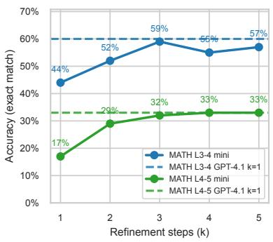
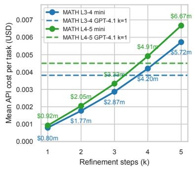
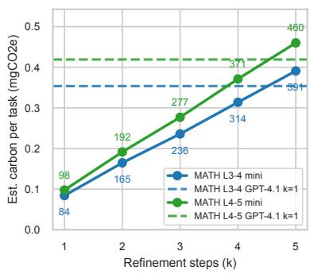
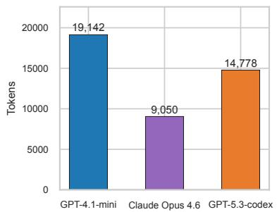
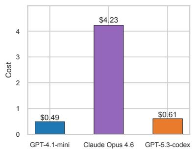
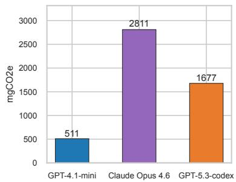
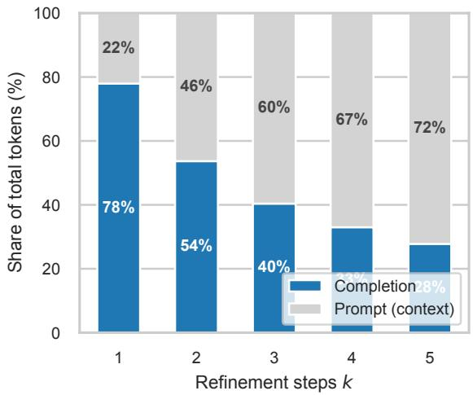
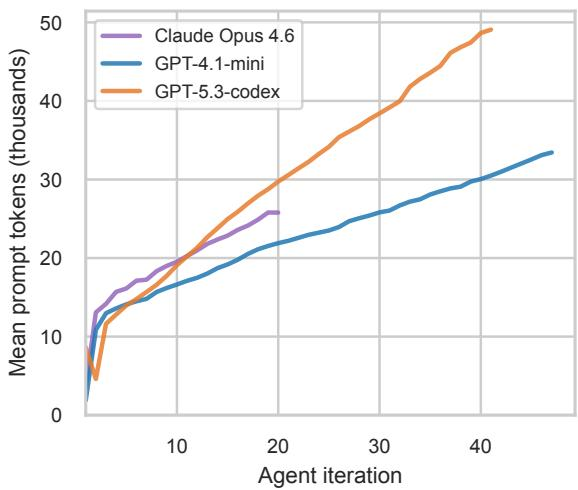

# Toward Sustainable Agentic AI: Carbon Tradeofs Across Iterative Self-Refinement and Tool-Augmented Coding

Boris Ruf †, Adrien de Mailly Nesle † and Marcin Detyniecki

AXA AI Research

## Abstract

Agentic language model systems can improve performance either by iterating on their own outputs or by using external tools in grounded environments. While these strategies can reduce error rates and substitute for larger models in some settings, their environmental cost remains relatively underexplored. We present two complementary empirical studies that estimate the energy and carbon footprint of agentic AI across settings of increasing complexity. Study 1 evaluates iterative verbal self-refinement: GPT-4.1-mini at � = 1–5 steps versus a GPT-4.1 single-pass baseline on two MATH benchmark splits. Study 2 evaluates tool-augmented agentic coding: GPT-4.1-mini, Claude Opus 4.6, and GPT-5.3-codex on SWE-bench Lite, where agents operate inside Docker-isolated environments with access to code execution and file editing tools. In Study 1, � = 3 refinements close a 16-percentage-point accuracy gap to within 1 point, but nearly triple the carbon footprint relative to the cheap single-pass baseline while remaining below the GPT-4.1 single-pass baseline under the current token-based carbon scenario. In Study 2, GPT-5.3-codex achieves the highest resolution rate in this sample (81.2%), ahead of Claude Opus 4.6 (68.9%) and GPT-4.1-mini (25.0%), but resolved-task-normalized eficiency remains mixed: GPT-4.1-mini is lowest on estimated carbon and cost per resolved task, while GPT-5.3-codex delivers substantially higher task success. All carbon estimates cover output-token inference only; prompt tokens, which exceed 99% of tokens in Study 2, and tool execution are not charged, so the figures are lower bounds on the full agentic footprint.

## Keywords

sustainable AI, LLM inference energy, carbon emissions accounting, agentic AI benchmarking

## 1. Introduction

Large language model (LLM) agents increasingly rely on two broad strategies to improve performance: iterative self-refinement and tool-augmented interaction. In self-refinement, the model generates an initial response, critiques it, and revises it over multiple rounds [1, 2]. In tool-augmented settings, agents use code execution, file editing, and test runners to ground decisions in external feedback [3, 4]. Both strategies can improve task outcomes and, in some settings, allow smaller models to approach the quality of larger ones [3, 5].

From a sustainability perspective, both framings are incomplete. Self-refinement does not eliminate cost—it shifts it from model parameters to API calls and execution time. Each additional refinement step or tool invocation consumes prompt tokens, completion tokens, compute time, and energy. Understanding how quickly the carbon footprint compounds as a function of refinement depth, agent architecture, and model choice is essential for responsible deployment of agentic systems.

This paper makes contributions in the following fields:

• Iterative Self-Refinement (Study 1). A controlled, forced-� evaluation of GPT-4.1-mini (� = 1– 5) against a GPT-4.1 single-pass baseline on MATH Level 3–4 and Level 4–5, with per-call token, energy, and carbon tracking.

• Tool-Augmented Agentic Coding (Study 2). A carbon analysis of a tool-augmented agentic coding benchmark: GPT-4.1-mini, Claude Opus 4.6, and GPT-5.3-codex on SWE-bench Lite [6] under Docker isolation, estimating the LLM-side inference footprint of real-world software engineering tasks.

## 2. Related Work

Self-refinement in LLM agents. Self-Refine was introduced in [1], demonstrating that iterative self-feedback improves performance across a range of tasks. Reflexion [2] frames refinement as verbal reinforcement learning. Both lines of work focus on accuracy gains, including on mathematical reasoning tasks [7]; energy costs are not reported. ReAct [3] extends agents to use tools, interleaving reasoning and acting in a grounded loop.

Agentic software engineering. SWE-bench [6] introduced a realistic benchmark where agents must resolve real GitHub issues by editing source code and passing repository tests. OpenHands [4] provides an open agent framework for this setting, running each task in a Docker-isolated workspace with access to bash, file editing, and browsing tools. AutoAgents [8] demonstrates how agents can be generated dynamically to coordinate specialised tools across complex multi-step tasks. No prior work has characterised the carbon cost of these agentic coding pipelines.

Energy and carbon of NLP. The energy cost of NLP training was surfaced in [9]; subsequent work extended this to inference [10, 11]. Patterson et al. [12] quantified the carbon of large model training and highlighted the role of data-centre location and grid mix. For inference, Samsi et al. [13] measured the energy of LLM inference on GPUs, and Luccioni et al. [14] showed that generative, multi-purpose models consume substantially more energy per query than task-specific ones. EcoLogits [15] provides per-token electricity estimates for major API models, which we build on here; energy scaling laws have been proposed to predict GPU energy for generative inference from its compute requirements [16], and profiles how input-token energy difers from output-token energy [17]. These works characterise single inference calls; we study how cost compounds across the multi-call loops of agentic systems.

Cost-aware agents. Agent evaluation has increasingly called for reporting cost alongside accuracy [18], and cascading strategies such as FrugalGPT [19] trade model size against call volume to reduce API spend. Separately, Huang et al. [20] show that intrinsic self-correction without external feedback does not reliably improve reasoning, which motivates measuring when additional refinement steps stop paying of. We extend this cost-aware view from monetary cost to energy and carbon.

## 3. Carbon Estimation

Detailed carbon data for cloud AI inference services is generally not publicly disclosed by API providers [21]. We therefore estimate inference carbon using a methodology that derives per-output-token electricity factors from GPU and server power models calibrated to known hardware configurations [15]. For a run with � completion tokens, model-specific electricity factor � (kWh/token), grid factor � $\mathrm { ( k g C O _ { 2 } e / k W h ) }$ , and scenario-embedded factor $\boldsymbol { b } \left( \mathrm { k g C O _ { 2 } e / t o k e n } \right)$ , we report

$$
{ \mathrm { C O 2 e _ { t o t a l } } } = T \cdot e \cdot g + T \cdot b .
$$

Thus, the energy columns in our tables report the electricity term only, while the carbon columns report the sum of Scope 2 electricity emissions and the scenario’s embedded per-token component. In both studies, the estimator is applied to completion tokens only. Because regional capacity for the required models difered at the time of the experiments, the two studies were run in diferent cloud regions (Ireland for Study 1, Sweden for Study 2), and each study applies the grid factor of its region. Absolute carbon values are therefore not comparable across studies; Section 6 provides a like-for-like comparison under a common European grid factor. To enable reproducibility and transparency, we use an open carbon footprint data model [22], which encodes per-configuration token totals into shareable benchmark URLs for cross-configuration comparison.

Table 1  
Mean per-task metrics on MATH $( N = 1 0 0$ per split) using estimated per-output-token carbon scenarios and 0.3476 kg $\mathbf { \cdot } { \mathbf { C O _ { 2 } e / k W h } }$ . Accuracy brackets give 95% Wilson confidence intervals.  
(a) Level 3–4
<table><tr><td>Model k Accuracy Cost/task  ${ \sf W h } / { \sf t a s k } ^ { \dagger }$   $\mathsf { m g C O _ { 2 } e ^ { \dagger } }$ </td></tr><tr><td>GPT-4.1-mini 1 44% [35,54] .00080 0.22</td></tr><tr><td>84 GPT-4.1-mini 2 52% [42,62] .00177 0.44 165</td></tr><tr><td>GPT-4.1-mini 3 59% [49,68] .00287 0.62 236</td></tr><tr><td>GPT-4.1-mini 4 55% [45,64] .00420 0.83 314</td></tr><tr><td>GPT-4.1-mini 5 57% [47,66] .00572 1.04 391</td></tr><tr><td>GPT-4.1 1 60% [50,69] .00381 0.97 354</td></tr></table>

(b) Level 4–5
<table><tr><td>Model k Accuracy Cost/task  ${ \sf W h } / { \sf t a s k } ^ { \dagger }$   $\mathsf { m g C O _ { 2 } e ^ { \dagger } }$ </td></tr><tr><td>GPT-4.1-mini 1 17% [11,26] .00092 0.26</td></tr><tr><td>98 GPT-4.1-mini 2 29% [21,39] .00205 0.51 192</td></tr><tr><td>GPT-4.1-mini 3 32% [24,42] .00333 0.73 277</td></tr><tr><td>GPT-4.1-mini 4 33% [25,43] .00491 0.98 371</td></tr><tr><td>GPT-4.1-mini 5 33% [25,43] .00667 1.22 460</td></tr><tr><td>GPT-4.1 1 33% [25,43] .00450 1.15 419</td></tr></table>

† Estimated from carbon scenarios; Wh/task is electricity only, while mgCO2e combines electricity and the scenario’s embedded per-token component.

## 4. Study 1: Iterative Self-Refinement

## 4.1. Setup

Benchmark. We evaluate on the MATH dataset [23], specifically Levels 3–4 (� = 100 problems) and Levels 4–5 (� = 100 problems). Gold answers are extracted from the final boxed answer in each solution; predictions are matched via float comparison, LaTeX fraction parsing, and normalised string comparison.

Configurations. We evaluate six configurations: GPT-4.1-mini at $k \in \{ 1 , 2 , 3 , 4 , 5 \}$ and GPT-4.1 at � = 1 as the quality baseline. All calls are made via Azure OpenAI using location northeurope at temperature 0.

Agent loop. The parameter � is the total number of LLM calls made per problem. Step 1: the model solves the problem (solve). Step 2: the model critiques its own solution (critique). Step 3+: the model verifies and revises (revise). Each call receives the problem together with all previous responses, and the answer extracted from the final (�-th) response is scored. Thus � = 1 is a single-pass solve, $k = 2$ adds one critique, and each further step adds one verify-and-revise round. The depth is forced: every task makes exactly � API calls, with no early stopping even if the model declares its answer correct.

Carbon estimation. Using Microsoft’s Azure regions list [24], we map northeurope to Ireland and apply its 2022 grid factor of 0.3476 $\mathrm { k g C O _ { 2 } e / k W h }$ [25]. For GPT-4.1-mini, we use an electricity coeficient per output token of 0.4800 mWh (modelled as a dense architecture); for GPT-4.1, we use 2.1857 mWh (modelled as a mixture-of-experts architecture), following the methodology in Section 3. In Table 1, Wh/task is the electricity term only; $m g C O _ { 2 } e$ adds the scenario’s embedded per-token component.

## 4.2. Results

Table 1 and Figure 1 show accuracy, cost, and carbon for each configuration on both MATH splits.

Self-refinement closes the accuracy gap. On Level 3–4, GPT-4.1-mini at $k = 1$ achieves 44% accuracy, 16 percentage points (pp) below GPT-4.1 (60%). By $k = 3 ,$ , mini reaches $5 9 \% ,$ closing the gap to within 1 pp at 25% lower API cost. The same pattern holds on Level 4–5: mini at $k = 1$ scores 17% vs. 33% for GPT-4.1, again exactly 16 pp behind, and � = 3 closes to 32% (−1 pp) at 26% lower cost. Paired McNemar tests on the same 100 problems confirm that the gain from � = 1 to $k = 3$ is significant on both splits $( p = 0 . 0 0 1 )$ , while the remaining diference between mini � = 3 and GPT-4.1 is not $( p = 1 . 0$ on both splits).

  
(a) Accuracy vs. �

  
(b) API cost vs. �

  
(c) Est. carbon vs. �  
Figure 1: Study 1: accuracy, cost, and carbon vs. � on MATH Level 3–4 and Level 4–5. Dashed line: $\mathrm { { G P T } } { \cdot } 4 . 1 ~ k = 1$

Accuracy plateaus beyond $k = 3 .$ Additional refinement steps yield no significant improvement. On Level 3–4, accuracy at $k = 4$ and � = 5 (55% and 57%) is lower than at $k = 3 .$ , but this diference lies within sampling noise (McNemar $p = 0 . 5 0$ for $k = 3$ vs. $k = 4 ;$ 12 problems lost vs. 8 gained). On Level 4–5, accuracy stays at 33% from � = 4 onward, matching GPT-4.1.

Carbon rises monotonically with refinement depth. On both splits, the most accurate nonbaseline refinement setting (� = 3) emits approximately 2.8× more carbon than the � = 1 mini baseline. Under the current per-output-token carbon scenario, however, mini � = 3 remains below the GPT-4.1 single-pass baseline on both splits: 236 vs. 354 $\mathrm { { \ m g C O _ { 2 } e } }$ on Level 3–4 and 277 vs. 419 mgCO e on Level 4–5. Carbon continues to increase with additional refinement steps and exceeds the GPT-4.1 baseline only at � = 5 on both splits. The carbon–accuracy crossover (beyond which further steps add carbon without a measurable accuracy gain) is at � = 3 on both splits; the observed peak is $k = 3$ on Level 3–4 and � = 4 on Level 4–5, but the two are not distinguishable at $N = 1 0 0$ . The cost–accuracy crossover (where refinement exceeds the upgrade cost) is � = 4 on both splits. These thresholds are distinct; attending to both is essential for sustainable deployment decisions.

Reproducibility (Carbon Estimates). Carbon comparisons based on token totals and the Irish grid factor are reproducible via the carbon footprint modelling tool for both MATH splits: Level 3–4 and Level 4–5 .

## 5. Study 2: Tool-Augmented Agents

## 5.1. Setup

Benchmark. SWE-bench Lite [6] is a curated subset of 300 real GitHub issues drawn from popular Python repositories (Django, Matplotlib, SymPy, scikit-learn, and others). Each task requires the agent to produce a patch that makes a set of previously-failing tests pass. Success is measured as pass@1: whether the generated patch resolves the issue in a single attempt as assessed by the oficial evaluation harness. Each model was run on the first 50 instances of the SWE-bench Lite test split (in dataset order: 6 Astropy and 44 Django issues), with up to three attempts per instance. Two instances failed to complete for every model and are excluded, leaving 48 for GPT-4.1-mini and GPT-5.3-codex. For Claude Opus 4.6, three further instances timed out and are excluded, leaving 45. On the 45 instances common to all three models, resolution rates are 26.7% (GPT-4.1-mini), 68.9% (Claude Opus 4.6), and 82.2% (GPT-5.3-codex); counting the three timeouts as unresolved instead gives 64.6% for Claude Opus 4.6. The ranking is therefore unafected by how the timed-out instances are handled.

Agent framework. We use the OpenHands agent [4] with the default tool preset: bash execution, file editing, and a structured task instruction. Each task runs in a dedicated Docker container pre-built for the target repository commit, providing full process isolation and a reproducible execution environment. The agent loop continues for up to 500 LLM iterations; a critic module checks for task completion at the end of each attempt.

Configurations. We compare three models: GPT-4.1-mini (the same cheap baseline as Study 1), Claude Opus 4.6 (Anthropic’s flagship model), and GPT-5.3-codex (a state-of-the-art reasoning-optimised model). All calls are routed through a LiteLLM proxy to Azure OpenAI or the Anthropic API (Sweden Central region) at each model’s default temperature.

Carbon estimation. We use Sweden’s 2022 grid-emissions factor, 0.0256 kgCO e/kWh [25]. We use electricity coeficients per output token of 0.4800 mWh for GPT-4.1-mini, 6.6824 mWh for Claude Opus 4.6, and 2.4322 mWh for GPT-5.3-codex, again using the Section 3 methodology. As in Study 1, the reported carbon values add the scenarios’ embedded per-token component to the electricity-based estimate. These values cover LLM inference only; they exclude container startup, repository installation, tool execution, and test-suite compute inside the Docker environment.

## 5.2. Results

Table 2 and Figure 2 summarise the results for all three models.

Resolution rate. GPT-5.3-codex leads with 81.2% pass@1, followed by Claude Opus 4.6 at 68.9% and GPT-4.1-mini at 25.0%. On the 45 shared instances, GPT-5.3-codex resolves six tasks that Claude Opus 4.6 does not and none in reverse (McNemar $p = 0 . 0 3 1 )$ ; given the sample size, this ordering should nevertheless be read as indicative. Claude Opus 4.6 converges in just 23.7 iterations on average—the fewest of the three—while GPT-4.1-mini requires 54.4.

Cost and carbon per task. Claude Opus 4.6 is the most expensive per task (\$2.91), roughly 6× GPT-5.3-codex (\$0.495) and 24× GPT-4.1-mini (\$0.123). At the task level, GPT-4.1-mini is the lowestenergy and lowest-carbon model (0.0023 kWh, 128 mgCO e), followed by GPT-5.3-codex (0.0292 kWh, $1 , 3 6 3 \mathrm { m g C O _ { 2 } e } )$ , then Claude Opus 4.6 (0.0417 kWh, 1,936 mgCO2e).

Carbon per resolved task. Normalised by outcome—carbon per resolved task—the ordering is unchanged but the gaps narrow: GPT-4.1-mini emits 511 mgCO2e per resolved task, GPT-5.3-codex emits 1,677 mgCO e (3.3× mini, down from 10.6× per task), and Claude Opus 4.6 emits 2,811 mgCO e (5.5× mini, down from 15.1× per task). Thus, GPT-5.3-codex leads on pass@1, while GPT-4.1-mini is most carbon-eficient per resolved task under this token-based estimate.

Table 2  
Core per-task metrics on SWE-bench Lite (iterations retained) using Sweden’s 2022 grid factor. Resolution brackets give 95% Wilson confidence intervals.
<table><tr><td>Model</td><td>N</td><td>Iterations</td><td>Cost/task</td><td>kWh/task†</td><td> $\mathrm { m g C O _ { 2 } e / t a s k ^ { \dagger } }$ </td><td>Resolution (pass@1)</td></tr><tr><td>GPT-4.1-mini</td><td>48</td><td>54.4</td><td>0.123</td><td>0.002297</td><td>128</td><td>25.0% [15,39]</td></tr><tr><td>Claude Opus 4.6</td><td>45</td><td>23.7</td><td>2.912</td><td>0.041661</td><td>1,936</td><td>68.9% [54,80]</td></tr><tr><td>GPT-5.3-codex</td><td>48</td><td>39.4</td><td>0.495</td><td>0.029204</td><td>1,363</td><td>81.2% [68,90]</td></tr></table>

† Estimated from carbon scenarios; kWh/task is electricity only, while mgCO2e/task combines electricity and the scenario’s embedded per-token component.

  
(a) Output tokens per resolved task

  
(b) Mean API cost per resolved task

  
(c) Est. carbon per resolved task  
Figure 2: Study 2: output tokens, API cost, and estimated carbon per resolved task on SWE-bench Lite.

Reproducibility (Carbon Estimates). Using the carbon footprint modelling tool, we reproduce carbon comparisons across configurations.

## 6. Discussion

Study 1: when is self-refinement worth it? Across both dificulty levels, self-refinement with GPT-4.1-mini is cost-competitive with a GPT-4.1 upgrade at � = 3 (≈25% cheaper, −1pp accuracy), and under the current token-based carbon scenario it also remains below the GPT-4.1 single-pass baseline at � = 3 on both MATH splits. Carbon nevertheless rises monotonically with refinement depth, so the sustainability gain relative to GPT-4.1 is scenario-dependent and does not hold once refinement is pushed further.

Study 2: capability and carbon eficiency diverge. Study 2 reveals a diferent pattern. In the tool-augmented, grounded setting of SWE-bench Lite, the highest-pass@1 model in this sample (GPT-5.3-codex) is substantially more accurate and converges faster than GPT-4.1-mini, but it is not dominant on every sustainability axis: GPT-4.1-mini remains lower on estimated cost and carbon per resolved task, while Claude Opus 4.6 converges in the fewest iterations. Under output-token accounting, capability therefore buys outcomes that the cheaper model cannot deliver, but not lower carbon per outcome. Grounded tool use does penalise weak models: GPT-4.1-mini fails more often and iterates longer, and so accumulates far more prompt context per task (see below). Whether this narrows or reverses the per-resolved-task gap under prompt-inclusive accounting remains open.

Diminishing returns in Study 1. On neither split does refinement beyond � = 3 yield a significant accuracy gain, while each further step adds carbon at a roughly constant rate. The lower accuracy at � = 4 and � = 5 on Level 3–4 is within sampling noise. Prior work finds that intrinsic self-correction can turn correct answers into incorrect ones [20]; whether this efect becomes significant with larger samples is left for future work.

Cross-study comparisons. Owing to model availability constraints, Study 1 ran in a data center in Ireland (Azure North Europe, ≈ 348 $\mathrm { g C O _ { 2 } e / k W h ) }$ and Study 2 in Sweden $( \approx 2 5 . 6 ~ \mathrm { g C O _ { 2 } e / k W h } ) [ 2 5 ]$ so their reported carbon figures are not directly comparable. For a like-for-like comparison, we use the carbon footprint modelling tool to create a carbon benchmark that applies Europe’s 2022 average grid-emissions factor (≈ 248 $\mathrm { g C O _ { 2 } e / k W h ) }$ to every configuration, enabling direct comparison across both studies. For Study 1, we use the Level 3–4 split as representative; the Level 4–5 split shows the same ordering.

Token composition and the limits of output-token costing. Figure 3 (Appendix) quantifies a structural gap in output-token-based carbon accounting across both studies. In Study 1 (Figure 3 a), prompt tokens rise from 22% of all tokens at $k = 1$ to 73% at $k = 5$ as prior responses are prepended to the context. Because our current carbon scenario charges only for completion tokens, it captures a shrinking share of token processing as � increases. In Study 2 (Figure 3 b), the imbalance is stronger: prompt tokens make up over 99% of all tokens at every iteration across all three models, growing from a few thousand at iteration 1 to tens of thousands by convergence. Weaker models therefore accumulate more context-processing work in addition to making more calls, which output-only accounting does not capture. Recent direct measurements on open models further show that input tokens have far lower energy intensity than output tokens, even in long-context settings, although the size of the gap depends on the serving stack [17]. Prompt-token dominance by count therefore does not imply prompt-token dominance in carbon. The main limitation of our estimator is that it can understate absolute footprint and misstate comparisons when prompt growth difers sharply across agents, rather than that token-count shares map directly to carbon shares.

Limitations. Study 1 evaluates a single model family on a mathematical reasoning benchmark, and Study 2 is limited to 45–48 SWE-bench Lite instances per model, drawn from only two repositories (Astropy and Django), so the results may not generalise to other models, repositories, agent frameworks, or deployment environments. With $N = 1 0 0$ per split, accuracy estimates in Study 1 carry 95% confidence intervals of roughly ±10 pp, so only large diferences are resolvable. Our carbon estimates treat model inference as the sole emission source. In particular, they include the per-token embedded component supplied by the selected carbon scenarios, but they do not include prompt-token processing, Docker container execution, test runs, networking, or additional data-centre overheads such as cooling beyond what is already implicit in the scenario assumptions. Direct energy measurements on open models would provide a stronger basis for comparison.

## 7. Conclusion

We have presented two empirical studies that quantify the energy and carbon footprint of agentic AI across settings of increasing complexity. In purely verbal self-refinement (Study 1), iterative refinement with a cheap model can close a 16-percentage-point accuracy gap at lower API cost but always at a nearly tripled carbon footprint relative to the mini baseline, while remaining below the GPT-4.1 single-pass baseline under the current token-based carbon scenario across two dificulty levels of MATH. In tool-augmented agentic coding (Study 2), GPT-5.3-codex achieves the highest pass@1 in this sample and resolves 3.2× more SWE-bench Lite tasks than GPT-4.1-mini, but at approximately 3.3× higher estimated carbon per resolved task under output-token accounting, which leaves out the prompt tokens that make up over 99% of tokens in this setting, as well as tool execution. This highlights that capability gains and sustainability gains need not move in the same direction.

Together, the two studies suggest that the carbon cost of agentic AI depends on task structure: in verbal self-refinement, cheaper models with more steps accumulate carbon with diminishing accuracy returns, whereas in grounded tool use, stronger models deliver outcomes that cheaper models cannot, at higher estimated carbon per outcome. Extending the accounting to prompt tokens and tool execution is the main next step to determine whether this ordering holds for the full agentic footprint.

## References

[1] A. Madaan, N. Tandon, P. Gupta, S. Hallinan, L. Gao, S. Wiegrefe, U. Alon, N. Dziri, S. Prabhumoye, Y. Yang, S. Gupta, B. P. Majumder, K. Hermann, S. Welleck, A. Yazdanbakhsh, P. Clark, Self-refine: iterative refinement with self-feedback, in: Proceedings of the 37th International Conference on Neural Information Processing Systems, NIPS, Curran Associates Inc., 2023.

[2] N. Shinn, F. Cassano, A. Gopinath, K. Narasimhan, S. Yao, Reflexion: Language agents with verbal reinforcement learning, in: Neural Information Processing Systems, Neural Information Processing Systems Foundation, Inc. (NeurIPS), 2023, pp. 8634–8652.

[3] S. Yao, J. Zhao, D. Yu, N. Du, I. Shafran, K. R. Narasimhan, Y. Cao, React: Synergizing reasoning and acting in language models, in: The 11th International Conference on Learning Representations, 2023.

[4] X. Wang, B. Li, Y. Song, F. F. Xu, X. Tang, M. Zhuge, J. Pan, Y. Song, B. Li, J. Singh, H. H. Tran, F. Li, R. Ma, M. Zheng, B. Qian, Y. Shao, N. Muennighof, Y. Zhang, B. Hui, J. Lin, R. Brennan, H. Peng, H. Ji, G. Neubig, OpenHands: An open platform for AI software developers as generalist agents, in: The 13th International Conference on Learning Representations, 2025.

[5] A. Chavan, R. Magazine, S. Kushwaha, M. Debbah, D. Gupta, Faster and lighter LLMs: a survey on current challenges and way forward, in: Proceedings of the 33rd International Joint Conference on Artificial Intelligence, IJCAI, 2024.

[6] C. E. Jimenez, J. Yang, A. Wettig, S. Yao, K. Pei, O. Press, K. Narasimhan, SWE-bench: Can language models resolve real-world GitHub issues?, in: International Conference on Learning Representations, 2024.

[7] Z. Jiang, H. Peng, S. Feng, F. Li, D. Li, LLMs can find mathematical reasoning mistakes by pedagogical chain-of-thought, in: Proceedings of the 33rd International Joint Conference on Artificial Intelligence, IJCAI, 2024.

[8] G. Chen, S. Dong, Y. Shu, G. Zhang, J. Sesay, B. Karlsson, J. Fu, Y. Shi, AutoAgents: a framework for automatic agent generation, in: Proceedings of the 33rd International Joint Conference on Artificial Intelligence, IJCAI, 2024.

[9] E. Strubell, A. Ganesh, A. McCallum, Energy and policy considerations for deep learning in NLP, in: A. Korhonen, D. Traum, L. Màrquez (Eds.), Proceedings of the 57th Annual Meeting of the Association for Computational Linguistics, Association for Computational Linguistics, 2019, pp. 3645–3650.

[10] K. Lottick, S. Susai, S. A. Friedler, J. P. Wilson, Energy usage reports: Environmental awareness as part of algorithmic accountability, Workshop on Tackling Climate Change with Machine Learning at NeurIPS (2019).

[11] N. Bannour, S. Ghannay, A. Névéol, A.-L. Ligozat, Evaluating the carbon footprint of NLP methods: A survey and analysis of existing tools, SUSTAINLP 27 (2021) 11–21.

[12] D. Patterson, J. Gonzalez, Q. Le, C. Liang, L.-M. Munguia, D. Rothchild, D. So, M. Texier, J. Dean, Carbon emissions and large neural network training, arXiv preprint arXiv:2104.10350 (2021).

[13] S. Samsi, D. Zhao, J. McDonald, B. Li, A. Michaleas, M. Jones, W. Bergeron, J. Kepner, D. Tiwari, V. Gadepally, From words to watts: Benchmarking the energy costs of large language model inference, in: 2023 IEEE High Performance Extreme Computing Conference (HPEC), IEEE, 2023, pp. 1–9. doi:10.1109/HPEC58863.2023.10363447.

[14] S. Luccioni, Y. Jernite, E. Strubell, Power hungry processing: Watts driving the cost of AI deployment?, in: The 2024 ACM Conference on Fairness, Accountability, and Transparency, FAccT ’24, ACM, 2024, pp. 85–99. doi:10.1145/3630106.3658542.

[15] S. Rincé, A. Banse, Ecologits: Evaluating the environmental impacts of generative ai, Journal of Open Source Software 10 (2025) 7471. Methodology: https://ecologits.ai/0.9/methodology/llm\_ inference/.

[16] A. Iyengar, J. Han, B. Ruf, V. Grari, M. Detyniecki, S. Ermon, Energy scaling laws for difusion models: Quantifying compute in image generation, in: The 2026 ACM Conference on Fairness, Accountability, and Transparency, 2026, pp. 8029–8050.

[17] B. Ruf, M. Detyniecki, The cost of context: Profiling the energy footprint of input tokens in large language models, HotCarbon / SIGENERGY Energy Informatics Review (2026). URL: https: //hotcarbon.org/assets/2026/paper-17.pdf.

[18] S. Kapoor, B. Stroebl, Z. S. Siegel, N. Nadgir, A. Narayanan, AI agents that matter, Transactions on Machine Learning Research 2025-May (2025).

[19] L. Chen, M. Zaharia, J. Zou, FrugalGPT: How to use large language models while reducing cost and improving performance, Transactions on Machine Learning Research (2024). URL: https://openreview.net/forum?id=cSimKw5p6R, featured Certification.

[20] J. Huang, X. Chen, S. Mishra, H. S. Zheng, A. Yu, X. Song, D. Zhou, Large lan-

guage models cannot self-correct reasoning yet, in: B. Kim, Y. Yue, S. Chaudhuri, K. Fragkiadaki, M. Khan, Y. Sun (Eds.), International Conference on Learning Representations, 2024, pp. 32808–32824. URL: https://proceedings.iclr.cc/paper\_files/paper/2024/file/ 8b4add8b0aa8749d80a34ca5d941c355-Paper-Conference.pdf.

[21] C. Hankendi, A. K. Coskun, B. Sovacool, Why transparency matters for sustainable data centers and carbon-neutral artificial intelligence (AI), iScience 28 (2025) 113705.

[22] B. Ruf, M. Detyniecki, Open and linked data model for carbon footprint scenarios, in: International Conference on Advanced Infocomm Technology, IEEE, 2023, pp. 423–427.

[23] D. Hendrycks, C. Burns, S. Kadavath, A. Arora, S. Basart, E. Tang, D. Song, J. Steinhardt, Measuring mathematical problem solving with the MATH dataset, NeurIPS Datasets and Benchmarks (2021).

[24] Microsoft, Azure regions list, https://learn.microsoft.com/en-us/azure/reliability/regions-list, 2026. Accessed: 2026-05-12.

[25] International Energy Agency (IEA), Emissions factors 2022, https://www.iea.org/ data-and-statistics/data-product/emissions-factors-2022, 2022. Accessed: 2026-05-12.

## Appendix

## A. Token Composition

  
(a) Study 1: share of prompt vs. completion tokens per refinement step � (GPT-4.1-mini, average of L3–4 and L4–5). At $k = 1$ prompts are 22% of all tokens; by � = 5 they are 73%.  
(b) Study 2: mean prompt token count per agent iteration for each model. Lines end where fewer than half of instances remain active. Prompt tokens exceed 99% of all tokens at every iteration.  
Figure 3: Token composition in both studies. Since our current carbon scenario charges only for completion tokens, the carbon estimate covers a shrinking fraction of actual token workload as refinement depth or agent iterations grow.