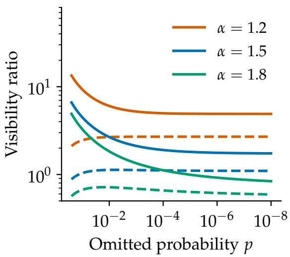
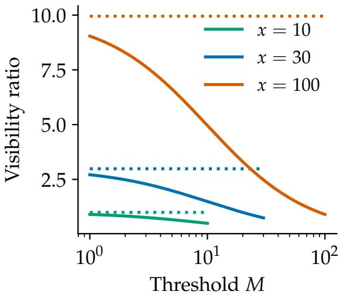
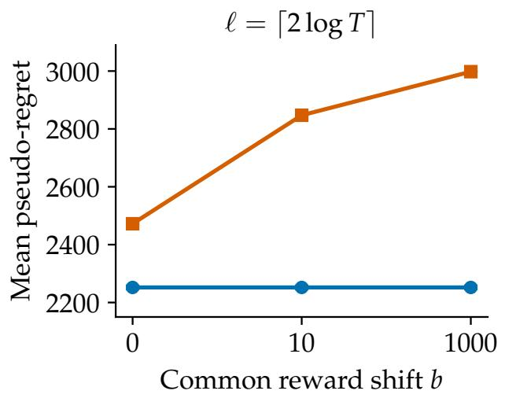
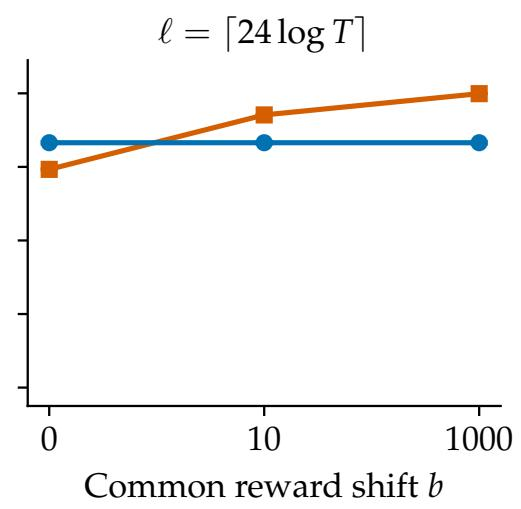

# Visible Tails: Characterizing Adaptation to Unknown Moments in Heavy-Tailed Bandits

Do Ngoc Tuan

TUAN.DONGOC@PHENIKAA-UNI.EDU.VN

Phenikaa School of Information Technology, Phenikaa University, Hanoi 12116, Vietnam

Nguyen Duc Hai

DUCHAI001@E.NTU.EDU.SG

College of Computing and Data Science, Nanyang Technological University, Singapore

## Abstract

Heavy-tailed bandit learners without moment parameters face an obstruction: the rewards that carry an arm’s mean can stay unseen. We address the remaining part of a COLT open problem by characterizing the optimal-arm laws that permit adaptation to unknown moments at constant-factor cost. The condition, variance-core visibility, is one-sided and translation-invariant: the mean hidden in any rare event is at most a constant multiple of the standard error of the rewards that remain. A quantile-trimmed UCB index that knows the visibility constants attains the central-moment benchmark on this class, and no single strategy adapts across all visibility levels. The same index achieves logarithmic expected regret on every instance with a visible optimal arm and finite-mean rewards. On an explicit family with no higher moment, gap ∆ and constant A, its logarithmic coefficient and the information lower bound are of order $\Delta ^ { - 1 } e ^ { \boldsymbol { A } / \Delta }$ , exponential in the inverse gap within one visibility class.

Keywords: heavy-tailed bandits, adaptive regret minimization, unknown moments, trimmed mean, information lower bounds

## 1. Introduction

A stochastic bandit learner must stay optimistic about rewards it has not yet seen. Heavy tails make this hard, because the rare large rewards that carry much of an arm’s mean can stay hidden for a long time. When rewards have a moment of order $1 + \varepsilon \in ( 1 , 2 ]$ bounded by u, robust UCB indices that know $( \varepsilon , u )$ achieve regret of order $u ^ { 1 / \varepsilon } \Delta ^ { - 1 / \varepsilon } \log T$ on an arm with mean gap ∆ over T rounds (Bubeck et al., 2013). Without these parameters, a run of small observations has two explanations: a poor arm, or the bulk of an excellent arm whose large rewards have not appeared. Genalti et al. (2024) turn this ambiguity into lower bounds showing that the known-parameter rate is out of reach with no further assumption, and they recover that rate by data-driven trimming under truncated non-positivity of the optimal arm. Symmetry supports a second adaptive guarantee (Tamás et al., 2025). These conditions are mutually incomparable and both exclude Pareto rewards, which led Genalti and Metelli (2025) to ask, as part of a COLT open problem, whether some assumption encompasses all distributions for which adaptation comes at no additional cost.

This paper answers that question for both the central-moment and the raw-moment benchmark. For a reward set $E$ of probability $1 - p .$ , let $b _ { E }$ be the centered mean omitted by E and let $v _ { E } = ( 1 - p ) \operatorname { V a r } [ X \mid E ]$ . A law has variance-core visibility, written $\operatorname { V C V } ( a , q )$ (Definition 1), if

$$
b _ { E } \leq a \sqrt { p v _ { E } }
$$

for every set $E$ with omitted probability $0 < p \le q$ . The condition is a bias-variance balance. After about $1 / p$ pulls the omitted event has typically not occurred, so the sample looks like draws from the law conditioned on $E ,$ , whose mean has standard error about $\sqrt { p \operatorname { V a r } [ X \mid E ] }$ Visibility says that the mean still unseen is at most a constant multiple of this standard error, so a confidence width built from the observed spread also covers the unseen upside. The condition is one-sided, because hidden upside alone harms optimism, and it is imposed on an optimal arm alone. It is also translation invariant. A common shift of all rewards leaves the bandit problem unchanged and inflates raw moments without bound, so we measure adaptation against a central-moment benchmark $R _ { T } ^ { \mathrm { { c e n } } }$ : the known-parameter rate written in each competitor’s own central moments, plus an exploration allowance of $\Delta _ { i }$ log $T$ per arm. The allowance has the form of the forced-exploration term in the bound of Genalti et al. (2024), which carries an extra factor $1 / \mathbb { P } [ X \neq 0 ]$

## 1.1. Our results

An exact adaptation frontier. Theorem 2 proves that a class $\mathcal { D }$ of optimal-arm laws containing all point masses admits constant-factor adaptation to $R _ { T } ^ { \mathrm { { c e n } } }$ if and only if $\mathcal { D } \subseteq$ $\operatorname { V C V } ( a , q )$ for some finite a and positive $q .$ Necessity is quantitative: a two-arm adaptation constant $C$ forces $a = { \sqrt { 1 2 8 C } }$ and $q = \operatorname* { m i n } \{ 1 / 2 , 1 / ( 4 C ) \}$ . Sufficiency is constructive: VT-UCB (visible-tail UCB), a quantile-trimmed UCB index with an independent pilot center, receives $( a , q )$ and the horizon and attains an explicit constant $C _ { K }$ . These inputs are necessary for uniform adaptation, since Corollary 3 shows that any strategy adapting over $\operatorname { V C V } ( a , q )$ has constant at least $1 / ( 2 q )$ . Hence no single strategy adapts over all visibility classes, and the $5 0 / q$ term in $C _ { K }$ has the right order.

Two observations drive the proof. Because the retained second moment of E around any point is at least $v _ { E }$ , visibility holds at every center at once, so an inaccurate pilot on the optimal arm leaves its index optimistic and the pilot needs accuracy on the competitor alone. In the other direction, conditioning a law on $E$ produces a competitor at KL divergence $- \log ( 1 - p )$ , which takes about $1 / p$ pulls to distinguish from the original law and whose variance is exactly what the benchmark charges. The same quantity $v _ { E }$ therefore governs the upper and the lower bound.

In the raw-moment setting of the open problem, Proposition 4 gives the corresponding statement, with threshold visibility at the origin as the exact condition. That raw class contains every truncated non-positive law, every law symmetric about its mean, and, for each fixed $\eta > 0$ , the translated Pareto laws with $\alpha \in [ 1 + \eta , 2 )$ . One condition therefore covers the assumptions known to support adaptation together with the Pareto rewards highlighted by Genalti and Metelli (2025). The boundary of the frontier is set by hidden atoms: a

Bernoulli(p) law with $p \leq q$ lies outside $\operatorname { V C V } ( a , q )$ for every $^ { a , }$ because the benchmark charges a deterministic competitor its exploration allowance alone (Section 6).

Logarithmic regret from a first moment. Theorem 5 proves instance-dependent ${ \cal O } ( \log T )$ regret for VT-UCB on every instance with a visible optimal arm and integrable competitors. Every arm, including the optimal one, needs a finite first moment and nothing more. A competitor with a central moment of order $1 + \varepsilon$ contributes the benchmark rate in its own $( \varepsilon , u )$ , so the index adapts arm by arm to heterogeneous unknown exponents. The analysis separates the two errors of a trimmed mean, the bias from discarding large observations and the sampling fluctuation of the rest. Both vanish for every integrable law as the trimmed fraction tends to zero, so every positive gap is resolved at a finite sample size. Corollary 6 gives the endpoint rate $\Delta ^ { - 1 / ( \alpha - 1 ) }$ log $T$ for polynomial tail envelopes, including Pareto competitors with infinite αth moment.

The price of integrability. The coefficient in Theorem 5 is finite on each instance and admits no polynomial bound in the inverse gap. Theorem 7 determines its order on an explicit family with tail $1 / [ t ( \log t ) ^ { 2 } ]$ , which has no finite moment of order above one. The coefficient of VT-UCB and the information lower bound for consistent strategies are both of order $\Delta ^ { - 1 } e ^ { \boldsymbol { A } / \Delta }$ , and their ratio is the explicit universal constant stated after the theorem. The gap is hidden at tail probability $r \approx e ^ { - A / \Delta }$ , where the remaining mean $A / \log ( 1 / r )$ falls to $\Delta$ , so resolving it takes $e ^ { { A } / { \dot { \Delta } } }$ log $T$ pulls up to a polynomial factor in $1 / \Delta$ . Corollary 8 extends this to a continuum of laws with coefficient $\Delta ^ { - 1 / \beta } \exp [ ( A / ( \beta \Delta ) ) ^ { 1 / \beta } ]$ , all in the single class $\mathrm { V C V } ( 0 , 1 / 4 )$

## 1.2. Related work

Adaptation to unknown moments. The lower bounds of Genalti et al. (2024) frame the problem, and truncated non-positivity of the optimal arm supports their AdaR-UCB guarantee. Optimal-arm tail-sign assumptions also support adaptation in Huang et al. (2022) and Chen et al. (2025). Raw visibility contains truncated non-positivity, and raw VT-UCB with the universal inputs $( 1 / 2 , 1 / 2 )$ attains the benchmark rate on that class. Variancecore visibility and truncated non-positivity are incomparable (Section 6), which reflects the role of location. Tamás et al. (2025) construct the parameter-free RMM-UCB under symmetry of every arm about its mean, with gap-dependent $\log ^ { 2 } T$ regret. Every integrable symmetric law lies in $\mathrm { V C V } ( \sqrt { 3 / 2 } , 1 / 4 )$ , so VT-UCB with these universal inputs achieves ${ \cal O } ( \log T )$ regret using symmetry of the optimal arm alone. Genalti and Metelli (2026) resolve the assumption-free part of this open problem and state that its remaining part is to identify the weakest additional assumption that recovers the known-parameter rates. Our characterization addresses that remaining part by identifying the classes that admit adaptation at constant-factor cost.

Mean estimation and confidence widths. Robust mean estimation (Catoni, 2012, Devroye et al., 2016, Lugosi and Mendelson, 2019) supplies point estimators with sharp deviations, and a bandit index additionally requires a computable width. Oliveira et al. (2025) prove finite-sample guarantees for the order-statistic trimmed mean under centralmoment conditions, with a trimming level set by the confidence. Hammouda et al. (2026)

<table><tr><td>Work</td><td>Optimal-arm condition</td><td>Inputs</td><td>Competitor moment</td><td>Regret per arm</td></tr><tr><td>Bubeck et al. (2013)</td><td>moment of order  $1 + \varepsilon$ </td><td> $\varepsilon , u$ </td><td> $\quad \operatorname { o r d e r } 1 + \varepsilon$ </td><td> $( u / \Delta ) ^ { 1 / \varepsilon } \log T$ </td></tr><tr><td>Genalti et al. (2024)</td><td>truncated non-positivity</td><td>none</td><td> $\mathrm { r a w } , \mathrm { o r d e r } 1 + \varepsilon$ </td><td> $[ ( u / \Delta ) ^ { 1 / \varepsilon } +$   $\Delta / \mathbb { P } [ X \neq 0 ] ] \log T$ </td></tr><tr><td>Tamás et al. (2025)</td><td>symmetry about the mean, on every arm</td><td>none</td><td>some higher moment</td><td> $\mathrm { g a p { \mathrm { - } d e p e n d e n t } \log ^ { 2 } } T$ </td></tr><tr><td>Ashutosh et al. (2021) Honda and</td><td>some higher moment moment generating</td><td>scaling function upper</td><td>some higher moment bounded above</td><td>superlogarithmic  $\Delta \log T / D _ { \mathrm { i n f } }$ </td></tr><tr><td>Takemura (2015)</td><td>function near zero</td><td>endpoint</td><td></td><td></td></tr><tr><td>Theorem 2</td><td> $\operatorname { V C V } ( a , q )$ </td><td> $a , q , T$ </td><td>central, order  $1 + \varepsilon$ </td><td> $[ ( u / \Delta ) ^ { 1 / \varepsilon } + \Delta ] \log T$ </td></tr><tr><td>Theorem 5</td><td> $\operatorname { V C V } ( a , q )$ </td><td> $a , q , T$ </td><td>first moment</td><td>instance-dependent log T</td></tr></table>

Table 1: Expected-regret guarantees for heavy-tailed stochastic bandits, organized by the condition on the optimal arm, the learner’s inputs, and the requirement on competitors. Here $D _ { \mathrm { i n f } }$ is the smallest KL divergence from the competitor’s law to a law whose mean exceeds the optimum.

characterize unknown-variance confidence intervals through an effective sample size and prove that adapting to the scale defining their classes is impossible, with sample-sizedependent classes for two-sided inference. Our condition is fixed in the sample size, controls the downward bias that matters for optimism, and characterizes bandit regret. These analyses share the classical difficulty of unseen mean mass (Bahadur and Savage, 1956). VT-UCB combines trimming and pilot centering with the empirical-variance optimism of Audibert et al. (2009) and Maurer and Pontil (2009), and its distinctive feature is a width that remains valid at every pilot center.

Regret under a first moment. Ashutosh et al. (2021) obtain arbitrarily slow superlogarithmic expected regret over laws having some higher moment, using distribution-oblivious algorithms. Gupta et al. (2026) give almost-sure guarantees for integrable rewards, and their expected-regret theorem uses sub-exponential tails. Theorem 5 gives expected ${ \cal O } ( \log T )$ regret for integrable arms given the visibility constants, and Theorem 7 determines the coefficient of this guarantee up to a constant factor on an explicit family. Our converse uses change of measure and reverse-KL alternatives (Lai and Robbins, 1985, Kaufmann et al., 2016, Agrawal et al., 2021). For rewards bounded above by a known endpoint, Honda and Takemura (2010, 2015) express the minimum divergence to a higher-mean law through the dual max $\operatorname { \mathbb { E } } [ \log ( 1 - \lambda ( X - \mu ) ) ]$ , which is the information quantity in our converse. Their

IMED regret theorem assumes a moment generating function near the origin on an optimal arm and uses the endpoint as an input. It therefore applies to the instances of Section 5, whose optimal arm is a point mass, and attains there the coefficient of our lower bound. VT-UCB uses neither the endpoint nor a moment generating function, and its guarantee extends to every visible optimal arm.

Other structure. Other work adapts to an unknown reward range (Hadiji and Stoltz, 2023) or uses a known kurtosis bound for scale-free regret (Lattimore, 2017). Pareto-specific Thompson sampling exploits a parametric family (Lee et al., 2023), whereas our learner receives no tail formula and no tail parameter. Adversarial heavy-tailed bandits (Cheng et al., 2024) and the comparison of heavy tails with contamination (Cherapanamjeri and Lee, 2025) address adversarially generated rewards and corrupted data. Our retained sets describe a fixed reward distribution, which gives atoms and the one-sided form of visibility their central role.

## 2. Model and a location-invariant benchmark

There are $K \geq 2$ arms and a known horizon $T \geq 3$ . Pulling arm $i$ returns an independent reward of law $\nu _ { i }$ on R, with $\mathbb { E } _ { \nu _ { i } } [ | X | ] < \infty$ , and an instance is the tuple $\pmb { \nu } = ( \nu _ { 1 } , \dots , \nu _ { K } )$ Write $\mu _ { i } = \mathbb { E } _ { \nu _ { i } } [ X ]$ , assume a unique optimal arm $i ^ { \star }$ , put $\Delta _ { i } = \mu _ { i ^ { \star } } - \mu _ { i }$ , and let $N _ { i } ( T )$ count the pulls of arm i in $T$ rounds. Expected regret is

$$
R _ { T } = \sum _ { i \neq i ^ { \star } } \Delta _ { i } \mathbb { E } [ N _ { i } ( T ) ] .
$$

Unless explicitly stated, no moment above order one is assumed. We write $\delta _ { x }$ for the point mass at x.

For the uniform characterization only, fix $\varepsilon _ { 0 } \in ( 0 , 1 ]$ and call an instance admissible when every arm has a finite central $( 1 + \varepsilon _ { 0 } )$ th moment. Define

$$
\begin{array} { r } { \mathcal { C } _ { i } = \{ ( \varepsilon , u ) : \varepsilon _ { 0 } \leq \varepsilon \leq 1 , u > 0 , \mathbb { E } [ | X - \mu _ { i } | ^ { 1 + \varepsilon } ] \leq u \} , } \\ { R _ { T } ^ { \mathrm { c e n } } = \log T \displaystyle \sum _ { i \neq i ^ { \star } } \Delta _ { i } \left[ 1 + \displaystyle \operatorname* { i n f } _ { ( \varepsilon , u ) \in \mathcal { C } _ { i } } \left( \frac { 4 u ^ { 1 / ( 1 + \varepsilon ) } } { \Delta _ { i } } \right) ^ { ( 1 + \varepsilon ) / \varepsilon } \right] . } \end{array}
$$

The raw benchmark $R _ { T } ^ { \circ }$ replaces $\left| X - \mu _ { i } \right| \mathbf { b y } \left| X \right|$ in $\mathcal { C } _ { i }$ . The infimum term is the sample complexity of estimating a mean to accuracy $\Delta _ { i }$ at confidence $1 / T$ under a moment of order $1 + \varepsilon$ , times the per-pull cost $\Delta _ { i }$ . This is the regret of robust UCB with known parameters (Bubeck et al., 2013). The term $\Delta _ { i }$ log $T$ is an exploration allowance: ruling out even a zero-variance competitor has this cost (Section 6), and it also pays for initialization. A class  admits free adaptation if, for each fixed $K$ , one strategy and finite $C _ { K }$ satisfy $R _ { T } \leq C _ { K } R _ { T } ^ { \mathrm { c e n } }$ for every horizon and admissible instance whose optimal law belongs to $\mathcal { D }$ The constants $C _ { K }$ depend on $\mathcal { D } , K , \varepsilon _ { 0 }$ and are uniform over instances, and we call $C = C _ { 2 }$ the two-arm adaptation constant. The strategy receives a description of $\mathcal { D }$

Fix a law of X with mean $\mu .$ . For a measurable reward set $E \subseteq \mathbb { R }$ , put

$$
\begin{array} { r l } & { p = \mathbb { P } [ X \notin E ] , \qquad \mu _ { E } = \mathbb { E } [ X \mid X \in E ] , } \\ & { b _ { E } = \mathbb { E } [ ( X - \mu ) \mathbf { 1 } _ { E ^ { c } } ] , \qquad v _ { E } = \mathbb { E } [ ( X - \mu _ { E } ) ^ { 2 } \mathbf { 1 } _ { E } ] . } \end{array}
$$

Thus $b _ { E } = ( 1 - p ) ( \mu - \mu _ { E } )$ measures how far the retained mean falls below the true mean, and $v _ { E } = ( 1 - p ) \operatorname { V a r } [ X \mid E ]$ measures the spread of the retained rewards. An atom is either retained or omitted whole.

Definition 1 (Variance-core visibility) A law belongs to $\mathrm { V C V } ( a , q ) i f$

$$
b _ { E } \leq a \sqrt { p v _ { E } } \qquad ( 0 < p \leq q , v _ { E } < \infty ) ,
$$

where $a \geq 0$ and $0 < q \le 1 / 2$ . When $v _ { E } = 0 .$ , the condition reads $b _ { E } \leq 0 .$ . It is invariant under translations and positive rescaling. The constant a bounds the unseen mean in standard errors at sample size $1 / p ,$ and q is the largest omitted probability covered. The learner’s inputs are $( a , q )$ and the horizon.

## 3. Characterization by retained variance

Trimming keeps the observations within distance M of a center z. For $Y = X - z$ , define the trimmed probability, the retained second moment, the mean deficit and the width scale:

$$
\begin{array} { r l r } & { p _ { z } ( M ) = \mathbb { P } [ | Y | > M ] , } & { V _ { z } ( M ) = \mathbb { E } [ Y ^ { 2 } \mathbf { 1 } _ { \{ | Y | \leq M \} } ] , } \\ & { b _ { z } ( M ) = \mathbb { E } [ ( X - \mu ) \mathbf { 1 } _ { \{ | Y | > M \} } ] , } & { s _ { z } ( M ) = \sqrt { p _ { z } ( M ) V _ { z } ( M ) } + M p _ { z } ( M ) . } \end{array}
$$

We say that $X - z$ has threshold visibility, written $X - z \in \mathrm { V T } ( c , q )$ , when $b _ { z } ( M ) \leq c s _ { z } ( M )$ for all $M \geq 0$ with $p _ { z } ( M ) \leq q . \mathrm { A t } z = 0$ , this is the raw-moment visibility condition, and we then drop the subscript z.

Theorem 2 (Centered adaptation frontier) Fix $\varepsilon _ { 0 } \in ( 0 , 1 ]$ . Let contain every point mass and consist oflaws withfinite central $( 1 + \varepsilon _ { 0 } ) t h$ moments. Thefollowing are equivalent: (i)  admits free adaptation to $R _ { T } ^ { \mathrm { { c e n } } } ; ( i i ) \mathcal { D } \subseteq \mathrm { { V C V } } ( a , q ) f o r$ some finite a and positive q; (iii) uniform constants $( c , q )$ make $X - \mu \in \mathrm { V T } ( c , q )$ for every law in $\mathcal { D } ;$ and (iv) uniform constants $( c , q )$ make $X - z \in \operatorname { V T } ( c , q )$ for every law in and every $z \in \mathbb { R }$

A two-arm adaptation constant C implies

$$
\mathcal { D } \subseteq \operatorname { V C V } \left( \sqrt { 1 2 8 C } , \operatorname* { m i n } \{ 1 / 2 , 1 / ( 4 C ) \} \right) .
$$

Conversely the algorithm below permits

$$
C _ { K } = 2 5 [ 2 0 0 ( 1 + a ) ] ^ { ( 1 + \varepsilon _ { 0 } ) / \varepsilon _ { 0 } } + 3 7 + 5 0 / q + 8 K .
$$

Proof outline. VCV implies threshold visibility at every center since $V _ { z } ( M ) \geq v _ { E }$ . Conversely, with $c ^ { \prime } = 6 c + 4$ , threshold visibility for $X - \mu$ implies $b _ { E } \leq c ^ { \prime } \sqrt { p \mathbb { E } [ ( X - \mu ) ^ { 2 } \mathbf { 1 } _ { E } ] }$ The identity

$$
\mathbb { E } [ ( X - \mu ) ^ { 2 } \mathbf { 1 } _ { E } ] = v _ { E } + { \frac { b _ { E } ^ { 2 } } { 1 - p } }
$$

removes the unknown location for small $p$ and yields VCV with constants

$$
\left( \sqrt { 2 } c ^ { \prime } , \operatorname* { m i n } \{ q / 2 , 1 / 4 , ( 2 c ^ { \prime 2 } + 1 ) ^ { - 1 } \} \right) .
$$

For necessity, condition on $E ,$ then compare $( \delta _ { \theta } , \nu ( \cdot \mid E ) )$ and $( \delta _ { \theta } , \nu )$ at $\theta = ( \mu + \mu _ { E } ) / 2$ The instances differ in arm 2 alone, by KL divergence $d = - \log ( 1 - p )$ per pull, and both have gap $b _ { E } / [ 2 ( 1 - p ) ]$ . A strategy with logarithmic regret on both must pull arm 2 about log $T / d$ times on the first (change of measure), which gives

$$
C \geq \frac { b _ { E } ^ { 2 } } { d \{ b _ { E } ^ { 2 } + 6 4 ( 1 - p ) v _ { E } \} } .
$$

Sections A and C prove the implications, including the case $v _ { E } = 0$

Corollary 3 (Visibility cannot be learned for free) Let $a \geq 0$ and $0 < q \leq 1 / 2 ,$ , and let $\mathrm { V C V } _ { \varepsilon _ { 0 } } ( a , q )$ denote the laws in $\operatorname { V C V } ( a , q )$ with finite central $( 1 + \varepsilon _ { 0 } ) t h$ moments. $H$ a strategy adapts over $\mathrm { V C V } _ { \varepsilon _ { 0 } } ( a , q )$ with two-arm constant $C ,$ , then

$$
C \geq \frac { 1 } { - \log ( 1 - q ) } \geq \frac { 1 } { 2 q } .
$$

Consequently no single strategy adapts over $\textstyle \bigcup _ { a \geq 0 , q > 0 } \operatorname { V C V } _ { \varepsilon _ { 0 } } ( a , q )$ , and the $5 0 / q$ term in $C _ { K }$ has the right order in $q .$

Proof It suffices to take $a = 0 ,$ , since $\mathrm { V C V } _ { \varepsilon _ { 0 } } ( 0 , q ) \subseteq \mathrm { V C V } _ { \varepsilon _ { 0 } } ( a , q )$ . This class contains every point mass. For $q < p < 1$ it also contains Bernoulli(p), because a set with omitted probability in $( 0 , q ]$ can omit only the atom at zero, and then $b _ { E } < 0$ . The converse above with $E = \{ 0 \}$ has $v _ { E } = 0 , b _ { E } = p ( 1 - p ) > 0$ and $d = - \log ( 1 - p )$ , so $C \geq 1 / d$ . Letting $p \downarrow q$ gives the first bound, and $- \log ( 1 - q ) \leq q / ( 1 - q ) \leq 2 q$ gives the second.

A uniform guarantee therefore requires prior knowledge of the visibility level. The raw benchmark has the same structure, with threshold visibility at the origin in place of the variance core.

Proposition 4 (Raw analogue) Fix $\varepsilon _ { 0 } ~ \in ~ ( 0 , 1 ]$ . Let contain every point mass and consist of laws with finite raw $( 1 + \varepsilon _ { 0 } ) t h$ moments. Then  admits free adaptation to $R _ { T } ^ { \circ }$ , defined as above with R◦ in place of $R _ { T } ^ { \mathrm { { c e n } } }$ , if and only if some finite c and positive q make $X \in \operatorname { V T } ( c , q )$ for every law in . A two-arm adaptation constant C permits $( c , q ) ~ = ~ ( \sqrt { 1 2 8 C }$ , min $\{ 1 / 2 , 1 / ( 4 C ) \} ,$ ). Conversely raw VT-UCB, defined in Section 4, permits

$$
C _ { K } ^ { \circ } = 2 5 [ 4 0 ( 1 + c ) ] ^ { ( 1 + \varepsilon _ { 0 } ) / \varepsilon _ { 0 } } + 2 + 5 0 / q + K .
$$

Necessity follows from the argument above with $v _ { E }$ replaced by $\mathbb { E } [ X ^ { 2 } \mathbf { 1 } _ { E } ]$ , and sufficiency is the pull-count bound in Section C.

Separation from raw visibility. Let $\Pi _ { p } = ( 1 - p ) \delta _ { p ^ { - 1 / 2 } } + p \delta _ { p ^ { - 1 / 2 } + 1 / p }$ for $0 < p \le 1 / 2$ At thresholds between its atoms, $b = 1 - p$ and $V = ( 1 - p ) / p ,$ , so $\mathrm { \hat { I } } _ { p } \in \mathrm { V T } ( 1 , 1 / 2 )$ uniformly. Yet retaining the lower atom gives $v _ { E } = 0$ and $b _ { E } = 1 - p > 0$ . After adjoining all point masses, this class admits raw-moment adaptation by Proposition 4 but fails centered adaptation for every uniform $( a , q )$ . The raw benchmark pays for a large artificial location.

## 4. One learner for central moments and finite means

At confidence $1 / T$ , a sample of size n is uninformative about events of probability below about log $T / n$ . VT-UCB therefore discards a fixed number ℓ of the largest deviations and builds its index from the rest, so the trimmed fraction $r = \ell / n$ shrinks as the estimate reaches further into the tail.

Set the trimming count $\ell = \lceil 2 4 \log T \rceil$ , the pilot size $m = 2 \lceil 1 6 \log T \rceil + 1$ , and the warm-up $n _ { 0 } = \lceil 2 \ell / q \rceil$ , which keeps $2 r \leq q$ . Pull each arm m times and reserve these observations solely for its median $Z _ { i }$ . Collect $n _ { 0 }$ fresh observations per arm. If the horizon ends during initialization, stop there. Let $X _ { i j }$ be the jth fresh observation of arm i. At fresh sample size $n ,$ let $S _ { i }$ index the $n - \ell$ observations with smallest $\lvert X _ { i j } - Z _ { i } \rvert$ , resolving ties by observation index. The trimmed mean, retained second moment, largest retained deviation and width are

$$
\begin{array} { r l r } & { \widehat { \mu } _ { i } = \displaystyle \frac { \sum _ { j \in S _ { i } } X _ { i j } } { n - \ell } , \quad } & { \widehat { V } _ { i } = \displaystyle \frac { \sum _ { j \in S _ { i } } ( X _ { i j } - Z _ { i } ) ^ { 2 } } { n - \ell } , } \\ & { \widehat { M } _ { i } = \displaystyle \operatorname* { m a x } _ { j \in S _ { i } } | X _ { i j } - Z _ { i } | , } & { \widehat { w } _ { i } = \sqrt { 2 \widehat { V _ { i } } \ell / n } + 9 \ell \widehat { M } _ { i } / n . } \end{array}
$$

Centered VT-UCB selects an arm maximizing $U _ { i } = \widehat { \mu } _ { i } + 3 ( 1 + a ) \widehat { w } _ { i }$ , using fixed arm order for ties. The term $3 \widehat { w } _ { i }$ covers sampling error and the term $3 a \widehat { w } _ { i }$ covers the mean removed by trimming, which visibility bounds by a multiple of the width. Shifting or positively rescaling all rewards leaves the actions unchanged, and the pilot and fresh samples are independent by construction. Raw VT-UCB omits the pilot stage and fixes every $Z _ { i } = 0$ , using raw visibility inputs $( c , q )$ in place of $( a , q )$ . Section C gives its moment and finite-mean bounds.

Theorem 5 (Central moments and integrability) Suppose an optimal law is $\operatorname { V C V } ( a , q )$ and every arm is integrable. Then $R _ { T } = O _ { \nu , a , q } ( \log T )$ . If a suboptimal arm has $\mathbb { E } [ | X -$ $\mu _ { i } | ^ { 1 + \varepsilon } ] \leq u ,$ , where $0 < \varepsilon \le 1$ , its regret contribution is at most

$$
\Delta _ { i } \left[ m + n _ { 0 } + 1 + \frac { 7 K } { T ^ { 2 } } + \frac { 1 } { T ^ { 3 } } + \ell \left( \frac { 8 0 0 ( 1 + a ) u ^ { 1 / ( 1 + \varepsilon ) } } { \Delta _ { i } } \right) ^ { ( 1 + \varepsilon ) / \varepsilon } \right] .
$$

The bound holds with the infimum over all admissible $0 < \varepsilon \le 1 , u > 0$ . The arm-wise guarantee and the finite-mean conclusion hold with no common exponent floor, and the optimal arm needs no higher moment.

Both statements rest on one function of the trimming level $r ,$ the profile $H$ , which is the smallest gap the index can resolve at that level. For a law ν on R with mean $\bar { \mu }$ and $Y \sim \nu ,$ with $p$ and $V$ as in Section 3 at $z = 0$ , define, for $0 < r \leq 1 / 4$

$$
\begin{array} { r l r l } & { M _ { - } ( r ) = \operatorname* { i n f } \{ M \geq 0 : p ( M ) \leq 2 r \} , } & & { M _ { + } ( r ) = \operatorname* { i n f } \{ M \geq 0 : p ( M ) \leq r / 2 \} , } \\ & { B _ { \nu } ( r ) = ( \mathbb { E } [ Y \mid \vert Y \vert \leq M _ { - } ( r ) ] - \bar { \mu } ) ^ { + } , } & & { W _ { \nu } ( r ) = 3 \sqrt { r V ( M _ { + } ( r ) ) } + 1 1 r M _ { + } ( r ) , } \\ & { H _ { \nu , a } ( r ) = B _ { \nu } ( r ) + 3 ( 2 + a ) W _ { \nu } ( r ) . } \end{array}
$$

Here $M _ { \pm }$ are population quantiles that bracket the empirical threshold, $B _ { \nu }$ is the amount by which trimming can inflate an estimated mean, and $W _ { \nu }$ bounds the width. Given all pilots and writing $\nu _ { i } - Z _ { i }$ for the law of $X - Z _ { i }$ , on a concentration event arm i is pulled at fresh sample size n only when $\Delta _ { i } \leq H _ { \nu _ { i } - Z _ { i } , a } ( \ell / n )$ . This event fails with probability at most $7 K / T ^ { 3 }$ over all arms and sample sizes. The concentration event comes from Lemma 9. Binomial bounds place the empirical threshold $\widehat { M }$ between $M _ { - } ( r )$ and $M _ { + } ( r )$ . Bernstein bounds at $M _ { - }$ then show that $\widehat { w }$ dominates the trimmed-mean error and $s ( M _ { - } )$ , which gives optimism, and a Bernstein bound at $M _ { + }$ gives $\widehat { w } \leq W _ { \nu } ( r )$ , which controls competitors.

For integrable laws, $r M _ { + } ( r ) \to 0$ and $r V ( M _ { + } ( r ) ) \to 0$ . Absolute continuity of the integral makes the omitted mean vanish too. Section C.1 makes this convergence uniform over $| Z _ { i } - \mu _ { i } | \le 4 \mathbb { E } [ | X - \mu _ { i } | ]$ , an event of probability at least $1 - T ^ { - 4 }$ . Every positive gap is therefore resolved at a finite fresh sample size, which gives logarithmic regret. That sample size depends on the law through its profile.

Corollary 6 (Polynomial endpoint) Under the assumptions ofTheorem 5, ifa suboptimal law satisfies $\mathbb { P } [ | X - \mu _ { i } | > t ] \le A _ { i } t ^ { - \alpha _ { i } }$ for all $t > 0$ , where $1 < \alpha _ { i } < 2 $ , its expected pull count $\mathbb { E } [ N _ { i } ( T ) ]$ is at most

$$
m + n _ { 0 } + 1 + 7 K / T ^ { 2 } + T ^ { - 3 } + \ell \left( \frac { D _ { \alpha _ { i } } ( a ) ( 1 6 A _ { i } ) ^ { 1 / \alpha _ { i } } } { \Delta _ { i } } \right) ^ { \alpha _ { i } / ( \alpha _ { i } - 1 ) } ,
$$

with explicit $D _ { \alpha } ( a )$ in Section C.1. The parameters $A _ { i } , \alpha _ { i }$ are unknown to the learner. This includes Pareto endpoints with infinite $\alpha _ { i } t h$ moment and gives regret exponent $- 1 / ( \alpha _ { i } - 1 )$ .

## 5. An exponential gap law

We now measure how hard learning can be inside one visibility class. Fix $A = e / 1 0$ . Let $\xi$ have mass $9 / 1 0$ at zero and survival probability $A / [ y ( \log y ) ^ { 2 } ]$ for $y \geq e ,$ , constant $1 / 1 0$ on $[ 0 , e )$ . Then $\mathbb { E } [ \xi ] = 2 A$ and $\mathbb { E } [ \xi ^ { 1 + \varepsilon } ] = \infty$ for every $\varepsilon > 0$ . For $0 < \Delta < A / 2$ , put $x _ { \Delta } = 2 A - \Delta$ and define

$$
P _ { \Delta } = \mathcal { L } ( x _ { \Delta } - \xi ) , \qquad \mathcal { Z } _ { \Delta } = ( \delta _ { 0 } , P _ { \Delta } ) ,
$$

where $\mathcal { L }$ denotes the law of its argument. The second arm has mean $- \Delta$ , yet it usually pays $x _ { \Delta } > 0$ , more than the optimal arm, and its low mean comes from rare large losses. An omitted reward set of mass at most $1 / 4$ cannot contain the positive atom, so it removes only rewards below the mean, and both arms lie in the fixed class $\mathrm { V C V } ( 0 , 1 / 4 )$ . The loss mass beyond the quantile at tail probability $r$ is about $A / \log ( 1 / r )$ , so the sample must reach $r \approx e ^ { - A / \Delta }$ before the gap surfaces.

Theorem 7 (Exponential gap complexity) Universal constants $C _ { 0 } , \Delta _ { 0 } > 0$ exist such that centered VT-UCB with $( a , q ) = ( 0 , 1 / 4 )$ satisfies

$$
\operatorname* { l i m } _ { T \to \infty } \operatorname* { s u p } _ { \log T } \frac { R _ { T } ( \mathcal { T } _ { \Delta } ) } { \log T } \le C _ { 0 } \Delta ^ { - 1 } e ^ { A / \Delta } \qquad ( 0 < \Delta < \Delta _ { 0 } ) .
$$

Every strategy with logarithmic regret on all integrable two-arm instances in $\mathrm { V C V } ( 0 , 1 / 4 )$ satisfies

$$
\operatorname* { l i m } _ { T \to \infty } \operatorname* { i n f } _ { \log T } \ge \frac { \Delta } { d _ { \Delta } } , \qquad d _ { \Delta } \sim \frac { \Delta ^ { 2 } } { A e } e ^ { - A / \Delta } .
$$

Here $d _ { \Delta } = \operatorname* { m a x } _ { 0 \leq \lambda < 1 / x _ { \Delta } } \mathbb { E } _ { P _ { \Delta } } [ \log ( 1 - \lambda X ) ]$ . It suffices to assume logarithmic regret on $\mathcal { I } _ { \Delta }$ and the explicit finite-variance alternatives in Section $D .$ Limits in $T$ precede the small-gap limit.

The prefactors are $4 8 A e ^ { \kappa + 1 }$ for the upper bound and $A e$ for the lower bound, with $\kappa = 1 3 3 + 1 8 { \sqrt { 2 } }$ . The two bounds therefore have the same order, and their ratio is the explicit proof constant $4 8 e ^ { \kappa } \approx 3 \times 1 0 ^ { 7 0 }$

With high probability the pilot median is the positive atom, so the centered rewards have law $- \xi$ . Writing $H = H _ { - \xi , 0 }$ for their profile and $L$ for the logarithm of the quantile of $\xi$ at tail probability 2r, we obtain

$$
H ( r ) = \frac { A } { L } + \frac { \kappa A } { L ^ { 2 } } + o ( L ^ { - 2 } ) , 2 r = \frac { A } { e ^ { L } L ^ { 2 } } .
$$

The index resolves the gap once $L \ge A / \Delta + \kappa + 1$ , which gives the upper coefficient. For the converse, let $\lambda _ { \Delta }$ maximize $f ( \lambda ) \ = \ \mathbb { E } _ { P _ { \Delta } } [ \log ( 1 - \lambda X ) ]$ over $0 ~ < ~ \lambda ~ < ~ 1 / x _ { \Delta }$ so that $d _ { \Delta } = f ( \lambda _ { \Delta } )$ . Reweighting $P _ { \Delta }$ by a density proportional to $( 1 - \lambda x ) ^ { - 1 }$ , with λ slightly above $\lambda _ { \Delta }$ , gives a law in the same visible class with positive mean and KL divergence from $P _ { \Delta }$ close to $d _ { \Delta }$ . Each pull carries about $d _ { \Delta }$ nats of evidence against this alternative, so a consistent strategy pulls the arm about log $T / d _ { \Delta }$ times. At the maximizer, $\Lambda _ { \Delta } = \log ( 1 / \lambda _ { \Delta } ) = A / \Delta + 1 + O ( \Delta )$ and $d _ { \Delta } = A \lambda _ { \Delta } / \Lambda _ { \Delta } ^ { 2 } ( 1 + o ( 1 ) )$ . The value $d _ { \Delta }$ coincides with the dual of Honda and Takemura (2015) at level zero. The learner’s quantile $A / \Delta + \kappa + 1$ and the converse’s $A / \Delta + 1$ differ by a constant, which exponentiates to the gap above.

Corollary 8 (A continuum of gap laws) For anyfixed $\beta > 0 ,$ , choose $A > 0$ with $A / e \le$ $1 / 1 0$ and $A ( 1 + 1 / \beta ) < e / 2 $ . Replacing the survivalfunction by $A / [ y ( \log y ) ^ { 1 + \beta } ]$ and setting

$P _ { \Delta } = \mathcal { L } ( \mathbb { E } [ \xi ] - \Delta - \xi )$ gives, in the comparison of Theorem 7, upper and lower logarithmic coefficients ofthe same order

$$
\Delta ^ { - 1 / \beta } \exp \left[ \left( \frac { A } { \beta \Delta } \right) ^ { 1 / \beta } \right] .
$$

Comparison constants depend on $A , \beta ,$ , and the visibility inputs stay $( 0 , 1 / 4 )$ . Section D.1 proves the extension.

## 6. Worked examples and location sensitivity

Symmetric optimal arms. Every integrable law symmetric about its own mean belongs to $\mathrm { V C V } ( \sqrt { 3 / 2 } , 1 / 4 )$ , because reflection pairs omitted positive values with retained negative values and yields $( b _ { E } ^ { + } ) ^ { 2 } \leq p ( 1 - p ) v _ { E } / ( 1 - 2 p )$ . The inputs $( a , q )$ are then universal, so VT-UCB uses no moment parameter on this class. Take an optimal arm $3 + \zeta$ with symmetric integrable $\zeta ,$ possibly of infinite variance, and a competitor $N ( 2 . 7 , \sigma ^ { 2 } )$ . Theorem 5 bounds the competitor’s pulls by $\ell [ 8 0 0 ( 1 + \sqrt { 3 / 2 } ) \sigma / 0 . 3 ] ^ { 2 } \approx 3 . 5 \times 1 0 ^ { 7 } \sigma ^ { 2 } \ell$ plus initialization. Apart from the proof constant, this is the known-parameter rate $\sigma ^ { 2 } \log T / \Delta ^ { 2 }$ , and neither the reward origin nor the tail of the optimal arm enters.

Pareto tails: trading a against $q .$ . Let X follow $\mathrm { P a r e t o } ( \alpha , x _ { 0 } )$ , with survival function $( x _ { 0 } / x ) ^ { \alpha }$ on $x \geq x _ { 0 }$ and $1 < \alpha < 2$ . With $y = M / x _ { 0 } \ge 1$ , the raw visibility ratio is

$$
\rho ( M ) = \frac { b ( M ) ^ { + } } { s ( M ) } = \frac { \alpha } { \alpha - 1 } \frac { 1 - y ^ { - 1 } } { 1 + \sqrt { \alpha ( 1 - y ^ { \alpha - 2 } ) / ( 2 - \alpha ) } } .
$$

At $\alpha = 3 / 2$ its maximum is 1.13018, above its limit $\approx 1 . 0 9 8 0 8$ . The variance-core ratio $b _ { E } / \sqrt { p v _ { E } }$ along the sets $E = \{ X \leq t \}$ gives a lower bound on the required a. $\mathbf { A t } \alpha = 3 / 2$ it $\mathrm { i s } \approx 6 . 6 1$ at $p = 1 / 4$ and decreases to $\sqrt { 3 }$ as $p  0$ (Figure 1a). This decrease is consistent with a smaller $a$ at a smaller level $q ,$ at the price of a longer warm-up $n _ { 0 } \approx 2 \ell / q$ . The proof yields the uniform inputs $( 3 4 { \sqrt { 2 } } , 1 / 2 3 1 3 )$ for $\alpha \in [ 3 / 2 , 2 )$ (Section E).

Hidden mass: see it or cover it. Let X follow $( 1 - p ) \mathrm { U } \{ - 1 , 1 \} + p \delta _ { x }$ , with $\mathrm { U } \{ - 1 , 1 \}$ uniform on $\{ - 1 , 1 \} , x > 1$ and $p \leq 1 / 3$ . If $q < p$ , no set has omitted mass in $( 0 , q ]$ , so the law lies in $\operatorname { V C V } ( 0 , q )$ , and the warm-up of size $2 \ell / q$ observes the atom. If $q \geq p ,$ omitting the atom gives $v _ { E } = 1 - p$ and $b _ { E } = p x ( 1 - p )$ , which forces $a \geq x { \sqrt { p ( 1 - p ) } }$ , so the width must cover a reward the sample can miss (Figure 1b).

Bounded laws and truncated non-positivity. For $p \leq q ,$ , the law Bernoulli(p) fails $\operatorname { V C V } ( a , q )$ for every $a ,$ , because retaining 0 gives $v _ { E } = 0 < b _ { E }$ . The conditioning converse uses only the point mass at the midpoint $\theta ,$ so the class of laws on [0, 1] does not admit free adaptation. The benchmark has no range term and charges a deterministic competitor its exploration allowance alone, and this fixes the boundary of the class. For $p = 0 . 1$ , rescaled by 10, the instances $( \delta _ { 1 / 2 } , \delta _ { 0 } )$ and $( \delta _ { 1 / 2 } , 0 . 9 \delta _ { 0 } + 0 . 1 \delta _ { 1 0 } )$ share the gap $1 / 2$ and the divergence $- \log 0 . 9$ , and logarithmic regret on both forces a coefficient of at least 4.74561 on the first, whose benchmark contribution is 0.5. Since Bernoulli $( p )$ is a translate of Bernoulli $( 1 - p )$

  
(a) Pareto rewards

  
(b) Hidden mass, $p = 0 . 0 1$  
Figure 1: Exact visibility ratios. (a) Pareto rewards against the omitted probability1 $p \mathrm { : }$ variance-core ratio along $E = \{ X \leq t \}$ (solid) and raw ratio $\rho$ (dashed). (b) Hidden mass with $p = 0 . 0 1$ : raw ratio $\rho ( M )$ (solid) and the variance-core value $x { \sqrt { p ( 1 - p ) } }$ (dotted).

it fails $\operatorname { V C V } ( a , q )$ when $1 - p \leq q ,$ although it is truncated non-positive in the sense of Genalti et al. (2024). Conversely $N ( 3 , 1 )$ belongs to $\mathrm { V C V } ( \sqrt { 3 / 2 } , 1 / 4 )$ but is not truncated non-positive. The two assumptions are therefore incomparable, while raw visibility contains every truncated non-positive law, as Section E shows.

Translation. Common shifts leave centered $\mathbf { V T s }$ action sequence unchanged, whereas raw VT degrades with the shift, as the simulation in Section F records at horizon 20,000.

## 7. Conclusion

Variance-core visibility identifies the optimal-arm laws that permit adaptation to unknown moments at constant-factor cost: hidden upside must stay within the statistical resolution of the rewards already observed. The condition is location invariant and supports one quantile-trimmed index that adapts to heterogeneous moments and reaches logarithmic regret from a finite first moment. The exponential gap law gives the price of that reach, since the information needed to separate two arms inside one visibility class grows faster than every polynomial in the inverse gap.

Three questions remain open. What is the sharp information constant on general visible laws? What regret is attainable when the visibility level is unknown, given that no single adaptation constant covers all visibility classes? How does the frontier change as the smallest allowed moment exponent tends to zero?

## References

Shubhada Agrawal, Sandeep K. Juneja, and Wouter M. Koolen. Regret minimization in heavy-tailed bandits. In Mikhail Belkin and Samory Kpotufe, editors, Proceedings of Thirty Fourth Conference on Learning Theory, volume 134 of Proceedings of Machine Learning Research, pages 26–62. PMLR, 15–19 Aug 2021. URL https://proceedings.mlr.press/v134/agrawal21a.html.

Kumar Ashutosh, Jayakrishnan Nair, Anmol Kagrecha, and Krishna Jagannathan. Bandit algorithms: Letting go of logarithmic regret for statistical robustness. In Arindam Banerjee and Kenji Fukumizu, editors, Proceedings ofThe 24th International Conference on Artificial Intelligence and Statistics, volume 130 of Proceedings of Machine Learning Research, pages 622–630. PMLR, 13–15 Apr 2021. URL https://proceedings. mlr.press/v130/ashutosh21a.html.

Jean-Yves Audibert, Rémi Munos, and Csaba Szepesvári. Exploration–exploitation tradeoff using variance estimates in multi-armed bandits. Theoretical Computer Science, 410 (19):1876–1902, 2009. doi: 10.1016/j.tcs.2009.01.016. URL https://doi.org/10. 1016/j.tcs.2009.01.016.

R. R. Bahadur and Leonard J. Savage. The Nonexistence of Certain Statistical Procedures in Nonparametric Problems. The Annals ofMathematical Statistics, 27(4):1115–1122, 1956. doi: 10.1214/aoms/1177728077. URL https://doi.org/10.1214/aoms/ 1177728077.

N. H. Bingham, C. M. Goldie, and J. L. Teugels. Regular Variation. Cambridge University Press, 1987. doi: 10.1017/cbo9780511721434. URL https://doi.org/10.1017/ cbo9780511721434.

Stéphane Boucheron, Gábor Lugosi, and Pascal Massart. Concentration Inequalities: A Nonasymptotic Theory of Independence. Oxford University Press, 2013. doi: 10. 1093/acprof:oso/9780199535255.001.0001. URL https://academic.oup.com/ book/26549.

Sébastien Bubeck, Nicolò Cesa-Bianchi, and Gábor Lugosi. Bandits with Heavy Tail. IEEE Transactions on Information Theory, 59(11):7711–7717, 2013. doi: 10.1109/TIT.2013. 2277869. URL https://doi.org/10.1109/TIT.2013.2277869.

Olivier Catoni. Challenging the empirical mean and empirical variance: A deviation study. Annales de l’Institut Henri Poincaré, Probabilités et Statistiques, 48(4):1148–1185, 2012. doi: 10.1214/11-aihp454. URL https://doi.org/10.1214/11-aihp454.

Yu Chen, Jiatai Huang, Yan Dai, and Longbo Huang. uniINF: Best-of-Both-Worlds Algorithm for Parameter-Free Heavy-Tailed MABs. In International Conference on Learning Representations, 2025. URL

https://proceedings.iclr.cc/paper\_files/paper/2025/hash/ b2c4b7d34b3d96b9dc12f7bce424b7ae-Abstract-Conference.html.

Duo Cheng, Xingyu Zhou, and Bo Ji. Taming Heavy-Tailed Losses in Adversarial Bandits and the Best-of-Both-Worlds Setting. In Advances in Neural Information Processing Systems, volume 37, pages 48083–48129, 2024. doi: 10.52202/079017-1524. URL https://papers.nips.cc/paper\_files/paper/2024/hash/ 55f5aa8d997a8071d0651e0009ec49a2-Abstract-Conference.html.

Yeshwanth Cherapanamjeri and Daniel Lee. Heavy-tailed estimation is easier than adversarial contamination. In Nika Haghtalab and Ankur Moitra, editors, Proceedings of Thirty Eighth Conference on Learning Theory, volume 291 of Proceedings ofMachine Learning Research, pages 1154–1184. PMLR, 30 Jun–04 Jul 2025. URL https://proceedings.mlr.press/v291/cherapanamjeri25a.html.

Luc Devroye, Matthieu Lerasle, Gábor Lugosi, and Roberto I. Oliveira. Sub-Gaussian mean estimators. The Annals ofStatistics, 44(6):2695–2725, 2016. doi: 10.1214/16-aos1440. URL https://doi.org/10.1214/16-aos1440.

Gianmarco Genalti and Alberto Maria Metelli. Open problem: Regret minimization in heavytailed bandits with unknown distributional parameters. In Nika Haghtalab and Ankur Moitra, editors, Proceedings of Thirty Eighth Conference on Learning Theory, volume 291 of Proceedings ofMachine Learning Research, pages 1–5. PMLR, 30 Jun–04 Jul 2025. URL https://proceedings.mlr.press/v291/genalti25a.html.

Gianmarco Genalti and Alberto Maria Metelli. Parameter-Free Heavy-Tailed Bandits, 2026. URL https://arxiv.org/abs/2607.29460. Preprint, version 1, July 31, 2026.

Gianmarco Genalti, Lupo Marsigli, Nicola Gatti, and Alberto Maria Metelli. (ε, u)-adaptive regret minimization in heavy-tailed bandits. In Shipra Agrawal and Aaron Roth, editors, Proceedings ofThirty Seventh Conference on Learning Theory, volume 247 of Proceedings ofMachine Learning Research, pages 1882–1915. PMLR, 30 Jun–03 Jul 2024. URL https://proceedings.mlr.press/v247/genalti24a.html.

Pratham Gupta, Alhad Sethi, and Shubhada Agrawal. Reliable Scale-Free Bandits via Empirical Likelihood, 2026. URL https://arxiv.org/abs/2610.18055. Preprint, version 1, October 13, 2026.

Hédi Hadiji and Gilles Stoltz. Adaptation to the Range in K-Armed Bandits. Journal of Machine Learning Research, 24(13):1–33, 2023. URL https://www.jmlr.org/ papers/v24/21-0148.html.

Ilyes Hammouda, Stanislav Minsker, and Mohamed Ndaoud. Sub-Gaussian Confidence Intervals for Heavy-Tailed Data: Characterizing the Limits of Inference. In Advances in Neural Information Processing Systems, 2026. URL https://arxiv.org/abs/ 2610.15799.

Junya Honda and Akimichi Takemura. An Asymptotically Optimal Bandit Algorithm for Bounded Support Models. In Proceedings of COLT 2010, pages 67–79, 2010.

Junya Honda and Akimichi Takemura. Non-Asymptotic Analysis of a New Bandit Algorithm for Semi-Bounded Rewards. Journal ofMachine Learning Research, 16(113):3721–3756, 2015. URL https://jmlr.org/papers/v16/honda15a.html.

Jiatai Huang, Yan Dai, and Longbo Huang. Adaptive best-of-both-worlds algorithm for heavy-tailed multi-armed bandits. In Kamalika Chaudhuri, Stefanie Jegelka, Le Song, Csaba Szepesvari, Gang Niu, and Sivan Sabato, editors, Proceedings of the 39th International Conference on Machine Learning, volume 162 of Proceedings of Machine Learning Research, pages 9173–9200. PMLR, 17–23 Jul 2022. URL https: //proceedings.mlr.press/v162/huang22c.html.

Emilie Kaufmann, Olivier Cappé, and Aurélien Garivier. On the Complexity of Best-Arm Identification in Multi-Armed Bandit Models. Journal ofMachine Learning Research, 17 (1):1–42, 2016. URL https://jmlr.org/papers/v17/kaufman16a.html.

T. L. Lai and Herbert Robbins. Asymptotically efficient adaptive allocation rules. Advances in Applied Mathematics, 6(1):4–22, 1985. doi: 10.1016/0196-8858(85)90002-8. URL https://doi.org/10.1016/0196-8858(85)90002-8.

Tor Lattimore. A Scale Free Algorithm for Stochastic Bandits with Bounded Kurtosis. In Advances in Neural Information Processing Systems, volume 30, 2017. URL https://papers.nips.cc/paper\_files/paper/2017/hash/ fed33392d3a48aa149a87a38b875ba4a-Abstract.html.

Tor Lattimore and Csaba Szepesvári. Bandit Algorithms. Cambridge University Press, 2020. doi: 10.1017/9781108571401. URL https://doi.org/10.1017/ 9781108571401.

Jongyeong Lee, Junya Honda, Chao-Kai Chiang, and Masashi Sugiyama. Optimality of Thompson sampling with noninformative priors for Pareto bandits. In Andreas Krause, Emma Brunskill, Kyunghyun Cho, Barbara Engelhardt, Sivan Sabato, and Jonathan Scarlett, editors, Proceedings ofthe 40th International Conference on Machine Learning, volume 202 of Proceedings of Machine Learning Research, pages 18810–18851. PMLR, 23– 29 Jul 2023. URL https://proceedings.mlr.press/v202/lee23d.html.

Gábor Lugosi and Shahar Mendelson. Mean Estimation and Regression Under Heavy-Tailed Distributions: A Survey. Foundations ofComputational Mathematics, 19(5):1145–1190, 2019. doi: 10.1007/s10208-019-09427-x. URL https://doi.org/10.1007/ s10208-019-09427-x.

Andreas Maurer and Massimiliano Pontil. Empirical Bernstein Bounds and Sample Variance Penalization. In Proceedings ofthe 22nd Annual Conference on Learning Theory, 2009. URL https://www.cs.mcgill.ca/\~colt2009/papers/012.pdf.

Roberto I. Oliveira, Paulo Orenstein, and Zoraida F. Rico. Finite-sample Properties of the Trimmed Mean, 2025. URL https://arxiv.org/abs/2501.03694. Preprint.

Ambrus Tamás, Szabolcs Szentpéteri, and Balázs Csáji. Data-driven upper confidence bounds with near-optimal regret for heavy-tailed bandits. In Yingzhen Li, Stephan Mandt, Shipra Agrawal, and Emtiyaz Khan, editors, Proceedings of The 28th International Conference on Artificial Intelligence and Statistics, volume 258 of Proceedings of Machine Learning Research, pages 2116–2124. PMLR, 03–05 May 2025. URL https:// proceedings.mlr.press/v258/tamas25a.html.

Alexandre B. Tsybakov. Introduction to Nonparametric Estimation. Springer New York, 2009. doi: 10.1007/b13794. URL https://doi.org/10.1007/b13794.

## Appendix A. Population equivalences and the conditioning converse

Throughout, conditional quantities are used only for sets of positive probability. The omitted centered mean can be negative, in which case every visibility inequality is automatic. We therefore square inequalities only after restricting to a positive omitted mean. All retained second moments in this appendix are finite at finite truncation thresholds.

For an integrable law, write $p = \mathbb { P } [ E ^ { c } ] , b _ { E } = \mathbb { E } [ ( X - \mu ) \mathbf { 1 } _ { E ^ { c } } ]$ , and let $v = \mathbb { E } [ X ^ { 2 } \mathbf { 1 } _ { E } ]$ be the raw analogue of $v _ { E }$ . Raw core visibility $( a , q )$ means $b _ { E } \leq a \sqrt { p v }$ whenever $0 < p \le q$ and $v < \infty$ . It immediately implies threshold visibility by taking $\begin{array} { r } { \boldsymbol { E } = \{ | \boldsymbol { X } | \le M \} } \end{array}$

Conversely, suppose $\operatorname { V T } ( c , q )$ holds. For $0 < p \leq \operatorname* { m i n } \{ q / 2 , 1 / 4 \}$ , first assume $v > 0$ and $b _ { E } > 0$ . Set $t = { \sqrt { v / p } }$ . Markov’s inequality within E gives

$$
p ( t ) \leq p + v / t ^ { 2 } = 2 p , \qquad V ( t ) \leq v + p t ^ { 2 } = 2 v , \qquad b ( t ) \leq 4 c \sqrt { p v } .
$$

The difference between the omitted integrals is supported on $E ^ { c } \cap \{ | X | \leq t \}$ and $E \cap \{ | X | >$ $t \}$ . Since $| p ( t ) - p | \leq p .$

$$
b _ { E } \leq b ( t ) + p t + v / t + p | \mu | .
$$

Using $( 1 - p ) \mu = \mathbb { E } [ X \mathbf { 1 } _ { E } ] + b _ { E }$ and Cauchy-Schwarz yields

$$
\frac { 1 - 2 p } { 1 - p } b _ { E } \leq ( 4 c + 2 ) \sqrt { p v } + p \sqrt { v / ( 1 - p ) } \leq \frac { 1 - 2 p } { 1 - p } ( 6 c + 4 ) \sqrt { p v } .
$$

If $v = 0$ , then $X = 0$ on E. For every $t > 0 , p ( t ) \leq p$ and $V ( t ) \leq p t ^ { 2 }$ , so $b ( t ) \leq 2 c p t$ Dominated convergence gives $\mu \mathbb { P } [ X = 0 ] \leq 0$ , hence $b _ { E } = ( 1 - p ) \mu \leq 0$ . This proves the raw equivalence, including the case $v = 0$ . The threshold t is chosen from the retained second moment of $E ,$ , which removes the term $M p ( M )$ from the final bound. The reverse implication requires no change of constants.

For the centered equivalence, put $v _ { E } = ( 1 - p ) \operatorname { V a r } [ X \mid E ]$ . The identity

$$
\mathbb { E } [ ( X - z ) ^ { 2 } \mathbf { 1 } _ { E } ] = v _ { E } + ( 1 - p ) ( \mu _ { E } - z ) ^ { 2 }\tag{A.1}
$$

shows that $\operatorname { v c v } ( a , q )$ implies $\operatorname { V T } ( a , q )$ for $X - z$ at every z. Conversely, uniform threshold visibility over all z implies $\mathrm { V C V } ( 6 c + 4 , \operatorname* { m i n } \{ q / 2 , 1 / 4 \} )$ by applying the raw equivalence with $z = \mu _ { E }$ . If visibility is known only about $\mu ,$ put $c ^ { \prime } = 6 c + 4$ . For $b _ { E } > 0$ , the raw equivalence and (A.1) give

$$
b _ { E } ^ { 2 } \leq c ^ { \prime 2 } p \left( v _ { E } + \frac { b _ { E } ^ { 2 } } { 1 - p } \right) .
$$

For $p \leq ( 2 c ^ { \prime 2 } + 1 ) ^ { - 1 }$ , moving the $b _ { E } ^ { 2 }$ term to the left side gives $b _ { E } ^ { 2 } \leq 2 c ^ { \prime 2 } p v _ { E }$ . This proves $\mathrm { \Delta V C V } ( \sqrt { 2 } c ^ { \prime }$ , min $\{ q / 2 , 1 / 4 , ( 2 c ^ { \prime 2 } + \stackrel {  } { 1 } ) ^ { - 1 } \} )$ .

For necessity, take $b _ { E } > 0$ , set $\Delta = b _ { E } / [ 2 ( 1 - p ) ]$ and $\theta = ( \mu + \mu _ { E } ) / 2$ , and compare

$$
\mathcal { I } _ { 0 } = ( \delta _ { \theta } , \nu [ \cdot ~ | ~ E ] ) , \qquad \mathcal { I } _ { 1 } = ( \delta _ { \theta } , \nu ) , \qquad d = - \log ( 1 - p ) ,
$$

writing $\mathbb { P } _ { 0 } , \mathbb { P } _ { 1 }$ and $\mathbb { E } _ { 0 }$ for the corresponding laws and expectation. Conditioning gives ${ \mathrm { K L } } ( \nu [ \cdot \mid E ] \parallel \nu ) = d ;$ , and the instances differ in arm 2 alone, so each pull of that arm carries d nats of information. The divergence decomposition and data processing for the binary relative entropy kl (Kaufmann et al., 2016, Tsybakov, 2009) apply to $F _ { T } = \{ N _ { 2 } ( T ) < T / 2 \}$ Logarithmic regret on both instances implies $\mathbb { P } _ { 0 } [ F _ { T } ]  1$ and $\mathbb { P } _ { 1 } [ F _ { T } ] \ : = \ : O ( \log T / T )$ Therefore

$$
d \mathbb { E } _ { 0 } [ N _ { 2 } ( T ) ] \geq \mathrm { k l } ( \mathbb { P } _ { 0 } [ F _ { T } ] , \mathbb { P } _ { 1 } [ F _ { T } ] ) \geq \mathbb { P } _ { 0 } [ F _ { T } ] \log \frac { 1 } { \mathbb { P } _ { 1 } [ F _ { T } ] } - \log 2 ,
$$

which proves lim inf $R _ { T } ( \mathcal { I } _ { 0 } ) / \log T \geq \Delta / d .$

The conditional arm has central variance $v _ { E } / ( 1 - p )$ . Using $( \varepsilon , u ) = ( 1 , v _ { E } / ( 1 - p ) )$ in the benchmark gives

$$
C \geq \frac { b _ { E } ^ { 2 } } { d \{ b _ { E } ^ { 2 } + 6 4 ( 1 - p ) v _ { E } \} } , \qquad \left( 1 - \frac { C p } { 1 - p } \right) b _ { E } ^ { 2 } \leq 6 4 C p v _ { E } .
$$

For $p \leq \operatorname* { m i n } \{ 1 / 2 , 1 / ( 4 C ) \}$ this proves the necessary VCV constant $\sqrt { 1 2 8 C }$ . Replacing $v _ { E }$ by v gives the raw converse. Point masses ensure that both comparison instances are admissible. The law $\nu$ is optimal in $\mathcal { I } _ { 1 }$ , while the point mass is optimal in $\mathcal { I } _ { 0 }$ . The conditional law need not belong to the specified optimal-arm class. Its finite variance suffices for its role as a competing arm. Zero variance is handled by taking the benchmark moment bound down to zero. No translation closure of the class is required.

The same argument has a finite-horizon form. Put $\bar { N } = \mathbb { E } _ { 0 } [ N _ { 2 } ( T ) ]$ and assume that the quantity $\Gamma = \log [ \Delta T / ( 2 R _ { T } ( \mathcal { I } _ { 1 } ) ) ]$ ] is positive. Then Markov gives $\dot { \mathbb { P } } _ { 0 } \dot { [ F _ { T } ] } \ge 1 - 2 \bar { N } / T$ and $\mathbb { P } _ { 1 } [ F _ { T } ] \le e ^ { - \Gamma }$ . Hence

$$
\bar { N } \ge \frac { ( \Gamma - \log 2 ) ^ { + } } { d + 2 \Gamma / T } .
$$

A positive upper bound on $R _ { T } ( \mathcal { T } _ { 1 } )$ can replace its actual value, so zero regret on the alternative causes no singularity.

## Appendix B. Quantile trimming with atoms

Lemma 9 (Quantile trimming) Let $X _ { 1 } , \ldots , X _ { n }$ be independent observations from an integrable law $\nu ,$ let $\ell \geq 1$ be an integer with $n \geq 4 \ell ,$ , and put $r = \ell / n$ . Discard the ℓ largest absolute observations, breaking ties by index. Define ${ \widehat { M } } , { \widehat { \mu } } , { \widehat { V } } , { \widehat { w } }$ as in the algorithm with pilot center zero, and set

$$
M _ { - } = \operatorname* { i n f } \{ M \geq 0 : p ( M ) \leq 2 r \} , \qquad M _ { + } = \operatorname* { i n f } \{ M \geq 0 : p ( M ) \leq r / 2 \} .
$$

Write $p _ { \pm } = p ( M _ { \pm } ) , V _ { \pm } = V ( M _ { \pm } )$ , and $\mu _ { - } = \mathbb { E } [ X \mid | X | \leq M _ { - } ]$ ]. The following hold jointly with probability at least $1 - 7 e ^ { - \ell / 6 }$ :

$$
\begin{array} { r } { M _ { - } \le \widehat { M } \le M _ { + } , \quad | \widehat { \mu } - \mu _ { - } | \le 3 \widehat { w } , \quad s ( M _ { - } ) \le \frac 3 2 \widehat { w } , \quad \widehat { w } \le W _ { \nu } ( r ) . } \end{array}\tag{B.1}
$$

$I f \mathbb { E } [ | X | ^ { 1 + \varepsilon } ] \leq u f o r 0 < \varepsilon \leq 1$ , also $\widehat { w } \le 2 5 u ^ { 1 / ( 1 + \varepsilon ) } r ^ { \varepsilon / ( 1 + \varepsilon ) }$

## Proof

Right continuity gives $p ( M _ { - } ) \leq 2 r$ and $p ( M _ { + } ) \leq r / 2$ . At a positive quantile, the inclusive tail probability is at least its defining level. Binomial Chernoff bounds consequently give the events

$$
\begin{array} { r l } & { \mathcal { G } _ { 1 } = \{ \# \{ | X _ { j } | > M _ { + } \} \subseteq \ell \} , } \\ & { \mathcal { G } _ { 2 } = \{ \# \{ | X _ { j } | \geq M _ { - } \} \geq \ell + 1 \} , } \\ & { \mathcal { G } _ { 3 } = \{ \# \{ | X _ { j } | > M _ { - } \} \leq 4 \ell \} , } \end{array}
$$

with failure probabilities at most $e ^ { - \ell / 6 } , e ^ { - \ell / 4 } , e ^ { - 2 \ell / 3 }$ . Take $\mathcal { G } _ { 2 }$ certain when $M _ { - } = 0$ . These choices distinguish atoms on a threshold from observations strictly beyond it. On $\mathcal { G } _ { 1 }$ , at most the discarded number of observations exceed $M _ { + }$ . On $\mathcal { G } _ { 2 } ,$ at least one of the observations at or above $M _ { - }$ remains. Thus their intersection gives the claimed empirical threshold bracket regardless of the tie order. The defining population quantiles are finite by integrability. If a quantile is positive, approaching it from below proves the inclusive-tail assertion by continuity of probabilities.

Put $\begin{array} { r } { \bar { X } _ { n } = n ^ { - 1 } \sum _ { j } X _ { j } \mathbf { 1 } _ { \{ | X _ { j } | \leq M _ { - } \} } \mathrm { ~ a n d ~ } \bar { x } _ { - } = ( 1 - p _ { - } ) \mu _ { - } } \end{array}$

Bernstein’s inequality (Boucheron et al., 2013) gives

$$
| \bar { X } _ { n } - \bar { x } _ { - } | \leq \sqrt { 2 V _ { - } r } + 2 M _ { - } r / 3
$$

except with probability $2 e ^ { - \ell }$ . On $\mathcal { G } _ { 2 } \cap \mathcal { G } _ { 3 }$ , the retained sum differs from $n { \bar { X } } _ { n }$ by at most $5 \ell \widehat { M }$ . At most 4ℓ retained observations lie above $M _ { - }$ , and at most ℓ discarded observations lie at or below it. Using

$$
\frac { n } { n - \ell } \le \frac { 4 } { 3 } , \quad | \bar { x } _ { - } | \le M _ { - } , \quad \left| \frac { n } { n - \ell } - \frac { 1 } { 1 - p _ { - } } \right| \le 4 r
$$

in the exact decomposition

$$
\widehat { \mu } - \mu _ { - } = \frac { \sum _ { j \in S } X _ { j } - n \bar { X } _ { n } } { n - \ell } + \frac { n } { n - \ell } \big ( \bar { X } _ { n } - \bar { x } _ { - } \big ) + \bar { x } _ { - } \left( \frac { n } { n - \ell } - \frac { 1 } { 1 - p _ { - } } \right)
$$

gives

$$
\begin{array} { r } { | \widehat { \mu } - \mu _ { - } | \leq \frac { 4 } { 3 } \sqrt { 2 V _ { - } r } + 1 2 r \widehat { M } . } \end{array}\tag{B.2}
$$

For $\begin{array} { r } { \overline { { X ^ { 2 } } } _ { - } = n ^ { - 1 } \sum _ { j } X _ { j } ^ { 2 } \mathbf { 1 } _ { \{ | X _ { j } | \leq M _ { - } \} } } \end{array}$ , another Bernstein event has failure probability $e ^ { - \ell }$ and gives

$$
\overline { { { X ^ { 2 } } } } _ { - } \geq V _ { - } - M _ { - } \sqrt { 2 V _ { - } r } - 2 M _ { - } ^ { 2 } r / 3 , \qquad \widehat { V } \geq \overline { { { X ^ { 2 } } } } _ { - } - 4 M _ { - } ^ { 2 } r / 3 .
$$

$\mathrm { I f } V _ { - } \geq 3 6 M _ { - } ^ { 2 } r$ , these losses are smaller than $V _ { - } / 2$ . Otherwise $\sqrt { 2 V _ { - } r } \leq \sqrt { 7 2 } M _ { - } r$ . Hence

$$
\sqrt { 2 V _ { - } r } \leq \sqrt { 2 } \sqrt { 2 \widehat { V } r } + 8 . 5 r \widehat { M } .
$$

Writing $\hat { h } = \sqrt { 2 \widehat { V } r }$ and ${ \hat { t } } = r { \widehat { M } } .$ , the right side of (B.2) is at most $4 \sqrt { 2 } \hat { h } / 3 + ( 7 0 / 3 ) \hat { t } \leq$ $3 { \hat { h } } + 2 { \bar { 7 } } { \hat { t } } .$ . Also

$$
s ( M _ { - } ) \leq \sqrt { 2 V _ { - } r } + 2 M _ { - } r \leq \sqrt { 2 } \hat { h } + 1 0 . 5 \hat { t } \leq 1 . 5 ( \hat { h } + 9 \hat { t } ) .
$$

These inequalities prove the middle two conclusions of (B.1).

Finally, Bernstein and $x y \le ( x ^ { 2 } + y ^ { 2 } ) / 2$ give, except with probability $e ^ { - \ell }$ ,

$$
\overline { { { X ^ { 2 } } } } _ { + } : = n ^ { - 1 } \sum _ { j } X _ { j } ^ { 2 } { \bf 1 } _ { \{ | X _ { j } | \leq M _ { + } \} } \leq 2 V _ { + } + \frac { 7 } { 6 } M _ { + } ^ { 2 } r .
$$

On $\mathcal { G } _ { 1 } , \widehat { V } \le 4 \overline { { X ^ { 2 } } } _ { + } / 3$ , so

$$
\widehat { w } \leq \frac { 4 } { \sqrt { 3 } } \sqrt { V _ { + } r } + \left( 9 + \frac { \sqrt { 2 8 } } { 3 } \right) M _ { + } r \leq 3 \sqrt { V _ { + } r } + 1 1 M _ { + } r = W _ { \nu } ( r ) .
$$

For the moment conclusion, the inclusive quantile bound and Markov’s inequality give, with $w _ { \mathrm { m } } = u ^ { 1 / ( 1 + \varepsilon ) } r ^ { \varepsilon / ( 1 + \varepsilon ) }$

$$
M _ { + } r \leq 2 w _ { \mathrm { m } } , \qquad V _ { + } r \leq 2 ( w _ { \mathrm { m } } ) ^ { 2 } .
$$

The preceding sharper bound is at most $2 5 w _ { \mathrm { m } } . \mathrm { H } M _ { + } = 0$ , the retained observations vanish on $\mathcal { G } _ { 1 }$ . Summing the six failure probabilities proves the lemma.

## Appendix C. Optimism, profiles and central moments

For an optimal $\operatorname { V T } ( c , q )$ arm with mean $\mu ^ { \star }$ and index $U _ { \star } , n \ge n _ { 0 }$ ensures $ { p _ { - } } \le q$ . Thus (B.1) gives

$$
\mu ^ { \star } - \mu _ { - } \leq \frac { c s ( M _ { - } ) } { 1 - p _ { - } } \leq 3 c \widehat w , \qquad U _ { \star } \geq \mu ^ { \star } .
$$

For a competing arm, (B.1) gives $U _ { i } \leq \mu _ { i } + H _ { \nu _ { i } , c } ( \ell / n )$ . Preassign independent reward sequences (Lattimore and Szepesvári, 2020) and union-bound over at most $K T$ sample sizes. The failure probability is at most $7 K T ^ { - 3 }$ , because $e ^ { - \ell / 6 } \leq T ^ { - 4 }$ . Each inequality is

proved on a fixed prefix of a pre-generated sequence, so the simultaneous event remains valid at the random sample counts selected by the policy. Arm i is pulled at most once at each sample size, proving

$$
\mathbb { E } [ N _ { i } ( T ) ] \le n _ { 0 } + \sum _ { n = n _ { 0 } } ^ { T - 1 } \mathbf { 1 } \{ \Delta _ { i } \le H _ { \nu _ { i } , c } ( \ell / n ) \} + 7 K / T ^ { 2 } .\tag{C.1}
$$

No monotonicity of H is required.

Under a raw moment bound, Hölder and Jensen give

$$
\vert b ( M ) \vert \le 2 u ^ { 1 / ( 1 + \varepsilon ) } p ( M ) ^ { \varepsilon / ( 1 + \varepsilon ) } .
$$

Consequently, with $w _ { \mathrm { m } } = u ^ { 1 / ( 1 + \varepsilon ) } r ^ { \varepsilon / ( 1 + \varepsilon ) } , | \mu _ { \mathrm { - } } - \mu _ { i } | \leq 8 w _ { \mathrm { m } }$ and

$$
U _ { i } - \mu _ { i } \le [ 8 + 7 5 ( 2 + c ) ] w _ { \mathrm { m } } \le 1 6 0 ( 1 + c ) w _ { \mathrm { m } } .
$$

Counting the admissible integers in (C.1) proves the raw moment bound

$$
\mathbb { E } [ N _ { i } ( T ) ] \le n _ { 0 } + 1 + \frac { 7 K } { T ^ { 2 } } + \ell \left( \frac { 1 6 0 ( 1 + c ) u ^ { 1 / ( 1 + \varepsilon ) } } { \Delta _ { i } } \right) ^ { ( 1 + \varepsilon ) / \varepsilon } .
$$

Since $\ell \leq 2 5$ log $T , n _ { 0 } \le ( 5 0 / q ) \log T + 1$ , log $T \geq 1 , 7 K / T ^ { 2 } \leq K \log T$ and $( 1 + \varepsilon ) / \varepsilon \leq$ $( 1 + \varepsilon _ { 0 } ) / \varepsilon _ { 0 }$ , this supplies sufficiency in Proposition 4. Necessity there follows from the converse of Section A with v in place of $v _ { E }$ , which gives raw core visibility and hence threshold visibility at the origin with the same constants.

For the centered policy, condition on all independent pilot medians $Z _ { i }$ . Section A preserves optimal-arm visibility at every pilot value. Fix one central moment pair $( \varepsilon , u )$ of a suboptimal arm and write $\sigma = u ^ { 1 / ( 1 + \varepsilon ) }$ . Markov and Hoeffding give

$$
\begin{array} { r } { \mathbb { P } [ | X - \mu _ { i } | > 4 \sigma ] \le 1 / 4 , \qquad \mathbb { P } [ | Z _ { i } - \mu _ { i } | > 4 \sigma ] \le e ^ { - m / 8 } \le T ^ { - 4 } . } \end{array}
$$

On the complementary event, Minkowski gives

$$
\left( \mathbb { E } [ | X - Z _ { i } | ^ { 1 + \varepsilon } ] \right) ^ { 1 / ( 1 + \varepsilon ) } \leq 5 \sigma .
$$

Conditional on all pilots, the fresh sequences remain independent and retain their original distributions. $\mathrm { A p p l y }$ the preceding concentration argument separately to observations shifted by $Z _ { i } ,$ , adding $Z _ { i }$ back to their indices. The concentration lemma is applied arm by arm. Only the competing arm whose pulls are being bounded needs the displayed pilot event. The optimal arm remains optimistic for every pilot value. This multiplies 160 by five and proves

$$
\mathbb { E } [ N _ { i } ( T ) ] \le m + n _ { 0 } + 1 + 7 K / T ^ { 2 } + T ^ { - 3 } + \ell \left( \frac { 8 0 0 ( 1 + a ) \sigma } { \Delta _ { i } } \right) ^ { ( 1 + \varepsilon ) / \varepsilon } .\tag{C.2}
$$

If $\sigma = 0$ , the arm is a point mass and its pilot is exact. An unfinished warm-up satisfies the same bound directly. Each fixed moment pair bounds the same expectation, so taking its infimum requires no union over exponents. Since $\ell \leq 2 5 \log T$ and $( 1 + \varepsilon ) / \varepsilon \leq ( 1 + \varepsilon _ { 0 } ) / \varepsilon _ { 0 }$ (C.2) supplies sufficiency in Theorem 2, with

$$
C _ { K } = 2 5 [ 2 0 0 ( 1 + a ) ] ^ { ( 1 + \varepsilon _ { 0 } ) / \varepsilon _ { 0 } } + 3 7 + 5 0 / q + 8 K .
$$

## C.1. Finite means and endpoint envelopes

For integrable X, write $M _ { + } = M _ { + } ( r )$ . Since $\mathbb { P } [ | X | \ge M _ { + } ] \ge r / 2$

$$
\begin{array} { r } { r M _ { + } \leq 2 M _ { + } \mathbb { P } [ | X | \geq M _ { + } ] \longrightarrow 0 , \qquad r V ( M _ { + } ) \leq r M _ { + } \mathbb { E } [ | X | ] \longrightarrow 0 . } \end{array}
$$

When $M _ { + }$ remains bounded the limits are immediate. Otherwise use $t \mathbb { P } [ | X | \ \geq \ t ] \ \leq$ $\mathbb { E } [ | X | \mathbf { 1 } _ { \{ | X | \geq t \} } ] \to 0$ . Absolute continuity of the integral also gives $B _ { \nu } ( r ) \to 0$ , since its omitted set has probability at most $2 r$ . Thus $H _ { \nu , c } ( r ) \to 0$ . These arguments also cover bounded support and atoms, where a quantile need not diverge. The first-moment assumption enters through absolute continuity of the integral.

For centered pilots, define $M _ { i } ( r ) = \operatorname* { i n f } \{ M : \mathbb { P } [ | X - \mu _ { i } | > M ] \leq r / 2 \}$ . Set $\tau _ { i } =$ $\mathbb { E } [ | X - \mu _ { i } | ] , \bar { M } _ { i } ( r ) = M _ { i } ( r ) + 4 \tau _ { i }$ , and

$$
\omega _ { i } ( p ) = \operatorname* { s u p } _ { \mathbb { P } [ F ] \leq p } \mathbb { E } [ | X - \mu _ { i } | \mathbf { 1 } _ { F } ] .
$$

Except with probability $T ^ { - 4 } , | Z _ { i } - \mu _ { i } | \le 4 \tau _ { i }$ . Uniformly over these centers, the shifted upper quantile is at most $\bar { M _ { i } } ( \boldsymbol { r } )$ and its first absolute moment is at most $5 \tau _ { i }$ . Therefore its profile is bounded by

$$
\overline { { { H } } } _ { i } ( r ) = \frac { \omega _ { i } ( 2 r ) } { 1 - 2 r } + 3 ( 2 + a ) \left\{ 3 \sqrt { 5 \tau _ { i } r \bar { M } _ { i } ( r ) } + 1 1 r \bar { M } _ { i } ( r ) \right\} \longrightarrow 0 .
$$

The shifted lower-quantile omission has probability at most $2 r$ . Since the central residual has mean zero, its conditional mean displacement is its omitted central integral divided by the retained probability. This proves the first term in $\overline { { H } } _ { i }$ . The width bound uses $V _ { z } ( M ) \leq M \mathbb { E } [ | X - z | ]$ . Finally $r M _ { i } ( r ) \to 0$ by the preceding quantile argument, while $\omega _ { i } ( p ) \to 0$ by absolute continuity. All convergence statements are uniform over the stated interval of pilot centers.

A point-mass competitor has zero profile. Conditional application of (C.1) proves

$$
\mathbb { E } [ N _ { i } ( T ) ] \leq m + n _ { 0 } + \sum _ { n = n _ { 0 } } ^ { T - 1 } \mathbf { 1 } \{ \Delta _ { i } \leq \overline { { H } } _ { i } ( \ell / n ) \} + 7 K / T ^ { 2 } + T ^ { - 3 } .
$$

Choose $r _ { i } > 0$ with $\overline { { H } } _ { i } ( r ) < \Delta _ { i }$ for $r \leq r _ { i }$ . The sum has at most $\ell / r _ { i } + 1$ terms, proving logarithmic regret with only finite first moments.

For an envelope $\mathbb { P } [ | X | > t ] \ \le \ A t ^ { - \alpha }$ , put $\sigma _ { A } = A ^ { 1 / \alpha }$ and $\gamma _ { \alpha } = ( \alpha - 1 ) / \alpha$ . Tail integration gives

$$
M _ { + } \leq ( 2 A / r ) ^ { 1 / \alpha } , \quad M _ { - } \leq ( A / ( 2 r ) ) ^ { 1 / \alpha } , \quad V ( M ) \leq \frac { 2 A } { 2 - \alpha } M ^ { 2 - \alpha } ,
$$

$$
\mathbb { E } [ | X | \mathbf { 1 } _ { F } ] \le \int _ { 0 } ^ { \infty } \operatorname* { m i n } \{ \mathbb { P } [ F ] , A t ^ { - \alpha } \} d t = \frac { \alpha } { \alpha - 1 } \sigma _ { A } \mathbb { P } [ F ] ^ { \gamma _ { \alpha } } .
$$

Define the explicit constants

$$
G _ { \alpha } = 2 ^ { ( \alpha - 1 ) / \alpha } \left( \frac { \alpha } { \alpha - 1 } + 1 \right) , \quad J _ { \alpha } = 2 ^ { 1 / \alpha } \left( \frac { 3 } { \sqrt { 2 - \alpha } } + 1 1 \right) , \quad D _ { \alpha } ( c ) = G _ { \alpha } + 3 ( 2 + c ) J _ { \alpha } .
$$

The identity $\mu _ { - } - \mu = p _ { - } \mu _ { - } - \mathbb { E } [ X \mathbf { 1 } _ { \left\{ | X | > M _ { - } \right\} } ]$ now yields

$$
B _ { \nu } ( r ) \leq G _ { \alpha } \sigma _ { A } r ^ { \gamma _ { \alpha } } , \quad W _ { \nu } ( r ) \leq J _ { \alpha } \sigma _ { A } r ^ { \gamma _ { \alpha } } , \quad H _ { \nu , c } ( r ) \leq D _ { \alpha } ( c ) \sigma _ { A } r ^ { \gamma _ { \alpha } } .
$$

Counting in (C.1) proves Corollary 6. For a central envelope, the pilot event $| Z _ { i } - \mu _ { i } | \leq$ $( 4 A ) ^ { 1 / \alpha }$ has failure probability at most $T ^ { - 4 }$ . On it, $\mathbb { P } [ | X - Z _ { i } | > t ] \le 1 6 A t ^ { - \alpha }$ , using $| X - \mu _ { i } | > t / 2$ when $t > 2 ( 4 A ) ^ { 1 / \alpha }$ and the bound one otherwise. Apply the raw result conditionally with 16A.

## Appendix D. The exponential coefficient

Recall $x _ { \Delta } = 2 A - \Delta$ , where $A = e / 1 0$ . Tail integration gives $\mathbb { E } [ \xi ] = 2 A$ and $\mathbb { E } [ \xi ^ { 1 + \varepsilon } ] = \infty$ for every $\varepsilon > 0$ . Every omitted reward set of probability at most $1 / 4$ excludes the atom at $x _ { \Delta }$ , whose mass is $9 / 1 0$ . Its remaining rewards lie below $x _ { \Delta } - e < - \Delta$ . Thus $P _ { \Delta }$ is $\mathrm { v c v } ( 0 , 1 / 4 )$

For $X \sim P _ { \Delta }$ , define

$$
f ( \lambda ) = \mathbb { E } [ \log ( 1 - \lambda X ) ] , \qquad 0 \leq \lambda < 1 / x _ { \Delta } .
$$

Strict concavity, $f ^ { \prime } ( 0 ) = \Delta$ and $f ^ { \prime } ( \lambda ) \to - \infty$ at $1 / x _ { \Delta }$ give a unique maximizer $\lambda _ { \Delta }$ . For $\lambda > \lambda _ { \Delta }$ sufficiently close, define

$$
\Omega _ { \lambda } = \mathbb { E } [ ( 1 - \lambda X ) ^ { - 1 } ] , \qquad \frac { d Q _ { \lambda } } { d P _ { \Delta } } ( x ) = \frac { 1 } { \Omega _ { \lambda } ( 1 - \lambda x ) } .
$$

Since $\Omega _ { \lambda } = 1 + \lambda \mathbb { E } [ X / ( 1 - \lambda X ) ] , Q _ { \lambda }$ has positive mean, while $\Omega _ { \lambda _ { \Delta } } = 1$ . The logarithm defining f is integrable, since its negative-tail part is bounded by $\lambda | X |$ and its positive support is bounded. Differentiation is justified on every compact subinterval of $( 0 , 1 / x _ { \Delta } )$ Strict concavity follows from the nondegenerate law, and the positive atom forces the derivative to diverge at the right endpoint. The variance of $Q _ { \lambda }$ is finite because $x ^ { 2 } / ( 1 - \lambda x ) \leq$ $| x | / \lambda$ on the negative tail. Moreover

$$
( 1 - \lambda x _ { \Delta } ) \Omega _ { \lambda } \leq 1 ,
$$

so its positive atom has probability at least $9 / 1 0$ . The same omitted-set argument gives $\mathrm { { V C V } ( 0 , 1 / 4 ) }$ . Finally,

$$
\mathrm { K L } ( P _ { \Delta } \| Q _ { \lambda } ) = f ( \lambda ) + \log \Omega _ { \lambda } \longrightarrow d _ { \Delta } : = f ( \lambda _ { \Delta } ) .
$$

The change-of-measure argument in Section A, applied to $( \delta _ { 0 } , P _ { \Delta } )$ and $( \delta _ { 0 } , Q _ { \lambda } )$ , proves the lower coefficient $\Delta / d _ { \Delta }$

To evaluate it, put $\Lambda = \log ( 1 / \lambda )$ and

$$
g _ { \Delta } ( \lambda ) = \lambda \mathbb { E } \left[ \frac { ( \xi - x _ { \Delta } ) ^ { 2 } } { 1 + \lambda ( \xi - x _ { \Delta } ) } \right] .
$$

Uniformly for $0 < \Delta < A / 2$ , replacing $\xi - x _ { \Delta }$ by $\xi$ changes this by $O ( \lambda )$ . The derivative of $\phi _ { \lambda } ( w ) = \lambda w ^ { 2 } / ( 1 + \lambda w )$ is $1 - ( 1 + \lambda w ) ^ { - 2 }$ , bounded on the intervening segment by a constant multiple of $\lambda ( \xi + x _ { \Delta } )$ . Tail integration and $y = e ^ { t }$ give

$$
g _ { \Delta } ( \lambda ) = A \int _ { 1 } ^ { \infty } \frac { k ( t - \Lambda ) } { t ^ { 2 } } d t + O ( \lambda ) , \qquad k ( \varsigma ) = \frac { e ^ { \varsigma } ( 2 + e ^ { \varsigma } ) } { ( 1 + e ^ { \varsigma } ) ^ { 2 } } .
$$

Writing $\chi ( \varsigma ) = e ^ { \varsigma } / ( 1 + e ^ { \varsigma } )$ gives $\boldsymbol { k } = \boldsymbol { \chi } + \boldsymbol { \chi } ^ { \prime }$ . Thus $\psi = k - \mathbf { 1 } _ { \{ \varsigma > 0 \} }$ has exponential tails and integral one, since $\chi ( - \varsigma ) = 1 - \chi ( \varsigma )$ . Expand $( \Lambda + \varsigma ) ^ { - 2 } { \bf o n } | \varsigma | \overset { \triangledown } { \le } \Lambda / 2$ . The correction is $\Lambda ^ { - 2 } + O ( \Lambda ^ { - 3 } )$ , while both complementary integrals are exponentially small. Hence

$$
g _ { \Delta } ( \lambda ) = { \frac { A } { \Lambda } } + { \frac { A } { \Lambda ^ { 2 } } } + O ( \Lambda ^ { - 3 } ) .\tag{D.1}
$$

The maximizing parameter tends to zero as $\Delta$ tends to zero. Otherwise $g _ { \Delta } ( \lambda )$ would stay bounded away from zero along a subsequence, contradicting its equality to $\Delta$ . Uniformity holds because $x _ { \Delta }$ stays in the compact interval $[ 3 A / 2 , 2 A ]$ . The equation $f ^ { \prime } ( \lambda _ { \Delta } ) = \Delta -$ $g _ { \Delta } ( \lambda _ { \Delta } ) = 0$ yields

$$
\Lambda _ { \Delta } = A / \Delta + 1 + { \cal O } ( \Delta ) , \qquad \lambda _ { \Delta } = e ^ { - 1 } e ^ { - A / \Delta } [ 1 + { \cal O } ( \Delta ) ] .
$$

Using $\tilde { \lambda } = \lambda e ^ { - \tau }$ in the integral of (D.1) gives

$$
\int _ { 0 } ^ { \lambda } g _ { \Delta } ( \tilde { \lambda } ) d \tilde { \lambda } = \lambda A [ \Lambda ^ { - 1 } + O ( \Lambda ^ { - 3 } ) ] ,
$$

because

$$
\int _ { 0 } ^ { \infty } { \frac { e ^ { - \tau } } { \Lambda + \tau } } d \tau = \Lambda ^ { - 1 } - \Lambda ^ { - 2 } + O ( \Lambda ^ { - 3 } ) , \qquad \int _ { 0 } ^ { \infty } { \frac { e ^ { - \tau } } { ( \Lambda + \tau ) ^ { 2 } } } d \tau = \Lambda ^ { - 2 } + O ( \Lambda ^ { - 3 } ) .
$$

These expansions follow by Taylor expansion under the exponentially integrable weight, with the remainder bounded by its second moment. Their second-order terms cancel. Consequently

$$
d _ { \Delta } = \lambda _ { \Delta } \Delta - \int _ { 0 } ^ { \lambda _ { \Delta } } g _ { \Delta } ( \tilde { \lambda } ) d \tilde { \lambda } = \frac { A \lambda _ { \Delta } } { \Lambda _ { \Delta } ^ { 2 } } [ 1 + { \cal O } ( \Lambda _ { \Delta } ^ { - 1 } ) ] \sim \frac { \Delta ^ { 2 } } { A e } e ^ { - A / \Delta } .
$$

For the upper bound, the pilot median equals $x _ { \Delta }$ unless at least half its observations come from the component of mass $1 / 1 0$ . Hoeffding bounds this failure by $T ^ { - 4 }$ . Conditional

on success, fresh shifted rewards have law $- \xi .$ . Write $y _ { - } = e ^ { L _ { - } }$ and $y _ { + } = e ^ { L _ { + } }$ for the quantiles of $\xi$ at tail probabilities $2 r$ and $r / 2$ . Then

$$
e ^ { L _ { - } } L _ { - } ^ { 2 } = A / ( 2 r ) , \qquad e ^ { L _ { + } } L _ { + } ^ { 2 } = 2 A / r , \qquad L _ { + } - L _ { - }  \log 4 .
$$

Tail integration gives

$$
\mathbb { E } [ \xi \mathbf { 1 } _ { \{ \xi > y \} } ] = A / \log y + A / ( \log y ) ^ { 2 } ,
$$

$$
V ( y ) = 2 \int _ { 0 } ^ { y } v \mathbb { P } [ \xi > v ] d v - y ^ { 2 } \mathbb { P } [ \xi > y ] = \frac { A y } { ( \log y ) ^ { 2 } } [ 1 + O ( ( \log y ) ^ { - 1 } ) ] .
$$

The last expansion follows by integration by parts in $\textstyle { \int _ { e } ^ { y } ( \log v ) ^ { - 2 } d v }$ . The bias is exactly

$$
B ( r ) = \frac { \mathbb { E } [ \xi \mathbf { 1 } _ { \{ \xi > y _ { - } \} } ] - 2 A \mathbb { P } [ \xi > y _ { - } ] } { 1 - \mathbb { P } [ \xi > y _ { - } ] } .
$$

Since the omitted probability is exponentially small in $L .$ −, it follows that

$$
B ( r ) = A / L _ { - } + A / L _ { - } ^ { 2 } + o ( L _ { - } ^ { - 2 } ) , \quad y _ { + } r \sim 2 A / L _ { + } ^ { 2 } , \quad \sqrt { V ( y _ { + } ) r } \sim \sqrt { 2 } A / L _ { + } ^ { 2 } ,
$$

$$
H _ { - \xi , 0 } ( r ) = A / L _ { - } + \kappa A / L _ { - } ^ { 2 } + o ( L _ { - } ^ { - 2 } ) , \qquad \kappa = 1 3 3 + 1 8 \sqrt { 2 } .
$$

Set $L _ { 0 } = A / \Delta + \kappa + 1$ and $r _ { \Delta } = A / ( 2 e ^ { L _ { 0 } } L _ { 0 } ^ { 2 } )$ . For sufficiently small $\Delta$ , the expansion and the decreasing majorant $A / L + ( \kappa + 1 / 2 ) A / L ^ { 2 }$ imply $H _ { - \xi , 0 } ( r ) < \Delta$ for all $r \leq r _ { \Delta }$ Therefore

$$
\frac { 1 } { r _ { \Delta } } \sim 2 A e ^ { \kappa + 1 } \Delta ^ { - 2 } e ^ { A / \Delta } .
$$

The profile bound, $\ell /$ log $T  2 4$ , and the additional pilot cost $m \Delta + \Delta T ^ { - 3 }$ prove the upper coefficient $O ( \Delta ^ { - 1 } e ^ { \dot { A } / \Delta } )$

## D.1. Other stretched-exponential powers

Fix $\beta > 0$ and choose $A / e \ \leq \ 1 / 1 0$ and $\mu _ { \beta } = A ( 1 + 1 / \beta ) < e / 2$ . Let the survival function above $e$ be $A / [ y ( \log y ) ^ { 1 + \beta } ]$ , with probability $A / e$ on the positive component and the remaining mass at zero. For $0 < \Delta < \mu _ { \beta } / 2$ , use $X = \mu _ { \beta } - \Delta - \xi$ . Tail integration gives $\mathbb { E } [ \xi ] = \mu _ { \beta }$ , while every higher moment diverges. The positive atom and the location of the remaining support prove $\operatorname { v c v } ( 0 , 1 / 4 )$ for this law and its rationally tilted alternatives exactly as above.

The calculation above replaces $t ^ { - 2 } \log { t ^ { - 1 - \beta } }$ . The indicator part of $k$ integrates to $\Lambda ^ { - \beta } / \beta$ , and $\psi .$ , which has integral one, contributes $\Lambda ^ { - \beta - 1 }$ . Exponential tails bound the Taylor remainder uniformly. Consequently

$$
g _ { \Delta } ( \lambda ) = \frac { A } { \beta } \Lambda ^ { - \beta } + A \Lambda ^ { - \beta - 1 } + O ( \Lambda ^ { - \beta - 2 } ) .
$$

Writing $L _ { \beta } = [ A / ( \beta \Delta ) ] ^ { 1 / \beta }$ , inversion of $\Delta = g _ { \Delta } ( \lambda _ { \Delta } )$ and the same cancellation of secondorder terms give

$$
\log ( 1 / \lambda _ { \Delta } ) = L _ { \beta } + 1 + O ( L _ { \beta } ^ { - 1 } ) , \qquad d _ { \Delta } \sim \frac { A } { e } L _ { \beta } ^ { - \beta - 1 } e ^ { - L _ { \beta } } .
$$

For the learner, integration by parts gives truncated second moment $A y / ( \log y ) ^ { 1 + \beta } [ 1 +$ $O ( 1 / \log y ) ]$ . The omitted first moment is exactly $A L ^ { - \beta } / \beta + A L ^ { - \beta - 1 }$ . Thus

$$
H ( r ) = { \frac { A } { \beta } } L _ { - } ^ { - \beta } + \kappa A L _ { - } ^ { - \beta - 1 } + o ( L _ { - } ^ { - \beta - 1 } ) , \qquad e ^ { L _ { - } } L _ { - } ^ { \beta + 1 } = A / ( 2 r ) .
$$

Choosing $L _ { - } = L _ { \beta } + \kappa + 1$ and repeating the profile count proves that both coefficients have order

$$
\Theta _ { A , \beta } \left( \Delta ^ { - 1 / \beta } \exp \left[ \left( \frac { A } { \beta \Delta } \right) ^ { 1 / \beta } \right] \right) .
$$

The lower prefactor is asymptotic to $e A ^ { 1 / \beta } \beta ^ { - 1 - 1 / \beta }$ , and any upper prefactor larger than $4 8 e ^ { \kappa + 1 } A ^ { 1 / \delta } \beta ^ { - 1 - 1 / \beta }$ is valid for sufficiently small gaps. Pilot failures and initialization have the same negligible contributions as before.

## Appendix E. Structural examples and Pareto comparison

Write $\rho ( M ) = b ( M ) ^ { + } / s ( M )$ , with value zero when its numerator vanishes and infinity when only its denominator vanishes. This convention covers zero retained energy.

For a finite raw second moment $v _ { 0 } = \mathbb { E } [ X ^ { 2 } ] > 0$ , absolute continuity gives $q _ { \nu } > 0$ such that every event F of probability at most $q _ { \nu }$ satisfies

$$
\begin{array} { r } { { \mathbb { E } } [ X ^ { 2 } \mathbf { 1 } _ { F } ] \leq v _ { 0 } / 2 , \qquad { \mathbb { E } } [ ( X - \mu ) ^ { 2 } \mathbf { 1 } _ { F } ] \leq v _ { 0 } / 2 . } \end{array}
$$

Taking $F = \{ | X | > M \}$ and applying Cauchy-Schwarz gives $b ( M ) ^ { + } \leq \sqrt { p ( M ) V ( M ) }$ . If $v _ { 0 } = 0$ , the law is a point mass at zero. Thus every finite-variance law is eventually raw visible. Apply this fact to $X - \mu$ and Section A to obtain eventual VCV, with a law-dependent threshold.

A law is truncated non-positive if $I _ { > } = \mathbb { E } [ X \mathbf { 1 } _ { \{ | X | > M \} } ] \leq 0$ for every $M \geq 0$ . With $I _ { \leq } = \mathbb { E } [ X \mathbf { 1 } _ { \{ | X | \leq M \} } ]$ and $p = p ( M )$

$$
\begin{array} { r } { b ( M ) = ( 1 - p ) I _ { > } - p I _ { \leq } \leq p | I _ { \leq } | \leq p \sqrt { ( 1 - p ) V ( M ) } \leq \frac { 1 } { 2 } \sqrt { p V ( M ) } . } \end{array}
$$

This proves raw $\mathrm { V T } ( 1 / 2 , 1 / 2 )$ . At threshold zero, dominated convergence supplies the same inequality.

Suppose the positive tail is regularly varying with index $\alpha \in ( 1 , 2 )$ and the negative tail is negligible relative to it. Karamata’s theorem (Bingham et al., 1987) and tail integration give

$$
p ( M ) \sim M ^ { - \alpha } \mathsf { L } ( M ) , \quad b ( M ) \sim \frac { \alpha } { \alpha - 1 } M ^ { 1 - \alpha } \mathsf { L } ( M ) , \quad V ( M ) \sim \frac { \alpha } { 2 - \alpha } M ^ { 2 - \alpha } \mathsf { L } ( M ) .
$$

The negative contributions are negligible by the same integral estimates, and $\mu p ( M )$ is of smaller order. Therefore

$$
\rho ( M ) \longrightarrow \frac { \alpha / ( \alpha - 1 ) } { 1 + \sqrt { \alpha / ( 2 - \alpha ) } } .
$$

Any strictly larger constant holds beyond some threshold. Choosing a smaller positive omitted-mass bound excludes all smaller thresholds. This threshold depends on the law through its slowly varying factor, so the resulting visibility constants are law dependent.

For the worked Pareto law with scale one, direct integration gives

$$
\begin{array} { l c r } { { p ( M ) = M ^ { - \alpha } , \displaystyle \qquad b ( M ) = \frac { \alpha } { \alpha - 1 } ( M ^ { 1 - \alpha } - M ^ { - \alpha } ) , } } \\ { { V ( M ) = \displaystyle \frac { \alpha } { 2 - \alpha } ( M ^ { 2 - \alpha } - 1 ) , \qquad M \geq 1 . } } \end{array}
$$

For the hidden-mass law $( 1 - p ) \mathrm { U } \{ - 1 , 1 \} + p \delta _ { x } , x > 1$ and $p \leq 1 / 2$ , thresholds $1 \leq M < x$ give

$$
\mu = p x , \quad b ( M ) = p x ( 1 - p ) , \quad V ( M ) = 1 - p , \quad \rho ( M ) = \frac { x \sqrt { p ( 1 - p ) } } { 1 + M \sqrt { p / ( 1 - p ) } } .
$$

This expression decreases in M. Thresholds below one omit all observations, and those at least x omit none. Hence

$$
{ \frac { x \sqrt { p } } { 2 \sqrt { 2 } } } \leq \operatorname* { s u p } _ { M : p ( M ) \leq p } \rho ( M ) = \rho ( 1 ) \leq x \sqrt { p } .
$$

These identities establish the examples exactly.

For a symmetric mean-zero law, let $F = \{ x > 0 : x \in E ^ { c } , - x \in E \}$ . Symmetry gives $b _ { E } \leq \textstyle \int _ { F } x d \nu$ , and reflection puts F inside E with mass at most $p .$ Consequently

$$
b _ { E } ^ { 2 } \leq p \mathbb { E } [ X ^ { 2 } { \bf 1 } _ { E } ] = p \left( v _ { E } + \frac { b _ { E } ^ { 2 } } { 1 - p } \right) , \qquad b _ { E } ^ { 2 } \leq p \frac { 1 - p } { 1 - 2 p } v _ { E } \leq \frac { 3 } { 2 } p v _ { E }
$$

when $b _ { E } > 0$ and $p \leq 1 / 4$ . This proves the uniform symmetry claim. A raw constant also follows directly. Write $X = \mu + \zeta$ with symmetric $\zeta . \mathrm { I f } p ( M ) \leq 1 / 4$ , then $M \geq | \mu |$ . For $\mu > 0$ , cancellation gives

$$
b ( M ) = \mathbb { E } [ \varsigma { \bf 1 } _ { \{ M - \mu < \zeta \leq M + \mu \} } ] \leq ( M + \mu ) p ( M ) , \qquad V ( M ) \geq \mu ^ { 2 } ( 1 / 2 - p ( M ) ) .
$$

Thus $\mu p ( M ) \leq \sqrt { V ( M ) p ( M ) }$ and $b ( M ) \leq s ( M )$ . For $\mu < 0$ , the cancellation has the opposite sign and $b ( M ) \leq 0$ . For $\mu = 0$ , it vanishes. Hence symmetry about an arbitrary mean implies raw $\mathrm { V T } ( 1 , 1 / 4 )$ as well.

For $X \sim \mathrm { P a r e t o } ( \alpha , x _ { 0 } )$ , the mean is $\mu _ { P } = \alpha x _ { 0 } / ( \alpha - 1 )$ . If the mean-centered omitted probability is at most $q _ { \alpha } = [ ( \alpha - 1 ) / ( 2 \alpha ) ] ^ { \alpha }$ , its threshold satisfies $M \geq \mu _ { P }$ . Only the right tail remains, and

$$
b ( M ) = p ( M ) \left[ \frac { \alpha } { \alpha - 1 } M + \frac { \mu _ { P } } { \alpha - 1 } \right] \leq \frac { \alpha + 1 } { \alpha - 1 } M p ( M ) .
$$

For $\alpha \in [ 1 + \eta , 2 )$ , the constants $c = ( 2 + \eta ) / \eta$ and $q = [ \eta / ( 2 ( 1 + \eta ) ) ] ^ { 2 }$ hold uniformly. Section A then yields uniform VCV constants over translations and scales. For $\eta = 1 / 2$ we have $c = 5$ and $q = 1 / 3 6$ , which give $\mathrm { V C V } ( 3 4 { \sqrt { 2 } } , 1 / 2 3 1 3 )$ . For the two-atom family $\Pi _ { p } ,$ retaining the lower atom gives $v _ { E } = 0 < b _ { E }$ . At raw thresholds between its two atoms,

$$
b = 1 - p , \qquad V = ( 1 - p ) / p , \qquad s ( M ) \geq \sqrt { 1 - p } \geq b .
$$

This proves the separation after adjoining all point masses.

Finally, for the raw Pareto benchmark with $0 < \varepsilon _ { 0 } < \alpha - 1$ , put $\varepsilon _ { \alpha } = \alpha - 1 , \varpi = \varepsilon _ { \alpha } - \varepsilon$ and $\Upsilon = \log ( 4 \alpha x _ { 0 } / \Delta )$ . Apart from the exploration allowance, this benchmark equals

$$
4 x _ { 0 } \log T \operatorname* { i n f } _ { 0 < \varpi \leq \varepsilon _ { \alpha } - \varepsilon _ { 0 } } \exp \left[ \frac { \Upsilon - \log \varpi } { \varepsilon _ { \alpha } - \varpi } \right] .
$$

The derivative has the sign of $\Upsilon - \log \varpi + 1 - \varepsilon _ { \alpha } / \varpi$ , strictly increasing from minus infinity. For small $\Delta$ , the unique minimizer is interior. Writing $t = \varepsilon _ { \alpha } / \varpi$ gives

$$
t - \log t = \Upsilon - \log \varepsilon _ { \alpha } + 1 , \quad t \sim \log ( x _ { 0 } / \Delta ) , \quad \exp [ t ] = \frac { 4 e \alpha x _ { 0 } } { \varepsilon _ { \alpha } \Delta } t .
$$

Substitution gives benchmark order

$$
x _ { 0 } ^ { \alpha / ( \alpha - 1 ) } \Delta ^ { - 1 / ( \alpha - 1 ) } [ \log ( x _ { 0 } / \Delta ) ] ^ { 1 / ( \alpha - 1 ) } \log T .
$$

The logarithmic factor comes from optimizing over the exponent. For $\alpha = 3 / 2 , x _ { 0 } =$ $0 . 9 , \Delta = 0 . 3$ , the optimizing exponent is $\approx 0 . 4 2 2 4 4 6$ and the benchmark pull coefficient is $\approx 4 . 7 7 6 5 2 \times 1 0 ^ { 6 }$ . Replacing 4 by the raw proof constant $1 6 0 ( 1 + 1 . 1 4 )$ gives exponent $\approx 0 . 4 5 6 4 2 0$ and coefficient $\approx 9 . 4 8 7 8 4 \times 1 0 ^ { 1 2 }$

## Appendix F. Translation experiment

Figure 2 and Table 2 compare raw and centered VT-UCB (raw VT and centered VT below) on $N ( 3 + h , 1 )$ and $N ( 2 . 7 + h , 1 )$ at $T = 2 0 { , } 0 0 0$ , with 200 independent replications, base seed 42, and common random numbers across methods and shifts. Both use $( a , q ) = ( \sqrt { 3 / 2 } , 1 / 4 )$ Centering reserves 319 pilot observations per arm. The theorem setting uses $\ell = 2 3 8$ and 1,904 fresh warm-up observations per arm. A practical setting uses $\ell = 2 0$ and 160 fresh observations, outside the range of the theorem.

Two reference points calibrate these values. Uniform play has regret $T \Delta / 2 = 3 0 0 0$ and UCB with known unit variance and bonus $\sqrt { 2 \log t / n }$ has mean regret 53.0 over 600 replications on the unshifted instance, with 95 percent interval half-width 2.0. Every configuration in Table 2 pulls the worse arm at least 37 percent of the time. Even at sample size $T$ , the certified width $3 ( 1 + a ) \widehat { w }$ of a unit-variance arm is $\approx 2 . 7 8$ with $\ell = 2 3 8$ and $\approx 0 . 4 9$ with $\ell = 2 0$ , against a gap of 0.3.

All runs remain in the pre-logarithmic regime, where the certified widths exceed the gap, so the experiment isolates the effect of translation. Centered VT has regret constant in the shift, because its action sequence is translation invariant, and raw VT has regret increasing in the shift. At zero shift under theorem tuning, raw VT has the lower regret, 2793.3 against 2865.7.

  
(a) Practical tuning

  
(b) Theorem tuning

1Figure 2: Translation sensitivity. Mean pseudo-regret with 95 percent Monte Carlo intervals based on Student’s $t _ { 1 9 9 }$ quantile. The practical setting is uncertified. Some intervals are smaller than the plotting symbols. Common shifts preserve centered $\mathbf { V T s }$ action sequence.
<table><tr><td>Setting</td><td>Method</td><td> $h = 0$ </td><td> $h = 1 0$ </td><td> $h = 1 0 0 0$ </td></tr><tr><td>Theorem,  $\ell = 2 3 8$ </td><td>raw VT</td><td>2793.3</td><td>2941.3</td><td>2999.1</td></tr><tr><td></td><td>centered VT</td><td>2865.7</td><td>2865.7</td><td>2865.7</td></tr><tr><td>Practical,  $\ell = 2 0$ </td><td>raw VT</td><td>2472.3</td><td>2847.3</td><td>2997.9</td></tr><tr><td></td><td>centered VT</td><td>2252.1</td><td>2252.1</td><td>2252.1</td></tr></table>

Table 2: Mean pseudo-regret over 200 replications at $T = 2 0 { , } 0 0 0$ . The largest 95 percent half-width is 6.5.