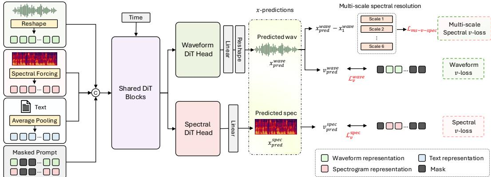
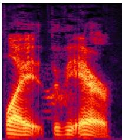
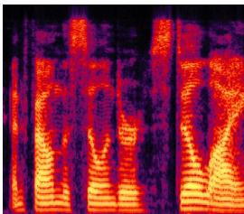
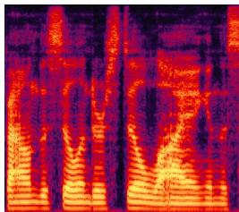
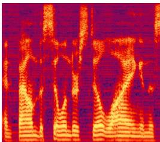
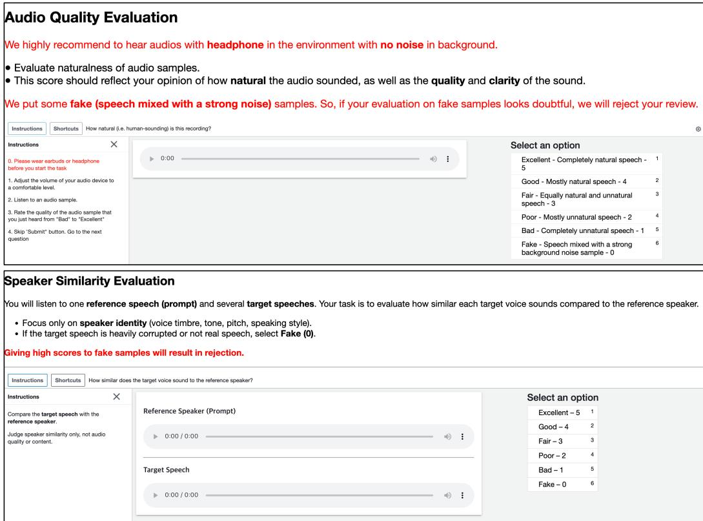
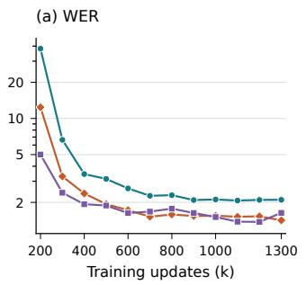
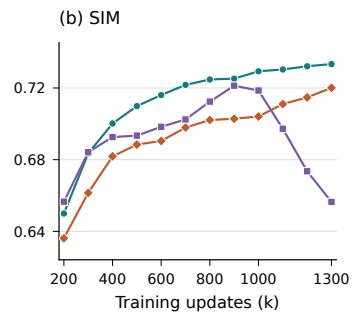
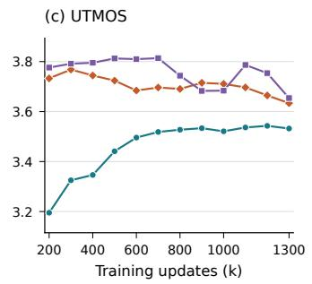

# WaveGen: Truly End-to-End Waveform Generation via Internal Spectral Trajectory Learning

Sang-Hoon Lee1∗

Ha-Yeong Choi2∗

1Department of Artificial Intelligence, Ajou University, Suwon, Korea 2Frontier AI Lab, KT Corp., Seoul, Korea

## Abstract

This work proposes WaveGen, a fully end-to-end diffusion-based text-to-waveform framework based on Spectral Forcing, which jointly learns an internal spectral trajectory and the target waveform trajectory within a single model, enabling direct end-to-end text-to-waveform generation. Unlike recent TTS pipelines, WaveGen does not rely on separately trained or externally decoded intermediate representations, such as neural audio codecs, Mel-spectrogram vocoders, or VAE-based latent models. In addition, WaveGen performs internal text-speech alignment within a single model, eliminating the need for external alignment modules such as duration predictors. To preserve a truly end-to-end formulation, our framework further avoids dependence on self-supervised representations, such as BERT-based text embeddings and Wav2Vec 2.0-based semantic representations, as well as semantic distillation methods for training optimization. To achieve this, we carefully design Spectral Forcing, a model architecture with disentangled diffusion heads, and a training objective based on a multi-scale spectral v-loss. We further validate the scalability of end-to-end TTS models by scaling the model size from 0.1B to 0.6B parameters. Using a single architecture, open-source data, and one-stage training, without external modules such as duration predictor or REPA, WaveGen demonstrates fully end-to-end waveform generation achieving state-of-the-art performance on the Emilia training dataset. In particular, WaveGen achieves a WER of 1.47 and a SIM of 0.75 on the Seed-en benchmark. Source code and checkpoints are available at https://github.com/sh-lee-prml/WaveGen.

## 1 Introduction

Recent progress in language models and generative models has substantially advanced text-tospeech (TTS) synthesis. Large language model (LLM)-based TTS systems [58, 22] have replaced conventional acoustic representations with neural audio codecs, enabling speech generation through discrete token modeling and in-context voice prompting. In parallel, diffusion and conditional flow matching (CFM)-based TTS models [33, 5] have improved the quality and flexibility of Melspectrogram generation through masked infilling and zero-shot voice conditioning. More recently, latent diffusion approaches [75, 47] further improve the efficiency of generative modeling by operating in compressed representation spaces rather than directly modeling high-dimensional audio signals.

Despite these advances, most recent TTS systems still rely on intermediate representations and external waveform decoders. Codec-based models [7, 6, 57] depend on the capacity and quality of neural audio codecs [72, 8, 32, 23, 70, 10, 63, 11]; Mel-spectrogram-based models require separately trained neural vocoders; and latent diffusion models require an additional pre-trained latent. These intermediate modules have been highly effective in practice, but they also introduce additional training stages, architectural dependencies, and upper-bound constraints on the final quality. In particular, high-fidelity waveform generation often requires GAN training, carefully designed architectures, or representation-specific optimization, making the overall pipeline increasingly complex.

Meanwhile, although end-to-end (E2E) TTS models [53, 26, 12] were explored in earlier studies, their limited scalability, training instability, and inferior zero-shot quality led the field to converge toward multi-stage pipelines. These limitations stem from the high temporal resolution of raw waveforms, which makes text-speech alignment difficult and often requires complex adversarial training for perceptually realistic waveform generation. Only E3-TTS [17] demonstrated the potential of waveform-level diffusion for TTS. However, it still relies on BERT-based text representations to facilitate text-waveform alignment, and directly applying diffusion modeling to waveform signals imposes a substantial computational burden due to the high temporal resolution of audio.

In this work, we propose WaveGen, a fully E2E diffusion-based text-to-waveform framework built upon Spectral Forcing. WaveGen directly generates high-resolution waveform from text within a single architecture. The key idea is to revisit the prediction and loss spaces of CFM for raw waveform generation. We found x-prediction with v-loss is essential for E2E waveform generation. Instead of forcing the model to learn waveform dynamics alone, Spectral Forcing jointly guides the model to learn an internal spectral trajectory while optimizing the target waveform trajectory. This design provides a structured inductive bias for high-resolution audio generation while preserving a truly E2E text-to-waveform formulation.

To this end, we carefully design WaveGen architecture with disentangled diffusion heads and introduce a multi-scale spectral loss for stable waveform-level flow matching. We further investigate the scalability of E2E TTS by increasing the model size from 0.1B to 0.6B parameters, showing that direct text-to-waveform generation can benefit from model scaling when the training objective and architecture are properly designed.

Our main contributions are summarized as follows:

• We propose WaveGen, a fully E2E text-to-waveform framework that directly generates raw waveform from text without separately trained intermediate representations.

• We introduce Spectral Forcing, which jointly learns an internal spectral trajectory and the target waveform trajectory, enabling stable CFM-based optimization in the high-resolution waveform domain.

• We investigate prediction and loss spaces for waveform generation and design a scalable waveform-level diffusion architecture with disentangled diffusion heads.

• We demonstrate that WaveGen achieves state-of-the-art zero-shot TTS performance using a single architecture, open-source data, and one-stage training, providing evidence that fully E2E text-to-waveform generation can be a viable alternative to increasingly complex multi-stage TTS pipelines.

## 2 Related Work

## 2.1 Conventional TTS

Traditional TTS systems consist of an acoustic model and a neural vocoder. Acoustic models generate acoustic features such as Mel-spectrogram, and neural vocoders convert acoustic features into raw waveform signals. Tacotron [64] paved the way of deep-learning based TTS system by introducing attention-based encoder-decoder structure to align text with speech, and Tacotron 2 [55] utilized WaveNet [44] to generate waveform from synthetic Mel-spectrogram. Transformer TTS [40] verified the effectiveness of encoder-decoder Transformer. However, these models suffer from unstable attention alignment and slow inference speed due to their autoregressive (AR) nature. To address these issues, FastSpeech [52] introduced parallel synthesis using a duration which is extracted from teacher AR models. Also, GAN-based neural vocoders accelerated TTS research in terms of both quality and inference speed. Specifically, PWG [67] and MelGAN [31] introduced GAN-based vocoder, and HiFi-GAN [29] introduced multi-period discriminator (MPD) which significantly enhances perceptual quality of synthetic speech. BigVGAN [35] scaled up the neural vocoder via snake periodic activation and an anti-aliasing low-pass filter. iSTFTNet [24] and Vocos [56] enhance the sampling efficiency by modeling features in a low-resolution space with iSTFT.

Table 1: Comparison of WaveGen with recent TTS systems. WaveGen uniquely achieves a fully E2E single-stage zero-shot TTS without relying on intermediate representations or auxiliary modules. T, C, W, M, L, and B denote text, codec, waveform, Mel, latent, and BERT, respectively.
<table><tr><td>Model</td><td>Qwen3-TTS</td><td>VoiceBox</td><td>E2/F5-TTS</td><td>CosyVoice3</td><td>VoxCPM</td><td>VITS</td><td>E3-TTS</td><td>WaveGen</td></tr><tr><td>End-to-End (T→W)</td><td>x</td><td>x</td><td>x</td><td>x</td><td>X</td><td>√</td><td>x</td><td>√</td></tr><tr><td>Single-stage</td><td>x</td><td>x</td><td>X</td><td>x</td><td>x</td><td>√</td><td>x</td><td>√</td></tr><tr><td>Zero-shot</td><td>√</td><td>√</td><td>√</td><td>√</td><td>√</td><td>x</td><td>√</td><td>√</td></tr><tr><td colspan="9">Dependency on Intermediate Representations (Explicit Waveform Decoder)</td></tr><tr><td colspan="9">Codec</td></tr><tr><td>Vocoder</td><td>V x</td><td>X √</td><td>X √</td><td>V V</td><td>x x</td><td>x x</td><td>X x</td><td>X x</td></tr><tr><td>VAE / Latent Model</td><td>x</td><td>x</td><td>X</td><td>x</td><td>√</td><td>x</td><td>x</td><td>x</td></tr><tr><td>GAN-based Training</td><td>√</td><td>√</td><td>√</td><td>√</td><td>√</td><td>√</td><td>x</td><td>x</td></tr><tr><td colspan="9"></td></tr><tr><td>Dependency on External Alignment Modules Pre-trained LLM</td><td>V</td><td>x</td><td>X</td><td>√</td><td>√</td><td>X</td><td>√</td><td>X</td></tr><tr><td>Duration Predictor</td><td>x</td><td>√</td><td>X</td><td>x</td><td>x</td><td>√</td><td>x</td><td>X</td></tr><tr><td>Pipeline Complexity</td><td>T→C→W</td><td>T→M→W</td><td>T→M→W</td><td>T→C→M→W</td><td>T→L→W</td><td>T→W</td><td>T→B→W</td><td>T→W</td></tr></table>

Neural Codec Language Models With the emergence of large language models, AudioGen [30] introduces language model-based audio generative models based on text prompt and utilize RVQbased neural audio codec as a discrete audio representation. Then, VALL-E [58] demonstrated neural codec language models can be a strong zero-shot TTS system with large-scale training and speech-level prompting. UniAudio [68] and Moshi [9] proposed efficient RVQ decoding method using multi-scale Transformer. Recently, most models utilize a pre-trained LLM for TTS backbone, and finetuned them to decode semantic token [13, 14] or RVQ tokens [27, 22, 18] which are extracted from large-scale high-quality audio codec via multi-token prediction (MTP) AR Transformer. Metis [62] and OmniVoice [78] employ a discrete diffusion language model using bidirectional Transformer.

Diffusion/CFM Grad-TTS [49] demonstrated the effectiveness of diffusion models for TTS. Voice-Box [33] and P-Flow [28] propose CFM-based TTS models via a masked-infilling training strategy, which significantly improve zero-shot speech synthesis through speech prompting. E2-TTS [15] introduces novel text-speech alignment learning with filler tokens. F5-TTS [5] and ZipVoice [77] introduce efficient CFM-based TTS models without any external duration predictor. Also, hybrid models such as CosyVoice [13, 14] utilized CFM-based Mel-spectrogram decoder conditioned on semantic tokens. Meanwhile, latent diffusion models (LDM) [34] have been investigated for efficient TTS modeling. Furthermore, continuous language models such as VoxCPM [75] and VibeVoice [47] show their effectiveness of AR diffusion via highly-compressed latent representation.

## 2.2 End-to-End TTS

E2E TTS has long been investigated as a way to simplify conventional cascaded speech synthesis pipelines. Early neural TTS systems such as Tacotron [64] established a unified sequence-to-sequence framework for text-to-acoustic modeling, but still required a Griffin-Lim algorithm [19]. ClariNet [48] explored parallel waveform generation through knowledge distillation from autoregressive WaveNet models. FastSpeech 2s [53] extended non-autoregressive TTS toward direct waveform generation. EATS [12] jointly optimized learnable duration modeling and waveform generation with adversarial training. VITS [26] introduced a strong text-to-waveform framework by combining variational inference, normalizing flows [25], and adversarial waveform training [29].

Despite these advances, prior E2E TTS systems still have important limitations: many rely on adversarial training to obtain perceptually realistic waveforms, which require carefully designed multiple discriminators, auxiliary losses, and significantly long training. More importantly, most of these models were not primarily designed for zero-shot speech synthesis, where the model must generate high-quality speech for unseen speakers from text and speech prompts. As a result, recent zero-shot TTS research has largely shifted toward codec-based language models, Mel-spectrogram diffusion models, or LDM rather than direct waveform-level generation.

Recently, E3-TTS [17] revisited diffusion-based text-to-waveform generation, demonstrating the potential of waveform-level generative modeling for TTS; however, it still relies on pretrained BERTbased text representations to facilitate text-waveform alignment, and directly applying diffusion modeling to high-resolution waveform signals introduces substantial computational cost. In contrast, this paper revisits fully E2E TTS under a stricter formulation: a single model directly generates waveform from text without neural audio codecs, Mel-spectrogram decoders, VAE, neural vocoders, duration predictors, self-supervised representations, or adversarial training as indicated in Table 1.

  
Figure 1: E2E text-to-waveform diffusion training details. We reshape high-resolution waveform signals (24,000 Hz) into a low-resolution space (100 Hz) for efficient E2E waveform diffusion. Then, we introduce Spectral Forcing for internal spectral guidance and simply concatenate averageupsampled text embeddings. We use shared DiT blocks for text-speech alignment and disentangled DiT heads for representation refinement. We adopt x-prediction as the prediction space, and v-loss as the target loss space, and introduce a new multi-scale v-space spectral loss

## 3 WaveGen

In this paper, we propose a fully E2E single-stage diffusion-based text-to-waveform generative model as illustrated in Figure 1. We analyze raw waveform as generative targets (Section 3.1), introduce a novel framework (Section 3.2), and efficient architecture (Section 3.3). Also, we revisit the prediction space and loss space for raw waveform (Section 3.4) and introduce the improved loss (Section 3.5).

## 3.1 CFM-based Waveform Generation

Recently, diffusion and CFM-based waveform generation models [54, 65, 38, 36] have emerged as a promising alternative to GAN-based models, offering a new direction for high-fidelity speech synthesis. PeriodWave [39] introduced a CFM-based periodic-aware generator for waveform generation. RFWave [42] presented efficient CFM-based models with STFT/iSTFT. Flow2GAN [69] improved CFM objective of waveform in spectral space. StreamFlow [6] proposed streaming flow matching for streaming waveform generation and efficient waveform diffusion Transformers using linear-reshape transformation. However, these works only employ waveform-level diffusion with strongly aligned acoustic conditions such as Mel-spectrogram or pre-trained neural audio codec. In our study, basic CFMs fail to align text-speech in high-resolution waveform space without any external modules.

## 3.2 Spectral Forcing

Due to the difficulty of waveform-level generation, previous works utilize intermediate representations such as Mel-spectrogram. To bridge the gap between text and waveform, we introduce Spectral Forcing, a method to jointly learn an internal spectral trajectory and the target waveform trajectory, enabling stable CFM-based optimization in the high-resolution waveform space. Specifically, we introduce a low-resolution spectral trajectory as an auxiliary generation target, which provides a structured inductive bias for text-speech alignment. Unlike cascaded approaches, the spectral trajectory is jointly generated within the same model and is used only as internal frequency-rich guidance, rather than as an external intermediate representation.

We adopt a simple DiT [45]-only architecture with AdaLN-SOLA [20]. The model takes as input the concatenation of the reshaped noisy waveform $x _ { t } ^ { w a v e }$ and its noisy spectral representation $x _ { t } ^ { s p e c }$ which is a lower-resolution Mel-spectrogram with 64 bins. For text conditioning, we adopt average pooling of ZipVoice [77, 76] that expands the average-pooled text embeddings along the temporal dimension to match the speech length without any external encoder. Following [33, 5], we utilize masked-infilling training for prompted generation by concatenating masked representations together.

## 3.3 Disentangled DiT Heads

We found that concatenating input representations is necessary for better text-speech alignment, but disentangling DiT heads for each representation is required for robust estimation. We use shared DiT blocks as an alignment backbone, and simply add shallow disentangled DiT heads as representationspecific generation. Baseline model uses 14 shared DiT blocks and two disentangled heads. We only compute the loss on the masked regions of the target representation.

## 3.4 Decoupled Prediction and Loss Spaces for Raw Waveform Generation

Recent flow matching-based waveform reconstruction models, such as PeriodWave [39] and RFWave [42], have demonstrated the potential of flow-based models for raw waveform reconstruction by improving periodic modeling and sampling efficiency. Despite these advances, we observe that conventional velocity-based objectives can be insufficient for preserving fine-grained waveform energy, often leading to degraded perceptual quality in generated audio.

Motivated by JiT [41], which highlights the effectiveness of clean-data prediction for highdimensional raw signals, and Latent Forcing [2] and ReGen [37], which leverage latent-assisted generation trajectories to better structure raw-space generation, we revisit the design of prediction and loss spaces in raw waveform CFM. Specifically, our model predicts clean waveform and spectral targets through Waveform DiT and Spectral DiT, while computing the training objective in the velocity space. This decoupled x-prediction and v-loss strategy enables effective waveform energy modeling without introducing the severe audible artifacts observed with direct x-loss optimization. Following the standard flow interpolation, we construct the intermediate sample in each domain $d \in \{ \mathrm { w a v e , s p e c } \}$ as $x _ { t } ^ { d } = ( 1 - t ) \dot { x } _ { 0 } ^ { d } + t x _ { 1 } ^ { d }$ , where $x _ { 0 } ^ { d }$ is Gaussian noise and $x _ { 1 } ^ { \bar { d } }$ is the clean target. Instead of directly predicting the velocity field, the model predicts the clean target $x _ { p r e d } ^ { d }$ . We then convert this prediction into the velocity space as:

$$
v _ { p r e d } ^ { d } = { \frac { x _ { p r e d } ^ { d } - x _ { t } ^ { d } } { 1 - t } } , \qquad v _ { t } ^ { d } = { \frac { x _ { 1 } ^ { d } - x _ { t } ^ { d } } { 1 - t } } .\tag{1}
$$

The loss is computed only on the masked generation region:

$$
\mathcal { L } _ { v } ^ { d } = \frac { \left\| \mathcal { M } ^ { d } \odot \left( v _ { p r e d } ^ { d } - v _ { t } ^ { d } \right) \right\| _ { 2 } ^ { 2 } } { \| \mathcal { M } ^ { d } \| _ { 1 } } , \qquad d \in \{ \mathrm { w a v e } , \mathrm { s p e c } \} ,\tag{2}
$$

where $\mathcal { M } ^ { d }$ denotes the domain-specific training mask and ⊙ is element-wise multiplication. This yields the waveform velocity loss $\mathcal { L } _ { v } ^ { w a v e }$ and the spectral velocity loss $\mathcal { L } _ { v } ^ { s p e c }$

## 3.5 Multi-Scale Energy-Normalized Spectral v-Loss

Flow2GAN [69] introduces spectral energy-adaptive loss scaling to alleviate the loss-perception mismatch in flow matching. Following this insight, we adopt energy-normalized spectral supervision for the CFM velocity objective and extend it to multiple spectral resolutions, enabling the model to capture time-frequency structures at different resolutions. As described in Section 3.4, our model adopts x-prediction while computing the objective in the velocity space. We define the waveformdomain velocity difference as:

$$
\begin{array} { r } { \Delta _ { v } ^ { w a v e } = x _ { p r e d } ^ { w a v e } - x _ { 1 } ^ { w a v e } = ( 1 - t ) \left( v _ { p r e d } ^ { w a v e } - v _ { t } ^ { w a v e } \right) . } \end{array}\tag{3}
$$

We use $\Delta _ { v } ^ { w a v e }$ for spectral supervision. For each scale $k \in \mathcal { K } ,$ we first compute a power spectrogram and apply a linear filterbank projection:

$$
\Phi _ { k } ( x ) = \left| \mathrm { S T F T } _ { k } ( x ) \right| ^ { 2 } \mathbf { F } _ { k } ,\tag{4}
$$

where $\mathbf { F } _ { k }$ denotes the linear filterbank matrix at the k-th spectral resolution. The proposed multi-scale spectral v-loss is then defined as:

$$
\mathcal { L } _ { m s - v - s p e c } = \sum _ { k \in \mathcal { K } } \frac { \left\| \mathcal { M } _ { k } ^ { w a v e } \odot \Phi _ { k } \left( \Delta _ { v } ^ { w a v e } \right) \odot \left( \Phi _ { k } ( x _ { 1 } ^ { w a v e } ) + \epsilon \right) ^ { - \frac { 1 } { 2 } } \right\| _ { 1 } } { \left\| \mathcal { M } _ { k } ^ { w a v e } \right\| _ { 1 } } ,\tag{5}
$$

where $\mathcal { M } _ { k } ^ { w a v e }$ is the mask for the k-th spectral resolution. Here, K is a set of spectral configurations with $n _ { \mathrm { b i n } } ~ = ~ [ 5 1 2 , 2 5 6 , 1 2 8 , 6 4 , \bar { 3 } 2 , 1 6 ] , n _ { \mathrm { f f t } } ~ = ~ w ~ = ~ [ 1 9 2 0 , 9 6 0 , 4 8 0 , 2 4 \bar { 0 } , 1 2 0 , 6 0 ]$ , and $h = [ 4 8 0 , 2 4 0 , 1 2 0 , 6 0 , \dot { 3 } 0 , 1 5 ]$ , where w and h denote the window size and hop size, respectively. The linear filter projection decomposes wave-domain velocity difference across frequency bands, and the ground-truth energy normalization prevents high-energy regions from dominating the loss. We follow Flow2GAN [69] for the scaling hyperparameters, using $\overline { { \epsilon } } = 1 0 ^ { - 7 }$ and clamping the scale to [0.01, 100]. The final objective is denoted as:

$$
\mathcal { L } _ { t o t a l } = \mathcal { L } _ { v } ^ { w a v e } + \lambda _ { s p e c } \mathcal { L } _ { v } ^ { s p e c } + \lambda _ { m s } \mathcal { L } _ { m s - v - s p e c } ,\tag{6}
$$

where $\lambda _ { s p e c } = 0 . 1$ and $\lambda _ { m s } = 0 . 1$

Table 2: Zero-shot TTS results on Seed-en Benchmark. Note that parameter size (Params) of baseline models only indicates their TTS module, but they require additional modules for waveform decoding.
<table><tr><td>Model</td><td>E2E</td><td>Params</td><td>Data</td><td>Vocoder</td><td>Codec</td><td>VAE</td><td>SPK Enc.</td><td>LLM</td><td>GAN</td><td>Diffusion</td><td>WER↓</td><td>SIM ↑</td></tr><tr><td>GT</td><td></td><td></td><td></td><td></td><td></td><td></td><td></td><td></td><td></td><td></td><td>2.14</td><td>0.73</td></tr><tr><td>SparkTTS [59]</td><td>X</td><td>0.5B</td><td>100k</td><td>x</td><td></td><td>x</td><td></td><td>√</td><td></td><td>x</td><td>1.98</td><td>0.58</td></tr><tr><td>TadiCodec-AR [60]</td><td>x</td><td>4B</td><td>100k</td><td>1</td><td></td><td>x</td><td>x</td><td>1</td><td></td><td>V</td><td>2.28</td><td>0.65</td></tr><tr><td>F5-TTS [5]</td><td>x</td><td>0.3B</td><td>100k</td><td></td><td>x</td><td>x</td><td>x</td><td>x</td><td></td><td></td><td>2.00</td><td>0.67</td></tr><tr><td>ZipVoice [77]</td><td>X</td><td>0.1B</td><td>100k</td><td></td><td>x</td><td>X</td><td>X</td><td>x</td><td></td><td></td><td>1.70</td><td>0.69</td></tr><tr><td>CosyVoice2 [13]</td><td>x</td><td>0.5B</td><td>166k</td><td></td><td></td><td>x</td><td></td><td></td><td></td><td></td><td>3.09</td><td>0.65</td></tr><tr><td>CosyVoice3-RL [14]</td><td>x</td><td>0.5B</td><td></td><td></td><td></td><td>x</td><td></td><td></td><td></td><td></td><td>1.68</td><td>0.69</td></tr><tr><td>Qwen3-TTS [22]</td><td>x</td><td>0.6B</td><td></td><td></td><td></td><td>x</td><td></td><td></td><td></td><td>X</td><td>1.68</td><td>0.70</td></tr><tr><td>Qwen3-TTS [22]</td><td>x</td><td>1.7B</td><td></td><td></td><td></td><td>x</td><td></td><td></td><td></td><td>X</td><td>1.50</td><td>0.71</td></tr><tr><td>MOSS-TTS [18]</td><td>x</td><td>1.7B</td><td></td><td></td><td>V</td><td>x</td><td></td><td></td><td></td><td>x</td><td>1.93</td><td>0.73</td></tr><tr><td>VibeVoice [46]</td><td>x</td><td>1.5B</td><td></td><td>x</td><td>x</td><td></td><td>x</td><td></td><td></td><td></td><td>3.04</td><td>0.68</td></tr><tr><td>VibeVoice-RT [46]</td><td>x</td><td>0.5B</td><td></td><td>x</td><td>x</td><td></td><td>x</td><td></td><td></td><td></td><td>2.05</td><td>0.63</td></tr><tr><td>VoxCPM-Emilia [75]</td><td>X</td><td>0.5B</td><td>100k</td><td>x</td><td>x</td><td></td><td>X</td><td></td><td></td><td></td><td>2.34</td><td>0.68</td></tr><tr><td>VoxCPM [75]</td><td>x</td><td>0.5B</td><td></td><td>x</td><td>x</td><td></td><td>x</td><td>V</td><td></td><td></td><td>1.85</td><td>0.72</td></tr><tr><td>WaveGen-S</td><td></td><td>0.1B</td><td>120k</td><td>x</td><td>x</td><td>x</td><td>x</td><td>x</td><td>x</td><td></td><td>4.42</td><td>0.53</td></tr><tr><td>WaveGen-B</td><td></td><td>0.4B</td><td>120k</td><td>x</td><td>x</td><td>x</td><td>X</td><td>X</td><td>X</td><td></td><td>1.77</td><td>0.63</td></tr><tr><td>WaveGen</td><td></td><td>0.6B</td><td>100k</td><td>x</td><td>x</td><td>x</td><td>x</td><td>x</td><td>x</td><td></td><td>1.47</td><td>0.75</td></tr></table>

Table 3: Subjective evaluation results on Seed-en benchmark
<table><tr><td>Model</td><td>GT</td><td>F5-TTS</td><td>CosyVoice3</td><td>Qwen3-TTS-0.6B</td><td>Qwen3-TTS-1.7B</td><td>WaveGen-S</td><td>WaveGen-B</td></tr><tr><td>nMOS</td><td>4.117±0.112</td><td>3.938±0.119</td><td>3.917±0.128</td><td>3.883±0.123</td><td>3.954±0.117</td><td>3.958±0.129</td><td>4.000±0.126</td></tr><tr><td>sMOS</td><td>3.932±0.038</td><td>3.989±0.037</td><td>3.972±0.038</td><td>3.968±0.037</td><td>4.008±0.037</td><td>3.952±0.037</td><td>3.988±0.037</td></tr></table>

## 4 Experiment and Result

## 4.1 Experimental Setup

Dataset For small-scale TTS and ablation studies, we utilized LibriTTS (CC-BY-4.0) [73]. LibriTTS is a high-quality speech dataset with a sampling rate of 24,000 Hz in WAV format. We filtered LibriTTS to include only utterances with durations of up to 12s for efficient training (319,627 samples). For large-scale training, WaveGen-S/B (v0.1) use the English subsets of Emilia (CC-BY-NC-4.0) and Emilia-YODAS (CC-BY-4.0) [21] provided as MP3-compressed audio with a sampling rate of 24,000 Hz. Following [5], we filter out several speakers and use utterances with durations of up to 30s. We also released WaveGen (0.6B) trained with multilingual Emilia datasets.

Training We train LibriTTS models with a learning rate of $1 \times 1 0 ^ { - 4 }$ using the AdamW optimizer [43], a fixed batch size of 128 for 1.1M steps. We train Emilia models with a learning rate of 1×10−4 using AdamW optimizer [43], a dynamic batch size with total 480s frame of waveform for 1.1M steps. All models except for the 0.6B models are trained on four GPUs using mixed precision. Due to limited computational resources, we train the models only for four epochs. We train WaveGen (0.6B) on eight GPUs for 11 epochs. During training, we use a masked-infilling strategy by dropping the speech prompt and text condition (0.3 and 0.2, respectively).

Sampling We adopt the Euler method as the ODE solver. For CFG scheduling, we build upon the strategy used in ZipVoice, where the text condition is dropped only at early time steps, and all ablation studies are conducted using this. However, when using a threshold of t < 0.5, we found that this substantially degrades speaker similarity in our model. Therefore, we restrict text-condition dropout to t < 0.02. We fix NFE to 32 and CFG to 2 in our experiments.

## 4.2 Zero-shot TTS results

We evaluate zero-shot TTS performance on the Seed-en benchmark dataset [1]. We compute WER and SIM to assess speech intelligibility and speaker similarity using Whisper and WavLM-Large, respectively. Table 2 demonstrates the effectiveness of E2E TTS training without relying on external modules, and shows the scalability of the proposed models by achieving promising performance compared to large-scale TTS systems that require multi-stage training.

We also conduct a subjective evaluation using Amazon Mechanical Turk (MTurk) with details provided in Appendix D. We compare WaveGen with publicly available strong baselines, including F5-TTS [5], CosyVoice3 [14], and Qwen3-TTS [22]. Notably, our model achieves comparable mean opinion scores (MOS) for both naturalness (nMOS) and similarity (sMOS) as reported in Table 3. We encourage readers to listen to the audio samples on our demo page. Additionally, we provide extensive ablation studies in the following subsections.

## 4.3 Spectral Forcing

We found that learning the waveform trajectory alone does not guarantee text-speech alignment. To bridge the gap between text and speech, we introduce Spectral Forcing, which jointly learns an internal spectral trajectory within a single model. We first use a linear spectrogram as the target spectral representation, but it leads to unstable training. We therefore adopt the Mel-spectrogram as a target representation and analyze the effect of the number of Mel bins in Table 4. Larger

Table 4: Comparison of Spectral Forcing
<table><tr><td rowspan=1 colspan=1>Type  Bin</td><td rowspan=1 colspan=4>WER  SIM DNSMOS</td><td rowspan=1 colspan=1>Analysis</td></tr><tr><td rowspan=1 colspan=1>No SF  一</td><td rowspan=1 colspan=4>123.67 0.19    3.20</td><td rowspan=1 colspan=1>Fails to align</td></tr><tr><td rowspan=1 colspan=1>Mel   256</td><td rowspan=1 colspan=4>126.50 0.35    3.17</td><td rowspan=4 colspan=1>DenoisingReconstructionMel Bins↓↑FasterConvergence</td></tr><tr><td rowspan=1 colspan=1>Mel   128</td><td rowspan=1 colspan=4>18.670.523.55</td><td rowspan=3 colspan=1>6.80  0.50    3.624.96  0.47    3.724.26  0.48    3.64</td></tr><tr><td rowspan=1 colspan=1>Mel    80Mel    64</td><td></td><td></td><td></td><td></td></tr><tr><td rowspan=1 colspan=1>Mel    32</td><td rowspan=1 colspan=3>4.260.48</td><td></td></tr><tr><td rowspan=1 colspan=1>Linear 481</td><td rowspan=1 colspan=2>NaN</td><td rowspan=2 colspan=3>NaNNaN</td></tr><tr><td rowspan=1 colspan=1>Linear 128Linear 64</td><td></td><td></td></tr></table>

Mel bins make the model focus more on waveform reconstruction rather than text-speech alignment. In contrast, smaller Mel bins provide a stronger information bottleneck, encouraging earlier alignment and faster convergence. We adopt 64 Mel bins, which offers a favorable trade-off between alignment, convergence, and high-frequency detail generation.

## 4.4 End-to-End Waveform Generation

To evaluate the effectiveness of E2E training, we train a two-stage TTS system consisting of a text-to-Mel model and a vocoder. For both stages, we use the same DiT architecture with maskedinfilling training. Table 5 shows that the vocoder can be successfully trained even without GAN-based training. However,

Table 5: Comparison of E2E and cascaded models
<table><tr><td>Method</td><td>Params.</td><td>NFE</td><td>RTF</td><td>WER</td><td>SIM</td><td>DNSMOS</td></tr><tr><td>End-to-End</td><td>407M</td><td>32</td><td>0.24</td><td>2.91</td><td>0.53</td><td>3.67</td></tr><tr><td>End-to-End</td><td>210M</td><td>32</td><td>0.12</td><td>4.68</td><td>0.50</td><td>3.71</td></tr><tr><td>End-to-End</td><td>113M</td><td>32</td><td>0.08</td><td>4.96</td><td>0.47</td><td>3.72</td></tr><tr><td>Vocoding (GT Mel)</td><td>113M</td><td>32</td><td>0.08</td><td>1.47</td><td>0.70</td><td>3.32</td></tr><tr><td>Vocoding (GT Mel)</td><td>113M</td><td>16</td><td>0.04</td><td>1.57</td><td>0.70</td><td>3.33</td></tr><tr><td>Two-Stage</td><td>226M</td><td>32 + 32</td><td>0.16</td><td>4.39</td><td>0.46</td><td>3.53</td></tr><tr><td>Two-Stage</td><td>226M</td><td>16 + 16</td><td>0.09</td><td>5.17</td><td>0.47</td><td>3.59</td></tr></table>

the two-stage pipeline still suffers from the inherent limitations of cascaded generation, where the intermediate Mel representation constrains the waveform generation process and errors from the acoustic model can propagate to the vocoder. In contrast, E2E models directly optimize text-towaveform generation within a single model, achieving better WER, SIM, and DNSMOS under the same NFEs (total NFE of 32). These results demonstrate the advantage of E2E over cascaded TTS systems. We also report the real-time factor (RTF) on NVIDIA A100 without inference optimization.

## 4.5 Architecture Design

We compare the effectiveness of disentangled DiT heads for multi-representation generation. Using only shared DiT blocks shows poor performance, suggesting that a fully shared architecture is insufficient for generating multiple representations. We therefore add shallow disentangled DiT heads on top of shared DiT

Table 6: Disentangled DiT Heads
<table><tr><td>#Shared DiT</td><td># Disentangled DiT</td><td>WER</td><td>SIM</td><td>DNSMOS</td></tr><tr><td>18</td><td>0</td><td>7.83</td><td>0.44</td><td>3.60</td></tr><tr><td>14</td><td>2 (4)</td><td>4.96</td><td>0.47</td><td>3.72</td></tr><tr><td>10</td><td>4 (8)</td><td>7.64</td><td>0.46</td><td>3.65</td></tr></table>

blocks, enabling the model to maintain a shared alignment backbone while learning representationspecific refinement. Table 6 shows that this design substantially improves WER, SIM, and DNSMOS. However, using too many disentangled blocks degrades performance due to degraded alignment. We therefore adopt 14 shared DiT blocks with 2 disentangled DiT blocks.

## 4.6 Decoupled Prediction and Loss Spaces

We investigate the prediction and loss spaces for E2E TTS. Unlike previous CFM-based waveform generation models, which generate waveforms conditioned on Melspectrograms, E2E TTS must directly learn the energy distribution of target waveforms without relying on ground-truth acoustic conditioning during generation.

Table 7: Comparison of prediction space
<table><tr><td>Pred</td><td>Loss</td><td>SF</td><td>WER</td><td>SIM</td><td>DNSMOS</td></tr><tr><td>x-pred</td><td>v-loss</td><td>x</td><td>123.67</td><td>0.19</td><td>3.20</td></tr><tr><td>v-pred</td><td>v-loss</td><td>x</td><td>119.52</td><td>0.16</td><td>2.65</td></tr><tr><td>x-pred</td><td>v-loss</td><td>√</td><td>5.57</td><td>0.46</td><td>3.45</td></tr><tr><td>v-pred</td><td>v-loss</td><td>√</td><td>3.93</td><td>0.48</td><td>2.94</td></tr></table>

Although v-prediction yields slightly better text-speech alignment and speaker similarity where v-prediction focuses low-frequency information due to noisy target velocity, we observe that it lacks the ability to accurately estimate waveform energy, resulting in significant degradation in perceptual quality. In contrast, Table 7 shows that x-prediction generates waveforms with more accurate energy distribution and significantly improves the perceptual quality of speech. This observation is particularly important because it suggests that high-quality waveform generation can be achieved without adversarial training. Note that the x-loss space introduces significant metallic noise and should therefore be avoided in current systems.

## 4.7 Multi-scale Spectral v-loss

To further improve high-frequency detail reconstruction in CFM-based waveform generation, we investigate an enhanced CFM objective in the spectral domain. Flow2GAN [69] introduced a novel spectral loss that minimizes waveform errors with spectral en-

Table 8: Loss Comparison
<table><tr><td>Method</td><td>Loss</td><td>WER</td><td>SIM</td><td>DNSMOS</td></tr><tr><td>Orig. CFM [39]</td><td> $\mathcal { L } _ { v }$ </td><td>5.57</td><td>0.46</td><td>3.45</td></tr><tr><td>Modified CFM [69]</td><td> $\mathcal { L } _ { v - s p e c }$ </td><td>68.82</td><td>0.46</td><td>3.49</td></tr><tr><td>Ours (Ablation)</td><td>Lms-v-spec</td><td>16.98</td><td>0.51</td><td>3.57</td></tr><tr><td>Ours (Final)</td><td> $\mathcal { L } _ { v } + \lambda _ { m s } \mathcal { L } _ { m s - v - s p e c }$ </td><td>4.96</td><td>0.47</td><td>3.72</td></tr></table>

ergy scaling, enabling balanced frequency-wise optimization. This differs from conventional spectrogram losses, which directly minimize the discrepancy between predicted and target spectrograms. However, we found that such a loss tends to overemphasize high-frequency details at the expense of low-frequency structure, which can make text-speech alignment more difficult in E2E TTS. Unlike neural vocoders, E2E TTS models cannot rely on ground-truth spectral inputs during generation. To address this issue, we propose a multi-scale spectral v-loss that balances time-frequency optimization across multiple resolutions. The proposed loss improves overall frequency details and leads to better speaker similarity and perceptual quality as reported in Table 8. The final training objective combines the original CFM losses for wave and spec domains with our proposed multi-scale spectral v-loss.

## 4.8 Preliminary Study on REPA

The results reported for our main WaveGen models do not use representation alignment (REPA) [71] or any external modules. However, recent studies on REPA suggest that

Table 9: REPA result
<table><tr><td>Method</td><td>Loss</td><td>WER</td><td>SIM</td><td>DNSMOS</td></tr><tr><td>Ours (Final)</td><td> $\mathcal { L } _ { v } + \lambda _ { m s } \mathcal { L } _ { m s - v - s p e c }$ </td><td>|4.96</td><td>0.47</td><td>3.72</td></tr><tr><td>+REPA (Optional)</td><td> $+ \lambda _ { r e p a } \mathcal { L } _ { r e p a } \mathrm { ( W h i s p e r ) }$ </td><td>3.54</td><td>0.54</td><td>3.70</td></tr></table>

external representation guidance can improve diffusion training. We conduct a small-scale preliminary experiment (WaveGen-S, LibriTTS) to examine whether REPA can further improve E2E waveform generation. We apply REPA to the middle layer (10th layer) using semantic representations extracted from the encoder output of Whisper-small, and adopt a cosine similarity-based alignment loss weighted by $\lambda _ { r e p a } = 0 . 1$ . As shown in Table 9, REPA improves WER and SIM while maintaining comparable DNSMOS, suggesting faster convergence and improved training stability. We leave further improvements with REPA for future work.

## 4.9 Scalability

Table 10: Model comparison with respect to model size and dataset scale
<table><tr><td rowspan="2">Model</td><td rowspan="2">Params.</td><td rowspan="2">Data (hours)</td><td rowspan="2">Training Steps</td><td colspan="3">Basic CFG (2.0)</td><td colspan="3">Modified CFG (2.0)</td></tr><tr><td>WER↓</td><td>SIM↑</td><td>DNSMOS ↑</td><td>WER↓</td><td>SIM ↑</td><td>DNSMOS ↑</td></tr><tr><td>WaveGen-S</td><td>113M</td><td>0.5k</td><td>1.1M</td><td>4.96</td><td>0.47</td><td>3.72</td><td>4.64</td><td>0.49</td><td>3.57</td></tr><tr><td>WaveGen-B</td><td>407M</td><td>0.5k</td><td>1.1M</td><td>2.91</td><td>0.53</td><td>3.67</td><td>2.93</td><td>0.55</td><td>3.59</td></tr><tr><td>WaveGen-S</td><td>113M</td><td>120k</td><td>1.1M</td><td>4.27</td><td>0.49</td><td>3.60</td><td>4.42</td><td>0.53</td><td>3.56</td></tr><tr><td>WaveGen-B</td><td>407M</td><td>120k</td><td>1.1M</td><td>2.37</td><td>0.59</td><td>3.60</td><td>1.77</td><td>0.63</td><td>3.60</td></tr></table>

We investigate the scalability of E2E TTS models with respect to both model size and dataset scale. Specifically, we train two model variants, S and B, with 0.1B and 0.4B parameters, respectively. Each model is trained on both LibriTTS (0.5k hours) and Emilia (120k hours). As shown in Table 10, the proposed models show consistent improvement in intelligibility and similarity as both model size and dataset scale increase. Furthermore, we find that the modified CFG strategy improves speaker similarity, suggesting that the initial sampling steps play an important role in adapting speaker characteristics. We provide additional results with different training steps in Table 14. Based on the trends observed from extended training and the REPA results in Table 9, we believe that further training can improve the overall quality of our models. However, due to limited computational resources, we train the models for only four epochs in this study.

We further investigate the effect of NFE on E2E TTS. Table 11 presents the results of WaveGen-B with different NFE settings. We find that speaking style is adapted in the early sampling stages, and high-quality waveform generation requires at least eight steps. Increasing the number of sampling steps generally improves similarity and perceptual quality. These results suggest that early sampling steps play a crucial role in establishing

Table 11: Analysis of NFE (Seed-en)
<table><tr><td>Model</td><td>NFE</td><td>WER</td><td>SIM</td><td>DNSMOS</td></tr><tr><td rowspan="6">WaveGen-B</td><td>4</td><td>52.0</td><td>0.39</td><td>3.06</td></tr><tr><td>8</td><td>4.85</td><td>0.61</td><td>3.48</td></tr><tr><td>16</td><td>2.16</td><td>0.63</td><td>3.56</td></tr><tr><td>32</td><td>1.77</td><td>0.63</td><td>3.60</td></tr><tr><td>50</td><td>1.87</td><td>0.64</td><td>3.61</td></tr><tr><td>100</td><td>1.84</td><td>0.64</td><td>3.63</td></tr></table>

text-speech alignment and adapting speaking style, whereas additional steps mainly refine waveform.

Table 12: Multilingual TTS results using F5-TTS architecture and large-scale training configuration. For a fair comparison, all models are trained with the open-source Emilia dataset about 100k hours (English and Chinese). With end-to-end waveform generation, our models achieve the state-of-the-art performance on Seed-TTS-Eval benchmarks using public-available datasets.
<table><tr><td rowspan="2">Model</td><td rowspan="2">E2E</td><td rowspan="2">SF (Drop)</td><td rowspan="2">Anchoring</td><td rowspan="2">Hz</td><td rowspan="2">Hop (Frame)</td><td rowspan="2">Params</td><td rowspan="2">Data</td><td colspan="3">seed-en</td><td colspan="3">seed-zh</td></tr><tr><td>WER↓</td><td>SIM↑</td><td>UTMOS ↑</td><td>CER↓</td><td>SIM↑</td><td>UTMOS ↑</td></tr><tr><td>GT</td><td></td><td></td><td></td><td>24k</td><td></td><td></td><td></td><td>2.06</td><td>0.73</td><td>3.53</td><td>1.26</td><td>0.76</td><td>2.78</td></tr><tr><td>Seed-TTS [1]</td><td>x</td><td>x</td><td></td><td>24k</td><td></td><td></td><td></td><td>2.25</td><td>0.76</td><td></td><td>1.12</td><td>0.79</td><td></td></tr><tr><td>VoxCPM-Emilia [74]</td><td>x</td><td>x</td><td></td><td>16k</td><td></td><td>0.5B</td><td>100K</td><td>2.34</td><td>0.68</td><td></td><td>1.11</td><td>0.74</td><td></td></tr><tr><td>MaskGCT [61]</td><td>x</td><td>x</td><td></td><td>24k</td><td></td><td>2.2B</td><td>100K</td><td>2.88</td><td>0.71</td><td>3.55</td><td>2.40</td><td>0.77</td><td>2.63</td></tr><tr><td>OmniVoice-Emilia [78]</td><td>x</td><td>x</td><td></td><td>24k</td><td></td><td>0.8B</td><td>100K</td><td>1.72</td><td>0.71</td><td>3.88</td><td>0.89</td><td>0.76</td><td>3.05</td></tr><tr><td>ZipVoice [77]</td><td>x</td><td>x</td><td></td><td>24k</td><td>256 (93.75)</td><td>123M</td><td>100K</td><td>1.70</td><td>0.69</td><td>3.82</td><td>1.40</td><td>0.75</td><td>3.15</td></tr><tr><td>E2-TTS [15]</td><td>x</td><td>x</td><td></td><td>24k</td><td>256 (93.75)</td><td>333M</td><td>100K</td><td>2.19</td><td>0.71</td><td>3.20</td><td>1.97</td><td>0.73</td><td>2.27</td></tr><tr><td>F5-TTS [5]</td><td>x</td><td>x</td><td></td><td>24k</td><td>256 (93.75)</td><td>336M</td><td>100K</td><td>1.83</td><td>0.67</td><td>3.76</td><td>1.56</td><td>0.76</td><td>2.95</td></tr><tr><td>BareWave [16]</td><td>√</td><td>x</td><td></td><td>24k</td><td>768 (31.25)</td><td>983M</td><td>19.4K</td><td>1.75</td><td>0.60</td><td>3.72</td><td></td><td></td><td></td></tr><tr><td>WavTTS [4]</td><td></td><td>x</td><td></td><td>16k</td><td>160 (100)</td><td>673M</td><td>100K</td><td>1.50</td><td>0.65</td><td>3.92</td><td>1.59</td><td>0.73</td><td>3.08</td></tr><tr><td>WaveGen-16k</td><td></td><td>√(0.5)</td><td>x</td><td>16k</td><td>160 (100)</td><td>676M</td><td>100K</td><td>1.51</td><td>0.71</td><td>3.90</td><td>1.65</td><td>0.77</td><td>3.09</td></tr><tr><td>WaveGen-16k</td><td>√</td><td>√(0.5)</td><td>√</td><td>16k</td><td>160 (100)</td><td>676M</td><td>100K</td><td>1.69</td><td>0.75</td><td>3.79</td><td>1.92</td><td>0.80</td><td>3.01</td></tr><tr><td>WaveGen</td><td>V</td><td>√(0.2)</td><td>x</td><td>24k</td><td>480 (50)</td><td>680M</td><td>100K</td><td>1.55</td><td>0.72</td><td>3.68</td><td>1.66</td><td>0.78</td><td>2.84</td></tr><tr><td>WaveGen</td><td></td><td>√(0.2)</td><td>L</td><td>24k</td><td>480 (50)</td><td>680M</td><td>100K</td><td>1.47</td><td>0.75</td><td>3.68</td><td>1.75</td><td>0.80</td><td>2.87</td></tr><tr><td>WaveGen (Ablation)</td><td></td><td>√(0)</td><td>x</td><td>24k</td><td>480 (50)</td><td>680M</td><td>100K</td><td>2.07</td><td>0.73</td><td>3.60</td><td>2.33</td><td>0.79</td><td>2.76</td></tr><tr><td>WaveGen (Ablation)</td><td></td><td>√(0)</td><td>√</td><td>24k</td><td>480 (50)</td><td>680M</td><td>100K</td><td>1.97</td><td>0.75</td><td>3.70</td><td>2.11</td><td>0.80</td><td>2.85</td></tr><tr><td>WaveGen (Ablation)</td><td></td><td>√(0.5)</td><td>x</td><td>24k</td><td>480 (50)</td><td>680M</td><td>100K</td><td>1.39</td><td>0.70</td><td>3.81</td><td>1.58</td><td>0.76</td><td>2.97</td></tr><tr><td>WaveGen (Ablation)</td><td></td><td>√(0.5)</td><td>√</td><td>24k</td><td>480 (50)</td><td>680M</td><td>100K</td><td>1.56</td><td>0.74</td><td>3.70</td><td>1.74</td><td>0.79</td><td>2.87</td></tr></table>

## 4.10 Multilingual TTS results

We conduct large-scale multilingual TTS experiments on the English (En) and Chinese (Zh) subsets of the Emilia dataset, and adopt F5-TTS-based architectures including ConvNeXt-based text encoder and filler token-based conditioning and hyperparameters of WavTTS including waveform scaling and time scheduling for fair comparison.2 Table 12 shows that WaveGen achieves strong performance across all evaluation metrics, demonstrating the effectiveness of direct waveform modeling and spectral forcing. Specifically, WaveGen achieves speaker similarities of 0.75 and 0.80 on the seeden and seed-zh benchmark using only the publicly available Emilia dataset. Notably, we do not employ REPA when training WaveGen, suggesting further room for improvement through additional representation alignment techniques. In the following subsections and Appendix F, we further provide detailed analyses of the waveform diffusion optimization techniques used in WaveGen.

## 4.11 Information bottleneck pre-net for multi-representation generation

We further investigate the effect of Spectral Forcing during large-scale training. When using a large-scale dataset, the dependency of Spectral Forcing increases because the model has difficulty aligning text with speech at the initial stage. While Spectral Forcing is weak guidance, the model is prone to learn to reconstruct waveforms from Spectral Forcing, resulting in delayed emergence of text-speech alignment. To reduce this limitation, we revisit the simple techniques, pre-net used in Tacotron [64] by adding information bottleneck layers with two MLP layers and dropout to reduce dependency on teacher forcing for AR training. Specifically, we utilize 8n Mel bins and smaller bottleneck dimension of 32 similar to [3]. We apply this bottleneck layer with dropout of 0.2 during training and inference. It improves the robustness of multi-representation generation by learning to generate waveform from multiple conditions. We investigated the effect of dropout ratio on Spectral Forcing in Appendix F.2.

## 4.12 Prompt Anchor

Following [66], we observe a train-inference mismatch in iterative generation under masked-infilling training. During training, the prompt region is fixed to the GT speech and is therefore not explicitly optimized for iterative updates. At inference time, however, repeatedly updating $x _ { t }$ in the prompt region can introduce undesirable deviations from the GT prompt trajectory.

To address this issue, we anchor the prompt region to a GT-based intermediate state during iterative sampling. Specifically, at each sampling step, we construct the prompt-region $x _ { t }$ by interpolating between the corresponding x0 and x1, rather than using the model-updated values. This simple prompt anchoring strategy substantially improves speaker similarity by reducing the train-inference mismatch introduced by masked-infilling training.

  
(a) Prompt Audio (MP3 Format)

  
(b) Gen. Audio (Trained with Emilia)

  
(c) Gen. Audio (Trained with LibriTTS)

  
(d) Gen. Audio (Trained with �-pred)

Figure 2: Spectral analysis with respect to audio format and prediction space

## 5 Spectral Analysis of Audio Format and Prediction Space

Impact of Audio Compression Neural vocoders and audio codecs are commonly trained on highquality waveform datasets, and their training can often be effective even with relatively small datasets. By contrast, modern TTS models require large-scale training datasets to model diverse speaking styles including prosody and timbre in zero-shot scenarios. Although Emilia enables large-scale training, its MP3-compressed audio can limit the amount of recoverable high-frequency detail, which is particularly important for end-to-end waveform generation. As a result, models trained on such data tend to struggle with generating high-frequency components above 8 kHz. In contrast, models trained on LibriTTS preserve and generate richer high-frequency information as illustrated in Figure 2. This observation highlights the importance of carefully curating training data for E2E TTS, where the model must directly learn both linguistic alignment and high-fidelity waveform generation.

Effect of Prediction Space x-prediction plays a crucial role in high-quality waveform generation. As shown in Figure 2, the model trained with v-prediction fails to recover a reliable energy distribution because the target velocity is highly noisy, resulting in substantially degraded waveform quality.

## 6 Potential Broader Impact

Societal Positive Impact Our work proposes an E2E TTS model that directly generates high-quality waveform from text, thereby simplifying existing complex multi-stage TTS pipelines and enhancing training and inference efficiency. This efficient simplification, which enables speech generation with a single model without relying on external modules, enhances the accessibility of speech technologies and provides a foundation for broader adoption in both academic and industrial settings. Furthermore, in terms of application technology, this method can have a positive impact on diverse fields such as voice interfaces, education, and media content. In particular, the generation of clear and natural speech can improve the user experience and contribute to the advancement of speech language model.

Societal Negative Impact Although the model and method proposed in this work do not directly raise ethical issues, there is a possibility of misuse when combined with voice cloning due to their ability to generate high-quality speech. For example, the model could be used to imitate a specific speaker’s voice or generate realistic fake speech to convey misleading information, which may lead to issues such as voice phishing or impersonation. To mitigate these potential risks, it is necessary to pursue complementary research on fake audio detection as well as speech safety, including method for identification and authenticity verification. As part of future work, we plan to further explore watermarking and authentication techniques to enable tracing the origin of generated audio.

Limitation We introduce an E2E TTS model that does not rely on any external modules, including SSL models. Nevertheless, SSL-based guidance, such as REPA, can be incorporated to accelerate training. Due to limited computational resources, we restrict large-scale training to four epochs. The observed scaling trend suggests that longer training may further improve performance, which we leave for future work. In addition, we plan to extend our model to 48 kHz waveform generation.

## 7 Conclusion

We proposed WaveGen, a fully E2E diffusion-based text-to-waveform TTS system. Unlike previous TTS systems, WaveGen directly generates raw waveforms from text without separately trained intermediate representations. By introducing Spectral Forcing, disentangled DiT heads, and a multi-scale spectral v-loss, WaveGen enables stable CFM-based optimization in the high-resolution waveform domain. Our results show that direct text-to-waveform generation can achieve promising zero-shot TTS performance and benefit from model and dataset scaling, suggesting a simple and scalable alternative to increasingly complex cascaded TTS pipelines.

## 8 Acknowledgments

This work was supported by Institute of Information & communications Technology Planning & Evaluation (IITP) grant funded by the Korea government (MSIT) (RS-2025-02283048, Developing the Next-Generation General AI with Reliability, Ethics, and Adaptability, IITP-2026-RS-2023- 00255968, the Artificial Intelligence Convergence Innovation Human Resources Development, RS-2026-25617480, AI Star Fellowship Support Program(Gyeongsang National University)), National Research Foundation of Korea (NRF) grant funded by the Korea government (MSIT) (RS-2026- 25518808), the “Advanced GPU Utilization Support Program” funded by the Government of the Republic of Korea (Ministry of Science and ICT), and Artificial intelligence industrial convergence cluster development project funded by the Ministry of Science and ICT (MSIT, Korea)&Gwangju Metropolitan City.

## References

[1] Philip Anastassiou, Jiawei Chen, Jitong Chen, Yuanzhe Chen, Zhuo Chen, Ziyi Chen, Jian Cong, Lelai Deng, Chuang Ding, Lu Gao, et al. Seed-tts: A family of high-quality versatile speech generation models. arXiv preprint arXiv:2406.02430, 2024.

[2] Alan Baade, Eric Ryan Chan, Kyle Sargent, Changan Chen, Justin Johnson, Ehsan Adeli, and Li Fei-Fei. Latent forcing: Reordering the diffusion trajectory for pixel-space image generation. arXiv preprint arXiv:2602.11401, 2026.

[3] Mingjian Chen, Xu Tan, Yi Ren, Jin Xu, Hao Sun, Sheng Zhao, and Tao Qin. MultiSpeech: Multi-Speaker Text to Speech with Transformer. In Interspeech 2020, pages 4024–4028, 2020. doi: 10.21437/Interspeech.2020-3139.

[4] Wenxi Chen, Dongya Jia, Yushen Chen, Zhikang Niu, Yuzhe Liang, Xiquan Li, Ruiqi Yan, Ziyang Ma, Guanrou Yang, Sanyuan Chen, et al. Wavtts: Towards high-quality zero-shot tts via direct raw waveform modeling. arXiv preprint arXiv:2606.03455, 2026.

[5] Yushen Chen, Zhikang Niu, Ziyang Ma, Keqi Deng, Chunhui Wang, Jian Zhao, Kai Yu, and Xie Chen. F5-tts: A fairytaler that fakes fluent and faithful speech with flow matching. arXiv preprint arXiv:2410.06885, 2024.

[6] Ha-Yeong Choi and Sang-Hoon Lee. Streamflow: Streaming audio generation from discrete tokens via streaming flow matching. In D. Belgrave, C. Zhang, H. Lin, R. Pascanu, P. Koniusz, M. Ghassemi, and N. Chen, editors, Advances in Neural Information Processing Systems, volume 38, Main Conference, pages 4669–4697. Curran Associates, Inc., 2025. doi: 10.52202/085713-0165. URL https://proceedings.neurips.cc/paper\_files/paper/ 2025/file/0713495297dab18fabca4795cb9ef8ef-Paper-Conference.pdf.

[7] Jade Copet, Felix Kreuk, Itai Gat, Tal Remez, David Kant, Gabriel Synnaeve, Yossi Adi, and Alexandre Défossez. Simple and controllable music generation. Advances in neural information processing systems, 36:47704–47720, 2023.

[8] Alexandre Défossez, Jade Copet, Gabriel Synnaeve, and Yossi Adi. High fidelity neural audio compression. Transactions on Machine Learning Research, 2023. ISSN 2835-8856. URL https://openreview.net/forum?id=ivCd8z8zR2. Featured Certification, Reproducibility Certification.

[9] Alexandre Défossez, Laurent Mazaré, Manu Orsini, Amélie Royer, Patrick Pérez, Hervé Jégou, Edouard Grave, and Neil Zeghidour. Moshi: a speech-text foundation model for real-time dialogue. arXiv preprint arXiv:2410.00037, 2024.

[10] Luca Della Libera, Francesco Paissan, Cem Subakan, and Mirco Ravanelli. Focalcodec: Lowbitrate speech coding via focal modulation networks. In D. Belgrave, C. Zhang, H. Lin, R. Pascanu, P. Koniusz, M. Ghassemi, and N. Chen, editors, Advances in Neural Information Processing Systems, volume 38, Main Conference, pages 23742–23767. Curran Associates, Inc., 2025. doi: 10.52202/085713-0801. URL https://proceedings.neurips.cc/paper\_files/ paper/2025/file/220e6dbed88faa83bd9f9e8fa359e43d-Paper-Conference.pdf.

[11] Luca Della Libera, Cem Subakan, and Mirco Ravanelli. Beyond fixed frames: Dynamic character-aligned speech tokenization. arXiv preprint arXiv:2601.23174, 2026.

[12] Jeff Donahue, Sander Dieleman, Mikolaj Binkowski, Erich Elsen, and Karen Simonyan. Endto-end adversarial text-to-speech. In International Conference on Learning Representations, 2021. URL https://openreview.net/forum?id=rsf1z-JSj87.

[13] Zhihao Du, Yuxuan Wang, Qian Chen, Xian Shi, Xiang Lv, Tianyu Zhao, Zhifu Gao, Yexin Yang, Changfeng Gao, Hui Wang, et al. Cosyvoice 2: Scalable streaming speech synthesis with large language models. arXiv preprint arXiv:2412.10117, 2024.

[14] Zhihao Du, Changfeng Gao, Yuxuan Wang, Fan Yu, Tianyu Zhao, Hao Wang, Xiang Lv, Hui Wang, Chongjia Ni, Xian Shi, et al. Cosyvoice 3: Towards in-the-wild speech generation via scaling-up and post-training. arXiv preprint arXiv:2505.17589, 2025.

[15] Sefik Emre Eskimez, Xiaofei Wang, Manthan Thakker, Canrun Li, Chung-Hsien Tsai, Zhen Xiao, Hemin Yang, Zirun Zhu, Min Tang, Xu Tan, et al. E2 tts: Embarrassingly easy fully non-autoregressive zero-shot tts. In 2024 IEEE Spoken Language Technology Workshop (SLT), pages 682–689. IEEE, 2024.

[16] Wei Fan, Chao-Hong Tan, Qian Chen, Wen Wang, Xiangang Li, Kejiang Chen, Weiming Zhang, and Nenghai Yu. Barewave: Waveform-native flow-matching text-to-speech. arXiv preprint arXiv:2606.09048, 2026.

[17] Yuan Gao, Nobuyuki Morioka, Yu Zhang, and Nanxin Chen. E3 tts: Easy end-to-end diffusionbased text to speech. In 2023 IEEE Automatic Speech Recognition and Understanding Workshop (ASRU), pages 1–8. IEEE, 2023.

[18] Yitian Gong, Botian Jiang, Yiwei Zhao, Yucheng Yuan, Kuangwei Chen, Yaozhou Jiang, Cheng Chang, Dong Hong, Mingshu Chen, Ruixiao Li, et al. Moss-tts technical report. arXiv preprint arXiv:2603.18090, 2026.

[19] Daniel Griffin and Jae Lim. Signal estimation from modified short-time fourier transform. IEEE Transactions on acoustics, speech, and signal processing, 32(2):236–243, 1984.

[20] Jiarui Hai, Yong Xu, Hao Zhang, Chenxing Li, Helin Wang, Mounya Elhilali, and Dong Yu. EzAudio: Enhancing Text-to-Audio Generation with Efficient Diffusion Transformer. In Interspeech 2025, pages 4233–4237, 2025. doi: 10.21437/Interspeech.2025-1137.

[21] Haorui He, Zengqiang Shang, Chaoren Wang, Xuyuan Li, Yicheng Gu, Hua Hua, Liwei Liu, Chen Yang, Jiaqi Li, Peiyang Shi, et al. Emilia: A large-scale, extensive, multilingual, and diverse dataset for speech generation. IEEE Transactions on Audio, Speech and Language Processing, 2025.

[22] Hangrui Hu, Xinfa Zhu, Ting He, Dake Guo, Bin Zhang, Xiong Wang, Zhifang Guo, Ziyue Jiang, Hongkun Hao, Zishan Guo, et al. Qwen3-tts technical report. arXiv preprint arXiv:2601.15621, 2026.

[23] Shengpeng Ji, Ziyue Jiang, Wen Wang, Yifu Chen, Minghui Fang, Jialong Zuo, Qian Yang, Xize Cheng, Zehan Wang, Ruiqi Li, Ziang Zhang, Xiaoda Yang, Rongjie Huang, Yidi Jiang, Qian Chen, Siqi Zheng, and Zhou Zhao. Wavtokenizer: an efficient acoustic discrete codec tokenizer for audio language modeling. In The Thirteenth International Conference on Learning Representations, 2025. URL https://openreview.net/forum?id=yBlVlS2Fd9.

[24] Takuhiro Kaneko, Kou Tanaka, Hirokazu Kameoka, and Shogo Seki. istftnet: Fast and lightweight mel-spectrogram vocoder incorporating inverse short-time fourier transform. In ICASSP 2022-2022 IEEE International Conference on Acoustics, Speech and Signal Processing (ICASSP), pages 6207–6211. IEEE, 2022.

[25] Jaehyeon Kim, Sungwon Kim, Jungil Kong, and Sungroh Yoon. Glow-tts: A generative flow for text-to-speech via monotonic alignment search. Advances in Neural Information Processing Systems, 33:8067–8077, 2020.

[26] Jaehyeon Kim, Jungil Kong, and Juhee Son. Conditional variational autoencoder with adversarial learning for end-to-end text-to-speech. In International Conference on Machine Learning, pages 5530–5540. PMLR, 2021.

[27] Jaehyeon Kim, Taehong Moon, Keon Lee, and Jaewoong Cho. Efficient generative modeling with residual vector quantization-based tokens. In Forty-second International Conference on Machine Learning, 2025. URL https://openreview.net/forum?id=f8uPzuMNDq.

[28] Sungwon Kim, Kevin Shih, rohan badlani, Joao Felipe Santos, Evelina Bakhturina, Mikyas Desta, Rafael Valle, Sungroh Yoon, and Bryan Catanzaro. P-flow: A fast and dataefficient zero-shot tts through speech prompting. In A. Oh, T. Naumann, A. Globerson, K. Saenko, M. Hardt, and S. Levine, editors, Advances in Neural Information Processing Systems, volume 36, pages 74213–74228. Curran Associates, Inc., 2023. doi: 10.52202/075280-3246. URL https://proceedings.neurips.cc/paper\_files/paper/ 2023/file/eb0965da1d2cb3fbbbb8dbbad5fa0bfc-Paper-Conference.pdf.

[29] Jungil Kong, Jaehyeon Kim, and Jaekyoung Bae. Hifi-gan: Generative adversarial networks for efficient and high fidelity speech synthesis. Advances in neural information processing systems, 33:17022–17033, 2020.

[30] Felix Kreuk, Gabriel Synnaeve, Adam Polyak, Uriel Singer, Alexandre Défossez, Jade Copet, Devi Parikh, Yaniv Taigman, and Yossi Adi. Audiogen: Textually guided audio generation. In The Eleventh International Conference on Learning Representations, 2023. URL https: //openreview.net/forum?id=CYK7RfcOzQ4.

[31] Kundan Kumar, Rithesh Kumar, Thibault De Boissiere, Lucas Gestin, Wei Zhen Teoh, Jose Sotelo, Alexandre De Brebisson, Yoshua Bengio, and Aaron C Courville. Melgan: Generative adversarial networks for conditional waveform synthesis. Advances in neural information processing systems, 32, 2019.

[32] Rithesh Kumar, Prem Seetharaman, Alejandro Luebs, Ishaan Kumar, and Kundan Kumar. High fidelity audio compression with improved rvqgan. Advances in Neural Information Processing Systems, 36:27980–27993, 2023.

[33] Matthew Le, Apoorv Vyas, Bowen Shi, Brian Karrer, Leda Sari, Rashel Moritz, Mary Williamson, Vimal Manohar, Yossi Adi, Jay Mahadeokar, and Wei-Ning Hsu. Voicebox: Text-guided multilingual universal speech generation at scale. In A. Oh, T. Naumann, A. Globerson, K. Saenko, M. Hardt, and S. Levine, editors, Advances in Neural Information Processing Systems, volume 36, pages 14005–14034. Curran Associates, Inc., 2023. doi: 10.52202/075280-0618. URL https://proceedings.neurips.cc/paper\_files/paper/ 2023/file/2d8911db9ecedf866015091b28946e15-Paper-Conference.pdf.

[34] Keon Lee, Dong Won Kim, Jaehyeon Kim, and Jaewoong Cho. Ditto-tts: Efficient and scalable zero-shot text-to-speech with diffusion transformer. arXiv preprint arXiv:2406.11427, 2024.

[35] Sang-gil Lee, Wei Ping, Boris Ginsburg, Bryan Catanzaro, and Sungroh Yoon. BigVGAN: A universal neural vocoder with large-scale training. In The Eleventh International Conference on Learning Representations, 2023. URL https://openreview.net/forum?id= iTtGCMDEzS\_.

[36] Sang-Hoon Lee and Ha-Yeong Choi. Hierarchical representation alignment learning of diffusion transformers for neural audio codec. In Maria Liakata, Viviane P. Moreira, Jiajun Zhang, and David Jurgens, editors, Findings ofthe Associationfor Computational Linguistics: ACL 2026, pages 32410–32426, San Diego, California, United States, July 2026. Association for Computational Linguistics. ISBN 979-8-89176-395-1. doi: 10.18653/v1/2026.findings-acl.1622. URL https://aclanthology.org/2026.findings-acl.1622/.

[37] Sang-Hoon Lee and Ha-Yeong Choi. Regen: Hierarchical multi-prompt representation generation for efficient waveform diffusion models. In Forty-third International Conference on Machine Learning, 2026. URL https://openreview.net/forum?id=T8Y9elIrXa.

[38] Sang-Hoon Lee, Ha-Yeong Choi, and Seong-Whan Lee. Accelerating high-fidelity waveform generation via adversarial flow matching optimization. arXiv preprint arXiv:2408.08019, 2024.

[39] Sang-Hoon Lee, Ha-Yeong Choi, and Seong-Whan Lee. Periodwave: Multi-period flow matching for high-fidelity waveform generation. In The Thirteenth International Conference on Learning Representations, 2025. URL https://openreview.net/forum?id=tQ1PmLfPBL.

[40] Naihan Li, Shujie Liu, Yanqing Liu, Sheng Zhao, and Ming Liu. Neural speech synthesis with transformer network. In Proceedings of the AAAI conference on artificial intelligence, volume 33, pages 6706–6713, 2019.

[41] Tianhong Li and Kaiming He. Back to basics: Let denoising generative models denoise. arXiv preprint arXiv:2511.13720, 2025.

[42] Peng Liu, Dongyang Dai, and Zhiyong Wu. RFWave: Multi-band rectified flow for audio waveform reconstruction. In The Thirteenth International Conference on Learning Representations, 2025. URL https://openreview.net/forum?id=gRmWtOnTLK.

[43] Ilya Loshchilov and Frank Hutter. Decoupled weight decay regularization. In International Conference on Learning Representations, 2019. URL https://openreview.net/forum? id=Bkg6RiCqY7.

[44] Aaron van den Oord, Sander Dieleman, Heiga Zen, Karen Simonyan, Oriol Vinyals, Alex Graves, Nal Kalchbrenner, Andrew Senior, and Koray Kavukcuoglu. Wavenet: A generative model for raw audio. arXiv preprint arXiv:1609.03499, 2016.

[45] William Peebles and Saining Xie. Scalable diffusion models with transformers. In Proceedings of the IEEE/CVF international conference on computer vision, pages 4195–4205, 2023.

[46] Zhiliang Peng, Jianwei Yu, Wenhui Wang, Yaoyao Chang, Yutao Sun, Li Dong, Yi Zhu, Weijiang Xu, Hangbo Bao, Zehua Wang, et al. Vibevoice technical report. arXiv preprint arXiv:2508.19205, 2025.

[47] Zhiliang Peng, Jianwei Yu, Wenhui Wang, Yaoyao Chang, Yutao Sun, Li Dong, Yi Zhu, Weijiang Xu, Hangbo Bao, Zehua Wang, Shaohan Huang, Yan Xia, and Furu Wei. Vibevoice: Expressive podcast generation with next-token diffusion. In The Fourteenth International Conference on Learning Representations, 2026. URL https://openreview.net/forum?id=FihSkzyxdv.

[48] Wei Ping, Kainan Peng, and Jitong Chen. Clarinet: Parallel wave generation in end-to-end text-to-speech. In International Conference on Learning Representations, 2019. URL https: //openreview.net/forum?id=HklY120cYm.

[49] Vadim Popov, Ivan Vovk, Vladimir Gogoryan, Tasnima Sadekova, and Mikhail Kudinov. Gradtts: A diffusion probabilistic model for text-to-speech. In International conference on machine learning, pages 8599–8608. PMLR, 2021.

[50] Alec Radford, Jong Wook Kim, Tao Xu, Greg Brockman, Christine McLeavey, and Ilya Sutskever. Robust speech recognition via large-scale weak supervision. In International conference on machine learning, pages 28492–28518. PMLR, 2023.

[51] Chandan KA Reddy, Vishak Gopal, and Ross Cutler. Dnsmos: A non-intrusive perceptual objective speech quality metric to evaluate noise suppressors. In ICASSP 2021-2021 IEEE International Conference on Acoustics, Speech and Signal Processing (ICASSP), pages 6493– 6497. IEEE, 2021.

[52] Yi Ren, Yangjun Ruan, Xu Tan, Tao Qin, Sheng Zhao, Zhou Zhao, and Tie-Yan Liu. Fastspeech: Fast, robust and controllable text to speech. Advances in neural information processing systems, 32, 2019.

[53] Yi Ren, Chenxu Hu, Xu Tan, Tao Qin, Sheng Zhao, Zhou Zhao, and Tie-Yan Liu. Fastspeech 2: Fast and high-quality end-to-end text to speech. In International Conference on Learning Representations, 2021. URL https://openreview.net/forum?id=piLPYqxtWuA.

[54] Robin San Roman, Yossi Adi, Antoine Deleforge, Romain Serizel, Gabriel Synnaeve, and Alexandre Défossez. From discrete tokens to high-fidelity audio using multi-band diffusion. In Thirty-seventh Conference on Neural Information Processing Systems, 2023. URL https: //openreview.net/forum?id=dOanKg3jKS.

[55] Jonathan Shen, Ruoming Pang, Ron J Weiss, Mike Schuster, Navdeep Jaitly, Zongheng Yang, Zhifeng Chen, Yu Zhang, Yuxuan Wang, Rj Skerrv-Ryan, et al. Natural tts synthesis by conditioning wavenet on mel spectrogram predictions. In 2018 IEEE international conference on acoustics, speech and signal processing (ICASSP), pages 4779–4783. IEEE, 2018.

[56] Hubert Siuzdak. Vocos: Closing the gap between time-domain and fourier-based neural vocoders for high-quality audio synthesis. In The Twelfth International Conference on Learning Representations, 2024. URL https://openreview.net/forum?id=vY9nzQmQBw.

[57] Jinchuan Tian, Sang gil Lee, Zhifeng Kong, Sreyan Ghosh, Arushi Goel, Chao-Han Huck Yang, Wenliang Dai, Zihan Liu, Hanrong Ye, Shinji Watanabe, Mohammad Shoeybi, Bryan Catanzaro, Rafael Valle, and Wei Ping. UALM: Unified audio language model for understanding, generation and reasoning. In The Fourteenth International Conference on Learning Representations, 2026. URL https://openreview.net/forum?id=TsdlOjcQNu.

[58] Chengyi Wang, Sanyuan Chen, Yu Wu, Ziqiang Zhang, Long Zhou, Shujie Liu, Zhuo Chen, Yanqing Liu, Huaming Wang, Jinyu Li, et al. Neural codec language models are zero-shot text to speech synthesizers. arXiv preprint arXiv:2301.02111, 2023.

[59] Xinsheng Wang, Mingqi Jiang, Ziyang Ma, Ziyu Zhang, Songxiang Liu, Linqin Li, Zheng Liang, Qixi Zheng, Rui Wang, Xiaoqin Feng, et al. Spark-tts: An efficient llm-based text-to-speech model with single-stream decoupled speech tokens. arXiv preprint arXiv:2503.01710, 2025.

[60] Yuancheng Wang, Dekun Chen, Xueyao Zhang, Junan Zhang, Jiaqi Li, and Zhizheng Wu. Tadicodec: Text-aware diffusion speech tokenizer for speech language modeling. In D. Belgrave, C. Zhang, H. Lin, R. Pascanu, P. Koniusz, M. Ghassemi, and N. Chen, editors, Advances in Neural Information Processing Systems, volume 38, Main Conference, pages 147494–147523. Curran Associates, Inc., 2025. doi: 10.52202/ 085713-4932. URL https://proceedings.neurips.cc/paper\_files/paper/2025/ file/d8a12fde9e72444e1b356e8c37e53753-Paper-Conference.pdf.

[61] Yuancheng Wang, Haoyue Zhan, Liwei Liu, Ruihong Zeng, Haotian Guo, Jiachen Zheng, Qiang Zhang, Xueyao Zhang, Shunsi Zhang, and Zhizheng Wu. Maskgct: Zero-shot text-tospeech with masked generative codec transformer. In International Conference on Learning Representations, volume 2025, pages 47127–47150, 2025.

[62] Yuancheng Wang, Jiachen Zheng, Junan Zhang, Xueyao Zhang, Huan Liao, and Zhizheng Wu. Metis: A foundation speech generation model with masked generative pretraining. In D. Belgrave, C. Zhang, H. Lin, R. Pascanu, P. Koniusz, M. Ghassemi, and N. Chen, editors, Advances in Neural Information Processing Systems, volume 38, Main Conference, pages 131615–131645. Curran Associates, Inc., 2025. doi: 10.52202/ 085713-4381. URL https://proceedings.neurips.cc/paper\_files/paper/2025/ file/be8987a75afeeadfa65007cf7ee25de0-Paper-Conference.pdf.

[63] Yuancheng Wang, Zhenyu Tang, Yun Wang, Arthur Hinsvark, Yingru Liu, Yinghao Aaron Li, Kainan Peng, Junyi Ao, Mingbo Ma, Mike Seltzer, Qing He, and Xubo Liu. Scaling speech tokenizers with diffusion autoencoders. In The Fourteenth International Conference on Learning Representations, 2026. URL https://openreview.net/forum?id=llMfmDtWka.

[64] Yuxuan Wang, R.J. Skerry-Ryan, Daisy Stanton, Yonghui Wu, Ron J. Weiss, Navdeep Jaitly, Zongheng Yang, Ying Xiao, Zhifeng Chen, Samy Bengio, Quoc Le, Yannis Agiomyrgiannakis, Rob Clark, and Rif A. Saurous. Tacotron: Towards End-to-End Speech Synthesis. In Interspeech 2017, pages 4006–4010, 2017. doi: 10.21437/Interspeech.2017-1452.

[65] Simon Welker, Matthew Le, Ricky T. Q. Chen, Wei-Ning Hsu, Timo Gerkmann, Alexander Richard, and YI-CHIAO WU. Flowdec: A flow-based full-band general audio codec with high perceptual quality. In The Thirteenth International Conference on Learning Representations, 2025. URL https://openreview.net/forum?id=uxDFlPGRLX.

[66] Detai Xin, Shujie Hu, Chengzuo Yang, Chen Huang, Guoqiao Yu, Guanglu Wan, and Xunliang Cai. Longcat-audiodit: High-fidelity diffusion text-to-speech in the waveform latent space. arXiv preprint arXiv:2603.29339, 2026.

[67] Ryuichi Yamamoto, Eunwoo Song, and Jae-Min Kim. Parallel wavegan: A fast waveform generation model based on generative adversarial networks with multi-resolution spectrogram. In ICASSP 2020-2020 IEEE International Conference on Acoustics, Speech and Signal Processing (ICASSP), pages 6199–6203. IEEE, 2020.

[68] Dongchao Yang, Jinchuan Tian, Xu Tan, Rongjie Huang, Songxiang Liu, Xuankai Chang, Jiatong Shi, Sheng Zhao, Jiang Bian, Xixin Wu, et al. Uniaudio: An audio foundation model toward universal audio generation. arXiv preprint arXiv:2310.00704, 2023.

[69] Zengwei Yao, Wei Kang, Han Zhu, Liyong Guo, Lingxuan Ye, Fangjun Kuang, Weiji Zhuang, Zhaoqing Li, Zhifeng Han, Long Lin, and Daniel Povey. Flow2GAN: Hybrid flow matching and GAN with multi-resolution network for few-step high-fidelity audio generation. In The Fourteenth International Conference on Learning Representations, 2026. URL https:// openreview.net/forum?id=5eTpRIULtb.

[70] Zhen Ye, Peiwen Sun, Jiahe Lei, Hongzhan Lin, Xu Tan, Zheqi Dai, Qiuqiang Kong, Jianyi Chen, Jiahao Pan, Qifeng Liu, et al. Codec does matter: Exploring the semantic shortcoming of codec for audio language model. In Proceedings of the AAAI Conference on Artificial Intelligence, volume 39, pages 25697–25705, 2025.

[71] Sihyun Yu, Sangkyung Kwak, Huiwon Jang, Jongheon Jeong, Jonathan Huang, Jinwoo Shin, and Saining Xie. Representation alignment for generation: Training diffusion transformers is easier than you think. arXiv preprint arXiv:2410.06940, 2024.

[72] Neil Zeghidour, Alejandro Luebs, Ahmed Omran, Jan Skoglund, and Marco Tagliasacchi. Soundstream: An end-to-end neural audio codec. IEEE/ACM Transactions on Audio, Speech, and Language Processing, 30:495–507, 2021.

[73] Heiga Zen, Viet Dang, Rob Clark, Yu Zhang, Ron J. Weiss, Ye Jia, Zhifeng Chen, and Yonghui Wu. LibriTTS: A Corpus Derived from LibriSpeech for Text-to-Speech. In Proc. Interspeech 2019, pages 1526–1530, 2019. doi: 10.21437/Interspeech.2019-2441.

[74] Yixuan Zhou, Guoyang Zeng, Xin Liu, Xiang Li, Renjie Yu, Ziyang Wang, Runchuan Ye, Weiyue Sun, Jiancheng Gui, Kehan Li, et al. Voxcpm: Tokenizer-free tts for context-aware speech generation and true-to-life voice cloning. arXiv preprint arXiv:2509.24650, 2025.

[75] Yixuan Zhou, Guoyang Zeng, Xin Liu, Xiang Li, Renjie Yu, Ziyang Wang, Runchuan Ye, Weiyue Sun, Jiancheng Gui, Kehan Li, Zhiyong Wu, and Zhiyuan Liu. Hierarchical semanticacoustic modeling via semi-discrete residual representations for expressive end-to-end speech synthesis. In The Fourteenth International Conference on Learning Representations, 2026. URL https://openreview.net/forum?id=h5KLpGoqzC.

[76] Han Zhu, Wei Kang, Liyong Guo, Zengwei Yao, Fangjun Kuang, Weiji Zhuang, Zhaoqing Li, Zhifeng Han, Dong Zhang, Xin Zhang, et al. Zipvoice-dialog: Non-autoregressive spoken dialogue generation with flow matching. arXiv preprint arXiv:2507.09318, 2025.

[77] Han Zhu, Wei Kang, Zengwei Yao, Liyong Guo, Fangjun Kuang, Zhaoqing Li, Weiji Zhuang, Long Lin, and Daniel Povey. Zipvoice: Fast and high-quality zero-shot text-to-speech with flow matching. arXiv preprint arXiv:2506.13053, 2025.

[78] Han Zhu, Lingxuan Ye, Wei Kang, Zengwei Yao, Liyong Guo, Fangjun Kuang, Zhifeng Han, Weiji Zhuang, Long Lin, and Daniel Povey. Omnivoice: Towards omnilingual zero-shot text-to-speech with diffusion language models. arXiv preprint arXiv:2604.00688, 2026.

## A Implementation Details

Table 13: Hyperparameters of WaveGen
<table><tr><td>Module</td><td>Hyperparameter</td><td>WaveGen-S</td><td>WaveGen-B</td><td>WaveGen</td></tr><tr><td rowspan="2">Waveform</td><td>Sampling Rate</td><td>24000</td><td>24000</td><td>24000</td></tr><tr><td>Reshape</td><td>(100, 240)</td><td>(100, 240)</td><td>(50,480)</td></tr><tr><td rowspan="6">Spectral Forcing</td><td>Diffusion Resolution</td><td>100Hz</td><td>100Hz</td><td>50Hz</td></tr><tr><td>Hop</td><td>240</td><td>240</td><td>480</td></tr><tr><td>Window</td><td>960</td><td>960</td><td>1920</td></tr><tr><td>FFT</td><td>960</td><td>960</td><td>1920</td></tr><tr><td>Filter</td><td>Mel</td><td>Mel</td><td>Mel</td></tr><tr><td>Bin</td><td>64</td><td>64</td><td>80</td></tr><tr><td rowspan="4">Text Embedding</td><td>IB</td><td>=</td><td>è</td><td>32</td></tr><tr><td>Dimension</td><td>384</td><td>384</td><td>512</td></tr><tr><td>ConvNeXt</td><td></td><td></td><td>4</td></tr><tr><td>Conditioning</td><td>Average</td><td>Average</td><td>Filler Token</td></tr><tr><td rowspan="9">DiT</td><td>Input Dim.</td><td>768</td><td>1024</td><td>1158</td></tr><tr><td>Hidden Dim.</td><td>1536</td><td>4096</td><td>4632</td></tr><tr><td>Shared Layer</td><td>14</td><td>24</td><td>24</td></tr><tr><td>Disentangled Layer</td><td>2</td><td>2</td><td>2</td></tr><tr><td>Head</td><td>12</td><td>16</td><td>16</td></tr><tr><td>Type</td><td>Scale-DiT</td><td>Scale-DiT</td><td>DiT</td></tr><tr><td>AdaLN</td><td>AdaLN-SOLA (rank=32)</td><td>AdaLN-SOLA (rank=32)</td><td>AdaLN-Zero</td></tr><tr><td>Training Step</td><td>1.1M</td><td>1.1M</td><td>1.3M</td></tr><tr><td>Epoch</td><td>4</td><td>4</td><td></td></tr><tr><td rowspan="11">Training</td><td></td><td>4</td><td></td><td>11</td></tr><tr><td>GPU</td><td> $1 \times 1 0 ^ { - 4 }$ </td><td>4</td><td>8</td></tr><tr><td>Learning Rate Warm-up Scheduling</td><td>20,000 steps</td><td> $1 \times 1 0 ^ { - 4 }$ </td><td> $7 . 5 \times 1 0 ^ { - 5 }$ </td></tr><tr><td>Learning Scheduling</td><td>Cosine Decay</td><td>20,000 steps Cosine Decay</td><td>20,000 steps</td></tr><tr><td> $\lambda _ { \mathrm { s f } }$ </td><td>0.1</td><td>0.1</td><td>Linear Decay</td></tr><tr><td> $\lambda _ { \mathrm { v - s t f t } }$ </td><td>0.1</td><td>0.1</td><td>0.1</td></tr><tr><td> $\lambda _ { \mathrm { x - s t f t } }$ </td><td></td><td></td><td>0.05</td></tr><tr><td>Audio/Token Drop</td><td>0.3/0.2</td><td>0.3/0.2</td><td>0.1 (Joint)</td></tr><tr><td>Model Size</td><td>113M</td><td>407M</td><td>680M</td></tr><tr><td>Max Frame</td><td>480s</td><td>480s</td><td>384s</td></tr><tr><td>Length</td><td>3-30s</td><td>3-30s</td><td>3-30s</td></tr><tr><td>t scheduling</td><td></td><td>Uniform</td><td>Uniform</td><td></td></tr><tr><td>Data Scaling</td><td> -</td><td>一 Max Normalization + x0.95</td><td>Max Normalization + x0.95</td><td>Logit normal (µ=-0.8, σ=0.8)</td></tr><tr><td>Noise Scaling</td><td>Waveform Waveform Noise</td><td>0.25</td><td></td><td>x9</td></tr><tr><td rowspan="3">Sampling</td><td>Spectral Noise</td><td>1</td><td>0.25 1</td><td>1</td></tr><tr><td></td><td></td><td></td><td>1</td></tr><tr><td>ODE Method</td><td>Euler</td><td>Euler</td><td>Euler</td></tr><tr><td rowspan="4">Objective</td><td>Steps CFG</td><td>32 2</td><td>32</td><td>50</td></tr><tr><td></td><td></td><td>2</td><td>3</td></tr><tr><td>Prediction Space</td><td>x-pred</td><td>x-pred</td><td>x-pred</td></tr><tr><td>Loss Space x to v conversion</td><td>v-loss</td><td>v-loss</td><td>v-loss</td></tr><tr><td rowspan="5">Multi-scale</td><td>tclip</td><td> $\displaystyle { ( x _ { \theta } - x _ { t } ) / ( 1 - t ) }$ </td><td> $\displaystyle { ( x _ { \theta } - x _ { t } ) / ( 1 - t ) }$ </td><td> $\displaystyle { ( x _ { \theta } - x _ { t } ) / ( 1 - t ) }$ </td></tr><tr><td>Hop</td><td></td><td></td><td></td></tr><tr><td>Window</td><td>[480, 240, 120, 60, 30, 15]</td><td>[480, 240, 120, 60, 30, 15]</td><td></td></tr><tr><td>FFT</td><td>[1920, 960, 480, 240, 120, 60]</td><td>[1920, 960, 480, 240, 120, 60]</td><td></td></tr><tr><td>Filter</td><td>[1920, 960, 480, 240, 120, 60] Linear</td><td>[1920, 960, 480, 240, 120, 60]</td><td></td></tr><tr><td rowspan="5">Multi-scale Spectral x-loss</td><td>Bin</td><td>[512,256,128,64,32,16]</td><td>Linear [512,256,128,64,32,16]</td><td></td></tr><tr><td>Hop</td><td></td><td></td><td>[512, 256, 128, 64, 32, 16, 8]</td></tr><tr><td>Window</td><td></td><td></td><td>[2048, 1024, 512,256, 128, 64,32]</td></tr><tr><td>FFT</td><td></td><td></td><td>[2048, 1024,512,256, 128, 64, 32]</td></tr><tr><td></td><td></td><td></td><td></td></tr><tr><td rowspan="5"></td><td>Filter</td><td></td><td></td><td>Mel</td></tr><tr><td></td><td></td><td></td><td></td></tr><tr><td>Bin</td><td></td><td></td><td></td></tr><tr><td></td><td></td><td></td><td></td></tr><tr><td></td><td></td><td></td><td>[320,160,80,40,20,10,5]</td></tr></table>

## B Implementation Details for Baselines

Spark-TTS Spark-TTS3 [59] is an LLM-based zero-shot TTS with BiCodec, a single-stream speech codec that represents speech with semantic tokens for linguistic content and global tokens for speaker attributes.

TadiCodec-AR TaDiCodec4 [60] is a text-aware diffusion speech tokenizer that compresses speech into a low frame rate discrete representation using a diffusion autoencoder with text-guided decoding.

F5-TTS F5-TTS [5] is a non-autoregressive zero-shot TTS model based on flow matching with a Diffusion Transformer. It removes explicit duration modeling and phoneme-level alignment by padding text tokens to the speech length, and uses ConvNeXt-based text refinement to improve alignment robustness. For evaluation, we utilize the official implementation and released checkpoint.5

ZipVoice ZipVoice6 [77] is a compact zero-shot TTS model based on flow matching. It employs a Zipformer-based text encoder and vector-field estimator, uses average upsampling for initial speechtext alignment, and introduces flow distillation to reduce the number of sampling steps.

CosyVoice2 CosyVoice27 [13] is an LLM-based TTS model with a chunk-aware causal flow matching decoder. It improves speech token utilization with FSQ and supports both streaming and non-streaming synthesis within a unified framework.

CosyVoice3 CosyVoice3 [14] extends CosyVoice2 toward in-the-wild multilingual zero-shot TTS through larger-scale pre-training, a supervised multi-task speech tokenizer, and RL post-training. In our comparison, CosyVoice3-RL refers to the reward-optimized with differentiable reward optimization. For evaluation, we utilize the official implementation and released checkpoint.8

Qwen3-TTS Qwen3-TTS [22] is an LLM-based TTS system built on the Qwen3 backbone. It employs a 12Hz speech tokenizer with a multi-codebook RVQ consisting of 16 codebooks to represent both semantic and acoustic information. To efficiently model the multi-codebook sequence, it adopts multi-token prediction decoding. For evaluation, we utilize the official implementation and evaluate both the 0.6B and 1.7B checkpoints.9

MOSS-TTS MOSS-TTS10 [18] employs the MOSS-Audio-Tokenizer to convert waveform into a unified sequence of discrete representations capturing both semantic and acoustic information.

VibeVoice VibeVoice [46] is a long-form and multi-speaker TTS model designed to generate expressive conversational speech from text. It employs continuous speech tokenizers operating at low frame rate and uses next-token diffusion to autoregressively generate continuous speech representations. They release their open-source implementation11 and real-time model12.

VoxCPM VoxCPM13 [75] uses hierarchical semantic-acoustic modeling, where semantic-prosodic planning and residual acoustic modeling are coupled with a local diffusion decoder for high-fidelity speech generation.

  
Figure 3: MOS interfaces

## C Evaluation Details

WER We calculate word error rate (WER) using open-source automatic speech recognition model, Whisper [50]. We utilize the official implementation of Whisper-large-v314 to evaluate speech intelligibility.

SIM For evaluating speaker similarity quality, we utilized WavLM-large which is fine-tuned by speaker verification task15. We calculate cosine similarity between prompt and generated samples.

DNSMOS To assess the naturalness of the synthetic samples, we utilized the open-source Mean Opinion Score (MOS) prediction model, DNSMOS16[51].

## D Crowdsourcing Details

We conducted Mean Opinion Score (MOS) evaluations using Amazon Mechanical Turk (MTurk)17 to qualitatively assess the quality of synthesized speech from the TTS. Specifically, we carried out two types of evaluations: nMOS, which measures the naturalness of the generated speech, and sMOS, which measures the similarity of the generated speaker timbre to that of the prompt speaker. For each evaluation, 20 native speakers of American English participated. Each participant rated 100 samples per model on a 5-point scale ranging from 1 to 5. To reduce unreliable responses, such as participants randomly selecting scores, and to improve the reliability of the MTurk evaluation, we included Gaussian-noise samples as control samples. Responses from participants who failed to identify these samples as fake were excluded from the final analysis. In addition, only MTurk workers with a prior task approval rate of at least 80% and at least 100 approved HITs were allowed to participate in the evaluation.

Table 14: Comparison with respect to training steps.
<table><tr><td rowspan="2">Model</td><td rowspan="2">Params.</td><td rowspan="2">Data</td><td rowspan="2">Training Steps</td><td colspan="3">Basic CFG (2.0)</td><td colspan="3">No CFG</td></tr><tr><td>WER(↓)</td><td>SIM(↑)</td><td>DNSMOS(↑)</td><td>WER(↓)</td><td>SIM(↑)</td><td>DNSMOS(↑)</td></tr><tr><td>WaveGen-S</td><td>113M</td><td>0.5k</td><td>0.3M</td><td>104.23</td><td>0.32</td><td>3.53</td><td>129.85</td><td>0.25</td><td>3.31</td></tr><tr><td>WaveGen-S</td><td>113M</td><td>0.5k</td><td>0.5M</td><td>26.33</td><td>0.40</td><td>3.55</td><td>92.88</td><td>0.27</td><td>3.22</td></tr><tr><td>WaveGen-S</td><td>113M</td><td>0.5k</td><td>0.7M</td><td>8.75</td><td>0.45</td><td>3.68</td><td>76.66</td><td>0.33</td><td>3.38</td></tr><tr><td>WaveGen-S</td><td>113M</td><td>0.5k</td><td>0.9M</td><td>6.02</td><td>0.47</td><td>3.65</td><td>58.53</td><td>0.35</td><td>3.37</td></tr><tr><td>WaveGen-S</td><td>113M</td><td>0.5k</td><td>1.1M</td><td>4.96</td><td>0.47</td><td>3.72</td><td>56.58</td><td>0.36</td><td>3.36</td></tr><tr><td>WaveGen-B</td><td>407M</td><td>0.5k</td><td>0.3M</td><td>28.19</td><td>0.42</td><td>3.60</td><td>93.01</td><td>0.31</td><td>3.33</td></tr><tr><td>WaveGen-B</td><td>407M</td><td>0.5k</td><td>0.5M</td><td>9.19</td><td>0.49</td><td>3.60</td><td>76.53</td><td>0.33</td><td>3.20</td></tr><tr><td>WaveGen-B</td><td>407M</td><td>0.5k</td><td>0.7M</td><td>4.32</td><td>0.51</td><td>3.66</td><td>51.43</td><td>0.39</td><td>3.32</td></tr><tr><td>WaveGen-B</td><td>407M</td><td>0.5k</td><td>0.9M</td><td>3.69</td><td>0.52</td><td>3.65</td><td>44.82</td><td>0.39</td><td>3.33</td></tr><tr><td>WaveGen-B</td><td>407M</td><td>0.5k</td><td>1.1M</td><td>2.91</td><td>0.53</td><td>3.67</td><td>41.56</td><td>0.40</td><td>3.30</td></tr><tr><td>WaveGen-S</td><td>113M</td><td>120k</td><td>0.3M</td><td>91.23</td><td>0.32</td><td>3.27</td><td>148.32</td><td>0.21</td><td>3.02</td></tr><tr><td>WaveGen-S</td><td>113M</td><td>120k</td><td>0.5M</td><td>23.40</td><td>0.43</td><td>3.47</td><td>108.22</td><td>0.29</td><td>3.17</td></tr><tr><td>WaveGen-S</td><td>113M</td><td>120k</td><td>0.7M</td><td>8.50</td><td>0.45</td><td>3.60</td><td>77.88</td><td>0.33</td><td>3.25</td></tr><tr><td>WaveGen-S</td><td>113M</td><td>120k</td><td>0.9M</td><td>5.00</td><td>0.48</td><td>3.59</td><td>69.43</td><td>0.34</td><td>3.25</td></tr><tr><td>WaveGen-S</td><td>113M</td><td>120k</td><td>1.1M</td><td>4.27</td><td>0.49</td><td>3.60</td><td>69.69</td><td>0.35</td><td>3.28</td></tr><tr><td>WaveGen-B</td><td>407M</td><td>120k</td><td>0.3M</td><td>63.51</td><td>0.44</td><td>3.47</td><td>143.51</td><td>0.29</td><td>3.15</td></tr><tr><td>WaveGen-B</td><td>407M</td><td>120k</td><td>0.5M</td><td>18.37</td><td>0.53</td><td>3.48</td><td>90.07</td><td>0.38</td><td>3.23</td></tr><tr><td>WaveGen-B</td><td>407M</td><td>120k</td><td>0.7M</td><td>4.42</td><td>0.56</td><td>3.58</td><td>58.73</td><td>0.40</td><td>3.22</td></tr><tr><td>WaveGen-B</td><td>407M</td><td>120k</td><td>0.9M</td><td>2.91</td><td>0.57</td><td>3.56</td><td>60.91</td><td>0.42</td><td>3.22</td></tr><tr><td>WaveGen-B</td><td>407M</td><td>120k</td><td>1.1M</td><td>2.37</td><td>0.59</td><td>3.60</td><td>41.91</td><td>0.46</td><td>3.29</td></tr></table>

Table 15: Additional Training Results
<table><tr><td rowspan="2">Model</td><td rowspan="2">Params.</td><td rowspan="2">Data</td><td rowspan="2">Training Steps</td><td colspan="3">Basic CFG (2.0)</td><td colspan="3">No CFG</td></tr><tr><td>WER(↓)</td><td>SIM(↑)</td><td>DNSMOS(↑)</td><td>WER(↓)</td><td>SIM(↑)</td><td>DNSMOS(↑)</td></tr><tr><td>WaveGen-B</td><td>407M</td><td>120k</td><td>1.1M</td><td>2.37</td><td>0.59</td><td>3.60</td><td>41.91</td><td>0.46</td><td>3.29</td></tr><tr><td>WaveGen-B</td><td>407M</td><td>120k</td><td>1.2M</td><td>1.98</td><td>0.59</td><td>3.61</td><td>39.67</td><td>0.46</td><td>3.31</td></tr><tr><td>WaveGen-B</td><td>407M</td><td>120k</td><td>1.3M</td><td>1.85</td><td>0.60</td><td>3.60</td><td>36.67</td><td>0.46</td><td>3.30</td></tr></table>

Table 16: CFG results
<table><tr><td>Model</td><td>Params.</td><td>Data</td><td>Training Steps</td><td>CFG</td><td>WER(↓)</td><td>Modified CFG (2.0) SIM(↑)</td><td>DNSMOS(↑)</td></tr><tr><td>WaveGen-B</td><td>407M</td><td>120k</td><td>1.1M</td><td>0.5</td><td>4.26</td><td>0.605</td><td>3.55</td></tr><tr><td>WaveGen-B</td><td>407M</td><td>120k</td><td>1.1M</td><td>1</td><td>2.61</td><td>0.625</td><td>3.60</td></tr><tr><td>WaveGen-B</td><td>407M</td><td>120k</td><td>1.1M</td><td>2</td><td>1.77</td><td>0.635</td><td>3.60</td></tr><tr><td>WaveGen-B</td><td>407M</td><td>120k</td><td>1.1M</td><td>3</td><td>1.93</td><td>0.637</td><td>3.52</td></tr><tr><td>WaveGen-B</td><td>407M</td><td>120k</td><td>1.1M</td><td>4</td><td>1.87</td><td>0.633</td><td>3.37</td></tr></table>

## E Additional results

Table 14 shows the objective evaluation results of each model with respect to the number of training steps. The results indicate that model performance consistently improves as the number of training steps increases.

Due to limited computational resources, we trained the model only up to 1.1M steps, corresponding to four epochs on the Emilia dataset. Nevertheless, WaveGen-B continued to improve with additional training steps, as shown in Table 15. These results suggest that end-to-end TTS models have strong potential for further improvement with larger-scale training.

Table 16 shows the effect of CFG on the WaveGen-B model. Increasing the CFG scale substantially improves intelligibility, reducing WER from 4.26 to 1.77 when the CFG scale is increased from 0.5 to 2.0. Speaker similarity also improves consistently up to CFG 3.0, indicating that stronger conditioning helps the model better preserve the target speaker characteristics. However, excessively large CFG values slightly degrade perceptual quality, as reflected by the decrease in DNSMOS at CFG 3.0 and 4.0. These results show that CFG provides an effective trade-off between intelligibility, speaker similarity, and audio quality, with CFG 2.0 achieving the best overall balance in our experiments.

  
k uses the 1,250k checkpoint.Figure 4: Spectral Dropout

## F Multilingual WaveGen

We conducted multilingual text-to-speech comparison using Emilia (EN and ZH) datasets. For a fair comparison, we utilize the same architecture of F5-TTS to demonstrate the effectiveness of waveform-level diffusion training and Spectral Forcing. Then, we adopt the time scheduling methods of WavTTS to compare the effect of Spectral Forcing. For efficient waveform generation, we employ 50Hz resolutions using hop size of 480 for 24 kHz waveform diffusion.

## F.1 Spectral Loss

Basically, we introduce multi-scale spectral v-loss for our models. However, we adopt multi-scale Mel-spectrogram x-loss to compare Spectral Forcing based on WavTTS implementation. We observe that multi-scale Mel-spectrogram loss could improve the initial alignment learning and entire objective performances including WER and SIM. However, this loss induces buzzing sound on the generated waveform. To address this perceptual limitation, we released the perceptually-improved models together using multi-scale spectral v-loss which could significantly improve the perceptual quality. While it shows lower performance in objective metrics, we highly recommend adopting our new objectives for perceptual quality. We released the model finetuned with multi-scale spectral v-loss for perceptually improved speech synthesis.

## F.2 Spectral Dropout

We further investigated the use of spectral dropout in spectral forcing to improve robustness to noise in multilingual datasets. Figure 4 presents the objective evaluation metrics for different spectral dropout rates. The results suggest that higher dropout rates can improve initial alignment when training on noisy waveforms, but may also cause the spectral path to collapse during training. Without spectral dropout, the model tends to rely on the noisy Mel-spectrogram for waveform reconstruction. We therefore selected a dropout rate of 0.2 to reduce this reliance while maintaining the stability of the spectral path.

## F.3 Sampling Steps

With large-scale training, Table 17 shows that the model achieves better performance across all evaluated NFEs than that reported in Table 11. Furthermore, we plan to release an accelerated version of WaveGen that enables efficient speech synthesis in only a few sampling steps.

Table 17: Analysis of NFE (Seed-en, WaveGen)
<table><tr><td>Model</td><td>NFE</td><td>WER</td><td>SIM</td><td>UTMOS</td></tr><tr><td rowspan="5">WaveGen</td><td>1</td><td>93.10</td><td>0.19</td><td>1.30</td></tr><tr><td>2</td><td>23.71</td><td>0.42</td><td>1.31</td></tr><tr><td>4</td><td>2.76</td><td>0.64</td><td>2.34</td></tr><tr><td>8</td><td>1.70</td><td>0.75</td><td>3.44</td></tr><tr><td>10</td><td>1.72</td><td>0.75</td><td>3.53</td></tr><tr><td rowspan="4"></td><td>16</td><td>1.69</td><td>0.76</td><td>3.65</td></tr><tr><td>32</td><td>1.50</td><td>0.75</td><td>3.68</td></tr><tr><td>50</td><td>1.47</td><td>0.75</td><td>3.68</td></tr><tr><td></td><td></td><td></td><td></td></tr></table>