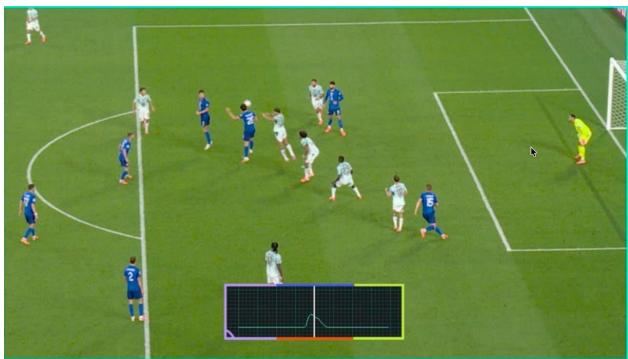
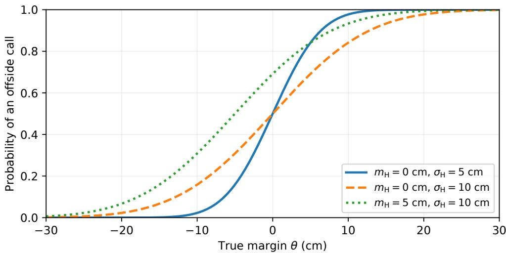
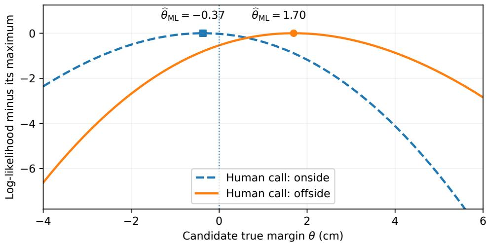
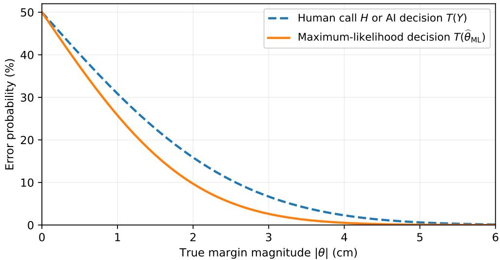
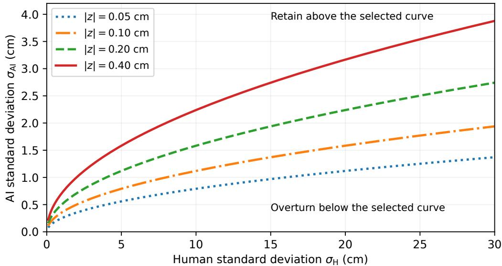
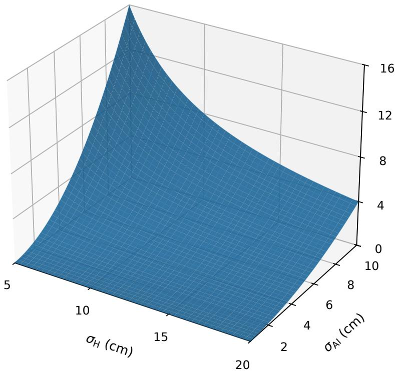

# When Should AI Overturn a Human Decision? Controversy at the 2026 World Cup and a $\scriptstyle { \sqrt { 2 / \pi } }$ Solution

Amir Ali Ahmadi Princeton University aaa@princeton.edu

Parsa Alavi Algonquin Regional High School parsialavi@gmail.com

Radeen Alavi Algonquin Regional High School radeenalavi@gmail.com

## Abstract

We study how to combine a human binary call (a referee’s ofside or onside decision) with an AI numerical measurement (VAR’s estimate of an attacker’s position relative to the ofside line). We derive an explicit maximum-likelihood rule that determines when the referee’s call should stand and when a conflicting VAR measurement should overturn it. Our model treats the true ofside margin as fixed and unknown and assumes independent additive Gaussian errors in the human’s perception and the AI measurement. When both errors have zero means and known standard deviations σH and σAI, respectively, the reversal threshold is $\sqrt { 2 / \pi } \sigma _ { \mathrm { A I } } ^ { 2 } / \sigma _ { \mathrm { H } }$ . An onside call is overturned precisely when VAR’s measured ofside margin exceeds this threshold—not merely because VAR places the attacker beyond the ofside line. We also derive the rule when either source has a systematic bias. We prove that the maximum-likelihood estimate of the true margin exists and is unique, while the final binary decision requires only a threshold comparison, without computing that estimate numerically. We illustrate the rule through numerical examples and show how to estimate the error parameters from calibration data. The same analysis applies beyond soccer to binary classification problems in which a human call and an AI measurement satisfy the stated model. This paper is intended for educational purposes: we aim to illustrate how undergraduate students and advanced high school students familiar with basic probabilit and calculus can investigate research questions in AI and its applications.

Keywords. Human–AI decision fusion, maximum likelihood, Gaussian measurement error, binary classification, probit regression, video assistant referee technology, sports analytics.

## 1 Introduction

The 2026 FIFA World Cup, unprecedented in scale, was marked by both extraordinary excitement and considerable controversy. Entire nations were lifted to their feet with lastminute goals, only for the video assistant referee (VAR) to be the bearer of disappointment at an agonizingly inconvenient time.

On June 26, 2026, in the final round of group-stage matches,   
Iran faced Egypt in what was the most important match either   
of these sides had played in years. It was a simple scenario;   
Iran needed a win to guarantee their qualification to the Round   
of 32, while a tie would leave their fate up to other results   
the next day. Egypt had already qualified to the Round of 32,   
but a loss against Iran would put them up against a European   
giant as opposed to a weaker side such as Australia. In a   
packed Seattle Stadium, with the authors among those in attendance, both teams traded early goals packed Seattle Stadium, with the authors among those in atter

  
Figure 1: The 3D reconstruction of Khalilzadeh’s late winner. According to VAR, the tip of his foot was in an ofside position, disallowing the goal.

in the first half. The game remained deadlocked into the final twenty minutes, when momentum began to shift. Iran launched a sustained attack that forced the Pharaohs to sit in a low block for the remainder of the game. In the 93rd minute, Iran seemed to have finally found the winner. A free-kick from star full-back Ramin Rezaeian led to a scufle in the box, resulting in a Shoja Khalilzadeh goal that lifted the spirits of an entire nation. Celebrations erupted, as Iran appeared to have made history. Yet the joy soon gave way to disappointment. After minutes of deliberation amid Egyptian protest, the referee turned to VAR and disallowed the goal for an alleged ofside1 ofense [4]. Although the on-field refereeing team initially ruled the goal onside, the decision was overturned after VAR claimed that a small part of Khalilzadeh’s foot was in an ofside position at the relevant moment. Figure 1 shows the reconstruction displayed during the review.

This VAR decision proved costly for Iran. Their fate was now up to matches the next day, their Round of 32 dreams dependent on at least one of the following outcomes occurring: Ghana beating Croatia, Uzbekistan not losing to Congo, and the bout between Austria and Algeria having a winner. According to The Athletic, “Team Melli” had a 92% chance of qualifying for the knockouts despite their seemingly unjust draw with Egypt [5]. This probability dropped all the way down to 0% as none of the three subsequent results went Iran’s way. One can argue that Iran’s woes could be traced back to that decisive goal disallowance by VAR. This raises a natural question: should a very small ofside margin reported by VAR be suficient to overturn the on-field referee’s call?

The Iran–Egypt incident was by no means the only VAR controversy at the 2026 World Cup. During the Portugal-Croatia game, there were multiple disallowed goals, the most notable of which came in the last minutes of stoppage time. In the 90+13th minute, Joško Gvardiol scored to equalize for his country and force the match into extra time. However, after lengthy deliberation, Croatian player Mario Pašalić was deemed ofside during the build-up and thus the goal was disallowed. The sequence consisted of an Ivan Perišić cross into the box followed by a deflection of Portuguese player Renato Veiga. The ball fell to Pašalić, who failed to control it, but it bounced of him to Gvardiol, who tapped it in. However, before Veiga’s deflection, there was a purported

  
Figure 2: The signal used by VAR to support its claim that the ball touched Matanović’s hair. The Croatian federation filed a complaint with FIFA challenging VAR’s decision to overturn the human ruling.

touch from Igor Matanović. At the time of this perceived touch, Pašalić was in an ofside position and subsequently became involved in the play that led to the goal. Although the alleged contact was nearly imperceptible to viewers watching on television, the sensor within the Trionda ball registered a signal that VAR interpreted as indicating contact with Matanović’s hair [6]. Figure 2 shows the sensor trace displayed for this incident. More generally, such incidents illustrate that even highly precise spatial reconstructions need not imply equally precise ofside margins: in video recorded at 30 frames per second for example, an athlete moving at 5 m/s travels about 17 cm between consecutive frames, so even small uncertainty in the relevant contact time can be consequential.

Disputes over whether technology presumed to be more accurate should take precedence over human judgment are not confined to soccer. In tennis, for instance, electronic line calling has also sparked much controversy. A recent example involved Alexander Zverev, then ranked No. 2 in the world. During his match against Alejandro Davidovich Fokina at the 2025 Madrid Open, Zverev disputed an electronic line call in the second set. He pointed to the ball mark on the clay, arguing that the line-calling technology had made an error of four to five centimeters. Umpire Mohamed Lahyani refused to inspect the ball mark on the court because, under the electronic line-calling rules, the electronic call took precedence. Out of frustration, Zverev retrieved his phone from his bag and took a picture of the mark, later posting it on social media. This incident further fueled the ongoing debate over how to resolve conflicts between human and machine refereeing systems [7]. Figure 3 shows two images associated with this incident.

  
Figure 3: Left: Alexander Zverev photographs a ball mark with his phone during the match to challenge an electronic line call that ruled Davidovich Fokina’s shot in. Right: the photograph, which Zverev later posted on Instagram to support his claim that the ball had landed out.

The tension between human judgment and technology extends beyond sports to various other applications of artificial intelligence (AI). In many such settings, the human provides a binary judgment, while the AI provides a numerical measurement that can be converted into a binary decision by comparison with a threshold. In medical diagnosis, for example, a physician may classify a lesion as benign or malignant, while an AI system assigns it a numerical malignancy score. In aircraft inspection, a maintenance engineer may classify a component as safe or requiring maintenance, while an AI system produces a numerical defect-severity score. In finance, a hedge fund manager may be bullish or bearish on a stock based on experience and judgment, while an AI model produces a numerical estimate of its expected return. These examples share the same information structure: a human binary judgment and an AI numerical measurement concerning the same underlying decision.

In this paper, we develop a maximum-likelihood model for combining human judgment and AI measurements to estimate an unknown quantity of interest and make a final binary decision. We assume that the correct decision is determined by the sign of a fixed, unknown scalar. The human and AI receive noisy information about this scalar through independent additive Gaussian errors, but only the sign of the human’s internal observation is available. We prove existence and uniqueness of the maximum-likelihood estimate of the unknown scalar and derive an explicit rule for its sign. The resulting decision rule combines the human binary call and the AI numerical measurement and requires only a threshold comparison once the error parameters have been calibrated. We also show how maximum likelihood can be used to estimate these parameters from data.

The model applies to any binary classification problem in which the human and AI receive noisy information about the same underlying scalar quantity and the stated error assumptions hold. We present the model in the context of ofside calls, which provided our original motivation; the translation to other applications satisfying these assumptions is immediate. In Section 2, we review the required probability and optimization concepts. In Section 3, we derive the model and

decision rule. In Section 4, we present numerical examples and illustrations of decision boundaries.   
In Section 5, we derive the calibration procedures, and in Section $6 ,$ we summarize our conclusions.

## 2 Preliminaries for maximum likelihood

In this section, we review the probability and optimization concepts needed to develop the maximumlikelihood model in the sections that follow.

## 2.1 The Gaussian distribution

A real-valued random variable X has a Gaussian distribution with mean $m \in \mathbb { R }$ and standard deviation $\sigma > 0$ , written $X \sim N ( m , \sigma ^ { 2 } )$ , if its probability density function is

$$
f _ { X } ( x ) = { \frac { 1 } { \sigma { \sqrt { 2 \pi } } } } \exp \left( - { \frac { ( x - m ) ^ { 2 } } { 2 \sigma ^ { 2 } } } \right) , \qquad x \in \mathbb { R } .\tag{2.1}
$$

The density determines interval probabilities by $\begin{array} { r } { \mathbb { P } ( a \leq X \leq b ) = \int _ { a } ^ { b } f _ { X } ( x ) } \end{array}$ dx for $a \leq b$ . Its mean and variance satisfy

$$
\mathbb { E } [ X ] = \int _ { - \infty } ^ { \infty } x f _ { X } ( x ) d x = m , \qquad \mathrm { V a r } ( X ) = \int _ { - \infty } ^ { \infty } ( x - m ) ^ { 2 } f _ { X } ( x ) d x = \sigma ^ { 2 } .
$$

The standard deviation $\sigma$ is the square root of the variance and has the same units as $X$

We denote the density and cumulative distribution function of $N ( 0 , 1 )$ as

$$
\phi ( u ) = \frac { 1 } { \sqrt { 2 \pi } } e ^ { - u ^ { 2 } / 2 } , \qquad \Phi ( u ) = \int _ { - \infty } ^ { u } \phi ( t ) d t .\tag{2.2}
$$

The cumulative distribution function of $X \sim N ( m , \sigma ^ { 2 } )$ is therefore

$$
F _ { X } ( x ) : = \mathbb { P } ( X \leq x ) = \Phi \left( { \frac { x - m } { \sigma } } \right) .\tag{2.3}
$$

We will use the identities $\Phi ( - u ) = 1 - \Phi ( u ) , \Phi ^ { \prime } ( u ) = \phi ( u )$ , and $\phi ^ { \prime } ( u ) = - u \phi ( u )$

Gaussian distributions are widely used in statistics and probability theory to model additive measurement error. The central limit theorem (see, e.g., [1, Section 5.4]) provides a useful justification for this choice. Roughly speaking, when an error is the sum of many small independent sources of error, its distribution can often be well approximated by a Gaussian distribution. This motivates the error model used in this paper.

## 2.2 Likelihood and log-likelihood

Let X denote data generated by a probability model with an unknown fixed parameter $\vartheta \in \Theta$ where Θ is the parameter space. If X is discrete, let $p _ { \vartheta } ( x ) = \mathbb { P } _ { \vartheta } ( X = x )$ be its probability mass function. If X has a probability density function, denote that function by $f _ { \vartheta }$ . For an observed value $x ,$ the likelihood function is

$$
L ( \vartheta ; x ) = \left\{ \begin{array} { l l } { p _ { \vartheta } ( x ) , } & { \mathrm { i n ~ t h e ~ d i s c r e t e ~ c a s e , } } \\ { f _ { \vartheta } ( x ) , } & { \mathrm { i n ~ t h e ~ c o n t i n u o u s ~ c a s e . } } \end{array} \right.
$$

We hold the data x fixed and regard $L ( \vartheta ; x )$ as a function of ϑ. When the data points come from independent observations, the joint likelihood is the product of their probability masses or

probability densities, as appropriate for each observation. A maximum-likelihood estimate (see, e.g., [2, Chap. 7]) is any parameter value satisfying

$$
\widehat { \vartheta } \in \mathop { \mathrm { a r g } } _ { \vartheta \in \Theta } \operatorname* { m a x } _ { \mathbf { \ell } } L ( \vartheta ; x ) .\tag{2.4}
$$

Here arg max denotes the set of maximizers. For discrete data, maximum likelihood selects a parameter value that assigns the largest probability to the observed data. For continuous data, the probability of any particular observed value is zero. We instead maximize the density at that value. When the density is continuous at the observation, the probability of a small neighborhood is approximately the density there times the neighborhood’s volume. Thus the maximum likelihood approach focuses on the local concentration of probability around the observed data.

Note that the likelihood function is nonnegative. We define the log-likelihood function by $\ell ( \vartheta ; x ) = \log L ( \vartheta ; x )$ when $L ( \vartheta ; x ) > 0$ , with the convention log $0 = - \infty$ . Since the logarithm is strictly increasing on $( 0 , \infty )$ , maximizing the likelihood and maximizing the log-likelihood are equivalent. Taking logarithms turns products into sums, which is convenient for some calculations. All likelihoods considered below are finite and strictly positive at every admissible parameter value.

## 2.3 Concavity and maximization

A set $C \subseteq \mathbb { R } ^ { n }$ is convex if it contains the line segment between any two of its points; that is,

$$
( 1 - t ) x + t y \in C \qquad { \mathrm { f o r ~ e v e r y ~ } } x , y \in C { \mathrm { ~ a n d ~ } } t \in [ 0 , 1 ] .
$$

A function $f : C \to \mathbb { R }$ on a convex set C is concave if

$$
f ( ( 1 - t ) x + t y ) \geq ( 1 - t ) f ( x ) + t f ( y ) \quad { \mathrm { f o r ~ a l l ~ } } x , y \in C { \mathrm { ~ a n d ~ } } t \in [ 0 , 1 ] .\tag{2.5}
$$

It is strictly concave if the inequality is strict whenever x $\neq y$ and $t \in ( 0 , 1 )$

Proposition 2.1. A strictly concave function on a convex set has at most one maximizer.

Proof. If distinct points x and y both attained the maximum value M, strict concavity at their midpoint would give $f ( ( x + y ) / 2 ) > ( f ( x ) + f ( y ) ) / 2 = M$ , a contradiction. □

Let $f$ be twice continuously diferentiable on an open interval I. If $f ^ { \prime \prime } ( x ) < 0$ for every $x \in I$ then f is strictly concave [2, Section 3.1.4], and $f ^ { \prime }$ is strictly decreasing. Consequently, if $f ^ { \prime } ( x ^ { \star } ) = 0$ at some $x ^ { \star } \in I$ , then $f ^ { \prime } > 0$ to its left and $f ^ { \prime } < 0$ to its right, so $x ^ { \star }$ is the unique maximizer on I. Note that a strictly concave function does not necessarily have a maximizer (consider, e.g., $f ( x ) = - e ^ { - x }$ for $x \in \mathbb { R } )$ ). The claim is that if it has one, then the maximizer must be unique.

## 3 Combining the referee’s call and the AI measurement

In this section, we formulate a model for combining a human binary call with an AI numerical measurement and derive the corresponding maximum-likelihood decision. The model applies to any binary classification problem in which the two observations satisfy the Gaussian error assumptions stated below. We present the derivation in the context of ofside calls as a concrete example.

## 3.1 The observation model

For an attacker in the opponents’ half, let $\theta \in \mathbb { R }$ be the fixed, unknown true margin: the signed longitudinal distance of the attacker’s foremost eligible body part beyond the ofside line at the relevant teammate contact. We use “ofside” and “onside” for this positional classification. Positive margins indicate ofside; nonpositive margins indicate onside. Define the binary decision function

$$
T ( t ) = \left\{ { \begin{array} { l l } { + 1 , } & { t > 0 , } \\ { - 1 , } & { t \leq 0 , } \end{array} } &  t \in \mathbb { R } . \right.\tag{3.1}
$$

The correct decision is $T ( \theta )$ ; the challenge is that the exact value of $\theta$ is unknown.

We model the referee’s perception of the true margin by an unobserved random variable $X _ { \mathrm { H } }$ Specifically, $X _ { \mathrm { H } }$ equals the true margin θ plus Gaussian noise with mean $m _ { \mathrm { H } }$ and standard deviation $\sigma _ { \mathrm H }$ . The referee does not explicitly compute a numerical distance; rather, $X _ { \mathrm { H } }$ represents the referee’s latent internal assessment in our model. The observed human call is only the binary decision $H = T ( X _ { \mathrm { H } } )$ . Specifically,

$$
X _ { \mathrm { H } } = \theta + \varepsilon _ { \mathrm { H } } , \qquad \varepsilon _ { \mathrm { H } } \sim N ( m _ { \mathrm { H } } , \sigma _ { \mathrm { H } } ^ { 2 } ) , \qquad H = T ( X _ { \mathrm { H } } ) ,\tag{3.2}
$$

and only H, i.e. the referee ofside/onside call, is observed.

The AI measurement is also modeled based on additive Gaussian noise, but with a possibly diferent mean and standard deviation:

$$
Y = \theta + \varepsilon _ { \mathrm { A I } } , \qquad \varepsilon _ { \mathrm { A I } } \sim N ( m _ { \mathrm { A I } } , \sigma _ { \mathrm { A I } } ^ { 2 } ) .\tag{3.3}
$$

We assume that the human measurement error $\varepsilon _ { \mathrm { H } }$ and the AI measurement error $\varepsilon _ { \mathrm { A I } }$ are independent.2 We also assume that $m _ { \mathrm { H } } , m _ { \mathrm { A I } } \in \mathbb { R }$ and $\sigma _ { \mathrm { H } } , \sigma _ { \mathrm { A I } } > 0$ are known. Section 5 explains how these parameters can be estimated from data. The means represent bias, and the standard deviations represent the variability of the measurement errors. The means and standard deviations have the same distance units as $\theta .$

We observe $H = h \in \{ - 1 , + 1 \}$ and $Y = y \in \mathbb { R }$ , but not $X _ { \mathrm { H } }$ . We refer to $Y$ as the AI measurement and to $y$ as its observed value.3 Define the bias-corrected AI measurement by

$$
Z = Y - m _ { \mathrm { A I } } , \qquad z = y - m _ { \mathrm { A I } } .\tag{3.4}
$$

Then $Z \sim N ( \theta , \sigma _ { \mathrm { A I } } ^ { 2 } )$ , and z is the observed bias-corrected AI measurement.

## 3.2 The joint likelihood

We first derive the probability mass function of the human call H. Recall that θ is the fixed true margin. For any event A involving the random human call or AI measurement, let $\mathbb { P } _ { \theta } ( A )$ denote the probability that A occurs under the model when the true margin is θ. For example, $\mathbb { P } _ { \theta } ( H = + 1 )$ is the probability that the referee calls ofside when the true margin is θ. From (3.2), an ofside call occurs when $\varepsilon _ { \mathrm { { H } } } > - \theta$ . The symmetry of the Gaussian distribution gives

$$
\mathbb { P } _ { \theta } ( H = + 1 ) = 1 - \Phi \bigg ( \frac { - \theta - m _ { \mathrm { H } } } { \sigma _ { \mathrm { H } } } \bigg ) = \Phi \bigg ( \frac { \theta + m _ { \mathrm { H } } } { \sigma _ { \mathrm { H } } } \bigg ) .
$$

The complementary probability gives the onside case. Thus, for $h \in \{ - 1 , + 1 \}$

$$
\mathbb { P } _ { \theta } ( H = h ) = \Phi \left( \frac { h ( \theta + m _ { \mathrm { H } } ) } { \sigma _ { \mathrm { H } } } \right) .\tag{3.5}
$$

In Figure 4, we plot the ofside-call probability from (3.5) for several human error parameters. Increasing $\sigma _ { \mathrm H }$ makes the transition between predominantly onside and predominantly ofside calls more gradual. A nonzero $m _ { H }$ shifts the true-margin value at which the referee is equally likely to call onside or ofside from $\theta = 0$ to $\theta = - m _ { H }$

We next consider the AI measurement. By (3.3), Y has a Gaussian distribution with mean $\theta + m _ { \mathrm { A I } }$ and standard deviation $\sigma _ { \mathrm { A I } }$ . In view of (2.1) and (2.2), the probability density function of $Y ,$ , evaluated at the observed value $y ,$ is given by

$$
f _ { Y } ( y ) = \frac { 1 } { \sigma _ { \mathrm { A I } } } \phi \biggl ( \frac { y - \theta - m _ { \mathrm { A I } } } { \sigma _ { \mathrm { A I } } } \biggr ) .
$$

Because the measurement errors $\varepsilon _ { \mathrm { H } }$ and $\varepsilon _ { \mathrm { A I } }$ are independent, the human call $H = T ( \theta + \varepsilon _ { \mathrm { H } } )$ and the AI measurement $Y = \theta + \varepsilon _ { \mathrm { A I } }$ are independent for each fixed θ. Multiplying the probability mass of $H = h$ by the probability density of $Y$ at $y$ therefore gives the joint likelihood

$$
L ( \theta ; h , y ) = \Phi \left( \frac { h ( \theta + m _ { \mathrm { H } } ) } { \sigma _ { \mathrm { H } } } \right) \frac { 1 } { \sigma _ { \mathrm { A I } } } \phi \left( \frac { y - m _ { \mathrm { A I } } - \theta } { \sigma _ { \mathrm { A I } } } \right) .\tag{3.6}
$$

Here $\phi$ and $\Phi$ are the standard Gaussian probability density function and cumulative distribution function defined in (2.2). The human factor uses Φ because only a sign is observed: we integrate the density of $X _ { \mathrm { H } }$ over the half-line corresponding to the reported call. The AI factor uses $\phi$ because the numerical value $y$ itself is observed. Thus the first factor is a probability mass and the second is a probability density. In particular, for real $a \leq b ,$

$$
\mathbb { P } _ { \theta } ( H = h , \ a \leq Y \leq b ) = \int _ { a } ^ { b } L ( \theta ; h , y ) d y .
$$

  
Figure 4: Human ofside-call probabilities from (3.5). A larger $\sigma _ { \mathrm H }$ makes the transition more gradual. A nonzero $m _ { H }$ shifts the $5 0 \%$ crossover point from $\theta = 0$ to $\theta = - m _ { H }$ . The parameters are illustrative.

## 3.3 The maximum-likelihood estimate

We now maximize the joint likelihood $L ( \theta ; h , y )$ in (3.6) over the true margin $\theta \in \mathbb { R }$ , holding the observed human call h and AI measurement y fixed. Recall from (3.4) that $z = y - m _ { \mathrm { A I } }$ is the observed bias-corrected AI measurement. By taking the logarithm of the likelihood function in (3.6), we can write down the log-likelihood function as

$$
\ell ( \theta ; h , y ) = - \log ( \sigma _ { \mathrm { A I } } \sqrt { 2 \pi } ) - \frac { ( z - \theta ) ^ { 2 } } { 2 \sigma _ { \mathrm { A I } } ^ { 2 } } + \log \Phi \biggl ( \frac { h ( \theta + m _ { \mathrm { H } } ) } { \sigma _ { \mathrm { H } } } \biggr ) .\tag{3.7}
$$

Our goal is to show that this function attains a unique maximum and to characterize its maximizer. We first establish a strict-concavity property of the Gaussian cumulative distribution function that will be useful here and again in the calibration analysis of Section 5. With $\phi ( \cdot )$ and $\Phi ( \cdot )$ as in (2.2), define

$$
\lambda ( u ) = \frac { \phi ( u ) } { \Phi ( u ) } , \qquad u \in \mathbb { R } .\tag{3.8}
$$

This function is positive and finite because $\Phi ( u ) \in ( 0 , 1 )$ for every $u \in \mathbb { R }$ . The following lemma is standard; we include a proof for completeness.

Lemma 3.1. Let Φ be the cumulative distribution function in (2.2). The function $u \mapsto$ log $\Phi ( u )$ is strictly concave on R.

Proof. Let $g ( u ) = \log \Phi ( u )$ . To prove that g is strictly concave, it sufices to show that $g ^ { \prime \prime } ( u ) < 0$ for every $u \in \mathbb { R }$ . Using the fact that $\Phi ^ { \prime } ( u ) = \phi ( u )$ and the definition of λ in (3.8), we have $\begin{array} { r } { g ^ { \prime } ( u ) = \frac { \phi ( u ) } { \Phi ( u ) } = \lambda ( u ) } \end{array}$ . Hence, $g ^ { \prime \prime } ( u ) = \lambda ^ { \prime } ( u )$ . Since $\phi ^ { \prime } ( u ) = - u \phi ( u )$

$$
\lambda ^ { \prime } ( u ) = \frac { \phi ^ { \prime } ( u ) \Phi ( u ) - \phi ( u ) \Phi ^ { \prime } ( u ) } { \Phi ( u ) ^ { 2 } } = - \lambda ( u ) \bigl ( u + \lambda ( u ) \bigr ) .
$$

We have $\lambda ( u ) > 0$ , so it remains to show that $u + \lambda ( u ) > 0$ . Since $\phi ^ { \prime } ( t ) = - t \phi ( t )$ and $\phi ( t ) \to 0$ as $t \to - \infty$ , we have

$$
u \Phi ( u ) + \phi ( u ) = \int _ { - \infty } ^ { u } ( u - t ) \phi ( t ) d t > 0 .
$$

As $\Phi ( u ) > 0 ,$ , division by $\Phi ( u )$ gives $u + \lambda ( u ) > 0$

Theorem 3.2 (Existence and uniqueness of the maximum-likelihood estimate). Consider the observation model (3.2)–(3.3) with independent measurement errors $\varepsilon _ { \mathrm { H } }$ and $\varepsilon _ { \mathrm { A I } _ { \mathrm { i } } }$ , given means $m _ { \mathrm { H } } , m _ { \mathrm { A I } } \in \mathbb { R }$ , and standard deviations $\sigma _ { \mathrm { H } } , \sigma _ { \mathrm { A I } } > 0$ . For every observed pair $( h , y ) \in \{ - 1 , + 1 \} \times \mathbb { R }$ there is a unique maximum-likelihood estimate ${ \widehat { \theta } } _ { \mathrm { M I } }$ of the true margin θ. It is the unique solution of the equation

$$
\frac { y - m _ { \mathrm { A I } } - \widehat { \theta } _ { \mathrm { M L } } } { \sigma _ { \mathrm { A I } } ^ { 2 } } + \frac { h } { \sigma _ { \mathrm { H } } } \lambda \Bigg ( \frac { h ( \widehat { \theta } _ { \mathrm { M L } } + m _ { \mathrm { H } } ) } { \sigma _ { \mathrm { H } } } \Bigg ) = 0 ,\tag{3.9}
$$

where $\lambda ( \cdot )$ is as in (3.8).

Proof. Let $z = y - m _ { \mathrm { A I } }$ . For fixed observations $( h , y )$ , diferentiation of the log-likelihood function with respect to θ gives

$$
\ell ^ { \prime } ( \theta ; h , y ) = \frac { z - \theta } { \sigma _ { \mathrm { A I } } ^ { 2 } } + \frac { h } { \sigma _ { \mathrm { H } } } \lambda \bigg ( \frac { h ( \theta + m _ { \mathrm { H } } ) } { \sigma _ { \mathrm { H } } } \bigg ) ,\tag{3.10}
$$

$$
\ell ^ { \prime \prime } ( \theta ; h , y ) = - \frac { 1 } { \sigma _ { \mathrm { A I } } ^ { 2 } } + \frac { 1 } { \sigma _ { \mathrm { H } } ^ { 2 } } \lambda ^ { \prime } \bigg ( \frac { h ( \theta + m _ { \mathrm { H } } ) } { \sigma _ { \mathrm { H } } } \bigg ) < 0 .\tag{3.11}
$$

The expression for the second derivative uses the fact that $h ^ { 2 } = 1$ , and the last inequality follows from the proof of Lemma 3.1 keeping in mind that $\lambda ^ { \prime } ( u ) = ( \log \Phi ) ^ { \prime \prime } ( u )$ . We can therefore conclude from (3.11) that the log-likelihood function is strictly concave.

To prove existence of a maximizer, observe that since log $\Phi \le 0$ , we have

$$
\ell ( \theta ; h , y ) \leq - \log ( \sigma _ { \mathrm { A I } } \sqrt { 2 \pi } ) - \frac { ( z - \theta ) ^ { 2 } } { 2 \sigma _ { \mathrm { A I } } ^ { 2 } } \longrightarrow - \infty \qquad \mathrm { a s ~ } | \theta |  \infty .
$$

Choose a closed bounded interval containing zero outside which $\ell ( \theta ; h , y ) < \ell ( 0 ; h , y )$ . Since ℓ is a continuous function, by the extreme value theorem, it must have a maximizer on this interval, which is also a maximizer on R. Strict concavity of ℓ and Proposition 2.1 imply that this maximizer must be unique. Lastly, the maximizer is the solution to $\ell ^ { \prime } = 0$ , which in view of (3.10) gives the equation in (3.9).

Rearranging (3.9), we have

$$
\widehat { \theta } _ { \mathrm { M L } } = z + \frac { h \sigma _ { \mathrm { A I } } ^ { 2 } } { \sigma _ { \mathrm { H } } } \lambda \bigg ( \frac { h ( \widehat { \theta } _ { \mathrm { M L } } + m _ { \mathrm { H } } ) } { \sigma _ { \mathrm { H } } } \bigg ) .\tag{3.12}
$$

Since λ is positive (see (3.8)), an ofside call increases the maximum likelihood estimate relative to the bias-corrected AI measurement $z ,$ and an onside call decreases it. The quantity ${ \widehat { \theta } } _ { \mathrm { M I } }$ L can be computed, $\mathrm { e . g . }$ , by bisection [8, Lecture 7] on the strictly decreasing derivative (3.10). Note that $\ell ^ { \prime } ( \theta ) \to + \infty$ as $\theta \to - \infty$ and $\ell ^ { \prime } ( \theta ) \to - \infty$ as $\theta \to + \infty$ , so two points with opposite derivative signs can always be found to serve as the initial bracket for the bisection algorithm.

In Figure 5, we fix the observed AI measurement y and the four error parameters and plot the log-likelihood for each human call. In this example, changing the human call changes the sign of the unique maximizer. In the two cases, the maximum-likelihood estimate lies to the right or left of the observed AI measurement by unequal amounts. The intuition is that an agreeing human call provides relatively little additional information because such a call was already likely at values near the AI measurement. By contrast, a disagreeing human call is more informative because it is less likely under those same values, causing the likelihood to shift farther to accommodate it.

  
Figure 5: Log-likelihoods for $y = 1$ cm, $m _ { \mathrm { H } } = m _ { \mathrm { A I } } = 0 ,$ and $\sigma _ { \mathrm { H } } = \sigma _ { \mathrm { A I } } = 2$ cm. Each curve has been shifted to have maximum zero. Changing the human call changes the sign of $\widehat { \theta _ { \mathrm { M L } } }$ even though the observed AI measurement is unchanged.

## 3.4 The maximum-likelihood decision

Recall that ${ \widehat { \theta } } _ { \mathrm { M I } }$ is the unique maximum-likelihood estimate of the true margin $\theta ,$ and is characterized by (3.9). We define the maximum-likelihood decision to be $T ( \widehat { \theta } _ { \mathrm { M L } } )$ , where $T$ is the binary decision function in (3.1). This will be our final decision obtained by combining the referee’s call with the AI measurement: our call will be ofside if $T ( \widehat \theta _ { \mathrm { M L } } ) = 1$ , and onside if $T ( \widehat \theta _ { \mathrm { M L } } ) = - 1$ . We next show that this decision can be obtained without computing the numerical value of $\widehat { \theta } _ { \mathrm { M L } }$

In the following proposition, $h \in \{ - 1 , 1 \}$ is the observed human call, $y \in \mathbb { R }$ is the observed AI measurement, and $m _ { \mathrm { H } } , m _ { \mathrm { A I } } , \sigma _ { \mathrm { H } } , \sigma _ { \mathrm { A I } }$ are the error parameters in (3.2)–(3.3). The functions $\phi ( \cdot )$ and $\Phi ( \cdot )$ are defined in (2.2).

Proposition 3.3 (Maximum-likelihood decision rule). Under the assumptions of Theorem 3.2, the maximum-likelihood decision is ofside if and only if

$$
y - m _ { \mathrm { A I } } + \frac { h \sigma _ { \mathrm { A I } } ^ { 2 } } { \sigma _ { \mathrm { H } } } \frac { \phi ( h m _ { \mathrm { H } } / \sigma _ { \mathrm { H } } ) } { \Phi ( h m _ { \mathrm { H } } / \sigma _ { \mathrm { H } } ) } > 0 .\tag{3.13}
$$

Proof. The maximum-likelihood decision is ofside if $\widehat { \theta } _ { \mathrm { M L } } > 0$ and onside if $\widehat { \theta } _ { \mathrm { M L } } \leq 0$ . For the log-likelihood $\ell ( \theta ; h , y )$ in (3.7), the derivative with respect to $\theta$ is given by (3.10). From the proof of Theorem 3.2, we see that $\ell ^ { \prime }$ is strictly decreasing and vanishes at $\widehat { \theta } _ { \mathrm { M L } }$ . Hence,

$$
\widehat { \theta } _ { \mathrm { M L } } > 0 \quad \Longleftrightarrow \quad \ell ^ { \prime } ( 0 ; h , y ) > 0 .
$$

Evaluating (3.10) at zero and multiplying by $\sigma _ { \mathrm { A I } } ^ { 2 }$ gives (3.13).

For $h \in \{ - 1 , + 1 \}$ , define the positive, referee-call-dependent threshold

$$
c _ { h } = \frac { \sigma _ { \mathrm { A I } } ^ { 2 } } { \sigma _ { \mathrm { H } } } \lambda \left( \frac { h m _ { \mathrm { H } } } { \sigma _ { \mathrm { H } } } \right) ,\tag{3.14}
$$

where $\lambda ( \cdot )$ is as in (3.8). Recall that $z = y - m _ { \mathrm { A I } }$ is the observed bias-corrected AI measurement. The maximum-likelihood decision rule declares ofside when $z + h c _ { h } > 0$ . Thus, following a human ofside call, the final decision is ofside if $z > - c _ { + 1 }$ , whereas following a human onside call, the final decision is ofside if $z > c _ { - 1 }$ . The two thresholds $c _ { + 1 }$ and $c _ { - 1 }$ can be computed ofline.

As a sanity check, consider the case where $m _ { H } > 0$ , which corresponds to a referee who may be somewhat biased to call ofside. Then, $\begin{array} { r } { \frac { m _ { H } } { \sigma _ { H } } > - \frac { m _ { H } } { \sigma _ { H } } } \end{array}$ . Since λ is strictly decreasing (see the proof of Lemma 3.1), we have $\begin{array} { r } { \lambda \Big ( \frac { m _ { H } } { \sigma _ { H } } \Big ) < \lambda \Big ( - \frac { m _ { H } } { \sigma _ { H } } \Big ) } \end{array}$ , and therefore $c _ { + 1 } < c _ { - 1 }$ . Hence, when the referee is biased toward ofside, the AI evidence required to overturn a human onside call in favor of ofside is stronger than the AI evidence required to overturn a human ofside call in favor of onside.

## 3.5 The special case of zero means

We now specialize the referee-call-dependent thresholds $c _ { + 1 }$ and $c _ { - 1 }$ from (3.14) to the prominent case where $m _ { \mathrm { H } } = m _ { \mathrm { A I } } = 0$ . The observed bias-corrected AI measurement $z = y - m _ { \mathrm { A I } }$ then equals the observed AI measurement y. Since $\lambda ( 0 ) = \phi ( 0 ) / \Phi ( 0 ) = \sqrt { 2 / \pi }$ , the two thresholds reduce to

$$
c _ { \mathrm { M L } } = \sqrt { \frac { 2 } { \pi } } \frac { \sigma _ { \mathrm { A I } } ^ { 2 } } { \sigma _ { \mathrm { H } } } .\tag{3.15}
$$

Therefore, the maximum-likelihood decision is ofside if and only if

$$
z + h c _ { \mathrm { M L } } > 0 .\tag{3.16}
$$

Note that both z and $c _ { \mathrm { M L } }$ have units of distance. If $h z \geq 0$ , the human call is retained. If $h z < 0$ the human call and AI measurement disagree, and we proceed as follows:

$$
\begin{array} { r c l } { | z | > c _ { \mathrm { M L } } } & { \implies } & { \mathrm { o v e r t u r n ~ t h e ~ h u m a n ~ c a l l } , } \\ { | z | < c _ { \mathrm { M L } } } & { \implies } & { \mathrm { r e t a i n ~ t h e ~ h u m a n ~ c a l l } . } \end{array}\tag{3.17}
$$

At $| z | = c _ { \mathrm { M I } }$ in a disagreement, the final decision is onside. This retains an onside call and overturns an ofside call.

It is intuitive that increasing $\sigma _ { \mathrm { A I } }$ raises the threshold $c _ { \mathrm { M L } }$ , since a noisier AI requires stronger evidence to overturn the human call, whereas increasing $\sigma _ { H }$ lowers $c _ { \mathrm { M I } }$ because a noisier human call should be easier to overturn. The diferent powers of $\sigma _ { \mathrm { A I } }$ and $\sigma _ { H }$ in $c _ { \mathrm { M I } }$ come from the two likelihood terms: diferentiating the Gaussian log-density for the AI measurement introduces a factor $1 / \sigma _ { \mathrm { A I } } ^ { 2 }$ , whereas diferentiating the log Gaussian tail probability for the human call introduces a factor $1 / \sigma _ { H }$ , as seen in (3.10).

Decision error probabilities. Recall the definition of the binary decision function $T ( \cdot )$ from (3.1). We now compare, under our model, the probabilities that the maximum-likelihood decision rule $T ( \widehat { \theta } _ { \mathrm { M L } } )$ , the human call $H$ , and the AI decision $T ( Y )$ make an incorrect decision, i.e., a decision diferent from $T ( \theta )$

Let us continue with the case $m _ { \mathrm { H } } = m _ { \mathrm { A I } } = 0$ . For a fixed true margin $\theta > 0$ , an erroneous maximum-likelihood onside decision occurs when $H = + 1$ and $Z \le - c _ { \mathrm { M L } }$ , or when $H = - 1$ and $Z \le c _ { \mathrm { M L } }$ . Here, $Z$ (which equals Y since $m _ { \mathrm { A I } } = 0 )$ is the bias-corrected AI measurement in $\left( 3 . 4 \right)$ and $c _ { \mathrm { M L } }$ is the threshold in (3.15). Independence of the human and AI measurement errors, $\epsilon _ { H }$ and ϵAI, gives

$$
\begin{array} { r l r } {  { \mathbb { P } _ { \theta } \bigl ( T ( \widehat { \theta } _ { \mathrm { M L } } ) \neq T ( \theta ) \bigr ) = \Phi \Big ( \frac { \theta } { \sigma _ { \mathrm { H } } } \Big ) \Phi \Big ( \frac { - \theta - c _ { \mathrm { M L } } } { \sigma _ { \mathrm { A I } } } \Big ) } } \\ & { } & { + \ : \Phi \Big ( - \frac { \theta } { \sigma _ { \mathrm { H } } } \Big ) \Phi \Big ( \frac { c _ { \mathrm { M L } } - \theta } { \sigma _ { \mathrm { A I } } } \Big ) . } \end{array}
$$

For $\theta < 0 .$ , by symmetry, we get the same expression with θ replaced by |θ|. Lastly, at $\theta = 0$ , the error probability is $1 / 2$

The human call and AI decision separately have error probabilities $\Phi ( - | \theta | / \sigma _ { \mathrm { H } } )$ and $\Phi ( - | \theta | / \sigma _ { \mathrm { A I } } )$ Figure 6 compares these probabilities when $\sigma _ { \mathrm { H } } = \sigma _ { \mathrm { A I } } = 2$ cm. $\mathrm { A t ~ } | \theta | = 2 ~ \mathrm { c m }$ , the maximumlikelihood decision has error probability approximately 9.70%, compared with 15.87% for either source alone. These probabilities average over all observations at a fixed true margin, not only disagreements.

  
Figure 6: Decision error probabilities for $m _ { \mathrm { H } } = m _ { \mathrm { A I } } = 0$ and $\sigma _ { \mathrm { H } } = \sigma _ { \mathrm { A I } } = 2$ cm. The human call H and the AI decision $T ( Y )$ have the same error probability.

## 4 Numerical examples and decision boundaries

In this section, we illustrate the maximum-likelihood decision rule with a few numerical examples and describe the boundaries between retaining and overturning the human call.

## 4.1 Examples with zero and nonzero means

Example 1 (Zero means). Recall the zero-mean threshold $c _ { \mathrm { M L } } = \sqrt { 2 / \pi } \sigma _ { \mathrm { A I } } ^ { 2 } / \sigma _ { \mathrm { H } }$ from (3.15). Let $m _ { \mathrm { H } } = m _ { \mathrm { A I } } = 0 , \sigma _ { \mathrm { H } } = 1 0$ cm, and $\sigma _ { \mathrm { A I } } = 2 ~ \mathrm { c m }$ . Then $c _ { \mathrm { M L } } \approx 0 . 3 1 9 2 ~ \mathrm { c m }$ . The observed bias-corrected AI measurement $z = y - m _ { \mathrm { A I } }$ equals y in this case. Table 1 shows that a conflicting measurement of magnitude 0.20 cm retains the human call, whereas a magnitude of 0.50 cm overturns it. The estimates are computed from (3.9); their signs follow directly from (3.16).

Table 1: Maximum-likelihood decisions for $m _ { \mathrm { H } } = m _ { \mathrm { A I } } = 0 , \sigma _ { \mathrm { H } } = 1 0$ cm, and $\sigma _ { \mathrm { A I } } = 2$ cm. Numerical estimates are rounded to four decimal places.
<table><tr><td>Human call</td><td> $z \ ( \mathrm { c m } )$   $\widehat { \theta } _ { \mathrm { M L } }$ </td><td>(cm) Final decision</td><td>Action</td><td></td></tr><tr><td>Offside</td><td>-0.20</td><td>0.1162</td><td>Offside</td><td>Retain</td></tr><tr><td>Offside</td><td>-0.50</td><td>-0.1763</td><td>Onside</td><td>Overturn</td></tr><tr><td>Onside</td><td>0.20</td><td>-0.1162</td><td>Onside</td><td>Retain</td></tr><tr><td>Onside</td><td>0.50</td><td>0.1763</td><td>Offside</td><td>Overturn</td></tr></table>

Example 2 (Unequal means). We next show how unequal error means afect the maximumlikelihood decision. In the human model, a negative $m _ { \mathrm { H } }$ can represent a reluctance to call ofside in a tense situation, whereas a positive mH represents a tendency to call ofside. Keep $\sigma _ { \mathrm { H } } = 1 0 $ cm and $\sigma _ { \mathrm { A I } } = 2$ cm, but set $m _ { \mathrm { H } } = 5$ cm and $m _ { \mathrm { A I } } = 0$ . The thresholds (3.14) become

$$
c _ { + 1 } \approx 0 . 2 0 3 7 ~ \mathrm { c m } , ~ \quad c _ { - 1 } \approx 0 . 4 5 6 4 ~ \mathrm { c m } .
$$

An ofside call with $y = - 0 . 3 0$ cm is overturned, but an onside call with $y = 0 . 3 0$ cm is retained. Equal conflicting magnitudes have diferent efects because the human bias makes the thresholds asymmetric.

To isolate the efect of AI bias, instead set $m _ { H } = 0$ and $m _ { \mathrm { A I } } = 1$ cm, keeping the same standard deviations. Since $m _ { H } = 0$ , the two thresholds in (3.14) are equal to $c _ { \mathrm { M L } }$ in (3.15). For $h = + 1$ and $y = 0 . 5 0 \ \mathrm { c m }$

$$
z + c _ { \mathrm { M L } } = y - m _ { \mathrm { A I } } + c _ { \mathrm { M L } } \approx - 0 . 1 8 0 8 ~ \mathrm { c m } < 0 .
$$

The maximum-likelihood decision is onside. Omitting the known AI bias would produce an ofside decision for the same observations.

## 4.2 Decision boundaries

We next visualize the boundary between retaining and overturning the human call. Suppose that both means are zero and that the observed bias-corrected AI measurement $z = y$ conflicts with the human call, so $h z < 0$ . Let $c _ { \mathrm { M L } }$ be the threshold in (3.15). For a fixed magnitude $| z | > 0$ , the boundary $| z | = c _ { \mathrm { M I } }$ can be written as

$$
\sigma _ { \mathrm { A I } } = \left( \frac { \pi } { 2 } \right) ^ { 1 / 4 } \sqrt { | z | \sigma _ { \mathrm { H } } } .\tag{4.1}
$$

Figure 7 plots this boundary in the $( \sigma _ { \mathrm { H } } , \sigma _ { \mathrm { A I } } )$ plane for four magnitudes of the conflicting AI measurement: $| z | = 0 . 0 5 , 0 . 1 0 , 0 . 2 0$ , and 0.40 cm. For a given curve, a point below it satisfies $| z | > c _ { \mathrm { M I } }$ and therefore overturns the human call. A point above it retains the call. Increasing |z| raises the boundary and enlarges the overturning region.

  
Figure 7: Decision boundaries for $| z | = 0 . 0 5 , 0 . 1 0 , 0 . 2 0 .$ , and 0.40 cm, with both means zero and $h z < 0$ For each curve, we overturn the human decision below the curve and retain it above.

Allowing the conflicting AI measurement magnitude $| z |$ to vary gives the surface

$$
| z | = \sqrt { \frac { 2 } { \pi } } \frac { \sigma _ { \mathrm { A I } } ^ { 2 } } { \sigma _ { \mathrm { H } } }\tag{4.2}
$$

in Figure 8. Points above the surface overturn the human call; points below retain it. A horizontal slice at a fixed |z| gives the corresponding two-dimensional boundary (4.1).

  
Figure 8: The decision boundary in (4.2). Both means are zero, and $h z < 0$ . Above the surface, we overturn the human decision; below it, we retain it. On the surface, the estimated true margin is zero and the fina decision is onside.

## 5 Maximum-likelihood calibration

The observation model (3.2)–(3.3) depends on four parameters: the human error mean $m _ { \mathrm { H } }$ and standard deviation $\sigma _ { \mathrm { H } } .$ , and the AI error mean $m _ { \mathrm { A I } }$ and standard deviation $\sigma _ { \mathrm { A I } }$ . In this section, we show how to estimate these parameters from calibration data. The same maximum-likelihood framework used above can also be used for this purpose once reference margins are available.

For our running ofside example, calibration data could be obtained from controlled plays or reconstructed incidents for which the player positions and contact times are known. The human calibration sample would record the referee’s binary call at each known true margin, while the AI calibration sample would record the corresponding numerical measurement. The two procedures need not use the same observations or the same sample size. More generally, depending on the application, the true margin may become observable after the relevant outcome is realized, or it may be measured during calibration using a higher-fidelity and more costly reference technology that need not be deployed in routine operation.

The first situation arises naturally in finance. For example, a hedge fund manager may predict whether a stock will outperform or underperform a benchmark over a specified horizon, while an AI model produces a numerical prediction of the stock’s excess return. Once the horizon has elapsed, the realized excess return provides the true margin: its sign determines the correct binary decision, while its magnitude measures the extent of outperformance or underperformance. Repeating this process across stocks and time periods provides calibration data for estimating the human and AI error parameters.

## 5.1 AI parameters

We collect $n \geq 2$ calibration records

$$
( \theta _ { i } , y _ { i } ) , \qquad i = 1 , \ldots , n ,\tag{5.1}
$$

where $\theta _ { i }$ is a fixed, known reference margin and $y _ { i }$ is the observed AI measurement. We assume that the AI measurement errors $y _ { i } - \theta _ { i } , i = 1 , \ldots , n$ , are independent and identically distributed according to ${ \cal N } ( { m _ { \mathrm { A I } } } , { \sigma _ { \mathrm { A I } } ^ { 2 } } )$ . The following derivation is standard; we include it for completeness.

Define the observed AI residuals by $e _ { i } = y _ { i } - \theta _ { i }$ , for $i = 1 , \ldots , n$ . The likelihood of the observed residual sample, as a function of $m _ { \mathrm { A I } }$ and $\sigma _ { \mathrm { A I } }$ , and its log-likelihood are

$$
L _ { \mathrm { A I } } ( m _ { \mathrm { A I } } , \sigma _ { \mathrm { A I } } ) = \prod _ { i = 1 } ^ { n } \frac { 1 } { \sigma _ { \mathrm { A I } } } \phi \biggl ( \frac { e _ { i } - m _ { \mathrm { A I } } } { \sigma _ { \mathrm { A I } } } \biggr ) ,\tag{5.2}
$$

$$
\ell _ { \mathrm { A I } } ( m _ { \mathrm { A I } } , \sigma _ { \mathrm { A I } } ) = - n \log { \sigma _ { \mathrm { A I } } } - \frac { n } { 2 } \log ( 2 \pi ) - \frac { 1 } { 2 \sigma _ { \mathrm { A I } } ^ { 2 } } \sum _ { i = 1 } ^ { n } ( e _ { i } - m _ { \mathrm { A I } } ) ^ { 2 } .\tag{5.3}
$$

Our goal is to find values for $m _ { \mathrm { A I } } \in \mathbb { R }$ and $\sigma _ { \mathrm { A I } } > 0$ that maximize $\ell _ { \mathrm { A I } }$ (or equivalently $L _ { \mathrm { A I } } )$ . Let $\textstyle { \overline { { e } } } = { \frac { 1 } { n } } \sum _ { i = 1 } ^ { n } e _ { i }$ . The identity

$$
\sum _ { i = 1 } ^ { n } ( e _ { i } - m _ { \mathrm { A I } } ) ^ { 2 } = \sum _ { i = 1 } ^ { n } ( e _ { i } - { \overline { { e } } } ) ^ { 2 } + n ( m _ { \mathrm { A I } } - { \overline { { e } } } ) ^ { 2 }
$$

shows that, for every fixed $\sigma _ { \mathrm { A I } } > 0$ , the unique maximizing mean is $m _ { \mathrm { A I } } = \overline { { e } } .$ Let $\begin{array} { r } { S = \sum _ { i = 1 } ^ { n } ( e _ { i } - \overline { { e } } ) ^ { 2 } } \end{array}$ and note that $S > 0$ when not all sample errors are identical. It is straightforward to verify that

$$
\frac { d } { d \sigma _ { \mathrm { A I } } } \ell _ { \mathrm { A I } } ( \overline { { e } } , \sigma _ { \mathrm { A I } } ) = \frac { S - n \sigma _ { \mathrm { A I } } ^ { 2 } } { \sigma _ { \mathrm { A I } } ^ { 3 } } .\tag{5.4}
$$

This derivative is positive for $\sigma _ { \mathrm { A I } } < \sqrt { S / n }$ and negative for $\sigma _ { \mathrm { A I } } > \sqrt { S / n }$ . Hence, with $S > 0$ , the unique maximum-likelihood estimates are the following intuitive quantities:

$$
{ \widehat { m } } _ { \mathrm { A I } } = { \overline { { e } } } , \qquad { \widehat { \sigma } } _ { \mathrm { A I } } = \left( { \frac { 1 } { n } } \sum _ { i = 1 } ^ { n } ( e _ { i } - { \overline { { e } } } ) ^ { 2 } \right) ^ { 1 / 2 } .\tag{5.5}
$$

The estimated mean is the average diference between the AI measurement and the reference margin, so it measures the AI’s systematic bias. The estimated standard deviation is the root mean squared deviation of these residuals from their average, so it measures their variability after removing the estimated bias.

## 5.2 Human parameters

We collect $n \geq 2$ calibration records $( \theta _ { i } , h _ { i } )$ , for $i = 1 , \ldots , n$ , where $\theta _ { i }$ is a fixed, known reference margin and $h _ { i } \in \{ - 1 , + 1 \}$ is the observed human call. For reliable estimation, the calibration sample should include reference margins near the transition region, where both onside and ofside calls occur. We assume that the underlying human measurement errors in these records are independent and identically distributed according to $N ( m _ { H } , \sigma _ { H } ^ { 2 } )$ . The internal human measurements $X _ { \mathrm { H } , i }$ are unobserved. By (3.5), the likelihood of the observed human calls is

$$
{ \cal L } _ { \mathrm { H } } ( m _ { \mathrm { H } } , \sigma _ { \mathrm { H } } ) = \prod _ { i = 1 } ^ { n } \Phi \biggl ( \frac { h _ { i } ( \theta _ { i } + m _ { \mathrm { H } } ) } { \sigma _ { \mathrm { H } } } \biggr ) .\tag{5.6}
$$

The maximum-likelihood problem of interest is therefore

$$
\operatorname* { m a x i m i z e } _ { m _ { \mathrm { H } } \in \mathbb { R } , \ \sigma _ { \mathrm { H } } > 0 } \quad \ell _ { \mathrm { H } } ( m _ { \mathrm { H } } , \sigma _ { \mathrm { H } } ) : = \sum _ { i = 1 } ^ { n } \log \Phi \Big ( \frac { h _ { i } ( \theta _ { i } + m _ { \mathrm { H } } ) } { \sigma _ { \mathrm { H } } } \Big ) .\tag{5.7}
$$

It is convenient to introduce the one-to-one reparameterization:

$$
\alpha = \frac { m _ { \mathrm { H } } } { \sigma _ { \mathrm { H } } } , \qquad \beta = \frac { 1 } { \sigma _ { \mathrm { H } } } > 0 , \qquad m _ { \mathrm { H } } = \frac { \alpha } { \beta } , \quad \sigma _ { \mathrm { H } } = \frac { 1 } { \beta } .\tag{5.8}
$$

The equivalent problem becomes

$$
\operatorname* { m a x i m i z e } _ { \alpha \in \mathbb { R } , \ \beta > 0 } \quad \widetilde { \ell } _ { \mathrm { H } } ( \alpha , \beta ) : = \sum _ { i = 1 } ^ { n } \log \Phi \big ( h _ { i } ( \alpha + \beta \theta _ { i } ) \big ) .\tag{5.9}
$$

In this parameterization, the probability of an ofside call at the known reference margin $\theta _ { i }$ is $\Phi ( \alpha + \beta \theta _ { i } )$ . A binary-response model of this form is called probit regression. Problem (5.9) estimates its two coeficients by maximum likelihood, with $\beta > 0$ required by the fact that $\sigma _ { \mathrm { H } } > 0$

Unlike the AI calibration problem, the human calibration problem does not generally admit closed-form maximum-likelihood estimates. Nevertheless, its optimization structure is particularly simple. It follows from Lemma 3.1 that log Φ is a concave function. Each summand in (5.9) is log Φ composed with an afine function and is therefore concave [2, Chapter 3]. Hence, $\scriptstyle { \widetilde { \ell } } _ { H }$ is concave on $\mathbb { R } \times ( 0 , \infty )$ . If the calibration sample contains at least two distinct reference margins, then $\scriptstyle { \widetilde { \ell } } _ { H }$ is strictly concave. Indeed, for two distinct parameter pairs $( \alpha _ { 1 } , \beta _ { 1 } )$ and $( \alpha _ { 2 } , \beta _ { 2 } )$ , the afine values $\alpha _ { 1 } + \beta _ { 1 } \theta _ { i }$ and $\alpha _ { 2 } + \beta _ { 2 } \theta _ { i }$ cannot agree at two distinct values of $\theta _ { i }$ unless the two parameter pairs coincide. Thus, at least one summand satisfies a strict concavity inequality, while all satisfy a nonstrict one. Proposition 2.1 then implies that any maximizer of (5.9) must be unique.4

The requirement of distinct reference margins is important for identifying both parameters. If every reference margin equals $\theta _ { 0 }$ , then the likelihood depends on $( \alpha , \beta )$ only through $\alpha + \beta \theta _ { 0 }$ , or equivalently on $( \theta _ { 0 } + m _ { H } ) / \sigma _ { H }$ , and the two human error parameters cannot be identified separately.

Problem (5.9) is a two-dimensional convex optimization problem and can be solved numerically using standard algorithms for convex optimization [2, Chapters 9–11]. Since the feasible set $\mathbb { R } \times ( 0 , \infty )$ is open, any maximizer $( \widehat { \alpha } , \widehat { \beta } )$ must satisfy the first-order conditions

$$
\frac { \partial \widetilde { \ell } _ { \mathrm { H } } } { \partial \alpha } = \sum _ { i = 1 } ^ { n } h _ { i } \lambda \big ( h _ { i } ( \widehat { \alpha } + \widehat { \beta } \theta _ { i } ) \big ) = 0 ,\tag{5.10}
$$

$$
\frac { \partial \widetilde { \ell } _ { \mathrm { H } } } { \partial \beta } = \sum _ { i = 1 } ^ { n } h _ { i } \theta _ { i } \lambda \big ( h _ { i } ( \widehat { \alpha } + \widehat { \beta } \theta _ { i } ) \big ) = 0 ,\tag{5.11}
$$

where $\lambda ( \cdot )$ is as in (3.8). Therefore, one can also solve these two nonlinear equations in the two unknowns αb and $\widehat { \beta }$ directly. Under the distinct-margin condition above, any solution $( { \widehat { \alpha } } , { \widehat { \beta } } )$ with ${ \widehat { \beta } } > 0$ is the unique maximizer of (5.9). We then recover the human error parameters as

$$
\widehat { m } _ { \mathrm { H } } = \frac { \widehat { \alpha } } { \widehat { \beta } } , \qquad \widehat { \sigma } _ { \mathrm { H } } = \frac { 1 } { \widehat { \beta } } .\tag{5.12}
$$

## 6 Summary and conclusions

We have developed a maximum-likelihood model for combining a human binary call with an AI numerical measurement under independent Gaussian measurement errors. We showed that the log-likelihood has a unique maximizer and that its derivative at zero determines the sign of this maximizer. The resulting decision therefore requires a threshold comparison rather than numerical optimization for each incident. When both error means are zero, the threshold is $\sqrt { 2 / \pi } \sigma _ { \mathrm { A I } } ^ { 2 } / \sigma _ { \mathrm { H } } ;$ nonzero means give call-dependent thresholds and an explicit correction to the AI measurement.

We also derived maximum-likelihood calibration procedures for the four error parameters. The AI parameters have closed-form estimates, while the human parameters are obtained from a twodimensional concave maximization problem. These procedures require numerical reference margins, but they do not require access to the human’s internal measurements. Although we used ofside calls to present the analysis throughout the paper, the same derivation applies whenever the human reports a binary decision about an underlying scalar quantity and the AI provides a numerical measurement of that same quantity. A promising direction for future work is to quantify the empirical impact of the proposed maximum-likelihood procedure on decision accuracy in applications where the model can be readily calibrated, such as finance, medical imaging, and prediction markets.

## Acknowledgments

Parsa and Radeen Alavi are grateful to their grandmother, Maryam Dara, for her support and encouragement throughout this project. The authors acknowledge the use of ChatGPT for generating figures, additional proofreading, and sanity checks, while following their $\scriptstyle { \sqrt { 2 / \pi } }$ rule to ensure that AI did not overturn their human judgment. They take full responsibility for the content.

## References

[1] D. P. Bertsekas and J. N. Tsitsiklis, Introduction to Probability, 2nd ed., Athena Scientific, Belmont, MA, 2008. https://www.mit.edu/\~dimitrib/probbook.html.

[2] S. Boyd and L. Vandenberghe, Convex Optimization, Cambridge University Press, Cambridge, 2004. https://web.stanford.edu/\~boyd/cvxbook/.

[3] The International Football Association Board, Laws of the Game, Law 11: Ofside, online edition, accessed October 25, 2026. https://www.theifab.com/laws/latest/offside/.

[4] S. Tobin, Iran wait on World Cup progress after late goal disallowed in Egypt draw, Reuters, June 27, 2026. Online report.

[5] The Athletic, 2026 FIFA Men’s World Cup third-place tracker. https://www.nytimes.com/athletic /interactive/fifa-mens-world-cup-2026-tracker/third-place-tracker/.

[6] Y. Arya, FIFA defend VAR decision to disallow Croatia’s stoppage time equaliser for hair flick as Portugal go through, Goal, July 3, 2026. https://www.goal.com/en/lists/fifa-defend-var-croat ia-goal-disallowed-portugal-world-cup/bltc7118fa3e7cbdffb.

[7] Reuters, The camera never lies: Electronic line calls in focus again as Zverev takes photo of ball mark, Malay Mail, April 28, 2025. https://www.malaymail.com/news/sports/2025/04/28/the-camera-never-lies-electronic-l ine-calls-in-focus-again-as-zverev-takes-photo-of-ball-mark/174771.

[8] A. A. Ahmadi, Lecture notes on computing and optimization, Princeton University, Fall 2025. https://aaa.princeton.edu/orf363.