# dNaViT: Discrete Codes are General-Purpose Visual Representations

Meituan LongCat Team

Discrete autoregressive modeling, notably through next-token prediction, has become a cornerstone of modern language models. Extending this paradigm to vision allows visual and language models to converge on a unified framework, thereby fostering shared methodology and infrastructure. This work investigates a central question: how far can a finite discrete vocabulary go in representing the richness of the visual world? We present dNaViT, a Discrete Native-resolution Vision Transformer that produces discrete visual primitives analogous to language tokens. Built upon a frozen pretrained encoder, dNaViT applies lightweight residual modulation with a dual-branch objective to inject reconstruction-aware cues into semantic features. By leveraging grouped product quantization, it scales discrete capacity without inflating spatial sequence lengths, while a balanced training recipe maintains both semantic and pixel-level information. Consequently, dNaViT functions as a versatile discrete visual tokenizer, enabling unified encoding across downstream tasks alongside high-fidelity image decoding. Extensive evaluations show that dNaViT matches or exceeds task-specific baselines across 12 visual understanding benchmarks, 4 generation benchmarks, and an image editing benchmark. These findings demonstrate that a compact discrete vocabulary can serve as a universal visual currency and unlock the full potential of fully unified, native multimodal methodology.

## Project Page GitHub Hugging Face

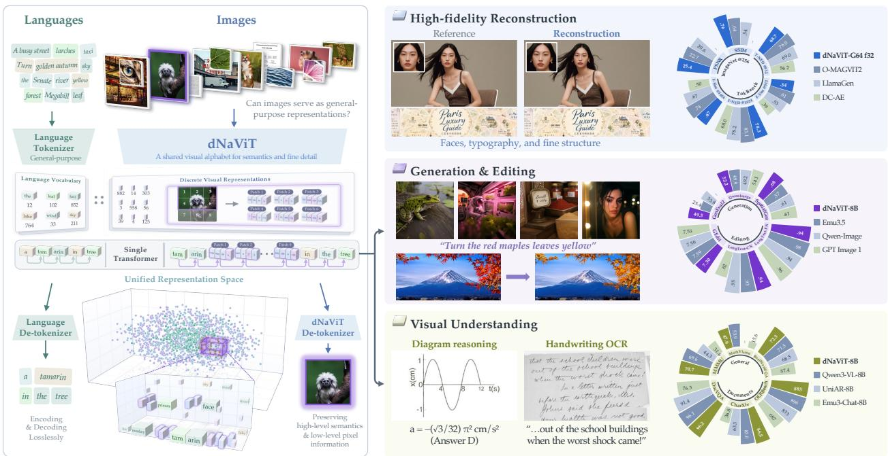  
Figure 1 dNaViT: A unified visual tokenizer for general-purpose modeling. dNaViT represents arbitrary-resolution images as discrete visual primitives, natively unifying reconstruction, understanding, generation, and editing under a shared vocabulary. By achieving performance competitive with specialized baselines across all domains, dNaViT validates a shared token-based paradigm for vision, analogous to language modeling.

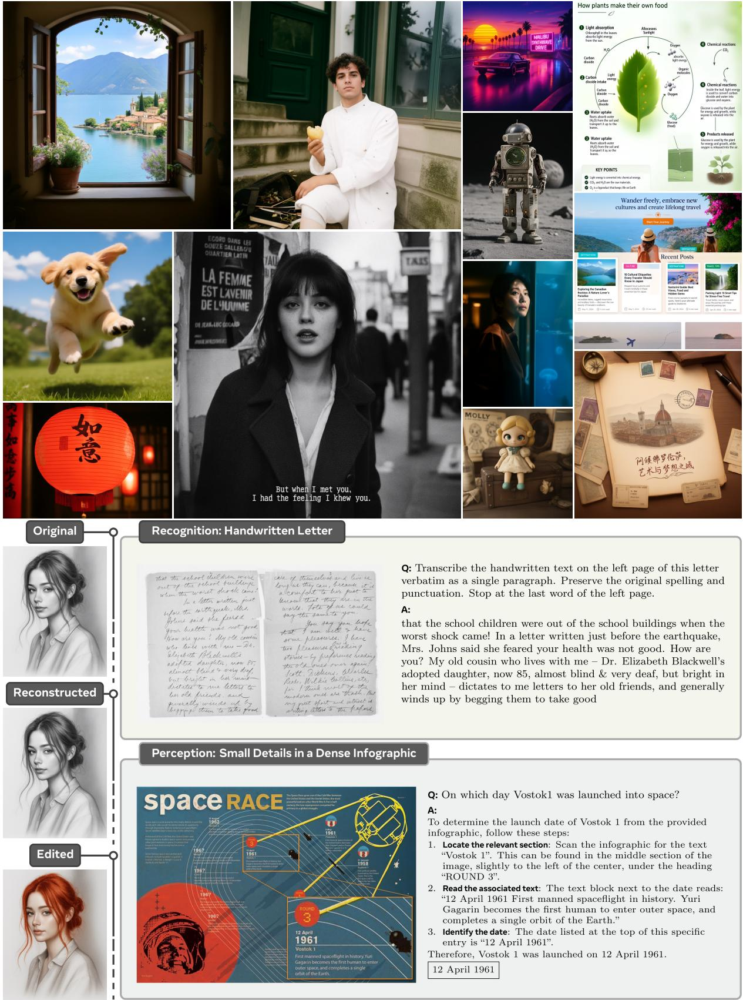  
Figure 2 dNaViT’s unified discrete representation as a foundation for diverse downstream visual tasks. Qualitative showcases illustrate the versatility of this shared representation.

## Contents

1 Introduction 4   
2 dNaViT 55   
2.1 Background   
2.2 Overall Architecture 6   
2.3 Representation Encoder 6   
2.4 Quantizer . 7   
2.5 Dual-Branch Reconstruction . 8   
2.6 Refiner . 9   
3 Implementation 10   
3.1 Training Stage 10   
3.2 Training Data . 12   
4 Experiment 12   
4.1 Image Reconstruction 12   
4.2 Image Classification 14   
4.3 Visual Understanding 16   
4.4 Visual Generation and Editing 18   
5 Analysis 18   
5.1 Efectiveness of ResMod 18   
5.2 Comparison between Discrete and Continuous Approaches . 19   
5.3 Comparison of Pixel Reconstruction 19   
5.4 Qualitative Visual Understanding Examples . 20   
6 Conclusion 20   
7 Contributors 20

## 1 Introduction

Language models have achieved remarkable success through next-token prediction, anchored by discrete tokens as their fundamental modeling unit (Brown et al., 2020). From the perspective of compression as intelligence (Delétang et al., 2023), discrete tokens provide a unified substrate for representation learning and autoregressive modeling. In contrast, modern multimodal models frequently rely on modality-specific representations and heterogeneous learning objectives (Cafagni et al., 2024). This paradigm divergence disconnects vision from the established techniques and scalable infrastructure to language, raising a foundational question: can visual information be represented losslessly like language using a learned discrete vocabulary?

Discrete visual representations ofer a promising bridge, naturally aligning visual inputs with autoregressive language architectures under a unified token-prediction objective (Xie et al., 2024; Wang et al., 2024b; Zou et al., 2026b; Peng et al., 2026; Meituan LongCat Team et al., 2026; Cui et al., 2025). However, discretizing dense, continuous visual signals into a finite vocabulary presents a severe information bottleneck (Ma et al., 2025; Yu et al., 2026) that hinders performance. Crucially, harmonizing high-level semantic abstraction for understanding with fine-grained pixel details for high-fidelity reconstruction within a single discrete bottleneck remains an unresolved tension (Wu et al., 2024; Qu et al., 2025).

To answer the question posed above and address these challenges, we introduce dNaViT, a Discrete Nativeresolution Vision Transformer that extends our preliminary work in LongCat-Next (Meituan LongCat Team et al., 2026). Following the representation encoder paradigm (Zheng et al., 2025), dNaViT enriches the semantic features of a frozen pretrained encoder with pixel details through a Residual Modulator (ResMod), without compromising its underlying semantic capability. The resulting features are discretized into a shared vocabulary using Grouped Product Quantization (PQ) (Jégou et al., 2011) under dual-branch representation and pixel reconstruction loss. Training progresses through continuous initialization, discrete feature alignment, and final joint optimization, which balance theses objectives and suppress gradient interference.

These design choices yield a shared discrete interface for tasks that conventionally rely on separate visual encodings, extending the utility of pretrained representations beyond their original objectives. By rotating and translating pretrained features, residual modulation reorganizes their geometry to accommodate reconstructionrelevant information, making more efective use of the available representational capacity. Combined with suficient factorized code capacity, this allows semantic structure and fine-grained detail to coexist within a shared discrete bottleneck, mitigating information loss during quantization. The resulting tokenizer brings the flexibility of text tokenization to vision: images can be encoded into discrete sequences and decoded into faithful reconstructions, while the codes retain semantic information closely aligned with language.

We evaluate the generality of dNaViT across four core capabilities: image reconstruction, classification, multimodal understanding, generation, editing. Driven by a single shared discrete vocabulary with a spatial downsampling factor f = 32, dNaViT achieves 28.12 dB PSNR and 0.81 SSIM at 512 × 512 resolution without sacrificing semantic representation capability. When paired with Qwen3-8B, dNaViT surpasses prior discrete baselines and rivals Qwen3-VL-8B across key document and reasoning benchmarks, scoring 885 on OCRBench. For image generation and editing, dNaViT achieve impressive performance on GenEval2 (49.5) and outperforms open-weight baselines on Qwen-Image-Bench (52.2), while excelling at bilingual text rendering. Crucially, dNaViT establishes these comprehensive understanding and generation capabilities under a substantially reduced data budget relative to existing models.

These findings suggest that the gap between continuous visual signals and discrete tokens is a challenge of representation learning rather than an inherent limitation. With appropriate modeling, discrete codes can serve as general-purpose visual primitives, bringing vision and language into a shared token-based paradigm. Our main contributions are summarized as follows:

1. This work explores the question of whether discrete codes can serve as general-purpose visual primitives, analogous to the role of tokens in language modeling. To investigate this possibility, we introduce dNaViT, a native-resolution visual tokenizer designed to capture both high-level semantic structure and fine-grained pixel information within a shared vocabulary for diferent tasks.

2. dNaViT uses residual modulation to aggregate multi-level features from a frozen vision encoder and grouped product quantization to encode the enriched representations. Progressive training coordinates dual-branch semantic and pixel reconstruction objectives. Experiments demonstrate that this design balances semantic preservation and reconstruction fidelity within the discrete bottleneck.

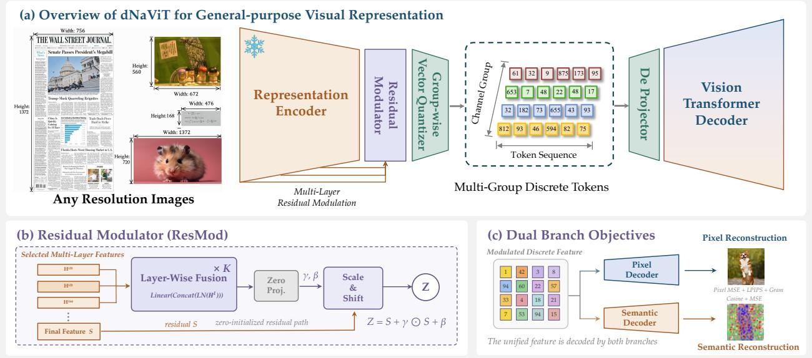  
Figure 3 Overview of dNaViT. (a) A frozen representation encoder handles arbitrary resolutions, with ResMod injecting multi-level information before group-wise product quantization. The shared discrete codes are decoded by individual ViT decoders into pixel and semantic reconstructions. (b) ResMod fuses intermediate features and predicts a zeroinitialized scale-and-shift residual. (c) Pixel and semantic branches are optimized with image and feature reconstruction losses, respectively.

3. Comprehensive evaluations across visual understanding, image reconstruction, generation, and editing demonstrate dNaViT’s generality. With a substantially smaller training data budget than the compared models, dNaViT achieves strong understanding and generation performance, highlighting the efectiveness and data eficiency of its unified, language-aligned representation.

4. This work demonstrates that a shared discrete token space can serve as a universal visual currency, providing a general-purpose intermediate representation across complementary tasks and a foundation for fully unified, native multimodal modeling.

## 2 dNaViT

This section presents dNaViT, a visual tokenizer that learns shared discrete codes as a unified interface for diverse downstream tasks, replacing separate task-specific feature representations. We will describe how the architecture supports these capabilities while mitigating conflicts between semantic abstraction and fine-grained detail preservation, as well as information loss during discretization.

## 2.1 Background

Visual modeling has largely relied on distinct continuous representations for diferent downstream tasks: pretrained semantic features for multimodal understanding (Tschannen et al., 2025) and reconstructionoriented latents for difusion-based synthesis (Rombach et al., 2022). Representation autoencoders bridge these approaches by pairing pretrained semantic encoders with reconstruction decoders (Zheng et al., 2025). By contrast, language models use discrete tokens as a uniform representation of text, supporting a unified, scalable next-token prediction framework. Meanwhile, recent benchmarks (An et al., 2026a; Yan et al., 2026) highlight the growing need to integrate linguistic and visual intelligence to solve real-world tasks.

Extending this framework to vision is challenging: unlike the discrete symbols of language, visual signals encode dense, continuous variation. Discrete visual tokenization addresses this by mapping images to sequences of codebook indices. For example, vector-quantized autoencoders assign continuous features to learned codebook entries and reconstruct images from the corresponding embeddings (van den Oord et al., 2017). These indices can be embedded and predicted like text tokens, enabling a shared autoregressive interface and the reuse of language-model architectures and objectives. Chameleon (Chameleon Team, 2024) and Emu3 (Wang et al., 2024b) demonstrate this formulation for multimodal understanding and generation. However, information loss during tokenization can constrain downstream performance and the benefits of scaling.

A shared token interface alone does not guarantee that the learned codes jointly preserve semantic information and fine-grained visual detail, both of which are essential to general-purpose visual modeling. Prior studies have examined the distinct information requirements of understanding and reconstruction (Qu et al., 2025) and identified limited discrete capacity as a key bottleneck in supporting both objectives (Ma et al., 2025). Motivated by these findings, dNaViT aims to preserve complementary task-relevant information within a shared discrete vocabulary and match the performance of task-specific representations.

## 2.2 Overall Architecture

Motivated by the exploration of information recovery through residual connections (Meituan LongCat Team et al., 2026), dNaViT further propose residual modulation to aggregate complementary cues and enrich the features of a frozen native-resolution vision encoder with reconstruction-relevant detail (Fig. 3). To preserve both semantic structure and visual detail within a shared discrete bottleneck, we quantize the enriched features using grouped product quantization and supervise the resulting codes through dual reconstruction branches. Progressive training coordinates these objectives to mitigate interference during optimization.

## 2.3 Representation Encoder

Unified visual tokenization must reconcile appearance invariance for understanding with sensitivity to detail for reconstruction. RAEs demonstrate reconstruction from continuous semantic features (Zheng et al., 2025), while LongCat-Next suggests that residual connections can carry low-level information across a semantic encoder (Meituan LongCat Team et al., 2026). This motivates us to directly leverage complementary cues by recombining multiple encoder depths, without even training the encoder itself. Meanwhile, quantization may collapse weakly expressed appearance diferences into the same code. It therefore requires retaining the final semantic representation as an explicit anchor throughout quantization to preserve representation quality.

To tackle this, we introduce a Residual Modulator (ResMod) inspired by frozen semantic base with detail-aware modulation of PAE (Yue et al., 2026), which fuses intermediate features from the frozen encoder and learns a spatially varying correction to its final representation. Multi-level fusion exposes complementary spatial cues, and a zero-initialized residual update preserves the pretrained features at initialization. The resulting feature grid provides the quantizer with a shared representation whose semantic structure and local detail can be supervised by the two reconstruction branches.

Residual Modulator. Figure $\mathrm { 3 ( b ) }$ illustrates the module. Let $\{ \mathbf { H } ^ { ( \ell ) } \} _ { \ell = 0 } ^ { L }$ be the spatial tokens of the frozen vision transformer, with $\mathbf { H } ^ { ( \ell ) } \in \mathbb { R } ^ { N \times D }$ . We select early and deeper layers ${ \mathcal { S } } \subseteq \{ 0 , \ldots , L \}$ and fuse their normalized features:

$$
\begin{array} { r } { \mathbf { U } = { \mathcal { T } } _ { \theta } \left( { \mathcal { F } } _ { \theta } \left( { \mathrm { C o n c a t } } _ { \ell \in { \mathcal { S } } } \left[ \mathrm { L N } _ { \ell } ( \mathbf { H } ^ { ( \ell ) } ) \right] \right) \right) , } \end{array}\tag{1}
$$

where $\mathcal { F } _ { \theta }$ projects the concatenated features to a common width and $\mathcal { T } _ { \theta }$ is a lightweight stack of self-attention and feed-forward blocks. These intermediate taps provide direct access to spatial information at diferent levels of abstraction.

Let $\mathbf { S } = \mathcal { A } ( \mathbf { H } ^ { ( L ) } )$ denote the semantic base on the quantizer grid, where A is the identity or the encoder’s spatial aggregation operator. We write $N _ { q }$ and C for the number of spatial positions and the channel width on this grid, respectively. A projection ${ \mathcal { P } } _ { \theta }$ aligns U to this grid, and an afine head predicts token-wise scale and shift parameters:

$$
\begin{array} { r } { ( \gamma , \beta ) = \mathrm { S p l i t } \big ( \mathcal { W } _ { \boldsymbol { \theta } } \big ( \mathrm { L N } ( \mathcal { P } _ { \boldsymbol { \theta } } ( \mathbf { U } ) ) \big ) \big ) , \qquad \mathbf { Z } = \mathbf { S } + \underbrace { \gamma \odot \mathbf { S } + \beta } _ { \Delta _ { \boldsymbol { \theta } } } . } \end{array}\tag{2}
$$

The projection ${ \mathcal { P } } _ { \theta }$ also aggregates spatial tokens when S uses a coarser grid. We initialize $\mathcal { W } _ { \theta }$ to zero, giving $\boldsymbol { \Delta } _ { \theta } = \mathbf { 0 }$ and $\mathbf { Z } = \mathbf { S }$ at initialization. Training then learns how to reweight the semantic base and add complementary information at each position. Thus, residual pathways within the encoder provide access to information across depth, and ResMod organizes this information for the discrete bottleneck while keeping the pretrained encoder fixed. As a result, ResMod only translates and rotates the pretrained features to enlarge representation capacity while preserving their original semantic structure.

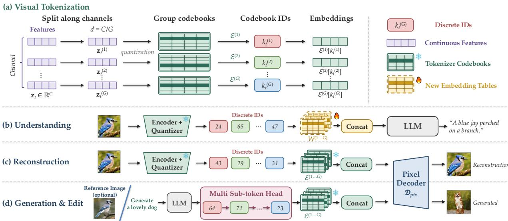  
Figure 4 Tokenization and Unified Codes for Downstream Tasks. (a) At spatial position t, the modulated feature $\mathbf { z } _ { t }$ is split into G channel groups and quantized with group-specific codebooks $\mathcal { E } ^ { ( g ) }$ , yielding indices $( k _ { t } ^ { ( 1 ) } , \dots , k _ { t } ^ { ( G ) } )$ and their embeddings. (b) Understanding supplies only code indices to the language model (LM) through newly initialized group-wise embedding tables $\{ \mathbf { W } ^ { ( g ) } \} _ { g = 1 } ^ { G }$ , trained jointly with the LM. (c) Reconstruction concatenates the indexed embeddings from the frozen tokenizer codebooks and feeds them to the pixel decoder $\mathcal { D } _ { \mathrm { p i x } }$ . (d) Generation and editing use a multi-sub-token head atop the LM to predict each position’s multi-level indices, optionally conditioned on a reference image, then decode through the same frozen codebooks and pixel decoder.

## 2.4 Quantizer

The residual modulator enriches the features entering the discrete bottleneck, but retaining the exposed semantic distinctions and spatial detail requires suficient quantization capacity at each spatial position. Motivated by evidence that multi-codebook quantization with a suficient bit budget preserves semantic information at a level competitive with continuous representations (Zou et al., 2026a), we adopt grouped product quantization (Jégou et al., 2011) to expand this capacity while keeping the spatial token grid unchanged. As illustrated in Fig. 4, the features are factorized along the channel dimension and encoded using multiple codebooks, avoiding a prohibitively large monolithic vocabulary.

Let $\mathbf { z } _ { t } \in \mathbb { R } ^ { C }$ denote the feature presented to the quantizer at position t of the modulated representation $\mathbf { Z } \in \mathbb { R } ^ { N _ { q } \times C }$ . We partition its channels into G disjoint groups, $\mathbf { z } _ { t } = \mathrm { C o n c a t } _ { g = 1 } ^ { G } \left\lceil \mathbf { z } _ { t } ^ { ( g ) } \right\rceil$ , where each group has dimension $d = C / G$ . Each group is assigned its own learned codebook $\begin{array} { r } { \mathcal { E } ^ { ( g ) } = \{ \mathbf { e } _ { k } ^ { ( g ) } \} _ { k = 1 } ^ { K } , } \end{array}$ with ${ \bf e } _ { k } ^ { ( g ) } \in \mathbb { R } ^ { d }$ Quantization selects the nearest entry within each group and concatenates the selected embeddings:

$$
\begin{array} { c } { { k _ { t } ^ { ( g ) } = \underset { k \in \{ 1 , \ldots , K \} } { \arg \operatorname* { m i n } } \left\| \mathbf { z } _ { t } ^ { ( g ) } - \mathbf { e } _ { k } ^ { ( g ) } \right\| _ { 2 } ^ { 2 } , } } \\ { { \ } } \\ { { \mathbf { k } _ { t } = ( k _ { t } ^ { ( 1 ) } , \ldots , k _ { t } ^ { ( G ) } ) , \qquad \mathbf { c } _ { t } = \mathrm { C o n c a t } _ { g = 1 } ^ { G } \left[ \mathbf { e } _ { k _ { t } ^ { ( g ) } } ^ { ( g ) } \right] . } } \end{array}\tag{3}
$$

Here $\mathbf { k } _ { t }$ is the discrete index tuple, whereas $\mathbf { c } _ { t }$ is its codebook embedding supplied to downstream decoders. Codebooks are shared across spatial positions, so the same quantization rule applies to variable-length grids at diferent image resolutions and aspect ratios. The resulting tuple belongs to the Cartesian product

$\mathcal { K } = \{ 1 , \ldots , K \} ^ { G }$ , giving a combinatorial code space with

$$
| { \cal K } | = { \cal K } ^ { G } , \qquad { \cal B } _ { \mathrm { p o s i t i o n } } = G \log _ { 2 } { \cal K } , \qquad { \cal B } _ { \mathrm { i m a g e } } = N _ { q } G \log _ { 2 } { \cal K } ,\tag{4}
$$

where $N _ { q }$ denotes the number of spatial positions on the quantizer grid. With G codebooks of K entries each, the quantizer admits up to $K ^ { G }$ combinations without explicitly storing a vocabulary of that size. At fixed K, increasing G raises the nominal bit budget while leaving $N _ { q }$ unchanged, but introduces more code indices to model. This budget characterizes the available discrete alphabet, not the empirical entropy or semantic information retained; greater capacity alone does not guarantee faithful reconstruction. Separate codebook lookups also do not imply statistically independent indices, as the groups encode the same visual content.

The quantization groups operate on the fused representation without predefined semantic or perceptual roles. Stacking the embeddings in spatial order gives $\mathbf { \bar { C } } = [ \mathbf { c } _ { 1 } , \dots , \mathbf { c } _ { N _ { a } } ] ^ { \top } \in \bar { \mathbb { R } } ^ { N _ { q } \times C }$ . The resulting matrix serves as a shared input to the semantic and pixel decoders, whose complementary objectives encourage the codes to retain both pretrained semantic structure and reconstruction-relevant detail. Residual modulation thus determines which information enters the bottleneck, grouped quantization supplies the capacity to encode it, and dual-decoder supervision guides how that capacity is used.

## 2.5 Dual-Branch Reconstruction

A general-purpose visual vocabulary must preserve pretrained semantic structure while retaining the finegrained visual detail needed to recover the original visual signal. These requirements concern diferent output spaces but must be satisfied by the same discrete codes. We therefore introduce two specialized decoders that share the quantized representation. The semantic branch aligns the codes with continuous visual features, while the pixel branch supervises image reconstruction.

Representation Reconstruction Branch. We take the quantized feature matrix $\mathbf { C } ,$ as defined in Section 2.4, as the input to both decoders. The semantic decoder $\mathcal { D } _ { \mathrm { s e m } }$ maps the quantized embeddings back to the continuous feature space after residual modulation,

$$
\widehat { \mathbf { Z } } = \mathcal { D } _ { \mathrm { s e m } } ( \mathbf { C } ) .\tag{5}
$$

We supervise this prediction with a fixed post-ResMod target $\mathbf { Z } ^ { \star }$ , combining feature regression with cosine alignment,

$$
\mathcal { L } _ { \mathrm { s e m } } = 1 - \cos \Bigl ( \widehat { \mathbf { Z } } , \mathrm { s g } ( \mathbf { Z } ^ { \star } ) \Bigr ) + \lambda _ { \mathrm { M S E } } ^ { \mathrm { s e m } } \left\| \widehat { \mathbf { Z } } - \mathrm { s g } ( \mathbf { Z } ^ { \star } ) \right\| _ { 2 } ^ { 2 } ,\tag{6}
$$

where $\operatorname { s g } ( \cdot )$ stops gradients through the target path. The target is produced by a frozen ResMod, as specified in Section 3.1. We find that cosine loss alone can be small even for inaccurate reconstructions when a dominant shared feature mean concentrates features in a narrow cone, consistent with representation anisotropy (Ethayarajh, 2019). The MSE term complements directional alignment by constraining absolute feature values. Reconstructing this representation encourages the codes to retain the semantic structure inherited from the pretrained backbone together with the information introduced by residual modulation.

Pixel Reconstruction Branch. Feature alignment alone does not directly constrain fidelity to the original image. We therefore decode the same embeddings into pixels, first restoring and expanding their spatial grid through token unmerging,

$$
\begin{array} { r } { \widehat { \mathbf { x } } = \mathcal { D } _ { \mathrm { p i x } } \big ( \mathcal { U } ( \mathbf { C } ; h _ { q } , w _ { q } ) \big ) , } \end{array}\tag{7}
$$

where $( h _ { q } , w _ { q } )$ is the quantized grid size, U denotes token unmerging and spatial expansion, and $\mathcal { D } _ { \mathrm { p i x } }$ is the pixel decoder. We train this branch with five complementary reconstruction losses,

$$
\mathcal { L } _ { \mathrm { p i x } } = \lambda _ { 1 } \mathcal { L } _ { 1 } + \lambda _ { \mathrm { M S E } } ^ { \mathrm { p i x } } \mathcal { L } _ { \mathrm { M S E } } + \lambda _ { \mathrm { L P I P S } } \mathcal { L } _ { \mathrm { L P I P S } } + \lambda _ { \mathrm { p e r c } } \mathcal { L } _ { \mathrm { p e r c } } + \lambda _ { \mathrm { G r a m } } \mathcal { L } _ { \mathrm { G r a m } } .\tag{8}
$$

The λ coeficients balance the five objectives; the pixel MSE weight $\lambda _ { \mathrm { M S E } } ^ { \mathrm { p i x } }$ is distinct from the feature MSE weight $\lambda _ { \mathrm { M S E } } ^ { \mathrm { s e m } }$ . All terms compare the reconstruction xb with the input x. Here $\mathcal { L } _ { 1 }$ and $\mathcal { L } _ { \mathrm { M S E } }$ denote mean absolute and mean squared pixel errors, respectively. $\mathcal { L } _ { \mathrm { L P I P S } }$ uses VGG features to measure perceptual similarity across multiple layers. The ConvNeXt-S-based perceptual loss $\mathcal { L } _ { \mathrm { p e r c } }$ applies MSE to the network outputs to align high-level recognition responses. $\mathcal { L } _ { \mathrm { G r a m } }$ matches Gram matrices of VGG features to preserve texture and channel correlations. The two branches jointly constrain the information retained by the shared vocabulary through

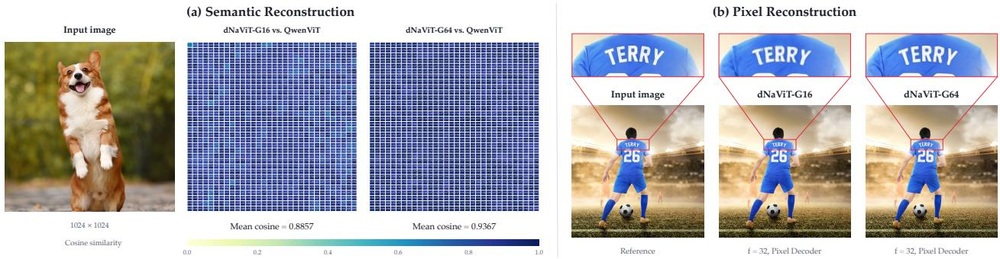  
Figure 5 Joint preservation of high-level semantics and low-level pixel detail in a shared discrete representation. (a) dNaViT’s reconstructed semantic features closely match the original QwenViT features. Each cell reports the cosine similarity between corresponding tokens. (b) Pixel reconstructions from dNaViT-G16 and dNaViT-G64, with matched crops highlighting the fine-grained text on the jersey.

$$
\begin{array} { r } { \mathcal { L } _ { \mathrm { d u a l } } = \lambda _ { \mathrm { s e m } } \mathcal { L } _ { \mathrm { s e m } } + \lambda _ { \mathrm { p i x } } \mathcal { L } _ { \mathrm { p i x } } . } \end{array}\tag{9}
$$

The semantic objective anchors reconstruction in the modulated feature space, while the pixel objective requires access to texture, color, and spatial detail. Section 3.1 describes how these objectives are introduced progressively to train the shared bottleneck and residual pathway.

Flexible Encoding and Decoding at Arbitrary Resolutions. We retain each image’s token-grid dimensions throughout encoding and decoding. The encoder maps an input image to an $h _ { q } \times w _ { q }$ feature grid, which quantization converts into codebook embeddings without altering its spatial layout. For semantic reconstruction, the semantic decoder recovers a continuous feature at each grid position. For image reconstruction, $\mathcal { U } ( \mathbf { C } ; h _ { q } , w _ { q } )$ uses the recorded dimensions to arrange and spatially expand the quantized tokens before the pixel decoder reconstructs an RGB image at the input resolution. Both branches therefore remain spatially aligned with the input image across varying grid dimensions and aspect ratios.

## 2.6 Refiner

Although the ViT pixel decoder preserves image content faithfully, standard practices often employ a refiner module to further enhance its visual perceptual quality. We introduce a code-conditioned Refiner for highfidelity decoding with sharper, more realistic details (Fig. 6). Unlike conventional super-resolution models conditioned on decoded RGB images, our Refiner directly conditions on discrete visual codes, avoiding information loss introduced by intermediate pixel decoding. It also requires no text conditioning, whose semantic priors may alter source content and constrain image editing. Built on a pretrained image-generation prior, the Refiner replaces the ViT pixel decoder with a flow decoder using discrete codes as its sole conditioning input. We train a multi-step teacher and distill it into an eficient one-step student.

Code-conditioned refinement. Given an encoder observation $\mathbf { x } _ { \mathrm { L } }$ and a target image $\mathbf { x _ { H } }$ , the frozen tokenizer maps $\mathbf { x } _ { \mathrm { L } }$ to codebook embeddings C. These embeddings condition a pretrained generative transformer through two paths: a context adapter supplies tokens to its joint-attention stream, and a time-conditioned spatial adapter injects aligned residuals into the latent input and selected transformer layers. Let $\mathbf { H } _ { \mathrm { r e f } } ^ { ( j ) }$ denote the token-feature matrix at layer $j$ of the Refiner and τ denote flow time. The layer update is

$$
\mathbf { H } _ { \mathrm { r e f } } ^ { ( j + 1 ) } = { \mathcal { B } } ^ { ( j ) } \left( \mathbf { H } _ { \mathrm { r e f } } ^ { ( j ) } , { \mathcal { C } } _ { \phi } ( \mathbf { C } ) \right) + { \mathcal { I } } _ { \phi } ^ { ( j ) } ( { \mathcal { A } } _ { \phi } ( \mathbf { C } , \tau ) ) ,\tag{10}
$$

where $\mathcal { C } _ { \phi }$ forms global context tokens and $\mathcal { I } _ { \phi } ^ { ( j ) } \circ \mathcal { A } _ { \phi }$ provides spatially aligned residual features. The injection projections are zero-initialized, so the added spatial path initially preserves the backbone computation. The global path carries scene-level context, while the spatial path aligns generated features with corresponding code locations. Because both adapters operate on code token grids, the Refiner supports variable resolutions and aspect ratios. The teacher is trained by flow matching in the latent space of a frozen image autoencoder. Let $\mathbf { y } _ { 0 } = \nu ( \mathbf { x } _ { \mathrm { H } } )$ , and use the noise level $\tau \in [ 0 , 1 ]$ as the flow coordinate, with ${ \bf y } _ { \tau } = ( 1 - \tau ) { \bf y } _ { 0 } + \tau \pmb { \epsilon }$ and $\mathbf { \epsilon } \in \sim \mathcal { N } ( \mathbf { 0 } , \mathbf { I } )$ . We optimize

Codes-Conditioned Refiner  
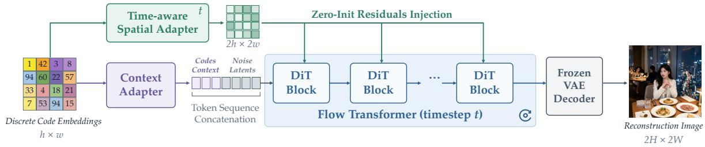  
Others Refiner (e.g. GLM-Image/UniAR/X-Omni…): Multi-step Decode, Text-condition Needed, Fixed Inject

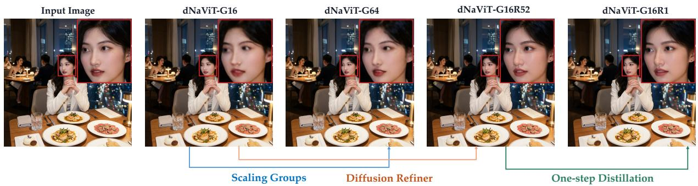  
Figure 6 Overview of the code-conditioned Refiner. Code embeddings condition a flow decoder through global context tokens and time-conditioned spatial residuals. A multi-step teacher is distilled into an eficient one-step student with adversarial supervision. The timestep t in the diagram corresponds to τ in the equations. Increasing the quantization group count (G64) improves reconstruction fidelity, whereas combining fewer groups (G16) with the one-step Refiner preserves fidelity while enhancing perceptual quality.

$$
\mathcal { L } _ { \mathrm { F M } } = \mathbb { E } \Big [ w ( \tau ) \big \| \mathbf { v } _ { \theta } \big ( \mathbf { y } _ { \tau } , \tau , \mathbf { C } \big ) - \big ( \epsilon - \mathbf { y } _ { 0 } \big ) \big \| _ { 2 } ^ { 2 } \Big ] .\tag{11}
$$

Here $\mathbf { v } _ { \theta }$ is the conditional velocity field and $w ( \tau )$ is the timestep-dependent loss weight.

One-step adversarial distillation. The one-step student is initialized from the frozen teacher and retains the same code condition. Training combines latent-space regression to the teacher’s multi-step output with a stop-gradient correction derived from the teacher’s noise predictions on identically perturbed student and teacher outputs. Adversarial supervision comes from a time-aware discriminator on features extracted by the frozen teacher, using ground-truth image latents as real samples and a hinge discriminator loss.

## 3 Implementation

## 3.1 Training Stage

Our optimization strategy separates learning complementary visual detail from adapting the enriched representation to a discrete bottleneck. As illustrated in Fig. 7, training proceeds through continuous pixel pretraining, discrete semantic reconstruction, and joint reconstruction. The tokenizer combines a pretrained Qwen3-VL ViT (∼400M), frozen throughout training to preserve its semantic representations, with a residual modulator (∼100M), totaling ∼500M parameters. We denote by $\mathcal E ( \mathbf x )$ the collection of intermediate and final ViT features supplied to ResMod R, and by Q the grouped quantizer.

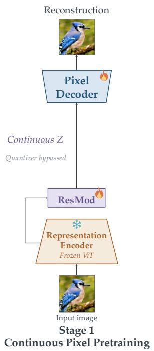

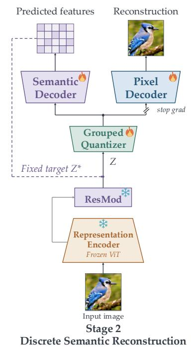

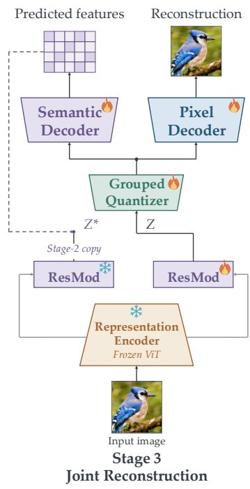  
Figure 7 Three-stage training schedule of dNaViT. Continuous pixel pretraining is followed by discrete semantic reconstruction and joint reconstruction. Stage 2 stops pixel gradients at the quantized embeddings. Stage 3 opens this gradient path while a frozen copy of the Stage-2 ResMod supplies the feature target. Flame and snowflake icons mark trainable and frozen modules; dashed purple paths denote fixed targets.

Stage 1: Continuous Pixel Pretraining. We first train ResMod to recover the original visual signal from the representation encoder. ResMod produces $\mathbf { Z } = \mathcal { R } ( \mathcal { E } ( \mathbf { x } ) )$ , which is passed to the pixel reconstruction branch. Minimizing $\mathcal { L } _ { \mathrm { p i x } }$ jointly trains ResMod and the pixel decoder while the ViT remains frozen. This stage initializes the residual pathway to expose reconstruction-relevant information before a discrete vocabulary is introduced.

Stage 2: Discrete Semantic Reconstruction. This stage initializes discrete representations that preserve semantic structure while retaining the pixel detail introduced by ResMod in Stage 1. We freeze both the ViT and ResMod, using the ResMod output Z as the quantizer input and the fixed semantic reconstruction target $\mathbf { Z } ^ { \star }$ . The quantizer and semantic decoder are jointly trained with $\mathcal { L } _ { \mathrm { s e m } }$ to reconstruct this detail-enriched representation from $\mathbf { C } = \mathcal { Q } ( \mathbf { Z } )$ . In parallel, the pixel decoder is trained with $\mathcal { L } _ { \mathrm { p i x } }$ on detached codes sg(C), establishing an initial mapping from discrete codes to pixels. Stopping gradients at this interface prevents the pixel objective from disrupting semantic learning while the discrete representations are being initialized.

Stage 3: Joint Reconstruction. This stage jointly refines the discrete representations for semantic and pixel reconstruction. We unfreeze the encoding ResMod while retaining a frozen teacher copy to prevent target drift during joint optimization. With student $\mathcal { R } ^ { \mathrm { S } }$ and teacher $\mathcal { R } ^ { \mathrm { T } }$ , the semantic target $\mathbf { Z } ^ { \star }$ now comes from the frozen teacher, while the quantized features C come from the trainable student:

$$
\begin{array} { r l } & { \mathbf { Z } ^ { \star } = \mathcal { R } ^ { \mathrm { T } } \big ( \mathcal { E } ( \mathbf { x } ) \big ) , } \\ & { \mathbf { C } = \mathcal { Q } \big ( \mathcal { R } ^ { \mathrm { S } } \big ( \mathcal { E } ( \mathbf { x } ) \big ) \big ) . } \end{array}\tag{12}
$$

The quantizer and both decoders continue training from Stage 2 under ${ \mathcal { L } } _ { \mathrm { d u a l } }$ . The semantic branch reconstructs the fixed target $\mathbf { Z } ^ { \star }$ , while the pixel branch is no longer detached, allowing pixel gradients to update the quantizer and student ResMod. The ViT and teacher ResMod remain frozen throughout.

## 3.2 Training Data

The tokenization and de-tokenization training corpus combines diverse image sources to support semantic representation learning and maintain fine-grained pixel information. These sources are grouped into three complementary categories according to visual content. Tokenizer training uses images exclusively for dualbranch supervision, with a carefully controlled resolution distribution to support arbitrary-resolution training.

General-DomainImages. LAION (Schuhmann et al., 2022), COYO (Byeon et al., 2022), and DataComp (Gadre et al., 2023), together with images from Recap-DataComp-1B (Li et al., 2024) and CapsFusion (Yu et al., 2024b), provide broad coverage of objects, scenes, and visual styles. An in-house image corpus further expands the diversity of the training data.

Text-Rich Images and Documents. Selected subsets of TextAtlas5M (Wang et al., 2025a) include book covers, images containing long words, academic papers, and presentation slides. Chinese- and English-language book and news pages, along with additional OCR-oriented collections, extend coverage to dense text, small characters, and complex document layouts. Infographic collections and ChartGalaxy (Li et al., 2025) further contribute information-dense content, including charts and tables, where spatial relationships among visual elements are critical to interpretation.

Fine-Grained and High-aesthetic Images. Face-focused LAION subsets, images derived from SA-1B (Kirillov et al., 2023), and an in-house collection of high-aesthetic-quality images enrich the corpus with detailed facial structures, local textures, and varied image compositions.

Training begins at a fixed resolution of 256 × 256 using a limited set of image sources to facilitate rapid convergence, then progressively transitions to native-resolution training at resolutions up to 2K on a broader data mixture. During this transition, sampling maintains a balanced distribution across resolution ranges. Images are resized to approximately preserve their aspect ratios, align spatial dimensions with the encoder stride, and keep sequence lengths within the token budget. Across all stages, the model is trained on several hundred billion tokens.

## 4 Experiment

We evaluate dNaViT across five complementary tasks to assess the generality of its shared discrete representation. Image reconstruction measures the preservation of fine-grained detail, while frozen-feature classification and multimodal understanding assess semantic discriminability, transfer robustness, and visual reasoning. Autoregressive text-to-image generation and instruction-guided editing further examine the utility of the learned codes for conditional synthesis and image manipulation.

## 4.1 Image Reconstruction

Evaluation Setup. We evaluate reconstruction on ImageNet-1K (Russakovsky et al., 2015) and Tok-Bench (Wu et al., 2025c) to assess whether dNaViT’s shared discrete vocabulary preserves overall image fidelity and fine-grained textual and facial detail. We denote the dNaViT variants with 16 and 64 quantization groups as dNaViT-G16 and dNaViT-G64, respectively; both use a vision transformer (ViT) pixel decoder without refinement and a spatial downsampling factor of f = 32. dNaViT-G16-R denotes the 16-group variant with the ViT pixel decoder replaced by the code-conditioned flow decoder (Refiner; Sec. 2.6). On ImageNet-1K, we report PSNR and SSIM at 256 × 256, 512 × 512, and 1024 × 1024, using the full validation set and standard preprocessing. On TokBench, we report text recognition accuracy (T-ACC), normalized edit similarity (T-NED), and face similarity (F-Sim) at 512 × 512 and 1024 × 1024, with equal weighting across the oficial instance-scale buckets. Baseline scores are taken from published reports. Diferences in evaluation protocols and training configurations preclude controlled or rate-matched comparisons.

ImageNet Reconstruction. As shown in Table 1, dNaViT-G64 achieves 25.41 dB PSNR with 0.76 SSIM at 256 × 256 and 28.12 dB PSNR with 0.81 SSIM at 512 × 512. At 1024 × 1024, it reaches 32.90 dB PSNR and 0.91 SSIM, compared with 28.93 dB and 0.81 for dNaViT-G16. These results indicate that dNaViT retains substantial reconstruction-relevant information within its shared discrete representation across all three resolutions.

Table 1 ImageNet reconstruction across resolutions. f denotes the spatial downsampling factor; spatial positions exclude quantization groups and do not specify bit rate. All dNaViT results use the same evaluation protocol on the full set of 50,000 ImageNet validation images. Higher is better for both metrics. Baseline results follow source-specific protocols and are not directly comparable across sources.
<table><tr><td rowspan="2">Method</td><td colspan="2">Configuration</td><td rowspan="2"></td><td colspan="2">ImageNet</td></tr><tr><td>Resolution</td><td>Spatial f positions</td><td>PSNR (dB) ↑</td><td>SSIM↑</td></tr><tr><td colspan="7">Continuous representations</td></tr><tr><td>SD-VAE 1.x / 2.x (Rombach et al., 2022)</td><td> $2 5 6 ^ { 2 }$ </td><td>8</td><td>1024</td><td>23.54</td><td>0.68</td></tr><tr><td>OmniTokenizer (Wang et al., 2024a)</td><td> $2 5 6 ^ { 2 }$ </td><td>8</td><td>1024</td><td>26.74</td><td>0.82</td></tr><tr><td>SD-VAE XL (Podell et al., 2023)</td><td> $2 5 6 ^ { 2 }$ </td><td>8</td><td>1024</td><td>27.37</td><td>0.78</td></tr><tr><td>Qwen-Image (Wu et al., 2025a)</td><td> $2 5 6 ^ { 2 }$ </td><td>8</td><td>1024</td><td>32.18</td><td>0.90</td></tr><tr><td>SD-VAE 3 (Esser et al., 2024)</td><td> $2 5 6 ^ { 2 }$ </td><td>8</td><td>1024</td><td>31.29</td><td>0.87</td></tr><tr><td>Wan2.1 (Team Wan et al., 2025)</td><td> $2 5 6 ^ { 2 }$ </td><td>8</td><td>1024</td><td>31.34</td><td>0.89</td></tr><tr><td>FLUX-VAE (Black Forest Labs, 2024)</td><td> $2 5 6 ^ { 2 }$ </td><td>8</td><td>1024</td><td>32.74</td><td>0.92</td></tr><tr><td>Cosmos-CI (NVIDIA et al., 2025)</td><td> $2 5 6 ^ { 2 }$ </td><td>16</td><td>256</td><td>25.07</td><td>0.70</td></tr><tr><td>VA-VAE (Yao and Wang, 2025)</td><td> $2 5 6 ^ { 2 }$ </td><td>16</td><td>256</td><td>27.96</td><td>0.79</td></tr><tr><td>Wan2.2 (Team Wan, 2025)</td><td> $2 5 6 ^ { 2 }$ </td><td>16</td><td>256</td><td>31.25</td><td>0.88</td></tr><tr><td> $\mathrm { P A E { - } D I N O v { 2 } ^ { \ddagger } }$  (Yue et al., 2026)</td><td> $2 5 6 ^ { 2 }$ </td><td>16</td><td>256</td><td>27.28</td><td></td></tr><tr><td>DC-SAE (Huang et al., 2026)</td><td> $2 5 6 ^ { 2 }$ </td><td>32</td><td>64</td><td>23.13</td><td></td></tr><tr><td>UniLiP (Tang et al., 2025a)</td><td> $2 5 6 ^ { 2 }$ </td><td>32</td><td>64</td><td>22.99</td><td>0.75</td></tr><tr><td>UniLiP (Tang et al., 2025a)</td><td> $4 4 8 ^ { 2 }$ </td><td>32</td><td>196</td><td>24.62</td><td>0.79</td></tr><tr><td colspan="8">Discrete representations</td></tr><tr><td>ARM (Wang et al., 2026)</td><td> $2 5 6 ^ { 2 }$ </td><td>16</td><td>256</td><td>19.60</td><td></td></tr><tr><td>Cosmos-DI (NVIDIA et al., 2025)</td><td> $2 5 6 ^ { 2 }$ </td><td>16</td><td>256</td><td>19.98</td><td>0.54</td></tr><tr><td>LlamaGen (Sun et al., 2024)</td><td> $2 5 6 ^ { 2 }$ </td><td>16</td><td>256</td><td>20.65</td><td>0.54</td></tr><tr><td>Open-MAGVIT2 (Luo et al., 2024)</td><td> $2 5 6 ^ { 2 }$ </td><td>16</td><td>256</td><td>22.70</td><td>0.64</td></tr><tr><td>BSQ-ViT (Zhao et al., 2024)</td><td> $2 5 6 ^ { 2 }$ </td><td>16</td><td>256</td><td>28.14</td><td>0.81</td></tr><tr><td>BitDance (Ai et al., 2026)</td><td> $2 5 6 ^ { 2 }$ </td><td>16</td><td>256</td><td>24.90</td><td>0.72</td></tr><tr><td>BitDance (Ai et al., 2026)</td><td> $2 5 6 ^ { 2 }$ </td><td>32</td><td>64</td><td>25.30</td><td>0.74</td></tr><tr><td>Emu3.5 (Cui et al., 2025)</td><td> $5 1 2 ^ { 2 }$ </td><td>16</td><td>1024</td><td>23.80</td><td></td></tr><tr><td>dNaViT-G16</td><td> $2 5 6 ^ { 2 }$ </td><td>32</td><td>64</td><td>22.82</td><td>0.64</td></tr><tr><td>dNaViT-G64</td><td> $2 5 6 ^ { 2 }$ </td><td>32</td><td>64</td><td>25.41</td><td>0.76</td></tr><tr><td>dNaViT-G16</td><td> $5 1 2 ^ { 2 }$ </td><td>32</td><td>256</td><td>25.47</td><td>0.71</td></tr><tr><td>dNaViT-G64</td><td> $5 1 2 ^ { 2 }$ </td><td>32</td><td>256</td><td>28.12</td><td>0.81</td></tr><tr><td>dNaViT-G16</td><td> $1 0 2 4 ^ { 2 }$ </td><td>32</td><td>1024</td><td>28.93</td><td>0.81</td></tr><tr><td>dNaViT-G64</td><td> $1 0 2 4 ^ { 2 }$ </td><td>32</td><td>1024</td><td>32.90</td><td>0.91</td></tr><tr><td></td><td></td><td></td><td></td><td></td><td></td></tr></table>

Fine-Grained Reconstruction on TokBench. Table 2 shows that dNaViT-G64 achieves results comparable to those reported for LlamaGen-f8 and higher scores than DC-AE-f32 on all three metrics at both resolutions. At $1 0 2 4 \times 1 0 2 4$ , it attains 63.08% T-ACC, 78.27% T-NED, and 0.67 F-Sim. The scale-stratified results in Table 3 further show consistent gains over dNaViT-G16 across all instance sizes. However, dNaViT-G16 and dNaViT-G64 difer in training configuration and duration, so this comparison does not isolate the efect of quantization group count. These findings indicate that dNaViT preserves textual and facial detail beyond global image structure. Small text nevertheless remains challenging, and a performance gap persists relative to stronger reconstruction models such as FLUX.1.

Table 2 Fine-grained reconstruction on TokBench. Results are macro-averages over three instance-scale buckets. T-ACC and T-NED are percentages; F-Sim is cosine similarity. f is the spatial downsampling factor.
<table><tr><td rowspan="2">Method</td><td rowspan="2">f</td><td colspan="3">Resolution@512 × 512</td><td rowspan="2">Resolution@1024 × 1024</td><td colspan="2"></td></tr><tr><td>T-ACC↑</td><td>T-NED↑</td><td>F-Sim↑ T-ACC↑</td><td>T-NED↑</td><td>F-Sim↑</td></tr><tr><td></td><td colspan="6">Continuous Autoencoders</td></tr><tr><td>DC-AE (Chen et al., 2024a)</td><td>32</td><td>38.25</td><td>56.22</td><td>0.39</td><td>52.14</td><td>68.02</td><td>0.50</td></tr><tr><td>VA-VAE (Yao and Wang, 2025)</td><td>16</td><td>53.30</td><td>69.65</td><td>0.57</td><td>62.84</td><td>77.21</td><td>0.69</td></tr><tr><td>SD-XL (Podell et al., 2023)</td><td>8</td><td>56.86</td><td>72.55</td><td>0.55</td><td>67.84</td><td>81.15</td><td>0.70</td></tr><tr><td>SD-3.5 (Stability AI, 2024)</td><td>8</td><td>81.84</td><td>90.30</td><td>0.81</td><td>89.71</td><td>95.05</td><td>0.93</td></tr><tr><td>FLUX.1-dev (Black Forest Labs, 2024)</td><td>8</td><td>87.64</td><td>93.86</td><td>0.86</td><td>93.09</td><td>96.96</td><td>0.96</td></tr><tr><td colspan="6">Discrete Tokenizers</td><td></td><td></td></tr><tr><td>VQGAN (Esser et al., 2021)</td><td>16</td><td>6.12</td><td>17.32</td><td>0.19</td><td>15.00</td><td>28.80</td><td>0.25</td></tr><tr><td>Chameleon (Chameleon Team, 2024)</td><td>16</td><td>11.55</td><td>26.80</td><td>0.28</td><td>23.52</td><td>40.39</td><td>0.36</td></tr><tr><td>LlamaGen (Sun et al., 2024)</td><td>16</td><td>15.01</td><td>30.44</td><td>0.25</td><td>27.19</td><td>43.58</td><td>0.33</td></tr><tr><td>VAR (Tian et al., 2024)</td><td>16</td><td>29.31</td><td>50.00</td><td>0.32</td><td>38.36</td><td>59.25</td><td>0.40</td></tr><tr><td>TokenFlow (Qu et al., 2025)</td><td>16</td><td>17.40</td><td>35.49</td><td>0.24</td><td>29.30</td><td>48.09</td><td>0.31</td></tr><tr><td>O-MAGVIT2 (Luo et al., 2024)</td><td>16</td><td>21.65</td><td>39.63</td><td>0.31</td><td>34.74</td><td>52.03</td><td>0.40</td></tr><tr><td>O-MAGVIT2 (pretrain) (Luo et al., 2024)</td><td>16</td><td>27.33</td><td>47.28</td><td>0.31</td><td>39.40</td><td>58.95</td><td>0.40</td></tr><tr><td>UniTok (Ma et al., 2025)</td><td>16</td><td>50.10</td><td>71.08</td><td>0.44</td><td>49.70</td><td>71.59</td><td>0.53</td></tr><tr><td>OmniTokenizer (Wang et al., 2024a)</td><td>8</td><td>42.48</td><td>60.70</td><td>0.50</td><td>53.48</td><td>70.02</td><td>0.61</td></tr><tr><td>LlamaGen (Sun et al., 2024)</td><td>8</td><td>52.56</td><td>68.99</td><td>0.53</td><td>63.89</td><td>78.24</td><td>0.67</td></tr><tr><td>O-MAGVIT2 (Luo et al., 2024)</td><td>8</td><td>60.56</td><td>76.00</td><td>0.61</td><td>69.68</td><td>83.12</td><td>0.74</td></tr><tr><td>dNaViT-G16</td><td>32</td><td>33.58</td><td>52.43</td><td>0.34</td><td>45.05</td><td>62.75</td><td>0.41</td></tr><tr><td>dNaViT-G64</td><td>32</td><td>51.69</td><td>68.72</td><td>0.54</td><td>63.08</td><td>78.27</td><td>0.67</td></tr></table>

Table 3 Scale-stratified reconstruction with dNaViT on TokBench. S, M, and L denote the oficial small, medium, and large instance buckets. Text metrics are percentages. Buckets are resolution-specific and do not define a fixed-instance comparison across resolutions.
<table><tr><td>Method</td><td>Resolution</td><td colspan="3">T-ACC↑</td><td colspan="3">T-NED↑</td><td colspan="3">F-Sim↑</td></tr><tr><td></td><td></td><td>S</td><td>M</td><td>L</td><td>S</td><td>M</td><td>L</td><td>S</td><td>M</td><td>L</td></tr><tr><td>dNaViT-G16</td><td>5122</td><td>3.52</td><td>24.56</td><td>72.66</td><td>17.60</td><td>52.52</td><td>87.19</td><td>0.14</td><td>0.25</td><td>0.61</td></tr><tr><td>dNaViT-G64</td><td>512²</td><td>12.18</td><td>54.94</td><td>87.95</td><td>34.73</td><td>76.67</td><td>94.76</td><td>0.29</td><td>0.49</td><td>0.84</td></tr><tr><td>dNaViT-G16</td><td>1024²</td><td>10.89</td><td>38.81</td><td>85.44</td><td>28.93</td><td>65.58</td><td>93.74</td><td>0.22</td><td>0.35</td><td>0.64</td></tr><tr><td>dNaViT-G64</td><td>1024²</td><td>26.79</td><td>68.50</td><td>93.95</td><td>51.93</td><td>85.29</td><td>97.58</td><td>0.49</td><td>0.65</td><td>0.86</td></tr></table>

## 4.2 Image Classification

Evaluation Setup. We evaluate frozen representations through linear probing on ImageNet-1K (Deng et al., 2009; Russakovsky et al., 2015) and direct transfer to ImageNet-A (Hendrycks et al., 2021b), ImageNet-R (Hendrycks et al., 2021a), ImageNet-V2 (Recht et al., 2019), ImageNet-Sketch (Wang et al., 2019), and ObjectNet (Barbu et al., 2019). All representations have a 16 × 16 spatial grid before FP32 mean pooling, followed by non-afine synchronized batch normalization and a linear classifier. Each encoder retains its original input resolution and normalization. Classifiers are trained exclusively on ImageNet-1K for 10 epochs using cross-entropy and SGD with momentum 0.9, Nesterov acceleration, zero weight decay, a global batch size of 1024, and a peak learning rate of 0.1. ImageNet-A and ImageNet-R use their respective 200-class subsets. ObjectNet evaluation covers 18,574 images from the oficial 113 overlapping categories, with many-to-one label mapping and red-border removal.

Table 4 STEM reasoning and general multimodal understanding. Comprehensive comparison of vision-language models (VLMs) using continuous or discrete visual representations.
<table><tr><td>Method</td><td>MMMU</td><td>MMMU-Pro</td><td>MathVista</td><td>MathVision</td><td>RealWorldQA</td><td>MMStar</td></tr><tr><td colspan="7">Continuous</td></tr><tr><td>LLaVA-OV-1.5-8B (An et al., 2025)</td><td>55.4</td><td>31.3</td><td>69.6</td><td>25.6</td><td>68.1</td><td>67.7</td></tr><tr><td>LLaVA-OV-2-8B (An et al., 2026b)</td><td></td><td></td><td></td><td></td><td>69.7</td><td>64.8</td></tr><tr><td>InternVL3-8B (Zhu et al., 2025)</td><td>62.7</td><td></td><td>71.6</td><td>29.3</td><td>70.8</td><td>68.2</td></tr><tr><td>InternVL3.5-8B (Wang et al., 2025b)</td><td>73.4</td><td></td><td>78.4</td><td>56.8</td><td>67.5</td><td>69.3</td></tr><tr><td>Kimi-VL-A3B (Kimi Team, 2025)</td><td>57.0</td><td>36.0</td><td>68.7</td><td>21.4</td><td>68.1</td><td>61.3</td></tr><tr><td>MiMo-VL-7B-2508 (Xiaomi, 2025)</td><td>63.1</td><td></td><td></td><td></td><td></td><td></td></tr><tr><td>BAGEL-7B (Deng et al., 2025)</td><td>55.3</td><td></td><td>73.1</td><td></td><td></td><td></td></tr><tr><td>Show-o2-7B (Xie et al., 2025b)</td><td>48.9</td><td></td><td></td><td></td><td></td><td>56.6</td></tr><tr><td>Molmo2-8B (Clark et al., 2026)</td><td>53.0</td><td></td><td>58.9</td><td></td><td>77.6</td><td></td></tr><tr><td>Nemotron-VL-12B (NVIDIA, 2025)</td><td>55.3</td><td></td><td>69.0</td><td>31.5</td><td>76.2</td><td>65.9</td></tr><tr><td>Eagle2.5-8B (Chen et al., 2025a)</td><td>55.8</td><td></td><td>67.8</td><td></td><td>76.7</td><td>66.2</td></tr><tr><td>Phi-4-multimodal (Microsoft, 2025)</td><td>55.1</td><td>38.5</td><td>62.4</td><td></td><td></td><td></td></tr><tr><td>PLM-8B (Cho et al., 2025)</td><td>46.1</td><td></td><td></td><td></td><td>75.0</td><td></td></tr><tr><td>Qwen2.5-VL-7B (Bai et al., 2025b)</td><td>58.6</td><td>38.3</td><td>68.2</td><td>25.1</td><td></td><td>63.9</td></tr><tr><td>Qwen3-VL-8B (Bai et al., 2025a)</td><td>69.6</td><td>55.9</td><td>77.2</td><td>53.9</td><td>71.5</td><td>70.9</td></tr><tr><td colspan="7">Discrete</td></tr><tr><td>Emu3-Chat-8B (Wang et al., 2024b)</td><td>31.6</td><td></td><td> $4 7 . 6 ^ { * }$ </td><td>15.6*</td><td>57.4</td><td>46.5*</td></tr><tr><td>Tar-7B (Han et al., 2026)</td><td>39.0</td><td></td><td></td><td></td><td></td><td></td></tr><tr><td>ViQ-7B (Yu et al., 2026)</td><td>49.1</td><td></td><td></td><td></td><td></td><td>54.2</td></tr><tr><td>UniAR-8B (Peng et al., 2026)</td><td>44.3</td><td> $2 2 . 7 ^ { * }$ </td><td>50.8*</td><td></td><td>68.5</td><td>56.7*</td></tr><tr><td>Kelix-8B (Ding et al., 2026)</td><td>54.1</td><td></td><td>76.5</td><td></td><td>72.1</td><td></td></tr><tr><td>LLaDA2.0-Uni (Bie et al., 2026)</td><td>50.1</td><td>34.0</td><td>68.1</td><td>26.7</td><td>66.7</td><td>64.1</td></tr><tr><td>dNaViT-8B</td><td>70.7</td><td>44.5</td><td>79.0</td><td>56.5</td><td>72.3</td><td>66.7</td></tr></table>

Table 5 Image classification on ImageNet-1K and distribution-shift benchmarks. Frozen representations are evaluated by linear probing on ImageNet-1K and direct transfer to ImageNet-A, ImageNet-R, ImageNet-V2, ImageNet-Sketch, and ObjectNet. All results report top-1 accuracy (%). † denotes continuous dNaViT features before quantization.
<table><tr><td>Method</td><td>f</td><td>Latent Shape</td><td>IN-1K</td><td>IN-A</td><td>IN-R</td><td>IN-V2</td><td>IN-Sketch</td><td>ObjectNet</td></tr><tr><td colspan="9">Continuous</td></tr><tr><td>QwenViT (Bai et al., 2025a)</td><td>32</td><td> $1 6 \times 1 6$ </td><td>80.45</td><td>60.13</td><td>65.00</td><td>70.18</td><td>46.57</td><td>56.48</td></tr><tr><td>InternViT (Wang et al., 2025b)</td><td>28</td><td> $1 6 \times 1 6$ </td><td>76.19</td><td>30.23</td><td>59.98</td><td>65.68</td><td>35.77</td><td>46.36</td></tr><tr><td>MoonViT (Kimi Team, 2025)</td><td>28</td><td> $1 6 \times 1 6$ </td><td>75.40</td><td>23.96</td><td>49.24</td><td>63.34</td><td>34.88</td><td>45.46</td></tr><tr><td>dNaViT-G16†</td><td>32</td><td> $1 6 \times 1 6$ </td><td>80.40</td><td>60.25</td><td>65.19</td><td>70.18</td><td>46.56</td><td>56.48</td></tr><tr><td colspan="9">Discrete</td></tr><tr><td>UniAR (Peng et al., 2026)</td><td>32</td><td> $1 6 \times 1 6$ </td><td>66.54</td><td>14.52</td><td>36.13</td><td>54.11</td><td>15.40</td><td>29.16</td></tr><tr><td>UniTok (Ma et al., 2025)</td><td>16</td><td> $1 6 \times 1 6$ </td><td>78.56</td><td>47.81</td><td>71.10</td><td>68.18</td><td>51.03</td><td>60.53</td></tr><tr><td>TokenFlow (Qu et al., 2025)</td><td>16</td><td> $1 6 \times 1 6$ </td><td>48.32</td><td>6.88</td><td>24.81</td><td>37.93</td><td>15.35</td><td>15.89</td></tr><tr><td>Emu3.5 (Cui et al., 2025)</td><td>16</td><td> $1 6 \times 1 6$ </td><td>8.39</td><td>1.16</td><td>3.08</td><td>5.87</td><td>0.77</td><td>2.71</td></tr><tr><td>dNaViT-G16</td><td>32</td><td> $1 6 \times 1 6$ </td><td>79.47</td><td>56.35</td><td>68.09</td><td>69.81</td><td>45.02</td><td>59.79</td></tr></table>

Results. As shown in Table 5, continuous dNaViT closely matches QwenViT on ImageNet-1K and all five distribution-shift benchmarks. Discrete dNaViT achieves 79.47% on ImageNet-1K, 0.93 percentage points below its continuous counterpart. Among the evaluated discrete representations, it achieves the highest

Table 6 OCR, document, and chart understanding. Comprehensive comparison of vision-language models (VLMs) using continuous or discrete visual representations.
<table><tr><td>Method</td><td>OCRBench</td><td>OCRBench V2 (en/zh)</td><td>CharXiv (DQ/RQ)</td><td>DocVQA</td><td>InfoVQA</td><td>OmniDocBench (en/zh)↓</td></tr><tr><td colspan="7">Continuous</td></tr><tr><td>LLaVA-OV-1.5-8B (An et al., 2025)</td><td>829</td><td></td><td>70.9/-</td><td>95.0</td><td>78.4</td><td></td></tr><tr><td>LLaVA-OV-2-8B (An et al., 2026b)</td><td>782</td><td></td><td></td><td>95.2</td><td>74.4</td><td></td></tr><tr><td>InternVL3-8B (Zhu et al., 2025)</td><td>880</td><td></td><td>73.6/37.6</td><td>92.7</td><td>76.8</td><td></td></tr><tr><td>InternVL3.5-8B (Wang et al., 2025b)</td><td>832</td><td></td><td>72.2/44.4</td><td>92.3</td><td>76.2</td><td></td></tr><tr><td>Kimi-VL-A3B (Kimi Team, 2025)</td><td>867</td><td></td><td></td><td></td><td>83.2</td><td></td></tr><tr><td>MiMo-VL-7B-2508 (Xiaomi, 2025)</td><td>881</td><td></td><td></td><td></td><td></td><td></td></tr><tr><td>Molmo2-8B (Clark et al., 2026)</td><td></td><td></td><td></td><td>93.2</td><td>80.1</td><td></td></tr><tr><td>Nemotron-VL-12B (NVIDIA, 2025)</td><td>856</td><td>62.0/44.2</td><td>76.5/41.7</td><td>94.7</td><td>79.4</td><td></td></tr><tr><td>Eagle2.5-8B (Chen et al., 2025a)</td><td>869</td><td></td><td></td><td>94.1</td><td>80.4</td><td></td></tr><tr><td>Phi-4-multimodal (Microsoft, 2025)</td><td>844</td><td></td><td></td><td>93.2</td><td>72.7</td><td></td></tr><tr><td>PLM-8B (Cho et al., 2025)</td><td>870</td><td></td><td></td><td>94.6</td><td>80.9</td><td></td></tr><tr><td>Qwen2.5-VL-7B (Bai et al., 2025b)</td><td>864</td><td>56.3/57.2</td><td>73.9/42.5</td><td>95.7</td><td>82.6</td><td>0.31/0.40</td></tr><tr><td>Qwen3-VL-8B (Bai et al., 2025a)</td><td>896</td><td>65.4/61.2</td><td>83.0/46.4</td><td>96.1</td><td>83.1</td><td>0.17/0.26</td></tr><tr><td colspan="7">Discrete</td></tr><tr><td>Emu3-Chat-8B (Wang et al., 2024b)</td><td>687</td><td></td><td>36.8*/14.1*</td><td>76.3</td><td>42.7*</td><td></td></tr><tr><td>X-Omni-7B (Geng et al., 2025)</td><td>704</td><td></td><td></td><td>88.6</td><td></td><td></td></tr><tr><td>ViQ-7B (Yu et al., 2026)</td><td>711</td><td></td><td></td><td>88.9</td><td>55.3</td><td></td></tr><tr><td>UniAR-8B (Peng et al., 2026)</td><td>833</td><td>43.0*/48.6*</td><td>63.3*/26.8*</td><td>91.4</td><td>68.9*</td><td>0.48*/0.43*</td></tr><tr><td>Kelix-8B (Ding et al., 2026)</td><td>867</td><td></td><td></td><td></td><td></td><td></td></tr><tr><td>LLaDA2.0-Uni (Bie et al., 2026)</td><td>757</td><td></td><td>68.4/-</td><td>89.5</td><td>70.1</td><td></td></tr><tr><td>dNaViT-8B</td><td>885</td><td>57.6/60.1</td><td>86.5/51.0</td><td>96.2</td><td>79.2</td><td>0.17/0.22</td></tr></table>

accuracy on ImageNet-1K, ImageNet-A, and ImageNet-V2, reaching 56.35% and 69.81% on the latter two. Its transfer performance is not uniformly lower than that of continuous dNaViT: it attains 68.09% on ImageNet-R and 59.79% on ObjectNet, compared with 65.19% and 56.48%, respectively. UniTok remains stronger on ImageNet-R, ImageNet-Sketch, and ObjectNet. These results suggest that dNaViT’s discrete representation preserves substantial linearly accessible semantic information, although its relative transfer performance depends on the target distribution.

## 4.3 Visual Understanding

We evaluate whether the discrete codes learned with both semantic and pixel reconstruction retain the information needed for multimodal understanding. We report general and mathematical reasoning separately from text, document, and chart understanding.

Training Setup. We pair the frozen visual tokenizer dNaViT-G16 with Qwen3-8B and train through alignment, pre-training, mid-training, and supervised fine-tuning using approximately 70B, 150B, 60B, and 30B tokens, respectively. Alignment uses image–text pairs, while pre-training covers image captioning, interleaved image–text sequences, OCR, grounding, multi-image data, and text-only data. Mid-training focuses on STEM and OCR, supplemented with general image–text and text-only data. Supervised fine-tuning uses visual instruction-following data covering general understanding, STEM, OCR, and document tasks.

Evaluation Setup. For general understanding, we use MMMU (Yue et al., 2024), MMMU-Pro (Yue et al., 2025a), RealWorldQA (xAI, 2024), and MMStar (Chen et al., 2024b); for mathematical reasoning, we use MathVista (Lu et al., 2024) and MathVision. For fine-grained visual understanding, we evaluate OCRBench (Liu et al., 2024), OCRBench V2 (Fu et al., 2026), DocVQA (Mathew et al., 2021), InfoVQA (Mathew et al.,

Table 7 Text-to-image generation. GenEval2 GM is the GenEval2 overall score; QwenImageBench is the overall score on Qwen-Image-Bench (0–100); SpatialGenEval measures spatial-relation generation; LongText reports the English and Chinese subsets of LongText-Bench. Comp. is per-axis spatial compression, including latent packing.
<table><tr><td>Model</td><td>Comp.</td><td>Params.</td><td>GenEval2 GM</td><td>Qwenlmage Bench</td><td>Spatial GenEval</td><td>LongText EN</td><td>LongText CN</td></tr><tr><td colspan="8">Proprietary Models</td></tr><tr><td>GPT Image 1 (OpenAI, 2025)</td><td></td><td></td><td></td><td>54.07</td><td>0.61</td><td>0.96</td><td>0.62</td></tr><tr><td>Seedream 4.0 (ByteDance Seed, 2025)</td><td></td><td></td><td></td><td>56.21</td><td>0.63</td><td>0.92</td><td>0.93</td></tr><tr><td>Seedream 4.5 (ByteDance Seed, 2026)</td><td></td><td></td><td></td><td>56.78</td><td></td><td>0.99</td><td>0.99</td></tr><tr><td>GPT Image 2 (OpenAI, 2026)</td><td></td><td></td><td></td><td>64.69</td><td></td><td>0.96</td><td>0.98</td></tr><tr><td>Nano Banana (Google, 2025a)</td><td></td><td></td><td>44.6</td><td></td><td>0.62</td><td>0.87</td><td>0.33</td></tr><tr><td>Nano Banana 2.0 (Google Cloud, 2026)</td><td></td><td></td><td></td><td>59.82</td><td></td><td>0.98</td><td>0.95</td></tr><tr><td>Nano Banana Pro (Google, 2025b)</td><td></td><td></td><td></td><td>59.45</td><td></td><td>0.98</td><td>0.95</td></tr><tr><td colspan="8">Diffusion Models</td></tr><tr><td>HiDream-I1-Full (Cai et al., 2025)</td><td>16×</td><td>17B</td><td></td><td>43.08</td><td></td><td>0.54</td><td>0.02</td></tr><tr><td>FLUX.1 [dev] (Black Forest Labs, 2024)</td><td>16×</td><td>12B</td><td>18.3</td><td>21.58</td><td>0.57</td><td>0.61</td><td>0.01</td></tr><tr><td>BAGEL (Deng et al., 2025)</td><td>16×</td><td>14B</td><td>23.1</td><td>42.04</td><td>0.57</td><td>0.37</td><td>0.31</td></tr><tr><td>Z-Image (Z-Image Team, 2025)</td><td>16×</td><td>6B</td><td>31.8</td><td>49.10</td><td></td><td>0.94</td><td>0.94</td></tr><tr><td>Z-Image-Turbo (Z-Image Team, 2025)</td><td></td><td>6B</td><td>31.0</td><td></td><td>0.59</td><td>0.92</td><td>0.93</td></tr><tr><td>Qwen-Image (Wu et al., 2025a)</td><td>16×</td><td>20B</td><td>33.8</td><td>49.23</td><td>0.61</td><td>0.94</td><td>0.95</td></tr><tr><td>Qwen-Image-2512 (Qwen Team, 2025a)</td><td></td><td>20B</td><td>29.0</td><td>52.06</td><td>0.60</td><td>0.96</td><td>0.97</td></tr><tr><td>OmniGen2 (Wu et al., 2025b)</td><td>16×</td><td>4B</td><td>18.7</td><td>40.70</td><td>0.56</td><td>0.56</td><td>0.06</td></tr><tr><td>SANA-1.5 (Xie et al., 2025a)</td><td>32×</td><td>4.8B</td><td>17.5</td><td>35.14</td><td>0.54</td><td>0.05</td><td></td></tr><tr><td>SenseNova-U1-8B (Diao et al., 2026)</td><td></td><td>8B</td><td>40.5</td><td>49.02</td><td>0.72</td><td>0.95</td><td>0.82</td></tr><tr><td colspan="8">Autoregressive Models</td></tr><tr><td>Janus-Pro-7B (Chen et al., 2025b)</td><td>16×</td><td>7B</td><td>4.6</td><td>23.53</td><td>0.51</td><td>0.02</td><td>0.01</td></tr><tr><td>GLM-Image (Z.ai, 2026)</td><td>16×</td><td>16B</td><td>22.2</td><td>48.19</td><td>0.58</td><td>0.95</td><td>0.98</td></tr><tr><td>Emu3.5 (Cui et al., 2025)</td><td>16×</td><td>34.1B</td><td>25.4</td><td>49.89</td><td>0.57</td><td>0.98</td><td>0.93</td></tr><tr><td>dNaViT-8B</td><td>32×</td><td>8B</td><td>49.5</td><td>52.17</td><td>0.68</td><td>0.94</td><td>0.94</td></tr></table>

2022), ChartQA (Masry et al., 2022), CharXiv (Wang et al., 2024c), and OmniDocBench (Ouyang et al., 2025). The comparison includes models that use continuous visual representations and models that pass visual information through a discrete bottleneck before language-model processing. These are model-level comparisons with potentially diferent training data, image resolutions, prompting, and scoring protocols.

STEM and General Understanding. Table 4 demonstrates strong STEM reasoning and general understanding with discrete visual tokens. dNaViT leads the discrete models in this comparison and remains competitive with strong continuous-representation models, including comparable performance to Qwen3-VL-8B on MathVista. These results demonstrate that discrete visual representations can support strong multimodal reasoning and general understanding.

OCR, Document, and Chart Understanding. Discrete representations are often assumed to discard the fine-grained visual details required for OCR and document understanding (Yu et al., 2026). Table 6 shows that dNaViT outperforms the compared discrete models and substantially narrows the gap to strong continuous models on text-centric tasks. It performs comparably to Qwen3-VL-8B on DocVQA and OmniDocBench and leads the compared models on both CharXiv tasks. These results demonstrate that discrete visual representations can support fine-grained OCR, document understanding, and chart interpretation, challenging the view that they are inherently unsuitable for fine-grained visual tasks.

Table 8 Image editing on GEdit-Bench (English full set). SC: semantic consistency; PQ: perceptual quality. Higher is better for all three metrics. Comp. is per-axis spatial compression, including latent packing.
<table><tr><td>Model</td><td></td><td>Comp. Params.</td><td>SC↑</td><td>PQ↑</td><td>Overall ↑</td></tr><tr><td colspan="6">Proprietary Models</td></tr><tr><td>Gemini 2.0 (Kampf and Brichtova, 2025)</td><td></td><td></td><td>6.73</td><td>6.61</td><td>6.32</td></tr><tr><td>Gemini 2.5 Flash Image (Fortin et al., 2025)</td><td></td><td></td><td>7.41</td><td>7.96</td><td>7.10</td></tr><tr><td>GPT-Image-1 [High] (OpenAI, 2025)</td><td></td><td></td><td>7.85</td><td>7.62</td><td>7.53</td></tr><tr><td colspan="6">Open Models</td></tr><tr><td>AnyEdit (Yu et al., 2024a)</td><td>8×</td><td>0.9B</td><td>3.18</td><td>5.82</td><td>3.21</td></tr><tr><td>Instruct-Pix2Pix (Brooks et al., 2023)</td><td>8×</td><td>0.9B</td><td>3.58</td><td>5.49</td><td>3.68</td></tr><tr><td>MagicBrush (Zhang et al., 2023)</td><td>8×</td><td>0.9B</td><td>4.68</td><td>5.66</td><td>4.52</td></tr><tr><td>UniWorld-v1 (Lin et al., 2025)</td><td>16×</td><td>12B</td><td>4.93</td><td>7.43</td><td>4.85</td></tr><tr><td>OmniGen (Xiao et al., 2024)</td><td>16×</td><td>3.8B</td><td>5.96</td><td>5.89</td><td>5.06</td></tr><tr><td>FLUX.1 Kontext [Dev] (Black Forest Labs et al., 2025)</td><td>16×</td><td>12B</td><td>6.52</td><td>7.38</td><td>6.00</td></tr><tr><td>OmniGen2 (Wu et al., 2025b)</td><td>16×</td><td>4B</td><td>7.16</td><td>6.77</td><td>6.41</td></tr><tr><td>BAGEL (Deng et al., 2025)</td><td>16×</td><td>14B</td><td>7.36</td><td>6.83</td><td>6.52</td></tr><tr><td>Step1X-Edit (Liu et al., 2025)</td><td>16×</td><td>12B</td><td>7.66</td><td>7.35</td><td>6.97</td></tr><tr><td>Qwen-Image-Edit (Qwen Team, 2025b)</td><td>16×</td><td>20B</td><td>8.00</td><td>7.86</td><td>7.56</td></tr><tr><td>Emu3.5 (Cui et al., 2025)</td><td>16×</td><td>34.1B</td><td>8.11</td><td>7.70</td><td>7.59</td></tr><tr><td>dNaViT-8B</td><td>32×</td><td>8B</td><td>7.41</td><td>7.20</td><td>7.30</td></tr></table>

## 4.4 Visual Generation and Editing

Evaluation Setup. We evaluate text-to-image generation of dNaViT-G16-R on GenEval2, Qwen-Image-Bench (Li et al., 2026), SpatialGenEval, and LongText-Bench (Geng et al., 2025). These benchmarks assess compositional alignment, prompt following, spatial reasoning, and text rendering in English and Chinese. For instruction-guided image editing, we use the English full set of GEdit-Bench (Liu et al., 2025) and report semantic consistency (SC), perceptual quality (PQ), and the benchmark’s overall score.

Text-to-Image Generation. Table 7 compares proprietary, difusion, and autoregressive models on compositional generation, spatial reasoning, and text rendering, using the benchmark settings summarized in its caption. dNaViT-8B attains the highest GenEval2 GM (49.5) among the models that report this metric and the second-highest SpatialGenEval score (0.68), behind SenseNova-U1-8B (0.72). Its QwenImageBench score of 52.17 exceeds every open-weight baseline while remaining below the proprietary systems (54.07–64.69), and it reaches 0.94 and 0.94 on the English and Chinese subsets of LongText-Bench, within the range of the open-weight models and below the strongest proprietary systems on Chinese text. Baseline values are reported results and may use diferent training data, sampling configurations, and evaluation protocols.

Instruction-Guided Image Editing. Table 8 compares image editing with proprietary and open models. SC measures consistency with the editing instruction and PQ measures perceptual quality. We retain the benchmark-reported overall scores rather than recomputing them as the arithmetic mean of SC and PQ.

## 5 Analysis

## 5.1 Effectiveness of ResMod

We compare ResMod (a zero-initialized residual modulation module with the pretrained encoder frozen) with SelfDistill (a shallow fusion baseline that trains the encoder while matching its final-layer features to a frozen teacher) Tang et al. (2025b); Yue et al. (2025b). As shown in Fig. 8, ResMod maintains lower pixel MSE and representation cosine losses during the late training stage. The zoomed 10k–11k interval shows that both advantages remain stable rather than arising from isolated fluctuations. These results indicate that ResMod preserves high-level semantic representations while retaining more fine-grained visual details, resulting in more efective fusion of pixel and semantic information.

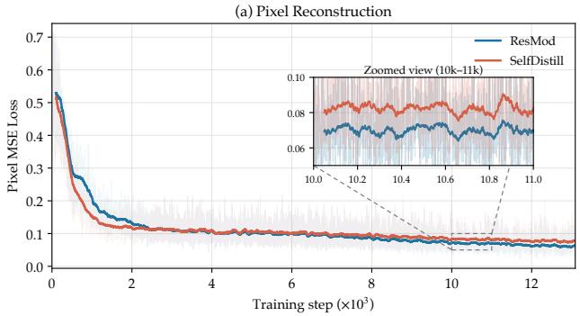

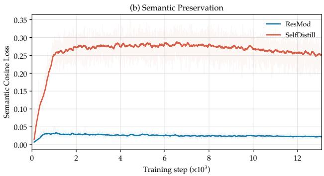  
Figure 8 Pixel and representation losses for residual feature fusion. Compared with SelfDistill, ResMod maintains lower pixel MSE and representation cosine losses during late-stage training, indicating better preservation of both visua details and semantic representations.

Table 9 Visual understanding with continuous and discrete representations. Continuous features are evaluated with and without ResMod. OCRBench is divided by 10 when computing the eight-benchmark average.
<table><tr><td>Exp ID</td><td>Type</td><td>ResMod</td><td>MMMU</td><td>RealWorldQA</td><td>MMStar</td><td>OCRBench</td><td>TextVQA</td><td>AI2D</td><td>ChartQA</td><td>DocVQA</td><td>Avg. ↑</td></tr><tr><td>1</td><td></td><td>x</td><td>39.44</td><td>60.26</td><td>44.60</td><td>695</td><td>74.84</td><td>81.87</td><td>73.64</td><td>86.29</td><td>66.31</td></tr><tr><td>2</td><td>Continuous</td><td>√</td><td>40.56</td><td>60.92</td><td>45.33</td><td>695</td><td>74.89</td><td>81.51</td><td>73.16</td><td>86.01</td><td>66.48</td></tr><tr><td>3</td><td></td><td>√</td><td>40.00</td><td>62.61</td><td>46.60</td><td>713</td><td>75.05</td><td>81.31</td><td>72.80</td><td>86.01</td><td>66.96</td></tr><tr><td>4</td><td>Discrete</td><td>√</td><td>38.33</td><td>59.08</td><td>45.73</td><td>682</td><td>73.49</td><td>80.60</td><td>71.00</td><td>83.98</td><td>65.05</td></tr></table>

We further assess the efectiveness of ResMod on visual understanding tasks. These experiments use Qwen3- 1.7B as the language backbone, with the visual tokenizer kept frozen. In Table 9, settings 1 and 3 train understanding models on frozen continuous features without and with pretrained ResMod, respectively. For the training-free setting 2, we directly insert pretrained ResMod into the trained model from 1 at evaluation time, without any further parameter updates. Setting 2 maintains comparable average performance to 1, even without retraining the LLM. Together with the reconstruction results above, this provides further evidence that ResMod can enrich pixel-level information while preserving pretrained semantic information.

## 5.2 Comparison between Discrete and Continuous Approaches

Using the same understanding training and evaluation setup as in Sec. 5.1, we compare discrete and continuous visual representations. Table 9 shows comparable performance across general understanding, OCR, and document benchmarks. This observation is consistent with the scaling analysis in LongCat-Next (Meituan LongCat Team et al., 2026), which finds that discrete visual embeddings require more training data because they are learned from scratch, and that increasing the data scale progressively closes the gap with continuous models. Together, these findings suggest that discrete visual representations can match continuous features in multimodal understanding.

## 5.3 Comparison of Pixel Reconstruction

Fig. 9 isolates the efect of the decoding strategy while keeping the visual representation and input resolution fixed. The ViT pixel decoder maps the discrete code embeddings directly to pixel values. This path reliably preserves the global layout, color distribution, and semantic content, but tends to over-smooth high-frequency information. Consequently, small text, fine boundaries, and repetitive textures often appear blurred or partially merged.

The flow-based Refiner, used in dNaViT-G16-R, conditions the decoder on the same discrete representations while leveraging a pretrained generative prior. Rather than relying solely on direct pixel regression, it recovers sharper letter contours, finer textures, and more convincing high-frequency details. These improvements are obtained without changing the underlying codes, and the generated results remain consistent with the structure and semantic content specified by the tokenizer.

The advantage becomes particularly evident under high spatial compression. Even with a compact token representation, the Refiner continues to recover legible text and boundary details that the pixel decoder leaves ambiguous. This indicates that the discrete representation retains substantial information beyond what is recovered by direct pixel decoding, and that a generative decoder can realize this information more efectively. The comparison therefore separates the capacity of the learned tokenizer from the limitations of the decoding head, highlighting the benefit of our code-conditioned refinement under highly compressed representations.

## 5.4 Qualitative Visual Understanding Examples

We present qualitative examples of our 8B understanding model on challenging visual inputs: dense full-page documents in English (Fig. 10) and Chinese (Fig. 11), cursive handwriting (Fig. 12), an engineering drawing (Fig. 13), and diagram-grounded reasoning (Figs. 14 and 15). Each example places the source image inside the model response, with the instruction and the response set. Responses are reproduced verbatim, including the model’s own errors. Long transcriptions are truncated at a paragraph boundary and marked as continuing, and for examples in which the model produces an explicit reasoning trace, only the final response is shown. These examples illustrate fine-grained recognition and reasoning rather than replace quantitative evaluation.

## 6 Conclusion

This work presents dNaViT, a foundational visual component acting as a native-resolution tokenizer that turns discrete codes into universal visual primitives. Through lightweight residual modulation, grouped product quantization, and progressive dual-branch optimization, dNaViT successfully reconciles high-level semantic abstraction with fine-grained visual reconstruction. Further code-conditioned refinement enhances perceptual fidelity without altering the unified representation. Across understanding, generation, and editing tasks, dNaViT matches or exceeds task-specific baselines under a significantly smaller data budget. These findings demonstrate that a shared discrete token space can serve as a universal visual currency, paving the way for fully unified, native multimodal intelligence.

## 7 Contributors

Xiaotong Li\*, Zhengrong Yue\*, Xu Huang\*, Jialv Zou\*, Minhao Jing, Wenhao Yan, Haodong Li, Hai Huang, Bo Zhao, Yan Feng, Peng Pei, Xunliang Cai

Equal contribution.

Same Input Resolution  
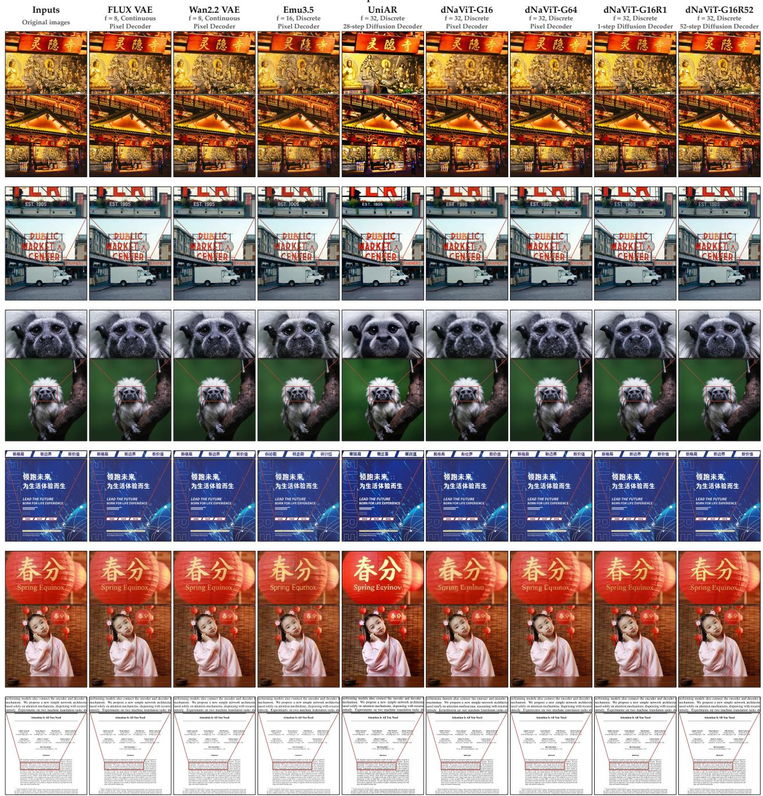  
Figure 9 Qualitative reconstruction comparison at the same input resolution. f denotes the spatial downsampling factor. Continuous and Discrete denote unquantized latent representations and quantized codes, respectively. G and R specify the number of quantization groups and refinement steps.

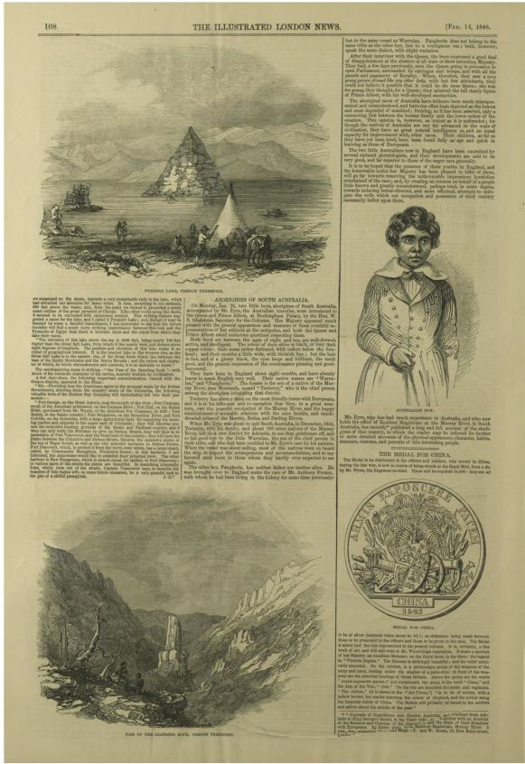

Q: Transcribe all text on this page verbatim in reading order, including headers, image captions, footnotes and the smallest print. Preserve the original language, paragraphs and punctuation. Do not summarize or translate.

## A:

108

THE ILLUSTRATED LONDON NEWS.

[FEB. 14, 1846.

PYRAMID LAKE, OREGON TERRITORY. we encamped on the shore, opposite a very remarkable rock in the lake, which had attracted our attention for many miles. It rose, according to our estimate, 600 feet above the water, and, from the point we viewed it, presented a pretty exact outline of the great pyramid of Cheops. Like other rocks along the shore, it seemed to be encrusted with calcareous cement. This striking feature suggested a name for the lake, and I called it Pyramid Lake; and, though it may be deemed by some a fanciful resemblance, I can undertake to say that the future traveller will find a much more striking resemblance between this rock and the Pyramids of Egypt than there is between them and the object from which they take their name. “The elevation of this lake above the sea is 4890 feet, being nearly 700 feet higher than the Great Salt Lake, from which it lies nearly west, and distant about eight degrees of longitude. The position and elevation of this lake make it an object of geographical interest. It is the nearest lake to the western rim, as the Great Salt Lake is to the eastern rim, of the great Basin which lies between the base of the Rocky Mountains and the Sierra Nevada; and the extent and character of which, its whole circumference and contents, it is so desirable to know.” The accompanying scene is striking—“the Pass of the Standing Rock”—with much of the romantic character of the ravine, scarcely trodden by civilization. A few days since, the following important communication, viewed on the Oregon dispute, appeared in the Times: "Sir,—Providing that the Americans agree to the proposal made by the British Government, allowing them the country south of the Columbia, the following valuable forts of the Hudson Bay Company will immediately fall into their possession:— “Fort George, on the Great Astoria, near the mouth of the

river; Fort Umpqua, south of the American settlement, on the Umpqua River; Fort Hall, on the Snake River, purchased from Mr. Wyeth, of the American Fur Company, in 1837; Fort Balsee, in the Snake country; Fort Nespecees, on the Nespecees River, and Fort Colville, on the Columbia, with a large agricultural farm for supplying the hunting parties and outposts in the upper part of Columbia; they will likewise possess the extensive hunting grounds of the Snake and Flathead country, and if they can only bully the British to give up Defuca Straits, they will then be in possession of Fort Vancouver; and the finest part of the country; they will have the plains between the Columba and Defuca Straits, likewise the extensive plains at the top of Paget Sound, as well as the two splendid harbours in Defuca Straits, Port Discovery, which, to protect it from the north-west winds, has a large island, called, by Commander Broughton, Protection Island; in this harbour, I am informed, the Americans would like to establish their principal town. The other harbour is New Dungeness, which is almost equal, for shelter, to Port Discovery; in various parts of the straits the plains are beautiful. In describing Admiralty Inlet, which runs out of the straits, Captain Vancouver says, to describe the beauties of this region will, on some future occasion, be a very grateful task to the pen of a skilful panegyrist. J. D.” ABORIGINES OF SOUTH AUSTRALIA.   
On Monday, Jan. 26, two little boys, aborigines of South Australia, accompanied by Mr. Eyre, the Australian traveller, were introduced to the Queen and Prince Albert, at Buckingham Palace, by the Hon. W. E. Gladstone, Secretary for the Colonies. Her Majesty appeared much pleased with the general appearance and manners of these youthful representatives of her subjects at the antipodes, and both the Queen and Prince Albert asked numerous questions respecting them.   
Both boys are between the ages of eight and ten, are well-formed, active, and intelligent. The colour of their skins is black, or very dark copper colour; their noses rather flattened, with indent below the forehead; and their mouths a little wide, with thickish lips; but the hair is fine, and of a glossy black, the eyes large and brilliant, the teeth good, and the general expression of the countenance pleasing and good-humoured.   
They have been in England about eight months, and have already learnt to speak English very well. Their native names are “Warrulan,” and “Pangkerin.” The former is the son of a native of the Murray River, near Moorunde, named “Tenberry,” who is the chief person among the aborigines inhabiting that district.   
Tenberry has always been on the most friendly terms with Europeans, and it is to his influence and co-operation that they, in a great measure, owe the peaceful occupation of the Murray River, and the happy establishment of amicable relations with the once hostile, and much-dreaded tribes of the Murray, Rufus, and Darling Rivers.   
[response continues]

Figure 10 Full-page OCR of a densely printed page from The Illustrated London News (1846). The response transcribes the multi-column body text, headings and engraving captions in reading order.

第22卷第1期 水土保持研究2015年2月

# 小兴安岭南麓典型森林类型的土壤水文功能研究

张淑兰，张海军，张武，王长宝，邓际华2，宋英博3，张强

(1.佳木斯大学，黑龙江佳木断154007：2.黑龙江省合江林业科学研究所，

摘 要·通过测定土壤水文物理性质，持水及渗透性能，分析了小兴安岭南麓典型森林土壤的持水，蓄水和渗透能力并利用Kostiaksoy方程，Horton方程和Philin方程模拟了土壤入渗过程，结果表明：该区森林土壤客重介于0.45\~1.52g/cm之间：不同植被类型馆和含水率为28.73%\~177.32%，毛管含水率25.26\~156.84%，自然含水率13.91%\~119.18%，随着土层深度加厚，三者具有明显减小趋势；土壤最大持水量范圈为282.88\~341.41 mm，有效持水量为27,88\~61.13 mm，涵蓄降水能力为165.98\~197.37 mm(除人工兴安落叶松林为 76.32 mm 以外)：各植被类型土壤初渗速率和稳渗速率最大值在 0—10 cm 或 10—20 cm 土层，平均值分别为 11.92 mm/min和 2.78 mmmin：二者最小值在不同的植被类型下出现的士层不同，平均值分别为219 rmm/min和0.6 rmm/min：从+壤的入清过程模拟看，Horton方程的模拟效果较好，

关键词：土壤水文物理；持水能力；渗透性：小兴安岭

中图分类号：S715.7 文献标识码：A

文章编号：1005-3409(2015)01-0140-06

DOI:10.13869/j.cnki.rswc.2015.01.027

# Soil Hydrological Properties of Main Vegetation in Down South of Xiao Xing'an Mountains

ZHANG Shulan1 , ZHANG Haijun1, ZHANG Wu1, WANG Changbao1, DENG Jihua2 , SONG Yingbo3, ZHANG Qiang1

Abstract: Based on soil hydrology physical properties, water holding capacity and infiltration, the water stor moisture contents of different vegetation types were between 28, 73%\~177, 32%. capillary moisture con rameters obviously decreased with increase of soil depth; the range of soil maximum storage capacity wat \~197. 37 mm (except for artificial Larix gmelini forest of 76, 32 mm). Soil initial infiltration rate and stead infiltration rate of each vegetation type were the largest in 0—10 em or 10—20 em soil laver, the average val types present in different soil layers, with average value of 2. 19 mm/min and 0. 66 mm/min. According to the soil infiltration process simulation, Horton equation was better for this simulation Keywords:soil hvdrological properties; water storage capacitv; infiltration; Xiao Xing'an Mountain

森林土壤的水文功能主要指土壤的持水能力及渗透特性，是森林植被保持水土和涵养水源作用的重要体现1-1]，也是森林生态系统服务功能评价的一个重要指标[4-5]。其中，森林土壤的持水能力是指森林生态系统中涵蓄土壤水分、补充地下水和调节河川流量的功能，其与森林土壤的物理性质有直接的关

收稿日期：2014-04-11 玻稿日期：2014-04-11 修回日期：2014-04-29 修回日期：2014-04-29

资助项目：国家自然科学基金项目(41301034)：黑龙江省教育厅科学技术研究项目(12531703)；佳木斯大学青年基金项目(Sq2012-32)第一作者：张淑兰(1980—)，女，河北省漆南县人，博士，讲师，主要从事森林生态、生态水文过程与模型应用研究。Email:zhangshulan1980@

Q: Transcribe all text on this page verbatim in reading order, including running headers, footnotes, afiliations and the smallest print. Preserve the original language (keep Chinese text in Chinese and English text in English), paragraphs and punctuation. Do not summarize or translate.

## A:

第 22 卷第 1 期2015 年 2 月水土保持研究

Research of Soil and Water Conservation   
Vol. 22, No. 1   
Feb., 2015

小兴安岭南麓典型森林类型的土壤水文功能研究张淑

兰 1 ，张海军 1 ，张武 1 ，王长宝 1 ，邓际华 2 ，宋英博 3 ，张强 1(1. 佳木斯大学，黑

龙江 佳木斯 154002；2. 黑龙江省合江林业科学研究所，黑龙江 佳木斯154007；3. 黑龙江省农业科学院佳木斯分院，黑龙江 佳木斯 154007)摘要：通过测定土壤

水文物理性质、持水及渗透性能，分析了小兴安岭南麓典型森林土壤的持水、蓄水和渗透能力，并利用 Kostiakov 方程、Horton 方程和 Philip方程模拟了土壤入渗过程。结果表明：该区森林土壤容重介于 0.45～1.52g/cm 3 之间；不同植被类型饱和含水率为 28.73%～177.32%，毛管含水率 25.26～156.84%，自然含水率 13.91%～119.18%，

关键词：土壤水文物理；持水能力；渗透性；小兴安岭

中图分

类号：S715.7 文献标识码：A 文章编号：1005-3409(2015)01-0140-06  
DOI:10.13869/j.cnki.rswc.2015.01.027

Soil Hydrological

Properties of Main Vegetation in Down South of Xiao Xing’an Mountains ZHANG Shulan 1 , ZHANG Haijun 1 , ZHANG Wu 1 , WANG Changbao 1 , DENG Jihua 2 , SONG Yingbo 3 , ZHANG Qiang 1

Q: Transcribe all handwritten text on this page verbatim, line by line, preserving the original spelling, punctuation and line breaks. Do not correct or translate. Mark illegible words as [illegible].

## A:

HARDEGG’S JERUSALEM HOTEL   
JAFFA (Palestine)   
Telegr. HOTEL HARDEGG   
Jafa, Nov. 21, 1911   
Mollie dear::   
I read your three letters   
on the boat and was much distressed   
to learn what the doctor said about it, also we both knew you had a sensitive   
gall bladder. I am glad those blessed   
women took you in hand and I hope   
now that your convalescence is over, that things will go better. I had a letter from Mora and she says you are not well she   
thinks. I do not think you have passed   
gall stones as George did for you from   
not had three occurrences of pain before. They say most people have gall stones. You should follow the doctor’s advice about diet. Do you know. I am convinced that   
cofee for breakfast was bad for me. I am

Figure 12 Full transcription of a 1911 cursive letter written on printed hotel stationery, covering both the printed letterhead and the connected handwriting.

## Engineering Drawing

Q: Read the title block and every station range on this engineering drawing. Transcribe the drawing number, date, sheet title, project ID, sheet number and total, and list each STA. range under the section it belongs to. Output only the transcription.

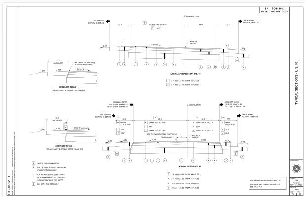  
Figure 13 Structured field extraction from a large-format engineering drawing: the response transcribes the title block and every station range, grouped by the typical section it belongs to.

## A:

Drawing Number: SP 1304-1(c)

Date: JANUARY 2025

Sheet Title: TYPICAL SECTIONS - U.S. 46

Project ID: 130401

Sheet Number / Total: P.5 / 86

SUPERELEVATED SECTION - U.S. 46   
STA. 658+77.85 TO STA. 659+27.03   
STA. 659+27.03 TO STA. 660+20.37

NORMAL SECTION - U.S. 46

STA. 660+20.37 TO STA. 660+51.59   
STA. 660+51.59 TO STA. 663+81.59   
STA. 663+81.59 TO STA. 664+31.59   
STA. 664+31.59 TO STA. 664+81.59

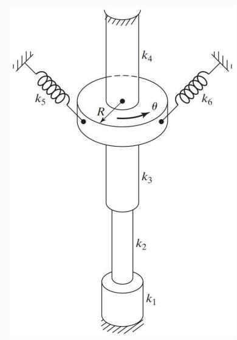

Q: Find the equivalent torsional spring constant of the system shown in the figure.   
Assume that k1, k2, k3, and k4 are torsional and k5 and k6 are linear spring constants.

Options: A $\begin{array} { r } { \mathbf { \nabla } . ~ k _ { e t } = ( \frac { k _ { 1 } k _ { 2 } k _ { 3 } } { k _ { 2 } k _ { 3 } + k _ { 1 } k _ { 3 } + k _ { 1 } k _ { 2 } } ) + k _ { 5 } + R ^ { 2 } ( k _ { 4 } + k _ { 6 } ) ; ~ \mathrm { B } . } \end{array}$

$$
\begin{array} { r } { k _ { e t } = ( \frac { k _ { 1 } k _ { 2 } k _ { 3 } } { k _ { 2 } k _ { 3 } + k _ { 1 } k _ { 3 } + k _ { 1 } k _ { 2 } } ) + k _ { 4 } + R ^ { 2 } ( k _ { 5 } + k _ { 6 } ) ; \mathrm { C } . } \end{array}\tag{A:}
$$

$$
\begin{array} { r } { k _ { e t } = ( \frac { k _ { 1 } k _ { 2 } k _ { 3 } } { k _ { 2 } k _ { 3 } + k _ { 1 } k _ { 3 } + k _ { 1 } k _ { 2 } } ) + k _ { 6 } + R ^ { 2 } ( k _ { 4 } + k _ { 5 } ) . } \end{array}
$$

The correct choice is B.

The three torsional springs $\boldsymbol { k } _ { 1 } , \boldsymbol { k } _ { 2 } , \boldsymbol { k } _ { 3 }$ are in series, so their equivalent stifness is

$$
k _ { 1 2 3 } = { \frac { k _ { 1 } k _ { 2 } k _ { 3 } } { k _ { 1 } k _ { 2 } + k _ { 1 } k _ { 3 } + k _ { 2 } k _ { 3 } } } .
$$

The linear springs $k _ { 5 }$ and $k _ { 6 }$ act at radius $R ,$ so they produce torques

$$
M _ { 5 } = k _ { 5 } R ^ { 2 } \theta , \qquad M _ { 6 } = k _ { 6 } R ^ { 2 } \theta ,
$$

giving total linear-spring torque

$$
M _ { 5 6 } = R ^ { 2 } ( k _ { 5 } + k _ { 6 } ) \theta .
$$

The torsional spring $k _ { 4 }$ directly adds

Thus

$$
M _ { 4 } = k _ { 4 } \theta .
$$

$$
\boxed { k _ { e t } = \cfrac { k _ { 1 } k _ { 2 } k _ { 3 } } { k _ { 1 } k _ { 2 } + k _ { 1 } k _ { 3 } + k _ { 2 } k _ { 3 } } + k _ { 4 } + R ^ { 2 } ( k _ { 5 } + k _ { 6 } ) }
$$

which is Option B.

Figure 14 Mechanical-vibration reasoning from a schematic: the model identifies series, parallel and lever-arm spring combinations (MMMU, hard).

## Projectile Angle at Impact

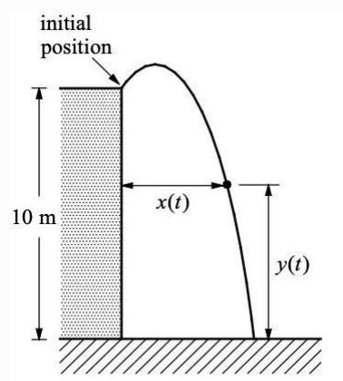

Q: An obiect is thrown upward into the air 10 meters above the ground. The figure above shows the initiaposition of the object and the position at a later time. At time t seconds after the object is thrown upwardthe horizontal distance from the initial position is given by x(t) meters, and the vertical distance from the ground is given by y(t) meters, where $\textstyle { \frac { d x } { d t } } = 1 . 4$ and $\begin{array} { r } { \frac { d y } { d t } = 4 . 2 - 9 . 8 t , \mathrm { f o r ~ t ~ \geq ~ 0 ~ } } \end{array}$ .Find the angle $\theta , 0 < \theta <$ $\dot { \pi } / 2$ , between the path of the object and the ground at the instance the objecthit the ground. Options: $\mathrm { \dot { A } . ~ } \theta = 0 . 5 2 4 ; \mathrm { \dot { B } . ~ } \theta = 1 . 0 4 7 ; \mathrm { \dot { C } . ~ } \theta = 1 . 4 7 5 ; \mathrm { D . ~ } \theta = 1 . 5 7 0$

$$
y ( t ) = 1 0 + 4 . 2 t - 4 . 9 t ^ { 2 }
$$

The object hits the ground when $y ( t ) = 0 \colon$

$$
4 . 9 t ^ { 2 } - 4 . 2 t - 1 0 = 0
$$

$$
t \approx 1 . 9 2
$$

At that time,

$$
\frac { d y } { d t } = 4 . 2 - 9 . 8 t \approx - 1 4 . 6 1 6
$$

Note: Figure not drawn to scale.

and

$$
\frac { d x } { d t } = 1 . 4
$$

So the slope of the path is

$$
\frac { d y } { d x } = \frac { d y / d t } { d x / d t } \approx \frac { - 1 4 . 6 1 6 } { 1 . 4 } = - 1 0 . 4 4
$$

The angle with the ground is

$$
\theta = \tan ^ { - 1 } ( 1 0 . 4 4 ) \approx 1 . 4 7 5
$$

Answer: C. θ = 1.475

Figure 15 Calculus reasoning grounded in a diagram: the model integrates the velocity, solves for the landing time and converts the slope into an angle (MMMU, hard).

## References

Yuang Ai, Jiaming Han, Shaobin Zhuang, Weijia Mao, Xuefeng Hu, Ziyan Yang, Zhenheng Yang, Huaibo Huang, Xiangyu Yue, and Hao Chen. BitDance: Scaling autoregressive generative models with binary tokens. arXiv preprint arXiv:2602.14041, 2026. https://arxiv.org/abs/2602.14041.

Ruichuan An, Sihan Yang, Ziyu Guo, Wei Dai, Zijun Shen, Haodong Li, Renrui Zhang, Xinyu Wei, Guopeng Li, Wenshan Wu, and Wentao Zhang. GENIUS: Generative fluid intelligence evaluation suite. arXiv preprint arXiv:2602.11144, 2026a. https://arxiv.org/abs/2602.11144.

Xiang An, Yin Xie, Kaicheng Yang, Wenkang Zhang, Xiuwei Zhao, Zheng Cheng, Yirui Wang, Songcen Xu, Changrui Chen, Didi Zhu, et al. LLaVA-OneVision-1.5: Fully open framework for democratized multimodal training. arXiv preprint arXiv:2509.23661, 2025.

Xiang An, Yin Xie, Feilong Tang, Yunyao Yan, Huajie Tan, Didi Zhu, Changrui Chen, Xiuwei Zhao, Bin Qin, Kaicheng Yang, et al. LLaVA-OneVision-2: Towards next-generation perceptual intelligence. arXiv preprint arXiv:2605.25979, 2026b.

Shuai Bai, Yuxuan Cai, Ruizhe Chen, Keqin Chen, Xionghui Chen, Zesen Cheng, Lianghao Deng, Wei Ding, Chang Gao, Chunjiang Ge, et al. Qwen3-VL technical report. arXiv preprint arXiv:2511.21631, 2025a.

Shuai Bai, Keqin Chen, Xuejing Liu, Jialin Wang, Wenbin Ge, Sibo Song, Kai Dang, Peng Wang, Shijie Wang, Jun Tang, Humen Zhong, Yuanzhi Zhu, Mingkun Yang, Zhaohai Li, Jianqiang Wan, Pengfei Wang, Wei Ding, Zheren Fu, Yiheng Xu, Jiabo Ye, Xi Zhang, Tianbao Xie, Zesen Cheng, Hang Zhang, Zhibo Yang, Haiyang Xu, and Junyang Lin. Qwen2.5-VL technical report. arXiv preprint arXiv:2502.13923, 2025b.

Andrei Barbu, David Mayo, Julian Alverio, William Luo, Christopher Wang, Dan Gutfreund, Josh Tenenbaum, and Boris Katz. ObjectNet: A large-scale bias-controlled dataset for pushing the limits of object recognition models. In Advances in Neural Information Processing Systems, volume 32, 2019.

Tiwei Bie, Haoxing Chen, Tieyuan Chen, Zhenglin Cheng, Long Cui, Kai Gan, Zhicheng Huang, et al. LLaDA2.0- Uni: Unifying multimodal understanding and generation with difusion large language model. arXiv preprint arXiv:2604.20796, 2026.

Black Forest Labs. FLUX. Oficial model and code release, 2024. https://github.com/black-forest-labs/flux.

Black Forest Labs, Stephen Batifol, Andreas Blattmann, et al. FLUX.1 Kontext: Flow matching for in-context image generation and editing in latent space. arXiv preprint arXiv:2506.15742, 2025. https://arxiv.org/abs/2506.15742.

Tim Brooks, Aleksander Holynski, and Alexei A. Efros. InstructPix2Pix: Learning to follow image editing instructions. In Proceedings of the IEEE/CVF Conference on Computer Vision and Pattern Recognition, 2023. https://arxiv. org/abs/2211.09800.

Tom B. Brown, Benjamin Mann, Nick Ryder, Melanie Subbiah, Jared Kaplan, Prafulla Dhariwal, Arvind Neelakantan, Pranav Shyam, Girish Sastry, Amanda Askell, et al. Language models are few-shot learners. arXiv preprint arXiv:2005.14165, 2020. https://arxiv.org/abs/2005.14165.

Minwoo Byeon, Beomhee Park, Haecheon Kim, Sungjun Lee, Woonhyuk Baek, and Saehoon Kim. COYO-700M: Image-text pair dataset. https://github.com/kakaobrain/coyo-dataset, 2022.

ByteDance Seed. Seedream 4.0: Toward next-generation multimodal image generation. arXiv preprint arXiv:2509.20427, 2025. https://arxiv.org/abs/2509.20427.

ByteDance Seed. Seedream 4.5, 2026. https://console.byteplus.com/ark/region:ap-southeast-1/model/detail?Id= seedream-4-5. Model release.

Davide Cafagni, Federico Cocchi, Luca Barsellotti, Nicholas Moratelli, Sara Sarto, Lorenzo Baraldi, Lorenzo Baraldi, Marcella Cornia, and Rita Cucchiara. The revolution of multimodal large language models: A survey. In Findings of the Association for Computational Linguistics: ACL 2024, pages 13590–13618. Association for Computational Linguistics, 2024. doi: 10.18653/v1/2024.findings-acl.807. https://aclanthology.org/2024.findings-acl.807/.

Qi Cai, Jingwen Chen, Yang Chen, et al. HiDream-I1: A high-eficient image generative foundation model with sparse difusion transformer. arXiv preprint arXiv:2505.22705, 2025. https://arxiv.org/abs/2505.22705.

Chameleon Team. Chameleon: Mixed-modal early-fusion foundation models. arXiv preprint arXiv:2405.09818, 2024. https://arxiv.org/abs/2405.09818.

Guo Chen, Zhiqi Li, Shihao Wang, Jindong Jiang, Yicheng Liu, Lidong Lu, De-An Huang, Wonmin Byeon, et al. Eagle 2.5: Boosting long-context post-training for frontier vision-language models. arXiv preprint arXiv:2504.15271, 2025a.

Junyu Chen, Han Cai, Junsong Chen, et al. Deep compression autoencoder for eficient high-resolution difusion models. arXiv preprint arXiv:2410.10733, 2024a. https://arxiv.org/abs/2410.10733.

Lin Chen, Jinsong Li, Xiaoyi Dong, Pan Zhang, Yuhang Zang, Zehui Chen, Haodong Duan, Jiaqi Wang, Yu Qiao, Dahua Lin, et al. Are we on the right way for evaluating large vision-language models? Advances in Neural Information Processing Systems, 37:27056–27087, 2024b.

Xiaokang Chen, Zhiyu Wu, Xingchao Liu, Zizheng Pan, Wen Liu, Zhenda Xie, Xingkai Yu, and Chong Ruan. Janus-Pro: Unified multimodal understanding and generation with data and model scaling. arXiv preprint arXiv:2501.17811, 2025b. https://arxiv.org/abs/2501.17811.

Jang Hyun Cho, Andrea Madotto, Efrosyni Mavroudi, Triantafyllos Afouras, Tushar Nagarajan, Muhammad Maaz, Yale Song, Tengyu Ma, et al. PerceptionLM: Open-access data and models for detailed visual understanding. arXiv preprint arXiv:2504.13180, 2025.

Christopher Clark, Jieyu Zhang, Zixian Ma, Jae Sung Park, Mohammadreza Salehi, Rohun Tripathi, Sangho Lee, Zhongzheng Ren, et al. Molmo2: Open weights and data for vision-language models with video understanding and grounding. arXiv preprint arXiv:2601.10611, 2026.

Yufeng Cui, Honghao Chen, Haoge Deng, Xu Huang, Xinghang Li, Jirong Liu, Yang Liu, Zhuoyan Luo, Jinsheng Wang, et al. Emu3.5: Native multimodal models are world learners. arXiv preprint arXiv:2510.26583, 2025. https://arxiv.org/abs/2510.26583.

Grégoire Delétang, Anian Ruoss, Paul-Ambroise Duquenne, Elliot Catt, Tim Genewein, Christopher Mattern, Jordi Grau-Moya, Li Kevin Wenliang, Matthew Aitchison, Laurent Orseau, Marcus Hutter, and Joel Veness. Language modeling is compression. arXiv preprint arXiv:2309.10668, 2023. https://arxiv.org/abs/2309.10668

Chaorui Deng, Deyao Zhu, Kunchang Li, Chenhui Gou, Feng Li, Zeyu Wang, Shu Zhong, Weihao Yu, Xiaonan Nie, Ziang Song, Guang Shi, and Haoqi Fan. Emerging properties in unified multimodal pretraining. arXiv preprint arXiv:2505.14683, 2025. https://arxiv.org/abs/2505.14683.

Jia Deng, Wei Dong, Richard Socher, Li-Jia Li, Kai Li, and Li Fei-Fei. ImageNet: A large-scale hierarchical image database. In IEEE Conference on Computer Vision and Pattern Recognition, 2009.

Haiwen Diao, Penghao Wu, Hanming Deng, Jiahao Wang, Shihao Bai, Silei Wu, Weichen Fan, Wenjie Ye, Wenwen Tong, Xiangyu Fan, et al. SenseNova-U1: Unifying multimodal understanding and generation with NEO-unify architecture. arXiv preprint arXiv:2605.12500, 2026. https://arxiv.org/abs/2605.12500.

Boyang Ding, Chenglong Chu, Dunju Zang, Han Li, Jiangxia Cao, Kun Gai, Muhao Wei, Ruiming Tang, et al. Kelix technical report. arXiv preprint arXiv:2602.09843, 2026.

Patrick Esser, Robin Rombach, and Björn Ommer. Taming transformers for high-resolution image synthesis. In Proceedings of the IEEE/CVF Conference on Computer Vision and Pattern Recognition, pages 12873–12883, 2021.

Patrick Esser, Sumith Kulal, Andreas Blattmann, Rahim Entezari, Jonas Müller, Harry Saini, Yam Levi, Dominik Lorenz, Axel Sauer, et al. Scaling rectified flow transformers for high-resolution image synthesis. arXiv preprint arXiv:2403.03206, 2024. https://arxiv.org/abs/2403.03206.

Kawin Ethayarajh. How contextual are contextualized word representations? Comparing the geometry of BERT, ELMo, and GPT-2 embeddings. In Proceedings of the 2019 Conference on Empirical Methods in Natural Language Processing and the 9th International Joint Conference on Natural Language Processing (EMNLP-IJCNLP), pages 55–65, Hong Kong, China, November 2019. Association for Computational Linguistics. doi: 10.18653/v1/D19-1006. https://aclanthology.org/D19-1006/.

Alisa Fortin, Guillaume Vernade, Kat Kampf, and Ammaar Reshi. Introducing Gemini 2.5 Flash Image, our state-of-the-art image model. Google Developers Blog, 2025. https://developers.googleblog.com/ introducing-gemini-2-5-flash-image/.

Ling Fu, Zhebin Kuang, Jiajun Song, Mingxin Huang, Biao Yang, Yuzhe Li, Linghao Zhu, Qidi Luo, Xinyu Wang, Hao Lu, et al. OCRBench V2: An improved benchmark for evaluating large multimodal models on visual text localization and reasoning. Advances in Neural Information Processing Systems, 38, 2026.

Samir Yitzhak Gadre, Gabriel Ilharco, Alex Fang, et al. DataComp: In search of the next generation of multimodal datasets. In Advances in Neural Information Processing Systems, 2023. https://arxiv.org/abs/2304.14108.

Zigang Geng, Yibing Wang, Yeyao Ma, Chen Li, Yongming Rao, Shuyang Gu, Zhao Zhong, Qinglin Lu, Han Hu, Xiaosong Zhang, et al. X-Omni: Reinforcement learning makes discrete autoregressive image generative models great again. arXiv preprint arXiv:2507.22058, 2025.

Google. Introducing Gemini 2.5 flash image, 2025a. https://developers.googleblog.com/en/ introducing-gemini-2-5-flash-image/. Oficial announcement of Nano Banana.

Google. Build with Nano Banana Pro, our Gemini 3 pro image model, 2025b. https://blog.google/innovation-and-ai/ technology/developers-tools/gemini-3-pro-image-developers/. Oficial announcement of Nano Banana Pro.

Google Cloud. Nano Banana 2 and Nano Banana Pro are generally available, 2026. https://cloud.google.com/ blog/products/ai-machine-learning/nano-banana-2-and-nano-banana-pro-are-generally-available. Oficial release of Nano Banana 2.

Jiaming Han, Hao Chen, Yang Zhao, Hanyu Wang, Qi Zhao, Ziyan Yang, Hao He, Xiangyu Yue, and Lu Jiang. Vision as a dialect: Unifying visual understanding and generation via text-aligned representations. Advances in Neural Information Processing Systems, 38:158430–158459, 2026.

Dan Hendrycks, Steven Basart, Norman Mu, Saurav Kadavath, Frank Wang, Evan Dorundo, Rahul Desai, Tyler Zhu, Samyak Parajuli, Mike Guo, Dawn Song, Jacob Steinhardt, and Justin Gilmer. The many faces of robustness: A critical analysis of out-of-distribution generalization. In Proceedings of the IEEE/CVF International Conference on Computer Vision, pages 8340–8349, 2021a.

Dan Hendrycks, Kevin Zhao, Steven Basart, Jacob Steinhardt, and Dawn Song. Natural adversarial examples. In Proceedings of the IEEE/CVF Conference on Computer Vision and Pattern Recognition, pages 15262–15271, 2021b.

Xu Huang, Ye Huang, Zijun Liao, Yuwei Niu, Xiaojie Li, Menghan Zhou, De Wen Soh, Xiaotong Li, and Daquan Zhou. DC-SAE: Deep compression semantic autoencoder for faster difusion convergence. arXiv preprint arXiv:2609.39222, 2026. https://arxiv.org/abs/2609.39222.

Hervé Jégou, Matthijs Douze, and Cordelia Schmid. Product quantization for nearest neighbor search. IEEE Transactions on Pattern Analysis and Machine Intelligence, 33(1):117–128, 2011. doi: 10.1109/TPAMI.2010.57. https://doi.org/10.1109/TPAMI.2010.57.

Kat Kampf and Nicole Brichtova. Experiment with Gemini 2.0 Flash native image generation. Google Developers Blog, 2025. https://developers.googleblog.com/en/experiment-with-gemini-20-flash-native-image-generation/.

Kimi Team. Kimi-VL technical report. arXiv preprint arXiv:2504.07491, 2025.

Alexander Kirillov, Eric Mintun, Nikhila Ravi, Hanzi Mao, Chloe Rolland, Laura Gustafson, Tete Xiao, Spencer Whitehead, Alexander C. Berg, Wan-Yen Lo, Piotr Dollár, and Ross Girshick. Segment anything. arXiv preprint arXiv:2304.02643, 2023. https://arxiv.org/abs/2304.02643.

Niantong Li, Guangzheng Hu, Weixu Qiao, Ying Ba, Qichen Hong, Shijun Shen, Jinlin Wang, Fan Zhou, Jianye Kang, Xin Shang, Ziyi He, Wei Wang, Dalin Li, Jiahao Li, Jie Zhang, Kaiyuan Gao, Kun Yan, Lihan Jiang, Ningyuan Tang, Shengming Yin, Tianhe Wu, Xiao Xu, Xiaoyue Chen, Yuxiang Chen, Yan Shu, Yanran Zhang, Yilei Chen, Yixian Xu, Zekai Zhang, Zhendong Wang, Zihao Liu, Zikai Zhou, Hongzhu Shi, Yi Wang, Bing Zhao, Hu Wei, Lin Qu, and Chenfei Wu. Qwen-Image-Bench: From generation to creation in text-to-image evaluation. arXiv preprint arXiv:2605.28091, 2026.

Xianhang Li, Haoqin Tu, Mude Hui, Zeyu Wang, Bingchen Zhao, Junfei Xiao, Sucheng Ren, Jieru Mei, Qing Liu, Huangjie Zheng, Yuyin Zhou, and Cihang Xie. What if we recaption billions of web images with LLaMA-3? arXiv preprint arXiv:2406.08478, 2024. https://arxiv.org/abs/2406.08478.

Zhen Li, Duan Li, Yukai Guo, Xinyuan Guo, Bowen Li, Lanxi Xiao, Shenyu Qiao, Jiashu Chen, Zijian Wu, Hui Zhang, Xinhuan Shu, and Shixia Liu. ChartGalaxy: A dataset for infographic chart understanding and generation. arXiv preprint arXiv:2505.18668, 2025. https://arxiv.org/abs/2505.18668.

Bin Lin, Zongjian Li, Xinhua Cheng, et al. UniWorld: High-resolution semantic encoders for unified visual understanding and generation. arXiv preprint arXiv:2506.03147, 2025. https://arxiv.org/abs/2506.03147.

Shiyu Liu, Yucheng Han, Peng Xing, Fukun Yin, Rui Wang, Wei Cheng, Jiaqi Liao, Yingming Wang, Honghao Fu, Chunrui Han, Guopeng Li, Yuang Peng, Quan Sun, Jingwei Wu, Yan Cai, Zheng Ge, Ranchen Ming, Lei Xia,

Xianfang Zeng, Yibo Zhu, Binxing Jiao, Xiangyu Zhang, Gang Yu, and Daxin Jiang. Step1X-Edit: A practical framework for general image editing. arXiv preprint arXiv:2504.17761, 2025.

Yuliang Liu, Zhang Li, Mingxin Huang, Biao Yang, Wenwen Yu, Chunyuan Li, Xu-Cheng Yin, Cheng-Lin Liu, Lianwen Jin, and Xiang Bai. OCRBench: On the hidden mystery of OCR in large multimodal models. Science China Information Sciences, 67(12):220102, 2024.

Pan Lu, Hritik Bansal, Tony Xia, Jiacheng Liu, Chunyuan Li, Hannaneh Hajishirzi, Hao Cheng, Kai-Wei Chang, Michel Galley, and Jianfeng Gao. MathVista: Evaluating mathematical reasoning of foundation models in visual contexts. In International Conference on Learning Representations, volume 2024, pages 23439–23554, 2024.

Zhuoyan Luo, Fengyuan Shi, Yixiao Ge, Yujiu Yang, Limin Wang, and Ying Shan. Open-MAGVIT2: An opensource project toward democratizing auto-regressive visual generation. arXiv preprint arXiv:2409.04410, 2024. https://arxiv.org/abs/2409.04410

Chuofan Ma, Yi Jiang, Junfeng Wu, Jihan Yang, Xin Yu, Zehuan Yuan, Bingyue Peng, and Xiaojuan Qi. UniTok: A unified tokenizer for visual generation and understanding. In Advances in Neural Information Processing Systems, 2025. https://arxiv.org/abs/2502.20321.

Ahmed Masry, Jia Qing Tan, Shafiq Joty, Enamul Hoque, et al. ChartQA: A benchmark for question answering about charts with visual and logical reasoning. In Findings of the association for computational linguistics: ACL 2022, pages 2263–2279, 2022.

Minesh Mathew, Dimosthenis Karatzas, and CV Jawahar. DocVQA: A dataset for VQA on document images. In 2021 IEEE Winter Conference on Applications of Computer Vision (WACV), pages 2199–2208. IEEE, 2021.

Minesh Mathew, Viraj Bagal, Rubèn Tito, Dimosthenis Karatzas, Ernest Valveny, and CV Jawahar. InfographicVQA. In 2022 IEEE/CVF Winter Conference on Applications of Computer Vision (WACV), pages 2582–2591. IEEE, 2022.

Meituan LongCat Team, Bin Xiao, Chao Wang, Chengjiang Li, Chi Zhang, Chong Peng, Hang Yu, Hao Yang, Haonan Yan, Haoze Sun, et al. LongCat-Next: Lexicalizing modalities as discrete tokens. arXiv preprint arXiv:2603.27538, 2026. https://arxiv.org/abs/2603.27538.

Microsoft. Phi-4-Mini technical report: Compact yet powerful multimodal language models via mixture-of-LoRAs. arXiv preprint arXiv:2503.01743, 2025.

NVIDIA. NVIDIA Nemotron Nano V2 VL. arXiv preprint arXiv:2511.03929, 2025.

NVIDIA, Niket Agarwal, Arslan Ali, Maciej Bala, Yogesh Balaji, Erik Barker, Tifany Cai, Prithvijit Chattopadhyay, Yongxin Chen, et al. Cosmos world foundation model platform for physical AI. arXiv preprint arXiv:2501.03575, 2025. https://arxiv.org/abs/2501.03575.

OpenAI. Introducing our latest image generation model in the API, 2025. https://openai.com/index/ image-generation-api/. Oficial release of gpt-image-1.

OpenAI. GPT-Image-2, 2026. https://developers.openai.com/api/docs/models/gpt-image-2. Model documentation.

Linke Ouyang, Yuan Qu, Hongbin Zhou, Jiawei Zhu, Rui Zhang, Qunshu Lin, Bin Wang, Zhiyuan Zhao, Man Jiang, Xiaomeng Zhao, et al. OmniDocBench: Benchmarking diverse PDF document parsing with comprehensive annotations. In 2025 IEEE/CVF Conference on Computer Vision and Pattern Recognition (CVPR), pages 24838– 24848. IEEE, 2025.

Wujian Peng, Lingchen Meng, Yuxuan Cai, Xianwei Zhuang, Yuhuan Yang, Rongyao Fang, Chenfei Wu, Junyang Lin, Zuxuan Wu, and Shuai Bai. Unified multimodal autoregressive modeling with shared context—visual tokenizer is key to unification. arXiv preprint arXiv:2606.18249, 2026.

Dustin Podell, Zion English, Kyle Lacey, Andreas Blattmann, Tim Dockhorn, Jonas Müller, Joe Penna, and Robin Rombach. SDXL: Improving latent difusion models for high-resolution image synthesis. arXiv preprint arXiv:2307.01952, 2023. https://arxiv.org/abs/2307.01952.

Liao Qu, Huichao Zhang, Yiheng Liu, Xu Wang, Yi Jiang, Yiming Gao, Hu Ye, Daniel K. Du, Zehuan Yuan, and Xinglong Wu. TokenFlow: Unified image tokenizer for multimodal understanding and generation. In Proceedings of the IEEE/CVF Conference on Computer Vision and Pattern Recognition, 2025. https://arxiv.org/abs/2412.03069.

Qwen Team. Qwen-Image-2512: Finer detail, more realistic, 2025a. https://qwen.ai/blog?id=qwen-image-2512. Model release.

Qwen Team. Qwen-Image-Edit: Image editing with higher quality and eficiency. Oficial model release, 2025b. https://qwenlm.github.io/blog/qwen-image-edit/.

Benjamin Recht, Rebecca Roelofs, Ludwig Schmidt, and Vaishaal Shankar. Do ImageNet classifiers generalize to ImageNet? In Proceedings of the 36th International Conference on Machine Learning, volume 97, pages 5389–5400. PMLR, 2019.

Robin Rombach, Andreas Blattmann, Dominik Lorenz, Patrick Esser, and Björn Ommer. High-resolution image synthesis with latent difusion models. In Proceedings of the IEEE/CVF Conference on Computer Vision and Pattern Recognition, 2022. https://arxiv.org/abs/2112.10752.

Olga Russakovsky, Jia Deng, Hao Su, Jonathan Krause, Sanjeev Satheesh, Sean Ma, Zhiheng Huang, Andrej Karpathy, Aditya Khosla, Michael Bernstein, Alexander C. Berg, and Li Fei-Fei. ImageNet large scale visual recognition challenge. International Journal of Computer Vision, 115(3):211–252, 2015.

Christoph Schuhmann, Romain Beaumont, Richard Vencu, et al. LAION-5B: An open large-scale dataset for training next generation image-text models. arXiv preprint arXiv:2210.08402, 2022. https://arxiv.org/abs/2210.08402.

Stability AI. Introducing Stable Difusion 3.5. Oficial model release, 2024. https://stability.ai/news-updates/ introducing-stable-difusion-3-5.

Peize Sun, Yi Jiang, Shoufa Chen, Shilong Zhang, Bingyue Peng, Ping Luo, and Zehuan Yuan. Autoregressive model beats difusion: Llama for scalable image generation. arXiv preprint arXiv:2406.06525, 2024. https: //arxiv.org/abs/2406.06525.

Hao Tang, Chenwei Xie, Xiaoyi Bao, Tingyu Weng, Pandeng Li, Yun Zheng, and Liwei Wang. UniLiP: Adapting CLIP for unified multimodal understanding, generation and editing. arXiv preprint arXiv:2507.23278, 2025a. https://arxiv.org/abs/2507.23278.

Hao Tang, Chenwei Xie, Xiaoyi Bao, Tingyu Weng, Pandeng Li, Yun Zheng, and Liwei Wang. UniLiP: Adapting CLIP for unified multimodal understanding, generation and editing. arXiv preprint arXiv:2507.23278, 2025b. doi: 10.48550/arXiv.2507.23278. https://arxiv.org/abs/2507.23278.

Team Wan. Wan2.2: Open and advanced large-scale video generative models. Oficial model and code release, 2025. https://github.com/Wan-Video/Wan2.2.

Team Wan, Ang Wang, Baole Ai, Bin Wen, Chaojie Mao, Chen-Wei Xie, Di Chen, Feiwu Yu, Haiming Zhao, et al. Wan: Open and advanced large-scale video generative models. arXiv preprint arXiv:2503.20314, 2025. https://arxiv.org/abs/2503.20314.

Keyu Tian, Yi Jiang, Zehuan Yuan, Bingyue Peng, and Liwei Wang. Visual autoregressive modeling: Scalable image generation via next-scale prediction. arXiv preprint arXiv:2404.02905, 2024. https://arxiv.org/abs/2404.02905.

Michael Tschannen, Alexey Gritsenko, Xiao Wang, Muhammad Ferjad Naeem, Ibrahim Alabdulmohsin, Nikhil Parthasarathy, Talfan Evans, Lucas Beyer, Ye Xia, Basil Mustafa, Olivier Hénaf, Jeremiah Harmsen, Andreas Steiner, and Xiaohua Zhai. SigLIP 2: Multilingual vision-language encoders with improved semantic understanding, localization, and dense features. arXiv preprint arXiv:2502.14786, 2025. https://arxiv.org/abs/2502.14786.

Aaron van den Oord, Oriol Vinyals, and Koray Kavukcuoglu. Neural discrete representation learning. In Advances in Neural Information Processing Systems, volume 30, 2017.

Alex Jinpeng Wang, Dongxing Mao, Jiawei Zhang, Weiming Han, Zhuobai Dong, Linjie Li, Yiqi Lin, Zhengyuan Yang, Libo Qin, Fuwei Zhang, Lijuan Wang, and Min Li. TextAtlas5M: A large-scale dataset for dense text image generation. arXiv preprint arXiv:2502.07870, 2025a. https://arxiv.org/abs/2502.07870.

Haohan Wang, Songwei Ge, Zachary Lipton, and Eric P. Xing. Learning robust global representations by penalizing local predictive power. In Advances in Neural Information Processing Systems, volume 32, 2019.

Junke Wang, Yi Jiang, Zehuan Yuan, Binyue Peng, Zuxuan Wu, and Yu-Gang Jiang. OmniTokenizer: A joint imagevideo tokenizer for visual generation. arXiv preprint arXiv:2406.09399, 2024a. https://arxiv.org/abs/2406.09399.

Junke Wang, Xiao Wang, Jiacheng Pan, Xuefeng Hu, Feng Li, Jingxiang Sun, Chaorui Deng, Zilong Chen, Yunpeng Chen, et al. ARM: An autoregressive large multimodal model with unified discrete representations. arXiv preprint arXiv:2606.11188, 2026. https://arxiv.org/abs/2606.11188.

Weiyun Wang, Zhangwei Gao, Lixin Gu, Hengjun Pu, Long Cui, Xingguang Wei, Zhaoyang Liu, Linglin Jing, Shenglong Ye, Jie Shao, et al. InternVL3.5: Advancing open-source multimodal models in versatility, reasoning, and eficiency. arXiv preprint arXiv:2508.18265, 2025b.

Xinlong Wang, Xiaosong Zhang, Zhengxiong Luo, Quan Sun, Yufeng Cui, Jinsheng Wang, Fan Zhang, Yueze Wang, Zhen Li, Qiying Yu, et al. Emu3: Next-token prediction is all you need. arXiv preprint arXiv:2409.18869, 2024b.

Zirui Wang, Mengzhou Xia, Luxi He, Howard Chen, Yitao Liu, Richard Zhu, Kaiqu Liang, Xindi Wu, Haotian Liu, Sadhika Malladi, et al. CharXiv: Charting gaps in realistic chart understanding in multimodal LLMs. Advances in Neural Information Processing Systems, 37:113569–113697, 2024c.

Chenfei Wu, Jiahao Li, Jingren Zhou, Junyang Lin, Kaiyuan Gao, Kun Yan, Sheng-ming Yin, Shuai Bai, Xiao Xu, et al. Qwen-Image technical report. arXiv preprint arXiv:2508.02324, 2025a. https://arxiv.org/abs/2508.02324.

Chengyue Wu, Xiaokang Chen, Zhiyu Wu, Yiyang Ma, Xingchao Liu, Zizheng Pan, Wen Liu, Zhenda Xie, Xingka Yu, Chong Ruan, and Ping Luo. Janus: Decoupling visual encoding for unified multimodal understanding and generation. arXiv preprint arXiv:2410.13848, 2024. https://arxiv.org/abs/2410.13848.

Chenyuan Wu, Pengfei Zheng, Ruiran Yan, et al. OmniGen2: Exploration to advanced multimodal generation. arXiv preprint arXiv:2506.18871, 2025b. https://arxiv.org/abs/2506.18871.

Junfeng Wu, Dongliang Luo, Weizhi Zhao, Zhihao Xie, Yuanhao Wang, Junyi Li, Xudong Xie, Yuliang Liu, and Xiang Bai. TokBench: Evaluating your visual tokenizer before visual generation. arXiv preprint arXiv:2505.18142, 2025c. https://arxiv.org/abs/2505.18142.

xAI. RealWorldQA: A benchmark for real-world spatial understanding. https://huggingface.co/datasets/xai-org/ RealworldQA, 2024. Accessed: 2025-04-26.

Shitao Xiao, Yueze Wang, Junjie Zhou, et al. OmniGen: Unified image generation. arXiv preprint arXiv:2409.11340, 2024. https://arxiv.org/abs/2409.11340.

LLM-Core-Team Xiaomi. MiMo-VL technical report. arXiv preprint arXiv:2506.03569, 2025. https://arxiv.org/abs/ 2506.03569.

Enze Xie, Junsong Chen, Yuyang Zhao, et al. SANA 1.5: Eficient scaling of training-time and inference-time compute in linear difusion transformer. arXiv preprint arXiv:2501.18427, 2025a. https://arxiv.org/abs/2501.18427.

Jinheng Xie, Weijia Mao, Zechen Bai, David Junhao Zhang, Weihao Wang, Kevin Qinghong Lin, Yuchao Gu, Zhijie Chen, Zhenheng Yang, and Mike Zheng Shou. Show-o: One single transformer to unify multimodal understanding and generation. arXiv preprint arXiv:2408.12528, 2024. https://arxiv.org/abs/2408.12528.

Jinheng Xie, Zhenheng Yang, and Mike Zheng Shou. Show-o2: Improved native unified multimodal models. arXiv preprint arXiv:2506.15564, 2025b.

Wenhao Yan, Haodong Li, Xiaotong Li, Yaxin Luo, Zhengrong Yue, Jialv Zou, Xu Huang, Haojin Yang, Nan Jia, Yan Feng, Peng Pei, and Xunliang Cai. WorldCast: Exploring intelligent visual generation in world state prediction. arXiv preprint arXiv:2610.20731, 2026. https://arxiv.org/abs/2610.20731.

Jingfeng Yao and Xinggang Wang. Reconstruction vs. generation: Taming optimization dilemma in latent difusion models. arXiv preprint arXiv:2501.01423, 2025. https://arxiv.org/abs/2501.01423.

Qifan Yu, Wei Chow, Zhongqi Yue, et al. AnyEdit: Mastering unified high-quality image editing for any idea. arXiv preprint arXiv:2411.15738, 2024a. https://arxiv.org/abs/2411.15738.

Qiying Yu, Quan Sun, Xiaosong Zhang, Yufeng Cui, Fan Zhang, Yue Cao, Xinlong Wang, and Jingjing Liu. CapsFusion: Rethinking image-text data at scale. In Proceedings of the IEEE/CVF Conference on Computer Vision and Pattern Recognition, 2024b. https://arxiv.org/abs/2310.20550.

Xumin Yu, Zuyan Liu, Zhenyu Yang, Yuhao Dong, Shengsheng Qian, Jiwen Lu, Han Hu, and Yongming Rao. ViQ: Text-aligned visual quantized representations at any resolution. arXiv preprint arXiv:2606.27313, 2026.

Xiang Yue, Yuansheng Ni, Kai Zhang, Tianyu Zheng, Ruoqi Liu, Ge Zhang, Samuel Stevens, Dongfu Jiang, Weiming Ren, Yuxuan Sun, et al. MMMU: A massive multi-discipline multimodal understanding and reasoning benchmark for expert AGI. In Proceedings of the IEEE/CVF conference on computer vision and pattern recognition, pages 9556–9567, 2024.

Xiang Yue, Tianyu Zheng, Yuansheng Ni, Yubo Wang, Kai Zhang, Shengbang Tong, Yuxuan Sun, Botao Yu, Ge Zhang, Huan Sun, et al. MMMU-Pro: A more robust multi-discipline multimodal understanding benchmark. In Proceedings of the 63rd Annual Meeting of the Association for Computational Linguistics (Volume 1: Long Papers), pages 15134–15186, 2025a.

Zhengrong Yue, Haiyu Zhang, Xiangyu Zeng, Boyu Chen, Chenting Wang, Shaobin Zhuang, Lu Dong, Yi Wang, Limin Wang, and Yali Wang. UniFlow: A unified pixel flow tokenizer for visual understanding and generation. arXiv preprint arXiv:2510.10575, 2025b. doi: 10.48550/arXiv.2510.10575. https://arxiv.org/abs/2510.10575.

Zhengrong Yue, Taihang Hu, Mengting Chen, Haiyu Zhang, Zihao Pan, Tao Liu, Zikang Wang, Jinsong Lan, Xiaoyong Zhu, Bo Zheng, and Yali Wang. What matters for difusion-friendly latent manifold? prior-aligned autoencoders for latent difusion. arXiv preprint arXiv:2605.07915, 2026. https://arxiv.org/abs/2605.07915.

Z-Image Team. Z-Image: An eficient image generation foundation model with single-stream difusion transformer. arXiv preprint arXiv:2511.22699, 2025. https://arxiv.org/abs/2511.22699.

Z.ai. GLM-Image: Auto-regressive for dense-knowledge and high-fidelity image generation. Oficial model and code release, 2026. https://github.com/zai-org/GLM-Image

Kai Zhang, Lingbo Mo, Wenhu Chen, Huan Sun, and Yu Su. MagicBrush: A manually annotated dataset for instruction-guided image editing. In Advances in Neural Information Processing Systems, 2023. https://arxiv.org/ abs/2306.10012.

Yue Zhao, Yuanjun Xiong, and Philipp Krähenbühl. Image and video tokenization with binary spherical quantization. arXiv preprint arXiv:2406.07548, 2024. https://arxiv.org/abs/2406.07548.

Boyang Zheng, Nanye Ma, Shengbang Tong, and Saining Xie. Difusion transformers with representation autoencoders. arXiv preprint arXiv:2510.11690, 2025. https://arxiv.org/abs/2510.11690.

Jinguo Zhu, Weiyun Wang, Zhe Chen, Zhaoyang Liu, Shenglong Ye, Lixin Gu, Hao Tian, Yuchen Duan, Weijie Su, Jie Shao, et al. InternVL3: Exploring advanced training and test-time recipes for open-source multimodal models. arXiv preprint arXiv:2504.10479, 2025.

Jialv Zou, Xiaotong Li, Zhengrong Yue, Xu Huang, Yaxin Luo, Wenhao Yan, Haodong Li, Wenyu Liu, and Xinggang Wang. Can discrete tokens serve as semantically lossless representations of visual signals? arXiv preprint arXiv:2610.37662, 2026a.

Jialv Zou, Bencheng Liao, Qian Zhang, Wenyu Liu, and Xinggang Wang. Omnimamba: Eficient and unified multimodal understanding and generation via state space models. In European Conference on Computer Vision, pages 98–116. Springer, 2026b.