# reComposer: Editable Planning for Controllable Image Generation

Susie S.Y. Li<sup>∗✉</sup> Tufts University Medford, MA, USA suyang.li@tufts.edu

Donghao Ren   
Apple   
Seattle, WA, USA   
donghao@apple.com

Angie Boggust Apple Cambridge, MA, USA aboggust@apple.com

Dominik Moritz Apple Pittsburgh, PA, USA domoritz@apple.com

Fred Hohman   
Apple   
Seattle, WA, USA   
fredhohman@apple.com

Yannick Assogba ✉ Apple Cambridge, MA, USA yassogba@apple.com

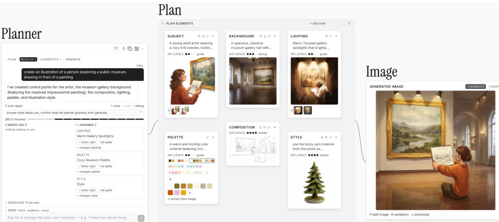  
Figure 1: Instead of a black-box prompt-to-image interface, reComposer provides a planning agent (left) that collaborates with creators to clarif<sub>y</sub> user intent and surface model assum<sub>p</sub>tions. The a<sub>g</sub>ent then decom<sub>p</sub>oses the ima<sub>g</sub>e <sub>g</sub>eneration <sub>g</sub>oal into semanticall relevant desi n decisions re resented as lan elements (middle). The user can freel modif the lan elements add their own visual and textual references after which reComposer s<sub>y</sub>nthesizes a <sub>p</sub>rom<sub>p</sub>t to ca<sub>p</sub>ture this rich user s<sub>p</sub>ecification to generate the final image (right).

## Ab<sub>s</sub>t<sub>rac</sub>t

Prompt-based image generation makes it easy to produce visual assets, but ofers little support for engaging with the creative process. Prompting collapses interdependent creative decisions into a monolithic instruction and returns a finished image, leaving control limited to revising the prompt or correcting the model’s output. We present reComposer, a process-oriented image-generation interface built around editable planning, which decomposes users’ evolving intent into meaningful creative decisions – such as subject, composition, or palette – and collaborates with users to explore underspecified goals and alternatives. reComposer supports conversational and direct manipulation of the plan, moving between concept-level intent and visual-level control. We evaluated reComposer with 8 design and non-design professionals. Compared to prompting, participants felt greater control and ownership while developing visual assets, exploring alternatives, and iterating on details. Our findings suggest how shifting generative AI interaction from specifying outputs to shaping process can support creative thinking alongside asset production.

## 1 I<sub>n</sub>t<sub>ro</sub>d<sub>uc</sub>ti<sub>on</sub>

Text-to-image models increasingly support visual creation across a broad range ofusers, including design and non-design professionals who create visual assets as part of their work. Yet the dominant interaction remains an opaque prompt-and-output loop: users describe an image, inspect a rendered result, and revise the prompt or describe an edit when the output diverges from their intent [11, 20].

Other interfaces have explored node-based workflows and direct manipulation to provide more structured control, but often requires users to construct technical workflows or focus on particular visual dimensions [3, 23, 30]. The model also often implicitly makes consequential creative decisions on the user’s behalf, often before the those decisions have been consciously specified by the user [31, 33].

This prompt based workflow treats creative intent as something that can be fully specified and communicated in text upfront. Visual design and creation, however, develops through progressive exploration of interdependent decisions such as subject, color palette, composition, and style [29]. Prompt-based generation compresses this emergent process into a single upfront specification. For creative tools, this means supporting asset production without necessarily supporting the process of developing the intent behind it.

Additionally, these decisions can be dificult to both express and inspect in prompt-based interfaces. Nuanced visual intentions must be translated into language, often requiring users to find the right textual description for a concept, while the model’s interpretation remains largely hidden. Users see the resulting image, but have limited visibility into how individual aspects of their request were interpreted. Without persistent representation ofthese intermediate decisions, users have limited support for inspecting, revisiting, or expressing them as their intent evolves, or for changing one aspect while preserving others.

These challenges suggest an opportunity to shift from specifying a finished output toward explicitly developing the intermediate decisions that shape the output. In this work, we refer to this approach as editable planning: the model proposes an initial decomposition of the creative task into relevant design decisions — such as sub ject, composition, style, and color palette — which users can inspect and revise as their intent develops. We instantiate this approach in reComposer, an interactive system for process-oriented visual cocreation with generative AI. Given an initial prompt, reComposer’s planner surfaces underspecified aspects of the request and proposes a task-specific set of plan elements representing creative decisions — such as subject, composition, style, and color palette — that guide generation. Rather than exposing low-level model operations or requiring users to carefully engineer a prompt, reComposer organizes these elements around concepts familiar to visual creators. Users can develop the plan conversationally or directly edit individual elements, progressively refining their intent while deciding which aspects to specify themselves and which to leave open to the generative model.

The resulting plan persists as a canvas of editable elements, each paired with interactions appropriate to the decisions it represents. For example, users can manipulate composition spatially, edit color palettes directly from color swatches or extracted from reference images, provide visual references for subjects, backgrounds and styles, and control how strongly each element influences the final output. By making intermediate planning artifacts visible and editable, reComposer supports movement between developing high-level creative intent and making precise visual edits while making the process visible. Through reComposer, we investigate editable planning as a process-oriented interaction paradigm for generative visual co-creation.

Our contributions are as follows:

• Editable planning, a process-oriented interaction paradigm for generative image workflows in which an AI system collaborates with a user to dynamically construct a taskspecific representation ofintermediate design decisions that serves as a shared, editable representation for developing creative intent.

• reComposer, a canvas-based interface that instantiates the editable planning for image generation through semantic plan elements and direct manipulation controls grounded in real-world workflows, providing granular control over both concept-level and visual-level aspects of the final image.

• An evaluation of the system through a user study with 8 professionals, demonstrating its use case in a variety of real-world design tasks and scenarios. We find that re-Composer’s decomposition matched participants’ existing visual design process and gave them more agency in the image generation process.

## 2 R<sub>e</sub>l<sub>a</sub>t<sub>e</sub>d W<sub>or</sub>k

In this section, we review prior work on creative workflows and practices, interaction paradigms for generative image creation, and planning in human-AI collaboration. Together, these areas characterize how creators develop and express visual intent, and motivate editable planning as an interaction paradigm for generative creation.

## 2<sub>.</sub>1 Mi<sub>s</sub>m<sub>a</sub>t<sub>c</sub>h B<sub>e</sub>t<sub>wee</sub>n Cr<sub>ea</sub>ti<sub>ve</sub> Pr<sub>ocess a</sub>nd C<sub>u</sub>rr<sub>e</sub>nt G<sub>e</sub>nAI W<sub>o</sub>rkfl<sub>ow</sub>

Creative workflows are iterative and nonlinear. Creative processes almost never unfold in a single step of specification [28]. Instead, prior work on design and creative practices describes them as iterative processes in which creators move through diferent stages of activity, using diferent representations and forms of reasoning at each stage [4, 5]. Similarly, Stanford University’s Design School proposes a model that frames design as a nonlinear and iterative process, moving through five diferent stages [32].

Creative workflows are practice-specific. Although creative processes often share broad patterns of exploration and refinement, the intermediate design decisions through which this occurs vary across practices. For example, in drawing and painting, artists commonly reason through composition, value, and color as distinct aspects of the image [21]. Whereas infographic designers often progressively build a design by establishing grid structure and visual hierarchy, defining typography and color, and exploring alternative design decisions in parallel [16, 29]. Illustration practice similarly introduces domain-specific actions, such as narrative interpretation, character and composition development, sketch refinement, and layout adjustment [2].

## 2<sub>.</sub>2 Int<sub>e</sub>r<sub>ac</sub>ti<sub>o</sub>n P<sub>a</sub>r<sub>a</sub>di<sub>g</sub>m<sub>s</sub> f<sub>o</sub>r G<sub>e</sub>nAI Cr<sub>ea</sub>ti<sub>v</sub>it<sub>y</sub> T<sub>oo</sub>l<sub>s</sub>

Prompt-based interfaces. Generative AI systems such as Gemini [8], Midjourney [22], and ChatGPT [25] use natural language prompts as the primary user interaction method, making image generation accessible by allowing users to express creative intent in natural language. Although prompting lowers the barrier to creating images, users often experience dificulties in achieving an output that matches their intent. Translating nuanced visual goals into text often requires meticulous prompt engineering. Optimal prompts are substantially more complex and lengthy than users’ natural descriptions, creating a gap between how users intuitively communicate intent and the prompt-engineering required for effective outputs [9, 11, 30]. As prompts accumulate constraints and context, they become dificult to interpret, revise, and reuse.

Node-based interfaces. In contrast, pipeline-oriented node-based interfaces like ComfyUI [3] expose model parameters, conditioning mechanisms, and operations as modular graphs, enabling users to compose precise and reusable generation pipelines. However, their technical complexity makes them inaccessible to many users. To efectively leverage these systems, users must understand low-level computational components, translate creative intent into model inference operations, and configure how those operations connect [24].

Beyond pipeline-oriented interfaces, recent work explores intentoriented node interfaces, using node-based representations to organize creative processes at a higher level of abstraction. Rather than model operations, these systems represent creative artifacts, transformations, and alternative creative decisions as modular nodes in the system. For example, Spellburst [1] represents generative creative code as branchable and mergeable nodes, while Kyaw et al. [17] use node-based graphs to support composition and targeted editing of multimodal narratives in creative authoring, showing how visual-centric nodes can better support exploration while reducing the workload of manual workflow construction [24]. Empirical findings from these systems demonstrate how modular representations can externalize creative process and structure and provide localized control points.

reComposer builds on this principle but shifts the unit of mod ularity to the semantic decisions within the visual artifact: it automatically decomposes a natural-language description into an editable plan, allowing users to progressively explore and iterate on individual decisions of a creative workflow without authoring a computational workflow or primarily iterating on a monolithic prompt.

Direct manipulation interfaces. Direct manipulation systems allow users to convey creative intent by prioritizing visual and spatial interactions, including sketching layouts [13, 27, 36], spatial arrangements and bounding boxes. Recent work draws from realworld creative and design practices. For example, Brickify [30] enables users to compose designs by collecting and assembling reference images. Our work builds on top of these findings and integrates direct manipulation into each modality in the workflow: in reComposer, direct manipulation and agent-driven planning address complementary levels of control.

## 2.3 Plannin<sub>g</sub> as an Interface/Interaction for H<sub>u</sub>m<sub>a</sub>n-AI C<sub>o</sub>-Cr<sub>ea</sub>ti<sub>o</sub>n

Plans provide intermediate representation before generating an output. Prior interactive reasoning systems show that exposing intermediate representations can help users inspect and steer generation, but this interaction has been studied predominantly in text and code generation [15, 26, 35].

Planning has also emerged in visual generation, where systems first construct intermediate representations such as scene description, object list, layout, regions, or sequences of generation operations before rendering a final image [10, 14, 34]. However, these plans are primarily treated as internal model representations: they are produced and used to condition the final output, but remain hidden from users. Consequently, users have limited opportunity to inspect, revise, or interact with the intermediate decisions and assumptions that produced the final image.

Comparatively little work explores the opportunity of editable planning for visual co-creation: translating an open-ended prompt into interpretable design decisions that users can inspect, revise, and connect to generated results. Closest to our work is ToMigo [12], which focuses on graphic design and uses a graph representation of design elements to guide generation. However, ToMigo’s nodes express design intent only via text (e.g. by interpreting the intent behind uploaded visual references and writing that out as text), whereas our system provides image previews of these intermediate artifacts and supports visual iteration on individual design decisions before generating the full image.

Our system, reComposer, treats planning as a shared authoring representation between the user and the model. It automatically decomposes an initial prompt into editable decisions about design dimensions such as subject, composition, color, style, and other visual properties. Rather than requiring users to manually specify the full workflow, the system proposes an initial set of design decisions, and allows the user to iterate on it directly or in collaboration with the planning agent to explore and refine their intent. Our system also supports directly using visual references to prompt the final image generation.

## 3 F<sub>orma</sub>ti<sub>ve</sub> R<sub>esearc</sub>h <sub>an</sub>d I<sub>n</sub>t<sub>erv</sub>i<sub>ews</sub>

To ground our design goals in real-world creative practice, we conducted semi-structured expert interviews with three image generation practitioners at a large technology company. The interviews focused on understanding users’ approaches and challenges they encounter with current image generation tools and workflows. Our experts include: E1, who works on an image generation system used by machine learning engineers, creative design professionals, and business experts. E2 is an engineer working on the same system, with prior professional experience in film, art and graphics. E3 is an instructor and former graphic designer who teaches classes on using image generation in professional contexts. This range allowed us to understand current tools from both developer and practitioner perspectives.

## 3<sub>.</sub>1 Fi<sub>n</sub>di<sub>ngs</sub> <sub>an</sub>d Ch<sub>a</sub>ll<sub>enges</sub>

C1: Users’ creative intent develo<sub>p</sub>s throu<sub>g</sub>h interaction with intermediate artifacts. Creators begin with goals that vary in specificity. For example, some begin with a primarily text-based description of the message they are designing a visual communication for, while some begin with a set of visuals that they use as reference images. Creators rarely begin with a fully specified visual outcome and instead use generated artifacts — both textual and visual — to discover and progressively develop their goal (E1, E3). For example, users often generate images from their initial prompt, and use the initial results to further prompt the model for edits.

C2: Limited su<sub>pp</sub>ort for linked conce<sub>p</sub>tual and visual reasoning. When creating a visual asset meaningful to their work, creators often communicate intent and reason through both semantic and visual specifications. E3, an instructor who regularly teaches company-wide classes and workshops to professional users, points out the wide variety of user backgrounds and their use cases: their domains span "product prototype, marketing and advertising materials, concept sketches, and slide deck illustration". Some users have a set of reference images that they want to follow the style of, while some have a visual message they want to communicate as supporting assets in a slide deck. However, in current prompt based interfaces, there is very limited room for users to understand the model’s interpretation of concepts and how they are represented visually.

C3: B<sub>a</sub>rri<sub>e</sub>r in r<sub>o</sub>m t-<sub>c</sub>r<sub>a</sub>ftin<sub>g</sub> r<sub>esu</sub>lt<sub>s</sub> in in<sub>e</sub>fi<sub>c</sub>i<sub>e</sub>nt <sub>wo</sub>rkflows. Many users recognize the importance ofprompt-engineering in achieving the visual that matches their goal, however almost all users are unsure of their prompting strategy due to its openendedness. Users often hesitate on how many details to include, how to structure them inside a prompt, and how to plan prompts across multiple turns with the model to achieve desired results. As a result, users often resort to complex and tedious workflows such as prompting a diferent language model for an image prompt, using the separate model to iterate on the image artifact, which introduce ineficiencies and still often result in discarding or repeatedly starting new sessions due to the inherent linear nature of current chat dialogues and the inefectiveness in referencing visual artifacts produced earlier in the conversation.

## 4 reComposer

To investigate how editable planning can support human-AI cocreation in visual work, we developed reComposer, a web-based system that externalizes evolving creative intent as an editable plan and supports iterative refinement across semantic and visual representations.

## 4.1 S<sub>y</sub>stem Desi<sub>g</sub>n Goals and Rationale

Based on findings from our formative interviews as well as prior literature, we develop the following design goals:

DG1: Externalize evolvin<sub>g</sub> creative intent as editable re<sub>p</sub>resentations. Creative intent develops through multiple interdependent decisions (e.g. style, color palette, subject, and composition) that are often left implicit in prompts or hidden in the model’s interpretation (C3). Therefore, the system should make creative intent itself an external, inspectable artifact — decomposed into parts that a designer can read without machine-learning vocabulary, and adapted to the kind of visual artifact being made (C3). This requires t<sup>h</sup>e s<sub>y</sub>stem to <sup>d</sup><sub>y</sub>namica<sup>ll</sup><sub>y</sub> <sup>d</sup>ecom<sub>p</sub>ose creative intent into <sub>p</sub>ersistent, creator-facing plan elements tailored to the task and the type ofvisual artifact being created.

DG2: Preserve creator a<sub>g</sub>enc<sub>y</sub> throu<sub>g</sub>h selective and reversible control. Creative collaboration with generative models requires balancing user direction with the model’s ability to propose and imagine alternative possibilities. Rather than requiring users to specify every decision or delegating the entire process to the model, the system should strive for a fine-grained balance between letting users decide which creative decisions to make themselves, which to leave open to model interpretation, and allow users to selectively revise aspects of their process as their intent develops and evolves. Thi<sub>s</sub> <sub>requ</sub>i<sub>res</sub> i<sub>n</sub>t<sub>erme</sub>di<sub>a</sub>t<sub>e</sub> d<sub>ec</sub>i<sub>s</sub>i<sub>ons</sub> t<sub>o</sub> <sub>rema</sub>i<sub>n</sub> i<sub>n</sub>d<sub>epen</sub>d<sub>en</sub>tl<sub>y</sub> <sub>e</sub>dit<sub>a</sub>bl<sub>e</sub> and support diferent degrees of influence over generation.

DG3: Su<sub>pp</sub>ort <sub>p</sub>ro<sub>g</sub>ressive refinement across levels and modalities. Creative work moves between high-level conceptual decisions and increasingly specific visual details, and creators express intent through both language and visual representations (C2). The system should allow users to move fluidly between conceptual p<sup>l</sup>ann<sup>i</sup>ng an<sup>d</sup> <sup>di</sup>rec<sup>t</sup> v<sup>i</sup>sua<sup>l</sup> man<sup>i</sup>pu<sup>l</sup>a<sup>ti</sup>on, us<sup>i</sup>ng represen<sup>t</sup>a<sup>ti</sup>ons appropriate to each decision and stage of the process. For example, users may describe style in language or through references, manipulate composition spatially, and edit palette through colors rather than textual descriptions.

Guided by our design goals, we develop reComposer, a system that comprises

• A planning agent that supports task refinement, decomposition of user goals into design axes, and interactive editing of an image generation plan. (DG1,3)

• A structured representation of editable plan elements that give users control over design decisions (DG2). These representations are represented as UI elements which we also refer to as nodes, which provide specific interaction afordances particular to that design axis.

• A prompt synthesizer that converts the plan elements into a rich prompt used to generate the final image.

Our system is modular with respect to the underlying models used, in this study we use Gemini 3.5 Flash) [8]) for the planning agent and Gemini 3 Pro Image [6] and Gemini 3.1 Flash Image [7]) for image generation.

4.1.1 Planning Agent. The planning agent supports the user in three primary areas, task refinement and underspecification, plan element construction, and coordinated edits to existing plan elements.

The planning agent works with the user through a chat-style interface (Figure 2) to craft an image generation plan (DG3). Given an initial request, the planner identifies underspecified or ambiguous aspects of the user’s intent and surfaces these through clarifying questions and model assumptions. The user can answer these questions, confirm or reject the assumptions, or continue describing their intent; the planner incorporates these responses into the evolving plan.

As the user interacts with the agent, the planner directly constructs and modifies the plan elements. The agent is provided the available plan element types and their functionality (Table 1), along with some criteria for what make including a plan element useful. For example: a plan element should be meaningful for the current image task, independently editable by user, and likely to afect generation, while an inefective control point is generic and irrelevant and may be overly redundant with another control point. From these guidelines, the planner instantiates a task-specific set of plan elements. For example, lighting may be useful for a photorealistic or 3D-rendered scene but omitted when creating a flat vector poster or icon. Prompts and further details are found in appendix B.2.

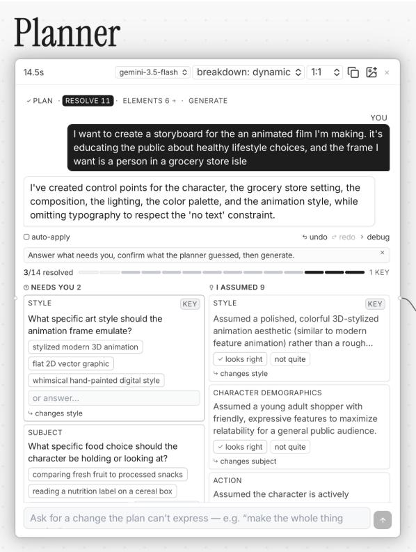  
Fi<sub>g</sub>ure 2: The <sub>p</sub>lanner surfaces decisions that are ambi<sub>g</sub>uous in the user’s <sub>p</sub>rom<sub>p</sub>t<sub>,</sub> as well as im<sub>p</sub>licit assum<sub>p</sub>tions made b<sub>y</sub> th<sub>e mo</sub>d<sub>e</sub>l<sub>, suc</sub>h <sub>as</sub> th<sub>e an</sub>i<sub>ma</sub>t<sub>e</sub>d <sub>c</sub>h<sub>arac</sub>t<sub>er</sub>’<sub>s</sub> d<sub>emograp</sub>hi<sub>c.</sub>

The planner can also perform multiple coordinated edits over the existing plan as the user’s idea evolves, adding, removing, or re vising multiple plan elements in response to a single conversational turn (subsection B.3). For example, a user may request for a "softer" visual character without immediately knowing which specific visual dimensions to adjust. In these cases, the planner interprets and infers which aspects are related - such as palette, lighting, and style - and proposes a set of edits for the user to review and apply. These changes are made through the same persistent plan that users can inspect and manipulate directly, allowing broad conversational intent to resolve into explicit, revisable design decisions (DG3).

4.1.2 Plan Elements. The resulting plan is represented as a collection of plan elements (also referred to as nodes) where each node exposes an editor appropriate to the design decision. In contrast to the nodes in a typical node based user interface, plan element nodes are presented to the user as a set without connectors between the nodes. Each is meant to represent a single design decision and the system synthesizes them into a final image generation prompt. We chose this design to avoid the high degree of complexity associated with node-based graphical editing while presenting the user with individual, semantically meaningful controls over final output. Table 1 outlines all the plan nodes currently present in the system.

Figure 3 shows interaction details for the palette and composition nodes. By interacting with these nodes the user can control specific design decisions that impact the final image generation.

Plan element customization. The relevant dimensions of a creative task may change as an idea develops, and users may want diferent degrees of structure at diferent moments (DG1). Accordingly, the set of plan elements is itself editable: users can add new plan elements, remove ones that are no longer useful, or simplify and elaborate the plan without reconstructing it. Additionally, users can also add “reference” nodes to bring in visual or textual assets that they already have in order to influence or include in the final generation. When a user adds a reference node, they also describe its purpose via a text description. For example in Figure 5, the user uploads a reference image for the data visualization icons, which are then reflected as the data markers in the final generated image.

Per-element influence dial. Creative exploration often contains decisions with diferent degrees of constraint: some are fixed constraints that must be followed, while some are exploratory directions (DG2). For example, a product designer working on a prototype mock-up may require the subject (product) to be represented accurately in the final image, while leaving lighting and palette for exploration. In reComposer each node can be assigned one of four diferent levels of influence:

• None: Excludes the node from final image generation without removing its visual representation from the UI.

• Guide: Treats the node as a loose direction that the model may reinterpret or adapt.

• Strong: Prioritizes close adherence to the node while allowing limited adaptation for visual coherence.

• Locked: Treats the node as a fixed constraint that should be preserved as faithfully as possible.

Together, these settings create a balance between allowing users to establish constraints while leaving other aspects open to interpretation, leveraging the model’s generative capacity to propose possibilities that are not fully specified.

4.1.3 Prompt Synthesis and Final Image Generation. When the user is satisfied with the plan, they click the “Generate” button to produce the final image. reComposer compiles the plan elements into a single structured, multimodal prompt for the image-generation model. The prompt opens with a high-level description of the desired image together with global settings such as the aspect ratio, followed by a textual representation of each plan element, interleaved with the preview images generated for image-based elements.

How each element is serialized depends on its type. Text-only elements such as palette and typography provide a description of the element’s role along with concrete details such as hex color codes or font specifications. Image-based elements such as subject, background, and composition additionally attach the preview image generated in the Plan Elements view, paired with instructions for how that image should be used in the final generation. For example, a background node guides the background rather than any foreground subject it may also depict. Where applicable, these elements also contribute structured details, such as the normalized bounding-box coordinates of a composition. Each element is also serialized with its user-selected influence level, so that the prompt reflects the relative influence the user assigned to it.

Table 1: reComposer’s <sub>p</sub>lan element t<sub>yp</sub>es. There are 7 uni<sub>q</sub>ue editor interfaces to su<sub>pp</sub>ort the 10 <sub>p</sub>lan element t<sub>yp</sub>es.
<table><tr><td rowspan="2">Plan Element subject</td><td>Design Axis</td><td>Editor</td></tr><tr><td>The main entity or entities: identity, appearance, pose.</td><td>Image editor</td></tr><tr><td>composition</td><td>Arrangement, framing, and spatial layout.</td><td>Composition editor: drag/resize/reorder regions; freeform scene or ordered-step graphic layout; sketch/pen tool.</td></tr><tr><td>background</td><td>The setting or backdrop behind the subject.</td><td>Image editor.</td></tr><tr><td>lighting</td><td>Light direction, quality, and time of day. Only for photographic or Image editor 3D-rendered scenes.</td><td></td></tr><tr><td>palette</td><td>The dominant and accent colors.</td><td>Palette editor: extract color palette from reference image; generate palette options from natural language prompts;</td></tr><tr><td>style</td><td>Medium and rendering aesthetic, applied globally to the whole image.</td><td>Image editor.</td></tr><tr><td>typography</td><td>Text and font selection.</td><td>Typography editor (font, size, color).</td></tr><tr><td></td><td>reference image A user-uploaded reference image to guide generation.</td><td>Image editor</td></tr><tr><td></td><td>reference textUser-uploaded text to include in the generated image.</td><td>Text editor</td></tr><tr><td>chart</td><td>User uploaded chart specification.</td><td>Visualization (e.g. Vega-Lite) spec with live chart preview.</td></tr></table>

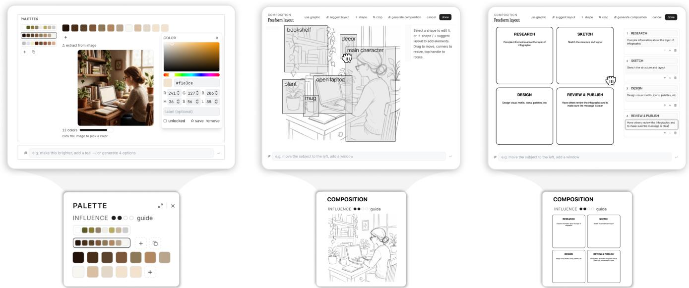  
(a) Palette node editor su<sub>pp</sub>orts (1) direct manipulation, (2) extract from reference image, and (3) generate multiple options from prompt  
(b) composition node’s scene mode editor supports (1) freeform sketch, (2) direct manipulation (drag/resize) on objects, and (3) edit via prompt  
(c) composition node’s graphic mode editor allows users to (1) directly manipulate layout via wireframes and (2) edit the text di<sub>rec</sub>tl<sub>y</sub> i<sub>n eac</sub>h fi<sub>e</sub>ld<sub>.</sub>  
Fi<sub>g</sub>ure 3: Each node in the works<sub>p</sub>ace ex<sub>p</sub>ands into a detailed editor works<sub>p</sub>ace<sub>,</sub> su<sub>pp</sub>ortin<sub>g</sub> fine-<sub>g</sub>rained<sub>,</sub> multi-modal interaction <sub>an</sub>d <sub>man</sub>i<sub>pu</sub>l<sub>a</sub>ti<sub>on o</sub>f th<sub>e v</sub>i<sub>sua</sub>l <sub>e</sub>l<sub>emen</sub>t<sub>.</sub>

Once the prompt is constructed and sent to the model, the final image is rendered in the “Image” component to the right of the Plan Elements. This component also retains a history of generated images as the user edits the plan and generates new images, supporting exploration and iteration.

A full example of this final prompt structure is included in Appendix B.4.

## 5 Exam<sub>p</sub>les

reComposer aims to provide a structured yet flexible and extensible interaction paradigm for a variety of visual tasks. Below, we showcase a selected set of example images generated using re-Composer’s workflow: stylized data visualization, a consistent set of architectural renderings, and an animation storyboard. In each of the use cases, by separating design aspects such as composition sketch, character, color palette, or typography, reComposer allows creators across these domains to ideate and iterate on these aspects independently, while progressing toward their goal with fine-grained control provided by reComposer. Additionally, in Figure 8 we show how reComposer’s planner helps the creator expand their conceptualization of a character by prompting the users to consider previously omitted design decisions.

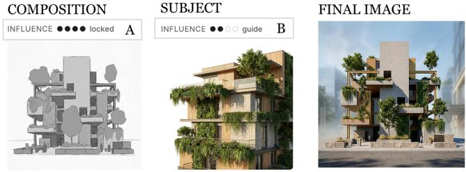  
Figure 4: Composition node (A), set to locked, is strictly followed in the final image, while subject node (B), set to guide, i<sub>s</sub> t<sub>a</sub>k<sub>en as re</sub>f<sub>erence</sub> b<sub>u</sub>t <sub>re-</sub>i<sub>mag</sub>i<sub>ne</sub>d<sub>.</sub>

Stylized Data Visualization. A data visualization designer uses re-Composer to explore novel ways to stylize charts. In reComposer, the planner creates relevant dimensions for her task: chart, style, and palette. She manually adds a reference node to provide finegrained visual specification for the icons, as well as annotate how her reference should be used. Figure 5 shows that by providing diferent datasets in the chart node but fixing the rest of the nodes, she creates consistently stylized renderings of the two datasets.

Infographic Design. A designer uses reComposer to make an infographic about the infographic-design process. After settling on decisions for subject (icons), a circular composition, and a pastel palette, she wants to experiment with diferent fonts. Figure 6 (top) shows the generated result using the default typography node. She then customizes this node by asking the agent to generate “three playful font options" (Figure 6 bottom). Since she sets the influence level of composition to "strong" but not "locked", she also gets to explore slight variations in layout while maintaining the overall circular flow.

Architecture Concept Rendering. An architecture graduate student uses reComposer to create a set of visuals to communicate his vision for a research project on climate-conscious architecture. After he describes the project goal and his ideas, the planner prompts him to think about decisions he has not yet specified, including the site and region that this project is set in, the rendering style, and the background. Figure 7 shows that after iterating on subject (build ing), background, and palette, he can generate multiple views by interacting with the composition node via natural language, describing “isometric", “side", “elevated", and “axonometric" views of the same building. reComposer generates a set of consistent renderings that follow the existing subject and background, while also following these view specifications.

Table 2: We evaluate reComposer with 8 <sub>p</sub>artici<sub>p</sub>ants who create ima<sub>g</sub>es as <sub>p</sub>art of their da<sub>y</sub>-to-da<sub>y</sub> work. Partici<sub>p</sub>ants <sub>represen</sub>t di<sub>verse</sub> <sub>ro</sub>l<sub>es</sub> <sub>an</sub>d <sub>crea</sub>ti<sub>ve</sub> t<sub>as</sub>k<sub>s</sub> th<sub>a</sub>t <sub>span</sub> d<sub>es</sub>i<sub>gn,</sub> en<sub>g</sub>ineerin<sub>g,</sub> and business.

ID Titl<sub>e</sub> T<sub>as</sub>k P1 Graphic Designer Branding image of company products P2 UI/UX Designer Video game stickers for a messaging app P3 Graphic Designer Style frames for animation storyboarding P4 Visual Designer Technical diagram for a presentation P5 Account Manager Image for an employee training presentation P6 Art Director Set of sales illustrations P7 ML Engineer Teaser figure for a presentation P8 Marketing Manager Marketing graphic for a mobile game

Animation Storyboard. A motion designer uses reComposer to create a storyboard to communicate an idea for a short animated film to her teammates. She first writes down the rough idea in the planner, which prompts her to think about character demographics which she had not yet considered. The planner also surfaces a few assumptions about the illustration style (such as polished, 3D animation). Using these questions to reflect on her intention for the film, she iterates on each dimension and settles on the character and style suitable for their intended message.

## 6 User Stud<sub>y</sub>

To understand how reComposer supports creative workflows, we conducted a within-subjects interview study with 8 participants who create imagery as part of their day-to-day work. Participants included designers who create consumer-facing visuals, marketing professionals who design advertising materials, and engineers who create technical figures for scientific communication (Table 2). We had each participant use reComposer and a chat-based interface to generate images for a task from their own work. This allowed us to test whether reComposer supports real-world constraints of participants’ creative practices.

## 6.1 Stud<sub>y</sub> Desi<sub>g</sub>n

Participants. To gain rich insights from experienced creators, we recruited 8 participants who create imagery in a professional setting. We identified relevant participants through calls within our organization and had them complete a pre-screening survey about their role, the type of imagery they create, and their experience with generative image tools. To understand a range of perspectives, we filtered to participants who held varying titles (e.g., designers and engineers) and created diverse types of imagery (e.g., animations and marketing materials). Participation in the user study was voluntary, and all participants gave informed consent.

Tasks. Rather than imposing a predefined task, we asked participants to bring an image generation task from their own work. This allowed us to evaluate reComposer in realistic scenarios with real-world constraints, because participants had a stake in the resulting image. Participants brought a wide variety of tasks, including storyboards for animations, marketing graphics, images for presentations, and multi-panel technical diagrams.

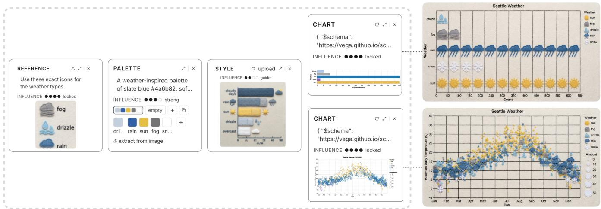  
Fi <sub>ure</sub> 5<sub>:</sub> C<sub>rea</sub>t<sub>or ma</sub>k<sub>es</sub> dif<sub>eren</sub>t d<sub>a</sub>t<sub>a v</sub>i<sub>sua</sub>li<sub>za</sub>ti<sub>ons ren</sub>d<sub>ere</sub>d i<sub>n a cons</sub>i<sub>s</sub>t<sub>en</sub>t <sub>cus</sub>t<sub>om</sub>i<sub>ze</sub>d <sub>s</sub>t l<sub>e.</sub> Th<sub>e crea</sub>t<sub>or ex</sub> l<sub>ores a</sub>l<sub>e</sub>tt<sub>e</sub> and st<sub>y</sub>le, and <sub>p</sub>rovides fine-grained detail about the icon using the reference node. Then, she generates the two st<sub>y</sub>lized visualizations b<sub>y</sub> var<sub>y</sub>ing onl<sub>y</sub> the dataset in the chart node while holding other as<sub>p</sub>ects consistent.

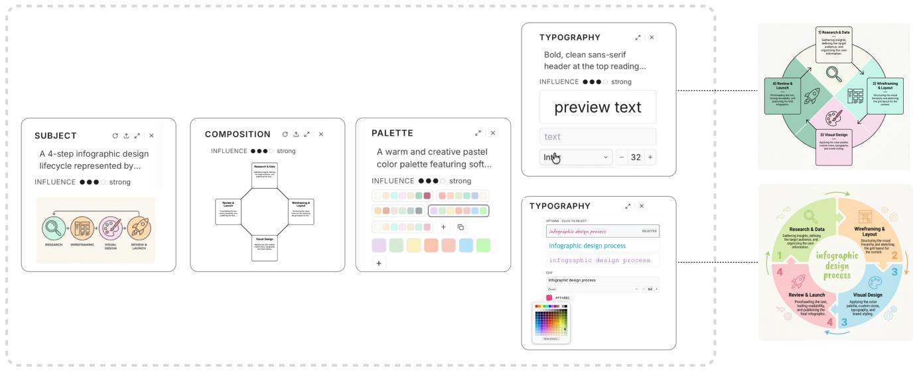  
Fi<sub>g</sub>ure 6: Info<sub>g</sub>ra<sub>p</sub>hic desi<sub>g</sub>ner uses reComposer to brainstorm and ideate on diferent wa<sub>y</sub>s to illustrate her idea b<sub>y</sub> s<sub>p</sub>ecif<sub>y</sub>in<sub>g</sub> subject (icons), a circular composition, and a <sub>p</sub>astel palette, setting them as guidance to leave room for sur<sub>p</sub>rise, and var<sub>y</sub>ing diferent typography. reComposer generates two diferent designs that reflect diferent fonts while maintaining the la<sub>y</sub>out, palette, and icons (right).

Method. We conducted each approximately 60 minute interview over video chat. We began by discussing participants’ current process for creating images and their experience with generative image tools. Then, participants completed their task using a chat-based interface and reComposer, with condition order counterbalanced across participants. We asked participants to think aloud during the study and had them reflect on their experience in both conditions. With participant consent, we recorded screen and audio for each interview and collected interaction logs within each system.

Analysis. To identify recurring patterns and insights from the study, we reviewed session recordings, think-aloud transcripts, and interaction logs. First, we performed open coding to identify participants’ experiences during each condition. Then, we conducted an iterative afinity diagramming and thematic analysis to identify higher-level themes about how the two interfaces shaped participants’ creative processes. We used the results to structure Section 6.2.

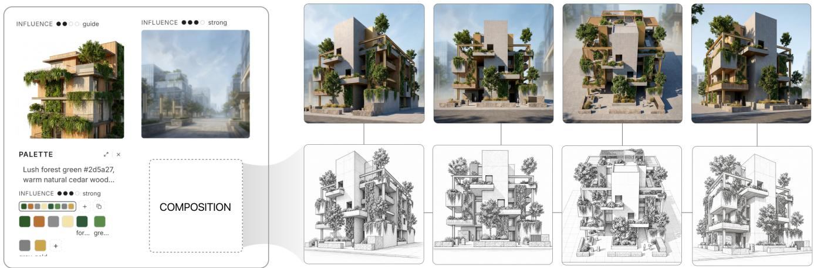

Figure 7: User creates a consistent set of architectural renderings from diferent angles b<sub>y</sub> fixing the background, subject, lighting, while using a diferent composition node for each.  
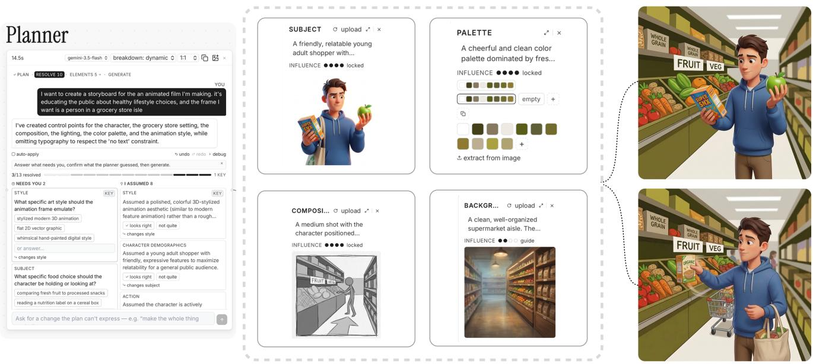  
Fi <sub>ure</sub> 8<sub>:</sub> Th<sub>e re</sub>C<sub>omposer</sub> l<sub>anner sur</sub>f<sub>aces assum</sub> ti<sub>ons a</sub>b<sub>ou</sub>t <sub>v</sub>i<sub>sua</sub>l <sub>s</sub>t l<sub>e an</sub>d <sub>c</sub>h<sub>arac</sub>t<sub>er</sub> d<sub>emo ra</sub> hi<sub>cs</sub> th<sub>a</sub>t th<sub>e mo</sub>d<sub>e</sub>l i<sub>s</sub> d<sub>e</sub>f<sub>au</sub>lti<sub>ng</sub> t<sub>o, encourag</sub>i<sub>ng consc</sub>i<sub>ous re</sub>fl<sub>ec</sub>ti<sub>on o</sub>f th<sub>ese</sub> d<sub>es</sub>i<sub>gn c</sub>h<sub>o</sub>i<sub>ces.</sub> O<sub>nce</sub> th<sub>ese are se</sub>ttl<sub>e</sub>d<sub>,</sub> th<sub>e</sub> d<sub>es</sub>i<sub>gner can crea</sub>t<sub>e a</sub> stor<sub>y</sub>board b<sub>y</sub> var<sub>y</sub>ing composition to generate each ke<sub>y</sub>frame.

## 6.2 Stud<sub>y</sub> Results

6.2.1 Current generative image workflows do not match creators’ needs. Today’s generative image tools promise to handle the entire image creation process, turning an idea into a finished image the way a designer or artist would. Yet despite participants’ experience with generative image models and enthusiasm for their capabilities, none of our participants used them to create finalized images. The 4/8 who used generative image models at all primarily relied on it for brainstorming, such as ideating new styles (P2) and generating mockups (P4). While these AI-generated options helped participants see a breadth of ideas at once, participants did this infrequently and early in their workflows, before discarding the results and completing the rest of the design process manually.

The main barrier to adoption is that current generative image tools do not ofer enough control or consistency to meet real-world constraints. When creating visual assets, participants have strict requirements, such as using company-approved fonts and color palettes (P3) or matching a character style they own the intellectual property of (P2). Since their images are often part of a larger design ecosystem, they also require consistency across designs, like sequential storyboard images (P3), icon families (P2), and slide deck figures (P7). The need for control was consistent across all participants, from professional creators (P1, P2, P3, P4, P8) to business professionals (P5) and engineers (P7).

Current generative image tools lack the level of control needed for participants to meet these constraints and ensure cohesion. As P4 described, generative image models can “get to 90% really quickly and then dialing in that last 10% is so dificult.” As a result, while generating an image with current tools is easy, generating one that meets their design standards is nearly impossible.

6<sub>.</sub>2<sub>.</sub>2 Pl<sub>ann</sub>i<sub>ng suppor</sub>t<sub>e</sub>d <sub>par</sub>ti<sub>c</sub>i<sub>pan</sub>t<sub>s</sub>’ it<sub>era</sub>ti<sub>ve</sub> d<sub>es</sub>i<sub>gn processes an</sub>d prevented unwanted model assumptions. A commonly experienced disconnect (5/8) between real-world image creation and generative image models is that most image generation tools assume that users have a fully specified design in mind at the outset. Chatbased tools generate a fully rendered image after every prompt, regardless of whether the user has specified a few-word idea or a few hundred word description. This contradicted participants established design processes, which were highly iterative, starting from an intentionally vague idea that they refined over time as their vision became clearer.

“I have a broad sense [that] I want somethin<sub>g</sub> action focused... but I don’t know specifically what I want, so I’m looking for help getting there and refining it along the way.” – P8

As a result, chat-based interfaces often anchored participants to a particular image by making assumptions and filling in details on their behalf. For example, while working in the chat interface, P5 prompted the model to depict a customer interaction using their workplace background. Since P5 did not fully describe how the employee or customer should look, the model filled in their facial expressions, perceived demographics, and workplace uniforms. Although these details influence how the image is perceived during employee training, seeing the model’s choices anchored P5 to that design and they stopped making substantial iterations, saying “I didn’t come into this with an explicit [idea],... so I <sub>g</sub>uess at this point, I’m just reacting to what it’s already created.” These anchoring effects were so strong that even when participants had a particular design in mind, seeing the generated image could change their intended design without them noticing. Before starting, P8 enthusiastically described wanting a clay style to match the playful tone of their existing marketing graphics. But they forgot to include that instruction in their prompt to the chat interface, so the model generated an animated style instead. Despite the image conflicting with their stated preference, P8 never corrected the style through out the session. When we pointed this out, they were surprised, saying “I, for some reason, throughout the conversation, did not ask it to chan<sub>g</sub>e to [clay] style [...] let me try it now.”

In contrast, reComposer’s planner gave participants control over their visual asset by making model assumptions explicit. Before a participant could be anchored by a generated image, the planner surfaced underspecified aspects of the prompt, showed what the model would fill in by default, and let participants change it to match their expectations. As a result, participants (P1, P2, P4, P5, P7, P8) used the planner to review and correct the model’s implicit assumptions prior to generation. These corrections ranged from simple preferences, like omitting text (P1) or using dark mode (P4), to critical design choices, like ensuring generated people matched their workplace demographics (P5).

The planner also expanded participants’ thinking by surfacing important aspects of the design that they did not initially consider. Participants were often surprised by the planner’s questions about details they had not thought to include in their prompt, such as a character’s clothing (P7) or the store lighting (P5). Participants felt the planner “was asking very intelligent questions around what I wanted out of the image, which means I’m not wasting time and tokens <sub>g</sub>eneratin<sub>g</sub> an ima<sub>g</sub>e [...] when we could be talkin<sub>g</sub> about what is expected and [...] our shared knowledge or lack there of” (P5). Overall, the planning process was intuitive because it reflected participants’ existing workflows, similar to “what you do in your head when you’re starting to think of your drawing” (P2) and how they typically brainstorm with colleagues (P5, P8).

Interestingly, participants valued some amount of underspecification and did not want to specify every aspect of their design. They had strong opinions on planner questions that related to their design taste or project constraints. But when the planner surfaced decisions that participants did not feel strongly about, they were happy to skip the question and default to the model’s assumption. For example, when generating a slide deck figure, P7 decisively answered questions about the professional target audience, but left the model to determine the color palette, explaining “I’m not really good with colors, so that’s the kind of thing I leave to the model to figure out.”

Even when participants allowed the model to fill in details on their behalf, surfacing the question in the planner was still valuable because it exposed design decisions that needed to be made. Often seeing the model’s assumptions helped participants clarify the design choice they actually wanted, and they would return to the planner to update the decision accordingly (P2, P4, P5, P8). For instance, after seeing the model assume an isometric design, P4 realized they preferred a flat design and returned to the planner to correct it.

6<sub>.</sub>2<sub>.</sub>3 <sub>re</sub>C<sub>omposer</sub>’<sub>s</sub> d<sub>ecompos</sub>iti<sub>on</sub> i<sub>n</sub>t<sub>o p</sub>l<sub>an e</sub>l<sub>emen</sub>t<sub>s ma</sub>t<sub>c</sub>h<sub>e</sub>d th<sub>e</sub> <sub>v</sub>i<sub>sua</sub>l d<sub>es</sub>i<sub>gn process an</sub>d <sub>ma</sub>d<sub>e par</sub>ti<sub>c</sub>i<sub>pan</sub>t<sub>s</sub>’ i<sub>n</sub>t<sub>erac</sub>ti<sub>ons more</sub> i<sub>n-</sub> tuitive. Our participants primarily interact with image generation models through chat interfaces that require them to describe visual properties in words. This conflicts with their existing creative practices that center on visual communication, such as illustrating an idea (P4) or collaborating by editing a shared image (P3). As a result, it was hard for participants to express their exact design requirements or make precise edits, with P3 describing “I want this very specific thing, [but] it’s hard to explain in words.” This was especially problematic for professional designers who found it frustrating “to spend time describing something when [they] couldjust make it” (P4).

In contrast, reComposer’s plan elements broke the prompting process into visual design components that matched participants’ mental models of image creation. Since these elements draw on longstanding creative practices, thinking about an image in terms like subject, composition, and background felt intuitive.

“The people who are best at using genAI are the people who can articulate their ideas at a level of detail that is extreme. So [for reComposer ] to remove that <sub>as a requ</sub>i<sub>remen</sub>t <sub>an</sub>d <sub>ma</sub>k<sub>e</sub> it <sub>v</sub>i<sub>sua</sub>l <sub>ma</sub>k<sub>es</sub> it <sub>more</sub> <sub>access</sub>ibl<sub>e,</sub> b<sub>ecause v</sub>i<sub>sua</sub>l <sub>peop</sub>l<sub>e are pr</sub>i<sub>me</sub>d t<sub>o</sub> thi<sub>n</sub>k about it this way to begin with.” – P4

By dynamically decomposing the plan into task-specific elements, reComposer fit a wide range of tasks and participant working styles. For example, it automatically included a typography element for P4’s technical diagram, a lighting element for P5’s realistic scene, and four subject elements for P6’s four-piece set of illustrations. Participants also added and deleted elements to better fit their personal working style, such as adding a reference sketch (P3) or replacing a model-generated style with their own style example (P5).

Describing the image as a set of design elements also helped participants communicate with the model. In particular, our design participants often work with other designers who they “can assume have a level of expertise already and know how to make [desi<sub>g</sub>n] choices” (P4). Whereas, generative image models lacked that shared expertise and often made poor decisions that professional designers never would. Breaking the image into elements helped participants get more out oftheir AI collaborations, because “when you have been designingfor a long time, so much ofthis that is second nature, ... so to b<sub>rea</sub>k it d<sub>own a</sub>t thi<sub>s</sub> l<sub>eve</sub>l <sub>rem</sub>i<sub>n</sub>d<sub>s you,</sub> lik<sub>e o</sub>h Ih<sub>ave</sub> t<sub>o</sub> b<sub>e rea</sub>ll<sub>y c</sub>l<sub>ear</sub> about everything” (P4). Some participants found the decomposition so useful that they carried it into their written prompts, adding individual descriptions of the subject and composition (P1) to better communicate with the model.

Since the plan elements are inspired by two-dimensional creative practices like drawing and painting and our formative interviews with image experts, they fit most participants’ use cases. However, participants who work on three-dimensional videos and animations wanted additional elements to capture their three-dimensional vi sion, such as perspective, camera angle, and shot progression. This validates our plan elements as core primitives of image design, while also suggesting future work incorporating primitives from video generation, such as by drawing on cinematography theory or letting AI models define novel element types when a user’s task falls outside of the predefined set.

6<sub>.</sub>2<sub>.</sub>4 Editi<sub>ng</sub> i<sub>n</sub>di<sub>v</sub>id<sub>ua</sub>l <sub>p</sub>l<sub>an e</sub>l<sub>emen</sub>t<sub>s gave par</sub>ti<sub>c</sub>i<sub>pan</sub>t<sub>s prec</sub>i<sub>se con-</sub> trol over the generated image. Chat interfaces structure image generation as a linear conversation, where users submit an initial prompt and repeatedly request changes over multiple turns. Because context compounds throughout the conversation, models often got stuck on a particular design and stopped making requested edits, forcing several participants to restart their chat session (P2, P5). This linear workflow also lacked precise control because subsequent prompts reinterpreted the entire image, so minor requests like asking the model to “zoom in” could “completely change the layout” (P5).

Instead of a linear workflow, reComposer’s plan elements acted as a visual toolkit that composed into a final image. Rather than packing every idea into one prompt, participants worked through each element to make relevant design decisions, such as choosing a color scheme in the palette element (P2, P3) or working through layouts in the composition element (P1, P4). Since previous design decisions were not implicitly included in the model’s context, partic ipants could revert unwanted decisions without the model getting stuck on a particular design. As a result, participants kept editing and refining plan elements as they progressed towards a finalized image in reComposer, making 2.4x more edits to the model’s generations (� < 0.05<sup>1</sup>) using reComposer (� = 11.4) than in the chat interface (� = 4.8).

“It’s a desi<sub>g</sub>n process thin<sub>g</sub>. [In] desi<sub>g</sub>n you are con-<sub>s</sub>t<sub>an</sub>tl<sub>y</sub> <sub>ma</sub>ki<sub>ng</sub> <sub>some</sub>thi<sub>ng</sub> <sub>an</sub>d th<sub>en</sub> <sub>c</sub>h<sub>ang</sub>i<sub>ng</sub> it<sub>.</sub> Edit<sub>-</sub> in<sub>g</sub>, iteratin<sub>g</sub>, and <sub>g</sub>ettin<sub>g</sub> feedback [are] such innate parts of the process. With a palette of options like this, it’<sub>s</sub> <sub>so</sub> i<sub>nv</sub>iti<sub>ng</sub> t<sub>o</sub> b<sub>e</sub> <sub>a</sub>bl<sub>e</sub> t<sub>o</sub> t<sub>wea</sub>k <sub>some</sub>thi<sub>ng</sub> <sub>an</sub>d <sub>see</sub> how it changes.” – P4

By mapping each plan element (e.g., composition) to a corresponding direct manipulation interface (e.g., draggable objects), reComposer allowed participants to make targeted edits. For instance, P2 felt they had more control over their image’s color when working in the palette element, saying “Ireally liked the color palette picker, because ifI was copy pasting HEX codes into [a chat interface], it<sup>’</sup>s just text, so I<sup>’</sup>m going to <sup>h</sup>ave no i<sup>d</sup>ea w<sup>h</sup>ic<sup>h</sup> one correspon<sup>d</sup>s to green or brown.” The influence dial on each element gave participants further control over the final image (7/8 adjusted it), such as letting P3 enforce the style of their reference image while treating their suggested palette as just a guide.

Being able to break an image into independently controllable elements also excited participants about using reComposer to facilitate design collaboration. P3 and P4 act as consultants who create and redesign content for stakeholders, like scientists and corporate partners. By locking certain elements (e.g., color, style) and leaving others editable (e.g., subject, composition), participants hypothesized that reComposer could “give agency to stakeholders to be more independent [...] [while] creatin<sub>g</sub> thin<sub>g</sub>s under certain <sub>g</sub>uidelines we set” (P3).

<sup>6</sup>.<sup>2</sup>.<sup>5 B</sup>y <sup>i</sup>ncreas<sup>i</sup>ng par<sup>ti</sup>c<sup>i</sup>pan<sup>t</sup>s<sup>’</sup> con<sup>t</sup>ro<sup>l</sup> over <sup>i</sup>mage genera<sup>ti</sup>on, reComposer changed their relationship with AI. reComposer increased participants’ control over their generated image by surfacing underspecification and model assumptions via the planner, highlighting visually salient elements in the plan, and providing direct manipulation editors for each plan element. As a result, 6/8 expressed wanting to use reComposer in their professional workflows to generate visual assets. They wanted tools with “the fine <sub>g</sub>rained control [reComposer ] had, because [existin<sub>g</sub> interfaces] feel like doing surgery with boxing gloves on” (P5).

Making precise edits that were incorporated in the generated image inspired participants to reflect on their AI collaborations more broadly. After using reComposer, P7 reflected that they had grown complacent about ceding control to AI models, saying “I feel like maybe I’ve defaulted to just lettin<sub>g</sub> the model <sub>g</sub>enerate [ima<sub>g</sub>es] automatically for me because I had no control.” While they felt chat interfaces limited their creativity, reComposer let them express themselves and have more agency in human-AI co-creation.

“Creativity is limited by the tools [you] have. [...] In a chat interface, the model takes your idea, shaves of all of its personality, [and] <sub>g</sub>enerates a very <sub>g</sub>eneric ima<sub>g</sub>e, [whereas] with [reComposer ] you are <sub>g</sub>ivin<sub>g</sub> peop<sup>l</sup>e <sup>th</sup>e power <sup>t</sup>o express <sup>th</sup>emse<sup>l</sup>ves an<sup>d</sup> pu<sup>tti</sup>ng the model back in its place.” – P7

Table 3: Top-level results: plan vs. raw. Scores are VQAScore (0–1) for GenAI-Bench and the composite (0–100) for Qwen-Ima<sub>g</sub>e-Benc<sup>h</sup>. $\Delta = \mathbf { P L A N } - \mathbf { R A W }$ (paired, 95% bootstrap CI).
<table><tr><td>Benchmark</td><td>Raw</td><td>Plan</td><td>∆ [95% CI]</td></tr><tr><td>GenAI-Bench</td><td>.883</td><td>.884</td><td>+0.001 [-0.015, +0.016]</td></tr><tr><td>Qwen-Image-Bench</td><td>60.2</td><td>56.9</td><td>-3.4 [−4.1, -2.6]</td></tr></table>

## 7 Pi<sub>pe</sub>li<sub>ne</sub> V<sub>a</sub>lid<sub>a</sub>ti<sub>on</sub>

Given the significant transformation reComposer makes to user prompts before final generation we decided to validate that our pipeline does not significantly harm the capabilities of the underlying model. To do this we turn to automated benchmarks typically used in text-to-image (T2I) generation evaluation. While this is not an exact fit to the scenarios reComposer is designed for, i.e. reComposer is designed for a heavily interactive and iterative pro cess, while automated benchmarks remove human involvement, we nevertheless find these to be a useful diagnostic of how the underlying pipeline afects the behavior of the model.

We evaluate on two benchmarks from the T2I literature. GenAI-Bench [18] is a well established benchmark consisting of 1,600 real-world text prompts sourced from professional designers that cover “essential visio-linguistic compositional reasoning skills such as comparison, counting and logic”. This benchmark comes with a metric, VQAScore, and an LLM evaluator to measure how accurately the generated image depicts the prompt. Qwen-Image-Bench [19] is a newer and more complex benchmark consisting of 1,000 prompts organized into 5 top level pillars (aesthetics, alignment, creative generation, quality and real-world fidelity) that are further decomposed into 56 evaluation facets. The Qwen-Image-Bench taxonomy was co-developed with professional artists and designers who then worked with LLM assistance to create prompts that reflect realistic text-to-image generation goals. Qwen-Image-Bench provides an LLM-as-judge evaluator (Q-Judger) that evaluates each generated image on up to 56 facets, with a rubric to produce either a N/A, fail, pass, excellent ratings. The mean number of evaluation facets per prompt-image pair in our evaluations is 24.87.

We compare benchmark performance under two conditions: raw, where the prompt is sent directly to the model, and plan where the prompt is sent to a “headless” version of reComposer that generates a result with no human intervention, relying fully on the decisions reComposer makes. We use Gemini 3 Pro Image for final image generation in both conditions and Gemini 3.5 Flash and Gemini 3.1 Flash Image for planning and intermediate image generation respectively in the plan condition. While this “headless” mode is not the mode in which the system was designed to be used, we believe it does ofer some insight into the performance of the pipeline underlying the system at scale. We grade image responses for each benchmark using the scorers and methodology provided by the benchmark authors.

On GenAI-Bench, the reComposer pipeline is statistically indistinguishable from raw generation. Figure 9 shows performance across the 10 skills this benchmark tests. On Qwen-Image-Bench we see a regression of -3.4pp in benchmark scores in the plan condition compared to raw. (Table 3).

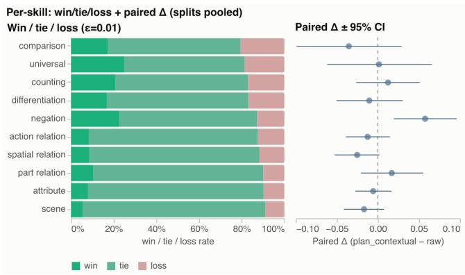  
Fi<sub>g</sub>ure 9: GenAI-Bench <sub>p</sub>erformance b<sub>y</sub> skill.

Table 4: Per-facet verdict counts (fail/pass/excellent) for the 21 f<sub>ace</sub>t<sub>s w</sub>ith dif<sub>erences</sub> b<sub>e</sub>t<sub>ween con</sub>diti<sub>ons.</sub> $\Delta n = n _ { \mathbf { p l a n } } -$ $n _ { \mathbf { r a w } }$ i<sub>s</sub> th<sub>e</sub> dif<sub>erence</sub> i<sub>n num</sub>b<sub>er o</sub>f <sub>samp</sub>l<sub>es</sub> f<sub>or</sub> thi<sub>s</sub> f<sub>ace</sub>t i<sub>n</sub> each condition (+ means more <sub>p</sub>revalent in the <sub>p</sub>lan condition).
<table><tr><td>Facet</td><td>Δ</td><td>∆n</td><td>raw</td><td>plan</td></tr><tr><td>Cross-lingual Genera- -41.7</td><td></td><td>+32</td><td>6/24/22</td><td>53/18/13</td></tr><tr><td>tion</td><td></td><td></td><td></td><td></td></tr><tr><td>Text Accuracy</td><td>-23.9</td><td>-58</td><td>81/54/220</td><td>138/47/112</td></tr><tr><td>Information Visualiza- tion</td><td>-23.5</td><td>-7</td><td>21/22/58</td><td>43/17/34</td></tr><tr><td>Font</td><td>-15.6</td><td>-17</td><td>6/45/32</td><td>13/41/12</td></tr><tr><td>Animals</td><td>-15.5</td><td>-2</td><td>58/9/43</td><td>74/8/26</td></tr><tr><td>Graphic Design</td><td>-13.2</td><td>-5</td><td>3/48/80</td><td>14/60/52</td></tr><tr><td>Objects</td><td>-11.9</td><td>-1</td><td>165/97/104</td><td>211/89/65</td></tr><tr><td>Text Layout</td><td>-10.5</td><td>-66</td><td>11/165/165</td><td>29/155/91</td></tr><tr><td>Anatomical Fidelity</td><td></td><td>-31</td><td>380/69/56</td><td>403/46/25</td></tr><tr><td>Style Control</td><td>-8.2</td><td></td><td></td><td></td></tr><tr><td>Composition Relation-</td><td>-8.0 -8.0</td><td>+9 +1</td><td>57/289/208 161/549/226</td><td>99/304/160 235/553/149</td></tr><tr><td>ship</td><td></td><td></td><td></td><td></td></tr><tr><td>Logical Resolution</td><td>-6.7</td><td>-9</td><td>87/99/52</td><td>94/108/27</td></tr><tr><td>Naturalness</td><td>-6.5</td><td>-5</td><td>324/447/166</td><td>385/440/107</td></tr><tr><td>Contact Interaction</td><td>-5.7</td><td>-10</td><td>182/268/22</td><td>218/228/16</td></tr><tr><td>2D Space</td><td>-4.6</td><td>-14</td><td>44/552/86</td><td>78/531/59</td></tr><tr><td>Imagination</td><td>-3.4</td><td>+8</td><td>6/136/52</td><td>11/147/44</td></tr><tr><td>Size</td><td>-2.9</td><td>-27</td><td>23/475/24</td><td>37/448/10</td></tr><tr><td>Physical Logic</td><td>-2.9</td><td>-10</td><td>605/259/65</td><td>634/235/50</td></tr><tr><td>3D Space</td><td>-2.4</td><td>-9</td><td>82/627/73</td><td>106/603/64</td></tr><tr><td>Material Texture</td><td>-2.2</td><td>-15</td><td>43/466/407</td><td>67/447/387</td></tr><tr><td>Resolution</td><td>-0.6</td><td>0</td><td>1/899/38</td><td>1/913/24</td></tr></table>

Table 4 shows evaluation facets with statistically significant diferences in the two conditions and reveals that a) a number of these are closely related and have to do with text rendering or placement and b) because fail/pass/excellent is mapped to 0/60/100 in the final scoring, failures are more heavily penalized than great results rewarded and the greater number of outright failures in the plan condition does show large absolute diferences in performance. We do also note that the judge fairly often uses diferent evaluation facets on the images for each prompt which may have some efect in the aggregation.

If we look at paired judgments (samples where the evaluation facet is triggered in both conditions) we can compute per-facet win/tie/loss rate of the plan condition compared to the raw condition. This is shown in Figure 10 (right) where we observe that only one category has a loss rate of greater than 50% and the plan condition otherwise being preferred or tying.

Manual inspection of failures in these worse performing facets shows that they are often caused by a failure to render the exact text provided in the prompt in the final image, and this causes multiple related evaluation facets to be scored low. Placeholder text from the preview images from various nodes in the plan elements is often rendered in the final image either instead of or in addition to the requested text and is penalized. And background text is often rendered at a low resolution (see Figures 11 12 13 for examples). We note that in the interactive workflow reComposer is designed for, these major textual elements are typically added or edited by the user in specific plan-element nodes, such as typography or composition, once the initial design direction is set. So while these results do indicate room for improvement, since reComposer is not designed for non-interactive generation we only consider these results as diagnostic pointers that represent the floor on the behavior of the system.

Overall we observe that even in this non-interactive setting, the pipeline generally produces images comparable to that of the underlying model.

## 8 Di<sub>scuss</sub>i<sub>on,</sub> Li<sub>m</sub>it<sub>a</sub>ti<sub>ons an</sub>d F<sub>u</sub>t<sub>ure</sub> W<sub>or</sub>k

Our user study findings provide promising evidence of our interaction paradigm, and highlight opportunities and challenges for treating intermediate creative decisions as editable representations in generative workflows.

Going beyond prompt-based interaction is important for advanced creative work. Our findings reinforce prior work showing that creating with generative models benefits from interaction beyond only natural-language prompting [30]. reComposer’s user study findings suggest that the opportunity is not simply to expose more control, but designing these controls around how creators think about their process. reComposer dynamically surfaces relevant semantic decisions in the form of plan element nodes, and allows the user to add, remove and edit them. As a result, the interface evolves with the users’ creative process, rather than requiring the user to conform to a static structure for specifying intent.

Editable Planning provides a shared representation for Human-AI Co-Creation. reComposer’s user study findings demonstrate how an intermediate plan can serve as a shared representation that grounds human-AI interaction. Users directly manipulated individual design decisions, while the planning agent operated over the same representation when broader changes are easier to express conversationally. For example, a user may know that an image should feel ’softer’ without fully knowing whether this should manifest as changes to palette, lighting, composition, or style. Rather than directly regenerating the image from this instruction, the agent can interpret the user’s partially specified intent and propose coordinated changes to relevant plan elements, keeping the traces visible and revisable. This suggests a diferent afordance for dialogue in generative interfaces: instead of a modality for users to optimize a prompt toward an output, reComposer demonstrates how it can be a modality to help users translate high-level intentions into explicit, manipulable decisions.

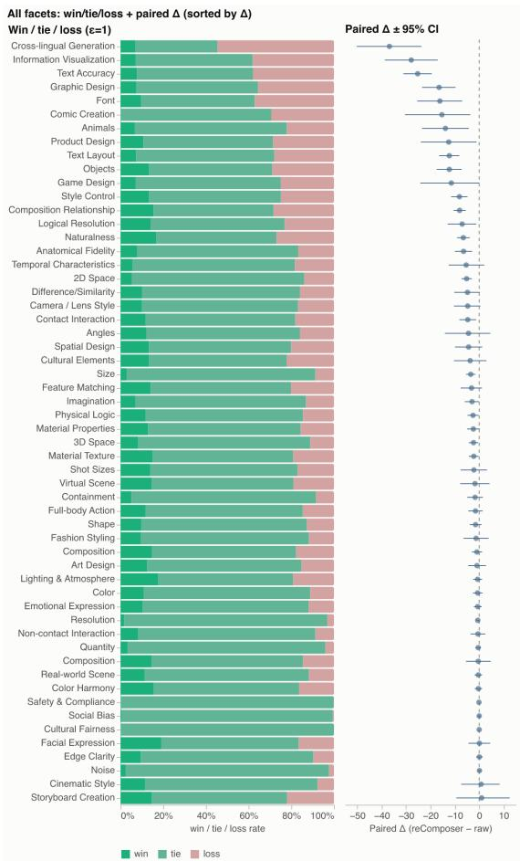  
Figure 10: Qwen-Image-Bench win/loss/tie rates for paired judgments. Only one facet has a loss rate more than 50%

U<sub>sers</sub> d<sub>es</sub>i<sub>re</sub> b<sub>o</sub>th <sub>con</sub>t<sub>ro</sub>ll<sub>a</sub>bilit<sub>y an</sub>d <sub>comp</sub>l<sub>emen</sub>t<sub>ar</sub>it<sub>y w</sub>ith <sub>genera-</sub> tive systems. Our user study results point to an overarching tension between control and complementarity in human-AI collaborative systems. For example, to increase user control over image generation, we explicitly designed reComposer’s planner to surface prompt underspecification and the model’s implicit assumptions. While we could have required participants to answer every planner question so the model did not make any assumptions about their intent, this would have forced participants to make design decisions before they were ready, prevented them from leveraging the model’s decisions to complement their thinking, and ultimately limited their creativity. Instead, we aimed to increase user agency by letting participants choose which decisions to make themselves, which to leave to the model, and when to change their mind.

“[I want to] wield [AI] tools in a way that is still very human driven, [where] we use the al<sub>g</sub>orithmic

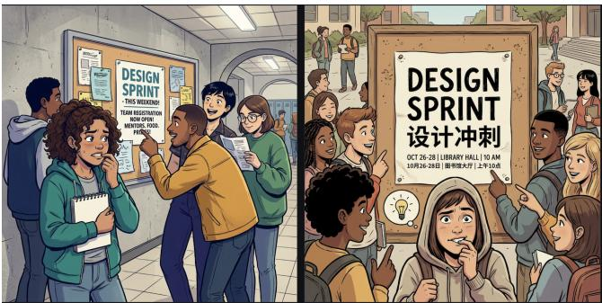  
Fi<sub>g</sub>ure 11: Plan condition on left<sub>,</sub> raw on ri<sub>g</sub>ht for the <sub>p</sub>rom<sub>p</sub>t “Comic scene: students gather at a campus bulletin board reading a poster titled “DESIGN SPRINT 设计冲刺”with bilingual date/location and visible whitespace. One student bites their lip in nervous excitement with subtle expression. Require legible accurate poster text, realistic wrinkled paper and pushpin stress, diverse non-repetitivefaces, and youthful excitement.” The plan condition ima<sub>g</sub>e fails to include the re<sub>q</sub>uested Chi-<sub>nese</sub> t<sub>ex</sub>t <sub>on</sub> th<sub>e message</sub> b<sub>oar</sub>d <sub>an</sub>d i<sub>s score</sub>d l<sub>ower.</sub> H<sub>owever</sub> we note that the overall com<sub>p</sub>osition of this ima<sub>g</sub>e is more <sub>rea</sub>li<sub>s</sub>ti<sub>c.</sub>

  
Fi<sub>g</sub>ure 12: plan condition on left<sub>,</sub> raw on ri<sub>g</sub>ht for the <sub>p</sub>rom<sub>p</sub>t “B/W magazine cover: monochrome portrait, person in sculptural overcoat with calm gaze; big title “FORM”and multi-line small subheads. Require high face/hair quality; sharp professional typography; strong contrast without losing detail.” The <sub>plan con</sub>diti<sub>on</sub> i<sub>nc</sub>l<sub>u</sub>d<sub>es</sub> th<sub>e wor</sub>d f<sub>orm</sub> b<sub>u</sub>t <sub>on</sub>l<sub>y as par</sub>t <sub>o</sub>f <sub>a</sub> subtitle and adds extra text (albeit <sub>p</sub>roducing a more t<sub>yp</sub>ical magazine cover layout).

## <sub>ran</sub>d<sub>omness</sub> i<sub>n</sub> <sub>a</sub> <sub>way</sub> th<sub>a</sub>t i<sub>s</sub> <sub>compe</sub>lli<sub>ng</sub> <sub>an</sub>d i<sub>n</sub>t<sub>eres</sub>t<sub>-</sub> in<sub>g</sub> as o<sub>pp</sub>ose<sup>d</sup> to <sup>l</sup>ettin<sub>g</sub> t<sup>h</sup>e tec<sup>h</sup>no<sup>l</sup>o<sub>gy</sub> <sup>d</sup>rive on its own.” – P4

Generative AIfor creators should provide access to process in addition to high quality output. One participant, after using reComposer, questioned whether they had previously let the AI take over too much before, they reflected that their engagement with the process before was limited because they knew they could only do so much in a prompt based system, but seeing new tools like re-Composer in turn changed how they will engage with the process (P7). These comments suggest that making intermediate decisions visible can also make the division of contribution between user and model more visible. Prompt-to-output interfaces can obscure many of the decisions delegated between an initial prompt and a finished output. By externalizing some of these decisions, generative interfaces may create opportunities for users to consider, revise, or intentionally delegate them. This raises a broader design question of not only which parts of creative work can be automated, but which parts are valuable for people to continue engaging with.

  
Fi<sub>g</sub>ure 13: plan condition on left<sub>,</sub> raw on ri<sub>g</sub>ht for the <sub>p</sub>rom<sub>p</sub>t “Generate a <sub>p</sub>et <sub>p</sub>roduct e-commerce banner: l<sub>e</sub>ft<sub>—</sub>“宠爱每一天” i<sub>n so</sub>ft <sub>roun</sub>d<sub>e</sub>d f<sub>on</sub>t <sub>w</sub>ith <sub>s</sub>li<sub>g</sub>htl<sub>y</sub> h<sub>an</sub>d<sub>-</sub> d<sub>rawn curves; r</sub>i<sub>g</sub>ht<sub>—</sub>“L<sub>ove</sub> Th<sub>em</sub> E<sub>very</sub> D<sub>ay</sub>” <sub>ma</sub>t<sub>c</sub>hi<sub>ng</sub> <sub>we</sub>i<sub>g</sub>ht <sub>an</sub>d li<sub>ne</sub> h<sub>e</sub>i<sub>g</sub>ht<sub>,</sub> bili<sub>ngua</sub>l b<sub>ase</sub>li<sub>nes s</sub>t<sub>r</sub>i<sub>c</sub>tl<sub>y a</sub>li<sub>gne</sub>d<sub>.</sub> B<sub>ac</sub>k<sub>groun</sub>d<sub>: an orange ca</sub>t <sub>gen</sub>tl<sub>y paw</sub>i<sub>ng a</sub> b<sub>ran</sub>d<sub>e</sub>d <sub>ca</sub>t f<sub>oo</sub>d b<sub>ow</sub>l<sub>.</sub> T<sub>ex</sub>t <sub>area over</sub>l<sub>a</sub>id <sub>w</sub>ith 15% <sub>opac</sub>it<sub>y w</sub>hit<sub>e mas</sub>k f<sub>or</sub> hi<sub>g</sub>h readabilit<sub>y</sub>. Color <sub>p</sub>alette: warm bei<sub>g</sub>e and li<sub>g</sub>ht <sub>g</sub>ra<sub>y</sub>- bl<sub>ue.</sub>” Th<sub>en plan con</sub>diti<sub>on resu</sub>lt <sub>uses</sub> th<sub>e wrong pa</sub>i<sub>r o</sub>f l<sub>anguages</sub> f<sub>or</sub> th<sub>e</sub> bili<sub>ngua</sub>l t<sub>ex</sub>t<sub>.</sub>

User study limitations. Our study participants were primarily designers and creators recruited from a U.S.-based technology company. While participants brought experience from diferent creative roles and practices, other creators from diferent domains may differ in how they conceptualize their process, which intermediate decisions they exposed, and how much structure or model initiative they prefer. Future studies could validate reComposer with a broader range of domain creators, and extend the set of controls for broader support.

Additionally, participants interacted with reComposer in a firstuse study and for a limited period of time. Many participants expressed interest in spending more time exploring the “full potential of the tool” (E3), suggesting that the current findings may not capture the full set of interactions and experiences users would have with reComposer over a longer period of time. A longitudinal study examining how reComposer integrates into existing creative workflows could provide valuable insights.

Extending Editable Planning Beyond Visual Creation. Although reComposer instantiates editable planning in visual asset creation, the underlying interaction paradigm is not necessarily constrained to visual generation. Increasingly, people collaborate with generative AI systems on tasks that unfold across multiple intermediate decisions and reasoning spaces that demand more than a single request and response. Writing, programming, and scientific workflows similarly require high-level goals to be translated into a chang ing set of intermediate decisions, many of which may otherwise remain implicit in prompts or be made by the model. Editable plan ning suggests an alternative to both extremes of requiring users to specify every step themselves or delegating the entire process to an AI system. Future interfaces might explore how we can foster synergetic human-AI collaboration by selectively externalizing decisions where human judgment, reflection, and ownership matter, while allowing others to be delegated.

## 9 C<sub>o</sub>n<sub>c</sub>l<sub>us</sub>i<sub>o</sub>n

We present reComposer, an image generation tool that operationalizes editable planning as a process-oriented design paradigm for controllable image generation. Grounded in real-world principles and workflows of visual designers and image generation practitioners, reComposer exposes semantic decisions throughout the generative process, enabling users to engage with and shape the intermediate creative choices rather than delegating the entire process to the model. In a user study with 8 participants, our findings suggest that intermediate plans and visual artifacts can provide meaningful control and transparency, while fostering more reflective and process-aligned creative practice in human-AI co-creation.

## R<sub>e</sub>f<sub>erences</sub>

[1] Tyler Angert, Miroslav Suzara, Jenny Han, Christopher Pondoc, and Hariharan Subramonyam. 2023. Spellburst: A Node-based Interface for Exploratory Creative Coding with Natural Language Prompts. UIST (Oct. 2023), 1–22. doi:10.1145/ 3586183.3606719

[2] Irfan Arifin and Hasbi Hasbi. 2025. Illustration process in visual communication: a qualitative study on storybook product development. International Journal of Visual and Performing Arts 7, 1 (2025), 195–206. doi:10.31763/viperarts.v7i1.1673

[3] ComfyAnonymous and Contributors. 2023. ComfyUI: A modular stable difusion GUI and backend. https://github.com/comfy-org/comfyui

[4] Design Council. 2005. A study of the design process – The Double Dia mond. http://www.designcouncil.org.uk/sites/default/files/asset/document ElevenLessons\_Design\_Council%20%282%29.pdf

[5] Kees Dorst and Nigel Cross. 2001. Creativity in the design process: co-evolution of problem–solution. Design Studies 22, 5 (2001), 425–437. doi:10.1016/S0142- 694X(01)00009-6

[6] Google DeepMind. 2025. Gemini 3 Pro Image. Image model. https://ai.google. dev/gemini-api/docs/models/gemini-3-pro-image

[7] Google DeepMind. 2026. Gemini 3.1 Flash Image. Image model. https://ai.google. dev/gemini-api/docs/models/gemini-3.1-flash-image

[8] Google DeepMind. 2026. Gemini 3.5 Flash. Large language model. https: //deepmind.google/models/model-cards/gemini-3-5-flash

[9] Yaru Hao, Zewen Chi, Li Dong, and Furu Wei. 2023. Optimizing Prompts for Text-to-Image Generation. In Advances in Neural Information Processing Systems, A. Oh, T. Naumann, A. Globerson, K. Saenko, M. Hardt, and S. Levine (Eds.), Vol. 36. Curran Associates, Inc., 66923–66939. doi:10.52202/075280-2923

[10] Runze He, Bo cheng, Yuhang Ma, Qingxiang Jia, Shanyuan Liu, Ao Ma, Xiaoyu Wu, Liebucha Wu, Dawei Leng, and Yuhui Yin. 2025. PlanGen: Towards Unified Layout Planning and Image Generation in Auto-Regressive Vision Language Models. In 2025 IEEE/CVF International Conference on Computer Vision (ICCV). 18143–18154. doi:10.1109/ICCV51701.2025.01686

[11] Yutong He, Alexander Robey, Naoki Murata, Yiding Jiang, Joshua Nathaniel Williams, George J. Pappas, Hamed Hassani, Yuki Mitsufuji, Ruslan Salakhutdinov, and J Zico Kolter. 2025. Automated Black-box Prompt Engineering for Personalized Text-to-Image Generation. Transactions on Machine Learning Research (2025). https://openreview.net/forum?id=IVYVDN6pJ6

[12] Lena Hegemann, Xinyi Wen, Michael A. Hedderich, Tarmo Nurmi, and Hariharan Subramonyam. 2026. ToMigo: Interpretable Design Concept Graphs for Aligning Generative AI with Creative Intent. In Proceedings ofthe 2026 Designing Interactive Systems Conference (DIS ’26). Association for Computing Machinery, New York, NY, USA, 643–660. doi:10.1145/3800645.3813064

[13] Zeyuan Huang, Cangjun Gao, Yaxian Shan, Haoxiang Hu, Qingkun Li, Xiaoming Deng, Cuixia Ma, Yu-Kun Lai, Yong-Jin Liu, Feng Tian, Guozhong Dai, and Hongan Wang. 2025. SketchGPT: A Sketch-based Multimodal Interface for

Application-Agnostic LLM Interaction. In Proceedings of the 38th Annual ACM Symposium on User Interface Software and Technology (UIST ’25). Association for Computing Machinery, New York, NY, USA, Article 157, 18 pages. doi:10.1145/ 3746059.3747598

[14] Liya Ji, Chenyang Qi, and Qifeng Chen. 2025. Instruction-based Image Editing with Planning, Reasoning, and Generation. In Proceedings of the IEEE/CVF International Conference on Computer Vision (ICCV). 17506–17515.

[15] Xue Jiang, Yihong Dong, Lecheng Wang, Zheng Fang, Qiwei Shang, Ge Li, Zhi Jin, and Wenpin Jiao. 2024. Self-Planning Code Generation with Large Language Models. ACM Trans. Softw. Eng. Methodol. 33, 7, Article 182 (Sept. 2024), 30 pages. doi:10.1145/3672456

[16] Renata Kuba and Allan Jeong. 2024. Sequential analysis of design processes performed by design experts and college students in infographic design. Journal ofVisual Literacy 43, 2 (2024), 124–146. doi:10.1080/1051144X.2024.2349380

[17] Alexander Htet Kyaw and Lenin Ravindranath Sivalingam. 2025. Node-Based Editing for Multimodal Generation of Text, Audio, Image, and Video. arXiv:2511.03227 [cs.HC] https://arxiv.org/abs/2511.03227

[18] Baiqi Li, Zhiqiu Lin, Deepak Pathak, Jiayao Li, Yixin Fei, Kewen Wu, Xide Xia, Pengchuan Zhang, Graham Neubig, and Deva Ramanan. 2024. Evaluating and Improving Compositional Text-to-Visual Generation. In Proceedings ofthe IEEE/CVF Conference on Computer Vision and Pattern Recognition (CVPR) Workshops. 5290– 5301.

[19] Niantong Li, Guangzheng Hu, Weixu Qiao, Ying Ba, Qichen Hong, Shijun Shen, Jinlin Wang, Fan Zhou, Jianye Kang, Xin Shang, Ziyi He, Wei Wang, Dalin Li, Jiahao Li, Jie Zhang, Kaiyuan Gao, Kun Yan, Lihan Jiang, Ningyuan Tang, Shengming Yin, Tianhe Wu, Xiao Xu, Xiaoyue Chen, Yuxiang Chen, Yan Shu, Yanran Zhang, Yilei Chen, Yixian Xu, Zekai Zhang, Zhendong Wang, Zihao Liu, Zikai Zhou, Hongzhu Shi, Yi Wang, Bing Zhao, Hu Wei, Lin Qu, and Chenfei Wu. 2026. Qwen-Image-Bench: From Generation to Creation in Text-to-Image Evaluation. arXiv preprint arXiv: 2605.28091 (2026).

[20] Vivian Liu and Lydia B Chilton. 2022. Design Guidelines for Prompt Engineering Text-to-Image Generative Models. In Proceedings of the 2022 CHI Conference on Human Factors in Computing Systems (New Orleans, LA, USA) (CHI ’22). Association for Computing Machinery, New York, NY, USA, Article 384, 23 pages. doi:10.1145/3491102.3501825

[21] Jiaju Ma, Chau Vu, Asya Lyubavina, Catherine Liu, and Jingyi Li. 2025. Computational Scafolding of Composition, Value, and Color for Disciplined Drawing. In Proceedings ofthe 38th Annual ACM Symposium on User Interface Software and Technology (UIST ’25). Association for Computing Machinery, New York, NY, USA, Article 161, 15 pages. doi:10.1145/3746059.374760

[22] MidJourney. 2026. MidJourney. https://docs.midjourney.com

[23] Chong Mou, Xintao Wang, Jiechong Song, Ying Shan, and Jian Zhang. 2024. DragonDifusion: Enabling Drag-style Manipulation on Difusion Models. In The Twelfth International Conference on Learning Representations. https://openreview. net/forum?id=OEL4FJMg1b

[24] Duc-Hung Nguyen, Huu-Phuc Huynh, Minh-Triet Tran, and Trung-Nghia Le. 2025. GenFlow: Interactive Modular System for Image Generation. arXiv:2506.21369 [cs.CV] https://arxiv.org/abs/2506.21369

[25] OpenAI. 2026. ChatGPT. https://chatgpt.com

[26] Rock Yuren Pang, K. J. Kevin Feng, Shangbin Feng, Chu Li, Weijia Shi, Yulia Tsvetkov, Jefrey Heer, and Katharina Reinecke. 2026. Interactive Reasoning: Visualizing and Controlling Chain-of-Thought Reasoning in Large Language Models. In Proceedings ofthe 31st International Conference on Intelligent User Interfaces (IUI ’26). Association for Computing Machinery, New York, NY, USA, 852–867. doi:10.1145/3742413.3789091

[27] Vishnu Sarukkai, Lu Yuan, Mia Tang, Maneesh Agrawala, and Kayvon Fatahalian. 2024. Block and Detail: Scafolding Sketch-to-Image Generation. In Proceedings ofthe 37th Annual ACM Symposium on User Interface Software and Technology (Pittsburgh, PA, USA) (UIST ’24). Association for Computing Machinery, New York, NY, USA, Article 33, 13 pages. doi:10.1145/3654777.3676444

[28] R. Keith Sawyer. 2021. The iterative and improvisational nature of the creative process. Journal ofCreativity 31, 3 (2021), 100002. doi:10.1016/j.yjoc.2021.100002

[29] Xinyu Shi, Shunan Guo, Jane Hofswell, Gromit Yeuk-Yin Chan, Victor S. Bursztyn, Jian Zhao, and Eunyee Koh. 2025. Comprehensive Sketching: Exploring Infographic Design Alternatives in Parallel. In Proceedings ofthe Extended Abstracts ofthe CHI Conference on Human Factors in Computing Systems (CHI EA ’25). Association for Computing Machinery, New York, NY, USA, Article 145, 8 pages. doi:10.1145/3706599.3720182

[30] Xinyu Shi, Yinghou Wang, Ryan Rossi, and Jian Zhao. 2025. Brickify: Enabling Expressive Design Intent Specification through Direct Manipulation on Design Tokens. In Proceedings of the 2025 CHI Conference on Human Factors in Computing Systems (CHI ’25). Association for Computing Machinery, New York, NY, USA, Article 424, 20 pages. doi:10.1145/3706598.3714087

[31] Zoe De Simone, Angie Boggust, Fredo Durand, Ashia Wilson, and Arvind Satyanarayan. 2026. Creo: From One-Shot Image Generation to Progressive, Co-Creative Ideation. arXiv:2604.13956 [cs.HC] https://arxiv.org/abs/2604.13956

[32] Stanford University. 2004. ME 113 — web.stanford.edu. https://web.stanford.edu/ class/me113/d\_thinking.html. [Accessed 10-09-2026].

[33] Samangi Wadinambiarachchi, Ryan M. Kelly, Saumya Pareek, Qiushi Zhou, and Eduardo Velloso. 2024. The Efects of Generative AI on Design Fixation and Divergent Thinking. In Proceedings ofthe CHI Conference on Human Factors in Computing Systems (CHI ’24). ACM, 1–18. doi:10.1145/3613904.3642919

[34] Lei Zhang, Junjiao Tian, Zhipeng Fan, Kunpeng Li, Jialiang Wang, Weifeng Chen, Markos Georgopoulos, Felix Juefei-Xu, Yuxiang Bao, Julian McAuley, Manling Li, and Zecheng He. 2026. Think in Strokes, Not Pixels: Process-Driven Image Generation via Interleaved Reasoning. arXiv:2604.04746 [cs.CV] https: //arxiv.org/abs/2604.04746

[35] Shun Zhang, Zhenfang Chen, Yikang Shen, Mingyu Ding, Joshua B. Tenenbaum, and Chuang Gan. 2023. Planning with Large Language Models for Code Generation. In The Eleventh International Conference on Learning Representations. https://openreview.net/forum?id=Lr8cOOtYbfL

[36] Tianyu Zhang, Xiaoxuan Xie, Xusheng Du, and Haoran Xie. 2025. Sketch-guided scene image generation with difusion model. Comput. Graph. 129, C (June 2025), 10 pages. doi:10.1016/j.cag.2025.104226

## A Generated Out<sub>p</sub>uts

## A<sub>.</sub>1 S<sub>a</sub>m<sub>p</sub>l<sub>es</sub> fr<sub>o</sub>m G<sub>e</sub>mini <sub>c</sub>h<sub>a</sub>t it<sub>e</sub>r<sub>a</sub>ti<sub>o</sub>n<sub>s</sub>

Create a museum exhibit entrance infographic for an exhibition about how humans have stored and preserved knowledge across generations, from oral storytelling and cave paintings to books, photographs, computers, and Al.

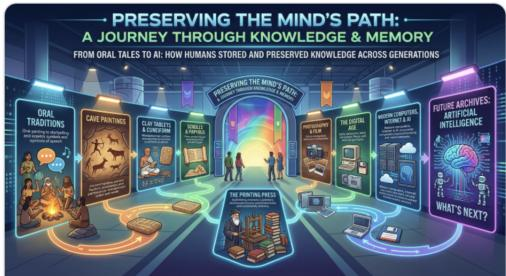

(a) Initial prompt. The first sample fixes the image’s composition – an isometric corridor lined with exhibit panels.  
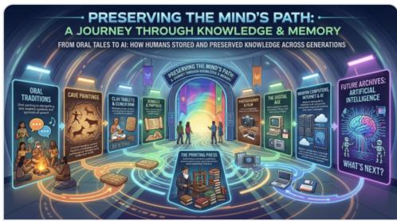

change the layout to circular

(b) User edit request 1: “change the layout to circular.” The corridor survives and circular motifs are added as decoration instead: a global i<sub>ns</sub>t<sub>ruc</sub>ti<sub>on</sub> l<sub>an</sub>d<sub>s</sub> <sub>as</sub> <sub>a</sub> l<sub>oca</sub>l <sub>c</sub>h<sub>ange,</sub> <sub>an</sub>d th<sub>e</sub> <sub>user</sub> h<sub>as</sub> <sub>no</sub> <sub>way</sub> t<sub>o</sub> <sub>say</sub> <sub>w</sub>hi<sub>c</sub>h <sub>par</sub>t<sub>s</sub> <sub>o</sub>f th<sub>e</sub> i<sub>mage</sub> th<sub>e</sub> <sub>p</sub>h<sub>rase</sub> “<sub>c</sub>i<sub>rcu</sub>l<sub>ar</sub> l<sub>ayou</sub>t” i<sub>s</sub> <sub>mean</sub>t t<sub>o</sub> <sub>govern.</sub>

change the layout to 2d grid

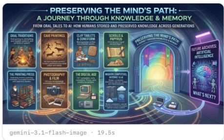

(c) User edit request 2: “change the layout to 2d grid.” Here the arrangement does change, but the image is re-synthesized around it and the <sub>pane</sub>l <sub>con</sub>t<sub>en</sub>t<sub>s,</sub> l<sub>a</sub>b<sub>e</sub>l<sub>s, an</sub>d <sub>co</sub>l<sub>or</sub> d<sub>r</sub>ift <sub>w</sub>ith it<sub>–</sub>th<sub>e user canno</sub>t h<sub>o</sub>ld th<sub>e con</sub>t<sub>en</sub>t fi<sub>xe</sub>d <sub>w</sub>hil<sub>e vary</sub>i<sub>ng</sub> th<sub>e</sub> l<sub>ayou</sub>t<sub>.</sub>

Fi<sub>g</sub>ure 14: Three turns of one Gemini chat session on the same info<sub>g</sub>ra<sub>p</sub>hic brief. La<sub>y</sub>out intent is ex<sub>p</sub>ressible onl<sub>y</sub> as <sub>p</sub>rose<sub>,</sub> so an edit either under-applies (b) or carries the rest of the image with it (c), while every turn stays anchored to the initial sample (a).

## B S<sub>y</sub>stem Prom<sub>p</sub>ts

## B<sub>.</sub>1 Pl<sub>a</sub>n G<sub>e</sub>n<sub>e</sub>r<sub>a</sub>ti<sub>o</sub>n

You are an expert AI Image Planner. Turn the user's idea into a structured, editable Image Plan -- NOT a finished prompt, and NOT an image.   
FIRST, silently infer the TASK TYPE (e.g. photo, illustration, character asset, icon set, logo, poster, infographic, UI asset, product   
mockup, diagram). Then plan in the TERMS THAT MATTER for that task. Do NOT force a photographic frame -- camera angle, lighting   
direction, depth of field, time of day -- onto tasks that don't have one (a flat infographic, icon set, logo, or UI asset has no "   
lighting" or "camera").   
Output the plan in EXACTLY this structure (it is parsed downstream):   
1. Concept Analysis   
\* Intent: <one sentence -- the core purpose of the image>   
\* Audience: <who it is for>   
\* Mood: <2-5 words>   
2. Structural Plan   
List ONLY the dimensions that are meaningful for the inferred task, each as a "\*\*Label:\*\* value" bullet. Choose from -- but do not force   
-- these dimensions:   
\* Subject -- the main entity/entities and their key features.   
\* Composition / Layout -- arrangement, framing, spatial structure (for graphic tasks: how panels/elements are laid out).   
\* Background -- setting or backdrop.   
\* Lighting -- ONLY for photographic / rendered 3D scenes; omit for flat/graphic tasks.   
\* Color / Palette -- dominant and accent colors.   
\* Style -- medium, treatment, aesthetic.   
\* Typography / Text -- only if the image contains lettering.   
Hard rules:   
\* Begin directly with the heading "1. Concept Analysis". NEVER include preamble, acknowledgments, or restatements (no "Certainly!", "Here's   
...", "Sure!").   
\* Keep each field to 1-2 sentences. Use bullets and bold labels for scannability.   
\* OMIT dimensions that don't apply to the task rather than inventing generic content for them.   
\* The project's output aspect ratio is \$\{outputAspect\}. If you mention an aspect ratio or framing in Composition / Layout, it MUST be \$   
\{outputAspect\}. Never introduce a different ratio.

## B<sub>.</sub>2 D<sub>eco</sub>m<sub>pos</sub>iti<sub>o</sub>n int<sub>o</sub> Pl<sub>a</sub>n El<sub>e</sub>m<sub>e</sub>nt<sub>s</sub>

You are the system's planning agent.   
Your job is to turn a user's image request (given as a structured Image Plan in markdown) into a set of editable control points for a node  
graph editor.   
Do NOT use a fixed schema. Do NOT blindly include subject, background, lighting, color, or camera. Only include a control point if it is   
meaningful for THIS specific image task.   
First infer the image task type. Then decide which control dimensions are useful for that task. Then propose user-facing control points.   
A good control point is:   
meaningful for the current image task   
- likely to affect generation   
independently editable by the user   
useful for future locking, variation, or refinement   
A bad control point is:   
generic but irrelevant   
only included because a fixed schema expects it   
too vague to edit   
- redundant with another control point   
Also list common controls you intentionally omitted and why.   
Output ONLY a single JSON object (no preamble, no markdown fences, no explanation). Schema:   
{   
"inferredTaskType": one of "single\_image" | "character\_asset" | "asset\_set" | "icon\_set" | "sticker" | "poster" | "background\_scene"   
| "product\_mockup" | "infographic" | "ui\_asset" | "logo" | "reference\_variation\_set" | "other",   
"taskRationale": "one sentence on why this task type",   
"agentMessage": "one short friendly sentence: which controls you found and which you skipped",   
"controlPoints": [   
{   
"label": "short human label",

reComposer: Editable Plannin<sub>g</sub> for Controllable Ima<sub>g</sub>e Generation

```jsonl
"role": one of "identity" | "appearance" | "composition" | "pose\_action" | "environment" | "style" | "color" | "lighting" | "camera"
| "material" | "text" | "constraint" | "negative\_constraint" | "variation\_axis" | "consistency\_rule" | "export\_format" | "other",
"value": "1-3 sentences suitable for inclusion in an image-generation prompt",
"description": "one sentence on what this control governs",
"relevance": "essential" | "useful" | "optional",
"granularity": "broad" | "specific"
}
],
"omittedControlPoints": [
{ "label": "Complex background scene", "reason": "This is a reusable asset, so a detailed scene would reduce reusability." }
],
"suggestedAspectRatio": "1:1" | "4:3" | "3:2" | "16:9" | "9:16",
"steps": [
{ "label": "short step title", "caption": "one short sentence explaining this step", "icon": "a single emoji or 1-2 word icon hint" }
]
}
Rules:
- Propose 3-8 control points based on SEMANTIC RELEVANCE, not a target count.
Do not force irrelevant controls. Do list what you omitted.
- ONLY when inferredTaskType is "infographic": also return an ordered "steps" array (3-8 items) describing the sequence the infographic
depicts, each with a short label and a one-sentence caption. For EVERY other task type, OMIT "steps" entirely (do not return an empty
array).
- Output valid JSON only. Do not wrap in markdown code fences.
```

## B<sub>.</sub>3 C<sub>o</sub>n<sub>ve</sub>r<sub>sa</sub>ti<sub>o</sub>n<sub>a</sub>l A<sub>ge</sub>nt

You are editing a semantic image-generation graph. You do not generate images. You do not write the final Gemini prompt. Your job is to   
propose structured edits to the graph so the existing Gemini compiler can later generate the final image.   
You will be given the current graph (nodes with id, type, title, text, influence 0--100, constraint mode, priority rank) and a natural  
language request from the user. Palette nodes additionally list their structured swatches (hex colors). Translate the request into   
edits that span as many nodes as needed to achieve the intent.   
Output ONLY a single JSON object (no preamble, no markdown fences, no explanation) of this shape:   
\{   
"summary": "one short sentence describing the overall change",   
"rationale": "1-3 sentences explaining why these edits achieve the request",   
"operations": [ /\* see operation shapes below \*/ ]   
\}

Operation shapes (include EXACTLY the listed keys; every operation MUST include a non-empty "reason"):   
\{ "op": "update\_node\_text", "nodeId": "...", "field": "text" | "title" | "compiledSummary", "after": "new value", "reason": "..." \}   
- \{ "op": "set\_node\_influence", "nodeId": "...", "after": 0-100, "reason": "..." \}   
\{ "op": "set\_constraint\_mode", "nodeId": "...", "after": "off" | "loose" | "guide" | "strong" | "locked", "reason": "..." \}   
- \{ "op": "set\_priority\_rank", "nodeId": "...", "after": 1, "reason": "..." \}   
- \{ "op": "set\_palette\_colors", "nodeId": "...", "after": [ \{ "hex": "#rrggbb", "label": "optional name" \} ], "reason": "..." \}   
- \{ "op": "add\_node", "node": \{ "id": "new-kebab-id", "type": "subject" | "composition" | "background" | "lighting" | "palette" | "style"   
| "typography" | "details", "title": "...", "text": "...", "influence": 0-100 \}, "reason": "..." \}   
- \{ "op": "remove\_node", "nodeId": "...", "reason": "..." \}   
- \{ "op": "connect\_nodes", "sourceId": "...", "targetId": "...", "edgeType": "contains" | "informs" | "overrides" | "refines", "reason":   
"..." \}   
- \{ "op": "disconnect\_nodes", "sourceId": "...", "targetId": "...", "reason": "..." \}   
Rules:   
- Only edit nodes marked editable=true in the graph snapshot.   
- To recolor a palette node, use set\_palette\_colors with concrete hex values (this updates the actual swatches and the compiled palette   
condition); do NOT try to recolor it via update\_node\_text.   
- Never remove the last subject or composition node unless the user explicitly asks to.   
Prefer editing text / influence / mode / priority / palette colors over adding or removing nodes.   
- Keep influence in 0--100 and constraint modes within the allowed set.   
Do not invent node ids that aren't in the graph (except for add\_node, which introduces a new id).   
Output valid JSON only.

## B<sub>.</sub>4 Fin<sub>a</sub>l Im<sub>age</sub> G<sub>e</sub>n<sub>e</sub>r<sub>a</sub>ti<sub>o</sub>n

=== SYSTEM INSTRUCTION ===

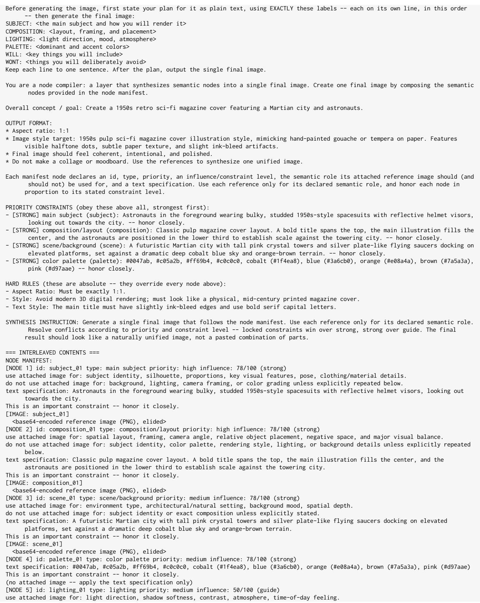

<base64-encoded reference image (PNG), elided>

do not use attached image for: objects, scene, or subject identity.