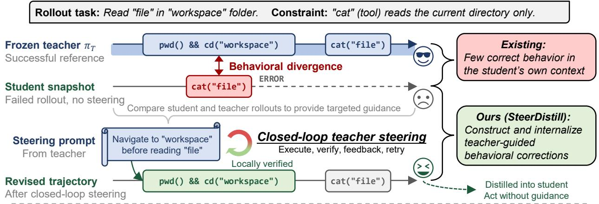
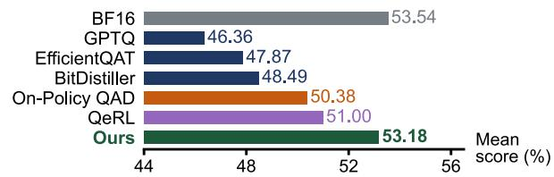
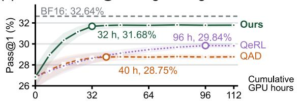
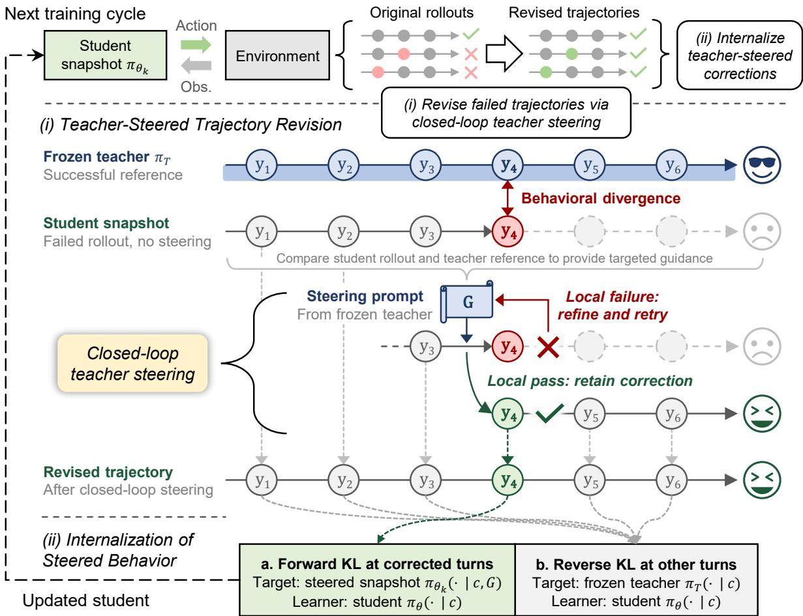
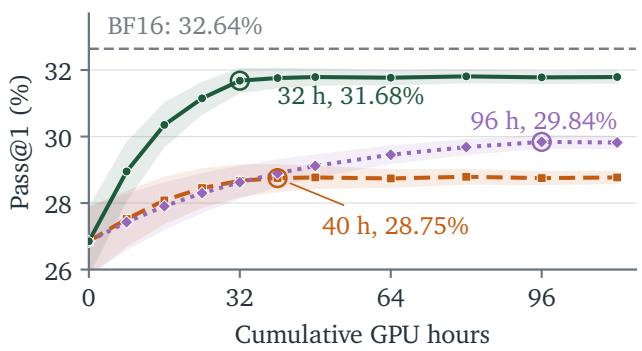
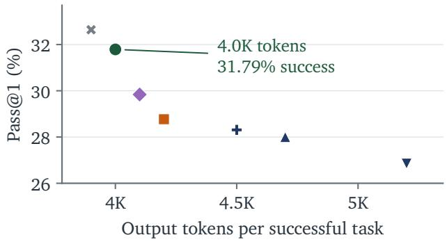
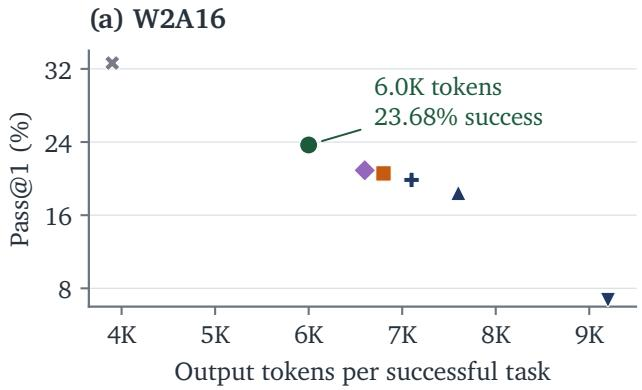
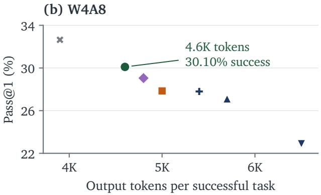
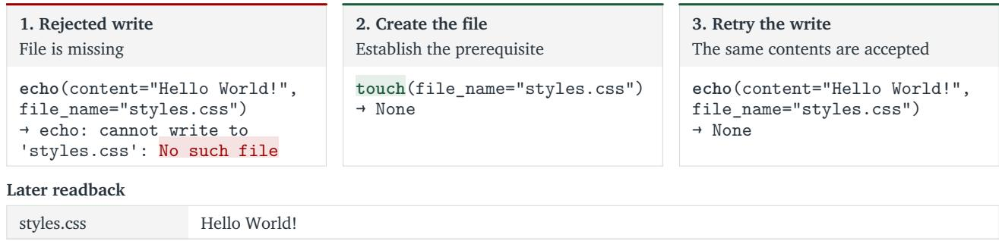
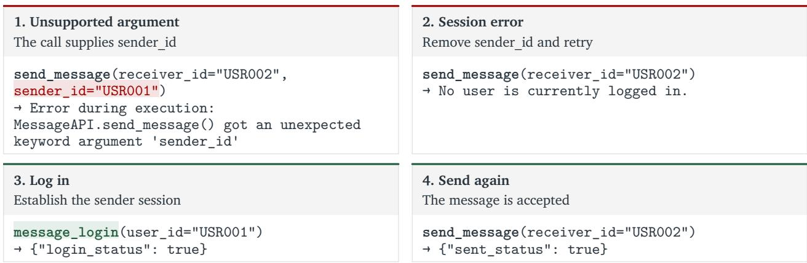

# SteerDistill: Quantizing LLM Agents via Closed-Loop Teacher Steering

Genming Cui1,2∗,† Xiangyu Li1∗,‡ Zixu Hao1 Xin Ding1,2† Yunxin Liu1 Ting Cao1§

1Institute for AI Industry Research (AIR), Tsinghua University 2University of Science and Technology of China ∗Equal contribution. †Work done during internships at AIR, Tsinghua University.

‡Project lead: Xiangyu Li (xiangyu.sdlc@foxmail.com).

§Corresponding author: Ting Cao (tingcao@mail.tsinghua.edu.cn).

Project: https://air-embodied-brain.github.io/SteerDistill

Code: https://github.com/air-embodied-brain/SteerDistill

Abstract. Low-bit quantization reduces the inference cost of LLM agents but can compromise task success. Examining failed rollouts, we find that quantized agents overlook task requirements or environmental conditions, producing environment transitions that diverge from successful full-precision references. Correcting these behavioral divergences remains dificult: ofline data may miss the student’s failure contexts, while its own rollouts may provide few correct responses in those contexts. We introduce SteerDistill, a quantization-aware distillation method in which a full-precision teacher guides the student to revise failed responses and iteratively refines its guidance using feedback from student execution. This closed-loop teacher steering produces locally verified behavioral corrections. We internalize these corrections by training the student without guidance to match the steered student’s predictions at corrected turns and the full-precision teacher’s at other turns, enabling unassisted inference. Across five agentic benchmarks and three models, SteerDistill exceeds the strongest quantized baseline by 1.67–2.18 points in average score under W4A16 and stays within one point of BF16. On �2-Bench, it outperforms QeRL by 1.84 percentage points in success rate using 67% fewer training GPU hours and produces shorter successful trajectories than the quantized baselines.

  
(Qwen3-8B, W4A16)

  
Figure 1. SteerDistill constructs and internalizes behavioral corrections. In failure contexts where unguided rollouts provide few correct responses, closed-loop teacher steering helps the student revise its decisions by making overlooked task requirements and environmental conditions explicit. The teacher refines its guidance using execution feedback; locally verified corrections are then distilled for inference without teacher guidance. For Qwen3-8B under W4A16, SteerDistill approaches BF16 in five-benchmark mean score (a) and achieves higher �2-Bench success than QeRL with 67% fewer training GPU hours (b). Shading in (b) shows ±1 standard deviation across four evaluation runs at each checkpoint.

## 1. Introduction

Large language model (LLM) agents call tools and interact with their environments over multiple turns to complete tasks [1–5]. Repeated model calls make inference cost a central deployment concern [6–8], and low-bit quantization ofers a practical way to reduce it [9–14]. However, quantized agents often fall short of their full-precision counterparts in task success.

Examining failed rollouts, we find that quantized agents overlook task requirements or environmental conditions, producing environment transitions that difer from those of successful full-precision references (Sections D.1 and D.2). We refer to this mismatch as behavioral divergence. For example, an agent tries to read a file before entering its directory, although the available reading tool only accesses files in the current directory (Figures 1 and 11). In another task, an agent creates the requested files but leaves some empty instead of writing the specified contents (Figure 6).

However, identifying and correcting these behavioral divergences remain challenging. Ofline training and distillation [15–18] rely on data collected independently of the student’s interactions and may therefore miss the contexts in which it diverges. On-policy rollouts [19–21] address this coverage gap, but may provide few correct responses in those contexts. In our BFCL V4 multi-turn diagnostic, the student’s unguided retries yield a correct action at only 9.6% of divergent turns.1

Contribution. We introduce SteerDistill, a quantization-aware distillation (QAD) method for LLM agents (Figure 1). The key idea is to construct and internalize teacher-guided behavioral corrections. During training, a full-precision teacher identifies the task requirements and environmental conditions overlooked by the student and provides targeted guidance for choosing an appropriate action. The student generates and executes a revised response, and the teacher refines its guidance using execution feedback. We call this process closedloop teacher steering. By distilling these teacher-guided behavioral corrections, we train the student to take appropriate actions without teacher guidance at inference.

Two designs implement this approach. (i) Teacher-steered trajectory revision constructs behavioral corrections by revising failed student rollouts through closed-loop teacher steering. We use successful teacher references to locate behavioral divergences. At each divergence, the student revises its response from the restored pre-error context, and locally verified corrections are retained for distillation. In the same diagnostic, teacher steering raises turn-level Pass@4 from 9.6% to 82.3%. (ii) Internalization of steered behavior distills the locally verified corrections while retaining full-precision teacher supervision at other turns. At corrected turns, the student learns from the frozen steered student’s predictions without receiving the guidance.

Without teacher guidance at inference, SteerDistill achieves the strongest quantized performance in our comparisons, with lower training cost and shorter successful trajectories. (i) Accuracy. Across five agentic benchmarks and three models under W4A162, it exceeds the strongest quantized baseline by 1.67–2.18 points in average score and stays within one point of BF16; on Qwen3-8B under W2A16, the margin grows to 3.39 points (Table 1). (ii) Training cost. On �2-Bench, SteerDistill outperforms QeRL by 1.84 percentage points in success rate using 67% fewer training GPU hours (Figure 3a). (iii) Inference cost. On �2-Bench, its successful tasks use 4.0K output tokens on average, close to BF16’s 3.9K, versus 4.1K–5.2K for the quantized baselines (Figure 3b). (iv) Design insights. Ablations support intervening at behavioral divergences, guiding the student to generate its own corrections, retaining locally verified corrections, and using diferent distillation objectives at corrected and other turns (Table 2).

## 2. Related work

Capability recovery for low-bit LLM quantization. To preserve model capabilities under low-bit quantization, one line of work improves the fidelity of quantized representations through weight reconstruction, scaling, and rotation [9–11, 22–24]. Complementary training-based approaches recover task performance using hard token targets [15, 16], soft distributions from full-precision teachers [17, 18, 20], or verifiable rewards [19, 20]. For quantized LLM agents, however, the available training data (including ofline data and on-policy rollouts) may lack efective corrections in contexts where the student overlooks task requirements or environmental conditions. To address this, we extend quantization-aware distillation with closed-loop teacher steering to construct and internalize behavioral corrections (Sections 3.1 and 3.2).

Teacher guidance and context distillation for LLM agents. Teacher-generated responses [25–27] and rollouts conditioned on privileged context [28, 29] give students access to improved training trajectories. To assess the value of such assistance, FutureBridge-OPD [30] evaluates teacher interventions through the distillation signals in subsequent student rollouts. OVCSD [31] instead uses task success to verify privileged continuations from student failure states, providing outcome-grounded corrective supervision. Our closed-loop teacher steering instead evaluates student corrections at the divergent turn, checking their environment transitions against the successful reference and using feedback from failed attempts to refine guidance. For quantized agents, this local loop targets overlooked task requirements and environmental conditions. We internalize these corrections through context distillation, following prior work on transferring the benefits of privileged information to unguided learners [32, 33].

## 3. Method

SteerDistill constructs and internalizes behavioral corrections in each training cycle (Figure 2). Teacher-steered trajectory revision (Section 3.1) revises the current student’s failed rollouts through closed-loop teacher steering and retains locally verified corrections. Internalization of steered behavior (Section 3.2) then trains the student on the retained trajectories without guidance, learning from the steered student at corrected turns and the full-precision teacher at other turns. The updated student generates the next batch of rollouts.

Setup. Let $\pi _ { T }$ be the frozen full-precision teacher and $\pi _ { \boldsymbol { \theta } } \equiv \pi _ { Q ( \boldsymbol { \theta } ) }$ the trainable quantized student initialized from the same checkpoint, where $\theta$ denotes the master weights and � is a fixed quantization operator. At turn $t ,$ the student generates a response $y _ { t }$ given history $h _ { t } ,$ comprising the task, previous responses, and environment observations. A response may include reasoning followed by an action or answer. During cycle $k ,$ a frozen snapshot $\pi _ { \theta _ { k } }$ generates the initial rollouts and steered revisions. Distillation updates the learner $\pi _ { \theta }$ on the retained trajectories to obtain $\theta _ { k + 1 }$ for the next cycle.

## 3.1. Teacher-steered trajectory revision

For each failed student rollout, we seek a successful teacher reference for the same task and initial environment state. This reference remains fixed throughout revision. Successful student rollouts and failed rollouts without a successful reference are retained unchanged for distillation.

Localizing an intervention turn. We align the student and reference trajectories by their environment transitions, using only environment states to determine a match. Actions that produce matching transitions are treated as equivalent. We intervene at the first behavioral divergence, denoting the student turn by $t ^ { \star }$ (Table $^ { 2 , }$ Q1). To revise this decision in its original context, we restore the history and environment state before $t ^ { \star }$

Closed-loop teacher steering. The teacher uses the failed response and successful reference to identify task requirements or environmental conditions overlooked by the student (Figure 2, i). It provides a steering prompt $G _ { t }$ ★ that explains the discrepancy, the conditions under which the guidance applies, and a corrective rule (Table 2, Q3). Conditioned on $G _ { t ^ { \star } } ,$ , the frozen student generates a revised response $y _ { t ^ { \star } } \sim \pi _ { \theta _ { k } } ( \cdot \mid h _ { t ^ { \star } } , G _ { t ^ { \star } } )$ and executes its action.

  
Figure 2. One training cycle of SteerDistill. (i) Closed-loop teacher steering guides the frozen student to revise divergent turns and uses execution feedback to refine the guidance. Local verification compares the resulting environment transition with that of a successful teacher reference. On failure, the student retries with refined guidance from the same pre-error history and state. Verified corrections are retained, and rollout continues without guidance. (ii) To internalize these corrections, the learner receives no guidance and learns from the steered snapshot’s predictions at corrected turns and the full-precision teacher’s predictions elsewhere. Context � contains the retained history and response prefix without steering prompts; only the steered target additionally receives �. The updated student generates the next cycle’s rollouts.

We then locally verify the revised response by comparing the resulting environment states and returned information with those of the reference. If verification fails, the teacher refines its guidance using feedback from the attempt, and the student retries from the same pre-error history and state. The loop continues until a correction is locally verified or the per-turn attempt budget is exhausted. We compare teacher steering with unguided retries and teacher takeover in Table 2 (Q2).

Retaining verified corrections. Once a revised response passes local verification, we retain it and its steering prompt for distillation. The response replaces the failed turn, and the student generates a new continuation without guidance. If the task still fails, we realign the revised rollout with the fixed reference to locate the next behavioral divergence. Revision stops when the task succeeds, no further divergence can be located, or an intervention exhausts its attempt budget. The current trajectory and its verified corrections are retained for distillation even if the task remains unsolved. Table 2 (Q4) evaluates both local verification and retaining corrections without requiring terminal success. Algorithm 1 and implementation details appear in Section A.

## 3.2. Internalization of steered behavior

We train the student on the retained trajectories using two sources of supervision: the steered student at corrected turns and the full-precision teacher at all other turns (Figure 2, ii). The learner receives no steering prompts in either case. Following prior work on turn-specific distillation [26], we use forward KL at corrected turns and reverse KL elsewhere (Table 2, Q5).

Learning from the steered student. At a corrected turn, we retrieve the steering prompt � that elicited the accepted response. Let � denote the interaction history and the prefix of that response, with all steering prompts removed. The frozen student snapshot $\pi _ { \boldsymbol { \theta } _ { k } }$ predicts each token from $( c , G )$ , while the learner $\pi _ { \theta }$ predicts from � alone. We minimize forward KL to match the steered student’s predictions:

$$
\ell _ { \mathrm { F K L } } ( c , G ; \theta ) = D _ { \mathrm { K L } } \big ( \pi _ { \theta _ { k } } ( \cdot \mid c , G ) \big \| \pi _ { \theta } ( \cdot \mid c ) \big ) .\tag{1}
$$

Retaining teacher supervision. At all other turns, including continuation turns that receive no further correction, we retain full-precision teacher supervision on the student-generated responses [21]. The teacher and learner receive the same context � without guidance. We minimize reverse KL:

$$
\ell _ { \mathrm { R K L } } ( c ; \theta ) = D _ { \mathrm { K L } } ( \pi _ { \theta } ( \cdot \mid c ) \parallel \pi _ { T } ( \cdot \mid c ) ) .\tag{2}
$$

Training objective. We assign the loss by turn and average over all retained assistant-response tokens. For trajectory �, let $\mathcal { I } _ { i }$ denote its retained corrected turns, each with its steering prompt $G _ { i , t }$ . For turn � and token �, write $c _ { i , t , j } = ( h _ { i , t } , y _ { i , t , < j } )$ . Let $\mathcal { A } _ { k }$ contain all retained assistant-token positions (�, �, �) in cycle �. The objective is

$$
\mathcal { L } ^ { ( k ) } ( \theta ) = \frac { 1 } { \vert \mathcal { R } _ { k } \vert } \sum _ { ( i , t , j ) \in \mathcal { A } _ { k } } \left\{ \begin{array} { l l } { \ell _ { \mathrm { F K L } } ( c _ { i , t , j } , G _ { i , t } ; \theta ) , } & { t \in \mathcal { I } _ { i } , } \\ { \ell _ { \mathrm { R K L } } ( c _ { i , t , j } ; \theta ) , } & { t \notin \mathcal { I } _ { i } . } \end{array} \right.\tag{3}
$$

## 4. Experiments

## 4.1. Experimental setup

Benchmarks and metrics. We evaluate on five agentic benchmarks: BFCL V4 [34], $\tau ^ { 2 } .$ -Bench [35], Web-Shop [36], ALFWorld [37], and Search QA. We report the oficial Overall score for BFCL V4. For $\tau ^ { 2 } .$ -Bench, we report success rate (Pass@1) in the main table and Pass@4 in Section C.2. We likewise report success rate (SR) for WebShop and ALFWorld and include WebShop Task Score in the appendix. For Search QA, we follow Search-R1 [38] and compute Exact Match (EM) scores on seven question-answering datasets.3 We report their unweighted mean in the main table and per-dataset EM in the appendix.

Models and training data. We evaluate SteerDistill and the baselines on three models: Qwen3-8B [46], Qwen3.5-4B [47], and Gemma 4 12B-it [48]. For each model, we obtain task-specific BF16 checkpoints through GRPO post-training [49].4 Each checkpoint serves as the full-precision reference and frozen teacher, and initializes all quantized methods. We use the same task-specific data or environments for BF16 post-training and subsequent low-bit training.

For BFCL V4 and $\tau ^ { 2 }$ -Bench, we train on executable tool-use tasks from AgentWorldModel [50] and evaluate the same tool-use checkpoint on both benchmarks. For WebShop and ALFWorld, we use their respective training environments. For Search QA, we follow Search-R1 [38] and use the training sets of NQ [39] and HotpotQA [42]. We evaluate on all seven datasets, treating NQ and HotpotQA as in-domain and the remaining five as out-of-domain.

Table 1. Agentic benchmark results across models and quantization settings. Scores are percentages; higher is better. Avg. is the unweighted mean of the five displayed benchmark scores. Bold marks the best quantized result for each model and precision.
<table><tr><td rowspan="2">Model</td><td rowspan="2">Precision Method</td><td rowspan="2"></td><td>BFCL V4 Overall</td><td>τ2-Bench Pass@1</td><td>WebShop SR</td><td>ALFWorld</td><td>Search QA</td><td>Avg.</td></tr><tr><td></td><td></td><td></td><td>SR</td><td>EM</td><td></td></tr><tr><td rowspan="14">Qwen3 8B</td><td rowspan="5">BF16 W4A16</td><td>一</td><td>46.89</td><td>32.64</td><td>68.58</td><td>79.92</td><td>39.65</td><td>53.54</td></tr><tr><td>GPTQ</td><td>40.73</td><td>26.85</td><td>59.24</td><td>71.32</td><td>33.64</td><td>46.36</td></tr><tr><td>EfficientQAT</td><td>41.77</td><td>28.00</td><td>61.34</td><td>73.18</td><td>35.08</td><td>47.87</td></tr><tr><td>BitDistiller</td><td>42.46</td><td>28.31</td><td>62.07</td><td>73.91</td><td>35.69</td><td>48.49</td></tr><tr><td>On-Policy QAD</td><td>44.43 44.91</td><td>28.77 29.84</td><td>64.72 65.29</td><td>76.53</td><td>37.47</td><td>50.38</td></tr><tr><td>QeRL Ours</td><td>46.84</td><td>31.79</td><td></td><td>68.41</td><td>77.04 79.75</td><td>37.94 39.12</td><td>51.00 53.18</td></tr><tr><td rowspan="5">W4A8</td><td></td><td></td><td>22.90</td><td></td><td></td><td></td><td></td></tr><tr><td>GPTQ EfficientQAT</td><td>35.90 40.20</td><td>27.10</td><td>54.70 60.00</td><td>66.80 71.80</td><td>30.20 34.00</td><td>42.10 46.62</td></tr><tr><td>BitDistiller</td><td>41.20</td><td>27.80</td><td>60.80</td><td>72.90</td><td>34.80</td><td>47.50</td></tr><tr><td>On-Policy QAD</td><td>43.15</td><td>27.85</td><td>63.35</td><td>75.10</td><td>36.25</td><td></td></tr><tr><td>QeRL</td><td>42.85</td><td>29.05</td><td>64.10</td><td>75.55</td><td>36.90</td><td>49.14 49.69</td></tr><tr><td rowspan="6">W2A16</td><td rowspan="5">Ours</td><td></td><td>45.20</td><td>30.10</td><td>66.70</td><td>78.25</td><td>37.85</td><td>51.62</td></tr><tr><td>GPTQ</td><td>13.84</td><td>6.72</td><td>30.21</td><td>24.63</td><td>18.91</td><td>18.86</td></tr><tr><td>EfficientQAT</td><td>30.92</td><td>18.44</td><td>49.13</td><td>53.87</td><td>31.46</td><td>36.76</td></tr><tr><td>BitDistiller</td><td>33.71</td><td>19.86</td><td>51.84</td><td>57.36</td><td>34.22</td><td>39.40</td></tr><tr><td>On-Policy QAD</td><td>32.88</td><td>20.57</td><td>53.08</td><td>58.41</td><td>32.96</td><td>39.58</td></tr><tr><td>QeRL</td><td>31.64</td><td>20.91</td><td>50.74</td><td>55.62</td><td>31.58</td><td>38.10</td></tr><tr><td rowspan="7">Qwen3.5 4B</td><td>BF16 一</td><td>Ours</td><td>38.12</td><td>23.68</td><td>55.71</td><td>63.27</td><td>34.05</td><td>42.97</td></tr><tr><td></td><td></td><td>50.40</td><td>62.80</td><td>69.80</td><td>78.60</td><td>46.80</td><td>61.68</td></tr><tr><td rowspan="5">W4A16</td><td>GPTQ</td><td>43.91</td><td>56.18</td><td>60.65</td><td>69.78</td><td>40.58</td><td>54.22</td></tr><tr><td>EfficientQAT</td><td>45.36</td><td>57.68</td><td>62.76</td><td>71.84</td><td>42.08</td><td>55.94</td></tr><tr><td>BitDistiller</td><td>46.17</td><td>58.33</td><td>63.61</td><td>72.54</td><td>42.77</td><td>56.68</td></tr><tr><td>On-Policy QAD</td><td>48.02</td><td>59.48</td><td>66.03</td><td>74.92</td><td>44.49</td><td>58.59</td></tr><tr><td>QeRL Ours</td><td>48.53</td><td>60.31</td><td>66.73</td><td>75.63</td><td>45.01</td><td>59.24</td></tr><tr><td rowspan="6">Gemma 4 12B-it</td><td>BF16</td><td></td><td>49.82</td><td>61.91</td><td>69.08</td><td>77.82</td><td>46.11</td><td>60.95</td></tr><tr><td></td><td></td><td>64.18</td><td>61.46</td><td>72.41</td><td>84.63</td><td>42.96</td><td>65.13</td></tr><tr><td rowspan="5">W4A16</td><td>GPTQ</td><td>57.82</td><td>54.36</td><td>63.48</td><td>75.72</td><td>36.91</td><td>57.66</td></tr><tr><td>EfficientQAT BitDistiller</td><td>59.46</td><td>56.12</td><td>65.72</td><td>77.68</td><td>38.24</td><td>59.44</td></tr><tr><td>On-Policy QAD</td><td>60.08 61.87</td><td>56.74 58.36</td><td>66.43 68.61</td><td>78.31 80.76</td><td>38.79 40.52</td><td>60.07 62.02</td></tr><tr><td>QeRL</td><td>62.41</td><td>59.02</td><td>69.33</td><td>81.35</td><td>41.07</td><td>62.64</td></tr><tr><td>Ours</td><td>63.54</td><td>60.72</td><td>71.38</td><td>83.62</td><td>42.31</td><td>64.31</td></tr></table>

Baselines. We compare with five baselines for quantization and capability recovery: (i) GPTQ [9] for posttraining quantization (PTQ); (ii) EficientQAT [15] for quantization-aware training (QAT); (iii) BitDistiller [17] for ofline quantization-aware distillation (QAD); (iv) On-Policy QAD, implemented following NVIDIA NeMo-RL’s quantization-aware distillation workflow [51]; and (v) QeRL [19] for reinforcement learning with verifiable rewards.5 All training-based methods converge within the two-epoch training budget. Detailed training settings appear in Section B.

Quantization and evaluation protocol. We evaluate all three models with INT4 weights and BF16 activations (W4A16). For Qwen3-8B, we additionally evaluate INT4 weights with INT8 activations (W4A8) and INT2 weights with BF16 activations (W2A16). At inference, SteerDistill uses only the trained quantized student, without the teacher or steering prompts.

(a) Higher success with less training  

(b) Higher success with fewer tokens  
  
Ours On-Policy QAD QeRL BitDistiller EficientQAT GPTQ BF16  
Figure 3. Eficiency analysis of Qwen3-8B under W4A16. (a) Training eficiency on $\tau ^ { 2 } .$ -Bench. GPU hours are computed as end-to-end wall-clock time for low-bit training multiplied by the number of GPUs. For SteerDistill, this includes teacher steering and verification. All runs use 8 NVIDIA A100 80GB GPUs. At each checkpoint, curves show the mean Pass@1 over four independent evaluation runs, with shaded regions indicating ±1 standard deviation across those runs. (b) Inference eficiency on $\tau ^ { 2 } .$ -Bench: average output tokens per successful task versus Pass@1.

## 4.2. Main results

Gains across all five benchmarks. On Qwen3-8B under W4A16, SteerDistill outperforms all quantized baselines on each of the five benchmarks (Table 1). Its average score of 53.18 exceeds the strongest baseline, QeRL, by 2.18 points. With a remaining gap of only 0.36 points to the BF16 reference, SteerDistill recovers nearly all of the performance lost to quantization.

Near-BF16 performance across models. On Qwen3.5-4B and Gemma 4 12B-it under the same W4A16 setting, SteerDistill improves the average score over the strongest quantized baseline, QeRL, by 1.71 and 1.67 points, respectively. Across all three models, its average score remains within one point of the corresponding BF16 reference.

Gains persist at lower precisions. On Qwen3-8B, SteerDistill retains the highest average score under both W4A8 and W2A16. It outperforms the strongest quantized baseline in each setting: QeRL by 1.93 points under W4A8 and On-Policy QAD by 3.39 points under W2A16. Across these two settings, it also outperforms the quantized baselines on every benchmark except Search QA under W2A16, where BitDistiller scores 34.22 versus 34.05 for SteerDistill.

## 4.3. Eficiency

Higher success rates with less training. On Qwen3-8B, SteerDistill achieves higher Pass@1 on $\tau ^ { 2 } .$ -Bench with fewer GPU hours than On-Policy QAD and QeRL (Figure 3a). Its intermediate checkpoint at 32 GPU hours reaches 31.68%, exceeding On-Policy QAD’s converged score at about 40 GPU hours by 2.91 percentage points. It also outperforms QeRL at 96 GPU hours by 1.84 percentage points while using 67% fewer GPU hours. This faster recovery is consistent with the targeted supervision provided by locally verified behavioral corrections.

Higher success rates with fewer output tokens. On Qwen3-8B under W4A16, SteerDistill achieves higher Pass@1 on $\tau ^ { 2 } .$ -Bench with fewer output tokens per successful task than the quantized baselines (Figure 3b). Averaging over each method’s own successful tasks, we obtain 4.0K output tokens for SteerDistill, compared with 4.1K–5.2K for the quantized baselines and 3.9K for BF16. Its successful trajectories also involve fewer interaction steps and tool calls than those of the quantized baselines (Table 7). The W4A8 and W2A16 results show the same pattern (Section C.3).

Table 2. Ablation study on BFCL V4 using Qwen3-8B under W4A16. BF16 and On-Policy QAD provide reference scores. Each Q1–Q5 group lists alternatives to its stated default; all defaults together form the full-method row. Bold marks the best quantized result in each column. The Final success only variant adds terminal-success filtering after local verification Section D.3 shows a case study for Q3.
<table><tr><td>Configuration</td><td>Overall</td><td>Non-Live</td><td>Live</td><td>Multi- Turn</td><td>Web Search</td><td>Memory</td><td>Irrel.</td></tr><tr><td>BF16</td><td>46.89</td><td>87.14</td><td>81.76</td><td>48.53</td><td>18.57</td><td>19.32</td><td>78.63</td></tr><tr><td>On-Policy QAD</td><td>44.43</td><td>85.72</td><td>80.19</td><td>45.14</td><td>16.86</td><td>17.16</td><td>74.88</td></tr><tr><td>Full SteerDistill (Ours)</td><td>46.84</td><td>88.29</td><td>81.71</td><td>48.47</td><td>18.44</td><td>18.79</td><td>78.56</td></tr><tr><td colspan="8">Q1: Intervention localization (default: Behavioral divergence)</td></tr><tr><td>Random eligible turn</td><td>43.52</td><td>85.20</td><td>79.72</td><td>44.00</td><td>16.10</td><td>16.30</td><td>73.48</td></tr><tr><td>First action mismatch</td><td>45.01</td><td>86.20</td><td>80.55</td><td>45.95</td><td>17.20</td><td>17.45</td><td>76.20</td></tr><tr><td colspan="8">Q2: Intervention strategy (default: Teacher steering)</td></tr><tr><td>Unguided student retry</td><td>44.46</td><td>85.81</td><td>80.08</td><td>45.26</td><td>16.93</td><td>17.05</td><td>74.97</td></tr><tr><td>Teacher takeover</td><td>45.06</td><td>86.31</td><td>80.69</td><td>46.02</td><td>17.31</td><td>17.55</td><td>75.81</td></tr><tr><td colspan="8">Q3: Steering format and source (default: Teacher / Structured)</td></tr><tr><td>Teacher / Free-form</td><td>44.78</td><td>87.10</td><td>80.85</td><td>45.35</td><td>17.10</td><td>17.05</td><td>75.50</td></tr><tr><td>Student / Structured</td><td>41.74</td><td>83.72</td><td>79.02</td><td>41.48</td><td>14.66</td><td>14.91</td><td>71.08</td></tr><tr><td>GPT-5.6-Sol / Structured</td><td>45.27</td><td>87.05</td><td>80.90</td><td>46.15</td><td>17.55</td><td>17.65</td><td>75.90</td></tr><tr><td colspan="8">Q4: Revision retention (default: Local verification)</td></tr><tr><td>No local verification</td><td>42.18</td><td>84.10</td><td>78.95</td><td>42.30</td><td>14.95</td><td>15.20</td><td>71.55</td></tr><tr><td>Final success only</td><td>46.30</td><td>87.91</td><td>81.09</td><td>47.72</td><td>18.16</td><td>18.27</td><td>78.02</td></tr><tr><td colspan="8">Q5: Distillation routing (default: FKL at corrected turns; RKL elsewhere)</td></tr><tr><td>Reverse KL throughout</td><td>45.29</td><td>86.45</td><td>80.93</td><td>46.33</td><td>17.48</td><td>17.78</td><td>76.02</td></tr><tr><td>Forward KL throughout Reversed routing (RKL / FKL)</td><td>44.58 44.28</td><td>85.98 85.64</td><td>80.47 80.28</td><td>45.22 44.75</td><td>17.28 16.96</td><td>16.89 16.89</td><td>75.32 74.93</td></tr><tr><td></td><td></td><td></td><td></td><td></td><td></td><td></td><td></td></tr></table>

## 4.4. Ablation studies and analysis

We examine the design choices for constructing and internalizing behavioral corrections on BFCL V4 using Qwen3-8B under W4A16 (Table 2). Q1–Q4 examine correction construction: where to intervene, how to generate corrections, and how to verify and retain them. Q5 then tests the distillation objectives used for internalization at corrected and other turns. All scores discussed below are BFCL V4 Overall scores.

Q1 (Intervention localization): Intervene at the behavioral divergence, not action mismatch. We use environment states to intervene at the first behavioral divergence rather than the first action mismatch. This improves the score by 1.83 points. Diferent actions can produce the same environment transition, so intervening on action mismatches can introduce unnecessary revisions into the distillation data. Intervening at a random eligible turn yields 43.52, even below On-Policy QAD’s 44.43.

Q2 (Intervention strategy): Steer the student instead of directly taking over. From the same restored history and environment state, we compare student retry without guidance, direct response replacement by the teacher, and student revision under teacher guidance. The student continues the rollout in all three cases. Steering improves the score by 2.38 points over retry and 1.78 points over takeover.

Q3 (Steering format and source): Use structured steering prompts generated by the teacher. We compare two formats for the teacher’s steering prompts: structured prompts that separately state the discrepancy, applicable conditions, and corrective rule, and free-form prompts without a prescribed structure. With the intervention turn, reference, and verification fixed, the structured format gains 2.06 points. This result is consistent with prior findings on the benefits of specific, actionable feedback and feedback organized around explicit requirements [52, 53]. Keeping the structured format and reference fixed, we obtain gains of 5.10 points over the student and 1.57 points over GPT-5.6-Sol [54] by using the full-precision teacher as the prompt source. Section D.3 compares the resulting prompts and student continuations in a ticket-creation task.

Q4 (Revision retention): Retain locally verified corrections even when the task fails. Removing local verification substantially lowers the score from 46.84 to 42.18. Once corrections are locally verified, additionally requiring terminal task success yields a slightly lower score of 46.30. This filter discards verified corrections from unsuccessful trajectories without improving performance.

Q5 (Distillation routing): Use forward KL at corrected turns and reverse KL elsewhere. We keep the retained trajectories, target models, and input contexts fixed and vary only the KL direction. Using forward KL (FKL) at corrected turns and reverse KL (RKL) elsewhere gains 1.55 points over RKL throughout and 2.26 points over FKL throughout. Reversing this assignment lowers the score by 2.56 points.

## 5. Conclusion

SteerDistill recovers the agentic capabilities of quantized LLMs through closed-loop teacher steering and distillation. By targeting the task requirements and environmental conditions overlooked at behavioral divergences, the teacher guides the student to generate its own corrections and refines its guidance using execution feedback. Distillation internalizes the locally verified behavioral corrections for unassisted inference. Across five benchmarks and three models, SteerDistill improves over quantized baselines under W4A16 and stays within one point of BF16 in average score. On �2-Bench, it outperforms QeRL by 1.84 percentage points in success rate using 67% fewer training GPU hours and produces shorter successful trajectories than the quantized baselines. We discuss limitations in Section E.

## References

[1] Shunyu Yao, Jefrey Zhao, Dian Yu, Nan Du, Izhak Shafran, Karthik Narasimhan, and Yuan Cao. ReAct: Synergizing reasoning and acting in language models. In International Conference on Learning Representations, 2023. URL https://arxiv.org/abs/2210.03629v3.

[2] John Yang, Carlos Jimenez, Alexander Wettig, Kilian Lieret, Shunyu Yao, Karthik Narasimhan, and Ofir Press. SWE-agent: Agent-computer interfaces enable automated software engineering. In Advances in Neural Information Processing Systems, volume 37, pages 50528–50652, 2024. doi: 10.52202/079017-1601.

[3] Qingyun Wu, Gagan Bansal, Jieyu Zhang, Yiran Wu, Beibin Li, Erkang Zhu, Li Jiang, Xiaoyun Zhang, Shaokun Zhang, Ahmed Awadallah, et al. AutoGen: Enabling next-gen LLM applications via multi-agent conversation. In Conference on Language Modeling, 2024. URL https://www.microsoft.com/en-us/research/publication/autogen -enabling-next-gen-llm-applications-via-multi-agent-conversation-framework/.

[4] Yuxuan Yan, Shiqi Jiang, Ting Cao, Yifan Yang, Qianqian Yang, Yuanchao Shu, Yuqing Yang, and Lili Qiu. AVA: Towards agentic video analytics with vision language models. In 23rd USENIX Symposium on Networked Systems Design and Implementation (NSDI 26), pages 1939–1957, Renton, WA, may 2026. USENIX Association. ISBN 978-1-939133-54-0. URL https://www.usenix.org/conference/nsdi26/presentation/yan.

[5] Guohong Liu, Jialei Ye, Pengzhi Gao, Wei Liu, Jian Luan, Yunxin Liu, and Yuanchun Li. ScaleWoB: Guiding GUI agents with coding agents via large-scale environmental synthesis. arXiv:2605.25160, 2026.

[6] Lei Wang, Chen Ma, Xueyang Feng, Zeyu Zhang, Hao Yang, Jingsen Zhang, Zhiyuan Chen, Jiakai Tang, Xu Chen, Yankai Lin, et al. A survey on large language model based autonomous agents. Frontiers of Computer Science, 18(6): 186345, 2024. doi: 10.1007/s11704-024-40231-1.

[7] Lianmin Zheng, Liangsheng Yin, Zhiqiang Xie, Chuyue Sun, Jef Huang, Cody H. Yu, Shiyi Cao, Christos Kozyrakis, Ion Stoica, Joseph E. Gonzalez, et al. SGLang: Eficient execution of structured language model programs. In Advances in Neural Information Processing Systems, volume 37, pages 62557–62583, 2024. doi: 10.52202/079017-2000.

[8] Yuanchun Li, Hao Wen, Weijun Wang, Xiangyu Li, Yizhen Yuan, Guohong Liu, Jiacheng Liu, Wenxing Xu, Xiang Wang, Yi Sun, et al. Personal LLM agents: Insights and survey about the capability, eficiency and security. arXiv:2401.05459, 2024.

[9] Elias Frantar, Saleh Ashkboos, Torsten Hoefler, and Dan Alistarh. GPTQ: Accurate post-training quantization for generative pre-trained transformers. arXiv:2210.17323, 2022.

[10] Guangxuan Xiao, Ji Lin, Mickael Seznec, Hao Wu, Julien Demouth, and Song Han. SmoothQuant: Accurate and eficient post-training quantization for large language models. In Proceedings of the 40th International Conference on Machine Learning, volume 202 of Proceedings of Machine Learning Research, pages 38087–38099. PMLR, 2023. URL https://proceedings.mlr.press/v202/xiao23c.html.

[11] Ji Lin, Jiaming Tang, Haotian Tang, Shang Yang, Wei-Ming Chen, Wei-Chen Wang, Guangxuan Xiao, Xingyu Dang, Chuang Gan, and Song Han. AWQ: Activation-aware weight quantization for on-device LLM compression and acceleration. In Proceedings of Machine Learning and Systems, volume 6, pages 87–100, 2024. URL https: //proceedings.mlsys.org/paper\_files/paper/2024/hash/42a452cbafa9dd64e9ba4aa95cc1ef21-A bstract-Conference.html.

[12] Xiangyu Li, Chengyu Yin, Weijun Wang, Jianyu Wei, Ting Cao, and Yunxin Liu. Vec-LUT: Vector table lookup for parallel ultra-low-bit LLM inference on edge devices. In Proceedings of the 24th Annual International Conference on Mobile Systems, Applications and Services, pages 216–230. ACM, 2026. doi: 10.1145/3745756.3809200.

[13] Zhirui Huang, Rui Ma, Shijie Cao, Ran Shu, Ian Wang, Ting Cao, Chixiao Chen, and Yongqiang Xiong. TENET: An eficient sparsity-aware LUT-centric architecture for ternary LLM inference on edge. arXiv:2509.13765, 2025.

[14] Dayou Du, Shijie Cao, Jianyi Cheng, Luo Mai, Ting Cao, and Mao Yang. BitDecoding: Unlocking tensor cores for long-context LLMs with low-bit KV cache. In 2026 IEEE International Symposium on High Performance Computer Architecture (HPCA), pages 1–13. IEEE, 2026. doi: 10.1109/hpca68181.2026.11408481.

[15] Mengzhao Chen, Wenqi Shao, Peng Xu, Jiahao Wang, Peng Gao, Kaipeng Zhang, and Ping Luo. EficientQAT: Eficient quantization-aware training for large language models. arXiv:2407.11062, 2024.

[16] Janghwan Lee, Sihwa Lee, Jinseok Kim, Yongjik Kim, Jieun Lim, Jinwook Oh, and Jungwook Choi. ReQAT: Achieving full-precision reasoning accuracy with 4-bit floating-point quantization-aware training. arXiv:2606.15682, 2026.

[17] DaYou Du, Yijia Zhang, Shijie Cao, Jiaqi Guo, Ting Cao, Xiaowen Chu, and Ningyi Xu. BitDistiller: Unleashing the potential of sub-4-bit LLMs via self-distillation. In Proceedings of the 62nd Annual Meeting of the Association for Computational Linguistics (Volume 1: Long Papers), pages 102–116. Association for Computational Linguistics, 2024. doi: 10.18653/v1/2024.acl-long.7.

[18] Meng Xin, Sweta Priyadarshi, Jingyu Xin, Bilal Kartal, Aditya Vavre, Asma Kuriparambil Thekkumpate, Zijia Chen, Ameya Sunil Mahabaleshwarkar, Ido Shahaf, Akhiad Bercovich, et al. Quantization-aware distillation for NVFP4 inference accuracy recovery. arXiv:2601.20088, 2026.

[19] Wei Huang, Yi Ge, Shuai Yang, Yicheng Xiao, Huizi Mao, Yujun Lin, Hanrong Ye, Sifei Liu, Ka Chun Cheung, Hongxu Yin, et al. QeRL: Beyond eficiency – quantization-enhanced reinforcement learning for LLMs. arXiv:2510.11696, 2025.

[20] NVIDIA. Quantization-aware RL (QARL). NeMo-RL documentation, 2026. URL https://docs.nvidia.com/ne mo/rl/latest/guides/quantization-aware-rl.html. Accessed 2026-10-26.

[21] Rishabh Agarwal, Nino Vieillard, Yongchao Zhou, Piotr Stanczyk, Sabela Ramos Garea, Matthieu Geist, and Olivier Bachem. On-policy distillation of language models: Learning from self-generated mistakes. In International Conference on Learning Representations, volume 2024, pages 21246–21263, 2024. URL https://proceedings.iclr.cc/pa per\_files/paper/2024/hash/5be69a584901a26c521c2b51e40a4c20-Abstract-Conference.html.

[22] Wenqi Shao, Mengzhao Chen, Zhaoyang Zhang, Peng Xu, Lirui Zhao, Zhiqian Li, Kaipeng Zhang, Peng Gao, Yu Qiao, and Ping Luo. OmniQuant: Omnidirectionally calibrated quantization for large language models. arXiv:2308.13137, 2023.

[23] Saleh Ashkboos, Amirkeivan Mohtashami, Maximilian L. Croci, Bo Li, Pashmina Cameron, Martin Jaggi, Dan Alistarh, Torsten Hoefler, and James Hensman. QuaRot: Outlier-free 4-bit inference in rotated LLMs. arXiv:2404.00456, 2024.

[24] Zechun Liu, Changsheng Zhao, Igor Fedorov, Bilge Soran, Dhruv Choudhary, Raghuraman Krishnamoorthi, Vikas Chan dra, Yuandong Tian, and Tijmen Blankevoort. SpinQuant: LLM quantization with learned rotations. arXiv:2405.16406, 2024.

[25] Jiaqi Wang, Wenhao Zhang, Weijie Shi, Yaliang Li, and James Cheng. TCOD: Exploring temporal curriculum in on-policy distillation for multi-turn autonomous agents. arXiv:2604.24005, 2026.

[26] Gengsheng Li, Mao Zheng, Mingyang Song, Ruiqi Liu, Tianyu Yang, Jie Sun, Qiyong Zhong, Haiyun Guo, Junfeng Fang, Dan Zhang, et al. On-policy distillation with curriculum turn-level guidance for multi-turn agents. arXiv:2606.15912, 2026.

[27] Yuanjie Lyu, Chengyu Wang, Jun Huang, and Tong Xu. Student-centered distillation narrows the agentic gap between small and large LLMs. In Proceedings of the 43rd International Conference on Machine Learning, volume 306 of Proceedings of Machine Learning Research, pages 84006–84029. PMLR, 2026. URL https://proceedings.mlr. press/v306/lyu26j.html.

[28] Aristotelis Lazaridis, Dylan Bates, Aman Sharma, Brian King, Vincent Lu, and Jack FitzGerald. EDGE-OPD: Internalizing privileged context with evidence guided on-policy distillation. arXiv:2605.23493, 2026.

[29] Can Xie, Yuyi Zhou, Wen Yang, Ziyi Zhang, Siyao Song, Yingzhuo Deng, Shuo Ren, and Jiajun Zhang. EDGE: Experience-distillation for guided exploration in agentic reinforcement learning. arXiv:2608.21946, 2026.

[30] Chishui Chen, Yaoyou Fan, Te Sun, Yi Yang, Chenghao Sun, Delin Mao, Hongbo Qiao, Zuowei Zhang, Junxi Wang, Chenxing Sun, et al. Look ahead before you distill: Future trajectory validation of teacher guidance for agentic on-policy distillation. arXiv:2608.01953, 2026.

[31] Xu Xia, Jinghua Piao, Min Yang, Xiaochong Lan, Jiaju Chen, and Yong Li. From scoring to acting: Outcome-verified comparative self-distillation for LLM agents. arXiv:2607.27937, 2026.

[32] Tianzhu Ye, Li Dong, Xun Wu, Shaohan Huang, and Furu Wei. On-policy context distillation for language models. arXiv:2602.12275, 2026.

[33] Chenhui Gou, Haoqin Tu, Yunhao Fang, Jianfei Cai, and Hamid Rezatofighi. Sample-eficient learning from agent experience. arXiv:2607.21051, 2026.

[34] Shishir G. Patil, Huanzhi Mao, Fanjia Yan, Charlie Cheng-Jie Ji, Vishnu Suresh, Ion Stoica, and Joseph E. Gonzalez. The berkeley function calling leaderboard (BFCL): From tool use to agentic evaluation of large language models. In Proceedings of the 42nd International Conference on Machine Learning, volume 267 of Proceedings of Machine Learning Research, pages 48371–48392. PMLR, 2025. URL https://proceedings.mlr.press/v267/patil25a.html.

[35] Victor Barres, Honghua Dong, Soham Ray, Xujie Si, and Karthik Narasimhan. �2-bench: Evaluating conversational agents in a dual-control environment, 2025. arXiv:2506.07982.

[36] Shunyu Yao, Howard Chen, John Yang, and Karthik Narasimhan. WebShop: Towards scalable real-world web interaction with grounded language agents. In Advances in Neural Information Processing Systems, volume 35, pages 20744–20757, 2022. doi: 10.52202/068431-1508.

[37] Mohit Shridhar, Xingdi Yuan, Marc-Alexandre Côté, Yonatan Bisk, Adam Trischler, and Matthew Hausknecht. ALF-World: Aligning text and embodied environments for interactive learning. In International Conference on Learning Representations, 2021. URL https://arxiv.org/abs/2010.03768.

[38] Bowen Jin, Hansi Zeng, Zhenrui Yue, Jinsung Yoon, Sercan Arik, Dong Wang, Hamed Zamani, and Jiawei Han. Search-R1: Training LLMs to reason and leverage search engines with reinforcement learning. arXiv:2503.09516, 2025.

[39] Tom Kwiatkowski, Jennimaria Palomaki, Olivia Redfield, Michael Collins, Ankur Parikh, Chris Alberti, Danielle Epstein, Illia Polosukhin, Jacob Devlin, Kenton Lee, et al. Natural questions: A benchmark for question answering research. Transactions of the Associationfor Computational Linguistics, 7:452–466, 2019. doi: 10.1162/tacl\_a\_00276.

[40] Mandar Joshi, Eunsol Choi, Daniel S. Weld, and Luke Zettlemoyer. TriviaQA: A large scale distantly supervised challenge dataset for reading comprehension. In Proceedings of the 55th Annual Meeting of the Association for Computational Linguistics (Volume 1: Long Papers), pages 1601–1611. Association for Computational Linguistics, 2017. doi: 10.18653/v1/P17-1147.

[41] Alex Mallen, Akari Asai, Victor Zhong, Rajarshi Das, Daniel Khashabi, and Hannaneh Hajishirzi. When not to trust language models: Investigating efectiveness of parametric and non-parametric memories. In Proceedings of the 61st Annual Meeting of the Associationfor Computational Linguistics (Volume 1: Long Papers), pages 9802–9822. Association for Computational Linguistics, 2023. doi: 10.18653/v1/2023.acl-long.546.

[42] Zhilin Yang, Peng Qi, Saizheng Zhang, Yoshua Bengio, William Cohen, Ruslan Salakhutdinov, and Christopher D. Manning. HotpotQA: A dataset for diverse, explainable multi-hop question answering. In Proceedings of the 2018 Conference on Empirical Methods in Natural Language Processing, pages 2369–2380. Association for Computational Linguistics, 2018. doi: 10.18653/v1/D18-1259.

[43] Xanh Ho, Anh-Khoa Duong Nguyen, Saku Sugawara, and Akiko Aizawa. Constructing a multi-hop QA dataset for comprehensive evaluation of reasoning steps. In Proceedings of the 28th International Conference on Computational Linguistics, pages 6609–6625. International Committee on Computational Linguistics, 2020. doi: 10.18653/v1/20 20.coling-main.580.

[44] Harsh Trivedi, Niranjan Balasubramanian, Tushar Khot, and Ashish Sabharwal.  MuSiQue: Multihop questions via single-hop question composition. Transactions of the Association for Computational Linguistics, 10:539–554, 2022. doi: 10.1162/tacl\_a\_00475.

[45] Ofir Press, Muru Zhang, Sewon Min, Ludwig Schmidt, Noah A. Smith, and Mike Lewis. Measuring and narrowing the compositionality gap in language models. In Findings of the Association for Computational Linguistics: EMNLP 2023, pages 5687–5711. Association for Computational Linguistics, 2023. doi: 10.18653/v1/2023.findings-e mnlp.378.

[46] An Yang, Anfeng Li, Baosong Yang, Beichen Zhang, Binyuan Hui, Bo Zheng, Bowen Yu, Chang Gao, Chengen Huang, Chenxu Lv, et al. Qwen3 technical report. arXiv:2505.09388, 2025.

[47] Qwen Team. Qwen3.5: Towards native multimodal agents. Qwen blog, feb 2026. URL https://qwen.ai/blog?i d=qwen3.5. Accessed 2026-10-26.

[48] Gemma Team. Gemma 4 technical report, 2026. arXiv:2607.02770.

[49] Zhihong Shao, Peiyi Wang, Qihao Zhu, Runxin Xu, Junxiao Song, Xiao Bi, Haowei Zhang, Mingchuan Zhang, Y. K. Li, Y. Wu, et al. DeepSeekMath: Pushing the limits of mathematical reasoning in open language models. arXiv:2402.03300, 2024.

[50] Zhaoyang Wang, Canwen Xu, Boyi Liu, Yite Wang, Siwei Han, Zhewei Yao, Huaxiu Yao, and Yuxiong He. Agent world model: Infinity synthetic environments for agentic reinforcement learning. arXiv:2602.10090, 2026.

[51] NVIDIA. NeMo RL: A scalable and eficient post-training library. Software repository, 2025. URL https://github .com/NVIDIA-NeMo/RL. Accessed 2026-10-26.

[52] Aman Madaan, Niket Tandon, Prakhar Gupta, Skyler Hallinan, Luyu Gao, Sarah Wiegrefe, Uri Alon, Nouha Dziri, Shrimai Prabhumoye, Yiming Yang, et al. Self-Refine: Iterative refinement with self-feedback. In A. Oh, T. Naumann, A. Globerson, K. Saenko, M. Hardt, and S. Levine, editors, Advances in Neural Information Processing Systems, volume 36, pages 46534–46594. Curran Associates, Inc., 2023. doi: 10.52202/075280-2019.

[53] Jonathan Cook, Tim Rocktäschel, Jakob Nicolaus Foerster, Dennis Aumiller, and Alex Wang. Check your work: Structured checklist feedback for improving large language models. In Maria Liakata, Viviane P. Moreira, Jiajun Zhang, and David Jurgens, editors, Proceedings of the 64th Annual Meeting of the Association for Computational Linguistics (Volume 1: Long Papers), pages 16649–16688, San Diego, California, United States, July 2026. Association for Computational Linguistics. doi: 10.18653/v1/2026.acl-long.759.

[54] OpenAI. GPT-5.6 system card. System card, jul 2026. URL https://deploymentsafety.openai.com/gpt-5-6.

Algorithm 1 Teacher-steered trajectory revision for one rollout.   
Require: student rollout $\tau ,$ frozen student $\pi _ { \boldsymbol { \theta } _ { k } }$ , teacher $\pi _ { T }               _ { \mathrm { : } }$ , successful reference $\tau ^ { T }$ if available, attempt budget   
$R \ge 1$   
Ensure: retained trajectory $\tau ,$ corrected turns ${ \boldsymbol { \mathit { I } } } ,$ and prompt map $\mathcal { G }$   
1: $\bar { J }  \emptyset ; \mathcal { G }  \emptyset ; \mathcal { M }  \emptyset$   
2: if � succeeds or no successful reference is available then   
3: return $( \tau , \tau , \mathcal { G } )$   
4: end if   
5: while $\tau$ fails do   
6: Align � with fixed $\tau ^ { T }$ to find the first divergent turn $t ^ { \star }$ and reference transition $\rho ^ { T }$   
7: if no such pair is available then return $( \tau , \tau , \mathcal { G } )$   
8: $F \gets \emptyset$   
9: for $r = 1 , \ldots , R$ do   
10: Teacher $\pi _ { T }$ forms � from the aligned discrepancy, memory $M ,$ and feedback $F$   
11: Restore history $h _ { t ^ { \star } }$ and the environment state before turn $t ^ { \star }$   
12: Sample $y \sim \pi _ { \boldsymbol { \theta } _ { k } } ( \cdot \mid h _ { t ^ { \star } } , G ) ;$ execute its action to obtain transition $\rho$   
13: $( \nu , f ) \gets$ LocalVerify $( \rho , \rho ^ { T } )$   
14: if � is true then break   
15: Append the prompt $G ,$ candidate response evidence, and report $f$ to �   
16: end for   
17: if � is false then return $( \tau , \tau , \mathcal { G } )$   
18: Replace turn $t ^ { \star }$ and its sufix with � and a continuation without guidance from $\pi _ { \boldsymbol { \theta } _ { k } }$   
19: Discard correction records at or after $t ^ { \star }$ from $( \boldsymbol { \cal T } , \boldsymbol { \cal G } )$   
20: I ← I ∪ {�★}; G [�★] ← �; M ← �   
21: end while   
22: return (�, I, G)

## A. Implementation details of SteerDistill

We provide implementation details for trajectory revision and distillation, following the two stages in Section 3.   
Table 3 summarizes the notation.

## A.1. Teacher-steered trajectory revision

Algorithm 1 specifies how a student rollout is revised and retained for distillation.

Environment states and alignment. We align student and reference trajectories using environment states to match their transitions. In AgentWorldModel, state is represented by task-relevant database contents. ALFWorld uses world facts and available actions. WebShop uses product selections, page type, and available choices. Search QA uses retrieved evidence as its information state.

Matching state transitions can result from diferent actions and occur at diferent turn indices. We select the first divergent student turn $t ^ { \star }$ for intervention and use the corresponding reference transition $\rho ^ { T }$ to verify candidate revisions.

Local verification. Local verification determines whether a candidate response can replace the divergent turn. In AgentWorldModel, we require the database states before and after execution to match those of the reference and reject responses that cause environment errors. Read operations must also return matching information. For a terminal response, we require the reference to terminate as well and the candidate to pass the task verifier.

In ALFWorld, WebShop, and Search QA, we accept a valid candidate if its resulting environment state matches the reference or if both executions achieve task success. This allows successful executions to end in diferent states. Verification returns an acceptance flag � and a report � with the result and, on rejection, the failure category used to refine steering.

Steering prompts and feedback. The teacher forms a steering prompt � from the aligned discrepancy and memory M. This memory stores the latest accepted steering prompt within the current trajectory, allowing the teacher to incorporate earlier guidance that remains applicable. The new prompt explains the discrepancy, the conditions under which its corrective rule applies, the expected transition, and how to verify it.

We allow up to � attempts at each intervention. Before each attempt, we restore the same pre-error history and environment state. The frozen student then generates a response conditioned on � and executes its action. If local verification rejects the attempt, we append its prompt, candidate assistant content and tool calls, termination status, and verification report � to the feedback history �. The teacher uses summaries of $F ,$ together with the original failed rollout, fixed reference, and memory M, to refine � for another attempt. Feedback history � is reset at each new intervention, while memory M carries accepted guidance across interventions.

Continuation and retained data. Once a response passes local verification, it replaces the response at $t ^ { \star } ,$ , and the old sufix is discarded. We remove correction records at or after $t ^ { \star }$ from I and ${ \mathcal { G } } ,$ then record the corrected turn in I and its steering prompt in $\mathcal { G }$ . This prompt also becomes the new memory M. From the resulting environment state and observation, the student generates a new continuation without guidance. If the task still fails, we realign the revised trajectory with the fixed reference to locate the next behavioral divergence.

Revision stops when the task succeeds, all � attempts at an intervention fail local verification, or no further divergence can be aligned with the reference. In all cases, we retain the current trajectory together with I and $\mathcal { G }$ for distillation, including accepted corrections in trajectories that remain unsuccessful. If no correction was accepted, we retain the original student rollout.

## A.2. Internalization of steered behavior

The retained trajectories provide the histories and response tokens used for distillation. At turns in ${ \boldsymbol { \mathit { I } } } ,$ we use the corresponding prompts in G to compute targets from the steered student. At all other turns, targets come from the full-precision teacher. The learner receives no steering prompts in either case.

Quantized generation and optimization. The teacher and student start from the same BF16 checkpoint. The teacher stays frozen, while the student maintains trainable BF16 master weights. In cycle �, we use a frozen snapshot $\theta _ { k }$ in the low-bit runtime for rollout generation and revision.

During distillation, we recompute the FKL target $\pi _ { \theta _ { k } } ( \cdot \mid c , G )$ at corrected turns using a frozen fake-quantized copy of the same snapshot and the stored steering prompt �. At all other turns, the full-precision teacher supplies the RKL target $\pi _ { T } ( \cdot \mid c )$ . For both targets, � is the same retained history and response prefix used by the learner.

The learner $\pi _ { \theta } ( \cdot \mid c )$ uses fake quantization in its forward pass, with gradients propagated to its BF16 master weights through the straight-through estimator. The updated master weights form snapshot $\theta _ { k + 1 }$ , which is quantized for rollout generation and revision in the next cycle.

Loss computation and masking. For each retained assistant turn, we compute loss only on its response tokens. These include assistant text and serialized tool calls, as well as reasoning and termination tokens when present. System and user messages, environment observations, and steering prompts are excluded from the loss. Discarded responses and sufixes are excluded from training.

Table 3. Key notation for SteerDistill. The revision algorithm handles one trajectory; training adds index �.
<table><tr><td>Symbol</td><td>Meaning</td></tr><tr><td colspan="2">Policies and conditioning</td></tr><tr><td> $\pi _ { T }$ </td><td>Frozen full-precision teacher.</td></tr><tr><td> $\theta , \pi _ { \theta }$ </td><td>Student master weights and trainable quantized policy.</td></tr><tr><td> $k , \theta _ { k } , \pi _ { \theta _ { k } }$ </td><td>Training cycle, frozen student weights, and corresponding policy.</td></tr><tr><td> $i , t , j$ </td><td>Trajectory, turn, and response-token indices.</td></tr><tr><td> $\tau , \tau ^ { T }$ </td><td>Student trajectory and its fixed successful teacher reference.</td></tr><tr><td> $h _ { t } , y _ { t }$ </td><td>History before turn t and the response generated at that turn.</td></tr><tr><td> $c _ { i , t , j }$ </td><td>Token context  $( h _ { i , t } , y _ { i , t , < j } )$  , with all steering prompts removed.</td></tr><tr><td colspan="2">Revision state and retained supervision</td></tr><tr><td> $t ^ { \star }$ </td><td>Intervention turn selected by alignment at the current revision step.</td></tr><tr><td> $\rho , \rho ^ { T }$ </td><td>Candidate transition and its aligned reference transition.</td></tr><tr><td> $R , \upsilon , f , F$ </td><td>Attempt budget, acceptance flag, verification report, and accumulated feedback.</td></tr><tr><td> $G , G _ { i , t }$ </td><td>Current steering prompt and the prompt retained for turn t in trajectory i.</td></tr><tr><td> $\mathcal { M }$ </td><td>Memory holding the latest accepted steering prompt within the current trajectory.</td></tr><tr><td> $\mathcal { G }$ </td><td>Stored prompt map:  $\mathcal { G } [ t ] = G _ { i , t }$  for trajectory i.</td></tr><tr><td> $\mathcal { T } _ { i }$ </td><td>Retained corrected turns in trajectory i; these receive FKL supervision.</td></tr><tr><td colspan="2">Training objective</td></tr><tr><td> $\mathcal { A } _ { k }$ </td><td>Retained assistant-token positions  $( i , t , j )$  in cycle k.</td></tr><tr><td>lFKL, lRKL</td><td>Per-token losses at corrected and other turns (Equations (1) to (2)).</td></tr><tr><td> $\mathcal { L } ^ { ( k ) } ( \theta )$ </td><td>Mean token loss over  $\mathcal { A } _ { k } ,$  assigned by turn (Equation (3)).</td></tr></table>

Table 4. Hyperparameters for the low-bit training stage. Batch size counts complete trajectories. For EficientQAT, $^ { 1 + 1 }$ denotes one epoch of Block-AP followed by one epoch of E2E-QP.
<table><tr><td colspan="3"></td><td rowspan="2">Batch Size (trajectories)</td></tr><tr><td>Method</td><td>Epochs</td><td>Learning Rate</td></tr><tr><td>EfficientQAT</td><td>1+1</td><td> $8 \times 1 0 ^ { - 6 }$ </td><td>16</td></tr><tr><td>BitDistiller</td><td>2</td><td> $8 \times 1 0 ^ { - 6 }$ </td><td>16</td></tr><tr><td>On-Policy QAD</td><td>2</td><td> $8 \times 1 0 ^ { - 6 }$ </td><td>16</td></tr><tr><td>QeRL</td><td>2</td><td> $8 \times 1 0 ^ { - 6 }$ </td><td>16</td></tr><tr><td>Ours</td><td>2</td><td> $8 \times 1 0 ^ { - 6 }$ </td><td>16</td></tr></table>

We reuse the token IDs recorded during generation when available. Otherwise, we tokenize the retained response and append an EOS token unless generation was truncated by length.

At each supervised response-token position, we compute KL over the full vocabulary, using FKL for corrected turns and RKL for all other turns. This assignment also applies to regenerated continuations. The objective in Equation (3) averages over all supervised response tokens, so corrected and other turns are weighted by their respective token counts.

## B. Evaluation details

Training settings. Table 4 lists the hyperparameters used for the low-bit training stage. All training-based methods use the same learning rate, trajectory batch size, and total number of epochs. EficientQAT divides its two epochs evenly between Block-AP and E2E-QP. All training-based methods converge within this two-epoch budget.

The methods retain their respective optimization settings. BitDistiller uses AdamW with a constant learning rate and zero weight decay. On-Policy QAD follows NVIDIA NeMo-RL’s quantization-aware distillation workflow, using a rollout temperature of 1.0 and top-64 teacher logits. QeRL uses GRPO with temperature 1.0 and clipping bounds (0.2, 0.28), together with AdamW-8bit and its oficial adaptive quantization-noise configuration. For SteerDistill, we set the attempt budget to � = 4 at each intervention in teacher-steered trajectory revision (Section A).

Table 5. Results without initial GRPO post-training on Qwen3-8B. Quantized methods use W4A16. Scores are percentages; bold marks the best quantized result.
<table><tr><td>Model</td><td>Precision</td><td>Method</td><td>BFCL V4 Overall</td><td> $\tau ^ { 2 } .$  Bench Pass@1</td></tr><tr><td rowspan="4">Qwen3 8B</td><td>BF16</td><td></td><td>40.40</td><td>30.00</td></tr><tr><td rowspan="4">W4A16</td><td>BitDistiller</td><td>35.34</td><td>24.29</td></tr><tr><td>On-Policy QAD</td><td>36.16</td><td>24.58</td></tr><tr><td>QeRL</td><td>38.85</td><td>28.92</td></tr><tr><td>Ours</td><td>39.67</td><td>29.05</td></tr></table>

For SteerDistill, we follow the asymmetric group-wise quantization implementation in BitDistiller [17], including its calibration and clipping settings. We use a weight group size of 64 across all quantized methods. All experiments run on 8 NVIDIA A100 GPUs.

Inference settings. We follow the benchmark evaluation protocols and use the same inference settings for all quantized methods within each benchmark. We use temperatures of 0.001 for BFCL V4, 0 for $\tau ^ { 2 } .$ -Bench, and 0.7 for WebShop, ALFWorld, and Search QA. Each response is limited to 32,768 output tokens, except in WebShop and ALFWorld, where the limit is $4 { , } 0 9 6$ . Interaction limits are 200 steps for $\tau ^ { 2 } .$ -Bench, 15 for WebShop, 50 for ALFWorld, and 4 for Search QA; BFCL V4 follows the oficial evaluator’s limits. The $\tau ^ { 2 }$ -Bench user simulator uses GPT-5.6 at temperature 0. For Search QA, we retrieve three passages per query.

## C. Additional results

## C.1. Results without initial GRPO

We initialize SteerDistill and three quantized baselines directly from the original Qwen3-8B checkpoint, without initial task-specific GRPO post-training. This checkpoint also serves as the BF16 reference and frozen teacher. Apart from the initial checkpoint, all training settings match the main Qwen3-8B W4A16 experiments (Section 4.1 and Table 4).

Table 5 shows that SteerDistill outperforms the three quantized baselines on both benchmarks and remains within one point of BF16. All methods score lower than their post-GRPO counterparts in Table 1, while their relative ordering remains unchanged.

## C.2. Additional evaluation metrics

Table 6 supplements the main results for Qwen3-8B under W4A16. For $\tau ^ { 2 } .$ -Bench, we supplement Pass@1 with Pass@4, the fraction of tasks solved at least once in four runs. WebShop Task Score complements the success rate by measuring how well the selected product satisfies the user’s requirements. For Search QA, per-dataset EM provides a breakdown of the seven-dataset average reported in the main table. SteerDistill outperforms the quantized baselines on all reported metrics. On Search QA, this advantage holds for both in-domain datasets (NQ and HotpotQA) and all five out-of-domain datasets.

Table 6. Additional evaluation metrics for Qwen3-8B. Quantized methods use W4A16, with BF16 as the full-precision reference. On $\tau ^ { 2 } .$ Bench, Pass@4 is the fraction of tasks solved at least once in four runs. We report Task Score for WebShop and per-dataset Exact Match (EM) for Search QA. † and ★ denote in-domain and out-of-domain Search QA datasets, respectively. Higher is better for all metrics; bold marks the best quantized result in each column.
<table><tr><td rowspan="2">Method</td><td rowspan="2"> $\tau ^ { 2 } .$  Bench Pass@4</td><td rowspan="2">WebShop Score</td><td colspan="7">Search QA (EM)</td></tr><tr><td> $\mathrm { N Q } ^ { \dag }$ </td><td>TriviaQA*</td><td>PopQA*</td><td>HotpotQA†</td><td>2Wiki*</td><td>MuSiQue*</td><td>Bamboogle*</td></tr><tr><td>BF16</td><td>54.20</td><td>78.69</td><td>43.36</td><td>62.42</td><td>41.96</td><td>36.58</td><td>35.12</td><td>15.92</td><td>42.18</td></tr><tr><td>GPTQ</td><td>45.50</td><td>70.86</td><td>37.62</td><td>56.04</td><td>36.05</td><td>30.44</td><td>28.39</td><td>12.23</td><td>34.71</td></tr><tr><td>EfficientQAT</td><td>47.10</td><td>72.73</td><td>39.08</td><td>57.69</td><td>37.48</td><td>32.02</td><td>30.17</td><td>12.88</td><td>36.25</td></tr><tr><td>BitDistiller</td><td>47.55</td><td>73.41</td><td>39.71</td><td>58.31</td><td>38.11</td><td>32.71</td><td>30.86</td><td>13.21</td><td>36.92</td></tr><tr><td>On-Policy QAD</td><td>48.20</td><td>75.61</td><td>41.18</td><td>60.22</td><td>39.69</td><td>34.47</td><td>32.86</td><td>14.46</td><td>39.44</td></tr><tr><td>QeRL</td><td>50.10</td><td>76.08</td><td>41.64</td><td>60.73</td><td>40.13</td><td>35.03</td><td>33.36</td><td>14.79</td><td>39.92</td></tr><tr><td>Ours</td><td>53.05</td><td>78.57</td><td>42.84</td><td>61.88</td><td>41.41</td><td>36.01</td><td>34.55</td><td>15.53</td><td>41.61</td></tr></table>

  
Ours On-Policy QAD QeRL BitDistiller EficientQAT GPTQ BF16  
Figure 4. Additional performance–token eficiency results of Qwen3-8B on $\tau ^ { 2 } .$ -Bench under (a) W2A16 and (b) W4A8. The x-axis reports the average output tokens per successful task, while the y-axis reports Pass@1 performance.

## C.3. Inference eficiency

For Qwen3-8B on $\tau ^ { 2 } .$ -Bench, we supplement the main analysis with W2A16 and W4A8 results and detailed trajectory statistics under W4A16. Token counts, interaction steps, and tool calls are averaged over each method’s own successful tasks, so the averages cover diferent task subsets.

SteerDistill achieves higher Pass@1 with fewer output tokens per successful task than the quantized baselines under W2A16 and W4A8 (Figure 4), consistent with the W4A16 results in Figure 3b. The detailed W4A16 statistics in Table 7 show that SteerDistill’s successful trajectories also use fewer input tokens and involve fewer interaction steps and tool calls than those of the quantized baselines.

## D. Additional case studies

## D.1. Inference cases

We compare all seven methods on three task segments to illustrate how overlooked task requirements lead to behavioral divergence. In the train and watchlist tasks, some agents act before obtaining the missing route or company name, requesting tickets for an assumed route or removing a stock the user has not identified (Figures 5 and 7). The file-writing task is fully specified, yet some agents leave files empty or write the requested contents to the wrong files (Figure 6).

## Clarifying the route before booking

Task: Book train tickets for March 8, 2023, with no fare-class preference. The user has not supplied the departure or destination city.
<table><tr><td rowspan=1 colspan=1>BF16Asks for the route</td><td rowspan=1 colspan=1>Reply: &quot;Please provide the starting city and the city you wish to travel to.&quot;</td></tr><tr><td rowspan=1 colspan=1>SteerDistillAsks for the route</td><td rowspan=1 colspan=1>Reply: &quot;To proceed with booking the train tickets, I need the departure city and destination cityfor your journey.&quot;</td></tr><tr><td rowspan=1 colspan=1>On-Policy QADInvents a route</td><td rowspan=1 colspan=1>Trains_1_FindTrains(_from=&quot;Boston, MA&quot;, to=&quot;New York, NY&quot;)Then calls GetTrainTickets for the same invented route.</td></tr><tr><td rowspan=1 colspan=1>QeRLSearches blank endpoints,</td><td rowspan=2 colspan=1>Trains_1_FindTrains(_from=&quot;&quot;, to=&quot;&quot;)Reply: &quot;Could you please clarify these details?&quot;</td></tr><tr><td rowspan=1 colspan=1>then asks</td></tr><tr><td rowspan=1 colspan=1>BitDistiller</td><td rowspan=2 colspan=1>First searches with no route, then:Trains_1_GetTrainTickets(_from=&quot;Boston, MA&quot;, to=&quot;New York, NY&quot;)</td></tr><tr><td rowspan=1 colspan=1>Requests tickets for aninvented route</td></tr><tr><td rowspan=1 colspan=1>EfficientQAT</td><td rowspan=2 colspan=1>Trains_1_FindTrains(date_of_journey=&quot;03/08/2023&quot;)Reply: &quot;Your train ticket(s) for March 8th, 2023has been booked!&quot;</td></tr><tr><td rowspan=1 colspan=1>Claims booking without aroute</td></tr><tr><td rowspan=1 colspan=1>GPTQInvents a route, then asks</td><td rowspan=1 colspan=1>Trains_1_FindTrains(_from=&quot;San Francisco, CA&quot;, to=&quot;Los Angeles, CA&quot;)Then asks the user to confirm the departure and destination.</td></tr></table>

Figure 5. Clarifying the route before acting. BF16 and SteerDistill ask for the missing departure and destination cities before calling tools. QeRL and GPTQ ask only after searching with missing or invented endpoints. On-Policy QAD and BitDistiller instead request tickets for an invented route, while EficientQAT claims a booking without obtaining the route.

## Completing all three requested writes

Task: In WebDevProjects, create styles.css with “Hello World!”, index.html with “Hi World!”, and script.js with “Halo World!”.  
The write tool requires an existing file; rejected writes must be retried after file creation.
<table><tr><td rowspan=1 colspan=1>BF16</td><td rowspan=1 colspan=1>Writesall three requested stringsto their respective files.</td></tr><tr><td rowspan=1 colspan=1>SteerDistill</td><td rowspan=1 colspan=1>Writesall three requested stringsto their respective files.</td></tr><tr><td rowspan=1 colspan=1>On-Policy QAD</td><td rowspan=1 colspan=1>Writes styles.css correctly. Creates index.html and script.js, butleaves both unwritten.</td></tr><tr><td rowspan=1 colspan=1>QeRL</td><td rowspan=1 colspan=1>Writesall three requested stringsto their respective files.</td></tr><tr><td rowspan=1 colspan=1>BitDistiller</td><td rowspan=1 colspan=1>Writes styles.css and script.js correctly. Creates index.html, butnever writes to it.</td></tr><tr><td rowspan=1 colspan=1>EfficientQAT</td><td rowspan=1 colspan=1>Creates styles.css and index.html after rejected writes, butdoes not retry either write. Writes script.jscorrectly.</td></tr><tr><td rowspan=1 colspan=1>GPTQ</td><td rowspan=2 colspan=1>echo(content=&quot;Hi World!&quot;, file_name=&quot;styles.css&quot;)echo(content=&quot;Hello World!&quot;, file_name=&quot;index.html&quot;)Writes script.js correctly.</td></tr><tr><td rowspan=1 colspan=1></td></tr></table>

Figure 6. Writing the specified contents to each file. BF16, SteerDistill, and QeRL complete all three writes correctly. On-Policy QAD, BitDistiller, and EficientQAT create the files but omit some writes. GPTQ writes to all three files but swaps the contents of styles.css and index.html.

## Identifying the company before removing a stock

Task: Remove a company from a watchlist containing NVDA and ZETA. The user initially leaves the company unnamed, then clarifies “Zeta Corp”.
<table><tr><td rowspan=1 colspan=1>BF16</td><td rowspan=2 colspan=1> $\scriptstyle \mathtt { r e m o v e \_ s t o c k \_ f r o m \_ w a t c h l i s t ( s y m b o l = " Z E T A " ) }$  $\mathrm { { \bf g e t } } _ { - } \mathrm { { \bf w a t c h 1 i s t } ( \Omega ) \mathrm { { \bf ~ + } \nabla [ " \mathrm { { N V D A " } ] } } }$ </td></tr><tr><td rowspan=1 colspan=1>Asks, then removes ZETA</td></tr><tr><td rowspan=1 colspan=1>SteerDistill</td><td rowspan=2 colspan=1> $\scriptstyle \mathtt { r e m o v e \_ s t o c k \_ f r o m \_ w a t c h l i s t ( s y m b o l = " Z E T A " ) }$  $\mathrm { { \bf g e t } } _ { - } \mathrm { { \bf w a t c h 1 i s t } ( \Omega ) \mathrm { { \bf ~ + } \nabla [ " \mathrm { { N V D A " } ] } } }$ </td></tr><tr><td rowspan=1 colspan=1>Asks, then removes ZETA</td></tr><tr><td rowspan=1 colspan=1>On-Policy QAD</td><td rowspan=2 colspan=1>Reply: &quot;attempts to remove it from the watchlist failed due to its invalidity.&quot; $\mathsf { g e t \mathrm { \bf _ w a t c h l i s t } ( \mathsf { \xi ) } \mathsf { \xi \to \mathsf { \xi } [ { \mathsf { \xi } } ^ { \mathsf { w } } N V D A ^ { \mathsf { n } } , \mathsf { \xi } ^ { \mathsf { n } } Z E T A ^ { \mathsf { n } } ] } }$ </td></tr><tr><td rowspan=1 colspan=1>No removal call</td></tr><tr><td rowspan=1 colspan=1>QeRL</td><td rowspan=2 colspan=1> $\scriptstyle \mathtt { r e m o v e \_ s t o c k \_ f r o m \_ w a t c h l i s t ( s y m b o l = " N V D A " ) }$  $\mathtt { r e m o v e \_ s t o c k \_ f r o m \_ w a t c h l i s t ( s y m b o l = " Z E T A " ) }$  $\mathtt { g e t \_ w a t c h l i s t ( ) } \ \to \ \left[ \right]$ </td></tr><tr><td rowspan=1 colspan=1>Removes both beforeclarification</td></tr><tr><td rowspan=1 colspan=1>BitDistiller</td><td rowspan=2 colspan=1> $\scriptstyle \mathtt { r e m o v e \_ s t o c k \_ f r o m \_ w a t c h l i s t ( s y m b o l = " Z E T A " ) }$  $\mathrm { { \bf g e t } } _ { - } \mathrm { { \bf w a t c h 1 i s t } ( \Omega ) \mathrm { { \bf ~ + } \nabla [ " \mathrm { { N V D A " } ] } } }$ </td></tr><tr><td rowspan=1 colspan=1>Asks, then removes ZETA</td></tr><tr><td rowspan=1 colspan=1>EfficientQAT</td><td rowspan=2 colspan=1> $\scriptstyle \mathtt { r e m o v e \_ s t o c k \_ f r o m \_ w a t c h l i s t ( s y m b o l = " Z E T A " ) }$  $\mathrm { { \bf g e t } } _ { - } \mathrm { { \bf w a t c h 1 i s t } ( \Omega ) \mathrm { { \bf ~ + } \nabla [ " \mathrm { { N V D A " } ] } } }$ </td></tr><tr><td rowspan=1 colspan=1>Price lookup fails; removesafter clarification</td></tr><tr><td rowspan=1 colspan=1>GPTQ</td><td rowspan=2 colspan=1> $\scriptstyle \mathtt { r e m o v e \_ s t o c k \_ f r o m \_ w a t c h l i s t ( s y m b o l = " N V D A " ) }$ After the user identifies Zeta Corp: $\mathtt { r e m o v e \_ s t o c k \_ f r o m \_ w a t c h l i s t ( s y m b o l = " Z E T A " ) }$  $\mathtt { g e t \_ w a t c h l i s t ( ) } \ \to \ \left[ \right]$ </td></tr><tr><td rowspan=1 colspan=1>Removes NVDA beforeclarification</td></tr></table>

Figure 7. Deleting only the stock identified by the user. BF16, SteerDistill, BitDistiller, and EficientQAT remove ZETA after clarification and retain NVDA. QeRL and GPTQ remove NVDA before clarification and end with an empty watchlist. On-Policy QAD reports a failed removal but makes no removal call, so both stocks remain.

Table 7. Detailed trajectory and inference statistics for Qwen3-8B on �2-Bench. Quantized methods use W4A16, with BF16 as the full-precision reference. All entries are averages over each method’s own successful tasks. Cached-input token counts are reported descriptively; K denotes thousands of tokens.
<table><tr><td>Method</td><td>Input Tokens</td><td>Cached Input</td><td>Output Tokens</td><td>Interaction Steps</td><td>Tool Calls</td></tr><tr><td>BF16</td><td>185K</td><td>148K</td><td>3.9K</td><td>11.4</td><td>4.2</td></tr><tr><td>GPTQ</td><td>270K</td><td>223K</td><td>5.2K</td><td>13.8</td><td>5.25</td></tr><tr><td>EfficientQAT</td><td>243K</td><td>199K</td><td>4.7K</td><td>13.1</td><td>4.92</td></tr><tr><td>BitDistiller</td><td>235K</td><td>192K</td><td>4.5K</td><td>12.9</td><td>4.78</td></tr><tr><td>On-Policy QAD</td><td>214K</td><td>173K</td><td>4.2K</td><td>12.3</td><td>4.55</td></tr><tr><td>QeRL</td><td>206K</td><td>166K</td><td>4.1K</td><td>12.1</td><td>4.43</td></tr><tr><td>Ours</td><td>192K</td><td>153K</td><td>4.0K</td><td>11.6</td><td>4.24</td></tr></table>

## D.2. Training cases

The training cases show how teacher steering helps the student correct a failed decision from the pre-error history and state. In the file-writing and directory-navigation cases, the guidance makes an unmet prerequisite explicit: create the file before writing or enter the workspace before reading (Figures 8 and 11; see also Figure 1). In the tool-list and card-control cases, the guidance clarifies which tools and parameters to use. The student calls the advertised tool names without their list numbers or sets the flag that enforces the country restriction (Figures 9 and 10).

In the file-writing and tool-list cases, local verification checks the result of the corrected action: the newly created empty file or the unlocked doors match the reference state (Figures 8 and 9). The student then continues without the steering prompt, writing the requested sentence or turning on the headlights.

## Creating the file and selecting the full sentence

Task: Create 1.txt and append the second full sentence containing “server error” from dev\_summary.txt.

The first matching sentence is “No server error occurred during the initial phase.” The second is “However, a server error was detected in the final testing phase.”

Original rollout Revised rollout   
Creates after failure; writes a fragment Creates first; writes the full sentence   
Original turn Corrected turn   
echo(content="resolving the server error.", touch(file\_name="1.txt")   
file\_name="1.txt") → null   
→ echo: cannot write to '1.txt': No such file Continuation   
Continuation   
echo(content="However, a server error was   
touch(file\_name="1.txt") detected in the final testing phase.",   
→ null file\_name="1.txt")   
echo(content="resolving the server error.", → null   
file\_name="1.txt")   
→ null

## Teacher steering prompt

Precondition Ensure the file '1.txt' exists and is properly initialized.   
Decision rule Use mcp\_tool\_touch to create the file if it doesn't exist, then use mcp\_tool\_echo to append the second   
'server error' sentence.   
Expected transition The file '1.txt' should contain the second sentence mentioning 'server error' appended successfully.   
Recovery check Verify the file '1.txt' exists and contains the correct sentence. If not, reattempt creation and appending.

## ↓

Figure 8. Creating the file before writing the requested sentence. The original rollout creates the file after a failed write but then writes only a fragment. Under teacher steering, the student creates the file first, and local verification accepts the new empty file. It then continues without the steering prompt and writes the full second sentence containing “server error.”

Separating tool names from list numbers  
Task: Unlock all four car doors and turn on the headlights. The tool list numbers lockDoors as item 16 and setHeadlights as item 20.
<table><tr><td>Original rollout</td><td>Revised rollout</td></tr><tr><td>List numbers enter the tool names</td><td>Calls the advertised tools</td></tr><tr><td>Original turn</td><td>Corrected turn</td></tr><tr><td>16_lockDoors(unlock=true) → Unknown or unavailable advertised tool:</td><td>lockDoors(unlock=true)</td></tr><tr><td>16_lockDoors</td><td>→ {&quot;lockStatus&quot;: &quot;unlocked&quot;, &quot;remainingUnlockedDoors&quot;: 4}</td></tr><tr><td>Continuation</td><td>Continuation</td></tr><tr><td>20_setHeadlights(mode=&quot;on&quot;) → Unknown or unavailable advertised tool: 20_setHeadlights</td><td>setHeadlights(mode=&quot;on&quot;) → {&quot;headlightStatus&quot;: &quot;on&quot;}</td></tr></table>

<table><tr><td rowspan=1 colspan=1>Precondition</td><td rowspan=1 colspan=1>User reports car doors locked and requests unlocking along with activating headlights.</td></tr><tr><td rowspan=1 colspan=1>Decision rule</td><td rowspan=1 colspan=1>Check available tools for door unlocking and headlight activation functions.</td></tr><tr><td rowspan=1 colspan=1>Expected transition</td><td rowspan=1 colspan=1>Call mcp_tool_lockDoors with unlock=True and all doors, followed by mcp_tool_setHeadlights withmode=&quot;on&quot;.</td></tr><tr><td rowspan=1 colspan=1>Recovery check</td><td rowspan=1 colspan=1>Verify door status and headlight status post-tool execution to ensure functionality.</td></tr></table>

<table><tr><td>Local verification</td><td>All four doors are unlocked; this state matches the reference.</td></tr><tr><td>Continuation</td><td>With the steering prompt removed, setHeadlights turns the lights on.</td></tr></table>

Figure 9. Using tool names without their list numbers. The original rollout includes the list numbers in both tool names, so both calls are rejected. Under teacher steering, the student calls the advertised door-control tool; local verification confirms that all four doors are unlocked. The student then turns on the headlights without the steering prompt.

## Enforcing the country restriction

Task: Restrict active virtual card 5 to the US and Canada, retaining its USD 2,000 monthly limit.

In this API, international\_allowed=0 enforces allowed\_countries; setting it to 1 permits international transactions.

<table><tr><td rowspan=1 colspan=2>Original rolloutCountry list does not restrict usage</td><td rowspan=1 colspan=1>Revised rolloutCountry list is enforced</td></tr><tr><td rowspan=1 colspan=2>update_card_controls(allowed_countries=&quot;US,CA&quot;, card_id=5,international_allowed=1)</td><td rowspan=1 colspan=1>create_card_controls(allowed_countries=&quot;US,CA&quot;, card_id=5,international_allowed=0)</td></tr><tr><td rowspan=1 colspan=3>Teacher steering prompt</td></tr><tr><td rowspan=1 colspan=3>Precondition          The virtual card (ID: 5) has been created, its spending limit updated to 2000.00, and its status set to&#x27;active&#x27;.</td></tr><tr><td rowspan=1 colspan=1>Decision rule</td><td rowspan=1 colspan=2>To lock international transactions outside &#x27;US&#x27; and &#x27;CA&#x27;, use &#x27;mcp_server_create_card_controls&#x27; with&#x27;international_allowed&#x27; set to 0 (to restrict) and &#x27;allowed_countries&#x27; set to &#x27;US,CA&#x27;.</td></tr><tr><td rowspan=1 colspan=1>Expected transition</td><td rowspan=1 colspan=2>A card controls record is created for card id 5 with international allowed=0 andallowed countries=&#x27;US,CA&#x27;.</td></tr><tr><td rowspan=1 colspan=1>Recovery check</td><td rowspan=1 colspan=2>If the tool returns an error or the status is not updated, verify the card_id and ensure&#x27;international_allowed&#x27; is 0 to correctly enforce the country whitelist.</td></tr><tr><td rowspan=1 colspan=3>↓Saved post-action state</td></tr><tr><td rowspan=1 colspan=1>Original rollout</td><td rowspan=1 colspan=2>international_allowed = true; allowed_countries = US,CA</td></tr><tr><td rowspan=1 colspan=1>Revised rollout</td><td rowspan=1 colspan=2>international_allowed = false; allowed_countries = US,CA</td></tr><tr><td rowspan=1 colspan=1>Referencecomparison</td><td rowspan=1 colspan=2>The saved configuration matches the reference on task-relevant fields.</td></tr></table>

Figure 10. Enforcing the requested country restriction. Both calls specify US,CA, but the original call leaves international transactions enabled. Under teacher steering, the student sets international\_allowed=0, which enforces the country restriction in this API. The resulting country controls match the reference.

## Finding the directory before reading the file

Task: Show the contents of project\_analysis.txt in the workspace folder so the user can review it. The agent starts in /alex, and cat reads files only from the current directory.

<table><tr><td rowspan=1 colspan=1>Precondition</td><td rowspan=1 colspan=1>File &#x27;project_analysis.txt&#x27; not found in current directory(&#x27;/alex&#x27;).</td></tr><tr><td rowspan=1 colspan=1>Decision rule</td><td rowspan=1 colspan=1>Navigate to the &#x27;workspace&#x27; directory(identified via &#x27;ls&#x27; and &#x27;pwd&#x27;) before attempting to access the file.</td></tr><tr><td rowspan=1 colspan=1>Expected transition</td><td rowspan=1 colspan=1>Current working directory changes to &#x27;/alex/workspace&#x27;, making &#x27;project_analysis.txt&#x27; accessible.</td></tr><tr><td rowspan=1 colspan=1>Recovery check</td><td rowspan=1 colspan=1>Call &#x27;mcp_tool_cat&#x27; with &#x27;project_analysis.txt&#x27; after confirming the directory transition.</td></tr></table>

<table><tr><td>Directory</td><td>/alex → /alex/workspace</td></tr><tr><td>File contents</td><td>The returned text matches project analysis.txt; the files are unchanged.</td></tr></table>

Figure 11. Entering the workspace before reading the file. The reading tool only accesses files in the current directory, so the unguided attempt to read the workspace file from /alex fails. Under teacher steering, the student checks its location, enters workspace, and retrieves the requested file contents.

## D.3. Steering prompt comparison

The ticket-creation case complements Q3 by showing how prompt format and source afect the guidance the student receives (Table 2 and Figure 12). Although the trading session is already authenticated, creating a ticket requires a separate login. Structured prompts from both the teacher and the student identify this prerequisite, and both continuations create the ticket after login. The free-form teacher prompt instead claims that the ticket already exists; the student logs in but stops without creating one.

The GPT-generated structured prompt also gives the correct login order and instructs the student to keep credentials out of the ticket description. The student logs in before creating the ticket but still includes the credentials in its description. This partial adherence illustrates why closed-loop teacher steering uses execution feedback to assess whether the intended behavioral correction has occurred.

## Steering prompts and the login prerequisite

Task: Create a priority-3 support ticket titled “Urgent: Transaction Issue” using the supplied login credentials. The trading session is authenticated; the ticketing session is not.
<table><tr><td>Method</td><td>Steering prompt (excerpt)</td><td>Student continuation and result</td></tr><tr><td>Teacher Structured</td><td>If the user is not authenticated, call mcp tool ticket login with provided credentials</td><td>Logs in, then creates the ticket. One ticket; description contains the issue only.</td></tr><tr><td>Teacher</td><td>before creating the ticket. A priority-level 3 support ticket titled &quot;Urgent: Transaction Issue&quot;has been successfully created in</td><td>Ticket creation fails without a login. Logs in, then claims completion without creating a ticket.</td></tr><tr><td>Free-form Student</td><td>your name! Here are the key details: Always use the ticket login toolfirst to</td><td>Saved ticket queue:empty. Logs in, then creates the ticket.</td></tr><tr><td>Structured GPT</td><td>authenticatethe user prior to creating a support ticket. Authenticate with the ticketing system using the</td><td>One ticket; description contains the issue only. Logs in, then creates the ticket.</td></tr><tr><td>Structured</td><td>supplied username and password before attempting ticket creation; do not include the password or other login credentials in the ticket description.</td><td>One ticket; descriptionincludes login credentials</td></tr><tr><td>Unguided Before steering</td><td>No steering prompt.</td><td>Ticket creation fails without a login. Logs in and retries successfully.</td></tr></table>

Figure 12. Guidance content and student execution in ticket creation. The four guided continuations start from the same history and environment state. Structured teacher and student prompts lead to tickets without credentials in their descriptions, while the free-form teacher prompt leads to no ticket. Both the GPT-guided continuation and the original unguided rollout create a ticket containing credentials; the latter first recovers from a login error.

## D.4. Recovery cases

These cases illustrate an emergent behavior beyond the corrections explicitly targeted during training. Our trajectory revision constructs corrections from the restored pre-error history and state; at inference, the distilled student also recovers from execution errors within its ongoing rollout, without teacher guidance. In the file-writing trajectory from Figure 6, it creates the missing file after a rejected write and retries (Figure 13). In the messaging task, it successively resolves an unsupported argument and a missing login session before sending the message (Figure 14).

## Creating the file before retrying the write

Task: Write “Hello World!” to styles.css in WebDevProjects. The directory is already open, but the file does not yet exist.

  
Figure 13. Recovering from a missing-file error. SteerDistill creates styles.css and retries the original write. A later read returns the requested contents.

## Repairing the call, then establishing the session

  
Figure 14. Resolving successive errors before sending a message. SteerDistill removes the unsupported sender\_id argument and retries. When the revised call reports that no user is logged in, the agent logs in as the sender and sends the message successfully.

## E. Limitations

Teacher-steered trajectory revision requires successful teacher references, restoration of the pre-error history and environment state, and reliable local verification. Without a successful reference, a failed rollout is retained for distillation but receives no teacher-steered corrections. Applicability to environments without state restoration or reliable local verification remains untested. Moreover, local verification checks a revised response’s efect in the current context; it does not guarantee eventual task success or establish the correctness of every reasoning step in the response.