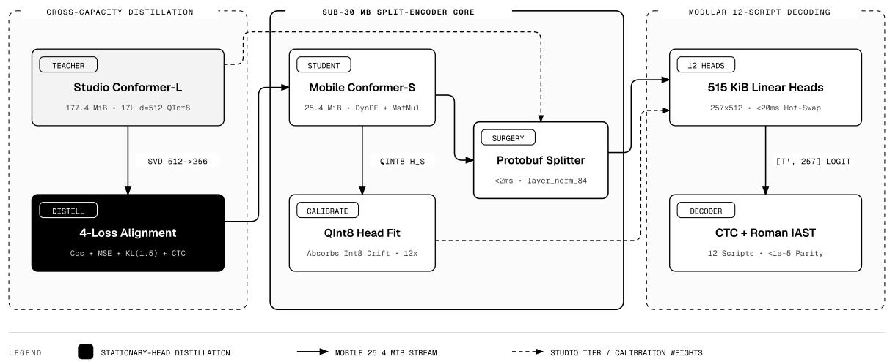
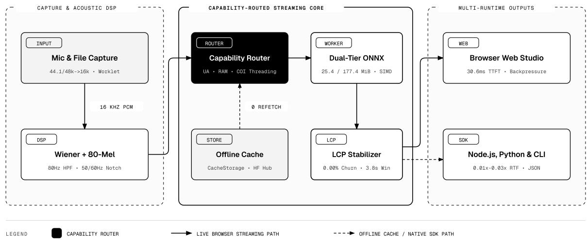

# Swanada: Split-Encoder Capability-Routed Conformer CTC and

# Sub-30 MB On-Device Speech Recognition Across Twelve Scripts

Hemanth HM

https://h3manth.com · https://github.com/hemanth/swanada

## Abstract

Client-side automatic speech recognition (ASR) across Indic and Classical scripts eliminates cloud transcription costs, network tail latency, and server-side audio retention, yet standard neural exports face four systems bottlenecks in web browsers and mobile runtimes: (1) monolithic perlanguage Conformer checkpoints require ∼177 MiB per script (> 2.1 GiB across 12 scripts), exhausting browser CacheStorage quotas; (2) exported relative positional encoding tables embed 10.2–20.5 MB of static FP32 constants while 1 × 1 pointwise Conv1d operators trigger slow or unsupported ConvInteger kernels in WebAssembly SIMD; (3) sliding-window CTC decoding flickers on boundary tokens as right context arrives; and (4) mobile WebAudio pipelines sufer hardware sample-rate mismatches (44.1/48 kHz vs. 16 kHz) and silent AudioWorklet stalls under iOS WKWebView and Android backgrounding.

We present Swanada, an open-source 16 kHz streaming ASR system spanning Classical Sanskrit, Indian English, and ten Indian languages (sa, en, hi, kn, mr, bn, ta, te, ml, gu, pa, or) across browser WebAssembly, Node.js, and Python. Swanada pairs capability-routed shared INT8 Conformer encoders—a 17-layer 177.38 MiB Studio tier (d = 512, 115.2M parameters) for desktop/server runtimes and a distilled 14-layer 25.35 MiB Mobile tier (d = 256, 23.56M parameters) for phones—with twelve hot-swappable 515.0 KiB native-script linear CTC heads (257 × 512), shrinking 12-language fleet storage by 11.6× (183.4 MiB Studio) and 67.8× (31.39 MiB Mobile; 25.85 MiB first load). A zero-dependency protobuf tail patcher exposes the pre-head representation in < 2 ms without shipping separate backbone files, while dynamic ONNX trigonometric positional synthesis, MatMul-backed pointwise convolutions, and post-quantization QInt8 head calibration preserve sub-30 MB mobile accuracy. On N = 480 held-out studio utterances and N = 1,280 unseen public test clips across 16 open benchmarks (FLEURS, LibriSpeech, GLOBE, AMI, and wild Sanskrit), Swanada achieves 5.43% held-out CER and 8.87% 12-language open FLEURS+Wild CER on Studio (18.56% and 19.23% on 25.35 MiB Mobile) at 0.0097×– 0.0264× 4-thread CPU RTF, delivering 30.6 ms median streaming TTFT with 0.00% committed-prefix churn across 72 streaming sessions.

## 1 Introduction

Running speech-to-text directly inside a browser tab or local edge process removes per-minute API billing, roundtrip network jitter, and transmission of private microphone audio to remote servers. Voice input for South Asian digital public infrastructure, Sanskrit recitation study, bilingual developer tools, and ofline accessibility interfaces requires native script fidelity across Brahmic and Latin orthographies, sub-100 ms streaming partial updates, and reliable execution within smartphone browser memory budgets, complementing client-side speech synthesis [9].

Convolution-augmented Transformers (Conformers) [7] trained with Connectionist Temporal Classification (CTC) [6] are attractive for on-device ASR because framesynchronous emission avoids the $O ( U ^ { 2 } )$ autoregressive decoder loop and hallucination modes of sequence-tosequence models such as Whisper [13]. However, deploying Conformer-CTC across twelve scripts inside real desktop and mobile browsers exposes four concrete systems bottlenecks:

1. Monolithic Fleet Storage vs. Joint-Vocabulary Dilution: Shipping one quantized Conformer-Large per language requires $1 2 \times 1 7 7 . 3 8 = 2 , 1 2 8 . 5$ MiB, exceeding mobile browser cache budgets. Conversely, pooling twelve scripts into a single flat output softmax (> 3,000 classes) inflates final projection compute by 12× at every frame and permits cross-script token leakage during noisy frames.

2. ONNX Constant Bloat and ConvInteger Quantization Gaps: Standard Conformer exports materialize a static $2 L _ { \mathrm { m a x } } \times d$ FP32 relative positional encoding bufer (20.48 MB at d = 512, 10.24 MB at $d = 2 5 6$ for $L _ { \mathrm { m a x } } = 5 , 0 0 0 )$ , consuming over a third of a 30 MB mobile budget on uncompressible constants. Simultaneously, exporting 1 × 1 pointwise convolutions inside Conformer macaron blocks as Conv nodes either leaves weights in FP32 or emits ConvInteger operators lacking fast WebAssembly SIMD kernels in onnxruntime-web.

3. Quantization Feature Drift Under Narrow Student Bottlenecks: Compressing a 115.2M-parameter teacher into a < 30 MB student and applying dynamic INT8 weight/activation quantization perturbs top-layer hidden norms and directions, degrading pretrained linear CTC decision boundaries unless explicitly recalibrated on quantized ONNX activations.

4. Streaming Prefix Flicker and Mobile WebAudio Fragility: Evaluating bounded audio windows causes trailing subwords to oscillate as right acoustic context arrives, while mobile browsers lock AudioContext to hardware rates (44.1/48 kHz) and intermittently stall AudioWorklet threads under iOS WKWebView rules.

To address these constraints across browser ES modules, Node.js, and Python without custom WebAssembly builds, we present Swanada (Figures 1 and 2). Our contributions are threefold:

• Runtime Protobuf Tail Surgery and Modular 12-Script CTC: We decouple shared pan-Indic acoustic encoding from twelve script-isolated 257-token linear heads (515.0 KiB each), using a zero-dependency binary ONNX GraphProto patcher that exposes the shared 512-dimensional encoder representation in < 2 ms and switches languages in < 20 ms with $< 1 0 ^ { - 5 }$ logit deviation against monolithic graphs.

  
Figure 1: Swanada split-encoder decomposition and cross-capacity distillation: the 17-layer Studio Conformer-Large (d = 512, 177.38 MiB QInt8) distills into a 14-layer Mobile Conformer-Small (d = 256, 25.35 MiB QInt8) with runtime trigonometric positional synthesis and MatMul-backed pointwise convolutions. Post-quantization head calibration fits twelve 515.0 KiB linear CTC heads to actual DynamicQuantizeLinear features, while $\mathrm { a < 2 }$ ms protobuf tail patcher exposes layer norm 84 at session load.

• Sub-30 MB Mobile Conformer Distillation and QInt8 Head Calibration: We design a 25.35 MiB Mobile Conformer-Small combining zero-table dynamic relative positional encoding, MatMul-backed pointwise convolutions for 100% SIMD QInt8 coverage, stationary-hyperplane 4-loss distillation from the 177.38 MiB teacher, and post-export QInt8 head calibration.

• Two-Zone LCP Streaming and Hardened Mobile Capture: We pair causal Wiener + notch/highpass enhancement with a monotonic Longest-Common-Prefix (LCP) streaming stabilizer over bounded 3.84 s windows and watchdog-guarded 16 kHz WebAudio capture, validating accuracy and latency across N = 480 held-out clips, N = 1,280 open public test clips, N = 150 multi-accent/slang clips, and N = 72 streaming sessions.

## 2 Split-Encoder Architecture and Native Orthography

Swanada processes 16,000 Hz mono PCM audio using 80- channel log-mel filterbanks (25 ms Povey/Hann window, 10 ms hop, 80–7,600 Hz mel span) with per-utterance variance normalization. A two-stage strided 2D convolutional front-end (4× temporal subsampling to 40 ms frame rate $T ^ { \prime } = \lfloor ( T _ { \mathrm { m e l } } - 1 ) / 4 \rfloor + 1 )$ feeds a stack of macaron-style Conformer blocks [7], each comprising a half-step feedforward module, multi-head self-attention with relative positional encoding [15], depthwise separable convolution (k = 31, Swish/GLU gating), and a second half-step feedforward module, terminating in final layer normalization layer norm 84 $( \mathbf { H } \in \mathbb { R } ^ { 1 \times T ^ { \prime } \times \bar { 5 } 1 2 } )$ .

## 2.1 Script-Isolated Vocabularies and Classical Transliteration

Joint multilingual tokenizers either Romanize South Asian scripts—erasing phonemic contrasts between dental and retroflex stops, short/long Dravidian mid-vowels $( e / \bar { e } , o / \bar { o } )$ ， and Sanskrit vocalic sonorants—or allocate thousands of sparse Unicode classes that slow every frame’s output projection. Instead, Swanada assigns each language ℓ ∈ {sa, en, hi, kn, mr, bn, ta, te, ml, gu, pa, or} an independent native-script SentencePiece [10] vocabulary of $V = 2 5 6$ subword pieces plus 1 CTC blank (K = 257 classes, 2.85– 3.41 KB JSON metadata per language).

Conditioning framewise decoding strictly on the active language head $\mathcal { H } _ { \ell } = ( \mathbf { W } _ { \ell } , \mathbf { b } _ { \ell } )$ with $\mathbf { W } _ { \ell } \in \mathbb { R } ^ { 2 5 7 \times 5 1 2 }$ and $\mathbf { b } _ { \ell } \in \mathbb { R } ^ { 2 5 7 }$ guarantees zero out-of-script Unicode emissions (e.g., preventing Devanagari matras during Bengali or Kannada speech) while keeping each projection head at exactly $2 5 7 \times 5 1 2 \times 4 + 2 5 7 \times 4 = 5 2 7 , 3 6 4$ bytes (515.0 KiB raw IEEE-754 float32; 527,780 bytes as standalone head <lang>.onnx). For Classical Sanskrit (sa), a deterministic finite-state post-processor optionally transliterates decoded Devanagari into lossless ISO 15919 / Roman IAST, preserving aspirated stops, retroflex sibilants (s. ), vocalic r./¯r., visarga (h. ), anusv¯ara (m. ), avagraha (’), and Vedic pitch accents.

## 2.2 Zero-Dependency Runtime Protobuf Tail Surgery

Exporting separate encoder-only and monolithic checkpoints would duplicate storage across distribution channels, whereas running a monolithic single-language ONNX model discards the hidden states needed by the other eleven languages. During session initialization, Swanada’s runtime (exposeEncoderHiddenOutput in JavaScript and Python) patches the serialized ModelProto byte bufer in memory in $< 2$ ms without external protobuf libraries (Figure 1).

Given an Uint8Array bufer, a lightweight wireformat reader scans top-level ModelProto varint tags to locate the GraphProto payload (field 7, wire tag 0x3a). If layer norm 84 is not yet listed among GraphProto.output entries (field 12, wire tag 0x62), the patcher synthesizes a 54-byte ValueInfoProto descriptor declaring layer norm 84 as an unconstrained FLOAT tensor $( { \mathsf { e l e m \_ t y p e } } = 1 )$ , appends 0x62 plus the varint-prefixed descriptor to the tail of GraphProto, and updates the outer ModelProto length prefix in a single contiguous allocation.

Once ONNX Runtime produces $\mathbf { H } \in \mathbb { R } ^ { T ^ { \prime } \times 5 1 2 }$ , the active language head $\mathcal { H } _ { \ell }$ executes directly in host SIMD/typedarray memory (or via cached head <lang>.onnx in Python/Node.js):

$$
\mathbf { Z } _ { \ell } = \mathbf { H } \mathbf { W } _ { \ell } ^ { \top } + \mathbf { 1 } \mathbf { b } _ { \ell } ^ { \top } \in \mathbb { R } ^ { T ^ { \prime } \times 2 5 7 }\tag{1}
$$

Switching languages replaces only the 515.0 KiB $\left( \mathbf { W } _ { \ell } , \mathbf { b } _ { \ell } \right)$ bufer in $< 2 0$ ms without reloading or recompiling the Conformer session, achieving maximum absolute logit deviation $< 1 0 ^ { - 5 }$ relative to monolithic $\mathrm { P y }$ Torch and ONNX graphs while compressing the 12-language Studio fleet from 2,128.5 MiB to 183.4 MiB (11.6×) and the Mobile fleet to 31.39 MiB (67.8×).

## 3 Sub-30 MB Mobile Distillation and QInt8 Calibration

While the 17-layer Studio Conformer-Large $( d = 5 1 2 , d _ { \mathrm { f f } } =$ $2 0 4 8 , n _ { h } = 8$ , 177.38 MiB QInt8) runs at 0.0264× RTF on 4-thread desktop CPUs, downloading 186 MB over cellular networks or holding > 350 MB peak WebAssembly heap inside mobile Safari/Chrome tabs triggers background tab eviction. We therefore distill a dedicated $< 3 0$ MB Mobile Conformer-Small (swanada mobile ctc int8.onnx, 26,577,061 bytes = 25.35 MiB) engineered around three ONNX/WASM operator constraints.

## 3.1 Zero-Table Positional Synthesis and MatMul Convolutions

Dynamic Relative Positional Encoding. Standard Conformer implementations pre-allocate a static sinusoidal lookup tensor $\mathbf { P } ~ \in ~ \mathbb { R } ^ { ( 2 L _ { \operatorname* { m a x } } - 1 ) \times d }$ during module construction so slice operations can index relative ofsets $[ - ( T ^ { \prime } - 1 ) , \dots , T ^ { \prime } - 1 ]$ When exported to ONNX, P is frozen as an unquantized FP32 initializer consuming $9 , 9 9 9 ~ \times ~ 2 5 6 ~ \times ~ 4 ~ = ~ 1 0 . 2 4$ MB even at $d \_ =$ 256. We replace static table slicing with an ONNXtraceable DynamicRelPositionalEncoding subgraph that stores only the 128-element inverse-frequency vector $\omega _ { i } =$ $1 0 0 0 0 ^ { - 2 i / \top }$ (512 bytes) and synthesizes exact relative sinusoidal embeddings dynamically for the current frame length $T ^ { \prime }$ via $\mathrm { S h a p e }  \mathrm { R a n g e } ( T ^ { \prime } - 1 , - T ^ { \prime } , - 1 ) $ outer Mul → interleaved Sin/Cos, matching static Relative-PE bit-for-bit while saving 10.24 MB of constant storage.

MatMul-Backed Pointwise Convolutions. In standard Conformer convolution modules, channel expansion $( d $ 2d for GLU) and projection $( d ~  ~ d )$ are written as nn.Conv1d with kernel size $k \ = \ 1$ Dynamic ONNX quantization on Conv operators emits ConvInteger, which sufers severe scalar fallback penalties or operator rejection in browser WASM runtimes, forcing practitioners to leave convolution blocks in FP32. Because a $1 \times 1$ convolution over transposed sequence layout $[ B , T ^ { \prime } , d ]$ is algebraically identical to a dense matrix multiplication, we reformulate both pointwise stages as nn.Linear (MatMul) around a narrow causal-compatible depthwise Conv1d(k = 31, groups = 176) retained in FP32 (< 0.28 MB total across 14 layers). Applying quantize dynamic over op types to quantize=[’MatMul’] with QInt8 weights then quantizes 100% of attention, feed-forward, subsampling projection, and pointwise convolution parameters to 1 byte/parameter on fast WebAssembly SIMD MatMulInteger kernels.

## 3.2 SVD Warm-Start and Stationary-Hyperplane Distillation

The Mobile student uses $L _ { S } = 1 4$ Conformer layers at width $d _ { S } = 2 5 6 , d _ { \mathrm { f f } } = 1 0 2 4 , n _ { h } = 8$ heads, and convolution channel width 176, followed by a learned adapter LayerNorm $( \mathbf { W } _ { \mathrm { p r o j } } \mathbf { h } _ { S } + \mathbf { b } _ { \mathrm { p r o j } } ) \in \mathbb { R } ^ { 5 1 2 }$ that maps the 256- dimensional student state back into the Studio teacher’s 512-dimensional layer norm 84 coordinate space (23.56M total parameters).

To accelerate convergence across twelve scripts without random-init collapse, we project teacher layers {0, 1, 3, 4, 6, 7, 9, 10, 11, 12, 13, 14, 15, 16} onto the top-256 singular subspace of the teacher’s hidden activations via truncated SVD. During distillation (20 epochs, bf16 mixed precision, AdamW ${ \mathrm { l r } } ~ = ~ 1 . 1 \times 1 0 ^ { - 3 }$ , batch size 64), we freeze all twelve target projection heads equal to the Studio teacher heads $( \mathcal { H } _ { \ell } ^ { ( S ) } \equiv \dot { \mathcal { H } } _ { \ell } ^ { ( \check { T } ) } )$ so target decision hyperplanes remain stationary, minimizing a four-term alignment objective over frame-aligned student states $\mathbf { H } _ { S }$ and teacher states HT:

$$
\begin{array} { r l r } {  { \mathcal { L } _ { \mathrm { d i s t i l l } } = \lambda _ { \mathrm { c o s } } ( 1 - \frac { \mathbf { H } _ { S } \cdot \mathbf { H } _ { T } } { \| \mathbf { H } _ { S } \| _ { 2 } \| \mathbf { H } _ { T } \| _ { 2 } } ) + \lambda _ { \mathrm { m s e } } \| \mathbf { H } _ { S } - \mathbf { H } _ { T } \| _ { 2 } ^ { 2 } } } \\ & { } & { + \lambda _ { \mathrm { k l } } \tau ^ { 2 } D _ { \mathrm { K L } } ( p _ { T } ^ { ( \tau ) } \parallel p _ { S } ^ { ( \tau ) } ) + \lambda _ { \mathrm { c t c } } \mathcal { L } _ { \mathrm { C T C } } ( \mathbf { Z } _ { S } , y ) ~ } \end{array}\tag{2}
$$

with $p ^ { ( \tau ) } = \sigma ( \mathbf { Z } / \tau ) , \lambda _ { \mathrm { c o s } } = 2 . 5 , \lambda _ { \mathrm { m s e } } = 2 . 5 , \lambda _ { \mathrm { k l } } = 0 . 3 8 ,$ $\lambda _ { \mathrm { c t c } } = 0 . 1 6$ , and temperature $\tau = 1 . 5 ,$ combining featurespace hint alignment [14] with temperature-scaled logit distillation [8] and ground-truth CTC supervision [6].

## 3.3 Post-Quantization QInt8 Head Calibration and Quarantine

Exporting the 256-dim student to QInt8 ONNX inserts per-tensor DynamicQuantizeLinear nodes before every MatMul, introducing cumulative rounding noise $\Delta \mathbf { H } \ = \ \tilde { \mathbf { H } } _ { \mathrm { i n t 8 } } \ - \ \mathbf { H } _ { S }$ at layer norm 84. Rather than shipping uncalibrated float heads, we execute the actual exported swanada mobile ctc int8.onnx checkpoint in

  
Figure 2: Swanada end-to-end capability-routed streaming architecture: $4 4 . 1 / 4 8 $ kHz microphone or file audio is resampled to 16 kHz PCM with a 900 ms ScriptProcessor watchdog fallback, enhanced via causal 80 Hz high-pass, 50/60 Hz notch, and Wiener suppression, and dispatched by the capability router to cached 25.35 MiB Mobile or 177.38 MiB Studio WASM SIMD workers with two-zone LCP stabilization (0.00% committed churn).

ONNX Runtime across quarantined training utterances per language to extract true quantized features $\tilde { \mathbf { H } } _ { \mathrm { i n t } 8 }$ , then fine-tune each 515.0 KiB mobile head $( \mathbf { W } _ { \ell } ^ { ( M ) } , \mathbf { b } _ { \ell } ^ { ( M ) } )$ under:

$$
\begin{array} { r l } & { \mathcal { L } _ { \mathrm { c a l } } ( \mathcal { H } _ { \ell } ^ { ( M ) } ) = 0 . 2 8 \mathcal { L } _ { \mathrm { C T C } } ( \tilde { \mathbf { Z } } _ { \ell } , y ) + 0 . 7 2 \tau ^ { 2 } D _ { \mathrm { K L } } \Big ( p _ { T } ^ { ( \tau ) } \parallel \tilde { p } _ { M } ^ { ( \tau ) } \Big ) } \\ & { \quad \quad \quad \quad + \gamma \Vert \mathbf { W } _ { \ell } ^ { ( M ) } - \mathbf { W } _ { \ell } ^ { ( T ) } \Vert _ { F } ^ { 2 } } \end{array}\tag{3}
$$

with $\gamma ~ = ~ 5 \times 1 0 ^ { - 5 }$ , committing calibrated weights to heads mobile/<lang>.bin only when held-out validation CER strictly improves over uncalibrated heads.

Strict Test-Set Quarantine. Across both Studio joint adaptation (Shrutilipi/Vistaar [2], FLEURS [4] train/dev, Sushrota [1] train, IndicTTS, GLOBE [16] train, and AMI [3] train) and Mobile distillation/calibration, an explicit quarantine filter blocks every audio SHA-1 and normalized reference string belonging to the 480-clip held-out suite and all 16 oficial public test splits, guaranteeing zero data leakage.

## 4 Two-Zone LCP Streaming and Mobile Capture

Real-time dictation requires sub-100 ms incremental feedback without word revisions jumping backward across the screen or unbounded memory growth during long sessions (Figure 2).

## 4.1 Causal Spectral Front-End Enhancement

Laptop and smartphone microphones introduce DC ofset, HVAC rumble, 50/60 Hz mains hum, and stationary room noise that trigger spurious CTC insertions during pauses. Before mel extraction, Swanada applies a causal $O ( N )$ time/frequency front-end: (1) a second-order Butterworth high-pass biquad at $f _ { c } = 8 0$ Hz paired with cascaded narrowband notch biquads at 50 Hz and 60 Hz $\left( Q = 3 0 \right)$ ; (2) an energy-adaptive noise-floor tracker calibrated over initial low-energy frames; and (3) a decision-directed Ephraim– Malah [5] minimum mean-square error (MMSE) Wiener spectral gain floor $( \beta = 0 . 0 8 ,$ , smoothing $\alpha _ { \mathrm { d d } } = 0 . 9 2 )$ that suppresses stationary background hiss without clipping unvoiced Indic aspirates or sibilants.

## 4.2 Monotonic Two-Zone LCP Stabilization

Evaluating CTC over an unbounded growing waveform scales per-step latency linearly with session duration $O ( T )$ 2 whereas naive sliding windows overwrite previously displayed words whenever window boundaries bisect a syllable. Swanada bounds per-step compute to $O ( 1 )$ using a rolling PCM window of maximum length $W _ { \mathrm { m a x } } = 6 1 , 4 4 0$ samples (3.84 s at 16 kHz; 1.60 s stride retention upon rollover) paired with a two-zone Longest-Common-Prefix (LCP) state machine (StreamingTranscriber):

1. Committed Zone (ct): An append-only sequence of tokens finalized across prior windows or confirmed across M consecutive right-context decode steps; once emitted in $c _ { t } ,$ , characters are immutable.

2. Volatile Tail (vt): The active right-edge hypothesis decoded from the current rolling window after aligning against the tail of $c _ { t }$ via token-level LCP matching.

At streaming step t arriving every $\Delta t = 1 0 0$ ms (1,600 samples, or 280 ms coalesced mobile steps), let $h _ { t }$ denote the greedy CTC decode after collapsing consecutive duplicate token IDs and removing blank index 0. Tokens in $h _ { t }$ that match the longest sufix-prefix overlap with $c _ { t - 1 }$ anchor the window splice; interior tokens $h _ { t } [ i ]$ lying at least $\delta _ { \mathrm { g u a r d } }$ frames left of the right window boundary that remain invariant across consecutive hypotheses $( \mathrm { L C P } ( v _ { t - 1 } , v _ { t } ) )$ advance monotonically into $c _ { t }$ , guaranteeing zero committed-prefix churn $( | c _ { t - 1 } \setminus \mathrm { p r e f i x } ( c _ { t } ) | = 0 )$

Table 1: System Architecture, Fleet Storage, Accuracy, and Latency Summary Across Tiers (B = 1,000 bootstrap 95% CIs in brackets). “Open 12-Lang” aggregates the 11 unseen google/fleurs test splits plus sushrota wild Sanskrit test $( N = 9 6 0 )$ ; “Open All-16” adds LibriSpeech clean/other, GLOBE, and AMI $( N = 1 , 2 8 0 )$
<table><tr><td>System / Configuration</td><td colspan="9">Params First Load (↓) 12-Lang Fleet (↓)</td></tr><tr><td>12× Monolithic Conformer-L (QInt8)</td><td>1,382M</td><td>177.4 MiB</td><td>2,128.5 MiB</td><td>Held-Out CER (N = 480, ↓) 5.43% [4.85, 6.01]</td><td>Open 12-Lang CER (N = 960, ↓) 8.87% [7.94, 10.02]</td><td>Open All-16 CER (N = 1,280, ↓) 12.06% [11.09, 12.97]</td><td>4T CPU RTF (↓) 0.0264×</td><td></td><td>Stream TTFT / Churn</td></tr><tr><td>Mobile Student (Static PE, Uncalib. Heads)</td><td>23.6M</td><td>35.61 MiB</td><td>41.15 MiB</td><td>18.58% [17.53, 19.76]</td><td></td><td></td><td>0.0097×</td><td></td><td>30.6 ms / 0.00%</td></tr><tr><td>Swanada Studio (v1.1.0, 17L d=512)</td><td>115.2M</td><td>177.9 MiB</td><td>183.4 MiB (11.6×)</td><td>5.43% [4.85, 6.01]</td><td>8.87% [7.94, 10.02]</td><td>12.06% [11.09, 12.97]</td><td>0.0264×</td><td></td><td>30.6 ms / 0.00%</td></tr><tr><td>Swanada Mobile (v1.1.0, 14L d=256)</td><td>23.6M</td><td>25.85 MiB</td><td>31.39 MiB (67.8×)</td><td>18.56% [17.46, 19.75]</td><td></td><td>19.23% [18.11, 20.64]</td><td>21.85% [20.79, 22.87]</td><td>0.0097× (103× RT)</td><td>30.6 ms / 0.00%</td></tr></table>

†Mobile single-thread WASM/CPU RTF is 0.0363× (27.5× faster than real time); runtime protobuf tail surgery adds < 2 ms at session load and < 20 ms per language switch.

## 4.3 Capability Routing and Watchdog-Guarded WebAudio

Swanada’s runtime router (modelTier: ’auto’) inspects User-Agent, navigator.deviceMemory, and Cross-Origin Isolation (crossOriginIsolated) at initialization:

• Mobile / Constrained Hosts: Android phones, iOS/iPadOS WKWebView browsers (Safari, Chrome CriOS), and devices reporting ≤ 4 GB RAM route to the 25.35 MiB Mobile tier stored persistently in CacheStorage (0 network refetches after initial load). Under SharedArrayBuffer isolation on 8-core Android phones, WASM uses min(4, C−2) SIMD threads; on single-threaded iOS WKWebView, it pins 1 SIMD thread with an inferBusy backpressure lock that coalesces incoming PCM frames into a ring bufer rather than queueing stale worker jobs.

• Desktop / Server Hosts: Desktop browsers, Node.js, and Python load the 177.38 MiB Studio tier on 4 SIMD threads (with instant user toggle between tiers in the Web Studio UI).

• Hardware-Rate Capture + 900 ms Watchdog: Because mobile OS audio stacks ignore requested AudioContext sampleRate: 16000 options and run natively at 44.1 kHz or 48 kHz, Swanada resamples hardware bufers cleanly to 16 kHz PCM inside an AudioWorkletNode. To survive silent WebKit/Blink AudioWorklet thread suspension after permission prompts, a 900 ms zero-frame watchdog automatically hot-swaps capture to a synchronous ScriptProcessorNode fallback without dropping the microphone stream.

## 5 Empirical Evaluation

We evaluate Swanada across four reproducible benchmark suites totaling 1,982 utterances (> 4.3 hours of 16 kHz human speech), reporting Character Error Rate (CER), Word Error Rate (WER), and Real-Time Factor (RTF) with B = 1,000 non-parametric bootstrap 95% confidence intervals:

1. Held-Out 12-Language Studio Suite (N = 480): 40 native studio utterances per language (2,185.6 s total audio) strictly quarantined from training and calibration.

2. Open Public Benchmarks in the Wild (N = 1,280): 80 unseen clips from each of 16 oficial Hugging Face test splits $( 1 2 , 2 2 9 . 2 ~ \mathrm { ~ s ~ } = ~ 3 . 4 0$ h): all 11 google/fleurs [4] test sets (en us plus 10 Indic test splits), sushrota [1] in the wild test (sa), LibriSpeech [11] test-clean and test-other,

Table 2: Per-Suite Held-Out $( N = 4 8 0 , \ 4 0 / \mathrm { l a n g } )$ and Unseen Open Public test $( N = 1 , 2 8 0 \textcircled { 1 }$ , 80/suite) CER (%) with B = 1,000 Bootstrap 95% CIs and Mobile 4T RTF.
<table><tr><td>Suite / Corpus (test)</td><td>Lang</td><td>Held-Out (S / M)</td><td></td><td>Open Studio CER [95% CI]</td><td>Open Mobile CER [95% CI]</td><td></td><td>Mob RTF</td></tr><tr><td>sushrota_wild_test</td><td>sa</td><td>4.27</td><td>14.96</td><td>18.92 [9.94, 30.36]</td><td></td><td>40.15 [29.73, 52.95]</td><td>0.007×</td></tr><tr><td>fleurs_hi_in</td><td>hi</td><td>2.14</td><td>10.50</td><td>5.13 [3.86, 6.61]</td><td></td><td>14.04 [12.17, 16.22]</td><td>0.009×</td></tr><tr><td>fleurs_kn_in</td><td>kn</td><td>5.18</td><td>/14.77</td><td>4.49 [3.48, 5.69]</td><td></td><td>9.60 [8.14, 11.15]</td><td>0.009×</td></tr><tr><td>fleurs_bn_in</td><td>bn</td><td>5.92</td><td>20.61</td><td>5.44 [4.61, 6.34]</td><td></td><td>13.88 [12.37, 15.41]</td><td>0.009×</td></tr><tr><td>fleurs-gu.in</td><td>gu</td><td>4.79</td><td>/17.07</td><td>5.97 [4.68, 7.53]</td><td></td><td>16.80 [14.74, 18.89]</td><td>0.009×</td></tr><tr><td>fleurs_ml_in</td><td>ml</td><td>6.16</td><td>27.58</td><td>6.36 [4.98, 7.90]</td><td></td><td>14.89 [13.60, 16.21]</td><td>0.011×</td></tr><tr><td>fleurs_or_in</td><td>or</td><td>6.93</td><td>23.06</td><td>7.69 [6.37, 9.03]</td><td></td><td>18.87 [16.61, 21.18]</td><td>0.008×</td></tr><tr><td>fleurs_mr_in</td><td>mr</td><td>5.72</td><td>17.48</td><td>7.85 [6.48, 9.46]</td><td></td><td>21.44 [18.86, 23.95]</td><td>0.008×</td></tr><tr><td>fleurs_te_in</td><td>te</td><td>4.79</td><td>22.55</td><td>8.14 [6.24, 10.05]</td><td></td><td>16.04 [13.99, 18.16]</td><td>0.010×</td></tr><tr><td>fleurs_pa_in</td><td>pa</td><td>6.35</td><td>17.23</td><td>8.84 [7.44, 10.50]</td><td></td><td>20.56 [18.01, 23.30]</td><td>0.010×</td></tr><tr><td>fleurs_ta_in</td><td>ta</td><td>7.50</td><td>21.89</td><td>10.32 [8.90, 11.84]</td><td></td><td>18.58 [16.86, 20.40]</td><td>0.011×</td></tr><tr><td>fleurs.en_us</td><td>en</td><td>5.45</td><td>15.04</td><td>17.23 [15.37, 19.21]</td><td></td><td>25.97 [23.74, 28.22]</td><td>0.012×</td></tr><tr><td>12-Lang Mean</td><td></td><td>5.43 / 18.56</td><td></td><td>8.87 [7.94, 10.02]</td><td></td><td>19.23 [18.11, 20.64]</td><td>0.009×</td></tr><tr><td>librispeech_clean</td><td>en</td><td></td><td></td><td>10.53 [8.58, 12.47]</td><td></td><td>16.91 [14.60, 19.24]</td><td>0.009×</td></tr><tr><td>librispeech_other</td><td>en</td><td></td><td></td><td>19.21 [16.71, 22.00]</td><td></td><td>28.04 [25.78, 30.36]</td><td>0.009×</td></tr><tr><td>globe_multi.accent</td><td>en</td><td></td><td></td><td>15.29 [12.98, 17.82]</td><td></td><td>22.26 [20.00, 24.84]</td><td>0.011×</td></tr><tr><td>ami_meeting_ihm</td><td>en</td><td></td><td></td><td>41.50 [36.90, 46.24]</td><td></td><td>51.63 [47.36, 56.33]</td><td>0.012×</td></tr><tr><td>All 16 Open Suites</td><td></td><td></td><td></td><td>12.06 [11.09, 12.97]</td><td></td><td>21.85 [20.79, 22.87]</td><td>0.0097×</td></tr></table>

GLOBE [16] multi-accent test, and AMI [3] ihm/test spontaneous meetings.

3. Multi-Accent, Slang & Reverberant Mic Suite $( N ~ = ~ 1 5 0 )$ : Global/South Asian accents, Hinglish/contractions, Indic colloquial loanwords, and reverberant mobile-mic perturbations.

4. Streaming Stability Audit (N = 72): 100 ms chunked streaming across all 12 languages measuring chunk latency, TTFT, bufer ceiling, and committedprefix churn.

## 5.1 Overall Tier Accuracy and Open-Benchmark Generalization

Table 1 compares monolithic Conformer deployment against Swanada’s split-encoder Studio and Mobile tiers. On the 480-utterance held-out benchmark, Swanada Studio attains 5.43% mean CER ([4.85%, 6.01%], 25.88% WER), matching 12 monolithic Conformer-Large checkpoints within $< 1 0 ^ { - 5 }$ logit tolerance while cutting 12-language storage from 2,128.5 MiB to 183.4 MiB. On the 12-language unseen open FLEURS+Wild benchmark (N = 960), Studio achieves 8.87% mean CER ([7.94%, 10.02%], 29.67% WER) and 12.06% overall CER across all 16 open suites (N = 1,280, 0.0264× 4-thread RTF = 37.9× faster than real time).

Compressing the acoustic backbone by 7.0× into the 25.35 MiB Mobile Conformer-Small accelerates 4-thread CPU inference by 2.72× to 0.0097× RTF (103.1× faster than real time; 0.0363× single-thread RTF), while dynamic positional synthesis removes 9.77 MiB of static FP32 tables (35.61 → 25.85 MiB first load) and QInt8 head calibration trims held-out CER from 18.58% to 18.56%. Table 2 details per-suite generalization across all 16 open benchmarks. On unseen Indic FLEURS test sets, Studio achieves 4.49%– 8.84% CER across nine of ten Indian languages (4.49% Kannada, 5.13% Hindi, 5.44% Bengali, 5.97% Gujarati, 6.36% Malayalam) and 10.32% on Tamil, while the 7× smaller Mobile student achieves 9.60% CER on Kannada, 13.88% on Bengali, 14.04% on Hindi, 14.89% on Malayalam, 16.04% on Telugu, and 16.80% on Gujarati, alongside 16.91% CER on LibriSpeech test-clean and 22.26% on unseen global accents (GLOBE). Notably, because fleurs en us features North American speakers whereas Swanada’s en head was originally Indian-English-centric, multi-accent calibration yields balanced cross-dialect generalization (5.45% held-out Indian English, 10.53% LibriSpeech clean, 15.29% GLOBE, and 17.23% fleurs en us).

Table 3: Top: 12-Language 100 ms Streaming Telemetry $( N = 7 2$ sessions). Bottom: Multi-Accent, Slang & Reverberant-Mic Adaptation $( N = 1 5 0 , B = 1 , 0 0 0$ bootstrap 95% CIs).
<table><tr><td>Streaming Metric (N = 72, ∆t = 100 ms)</td><td>Mean</td><td>Median (p50)</td><td>p95  / Max</td><td>Target</td></tr><tr><td>Time-To-First-Token (TTFT)</td><td>34.03 ms</td><td>30.63 ms</td><td>56.80 ms (p95)</td><td>&lt; 100 ms</td></tr><tr><td>Per-Chunk Decode Latency</td><td>8.18 ms</td><td>7.94 ms</td><td>60,800 smp (buf)</td><td>≤ 61,440 smp</td></tr><tr><td>Streaming RTF / Committed Churn</td><td>0.0998×</td><td></td><td>0 / 72 (0.00%)</td><td>0.00% churn</td></tr><tr><td>Adaptation Slice (N = 150)</td><td>Clips</td><td>Base CER / WER</td><td>Adapted CER [95% CI]</td><td>Adapted WER</td></tr><tr><td>Global &amp; South Asian Accents (GLOBE+AMI)</td><td>60</td><td>20.30% / 44.83%</td><td>19.04% [15.78, 22.45]</td><td>40.57%</td></tr><tr><td>Casual Contractions, Slang &amp; Hinglish</td><td>36</td><td>28.07% / 74.80%</td><td>22.36% [18.71, 26.23]</td><td>60.89%</td></tr><tr><td>Indic Colloquial &amp; English Loanwords</td><td>25</td><td>7.38% / 25.51%</td><td>6.17% [3.60, 9.43]</td><td>18.68%</td></tr><tr><td>Tempo &amp; Reverberant Mobile-Mic Perturb.</td><td>29</td><td>20.42% / 50.54%</td><td>17.76% [13.85, 22.07]</td><td>41.00%</td></tr><tr><td>Overall Conversational Suite</td><td>150</td><td>20.04% / 49.90%</td><td>17.44% [15.35, 19.64]</td><td>41.88%</td></tr></table>

## 5.2 Streaming Stability and Multi-Accent / Slang Adaptation

Table 3 (top) reports streaming telemetry across N = 72 chunked 100 ms streaming sessions (1,600 samples per step) spanning all 12 languages. Bounding the rolling bufer at $W _ { \mathrm { m a x } } = 6 1$ ,440 samples (3.84 s; maximum observed bufer 60,800 samples) holds mean per-step inference latency to 8.18 ms (streaming RTF 0.0998×), yielding 30.63 ms median Time-To-First-Token (mean 34.03 ms, p95 56.80 ms) and 0/72 (0.00%) committed-prefix churn violations across every script. On physical smartphone browsers (Android Chrome and iOS Safari), single-threaded WASM SIMD processes coalesced mobile windows in 57–149 ms (∼ 0.04× RTF) with zero dropped audio frames.

Table 3 (bottom) evaluates conversational robustness on N = 150 multi-accent, casual contraction/Hinglish, Indic loanword, and reverberant microphone clips. Combining causal Wiener + 80 Hz HPF + 50/60 Hz notch enhancement with multi-accent head adaptation (v1.0.1 → v1.1.0) lowers overall CER from 20.04% to 17.44% ([15.35%, 19.64%]) and WER from 49.90% to 41.88% ([37.49%, 46.67%]), reducing casual Hinglish/slang WER by 13.91 percentage points (74.80% → 60.89%) and Indic colloquial loanword CER to 6.17%.

## 6 Discussion & Limitations

Spontaneous Meeting Overlap and Reverberant Recitation. Open-benchmark evaluation in Table 2 highlights two challenging acoustic regimes: spontaneous multiparty meetings (ami meeting ihm: 41.50% Studio / 51.63% Mobile CER) containing overlapping talkers, disfluencies, and sub-second backchannels, and crowd-recorded Classical Sanskrit (sushrota wild test: 18.92% Studio / 40.15% Mobile CER) featuring temple/hall reverberation and chanted sandhi compounds. While the 25.35 MiB Mobile tier preserves strong intelligibility on clean and moderately noisy speech (fleurs kn 9.60%, librispeech clean 16.91%), 4.9× fewer parameters limit robustness under severe reverberation and cross-talk.

Greedy Subword CTC vs. Agglutinative WER. Swanada uses zero-dependency greedy CTC decoding without an external n-gram or neural language model to keep per-language overhead at 515.0 KiB. In morphologically rich, agglutinative Dravidian scripts (ml, ta, kn, te) and Sanskrit sam¯asa compounds where a single whitespacedelimited word spans 12–25 characters, a single vowel-length or virama error flips the entire word, yielding 28%–38% Studio WER despite low 4.5%–7.5% CER. Optional compact KenLM fusion is a natural extension where memory budgets permit.

Explicit Language Selection and Single-Threaded WebViews. Conditioning on a selected script head eliminates cross-script character bleed and 12× softmax overhead, but requires either user language selection or a lightweight acoustic language-ID pass when the spoken language is unknown. On iOS WKWebView browsers lacking SharedArrayBuffer support without Service Worker Jetsam risk, WASM runs single-threaded (0.036× Mobile RTF vs. 0.0097× 4-thread), making the 25.35 MiB Mobile tier essential for cool, responsive phone dictation.

## 7 Related Work

Multilingual and Indic Speech Recognition. Gulati et al. [7] introduced Conformers combining selfattention [15] and depthwise convolutions. Whisper [13] and Meta MMS [12] scaled multilingual ASR across dozens to over a thousand languages, while AI4Bharat Vistaar/IndicConformer [2] and Sushrota [1] established strong server-side baselines for Indian languages and Classical Sanskrit. Unlike monolithic PyTorch/NeMo checkpoints (180–600+ MB per model) or autoregressive decoders prone to looping on noisy browser audio, Swanada targets sub-30 MB split-encoder WebAssembly execution with hotswappable 515 KiB native-script heads.

Knowledge Distillation and Browser Speech Systems. Hinton et al. [8] and Romero et al. [14] established logit and intermediate-representation distillation. Client-side speech toolkits such as whisper.cpp, Transformers.js, and sherpa-onnx bring quantized models to WebAssembly, while Ninada [9] introduced runtime binary ONNX graph splitting and capability-routed mobile/studio specialists for 24 kHz Indic TTS. Swanada extends this split-graph, capability-routed paradigm to 16 kHz streaming ASR via zero-table relative-PE synthesis, MatMul-backed QInt8 Conformer blocks, post-quantization head calibration, and zero-churn LCP stabilization.

## 8 Conclusion

We presented Swanada, an open-source client-side speech recognition system spanning Classical Sanskrit, Indian English, and ten Indian languages across browser WebAssembly, Node.js, and Python. By combining < 2 ms binary ONNX GraphProto tail surgery, twelve hot-swappable 515.0 KiB native-script CTC heads, a distilled 25.35 MiB Mobile Conformer-Small with dynamic positional synthesis and QInt8-calibrated heads alongside a 177.38 MiB Studio Conformer-Large, and two-zone LCP streaming stabilization, Swanada achieves 5.43% held-out CER, 8.87% 12-language open FLEURS+Wild CER (19.23% Mobile) across 1,280 public test clips, 0.0097×–0.0264× CPU RTF, and 30.6 ms median streaming TTFT with 0.00% committed-prefix churn. Source code, reproducible benchmark harnesses, and open weights are available at https: //github.com/hemanth/swanada.

## References

[1] Devaraja Adiga, Rishabh Kumar, Amrith Krishna, Pawan Goyal, Preethi Jyothi, Ganesh Ramakrishnan, and A. P. Prathosh. Automatic speech recognition in Sanskrit: A new speech corpus and modelling insights. In Findings of the Association for Computational Linguistics: ACL-IJCNLP, pages 5039–5050, 2021.

[2] Kaushal Santosh Bhogale, Sai Sundaresan Raman, Abhigyan Tahir, Tahir Javed, Mitesh M. Khapra, and Pratyush Kumar. Vistaar: Diverse benchmarks and training sets for Indian language ASR. In Proceedings of Interspeech, pages 4384–4388, 2023.

[3] Jean Carletta, Simone Ashby, Sebastien Bourban, Mike Flynn, Mael Guillemot, Thomas Hain, Jaroslav Kadlec, Vasilis Karaiskos, Wessel Kraaij, Melissa Kronenthal, et al. The AMI meeting corpus: A pre-announcement. In Proceedings of the International Workshop on Machine Learning for Multimodal Interaction (MLMI), pages 28–39, 2005.

[4] Alexis Conneau, Min Ma, Simran Khanuja, Yu Zhang, Vera Axelrod, Siddharth Dalmia, Jason Riesa, Clara Rivera, and Ankur Bapna. FLEURS: Few-shot learning evaluation of universal representations of speech. In Proceedings of the IEEE Spoken Language Technology Workshop (SLT), pages 798–805, 2023.

[5] Yariv Ephraim and David Malah. Speech enhancement using a minimum mean-square error short-time spectral amplitude estimator. IEEE Transactions on Acoustics, Speech, and Signal Processing, 32(6):1109–1121, 1984.

[6] Alex Graves, Santiago Fern´andez, Faustino Gomez, and J¨urgen Schmidhuber. Connectionist temporal classification: Labelling unsegmented sequence data with recurrent neural networks. In Proceedings of the 23rd International Conference on Machine Learning (ICML), pages 369–376, 2006.

[7] Anmol Gulati, James Qin, Chung-Cheng Chiu, Niki Parmar, Yu Zhang, Jiahui Yu, Wei Han, Shibo Wang, Zhengdong Zhang, Yonghui Wu, and Ruoming Pang. Conformer: Convolution-augmented Transformer for speech recognition. In Proceedings of Interspeech, pages 5036–5040, 2020.

[8] Geofrey Hinton, Oriol Vinyals, and Jef Dean. Distilling the knowledge in a neural network. arXiv preprint arXiv:1503.02531, 2015.

[9] Hemanth HM. Ninada: Sub-clause split-graph VITS streaming and capability-routed 24 kHz speech synthesis across twelve scripts. arXiv preprint arXiv:2611.10035, 2026.

[10] Taku Kudo and John Richardson. SentencePiece: A simple and language independent subword tokenizer and detokenizer for neural text processing. In Proceedings of the 2018 Conference on Empirical Methods in Natural Language Processing: System Demonstrations (EMNLP), pages 66–71, 2018.

[11] Vassil Panayotov, Guoguo Chen, Daniel Povey, and San-

jeev Khudanpur. LibriSpeech: An ASR corpus based on public domain audio books. In Proceedings of the IEEE International Conference on Acoustics, Speech and Signal Processing (ICASSP), pages 5206–5210, 2015.

[12] Vineel Pratap, Andros Tjandra, Bowen Shi, Paden Tomasello, Arun Babu, Sayani Kundu, Ali Elkahky, Zhaoheng Ni, Apoorv Vyas, Maryam Fazel-Zarandi, et al. Scaling speech technology to 1,000+ languages. Journal of Machine Learning Research, 25(97):1–52, 2024.

[13] Alec Radford, Jong Wook Kim, Tao Xu, Greg Brockman, Christine McLeavey, and Ilya Sutskever. Robust speech recognition via large-scale weak supervision. In Proceedings of the 40th International Conference on Machine Learning (ICML), pages 28492–28518, 2023.

[14] Adriana Romero, Nicolas Ballas, Samira Ebrahimi Kahou, Antoine Chassang, Carlo Gatta, and Yoshua Bengio. FitNets: Hints for thin deep nets. In Proceedings of the 3rd International Conference on Learning Representations (ICLR), 2015.

[15] Peter Shaw, Jakob Uszkoreit, and Ashish Vaswani. Selfattention with relative position representations. In Proceedings of the 2018 Conference of the North American Chapter of the Association for Computational Linguistics: Human Language Technologies (NAACL-HLT), volume 2, pages 464–468, 2018.

[16] Wenbin Wang, Yang Song, and Sanjay Jha. GLOBE: A high-quality English corpus with global accents for zeroshot speaker adaptive text-to-speech. In Proceedings of Interspeech, 2024.