# TAPCO-G: LLM-Guided Design-Adaptive Timing and Power Co-Optimization with Graph-Based Physical Priors

WUQIAN TANG, National Tsing Hua University, Taiwan

ZIXIAO WANG†, The Hong Kong University of Science and Technology (Guangzhou), China

CHE-CHIEN LIN, National Tsing Hua University, Taiwan

FONG-HUA FU, National Tsing Hua University, Taiwan

LAURA ANGÉLICA SHION-KORSAK, National Tsing Hua University, Taiwan

XINYUN ZHANG, ShanghaiTech University, China

BEI YU, The Chinese University of Hong Kong, Hong Kong

CHUN-YAO WANG, National Tsing Hua University, Taiwan

Post-placement timing and power co-optimization is critical to meeting setup timing targets and reducing power within placement constraints. A cell replacement can improve timing along one path while increasing power or reducing slack on others. Conventional optimizers follow fixed rules for scheduling and accepting repairs, limiting their ability to address design-specific bottlenecks. A large language model (LLM) can propose changes to these rules, but on its own it cannot reliably estimate how a cell replacement afects endpoint slack and power. TAPCO-G combines LLM-guided optimizer adaptation with graph-based physical priors to evaluate candidate cell replacements. The outer loop tunes tool settings using physical-design feedback and revises executable repair policies when tuning stalls. The inner loop anchors delay estimates to static timing analysis snapshots, accounts for upstream driver-load changes, and propagates delay shifts to timing endpoints. It combines these estimates with coarse-to-fine power screening to prioritize candidates for physical trials. TAPCO-G produced placement-legal, logic-equivalent implementations and outscored CERBERUS on all eight ASAP7 benchmarks from the MLCAD 2026 Contest, with a mean quality score gain of 5.516 points, and scored 21.648 points higher than TAPCO on average. These results demonstrate the efectiveness of the proposed co-optimization framework.

CCS Concepts: • Hardware → Electronic design automation; • Computing methodologies → Artificial intelligence.

Additional Key Words and Phrases: Large language models, post-placement optimization, timing-power co-optimization, graph-based physical priors, gate sizing, multi-VT assignment

## 1 Introduction

Post-placement timing and power co-optimization is a decisive stage in modern very-large-scale integration (VLSI) physical synthesis [4]. Once standard cells and hard macros are placed and interconnect parasitics are extracted, the optimizer must simultaneously close setup timing violations and minimize dynamic and leakage power [31] within strict placement-density and routability headroom [13]. Discrete netlist transformations, including gate sizing [8, 27], multi-threshold-voltage (VT) assignment, bufering [3, 38], cloning, and pin swapping, exhibit intense electrical and physical coupling [37]. Upsizing a gate accelerates its intrinsic transition but increases input pin capacitance, imposing heavier capacitive loading on upstream drivers and elevating dynamic switching power;

†Corresponding author.

similarly, substituting a regular-VT (RVT) gate with a low-VT (LVT) or super-low-VT (SLVT) cell recovers path slack at the expense of exponential leakage growth. Achieving superior power, performance, and area (PPA) quality of results (QoR) therefore requires answering two intertwined questions: macroscopically, how to schedule, budget, and commit repair passes for a specific circuit’s bottleneck regime; and microscopically, how to accurately quantify the true endpoint-level timing and power value of candidate cell replacements before committing expensive physical trials.

Existing methodologies typically address only one side of this bi-level challenge. At the microscopic operator level, classical sensitivity-based sizers [1] and Lagrangian relaxation formulations [8, 37] rely on simplified local delay models that struggle to capture discrete library quantization and multi-corner path interactions. Recent machine learning (ML) [21, 30] and diferentiable optimization frameworks [17, 26] have significantly advanced physical design modeling [11, 25]. Graph neural networks (GNNs) have been deployed to predict pre-routing timing slack [18], guide discrete gate sizing over directed acyclic graphs (DAGs, e.g., DAGSizer) [10], and estimate signof power via subgraph approximation (ECO-GNN) [29]. Concurrently, analytical gradient descent (AGD) [34] and diferentiable sizing frameworks [43] relax discrete cell choices into continuous selections [14, 15] to co-optimize timing and power [33]. Despite their modeling power, learned surrogates often sufer from distribution shift when applied to unseen netlist topologies or macro-dominated layouts, whereas myopic rule-based heuristics in industrial and open-source engines [2, 40] evaluate cell swaps locally without propagating upstream driver penalties or downstream reconvergence across the static timing analysis (STA) graph.

At the macroscopic strategy level, the repair policy governs the efectiveness of each physical operator. It determines which violating endpoints to prioritize, how to balance timing recovery against power reduction, and when to retain or roll back intermediate states. Because circuit characteristics vary dramatically from logic-dense arithmetic cores to SRAM-dominated systems-on-chip (SoCs), no single static repair schedule is universally optimal. Automated flow tuning frameworks such as PTPT [16], REMOTune [44], reinforced placement autotuning [32], and microarchitectural design space explorers [7] cast tool customization as black-box hyperparameter optimization via Bayesian optimization [24, 36] or reinforcement learning. However, conventional parameter tuning operates strictly within a predefined interface of exposed scalar controls (e.g., slack margins, pass budgets, and utilization caps). An expressivity gap can arise when a static endpoint traversal order repeatedly exhausts whitespace on shallow violations while starving deep critical cones, or when an all-or-nothing commit rule discards valuable partial progress. In either case, tuning scalar parameters merely repeats the flawed behavior more aggressively. Escaping such stagnation requires modifying the executable repair policy itself.

Large language models (LLMs) [9] and autonomous coding agents [23, 41] provide a transformative paradigm for bridging this expressivity gap [35, 42]. In electronic design automation (EDA) [19], domain-adapted LLMs [28] and agentic workflows have demonstrated strong capabilities in script generation, design rule checking [46], and tool orchestration [20]. Because LLMs encode rich structural priors over source code, algorithmic control flow, and optimization heuristics, they can diagnose bottleneck symptoms from execution traces and synthesize targeted modifications to both tool configurations and source-level repair policies. Yet, language models alone lack fine-grained numerical precision on circuit netlists: an LLM cannot directly compute picosecond-level nonlinear delay model (NLDM) shifts or microwatt-level instance power tradeofs across tens of thousands of gates.

We propose TAPCO-G, a bi-level framework for post-placement timing and power co-optimization (Fig. 1). In the outer loop, an LLM proposes design-specific changes to the optimizer. To compare these proposals, TAPCO-G runs each candidate optimizer from the same initial placement. During each run, the inner loop ranks cell replacements using graph-based estimates of their timing and power efects, then tests selected replacements on the placed design. Signof results and execution diagnostics from the completed run guide the next outer-loop proposal.

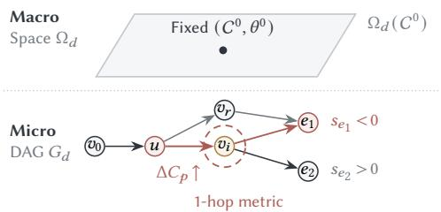  
(a) Static Heuristic Flow

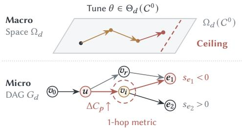  
(b) Black-Box Parameter Tuning

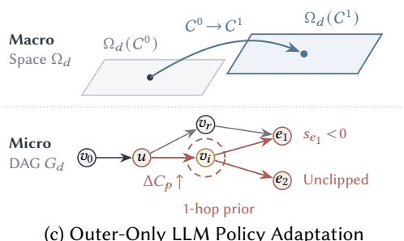  
(c) Outer-Only LLM Policy Adaptation

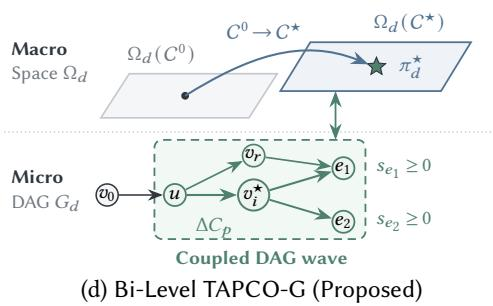  
Fig. 1. Evolution of post-placement timing and power optimization paradigms across macroscopic policy spaces (Ω�) and microscopic timing–power graphs $( G _ { d } = ( V _ { d } , E _ { d } ) )$ . (a) Static heuristic flows fix $( \dot { C ^ { 0 } } , \theta ^ { \dot { 0 } } )$ and evaluate isolated single-vertex moves on $G _ { d } ,$ missing fanin edge load penalties and multi-hop cone conflicts. (b) Black-box parameter tuning explores $\theta \in \Theta _ { d } ( C ^ { 0 } )$ within a single fixed policy plane and stalls at an expressivity ceiling. (c) Uncoupled outer-loop LLM policy adaptation [19, 20] expands macroscopic policies $( C ^ { 0 } {  } C ^ { 1 } )$ but still relies on myopic 1-hop vertex metrics on $G _ { d } .$ (d) Bi-level TAPCO-G jointly evolves outer source policies to $\pi _ { d } ^ { \star }$ and propagates inner replacements across coupled multi-hop DAG cones on $G _ { d }$

We validate TAPCO-G on all eight ASAP7 7-nm benchmarks [12] from the MLCAD 2026 Contest [5, 6, 22]. Every emitted implementation undergoes strict placement legality checks and formal logic equivalence checking (LEC).

Our main contributions are summarized below.

(1) We develop an LLM-guided adaptation loop that uses physical-design feedback to tune tool settings and revise executable repair policies when the current policy limits further improvement.

(2) We propose a graph-based timing model anchored to STA snapshots that accounts for changes in upstream driver load and propagates delay shifts through reconvergent paths to estimate how cell replacements afect endpoint slack.

(3) We introduce coarse-to-fine power screening from cell families to individual instances and use batched physical trials with bisection to recover beneficial replacements from rejected batches.

(4) We evaluate TAPCO-G through benchmark comparisons, physical replacement probes, and ablation studies, and show that it outperforms CERBERUS [45] on all eight designs, with a mean quality score gain of 5.516 points.

The remainder of this article is organized as follows. Section 2 introduces the post-placement timing and power graph, capacitive coupling models, and the constrained bi-level optimization formulation. Section 3 presents the outer-loop LLM-guided hierarchical optimizer adaptation framework, including policy-space expansion, bottleneck-conditioned proposal generation, and valid-incumbent trajectory gating. Section 4 details the inner-loop graph-based physical priors, covering snapshot-anchored driver-load coupling, incremental reconvergent DAG propagation, sequential boundary handling, and coarse-to-fine instance power screening. Section 5 reports comprehensive experimental evaluations, physical probe verifications, and ablation studies across the MLCAD 2026 Contest benchmark suite, and Section 6 concludes the article.

## 2 Preliminaries and Problem Formulation

We first formalize the electrical and physical models governing post-placement discrete cell transformations, and then cast design-adaptive timing and power co-optimization as a constrained bi-level optimization problem.

## 2.1 Post-Placement Timing Graph and Capacitive Coupling

Given a placed gate-level netlist � with standard-cell and macro coordinates, Liberty timing/power views, and extracted interconnect parasitics, post-placement optimization applies gate sizing, multi-VT substitution, bufering, cloning, pin swapping, and other transformations that preserve functional equivalence, followed by placement legalization [3, 8, 13, 38, 40]. For each editable cell instance $i \in \mathcal { I } _ { d }$ currently mapped to library master �, the technology library defines an admissible equivalent master set $\boldsymbol { \mathcal { V } } ( \boldsymbol { c } )$ spanning alternative drive strengths and VT flavors (e.g., RVT, LVT, and SLVT).

STA models signal propagation across combinational logic cones between sequential launch and capture boundaries as a timing and power DAG $G _ { d } = \left( V _ { d } , E _ { d } \right)$ . Each vertex $v \in V _ { d }$ represents a pin transition (rise or fall), and each directed edge $( u , v ) \in E _ { d }$ represents a cell timing arc or interconnect wire arc with delay $\tau _ { u v }$ . Given launch arrival boundary conditions, internal arrival times propagate recursively via

$$
a _ { v } = \operatorname* { m a x } _ { u \in \mathrm { p r e d } ( v ) } \left( a _ { u } + \tau _ { u v } \right) .\tag{1}
$$

Let $\delta _ { d }$ denote the set of constrained setup endpoints, and let $V _ { e } \subset V _ { d }$ denote the analyzed transition vertices associated with endpoint $e \in { \mathcal { E } } _ { d }$ . With required arrival time $r _ { v } .$ , the endpoint slack $s _ { e }$ and circuit-wide setup TNS $T _ { d } \leq 0$ are defined as

$$
s _ { e } = \operatorname* { m i n } _ { v \in V _ { e } } \bigl ( r _ { v } - a _ { v } \bigr ) , \qquad T _ { d } = \sum _ { e \in \mathcal { E } _ { d } } \operatorname* { m i n } ( 0 , s _ { e } ) .\tag{2}
$$

Under standard NLDM lookup tables, the delay $D _ { c } ( \sigma _ { u } , C _ { v } ^ { \mathrm { l o a d } } )$ and output slew of a cell arc $( u , v )$ mapped to master � are nonlinear functions of the input transition slew $\sigma _ { u }$ and the efective output capacitive load $C _ { v } ^ { \mathrm { l o a d } }$ . For a driver output pin � driving sink pin set $\mathcal { F } ( u )$ over interconnect wire capacitance $C _ { u } ^ { \mathrm { w i r e } }$ , the efective load is

$$
C _ { u } ^ { \mathrm { l o a d } } = C _ { u } ^ { \mathrm { w i r e } } + \sum _ { p \in \mathcal { F } ( u ) } C _ { p } ^ { \mathrm { p i n } } .\tag{3}
$$

As depicted in Fig. 2a, substituting master $c \to c ^ { \prime }$ at instance � alters both its own arc delays $D _ { c ^ { \prime } } ( \cdot )$ and the input pin capacitances $C _ { p } ^ { \mathrm { p i n } } ( c ^ { \prime } )$ , which directly perturbs the load $C _ { u } ^ { \mathrm { l o a d } }$ and delay of its upstream drivers [10, 33]. Furthermore, because $T _ { d }$ sums clipped endpoint slacks min $( 0 , s _ { e } )$ across reconvergent cones, local delay shifts only improve $T _ { d }$ to the extent that they reduce the dominant arrival at violating endpoints $( s _ { e } < 0 )$

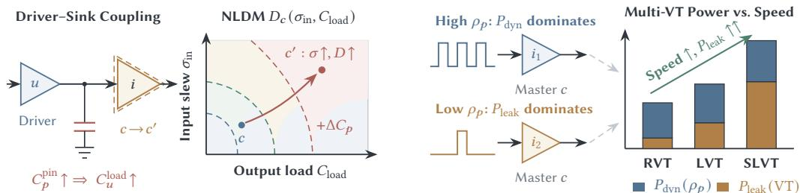  
(a) NLDM Surface $D _ { c } ( \sigma _ { \mathrm { i n } } , C _ { \mathrm { l o a d } } )$ & Load Coupling  
(b) Activity-Dependent Multi-VT Power

Fig. 2. Electrical and physical coupling fundamentals in post-placement co-optimization. (a) NLDM lookup surface $D _ { c } ( \sigma _ { \mathrm { i n } } , C _ { \mathrm { l o a d } } )$ and physical driver–sink capacitive coupling: upsizing sink $i \ ( c  c ^ { \prime } )$ increases pin capacitance $C _ { p } ^ { \mathrm { { p i n } } }$ , shifting the upstream driver operating point into a steeper delay/slew regime (� ↑). (b) Instance-level switching activity density $\rho _ { p }$ governs the balance between dynamic switching power $P _ { \mathrm { d y n } } ( \rho _ { p } )$ and multi-VT static leakage $P _ { \mathrm { l e a k } } ( \mathrm { V T } )$ across RVT, LVT, and SLVT flavors.

## 2.2 Dynamic and Leakage Power Decomposition

Total circuit power consists of dynamic power $P _ { d , \mathrm { d y n } }$ and static cell leakage power $P _ { d , \mathrm { l e a k } }$ [29, 31]. Dynamic power includes net switching power and internal cell power due to short-circuit current and parasitics. We write these components as

$$
P _ { d , \mathrm { d y n } } = \sum _ { i \in { \cal I } _ { d } } \big ( P _ { i , \mathrm { s w i t c h } } + P _ { i , \mathrm { i n t e r n a l } } \big ) , \qquad P _ { d , \mathrm { l e a k } } = \sum _ { i \in { \cal I } _ { d } } P _ { i , \mathrm { l e a k } } .\tag{4}
$$

While leakage power $P _ { i , \mathrm { l e a k } }$ is primarily determined by the cell master’s VT and transistor width, dynamic power depends strongly on instance-level operating conditions: $P _ { i , \mathrm { s w i t c h } }$ scales with net toggle activity and load capacitance, whereas $P _ { i , \mathrm { i n t e r n a l } }$ depends on pin toggle rates, input slew, and output capacitance. Consequently, as shown in Fig. 2b, two instances $i _ { 1 }$ and $i _ { 2 }$ instantiated from the exact same master � can exhibit vastly diferent dynamic-to-leakage ratios and timing slack headroom. Efective co-optimization must therefore account for instance-specific electrical context rather than relying solely on static library cell rankings.

## 2.3 Bi-Level Optimizer Adaptation Problem Formulation

Let $x _ { d } ^ { 0 }$ denote the initial placed physical state of design �. An inner post-placement optimizer is parameterized by an executable repair policy C (governing endpoint traversal order, operator sequencing, efort allocation, and commit/rollback logic) and an exposed configuration vector � (specifying setup/hold margins, pass budgets, utilization caps, and operator switches). Executing the optimizer on $x _ { d } ^ { 0 }$ yields the optimized implementation

$$
x _ { d } = A _ { C , \theta } ( x _ { d } ^ { 0 } ) .\tag{5}
$$

Relative to the initial state $x _ { d } ^ { 0 }$ with setup TNS $T _ { d } ^ { 0 } < 0$ and baseline power components $P _ { d , \mathrm { d y n } } ^ { 0 } , P _ { d , \mathrm { l e a k } } ^ { 0 } >$ 0, the normalized timing and power improvements of implementation $x _ { d }$ are defined as

$$
\Delta T _ { d } = \frac { T _ { d } - T _ { d } ^ { 0 } } { | T _ { d } ^ { 0 } | } ,\tag{6}
$$

$$
\Delta P _ { d , x } = \frac { P _ { d , x } ^ { 0 } - P _ { d , x } } { P _ { d , x } ^ { 0 } } , \qquad x \in \{ \mathrm { d y n , l e a k } \} .\tag{7}
$$

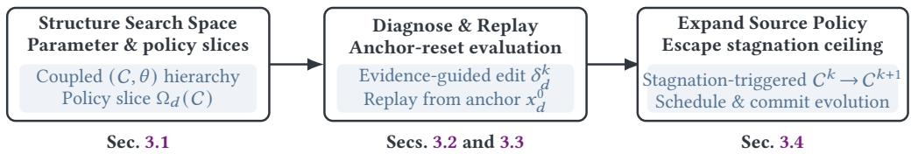  
(a) Outer-Loop: Evidence-grounded LLM optimizer adaptation (Section 3)

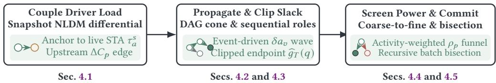  
(b) Inner-Loop: Graph-guided physical replacement priors (Section 4)  
Fig. 3. Bi-level methodological overview of TAPCO-G. (a) The outer-loop LLM optimizer adaptation engine (Section 3) structures coupled (C, �) slices, replays evidence-conditioned edits from the clean placement anchor $x _ { d } ^ { 0 } .$ , and expands source policies when parameter sweeps stagnate. (b) The inner-loop graph-guided replacement engine (Section 4) couples snapshot NLDM diferentials with upstream driver loads, propagates clipped arrival shifts across reconvergent cones, and screens candidates via an activity-weighted power funne and recursive batch bisection.

A signof domain evaluator measures the composite quality score $S _ { d } ( x _ { d } )$ by combining weighted PPA improvements with normalized physical-design penalties $\mathbf { \Delta } p _ { d , j }$ (capturing electrical slew and capacitance violations, cell displacement, and routing congestion overflow):

$$
S _ { d } ( x _ { d } ) = w _ { T } \Delta T _ { d } + w _ { D } \Delta P _ { d , \mathrm { d y n } } + w _ { L } \Delta P _ { d , \mathrm { l e a k } } - \sum _ { j } \lambda _ { j } p _ { d , j } ,\tag{8}
$$

where $\left( w _ { T } , w _ { D } , w _ { L } \right)$ are nonnegative tradeof weights and $\lambda _ { j } \geq 0$ are penalty coeficients. Crucially, every emitted design must satisfy a strict binary feasibility predicate valid $( x _ { d } ) \in \{ 0 , 1 \}$ , which enforces placement legality (zero cell overlap and valid site alignment) and formal LEC against $x _ { d } ^ { 0 }$

We formulate design-adaptive timing and power co-optimization as searching for a designspecialized policy $C _ { d } ^ { \star }$ and configuration $\theta _ { d } ^ { \star }$ that maximize the evaluated signof objective:

$$
\begin{array} { r l } & { ( C _ { d } ^ { \star } , \theta _ { d } ^ { \star } ) = \arg \underset { C \in \mathfrak { C } _ { d } , \theta \in \Theta _ { d } ( C ) } { \operatorname* { m a x } } S _ { d } \big ( A _ { C , \theta } ( x _ { d } ^ { 0 } ) \big ) , } \\ & { \mathrm { ~ s . t . ~ } \quad \quad \mathrm { v a l i d } \big ( A _ { C , \theta } ( x _ { d } ^ { 0 } ) \big ) = 1 . } \end{array}\tag{9}
$$

In TAPCO-G, the outer loop (Section 3) solves Eq. (9) by leveraging an LLM program prior and evaluator feedback to jointly evolve C and �, while the inner loop (Section 4) embeds graph-based physical priors inside $A _ { C , \theta }$ to maximize the accuracy and eficiency of candidate cell replacements.

## 3 Outer-Loop: LLM-Guided Hierarchical Optimizer Adaptation

Solving the bi-level co-optimization problem in Eq. (9) requires more than sampling numeric configurations within a static parameter box: the attainable quality frontier itself depends on how the optimizer schedules repair efort and commits physical transformations. TAPCO-G realizes outer-loop optimizer adaptation as an iterative, evidence-conditioned process (Fig. 3) that bridges macroscopic program reasoning and microscopic physical execution. At each iteration, the LLM leverages its structural prior over source code and optimization heuristics to diagnose the limiting bottleneck and synthesize a bounded modification at either the parameter or policy level. The physical-design pipeline then runs the candidate optimizer on the placed circuit, invoking the inner graph-guided replacement engine developed in Section 4. The pipeline returns objective PPA scores, legality/equivalence verdicts, and fine-grained execution diagnostics to ground subsequent adaptation.

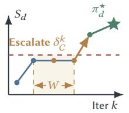

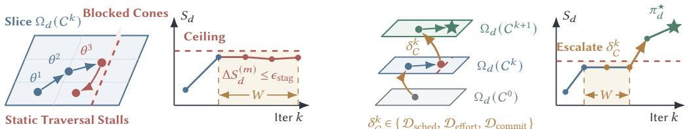  
(a) Within-policy ceiling & stagnation (Δ� (�) � ≤ �stag)  
(b) Stagnation-triggered source-policy escalation  
Fig. 4. Hierarchical adaptation space and stagnation-triggered policy escalation. (a) Within a fixed policy slice $\Omega _ { d } ( C ^ { k } )$ , scalar parameter tuning stalls at an expressivity ceiling $( \Delta S _ { d } ^ { ( m ) } \le \epsilon _ { \mathrm { s t a g } }$ over window � ) as static traversal repeatedly hits blocked cones. (b) Detecting stagnation triggers a source-policy edit $\delta _ { C } ^ { k }$ (Section 3.4), transitioning from $\Omega _ { d } ( C ^ { k } )$ to $\Omega _ { d } ( C ^ { k + 1 } )$ to unlock higher QoR frontiers.

## 3.1 Hierarchical Adaptation Space

Conventional automated flow tuning treats an EDA tool as an immutable black box and restricts search to its exposed scalar hyperparameters [16, 32, 44]. However, when the underlying repair schedule or commit logic mismatches a circuit’s topological structure, varying scalar margins or pass budgets rapidly hits an expressivity ceiling (Fig. 4a). Conversely, unconstrained code synthesis risks destabilizing core physical operators. To bridge this gap, our hierarchical adaptation space organizes optimizer customization into coupled parameter slices and executable policy planes, allowing TAPCO-G to exploit fast parameter specialization when suficient and seamlessly expand into new policy slices when structural stagnation occurs (Fig. 4b).

Formally, let $\pi = ( C , \theta )$ denote a complete candidate optimizer comprising an executable source policy C and its exposed configuration vector $\theta \in \Theta _ { d } ( C )$ . Holding the executable policy C fixed induces a policy-conditioned parameter slice $\Omega _ { d } ( C )$ , while varying C across the family of reachable policies ${ \mathfrak { C } } _ { d }$ defines the full hierarchical search space:

$$
\Omega _ { d } ( C ) = \big \{ ( C , \theta ) \big | \theta \in \Theta _ { d } ( C ) \big \} , \qquad \Omega _ { d } ^ { \mathrm { T A P C O - G } } = \bigcup _ { C \in \mathfrak { C } _ { d } } \Omega _ { d } ( C ) .\tag{10}
$$

This hierarchy spans three tightly coupled architectural layers:

(1) Physical Kernel Layer: Provides primitive netlist and layout transformations, including gate sizing, multi-VT substitution, bufer insertion/removal, gate cloning, pin swapping, and detailed placement legalization, alongside the inner-loop graph-guided replacement operator (Section 4).

(2) Parameter Envelope Layer (�): Exposes continuous and categorical controls that bound the repair envelope, including setup/hold slack margins, electrical slew and capacitance tolerances, maximum wire-length limits, endpoint TNS coverage ratios, pass iteration caps, and discrete operator enablement switches.

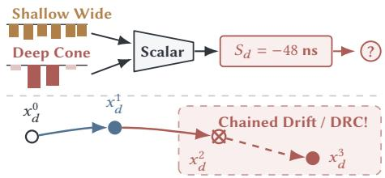  
(a) Scalar blindness & chained netlist drift

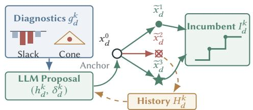  
(b) Diagnostic-guided radial replay from anchor $x _ { d } ^ { 0 }$  
Fig. 5. Diagnostic-guided LLM proposal and common-anchor execution protocol. (a) Scalar black-box scores mask distinct physical slack distributions while chained netlist executions accumulate placement and electrical drift. (b) TAPCO-G conditions proposals on multi-channel diagnostics $g _ { d } ^ { k }$ and replays every candidate radially from the clean anchor $x _ { d } ^ { 0 }$ (Section 3.3), logging all trials in $H _ { d } ^ { k }$ while monotonically updating the valid incumbent $I _ { d } ^ { k }$

(3) Executable Source-Policy Layer (C): Defines how the optimizer uses the parameter envelope to prioritize and re-sort violating endpoints across passes, scale repair efort with violation depth, filter candidate pools for timing and power, and decide when to commit or roll back intermediate netlist states.

Rather than treating hyperparameter tuning and code synthesis as disjoint paradigms, TAPCO-G navigates $\Omega _ { d } ^ { \mathrm { T A P C O - G } }$ from the inside out: it prioritizes lightweight parameter edits within the active slice $\Omega _ { d } ( C ^ { k } )$ whenever bottlenecks map to exposed controls, and invokes a policy transition $C ^ { k } \to C ^ { k + 1 }$ when empirical evidence reveals a structural limitation in $C ^ { k }$

With Eq. (10), TAPCO-G strictly generalizes conventional hyperparameter tuning $( \Omega _ { d } ( C ^ { 0 } ) \subset$ $\Omega _ { d } ^ { \mathrm { T A P C O - G } } )$ : it preserves the sample eficiency and stability of parameter optimization within wellbehaved slices while empowering the optimizer to reshape its own decision logic and configuration interface $\Theta _ { d } ( C )$ on complex corner cases.

## 3.2 Evidence-Conditioned LLM Proposal

Black-box optimization surrogates compress an entire physical-design execution into a single scalar objective value $S _ { d } ~ [ 2 4 , 3 6 ]$ . In post-placement co-optimization, however, identical scalar scores can mask diametrically opposed physical bottlenecks. For instance, a −48 ns TNS caused by thousands of shallow path violations requires broad multi-VT recovery, whereas the same −48 ns TNS concentrated in two deeply congested logic cones demands targeted bufering and cloning (Fig. 5a). Our proposal mechanism resolves this ambiguity by conditioning the LLM’s code and strategy prior on rich, multi-channel physical diagnostics alongside the full historical trajectory of accepted and rejected trials, transforming black-box guessing into hypothesis-driven engineering (Fig. 5b).

Specifically, at outer iteration �, TAPCO-G maintains both the active working optimizer $\pi _ { d } ^ { k }$ and the best valid incumbent tuple $I _ { d } ^ { k }$

$$
I _ { d } ^ { k } = \big ( \pi _ { d , b } ^ { k } , x _ { d , b } ^ { k } , S _ { d } ( x _ { d , b } ^ { k } ) \big ) , \qquad x _ { d , b } ^ { k } = A _ { \pi _ { d , b } ^ { k } } ( x _ { d } ^ { 0 } ) .\tag{11}
$$

Each evaluated candidate optimizer produces a decomposed evaluation vector $z _ { d } ^ { k }$ paired with a structured diagnostic trace $g _ { d } ^ { k }$

$$
\begin{array} { r } { z _ { d } ^ { k } = \left[ \Delta T _ { d } , \Delta P _ { d , \mathrm { d y n } } , \Delta P _ { d , \mathrm { l e a k } } , \{ p _ { d , j } \} , v _ { d } \right] ^ { k } , \qquad H _ { d } ^ { k } = \left\{ \left( \pi _ { d } ^ { t } , z _ { d } ^ { t } , g _ { d } ^ { t } \right) \right\} _ { t = 0 } ^ { k } , } \end{array}\tag{12}
$$

where $v _ { d } = { \mathrm { v a l i d } } ( x _ { d } ) \in \{ 0 , 1 \}$ records placement legality and formal LEC status, and $g _ { d } ^ { k }$ captures the endpoint slack distribution, worst violating cones, breakdown of applied move classes (sizing, VT swap, bufering, cloning), residual electrical design rule violation (DRV) counts, and any compilation or legalization failure logs.

A structured prompt constructor $\Phi$ compiles the design profile, current working optimizer $\pi _ { d } ^ { k } ,$ incumbent reference $I _ { d } ^ { k }$ , cumulative trial history $H _ { d } ^ { k }$ , and writable code/parameter scope $\mathcal { B } _ { d } ^ { k }$ into a decision context. Conditioned on this context, the LLM agent $\mathcal { L } _ { \phi }$ generates a structured triplet:

$$
\begin{array} { r } { ( h _ { d } ^ { k } , \ell _ { d } ^ { k } , \delta _ { d } ^ { k } ) = \mathcal { L } _ { \phi } \Bigl ( \Phi \bigl ( d , \pi _ { d } ^ { k } , I _ { d } ^ { k } , H _ { d } ^ { k } , \mathcal { B } _ { d } ^ { k } \bigr ) \Bigr ) , \qquad \ell _ { d } ^ { k } \in \{ \mathrm { p a r a m e t e r , p o l i c y } \} , } \end{array}\tag{13}
$$

where $h _ { d } ^ { k }$ is an explicit root-cause bottleneck hypothesis linking observed symptoms in $g _ { d } ^ { k }$ to specific optimizer mechanisms, $\ell _ { d } ^ { k }$ selects the adaptation level, and $\delta _ { d } ^ { k }$ is a single bounded dif applied within $\mathcal { B } _ { d } ^ { k }$ . Restricting $\delta _ { d } ^ { k }$ to one coherent intervention per iteration ensures unambiguous credit assignment when the next measurement $z _ { d } ^ { k + 1 }$ arrives.

With Eqs. (11) to (13), TAPCO-G decouples hypothesis generation from objective evaluation: the LLM exploits fine-grained diagnostic semantics $g _ { d } ^ { k }$ and historical contrast $H _ { d } ^ { k }$ to propose highleverage edits $\delta _ { d } ^ { k }$ , eliminating blind random perturbations while maintaining clear causal attribution across iterations.

## 3.3 Physical-Design Execution and Evaluator-Grounded Update

When adapting an optimizer across sequential trials, two pitfalls commonly arise: first, chaining candidate executions on top of previously modified netlists causes cumulative state drift, where a single aggressive pass that introduces subtle placement congestion or electrical degradation permanently corrupts downstream trials (Fig. 5a); second, greedy hill-climbing discards failed or regressing trials from memory, causing the agent to repeatedly revisit invalid parameter regions. To prevent state drift while preserving negative evidence, our execution and update protocol anchors every candidate trial to the identical initial placed state $x _ { d } ^ { 0 }$ and separates non-monotonic diagnostic memory accumulation from strict monotonic incumbent retention (Fig. 5b).

Given the proposed edit $( \ell _ { d } ^ { k } , \delta _ { d } ^ { k } )$ , an instantiation operator $U _ { \ell _ { d } ^ { k } }$ constructs the candidate optimizer $\widetilde { \pi } _ { d } ^ { k + 1 }$ and executes it from the clean initial placement $x _ { d } ^ { 0 } .$

$$
\widetilde { \pi } _ { d } ^ { k + 1 } = U _ { \ell _ { d } ^ { k } } \big ( \pi _ { d } ^ { k } , \delta _ { d } ^ { k } \big ) , \qquad \widetilde { x } _ { d } ^ { k + 1 } = A _ { \widetilde { \pi } _ { d } ^ { k + 1 } } \big ( x _ { d } ^ { 0 } \big ) .\tag{14}
$$

When $\ell _ { d } ^ { k } = \mathrm { p a r a m e t e r } .$ $U _ { \ell _ { d } ^ { k } }$ updates the Tcl/JSON configuration $\theta ;$ when $\ell _ { d } ^ { k } = \mathrm { p o l i c y }$ $U _ { \ell _ { d } ^ { k } }$ patches the source policy C, compiles the updated binary, and verifies syntactic and structural integrity prior to netlist execution. During $A _ { \widetilde { \pi } _ { d } ^ { k + 1 } } ( x _ { d } ^ { 0 } )$ , the pipeline performs initial parasitic extraction and STA, executes electrical DRV repair (fixing slew, capacitance, fanout, and wire-length violations), conducts setup timing and multi-VT power co-optimization integrated with the inner-loop graphguided replacement module (Section 4), legalizes modified cell placements, and runs signof STA, power analysis, and independent LEC verification.

Upon completion, the incumbent optimizer $\pi _ { d , b } ^ { k + 1 }$ is updated strictly under verified improvement:

$$
\pi _ { d , b } ^ { k + 1 } = \left\{ \widetilde { \pi } _ { d } ^ { k + 1 } , \quad \mathrm { i f } \mathrm { v a l i d } ( \widetilde { x } _ { d } ^ { k + 1 } ) = 1 \land S _ { d } ( \widetilde { x } _ { d } ^ { k + 1 } ) > S _ { d } ( x _ { d , b } ^ { k } ) , \right.\tag{15}
$$

Crucially, whether or not $\widetilde { \pi } _ { d } ^ { k + 1 }$ updates $I _ { d } ^ { k + 1 }$ , the observation record $( \widetilde { \pi } _ { d } ^ { k + 1 } , z _ { d } ^ { k + 1 } , g _ { d } ^ { k + 1 } )$ is appended to the history $H _ { d } ^ { k + 1 }$ . A trial that triggers legalization overflow or trades excessive leakage for marginal

slack serves as informative negative evidence, guiding $\mathcal { L } _ { \phi }$ in iteration $k + 1$ to refine margins or bound operator aggressiveness.

With Eqs. (14) and (15), TAPCO-G guarantees monotonically nondecreasing signof quality $S _ { d } ( x _ { d , b } ^ { k } )$ and 100% legality/LEC compliance on the retained solution, while harvesting informative diagnostic signals from both successful and unsuccessful experiments without state contamination.

## 3.4 Adaptive Policy-Space Expansion

In complex post-placement regimes, scaling up scalar budgets (such as pass counts or endpoint coverage percentages) under a fixed control policy often amplifies ineficiency rather than resolving violations. For example, if a static schedule visits endpoints in a fixed initial order and aborts whenever a pass fails to improve global score, increasing the pass budget simply re-executes expensive bufering on blocked paths and discards valid local timing recoveries (Fig. 4a). Adaptive policy-space expansion overcomes this bottleneck by detecting expressivity saturation from historical traces $H _ { d } ^ { k }$ and synthesizing targeted source-policy interventions that restructure endpoint ordering, efort allocation, and commit granularity (Fig. 4b).

To formalize this transition, let $\Delta S _ { d } ^ { ( m ) } = S _ { d } ( x _ { d , b } ^ { k } ) - S _ { d } ( x _ { d , b } ^ { k - m } )$ denote the incumbent improvement over a trailing window of � parameter-tuning trials within slice $\Omega _ { d } ( C ^ { k } )$ . When $\Delta S _ { d } ^ { ( m ) } \le \epsilon _ { \mathrm { s t a g } }$ and diagnostic traces $g _ { d } ^ { k - m : k }$ reveal recurring structural bottlenecks, the prompt constructor Φ escalates $\ell _ { d } ^ { k } \gets$ policy. The traces may show the same critical endpoints left untouched across parameter sweeps, high move-rejection rates, or power-recovery rollbacks. Formally, a policy edit $\delta _ { C } ^ { k }$ maps the current policy $C ^ { k }$ to a new executable policy $C ^ { k + 1 } = U _ { \mathrm { p o l i c y } } ( C ^ { k } , \delta _ { C } ^ { k } )$ across four primary structural dimensions:

$$
\begin{array} { r l r l } & { C ^ { k + 1 } = C ^ { k } \oplus \delta _ { C } ^ { k } , } & & { \delta _ { C } ^ { k } \in \{ \mathcal { D } _ { \mathrm { s c h e d } } , \mathcal { D } _ { \mathrm { e f f o r t } } , \mathcal { D } _ { \mathrm { c o m m i t } } , \mathcal { D } _ { \mathrm { c a n d } } \} , } \end{array}\tag{16}
$$

where $\mathcal { D } _ { \mathrm { s c h e d } }$ modifies dynamic endpoint prioritization (recomputing and re-sorting the violating frontier after intermediate netlist updates), $\mathcal { D } _ { \mathrm { e f f o r t } }$ implements violation-severity-aware efort allocation (scaling transformation budgets proportionally to path slack depth and skipping repeatedly unrepairable cones), $\mathcal { D } _ { \mathrm { c o m m i t } }$ refines state retention (preserving beneficial partial sub-passes and enabling bounded rollback recovery), and $\mathcal { D } _ { \mathrm { c a n d } }$ customizes candidate pre-filtering and inner-loop graph-prior invocation schedules. Once $C ^ { k + 1 }$ is instantiated, TAPCO-G resumes parameter tuning over the newly induced configuration domain $\Theta _ { d } ( C ^ { k + 1 } )$ .

With Eq. (16), TAPCO-G breaks free from the static expressive limits of of-the-shelf EDA engines: it automatically evolves custom scheduling, efort-allocation, and commit algorithms tailored to each circuit’s topology, and then fine-tunes their numeric parameters to reach operating points unattainable by hyperparameter tuning alone.

## 4 Inner-Loop: Graph-Guided Physical Priors for Cell Replacement

While the outer loop (Section 3) adapts the macroscopic scheduling and commit policy $\pi = ( C , \theta )$ the inner loop must evaluate and execute thousands of discrete cell replacements (sizing and multi-VT substitutions) during timing and power repair. Evaluating every candidate replacement via full incremental STA and signof power analysis is computationally prohibitive, whereas relying on isolated library cell lookups leads to severe estimation errors due to upstream capacitive loading, reconvergent path switching, and instance-level activity variations. To achieve both high physical fidelity and fast candidate screening, TAPCO-G embeds a five-stage graph-guided physical prior (Fig. 3b) directly inside the inner optimization loop.

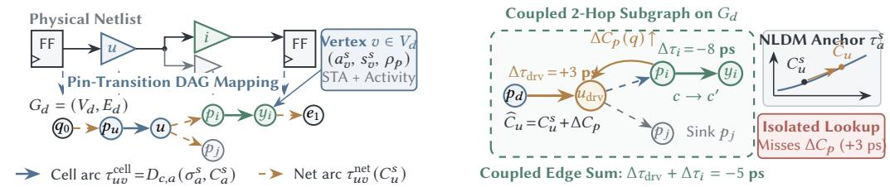  
(a) Physical netlist to annotated DAG $G _ { d } = \left( V _ { d } , E _ { d } \right)$  
(b) Snapshot-anchored fanin–target edge coupling  
Fig. 6. Circuit-to-graph mapping and snapshot-anchored edge coupling on $G _ { d } = \left( V _ { d } , E _ { d } \right)$ . (a) Physical netlist cells, flip-flops, and interconnects map to pin-transition vertices $\upsilon ~ \in ~ V _ { d }$ annotated with snapshot state $( a _ { v } ^ { s } , s _ { v } ^ { s } , \rho _ { p } )$ and directed cell/net timing arcs $e \in E _ { d }$ . (b) Replacing a candidate vertex sub-graph $( c  c ^ { \prime } )$ anchors diferential NLDM lookups to $\tau _ { a } ^ { s }$ and couples intrinsic cell-arc speedups with upstream fanin driveredge capacitance perturbations $\Delta C _ { p }$

## 4.1 Snapshot-Anchored Replacement and Driver-Load Coupling

Conventional greedy gate sizers evaluate a candidate replacement $\boldsymbol { q } = \left( i , c , c ^ { \prime } \right)$ by querying the isolated delay reduction of instance � from Liberty lookup tables. In sub-10-nm technologies such as ASAP7, however, upsizing a cell to a higher drive strength substantially increases its input pin capacitances $C _ { p } ( c ^ { \prime } )$ . When driven by a weak or heavily loaded upstream gate $u _ { \mathrm { d r v } }$ , this extra capacitance degrades the driver’s output transition and arc delay, often erasing or even reversing the local delay gain (Fig. 6a). To capture this bidirectional electrical interaction, our snapshot-anchored replacement model anchors diferential NLDM delay perturbations directly to live STA operating points while explicitly coupling each candidate’s intrinsic delay shift with the induced upstream driver-load penalty (Fig. 6b).

Formally, let superscript � denote a live STA snapshot recorded on the current working netlist, capturing all enabled cell and interconnect timing arcs, rise/fall arrival times $a _ { v } ^ { s } ,$ transition slews $\sigma _ { a : } ^ { s }$ , efective output loads $C _ { a } ^ { s } .$ , and endpoint slacks $s _ { e } ^ { s }$ . For a candidate replacement $\boldsymbol { q } = \left( i , c , c ^ { \prime } \right)$ that maps instance � from current master � to an equivalent master $c ^ { \prime } \in \mathcal { V } ( c )$ , we model the perturbed delay $\widehat { \tau } _ { a } ( q )$ of any afected cell timing arc � as a snapshot-anchored first-order NLDM diferential:

$$
\widehat { \tau } _ { a } ( q ) = \tau _ { a } ^ { s } + D _ { c ^ { \prime } , a } \big ( \sigma _ { a } ^ { s } , \widehat { C } _ { a } \big ) - D _ { c , a } \big ( \sigma _ { a } ^ { s } , C _ { a } ^ { s } \big ) ,\tag{17}
$$

where $D _ { c , a } ( \sigma , C )$ denotes the bilinearly interpolated Liberty NLDM delay surface of master � on arc � for the corresponding rise/fall transition polarity. Anchoring to $\tau _ { a } ^ { s }$ ensures exact zero-error consistency $\left( \widehat { \tau } _ { a } = \tau _ { a } ^ { s } \right)$ when $c ^ { \prime } = c$ and $\widehat { C } _ { a } = C _ { a } ^ { s }$ , while using $D _ { c ^ { \prime } , a } - D _ { c , a }$ captures the nonlinear sensitivity of the replacement at the exact local slew-load operating point.

Simultaneously, replacing $c \to c ^ { \prime }$ alters the input pin capacitance ofevery input pin $p \in \mathrm { i n p u t s } ( i )$ which perturbs the efective capacitive load $\widehat { C } _ { u }$ seen by each upstream driver output pin � driving sink set $\mathcal { F } ( u )$

$$
\widehat C _ { u } ( q ) = C _ { u } ^ { s } + \sum _ { \substack { p \in \mathcal { F } ( u ) \cap \mathrm { i n p u t s } ( i ) } } \Delta C _ { p } ( q ) , \qquad \Delta C _ { p } ( q ) = C _ { p } ( c ^ { \prime } ) - C _ { p } ( c ) .\tag{18}
$$

For each timing arc $\boldsymbol { a } _ { \mathrm { d r v } }$ of the upstream driver feeding �, its perturbed delay $\widehat { \tau } _ { a _ { \mathrm { d r v } } } ( q )$ is evaluated via Eq. (17) with its fixed driver master $c _ { \mathrm { d r v } }$ and updated load $\widehat { C } _ { u } ( q )$ from Eq. (18). When a batch of replacements is evaluated jointly, their pin capacitance diferentials $\Delta C _ { p }$ sum linearly at shared drivers before querying the nonlinear driver delay surface.

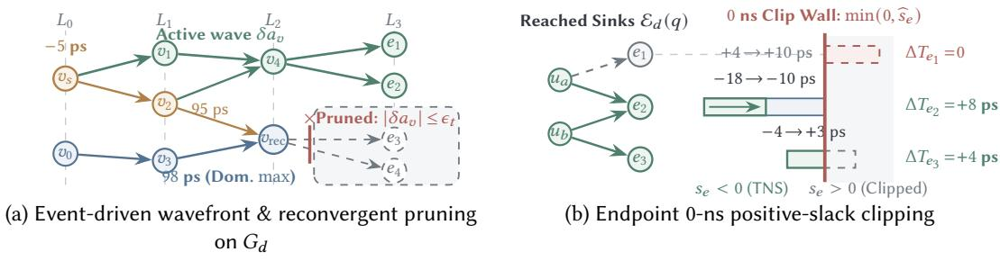  
Fig. 7. Event-driven topological wave propagation, reconvergent pruning, and endpoint slack clipping on $G _ { d } = \left( V _ { d } , E _ { d } \right)$ . (a) Arrival shifts $\delta a _ { v } ( q )$ propagate across the active fanout cone on $G _ { d }$ while branches masked by dominant reconvergent paths $\left( \left| \delta \boldsymbol { a } _ { v } \right| \leq \epsilon _ { t } \right)$ are immediately pruned. (b) At sink endpoints $\mathcal { E } _ { d } ( q )$ , positive slacks are clipped at 0 ns via min $( 0 , \widehat { s _ { e } } )$ so non-violating sinks $( e _ { 1 } )$ contribute zero artificial gain while true violating sinks $( e _ { 2 } )$ are accurately priced.

With Eqs. (17) and (18), TAPCO-G eliminates false-positive upsizing moves by evaluating every candidate replacement as a coupled two-stage electrical perturbation across both the target instance and its immediate fanin drivers, anchored directly to signof-accurate STA operating conditions.

## 4.2 Incremental Timing Graph Propagation

Even when the net local delay shift of a cell and its driver is negative, summing local delay improvements does not reflect circuit-level timing recovery. In reconvergent logic cones, accelerating one branch by $- 5 \mathrm { p } s$ yields only ${ \mathrm { a } } - 2$ ps arrival improvement if a parallel side branch arriving 2 ps earlier becomes the new dominant critical path (Fig. 7a); conversely, a single replacement on a high-fanout stem can simultaneously improve dozens of downstream violating endpoints. We therefore propagate local arc perturbations $\widehat { \tau } _ { u v } ( q )$ incrementally through the topological cone of the STA $\mathrm { D A G } G _ { d } ,$ computing exact max-arrival transitions and multi-endpoint fanout impacts without invoking full-chip STA (Fig. 7b).

Given the perturbed arc delays $\widehat { \tau } _ { u v } ( q )$ on the target cell and its upstream drivers (with $\widehat { \tau } _ { u v } ( q ) = \tau _ { u v } ^ { s }$ for all unperturbed arcs), the predicted arrival time $\widehat { a } _ { v } ( q )$ and arrival shift $\delta a _ { v } ( q )$ at any downstream vertex $v \in V _ { d }$ satisfy the recursive Bellman-Ford max-arrival relation:

$$
\widehat { a } _ { v } ( q ) = \operatorname* { m a x } _ { u \in \mathrm { p r e d } ( v ) } \bigl ( \widehat { a } _ { u } ( q ) + \widehat { \tau } _ { u v } ( q ) \bigr ) , \qquad \delta a _ { v } ( q ) = \widehat { a } _ { v } ( q ) - a _ { v } ^ { s } .\tag{19}
$$

Rather than recomputing Eq. (19) over the entire circuit graph $G _ { d }$ , TAPCO-G executes an eventdriven, level-ordered topological wave propagation restricted to the active perturbation cone:

(1) Wave Initialization: All output transition vertices of the upstream drivers $u _ { \mathrm { d r v } }$ and the replaced instance � whose arc delays changed $( \widehat { \tau } _ { u v } ( q ) \neq \tau _ { u v } ^ { s } )$ are inserted into a min-heap priority queue Q keyed by topological level lvl(�).

(2) Dominant-Arrival Re-evaluation: Popping vertex � from Q, TAPCO-G evaluates $\widehat { a } _ { v } ( q )$ over pred(�), reading $\widehat { a } _ { u } ( q )$ for visited predecessors and the baseline snapshot arrival $a _ { u } ^ { s }$ for unvisited predecessors outside the perturbed cone.

(3) Zero-Shift Cone Pruning: If $| \delta a _ { v } ( q ) | \leq \epsilon _ { t }$ (i.e., the arrival shift is masked by a dominant parallel reconvergent path), outgoing edges of � are pruned immediately; otherwise, all fanout neighbors $w \in \operatorname { s u c c } ( \upsilon )$ are enqueued into Q.

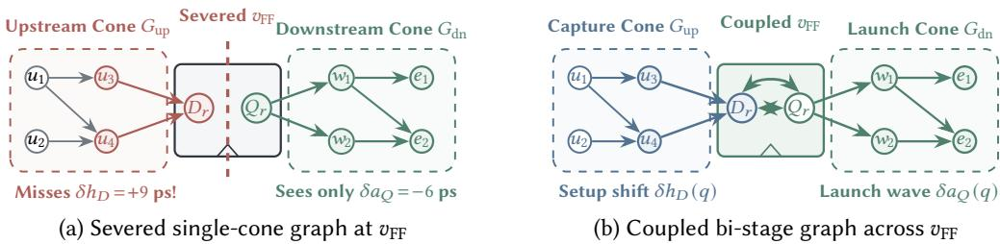  
Fig. 8. Cross-stage sequential graph coupling across boundary vertex $\boldsymbol { v } _ { \mathrm { F F } } = \left( D _ { r } , Q _ { r } \right)$ on $G _ { d } .$ . (a) Severing the timing graph at flip-flop boundaries isolates upstream cone $G _ { \mathrm { u p } }$ from downstream cone $G _ { \mathrm { d n } }$ and misses capture setup degradation $( \delta h _ { D } )$ . (b) TAPCO-G couples capture setup shifts $\delta h _ { D }$ on incoming edges to $D _ { r }$ with launch Clock-to-Q arrival waves $\delta \boldsymbol { a } _ { Q }$ on outgoing edges from $Q _ { r }$ across $\boldsymbol { v } _ { \mathrm { F F } }$

With $\operatorname { E q . }$ (19) and event-driven cone pruning, TAPCO-G resolves both reconvergent path masking and shared-stem fanout amplification in microseconds per candidate, confining computation strictly to vertices where arrival times actually shift.

## 4.3 Endpoint Value and Sequential Role Disambiguation

Propagating arrival shifts to path endpoints is still insuficient if all arrival reductions are valued equally or if sequential elements are treated as combinational gates. First, improving the arrival time of an endpoint that already has positive slack $\left( s _ { e } ^ { s } > 0 \right)$ contributes zero improvement to setup TNS $T _ { d }$ , wasting power and area (Fig. 8a). Second, replacing a flip-flop master $c \to c ^ { \prime }$ simultaneously shifts its launch Clock-to-Q delay (which propagates forward into downstream data paths) and modifies its capture setup time requirement (which directly shifts the required arrival at its own data input). To price both efects accurately, our endpoint valuation model decouples launch and capture sequential timing obligations and evaluates candidates strictly through clipped endpoint slack diferentials (Fig. 8b).

Specifically, when candidate $\boldsymbol { q } \ = \ \left( { i , c , c ^ { \prime } } \right)$ replaces a sequential flip-flop instance, TAPCO-G decomposes its timing impact into two distinct boundary mechanisms:

(1) Launch Clock-to-Q Perturbation: On the launch side, the Clock-to-Q arc delay change $\Delta D _ { \mathrm { c 2 q } } =$ $D _ { c ^ { \prime } , \mathrm { c 2 q } } ( \sigma _ { \mathrm { c l k } } ^ { s } , \widehat { C } _ { Q } ) - D _ { c , \mathrm { c 2 q } } ( \sigma _ { \mathrm { c l k } } ^ { s } , C _ { Q } ^ { s } )$ enters Eq. (17) at the flip-flop output $Q$ and propagates forward through the downstream combinational cone via Eq. (19) to produce arrival shifts $\delta a _ { e , \rho } ( q )$ at downstream endpoints �.

(2) Capture Setup-Time Perturbation: On the capture side, where instance � serves as endpoint $e _ { i } \in { \mathcal { E } } _ { d }$ , replacing $c \to c ^ { \prime }$ alters the intrinsic setup-time constraint table $H _ { c } ( \sigma _ { D } , \sigma _ { \mathrm { c l k } } )$ for each analyzed data transition $\rho \in$ {rise, fall}:

$$
\delta h _ { e _ { i } , \rho } ( q ) = H _ { c ^ { \prime } , \rho } \big ( \sigma _ { e _ { i } , \rho } ^ { s } , \sigma _ { \mathrm { c l k } } ^ { s } \big ) - H _ { c , \rho } \big ( \sigma _ { e _ { i } , \rho } ^ { s } , \sigma _ { \mathrm { c l k } } ^ { s } \big ) ,\tag{20}
$$

with $\delta h _ { e , \rho } ( q ) = 0$ for all endpoints $\boldsymbol { e } \neq \boldsymbol { e } _ { i }$ whose capture cell is unchanged.

Combining the propagated data-path arrival shift $\delta a _ { e , \rho } ( q )$ and the capture setup requirement shift $\delta h _ { e , \rho } ( q )$ , the projected summary slack $\widehat { s } _ { e } ( q )$ of endpoint � is anchored to the baseline endpoint slack $s _ { e } ^ { s }$

$$
\widehat { s _ { e } } ( q ) = s _ { e } ^ { s } + \operatorname* { m i n } _ { \substack { \rho \in \{ \mathrm { r i s e } , \mathrm { f a l l } \} } } \big ( s _ { e , \rho } ^ { s } - \delta a _ { e , \rho } ( q ) - \delta h _ { e , \rho } ( q ) \big ) - \operatorname* { m i n } _ { \substack { \rho \in \{ \mathrm { r i s e } , \mathrm { f a l l } \} } } s _ { e , \rho } ^ { s } .\tag{21}
$$

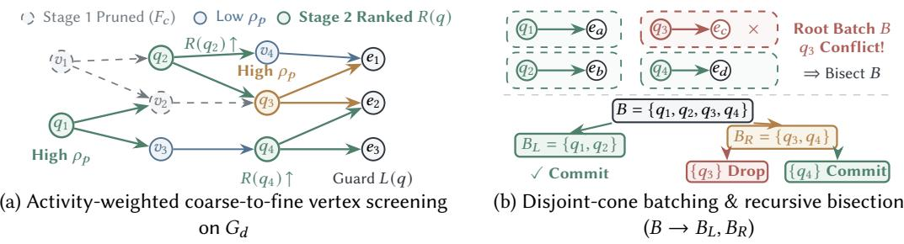  
Fig. 9. Graph-wide coarse-to-fine node power screening and conflict-free batch bisection on $G _ { d } .$ (a) TAPCO-G prunes low-leverage vertex families via $F _ { c }$ and refines active graph vertices using pin switching density $\rho _ { p }$ and slack-risk priority $R ( q )$ . (b) Top-ranked vertices with disjoint fanout cones are grouped into conflictfree batches $B \subset V _ { d } .$ while any batch triggering nonlinear regression is recursively bisected $( B  B _ { L } , B _ { R } ;$ Section 4.5) to isolate conflicting vertices.

Finally, we map the projected endpoint slacks to the normalized circuit-level timing objective gain ${ \widehat { g } } _ { T } ( q )$ consistent with Eq. (8):

$$
\widehat { g } _ { T } ( q ) = \frac { w _ { T } } { | T _ { d } ^ { 0 } | } \sum _ { e \in \mathcal { E } _ { d } ( q ) } \Big [ \operatorname* { m i n } \big ( 0 , \widehat { s } _ { e } ( q ) \big ) - \operatorname* { m i n } \big ( 0 , s _ { e } ^ { s } \big ) \Big ] ,\tag{22}
$$

where $\mathcal { E } _ { d } ( q ) \subseteq \mathcal { E } _ { d }$ is the sparse subset of endpoints reached by the propagation wave or capture setup update.

With Eqs. (20) to (22), TAPCO-G aligns microscopic candidate valuation directly with signof TNS: it prevents wasted power expenditure on already-closed paths $( s _ { e } ^ { s } \ge 0 )$ , penalizes moves that push non-violating paths into negative slack $( \widehat { s _ { e } } ( q ) < 0 )$ , and enables safe, high-gain multi-VT and drive-strength co-optimization across both sequential flip-flops and combinational logic.

## 4.4 Coarse-to-Fine Instance-Aware Power Screening

Accurate power co-optimization faces a fundamental scalability-accuracy dilemma: ranking cell replacements solely by static Liberty leakage or capacitance ratios ignores orders-of-magnitude variations in instance toggle rates and local slack headroom, whereas running detailed instance-level power and graph-timing queries across all $| \mathcal { I } _ { d } | \times | \mathcal { V } ( c ) |$ cell-variant pairs incurs excessive runtime overhead (Fig. 9a). We address this tradeof through a two-stage coarse-to-fine power screening funnel on $G _ { d } \colon$ Stage 1 rapidly scores master families using lightweight sampled instance statistics to allocate the candidate pool, and Stage 2 refines selected vertices using pin-level switching-power densities and endpoint-pressure-aware priority ranking (Fig. 9a).

In Stage 1 (Coarse Master-Family Screening), for each instantiated library master $c ,$ TAPCO-G samples a small representative subset of instances to obtain mean empirical internal, switching, and leakage powers $( \overline { { P } } _ { c , \mathrm { i n t } } , \overline { { P } } _ { c , \mathrm { s w } } , \overline { { P } } _ { c , \mathrm { l e a k } } )$ . Let $K _ { c }$ and $\ell _ { c }$ denote the nominal input capacitance and static leakage of master �, and let $\gamma _ { c , c ^ { \prime } }$ denote the library internal-energy scaling ratio between $c ^ { \prime }$ and �. The family-level power reduction potential $F _ { c }$ is evaluated as

$$
F _ { c } = \operatorname* { m a x } _ { c ^ { \prime } \in \mathcal { V } ( c ) } \left[ \frac { w _ { L } \overline { { P } } _ { c , \mathrm { l e a k } } } { P _ { d , \mathrm { l e a k } } ^ { 0 } } \left( 1 - \frac { \ell _ { c ^ { \prime } } } { \ell _ { c } } \right) + \frac { w _ { D } } { P _ { d , \mathrm { d y n } } ^ { 0 } } \left( \overline { { P } } _ { c , \mathrm { i n t } } \left( 1 - \gamma _ { c , c ^ { \prime } } \right) + \overline { { P } } _ { c , \mathrm { s w } } \left( 1 - \frac { K _ { c ^ { \prime } } } { K _ { c } } \right) \right) \right] _ { + } ,\tag{23}
$$

where $[ z ] _ { + } = \operatorname* { m a x } ( 0 , z )$ . The coarse screening pool allocates half of its capacity to critical timingcone instances and populates the remainder from $\mathrm { \ h i g h } { - } F _ { c }$ cell families, ensuring balanced coverage of timing recovery and power reduction.

In Stage 2 (Fine Instance-Level Refinement), for each candidate instance � admitted from the coarse pool, TAPCO-G extracts its exact snapshot internal power $P _ { i , \mathrm { i n t } } ^ { s }$ , leakage power $P _ { i , \mathrm { l e a k } } ^ { s }$ , and the pin-level switching-power density $\rho _ { p } = P _ { u ( p ) , \mathrm { s w } } ^ { s } / C _ { u ( p ) } ^ { s }$ on each input net driven by $u ( p )$ . The instance-specific dynamic and leakage power savings of replacement $\boldsymbol { q } = \left( i , c , c ^ { \prime } \right)$ are formulated as

$$
\widehat { \Delta P } _ { i , \mathrm { d y n } } ( q ) = P _ { i , \mathrm { i n t } } ^ { s } \big ( 1 - \gamma _ { c , c ^ { \prime } } \big ) + \sum _ { p \in \mathrm { i n p u t s } ( i ) } \rho _ { p } \big ( C _ { p } ( c ) - C _ { p } ( c ^ { \prime } ) \big ) ,\tag{24}
$$

$$
\widehat { \Delta P } _ { i , \mathrm { l e a k } } ( q ) = P _ { i , \mathrm { l e a k } } ^ { s } \left( 1 - \frac { \ell _ { c ^ { \prime } } } { \ell _ { c } } \right) .\tag{25}
$$

Combining the normalized power gain ${ \widehat { g } } _ { P } ( q )$ with the graph-propagated timing gain ${ \widehat { g } } _ { T } ( q )$ from Eq. (22) yields the composite predicted score gain ${ \widehat { g } } ( q )$

$$
\widehat { g } _ { P } ( q ) = w _ { D } \frac { \widehat { \Delta P } _ { i , \mathrm { d y n } } ( q ) } { P _ { d , \mathrm { d y n } } ^ { 0 } } + w _ { L } \frac { \widehat { \Delta P } _ { i , \mathrm { l e a k } } ( q ) } { P _ { d , \mathrm { l e a k } } ^ { 0 } } , \qquad \widehat { g } ( q ) = \widehat { g } _ { T } ( q ) + \widehat { g } _ { P } ( q ) .\tag{26}
$$

To prioritize candidates that deliver high net gain $\widehat g ( q ) > 0$ without endangering critical endpoints, TAPCO-G ranks admissible moves by a slack-degradation-penalized priority score $R ( q )$

$$
R ( q ) = \frac { \widehat g ( q ) } { 1 + \beta L ( q ) } , \qquad L ( q ) = \operatorname * { m a x } _ { e \in \mathcal { E } _ { d } ( q ) } \big [ s _ { e } ^ { s } - \widehat s _ { e } ( q ) \big ] _ { + } ,\tag{27}
$$

where $L ( q )$ measures the worst-case endpoint slack degradation induced by � and $\beta > 0$ controls endpoint risk aversion.

With Eqs. (23) to (27), TAPCO-G concentrates fine-grained graph propagation and physical trial budgets onto the highest-leverage instances, accurately pricing pin-specific dynamic switching savings against multi-endpoint timing slack risk.

## 4.5 Batched Physical Trials and Bisection Recovery

Executing physical STA and power updates one cell at a time is too slow for large netlists, so high-performance optimizers group top-ranked candidates into multi-cell batches. However, under conventional monolithic batch transactions, if a single candidate inside a batch of � moves triggers an unexpected electrical slew violation or nonlinear path conflict, rolling back the entire batch discards the $B - 1$ beneficial moves (Fig. 9b). To retain high batch throughput without sacrificing valid moves, our batched trial engine pairs state-guarded batch execution with recursive bisection recovery $( B \to B _ { L } , B _ { R } )$ , automatically isolating conflicting replacements while preserving all valid co-batched improvements (Fig. 9b).

Specifically, candidates with $R ( q ) > 0$ are dequeued in descending order of $R ( q )$ and grouped into conflict-free root batches $B = \{ q _ { 1 } , . . . , q _ { b } \}$ containing at most one replacement per instance. Before applying batch �, TAPCO-G checkpoints the current cell masters and placement coordinates. After applying � and refreshing incremental STA and power analysis on the working state $x ,$ the engine measures the exact internal PPA objective �(�):

$$
J ( x ) = w _ { T } \frac { T ( x ) } { | T _ { d } ^ { 0 } | } - w _ { D } \frac { P _ { \mathrm { d y n } } ( x ) } { P _ { d , \mathrm { d y n } } ^ { 0 } } - w _ { L } \frac { P _ { \mathrm { l e a k } } ( x ) } { P _ { d , \mathrm { l e a k } } ^ { 0 } } - \lambda _ { \mathrm { e l e c } } \hat { p } _ { \mathrm { e l e c } } ( x ) .\tag{28}
$$

A batch trial $x ^ { \prime } = \mathrm { A p p l y } ( x , B )$ is immediately committed if $J ( x ^ { \prime } ) - J ( x ) > \epsilon _ { J }$ and all configured endpoint slack floor and electrical guard conditions hold. If a multi-cell batch $( | B | > 1 )$ fails

Table 1. Initial benchmark characteristics of the eight-design ASAP7 suite under the reference contest constraints. Instance counts include all physically instantiated standard cells and hard macros.
<table><tr><td>Design</td><td>Instances</td><td>TNS (ns)</td><td>Total (mW)</td><td>Leakage (μW)</td><td>SRAM</td></tr><tr><td>AES</td><td>20,097</td><td>-12.44</td><td>432.0</td><td>96.3</td><td>No</td></tr><tr><td>JPEG</td><td>64,602</td><td>-48.77</td><td>294.0</td><td>174.0</td><td>No</td></tr><tr><td>NVDLA-P</td><td>106,994</td><td>-198.18</td><td>40.0</td><td>306.0</td><td>No</td></tr><tr><td>Ariane</td><td>210,455</td><td>-7568.43</td><td>658.0</td><td>17900.0</td><td>Yes</td></tr><tr><td>NVDLA-A</td><td>75,686</td><td>-203.23</td><td>165.0</td><td>321.0</td><td>No</td></tr><tr><td>NVDLA-C</td><td>312,696</td><td>-55.58</td><td>601.0</td><td>17300.0</td><td>Yes</td></tr><tr><td>MemPool</td><td>205,063</td><td>-3680.33</td><td>279.0</td><td>3070.0</td><td>Yes</td></tr><tr><td>NVDLA-M</td><td>20,346</td><td>-13.99</td><td>44.6</td><td>61.5</td><td>No</td></tr></table>

this acceptance test, TAPCO-G restores the checkpointed state � and invokes recursive bisection recovery:

$$
\begin{array} { r l } & { \mathrm { R e c o v e r } ( x , B ) = \left\{ \begin{array} { l l } { x ^ { \prime } , } & { \mathrm { i f ~ } J \mathrm { ( A p p l y ( } x , B ) \big ) - J ( x ) > \epsilon _ { J } \mathrm { ~ a n d ~ g u a r d s ~ h o l d } , } \\ { \mathrm { R e c o v e r } \big ( \mathrm { R e c o v e r } ( x , B _ { L } ) , B _ { R } \big ) , } & { \mathrm { i f ~ } | B | > 1 \mathrm { ~ ( w i t h ~ } B = B _ { L } \cup B _ { R } , | B _ { L } | = \lfloor B | / 2 \rfloor \big ) , } \\ { x , } & { \mathrm { i f ~ } | B | = 1 \mathrm { ~ a n d ~ t r i a l ~ r e j e c t e d } . } \end{array} \right. } \end{array}\tag{29}
$$

At periodic rebuild intervals, TAPCO-G refreshes the full STA snapshot � and reconstructs the graph priorities $R ( q )$ to reflect the evolved circuit state before returning the final legalized netlist to the outer loop (Section 3).

With Eqs. (28) and (29), TAPCO-G combines the throughput of batched physical evaluation with the precision of singleton conflict isolation, guaranteeing that every retained inner-loop transformation strictly improves measured circuit PPA before outer-loop signof verification.

## 5 Experiments

We conduct a comprehensive experimental campaign to evaluate TAPCO-G. First, we benchmark TAPCO-G against the MLCAD 2026 Contest 1st-place winner CERBERUS [6, 45] and standard OpenROAD optimization flows across all eight contest benchmarks (Section 5.2). Second, we perform a head-to-head comparison against our preliminary conference version (TAPCO) [39] to quantify the gains in convergence reliability, timing closure, and multi-VT allocation brought by our bi-level graph-guided architecture (Section 5.3). Third, we validate the physical fidelity and individual contributions of the inner-loop graph priors through 77 independent physical singleton probes and controlled component ablations (Section 5.4). Finally, we analyze outer-loop LLM policy evolution and design-specific specialization across the benchmark suite (Section 5.5).

## 5.1 Experimental Setup

Benchmarks and Evaluation Protocol. We evaluate all eight industrial-scale benchmarks from the MLCAD 2026 Contest suite [5] mapped to the ASAP7 predictive 7-nm FinFET technology [12]. As summarized in Table 1, the benchmark suite spans 20,097 to 312,696 instances and over two orders of magnitude in initial setup TNS (−12.44 ns to −7568.43 ns). Crucially, the suite encompasses two distinct physical regimes: five logic-dominated circuits (AES, JPEG, NVDLA-P, NVDLA-A, and NVDLA-M) where standard-cell sizing and multi-VT assignment control the majority of total power, and three macro-rich SoC blocks (Ariane, NVDLA-C, and MemPool) containing fixed SRAM macros that establish a high baseline power floor and severe routing/placement blockages.

All implementations are evaluated using the oficial contest signof flow based on OpenROAD and OpenSTA [2, 40]. Following Eq. (8), the signof quality score $S _ { Q }$ uses PPA tradeof weights $\left( w _ { T } , w _ { D } , w _ { L } \right) = \left( 3 0 , 5 0 , 5 0 \right)$ together with the total penalty deduction Pen. $\begin{array} { r } { \mathbf { \Phi } = - \sum _ { j } \lambda _ { j } p _ { d , j } } \end{array}$ combining normalized electrical slew/capacitance violations, average cell displacement $D _ { \mathrm { a v g } }$ (mean Manhattan displacement per standard cell in placement rows relative to the initial placement, weighted by $- 0 . 5 D _ { \mathrm { a v g } } )$ , and routing congestion overflow. Every emitted netlist and placed layout must pass strict placement legality checks and independent formal LEC against the original benchmark netlist; any implementation that fails legality or LEC is marked invalid (Fail) and disqualified from incumbent selection.

To compare implementation quality across diferent execution environments, all quality scores in this section exclude the runtime term while retaining the original timing and power weights and other score adjustments. The conference TAPCO scores are recomputed using this definition; for CERBERUS, we use the authors’ reported $S _ { \mathrm { f i n a l } } ^ { \mathrm { n o R } }$ values.

Compared Baselines. We compare TAPCO-G against four representative baselines:

(1) OR-LR [2, 40]: The upstream OpenROAD Lagrangian-relaxation global gate sizer and timing-driven repair flow executed for up to 100 iterations from the initial placed design.

(2) OR-LR+PR [40]: A two-stage sequential baseline that follows OR-LR timing repair with native slack-driven power recovery (100% recovery efort). We report its direct post-recovery signof quality in Table 2 alongside best-of-stage checkpoint fallback to OR-LR.

(3) TAPCO [39]: Our preliminary MLCAD conference version, which applies outer-loop LLM adaptation over conventional resizer operators [27] without the inner-loop graph-guided physical priors, driver-load coupling, or coarse-to-fine instance power screening developed in Section 4.

(4) CERBERUS [6, 45]: The 1st-place winning system of the MLCAD 2026 Contest, representing the state-of-the-art agentic optimization reference on this benchmark suite.

## 5.2 Dominance Over Contest Winner CERBERUS and Conventional Flows

Table 2 presents the overall signof quality comparison across all eight benchmarks against conventional flows, TAPCO, and the contest champion CERBERUS, while Table 3 reports TAPCO-G’s worst negative slack (WNS), setup TNS, and power, together with relative PPA reductions over the initial placed designs (Table 1) and decomposed score credits.

Clean Sweep Over Contest Champion CERBERUS.. As shown in Tables 2 and 3, TAPCO-G achieves a 100% (8/8) win rate against the contest winner CERBERUS, elevating the eight-design mean quality score from 41.128 to 46.644, an average gain of +5.516 points (+13.4% relative improvement). On logic-dominated designs where discrete sizing and multi-VT substitutions ofer rich coupling opportunities, TAPCO-G outperforms CERBERUS by wide margins: +13.937 points on JPEG (56.928 vs. 42.991), +12.249 points on NVDLA-A (71.028 vs. 58.779), +6.227 points on AES (64.729 vs. 58.502), +4.869 points on NVDLA-M (46.455 vs. 41.586), and +3.984 points on NVDLA-P (63.325 vs. 59.341). Even on the three macro-dominated designs (Ariane, NVDLA-C, and MemPool), where uneditable SRAM macros dominate total chip power and restrict standard-cell placement whitespace, TAPCO-G consistently surpasses CERBERUS by +0.322, +0.910, and +1.630 points, respectively. While agentic frameworks that tune outer scripts alone hit a ceiling when the resizer misjudges the timing and power efects of local moves, TAPCO-G breaks through this barrier by pairing outer policy adaptation with inner graph-guided candidate valuation.

Failure of Conventional Decoupled Sizing and Power Recovery. Compared with standard Open-ROAD Lagrangian relaxation (OR-LR, mean score 21.164), TAPCO-G more than doubles overall quality (+25.480 mean gain), improving AES by 47.8× (1.354 → 64.729) and Ariane by 273× (0.102 → 27.870). Notably, the two-stage OR-LR+PR baseline fails to improve upon pure OR-LR on any of the eight designs: invoking native slack-based power recovery after timing repair degrades the raw score on every benchmark (collapsing MemPool from 7.825 to 1.008 and driving the remaining seven circuits into negative scores, such as −18.360 on AES and −32.809 on JPEG), so even a best-of-stage checkpoint selector merely reverts to OR-LR (21.164). This confirms that sequential, uncoupled power recovery greedily consumes slack margins without accounting for shared reconvergent cones or upstream driver loading, whereas TAPCO-G’s unified graph prior co-optimizes timing and power simultaneously.

Table 2. Main quality score $( S _ { Q } )$ comparison across all eight ASAP7 benchmarks. OR-LR+PR reports the direct post-power-recovery score; because uncoupled power recovery degrades every design, a best-ofstage checkpoint selector between OR-LR and OR-LR+PR simply reverts to OR-LR on all eight benchmarks (mean 21.164). Fail indicates that the method failed to produce a placement-legal, LEC-verified final-phase implementation. Bold highlights the best result on each design.
<table><tr><td>Design</td><td>OR-LR [40]</td><td>OR-LR+PR [40]</td><td>TAPCO [39]</td><td>CERBERUS [45]</td><td>TAPCO-G</td><td>Δ TAPCO</td><td>Δ CERB.</td></tr><tr><td>AES</td><td>1.354</td><td>-18.360</td><td>37.778</td><td>58.502</td><td>64.729</td><td>+26.951</td><td>+6.227</td></tr><tr><td>JPEG</td><td>29.951</td><td>-32.809</td><td>29.801</td><td>42.991</td><td>56.928</td><td>+27.127</td><td>+13.937</td></tr><tr><td>NVDLA-P</td><td>51.261</td><td>-121.743</td><td>Fail</td><td>59.341</td><td>63.325</td><td>Valid (√)</td><td>+3.984</td></tr><tr><td>Ariane</td><td>0.102</td><td>-0.290</td><td>17.074</td><td>27.549</td><td>27.870</td><td>+10.796</td><td>+0.322</td></tr><tr><td>NVDLA-A</td><td>42.620</td><td>-7.892</td><td>Fail</td><td>58.779</td><td>71.028</td><td>Valid (√)</td><td>+12.249</td></tr><tr><td>NVDLA-C</td><td>25.071</td><td>-1607.154</td><td>Fail</td><td>27.844</td><td>28.754</td><td>Valid (√)</td><td>+0.910</td></tr><tr><td>MemPool</td><td>7.825</td><td>1.008</td><td>Fail</td><td>12.429</td><td>14.060</td><td>Valid (√)</td><td>+1.630</td></tr><tr><td>NVDLA-M</td><td>11.129</td><td>-15.543</td><td>24.737</td><td>41.586</td><td>46.455</td><td>+21.718</td><td>+4.869</td></tr><tr><td>Valid / Total</td><td>8/8</td><td>8/8</td><td>4/8</td><td>8/8</td><td>8/8</td><td>+4 Valid</td><td>8/8 Wins</td></tr><tr><td>Mean (4 Valid)</td><td>10.634</td><td>-16.751</td><td>27.348</td><td>42.657</td><td>48.996</td><td>+21.648</td><td>+6.339</td></tr><tr><td>Mean (All 8)</td><td>21.164</td><td>-225.348</td><td>一</td><td>41.128</td><td>46.644</td><td>一</td><td>+5.516</td></tr></table>

Table 3. Detailed physical signof metrics and decomposed score components of TAPCO-G across all eight benchmarks. Relative percentages in parentheses indicate reductions relative to the initial placed baselines in Table 1. Following Eq. (8), Timing $+ \mathsf { D } \mathsf { y } \mathsf { n } . + \mathsf { L e a k } . + \mathsf { P e } \mathsf { n } . = S _ { Q }$ , where Pen. $\begin{array} { r } { \mathbf { \Phi } = - \sum _ { j } \lambda _ { j } p _ { d , j } } \end{array}$ combines the displacement penalt $\mathsf { y } - 0 . 5 D _ { \mathrm { a v g } }$ (mean $D _ { \mathrm { a v g } } = 0 . 0 4 4$ across the suite) and residual electrical slew/capacitance penalties (e.g., −0.34 electrical and −0.01 displacement points on NVDLA-A).
<table><tr><td rowspan="2">Design</td><td colspan="4">Final Physical Signoff Metrics (TAPCO-G)</td><td colspan="5">Score Decomposition (pts)</td></tr><tr><td>WNS (ns)</td><td>Final TNS (ns)</td><td>Total Power (mW)</td><td>Leakage (µW)</td><td>Timing</td><td>Dyn.</td><td>Leak.</td><td>Pen.</td><td> $S _ { Q }$ </td></tr><tr><td>AES</td><td>-0.096</td><td>-12.15 (-2.3%)</td><td>259.0 (-40.0%)</td><td>11.5 (-88.1%)</td><td>+0.70</td><td>+20.02</td><td>+44.03</td><td>-0.02</td><td>64.73</td></tr><tr><td>JPEG</td><td>-0.102</td><td>-38.34 (-21.4%)</td><td>225.0 (-23.5%)</td><td>38.9 (-77.6%)</td><td>+6.42</td><td>+11.72</td><td>+38.82</td><td>-0.03</td><td>56.93</td></tr><tr><td>NVDLA-P</td><td>-0.351</td><td>-69.05 (-65.2%)</td><td>38.4 (-4.0%)</td><td>48.3 (-84.2%)</td><td>+19.55</td><td>+1.69</td><td>+42.11</td><td>-0.02</td><td>63.33</td></tr><tr><td>Ariane</td><td>-0.256</td><td>-602.92 (-92.0%)</td><td>658.0 (0.0%)</td><td>17800.0 (-0.6%)</td><td>+27.61</td><td>-0.01</td><td>+0.28</td><td>-0.01</td><td>27.87</td></tr><tr><td>NVDLA-A</td><td>-0.188</td><td>-118.98 (-41.5%)</td><td>111.0 (-32.7%)</td><td>47.3 (-85.3%)</td><td>+12.44</td><td>+16.31</td><td>+42.63</td><td>-0.35</td><td>71.03</td></tr><tr><td>NVDLA-C</td><td>-0.193</td><td>-8.46 (-84.8%)</td><td>585.0 (-2.7%)</td><td>16600.0 (-4.0%)</td><td>+25.43</td><td>+1.31</td><td>+2.02</td><td>-0.01</td><td>28.75</td></tr><tr><td>MemPool</td><td>-0.555</td><td>-2870.91 (-22.0%)</td><td>268.0 (-3.9%)</td><td>2730.0 (-11.1%)</td><td>+6.60</td><td>+1.93</td><td>+5.54</td><td>-0.01</td><td>14.06</td></tr><tr><td>NVDLA-M</td><td>-0.350</td><td>-15.89 (+13.6%)</td><td>38.5 (-13.7%)</td><td>7.6 (-87.6%)</td><td>-4.07</td><td>+6.79</td><td>+43.80</td><td>-0.06</td><td>46.45</td></tr><tr><td>Mean (8)</td><td>-0.261</td><td>- (-39.4%)</td><td>- (−15.1%)</td><td>- (-54.8%)</td><td>+11.83</td><td>+7.47</td><td>+27.40</td><td>-0.06</td><td>46.64</td></tr></table>

Adaptive Regime Specialization Across the Suite. Fig. 10 reveals how TAPCO-G automatically tailors its optimization trajectory to the physical regime of each circuit:

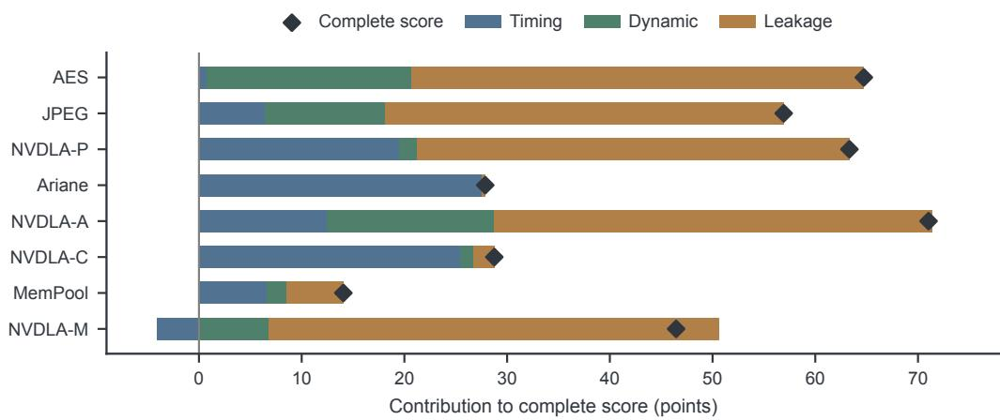  
Fig. 10. Decomposition of TAPCO-G signof quality scores into normalized setup timing (��), dynamic power $( \Delta P _ { \mathrm { d y n } } )$ , and leakage power $( \Delta P _ { \mathrm { l e a k } } )$ contributions across all eight benchmarks. Diamonds mark the complete signof score $S _ { Q }$ after electrical, displacement, and routing adjustments.

• Balanced Timing and Power Co-Optimization Regime: On AES, JPEG, NVDLA-P, and NVDLA-A, TAPCO-G simultaneously achieves positive setup timing recovery and massive power reductions. On AES, leakage drops by 88.1% (96.3 → 11.5 �W, contributing +44.029 points) and total power drops by 40.0% (432.0 → 259.0 mW, contributing +20.018 dynamic-power points) while TNS also improves from −12.44 to −12.15 ns. On NVDLA-A and NVDLA-P, TAPCO-G recovers 41.5% and 65.2% of initial TNS alongside 85.3% and 84.2% leakage reductions.

• Macro-Dominated Timing-First Regime: On Ariane and NVDLA-C, where fixed SRAM macros account for over 90% of total leakage (∼ 17.8 mW), standard-cell power downsizing yields negligible chip-level return. TAPCO-G detects this regime from evaluator diagnostics and concentrates efort on aggressive critical-path repair, slashing Ariane’s TNS by 92.0% (−7568.43 → −602.92 ns, +27.610 timing points) and NVDLA-C’s TNS by 84.8% (−55.58 → −8.46 ns, +25.434 timing points).

• Slack-for-Power Exchange Regime: On NVDLA-M, with a mild −13.99 ns initial TNS and 61.5 �W cell leakage, TAPCO-G executes a controlled −4.074-point timing trade (−13.99 → −15.89 ns) to unlock +43.805 leakage points (87.6% leakage reduction to 7.6 �W) and +6.788 dynamic-power points.

## 5.3 Comprehensive Superiority Over the Preliminary Conference Version

To isolate the advancement of TAPCO-G over TAPCO [39], we compare their convergence reliability, physical PPA metrics (Table 4), and standard-cell VT distributions (Fig. 11).

1. Breakthrough in Feasibility and Convergence (4/8 → 8/8 Valid). As shown in Table 2, TAPCO failed to produce valid final-phase implementations on four out of the eight contest benchmarks (NVDLA-P, NVDLA-A, NVDLA-C, and MemPool), sufering a 50% failure rate on large and macrocongested designs. Because TAPCO relied exclusively on coarse-grained resizer sweeps without microscopic graph physical priors or state-guarded trial recovery, aggressive parameter settings on congested designs either triggered unrecoverable placement legalization failures or violated electrical/equivalence constraints. By introducing snapshot-anchored graph screening, bisectionrecovered physical trials, and strict valid-incumbent gating, TAPCO-G achieves 100% (8/8) valid, LEC-verified convergence across the entire benchmark suite.

Table 4. Head-to-head physical PPA comparison between TAPCO [39] and TAPCO-G on the four designs where TAPCO produced valid final-phase solutions (out of eight total benchmarks). Units: TNS in ns, dynamic power $P _ { \mathrm { d y n } }$ in mW, and leakage power $P _ { \mathrm { l e a k } }$ in $\mu \mathsf { W } .$
<table><tr><td rowspan="2">Design</td><td colspan="3">Initial Baseline</td><td colspan="4">TAPCO [39]</td><td colspan="4">TAPCO-G (Ours)</td></tr><tr><td>TNS</td><td> $P _ { \mathrm { d y n } }$ </td><td> $P _ { \mathrm { l e a k } }$ </td><td>TNS</td><td> $P _ { \mathrm { d y n } }$ </td><td> $P _ { \mathrm { l e a k } }$ </td><td>Score</td><td>TNS</td><td> $P _ { \mathrm { d y n } }$ </td><td> $P _ { \mathrm { l e a k } }$ </td><td>Score (∆)</td></tr><tr><td>AES</td><td>-12.44 431.9</td><td></td><td>96.3</td><td>-17.67 385.0</td><td></td><td></td><td>9.7 37.778</td><td>-12.15 259.0</td><td></td><td></td><td>11.5 64.729 (+26.951)</td></tr><tr><td>JPEG</td><td>-48.77 293.8</td><td></td><td>174.0</td><td>-68.51 288.0</td><td></td><td></td><td>31.5 29.801</td><td></td><td>-38.34 225.0</td><td></td><td>38.9 56.928 (+27.127)</td></tr><tr><td>Ariane</td><td>-7568.43 640.1 17900.0</td><td></td><td></td><td>-3092.71 645.018000.0 17.074</td><td></td><td></td><td></td><td></td><td></td><td></td><td>-602.92 640.2 17800.0 27.870 (+10.796)</td></tr><tr><td>NVDLA-M</td><td>-13.99</td><td>44.5</td><td>61.5</td><td>-22.49</td><td>43.9</td><td></td><td>9.5 24.737</td><td>-15.89</td><td>38.5</td><td></td><td>7.6 46.455 (+21.718)</td></tr></table>

2. Massive Timing and Dynamic-Power Dominance (+21.648 Mean Score Gain). Even on the four benchmarks where TAPCO succeeded (Table 4 and Fig. 11(a)), TAPCO achieved its scores by severely sacrificing setup timing: relative to the initial designs, TAPCO degraded TNS by +42.0% on AES (−12.44 → −17.67 ns), +40.5% on JPEG (−48.77 → −68.51 ns), and +60.8% on NVDLA-M (−13.99 → −22.49 ns). In contrast, relative to TAPCO, TAPCO-G simultaneously improves setup timing and reduces dynamic power across all four circuits (while relative to the initial baseline, TAPCO-G improves TNS on AES, JPEG, and Ariane, and on NVDLA-M contains the slack-for-leakage trade to −15.89 ns vs. TAPCO’s −22.49 ns):

• Setup TNS Reductions of 29.3% to 80.5% over TAPCO: Relative to TAPCO, TAPCO-G slashes TNS magnitude by 31.2% on AES (−17.67 → −12.15 ns), 44.0% on JPEG (−68.51 → −38.34 ns), 80.5% on Ariane (−3092.71 → −602.92 ns), and 29.3% on NVDLA-M (−22.49 → −15.89 ns).

• Dynamic Power $( P _ { \mathrm { d y n } } )$ Reductions of up to 32.7% over TAPCO: Relative to TAPCO, TAPCO-G directly reduces dynamic power $P _ { \mathrm { d y n } }$ from 385.0 to 259.0 mW (−32.7%) on AES, from 288.0 to 225.0 mW (−21.9%) on JPEG, from 645.0 to 640.2 mW (−0.7%) on Ariane, and from 43.9 to 38.5 mW (−12.3%) on NVDLA-M, while also further reducing NVDLA-M leakage from 9.5 to 7.6 �W (−20.0%).

• Net Quality Surges of +10.80 to +27.13 Points: Across the four designs, TAPCO-G elevates mean quality from 27.348 to 48.996 (+21.648 points, or +79.2% relative gain), nearly doubling the score on AES (+26.951), JPEG (+27.127), and NVDLA-M (+21.718).

3. Physical Mechanism: Surgical Multi-VT Allocation vs. Blind Global Swapping. Fig. 11(b) explains the physical root cause of this performance gap by inspecting the multi-VT cell composition of the emitted netlists. Lacking endpoint-aware graph propagation, TAPCO applied a blunt, circuit-wide cell preference: on AES and JPEG, it converted 99.6% (19,459/19,536) and 99.9% of matched cells into uniform LVT gates, leaving critical paths starved of fast SLVT drive while wasting dynamic and leakage power on non-critical cones. Conversely, TAPCO-G’s graph-guided prior (Section 4) precisely quantifies each instance’s clipped endpoint slack impact ${ \widehat { g } } _ { T } ( q )$ and pin switching density $\rho _ { p } .$ . On AES, TAPCO-G surgically deploys 1,601 ultra-fast SLVT cells on the most critical timing cones, retains 13,380 LVT cells on moderate paths, and assigns 3,034 low-leakage RVT cells to non-critical paths; on NVDLA-M, it selectively expands the LVT population from 1,946 to 5,563 on violating cones to recover 6.60 ns of TNS while preserving RVT across the rest of the netlist.

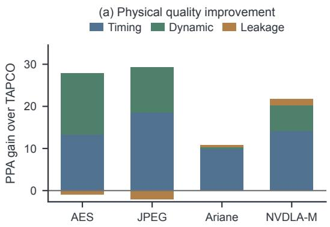

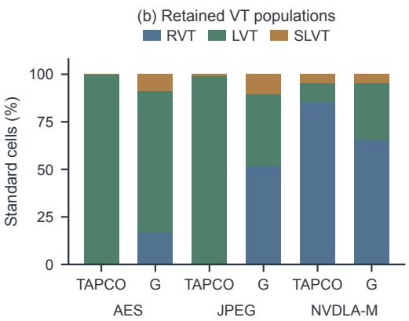  
Fig. 11. Physical comparison between TAPCO-G and TAPCO. (a) Component-wise timing (��), dynamicpower $( \Delta P _ { \mathrm { d y n } } ) .$ , and leakage $( \Delta P _ { \mathrm { l e a k } } )$ score gains of TAPCO-G over TAPCO under identical (30, 50, 50) weights. (b) Standard-cell VT (RVT, LVT, SLVT) distributions in the emited implementations.

Table 5. Singleton prediction fidelity across 77 independent physical replacement probes on AES (45 probes) and NVDLA-M (32 probes), comparing myopic local estimation, uncoupled graph propagation, and the ful TAPCO-G graph model with driver-load coupling.
<table><tr><td>Design</td><td>Timing-Power Predictor</td><td>MAE (pts) ↓</td><td>Sign Accuracy ↑</td><td>Top-8 Hit Rate ↑</td></tr><tr><td>AES</td><td>Myopic Local Estimator</td><td>0.0683</td><td>34/45 (75.6%)</td><td>5/8 (62.5%)</td></tr><tr><td>AES</td><td>Graph Propagation (No Load)</td><td>0.0183</td><td>40/45 (88.9%)</td><td>7/8 (87.5%)</td></tr><tr><td>AES</td><td>Full Graph Model (TAPCO-G)</td><td>0.0185</td><td>42/45 (93.3%)</td><td>8/8 (100.0%)</td></tr><tr><td>NVDLA-M</td><td>Myopic Local Estimator</td><td>0.1283</td><td>26/32 (81.3%)</td><td>6/8 (75.0%)</td></tr><tr><td>NVDLA-M</td><td>Graph Propagation (No Load)</td><td>0.0175</td><td>29/32 (90.6%)</td><td>7/8 (87.5%)</td></tr><tr><td>NVDLA-M</td><td>Full Graph Model (TAPCO-G)</td><td>0.0364</td><td>31/32 (96.9%)</td><td>8/8 (100.0%)</td></tr></table>

## 5.4 Fidelity and Ablation of Graph-Guided Physical Priors

We next look inside the inner loop to verify (i) how accurately our graph-guided physical prior predicts gains in the joint timing and power objective for isolated cell replacements, and (ii) how each inner-loop modeling component contributes to end-to-end optimization quality.

1. Physical Probe Verification of Predictor Fidelity. To evaluate prediction accuracy free from trajectory drift, we conduct 77 independent singleton physical probe experiments (45 candidate replacements on AES and 32 on NVDLA-M, stratified across the top-ranked candidates and gain quartiles). For every single probe, we apply the replacement to the physical netlist, run full incremental STA and power measurement to obtain the ground-truth inner objective change Δ�, and then restore all cell masters and placements to the exact baseline snapshot (verified by 77/77 zero-deviation restoration checks).

As demonstrated in Fig. 12 and Table 5, the myopic local estimator sufers from severe overestimation and frequent sign reversals (mean absolute error MAE = 0.0683 on AES and 0.1283 on NVDLA-M), predicting the wrong gain direction on nearly one-fourth of the candidates (34/45 and 26/32 sign accuracy) because it ignores reconvergent path masking and positive-slack clipping. Introducing incremental DAG propagation (Sections 4.2 and 4.3) slashes MAE by more than 3.7×, and incorporating upstream driver-load coupling (Section 4.1) further elevates gain-direction sign accuracy to 42/45 (93.3%) on AES and 31/32 (96.9%) on NVDLA-M while reducing MAE by 72.9% (0.0683 → 0.0185) and 71.6% (0.1283 → 0.0364) relative to the local estimator. Most importantly for candidate selection, among the top 8 candidates ranked by our full graph model, 100% (8/8) deliver verified positive physical gains on both designs, compared to only 5/8 (62.5%) and 6/8 (75.0%) under myopic local ranking.

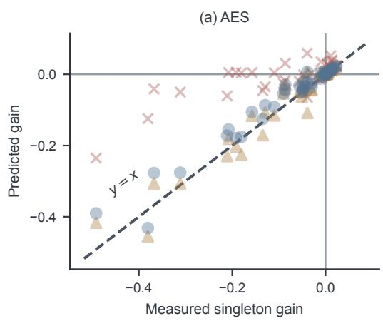

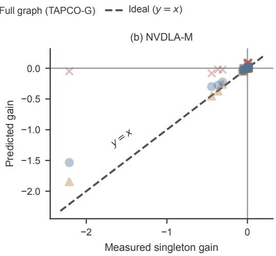  
Fig. 12. Predicted versus physically measured singleton timing–power gain across 77 independent cellreplacement probes (45 on AES and 32 on NVDLA-M). Each point is physically applied, evaluated via full signof STA and power analysis, and exactly restored to the baseline state. The dashed diagonal (� = �) marks idea zero-error prediction.

Table 6. Matched component ablations of the inner-loop physical priors under identical initial checkpoints, binaries, and root-action budgets. Each row isolates the efect of enabling a single physical-guidance mechanism.
<table><tr><td>Ablated Component</td><td>Design</td><td>Budget</td><td>Accepted (OFF → ON)</td><td>Score OFF</td><td>Score ON</td><td>Gain (∆SQ)</td></tr><tr><td>Graph Prop. (COMB)</td><td>AES</td><td>256</td><td>70 → 185 (2.64×)</td><td>60.201</td><td>60.821</td><td>+0.620</td></tr><tr><td>Graph Prop. (COMB)</td><td>NVDLA-M</td><td>256</td><td>39 → 188 (4.82×)</td><td>42.284</td><td>43.448</td><td>+1.164</td></tr><tr><td>Graph Prop. (FF+COMB)</td><td>AES</td><td>128</td><td>64 → 112 (1.75×)</td><td>60.293</td><td>60.635</td><td>+0.341</td></tr><tr><td>Graph Prop. (FF+COMB)</td><td>NVDLA-M</td><td>128</td><td>51 → 104 (2.04×)</td><td>42.236</td><td>42.489</td><td>+0.253</td></tr><tr><td>Graph Prop. (Late-Stage)</td><td>AES</td><td>256</td><td>82 → 164 (2.00×)</td><td>61.848</td><td>62.164</td><td>+0.316</td></tr><tr><td>Graph Prop. (Late-Stage)</td><td>NVDLA-M</td><td>256</td><td>48 → 142 (2.96×)</td><td>45.038</td><td>45.264</td><td>+0.226</td></tr><tr><td>Driver-Load Coupling  $( \Delta C _ { p } )$ </td><td>AES</td><td>256</td><td>80 → 185 (2.31×)</td><td>60.360</td><td>60.821</td><td>+0.461</td></tr><tr><td>Driver-Load Coupling  $( \Delta C _ { p } )$ </td><td>NVDLA-M</td><td>256</td><td>170 → 188 (1.11×)</td><td>43.268</td><td>43.448</td><td>+0.181</td></tr><tr><td>Coarse-to-Fine Power Funnel</td><td>AES</td><td>128</td><td>118 → 124 (1.05×)</td><td>64.362</td><td>64.390</td><td>+0.028</td></tr><tr><td>Coarse-to-Fine Power Funnel</td><td>NVDLA-A</td><td>128</td><td>109 → 121 (1.11×)</td><td>70.210</td><td>70.315</td><td>+0.104</td></tr><tr><td>Coarse-to-Fine Power Funnel</td><td>NVDLA-P</td><td>128</td><td>122 → 128 (1.05×)</td><td>63.097</td><td>63.325</td><td>+0.229</td></tr><tr><td>Expanded Candidate Horizon</td><td>AES</td><td>128</td><td>29 → 116 (4.00×)</td><td>59.926</td><td>60.135</td><td>+0.209</td></tr></table>

2. Controlled Component Ablations. Table 6 reports strictly matched ON/OFF ablation pairs where every factor except the tested physical prior is held identical:

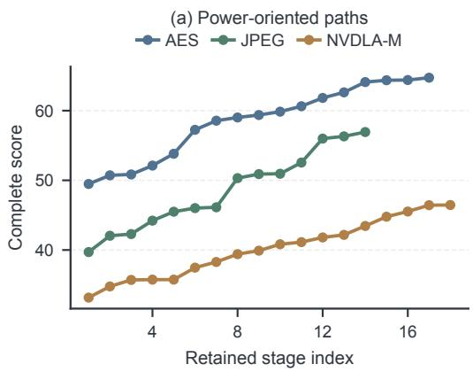

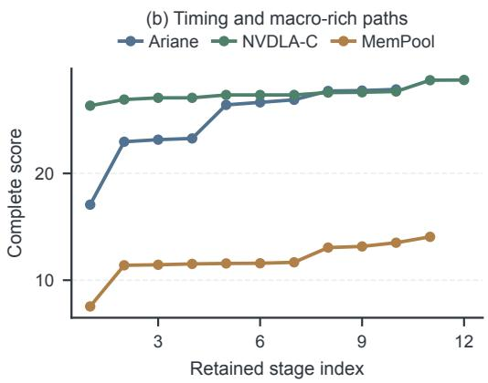  
Fig. 13. Monotonic signof quality (��) progression across retained adaptation stages on all eight ASAP7 benchmarks, illustrating how TAPCO-G combines outer-loop policy/parameter specialization with inner-loop graph-guided continuations to reach design-specific optima.

• Impact of Incremental Graph Propagation: Enabling graph-guided propagation and clipped endpoint valuation on combinational replacements (Graph Prop. (COMB)) improves signof quality by +0.620 points on AES and +1.164 points on NVDLA-M. Crucially, because graph priorities eliminate false-positive moves, the number of physically accepted replacements within the same 256-action budget surges by 2.64× (70 → 185) on AES and 4.82× (39 → 188) on NVDLA-M. Consistent gains hold when jointly optimizing flip-flops and combinational gates (FF+COMB, +0.341 and +0.253 points) and on heavily optimized late-stage checkpoints (Late-Stage, +0.316 and +0.226 points).

• Impact of Upstream Driver-Load Coupling: Adding driver-capacitance perturbation modeling (Eq. (18)) on top of graph propagation yields an additional +0.461 points on AES and +0.181 points on NVDLA-M, more than doubling accepted moves on AES (80 → 185) by filtering out oversized cells that overload weak fanin drivers.

• ImpactofCoarse-to-Fine PowerScreening andHorizon Expansion: Activating instance-sampled coarse-to-fine power screening (Section 4.4) consistently boosts quality across AES (+0.028), NVDLA-A (+0.104), and NVDLA-P (+0.229), achieving a 100% (128/128) trial acceptance rate on NVDLA-P. Furthermore, expanding the coarse/detailed candidate screening horizon from 512/128 to 2048/512 (Expanded Candidate Horizon) yields a +0.209-point improvement on AES and successfully recovers 8 beneficial multi-endpoint replacements that had negative local delay estimates.

## 5.5 Outer-Loop LLM Policy Evolution and Design-Specific Specialization

Finally, we examine how the outer-loop LLM adaptation engine (Section 3) drives monotonic signof quality progression (Fig. 13) by specializing both parameter envelopes (�, Table 7) and executable repair policies (C, Table 8) across the eight circuits.

Design-Specialized Parameter and Source Policies. Across the complete eight-design campaign, TAPCO-G accumulates 106 retained optimization stages that interleave outer-loop policy/parameter adaptations with inner-loop graph-guided continuations (Fig. 13). Table 7 demonstrates that TAPCO-G never converges to a one-size-fits-all configuration: across the eight designs, adapted wire-length limits span a 5× range (30 to 150 �m), repair-per-pass budgets span a 100× range (2 to 200), and setup slack margins span both aggressive positive over-design (+0.500 ns on AES and +0.210 ns on Ariane to force deeper timing repair) and negative slack relaxation (−0.105 ns on JPEG and −0.230 ns on NVDLA-M to protect power-saving cell assignments on near-zero-slack paths).

Table 7. Representative design-specialized parameter configurations $( \theta _ { d } ^ { \star } )$ discovered by TAPCO-G across the eight benchmarks. Default denotes the inherited baseline seting of the underlying repair pipeline.
<table><tr><td>Design</td><td>Wire (µm)</td><td>Slew/Cap. (%)</td><td>Setup Margin (ns)</td><td>Repairs/Pass</td><td>Primary Active Move Classes</td></tr><tr><td>AES</td><td>60</td><td>10/10</td><td>+0.500</td><td>50</td><td>Selective Sizing + Graph Multi-VT</td></tr><tr><td>JPEG</td><td>Default</td><td>Default</td><td>-0.105</td><td>Default</td><td>Graph Multi-VT + Load-Coupled Sizing</td></tr><tr><td>NVDLA-P</td><td>150</td><td>19/19</td><td>Default</td><td>2</td><td>Conservative Sizing + Power Funnel</td></tr><tr><td>Ariane</td><td>70</td><td>Default</td><td>+0.210</td><td>200</td><td>Full Buffering, Cloning, Sizing &amp; VT</td></tr><tr><td>NVDLA-A</td><td>78</td><td>9/9</td><td>+0.050</td><td>2</td><td>Tight-Envelope Sizing + Graph Multi-VT</td></tr><tr><td>NVDLA-C</td><td>30</td><td>20/20</td><td>+0.032</td><td>25</td><td>Targeted Critical-Cone VT &amp; Pin Swap</td></tr><tr><td>MemPool</td><td>Default</td><td>Default</td><td>+0.040</td><td>Default</td><td>Macro-Aware Buffering + Graph Sizing</td></tr><tr><td>NVDLA-M</td><td>Default</td><td>Default</td><td>-0.230</td><td>Default</td><td>Slack-Trading Leakage + Graph Sizing</td></tr></table>

Table 8. Source-level executable policy extensions $( C _ { d } ^ { \star } )$ synthesized by TAPCO-G beyond fixed parameter interfaces.
<table><tr><td>Policy Dimension</td><td>Expressivity Limit of Fixed Parameters θ Synthesized Source-Level Policy</td><td> $C _ { d } ^ { \star }$ </td></tr><tr><td>Dynamic Frontier  $( \mathcal { D } _ { \mathrm { s c h e d } } )$ </td><td>Static endpoint traversal order ignores tim- Dynamically recomputes and re-sorts the vi- ing shifts induced by earlier moves.</td><td>olating endpoint frontier after intermediate repair passes.</td></tr><tr><td>Severity Effort  $\left( \mathcal { D } _ { \mathrm { e f f o r t } } \right)$ </td><td>cones.</td><td>Uniform pass budgets waste whitespace Allocates transformation effort proportion- on shallow paths or hammer blocked ally to path violation depth and bypasses sat- urated cones.</td></tr><tr><td>Partial Commit  $( \mathcal { D } _ { \mathrm { c o m m i t } } )$ </td><td>valid sub-pass improvements.</td><td>All-or-nothing pass commit rules discard Checkpoints intermediate netlist states and pairs inner batch trials with bisection recov- ery.</td></tr><tr><td>Graph Schedule  $( \mathcal { D } _ { \mathrm { c a n d } } )$ </td><td>ing.</td><td>Binary move switches cannot express Interleaves conventional topological repair multi-stage timing-power candidate rank- with graph-guided sizing/VT passes and pin- swap sweeps.</td></tr></table>

When parameter specialization reaches an expressivity limit, TAPCO-G synthesizes the sourcelevel policy extensions summarized in Table 8. Furthermore, in controlled multi-context LLM adaptation trials starting from a late-stage AES checkpoint $( S _ { Q } = 5 9 . 8 9 8 )$ , autonomous LLM proposals consistently achieve 100% (27/27) placement-legal, LEC-verified executions across three independent runs, automatically discovering singleton batching, two-sample coarse power screening, and history-based variant filtering that cut wasted root trials by 47.3% (55 → 29) while monotonically elevating signof quality to 59.950.

## 6 Conclusion

We presented TAPCO-G, a bi-level framework for post-placement timing and power co-optimization that unites outer-loop LLM-guided hierarchical policy adaptation with inner-loop graph-based physical priors. At the macroscopic level, TAPCO-G leverages an LLM program prior conditioned on multi-channel physical diagnostics and evaluator-grounded history to jointly evolve exposed tool configurations and executable repair policies, overcoming the expressivity limits of static hyperparameter tuning. At the microscopic level, TAPCO-G anchors diferential NLDM delay lookups to live STA snapshots, couples local cell replacements with upstream driver capacitance perturbations, propagates arrival changes incrementally across reconvergent timing cones and sequential launch/capture boundaries, and filters candidates through a coarse-to-fine instanceaware power screening funnel with bisection-recovered physical trials. Evaluated across all eight ASAP7 7-nm benchmarks from the MLCAD 2026 Contest under strict placement legality and formal LEC verification, TAPCO-G achieves a 100% (8/8) valid convergence rate and a mean quality score of 46.644 (reducing setup TNS by up to 92.0% and standard-cell leakage by up to 88.1% over the initial baselines), defeating the contest champion CERBERUS on every benchmark (+5.516 mean gain, up to +13.937 points) and surpassing TAPCO by 10.80 to 27.13 net PPA points (+21.648 mean gain) while slashing setup TNS by 29.3% to 80.5% across the four designs where TAPCO converges.

## Acknowledgments

This work was supported in part by the National Science and Technology Council (NSTC) under Grants NSTC 112-2218-E-007-014, NSTC 112-2221-E-007-106-MY2, NSTC 112-2221-E-007-108, NSTC 113-2640-E-011-003, NSTC 113-2221-E-007-082-MY3, NSTC 114-2221-E-007-125-MY3, NSTC 114-2218-E-007-002, and NSTC 114-2221-E-007-126-MY3.

## References

[1] A. Agarwal, K. Chopra, and D. Blaauw. 2005. Statistical Timing Based Optimization Using Gate Sizing. In Proc. Design, Automation and Test in Europe. IEEE, 400–405. https://past.date-conference.com/proceedings-archive/2005/DATE05 PDFFILES/04B\_1.PDF

[2] T. Ajayi, D. Blaauw, T.-B. Chan, C.-K. Cheng, V. A. Chhabria, D. K. Choo, M. Coltella, S. Dobre, R. Dreslinski, M. Fogaça, et al. 2019. OpenROAD: Toward a Self-Driving, Open-Source Digital Layout Implementation Tool Chain. In Proc. Government Microcircuit Applications and Critical Technology Conference. 1105–1110.

[3] C. J. Alpert, M. Hrkić, J. Hu, and S. T. Quay. 2004. Fast and Flexible Bufer Trees that Navigate the Physical Layout Environment. In Proc. ACM/IEEE Design Automation Conference. ACM, New York, NY, USA, 24–29. doi:10.1145/996566. 996575

[4] C. J. Alpert, S. K. Karandikar, Z. Li, G.-J. Nam, S. T. Quay, H. Ren, C. N. Sze, P. G. Villarrubia, and M. C. Yildiz. 2007. Techniques for Fast Physical Synthesis. Proc. IEEE 95, 3 (2007), 573–599.

[5] ASU VDA Lab. 2026. MLCAD 2026 Contest: Agentic Algorithm Discovery for Timing Optimization. Contest specification. Accessed July 18, 2026. https://github.com/ASU-VDA-Lab/MLCAD26-Contest-Scripts-Benchmarks blob/main/MLCAD2026-Contest-Algorithm-Discovery.pdf

[6] ASU VDA Lab. 2026. MLCAD26 Contest Results. Online. Accessed July 18, 2026. https://asu-vda-lab.github.io MLCAD26-Contest

[7] Chen Bai, Qi Sun, Jianwang Zhai, Yuzhe Ma, Bei Yu, and Martin D. F. Wong. 2024. BOOM-Explorer: RISC-V BOOM Microarchitecture Design Space Exploration. ACM Transactions on Design Automation ofElectronic Systems 29, 1, Article 20 (2024), 23 pages.

[8] C.-P. Chen, C. C. N. Chu, and M. D. F. Wong. 1998. Fast and Exact Simultaneous Gate and Wire Sizing by Lagrangian Relaxation. In Proc. IEEE/ACM International Conference on Computer-Aided Design. ACM Press, New York, New York, USA, 617–624. doi:10.1145/288548.289097

[9] M. Chen, J. Tworek, H. Jun, Q. Yuan, H. P. de Oliveira Pinto, J. Kaplan, H. Edwards, Y. Burda, N. Joseph, G. Brockman, et al. 2021. Evaluating Large Language Models Trained on Code. arXiv preprint arXiv:2107.03374. doi:10.48550/arXiv. 2107.03374

[10] Chung-Kuan Cheng, Chester Holtz, Andrew B. Kahng, Bill Lin, and Uday Mallappa. 2023. DAGSizer: A Directed Graph Convolutional Network Approach to Discrete Gate Sizing of VLSI Graphs. ACM Transactions on Design Automation of Electronic Systems 28, 4, Article 52 (2023), 31 pages. doi:10.1145/3577019

[11] Vidya A. Chhabria, Wenjing Jiang, Andrew B. Kahng, and Sachin S. Sapatnekar. 2023. A Machine Learning Approach to Improving Timing Consistency between Global Route and Detailed Route. ACM Transactions on Design Automation ofElectronic Systems 29, 1, Article 18 (2023), 25 pages. doi:10.1145/3626959

[12] L. T. Clark, V. Vashishtha, L. Shifren, A. Gujja, S. Sinha, B. Cline, C. Ramamurthy, and G. Yeric. 2016. ASAP7: A 7-nm FinFET Predictive Process Design Kit. Microelectronics Journal 53 (2016), 105–115. doi:10.1016/j.mejo.2016.04.006

[13] S. Do, M. Woo, and S. Kang. 2019. Fence-Region-Aware Mixed-Height Standard Cell Legalization. In Proc. Great Lakes Symposium on VLSI. ACM, New York, NY, USA, 259–262. doi:10.1145/3299874.3318012

[14] Y. Du, Z. Guo, Y. Hsu, Z. Xiong, S. Kim, D. Z. Pan, R. Wang, and Y. Lin. 2025. Addressing Continuity and Expressivity Limitations in Diferentiable Physical Optimization: A Case Study in Gate Sizing. In Proc. International Symposium on

Electronics Design Automation. IEEE, 375–380. doi:10.1109/iseda65950.2025.11100319

[15] Y. Du, Z. Guo, Y. Lin, R. Wang, and R. Huang. 2024. Fusion of Global Placement and Gate Sizing with Diferentiable Optimization. In Proc. IEEE/ACM International Conference on Computer-Aided Design. ACM, New York, NY, USA, 1–9. doi:10.1145/3676536.3676670

[16] H. Geng, T. Chen, Y. Ma, B. Zhu, and B. Yu. 2023. PTPT: Physical Design Tool Parameter Tuning via Multi-Objective Bayesian Optimization. IEEE Transactions on Computer-Aided Design ofIntegrated Circuits and Systems 42, 1 (2023) 178–189. doi:10.1109/TCAD.2022.3167858

[17] Z. Guo and Y. Lin. 2022. Diferentiable-Timing-Driven Global Placement. In Proc. ACM/IEEE Design Automation Conference. ACM, New York, NY, USA, 1315–1320. doi:10.1145/3489517.3530486

[18] Zizheng Guo, Mingjie Liu, Jiaqi Gu, Shuhan Zhang, David Z. Pan, and Yibo Lin. 2022. A Timing Engine Inspired Graph Neural Network Model for Pre-Routing Slack Prediction. In Proc. ACM/IEEE Design Automation Conference. ACM, New York, NY, USA, 1207–1212. doi:10.1145/3489517.3530597

[19] Zhuolun He, Yuan Pu, Haoyuan Wu, Tairu Qiu, and Bei Yu. 2025. Large Language Models for EDA: Future or Mirage? ACM Transactions on Design Automation of Electronic Systems 30, 6, Article 90 (2025), 53 pages. doi:10.1145/3736167

[20] Z. He, H. Wu, X. Zhang, X. Yao, S. Zheng, H. Zheng, and B. Yu. 2023. ChatEDA: A Large Language Model Powered Autonomous Agent for EDA. In Proc. ACM/IEEE Workshop on Machine Learning for CAD. IEEE, 1–6. doi:10.1109 mlcad58807.2023.10299852

[21] Guyue Huang, Jingbo Hu, Yifan He, Jialong Liu, Mingyuan Ma, Zhaoyang Shen, Juejian Wu, Yuanfan Xu, Hengrui Zhang, Kai Zhong, Xuefei Ning, Yuzhe Ma, Haoyu Yang, Bei Yu, Huazhong Yang, and Yu Wang. 2021. Machine Learning for Electronic Design Automation: A Survey. ACM Transactions on Design Automation of Electronic Systems 26, 5, Article 40 (2021), 46 pages. doi:10.1145/3451179

[22] ISPD 2026 Contest Organizers. 2026. ISPD 2026 Contest: Post-Placement Bufering and Sizing. Contest specification. Accessed July 18, 2026. https://github.com/ABKGroup/ISPD26-Contes

[23] C. E. Jimenez, J. Yang, A. Wettig, S. Yao, K. Pei, O. Press, and K. Narasimhan. 2024. SWE-bench: Can Language Models Resolve Real-World GitHub Issues?. In Proc. International Conference on Learning Representations. 54107–54157. https://proceedings.iclr.cc/paper\_files/paper/2024/file/edac78c3e300629acfe6cbe9ca88fb84-Paper-Conference.pdf

[24] D. R. Jones, M. Schonlau, and W. J. Welch. 1998. Eficient Global Optimization of Expensive Black-Box Functions. Journal ofGlobal Optimization 13, 4 (1998), 455–492. doi:10.1023/A:1008306431147

[25] P. Liao, D. Guo, Z. Guo, S. Liu, Y. Lin, and B. Yu. 2023. DREAMPlace 4.0: Timing-Driven Placement with Momentum-Based Net Weighting and Lagrangian-Based Refinement. IEEE Transactions on Computer-Aided Design ofIntegrated Circuits and Systems 42, 10 (2023), 3374–3387.

[26] Y. Lin, S. Dhar, W. Li, H. Ren, B. Khailany, and D. Z. Pan. 2019. DREAMPlace: Deep Learning Toolkit-Enabled GPU Acceleration for Modern VLSI Placement. In Proc. ACM/IEEE Design Automation Conference. ACM, New York, NY, USA, 1–6. doi:10.1145/3316781.3317803

[27] F. Liu, W. Tang, B.-Y. Wang, A.-C. Shen, H.-W. Tsao, Y. Ye, Y. Shao, C.-Y. Wang, and B. Yu. 2026. HyPAS: A Hybrid Optimization Framework for Placement and Sizing Co-Optimization. In Proc. ACM/IEEE Design Automation Conference. Association for Computing Machinery. doi:10.1145/3770743.3804137

[28] M. Liu, T.-D. Ene, R. Kirby, C. Cheng, N. Pinckney, R. Liang, J. Alben, H. Anand, S. Banerjee, I. Bayraktaroglu, et al. 2023. ChipNeMo: Domain-Adapted LLMs for Chip Design. arXiv preprint arXiv:2311.00176. doi:10.48550/arXiv.2311.00176

[29] Yi-Chen Lu, Siddhartha Nath, Sai Pentapati, and Sung Kyu Lim. 2023. ECO-GNN: Signof Power Prediction Using Graph Neural Networks with Subgraph Approximation. ACM Transactions on Design Automation of Electronic Systems 28, 4, Article 55 (2023), 22 pages. doi:10.1145/3569942

[30] Yi-Chen Lu, Haoxing Ren, Hao-Hsiang Hsiao, and Sung Kyu Lim. 2024. GAN-Place: Advancing Open Source Placers to Commercial-Quality Using Generative Adversarial Networks and Transfer Learning. ACM Transactions on Design Automation of Electronic Systems 29, 2, Article 32 (2024), 17 pages.

[31] T. Luo, D. Newmark, and D. Z. Pan. 2008. Total Power Optimization Combining Placement, Sizing and Multi-VT Through Slack Distribution Management. In Proc. Asia and South Pacific Design Automation Conference. IEEE, 352–357.

[32] Gauthaman Murali, Anthony Agnesina, and Sung Kyu Lim. 2023. A PPA Study of Reinforced Placement Parameter Autotuning: Pseudo-3D vs. True-3D Placers. ACM Transactions on Design Automation ofElectronic Systems 28, 5, Article 75 (2023), 22 pages. doi:10.1145/3582007

[33] Z. Pan, Z. Guo, Y. Du, R. Wang, and Y. Lin. 2026. Disentangled Diferentiable Timing-Power Co-Optimization with Quad-Gradient Gate Sizing. In Proc. ACM/IEEE Design Automation Conference. Association for Computing Machinery, 7 pages. doi:10.1145/3770743.3804047

[34] Phuoc Pham, Tae Min Park, Sung Hyuk Cho, Tayyeb Mahmood, Joon Sung Yang, and Jaeyong Chung. 2025. AGD: Analytic Gradient Descent for Discrete Optimization in EDA and its Use to Gate Sizing. ACM Transactions on Design Automation of Electronic Systems 30, 5, Article 75 (2025), 22 pages. doi:10.1145/3748257

[35] N. Shinn, F. Cassano, A. Gopinath, K. Narasimhan, and S. Yao. 2023. Reflexion: Language Agents with Verbal Reinforcement Learning. In Advances in Neural Information Processing Systems, Vol. 36. Curran Associates, Inc., 8634–8652. doi:10.52202/075280-0377

[36] J. Snoek, H. Larochelle, and R. P. Adams. 2012. Practical Bayesian Optimization of Machine Learning Algorithms. In Advances in Neural Information Processing Systems, Vol. 25. Curran Associates, Inc. https://proceedings.neurips.cc/ paper\_files/paper/2012/file/05311655a15b75fab86956663e1819cd-Paper.pdf

[37] A. Stefanidis, D. Mangiras, C. Nicopoulos, D. Chinnery, and G. Dimitrakopoulos. 2021. Autonomous Application of Netlist Transformations Inside Lagrangian Relaxation-Based Optimization. IEEE Transactions on Computer-Aided Design ofIntegrated Circuits and Systems 40, 8 (2021), 1672–1686. doi:10.1109/TCAD.2020.3025541

[38] C. N. Sze, C. J. Alpert, J. Hu, and W. Shi. 2005. Path-Based Bufer Insertion. In Proc. ACM/IEEE Design Automation Conference. ACM Press, New York, New York, USA, 509–514. doi:10.1145/1065579.1065711

[39] Wuqian Tang, Zixiao Wang, Che-Chien Lin, Fong-Hua Fu, Laura Angélica Shion-Korsak, Xinyun Zhang, Bei Yu, and Chun-Yao Wang. 2026. TAPCO: LLM-Guided Design-Adaptive Timing and Power Co-Optimization. In Proc. ACM/IEEE International Symposium on Machine Learning for CAD. Association for Computing Machinery, New York, NY, USA, 8 pages.

[40] The OpenROAD Project. 2026. Resizer: Timing Optimizations and Design Repairs. OpenROAD documentation. Accessed July 18, 2026. https://openroad.readthedocs.io/en/latest/main/src/rsz/README.html

[41] J. Yang, C. E. Jimenez, A. Wettig, K. Lieret, S. Yao, K. Narasimhan, and O. Press. 2024. SWE-agent: Agent-Computer Interfaces Enable Automated Software Engineering. In Advances in Neural Information Processing Systems, Vol. 37. Curran Associates, Inc., 50528–50652. doi:10.52202/079017-1601

[42] S. Yao, J. Zhao, D. Yu, N. Du, I. Shafran, K. Narasimhan, and Y. Cao. 2023. ReAct: Synergizing Reasoning and Acting in Language Models. In Proc. International Conference on Learning Representations. https://openreview.net/forum?id= WE\_vluYUL-X

[43] Y. Ye, P. Xu, L. Ren, T. Chen, H. Yan, B. Yu, and L. Shi. 2025. Learning-Driven Physically Aware Large-Scale Circuit Gate Sizing. IEEE Transactions on Computer-Aided Design ofIntegrated Circuits and Systems 44, 5 (2025), 1901–1914. doi:10.1109/TCAD.2024.3488577

[44] S. Zheng, H. Geng, C. Bai, B. Yu, and M. D. F. Wong. 2023. Boosting VLSI Design Flow Parameter Tuning with Random Embedding and Multi-Objective Trust-Region Bayesian Optimization. ACM Transactions on Design Automation of Electronic Systems 28, 5 (2023), 74:1–74:23. doi:10.1145/3597931

[45] Taiyu Zhou, Jing Zhou, and Jingyi Zhou. 2026. CERBERUS: An Autonomous, Self-Evolving LLM Agent System for Design-Adaptive QoR Optimization. Zenodo software artifact, version 1.1.0. doi:10.5281/zenodo.21623209

[46] Binwu Zhu, Xinyun Zhang, Yibo Lin, Bei Yu, and Martin D. F. Wong. 2023. DRC-SG 2.0: Eficient Design Rule Checking Script Generation via Key Information Extraction. ACM Transactions on Design Automation ofElectronic Systems 28, 5, Article 80 (2023), 21 pages. doi:10.1145/3594666