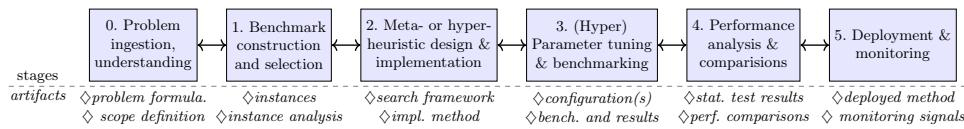
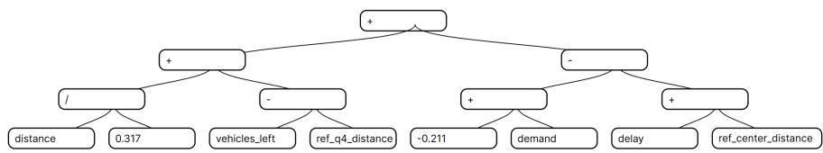

# Tailoring Optimization Approaches with Domain Knowledge in Industry Process for Meta-heuristic Development

Jakub Cebula1[0009−0002−1020−9433], Konrad Gmyrek1[0009−0000−7206−3674], Paweł B. Myszkowski1[0000−0003−2861−7240],

Marko Ðurasević2[0000−0001−8732−4769], Łukasz P. Olech3[0000−0001−9510−626X], and Adam Paliszek-Saładyga1[0009−0002−1961−5147]

1 Wrocław University of Science and Technology, Faculty of Information and Communication Technology,

ul. Ignacego Łukasiewicza 5, 50-371 Wrocław, Poland pawel.myszkowski@pwr.edu.pl

2 University of Zagreb, Faculty of Electrical Engineering and Computing, Unska ul. 3, 10000 Zagreb, Croatia 3 Melbourne, Victoria, Australia

Abstract. The paper presents an Industry Process for Meta-heuristic Development (IPMD) schema, a systematic methodology for applying meta- and hyper-heuristic applications to optimization problems. In this context, we present a case study of Balancing Non-dominated Tournament Genetic Programming (BNTGP) applied to solve two NP-hard multi-objective optimization problems: routing (Capacitated Vehicle Routing Problem with Time Windows) and scheduling (Multi-Skill Resource Constrained Project Scheduling Problem). The BNTGP method is based on a metaheuristic design. Its genetic programming-based representation makes BNTGP a hyper-heuristic, as it enables the exploration of a search space of heuristics for solving problems in general. The resulting heuristic can then be applied across a set of problem instances.

Keywords: multi-objective optimization · hyper-heuristics · genetic programming · CVRP-TW · MS-RCPSP

## 1 Introduction

The process of applying meta- and hyper-heuristics optimization to diferent complex problems requires multiple steps. First, researchers need to deeply understand the problem structure, constraints, choose benchmark instances, and propose a problem representation. Then they need to select, adjust, and tune the optimization method, and analyze its performance relative to other methods. According to the No Free Lunch (NFL) Theorem, the performance of all metaheuristic search algorithms is averaged across all possible optimization problems. However, incorporating domain knowledge can make metaheuristic design more efective in problem-aware optimization processes. Such a strategy requires experts to analyze the given problem, its instances, and the solution landscape, to define problem-specific heuristics, i.e., a solution representation, and crossover/- mutation/selection operators. A hyper-heuristic can address some of these challenges by automatically adapting to diferent problems and scenarios, which is particularly useful for novel problems and practical applications. This paper presents the methodology for applying the novel multi-objective Balancing Nondominated Tournament Genetic Programming (BNTGP) [4] to solve distinct optimization problems. The proposed Industry Process for Meta-heuristic Development (IPMD) [3] is applied to the development of the BNTGP hyper-heuristic. The IPMD methodology is a framework for the development of metaheuristics for real-world applications, and its use is demonstrated in the application of BNTGP to solving two distinct case studies: the Capacitated Vehicle Routing Problem with Time Windows (CVRPTW) and the Multi-Skill Resource Constrained Project Scheduling Problem (MS-RCPSP). This study discusses how domain knowledge is incorporated into the method and identifies common design principles that facilitate its application to new domains.

  
Fig. 1. The general flow of Industry Process for Metaheuristic Development (IPMD).

## 2 Industry Process for Meta-heuristic Development

The Industry Process for Metaheuristic Development (IPMD) [3] outlines the steps required to apply meta- and hyper-heuristics to solve optimization problems. The first step of the IPMD workflow (see Fig.1) is problem ingestion, where the structure, representation, constraints and objectivities of the problem are defined. The next step involves constructing or selecting a representative benchmark set of the problem. Subsequently, the meta- or hyper-heuristic method is designed and implemented or adapted to the problem by selecting appropriate operators and defining an evaluation function. Hyperparameter tuning is a crucial step that directly influences the quality of the obtained results. The final stages include performance analysis and deployment of the method.

The open-source iMOPSE 4 [2] library supports the IPMD process by providing researchers with problem definitions (e.g., CVRPTW, MS-RCPSP, TTP), preconfigured methods and operators, as well as tools for result analysis. iMOPSE also provides benchmarking problem instances for several NP-hard problems, including the MS-RCPSP standard d36 and the recently developed representative d45 [3], which covers a wider range of benchmarking instance types, providing a more comprehensive set for developing metaheuristics for MS-RCPSP.

## 3 BNTGP for MS-RCPSP and CVRPTW: A Case Study

The BNTGP is a Hyper-Heuristic for multi-objective (MO) optimization. The method combines the state-of-the-art metaheuristic Balanced Non-Dominated Tournament Genetic Algorithm (BNTGA) [1] and Genetic Programming (GP). The construction of an individual is performed by a heuristic decoder that iteratively selects the best feasible candidate action at each construction step. To determine which action is best, the method extracts features for each candidate action and combines them into a single score using an expression. Each expression is represented in the form of a tree, where the input feature values are leaves, nodes represent mathematical operations, and the root of the tree outputs a score. During optimization, a population of trees is evolved using genetic programming, where each tree is used to construct a single solution. The usage of GP allows BNTGP to automatically adjust to diferent problem instances. Additionally, it supports feature selection, as the features that do not contribute to the quality of results are not preserved during the evolution of trees.

The BNTGP was applied to two MO optimization problems: CVRPTW and MS-RCPSP [4], summarized in Table 1. For CVRPTW, the decoder constructs vehicle routes by repeatedly selecting the next customer to visit. To describe candidate customers, a set of classical routing descriptors has been selected, such as distance, demand, remaining capacity, and time-window information.

<table><tr><td rowspan=1 colspan=1>Aspect</td><td rowspan=1 colspan=1>CVRPTW</td><td rowspan=1 colspan=1>MS-RCPSP</td></tr><tr><td rowspan=1 colspan=1>Type</td><td rowspan=1 colspan=1>Routing problem</td><td rowspan=1 colspan=1>Scheduling problem</td></tr><tr><td rowspan=1 colspan=1>Decision variable</td><td rowspan=1 colspan=1>Customer</td><td rowspan=1 colspan=1>Activity-resource pair</td></tr><tr><td rowspan=1 colspan=1>Decoder</td><td rowspan=1 colspan=1>Route builder</td><td rowspan=1 colspan=1>Schedule builder</td></tr><tr><td rowspan=1 colspan=1>Constraints</td><td rowspan=1 colspan=1>Capacity, time windows</td><td rowspan=1 colspan=1>Skills, task precedence</td></tr><tr><td rowspan=1 colspan=1>Basic features</td><td rowspan=1 colspan=1>Distance, demand</td><td rowspan=1 colspan=1>Duration, skills, costs</td></tr><tr><td rowspan=1 colspan=1>Domain features</td><td rowspan=1 colspan=1>Regional descriptors</td><td rowspan=1 colspan=1>Pairwise descriptors</td></tr><tr><td rowspan=1 colspan=1>Objectives (2)</td><td rowspan=1 colspan=1>Distance, delay</td><td rowspan=1 colspan=1>Makespan, cost</td></tr></table>

Table 1. Summary of diferences between CVRPTW and MS-RCPSP

In the CVRPTW, the capacity constraint is handled directly by the decoder, such that routes are forcibly closed once vehicle capacity is reached. The number of vehicles and time window constraint violations are penalized during evaluation to discourage GP from exploiting these regions of the solution space. Figure 2 outlines an example solution evolved by BNTGP, showcasing the use of demand and vehicles\_left features related to constraints together with delay. Additional region-based features that use domain knowledge provide the relative positions of customers with respect to predefined reference regions, allowing GP to exploit clustering patterns present in some benchmark instances.

For BNTGP applied to MS-RCPSP [4], candidate actions are represented as activity-resource pairs. The decoder ensures schedule feasibility with respect

J.Cebula et al.

  
Fig. 2. Example GP tree expression for CVRPTW

to precedence and skill constraints, while GP evaluates candidate pairs using features describing activity urgency, resource availability, skill compatibility, and resource costs. Additional domain-knowledge-based pair-specific descriptors were introduced to capture opportunity costs and future resource utilization.

## 4 Conclusions and future works

In this paper, the BNTGP hyper-heuristic is briefly presented in the context of IPMD as a framework for development of metaheuristics for real-world applications. Despite substantial diferences between the two problems, the application of BNTGP followed a similar general pattern. The evolutionary framework remained unchanged, while domain knowledge was introduced through the design of candidate action features and decoder logic. Future work will investigate additional ways of incorporating domain knowledge into BNTGP, including automatic feature design and problem-specific feature selection. Another important direction is to study the transferability and interpretability of evolved heuristics across diferent instances and optimization problems.

Acknowledgements: This work has been supported by the statutory funds of the Department of Systems and Computer Networks, Faculty of Electronics, Wroclaw University of Science and Technology, and by the Croatian Science Foundation under project IP-2022-10-5398.

## References

1. Antkiewicz, M., Myszkowski, P.B.: Balancing pareto front exploration of nondominated tournament genetic algorithm (b-ntga) in solving multi-objective np-hard problems with constraints. Information Sciences 667, 120400 (May 2024)

2. Gmyrek, K., Myszkowski, P.B., Olech, Ł.P., Paliszek-Saładyga, A.: imopse: Opensource research environment for single- and multi-objective np-hard problems optimization (2026), accepted to GECCO 2026 Companion

3. Olech, Ł.P., Myszkowski, P.B.: Scalable benchmarking and problem instance analysis using machine learning for metaheuristics (2026), accepted to GECCO 2026 Workshop

4. Paliszek-Saładyga, A., Myszkowski, P.B., Ðurasević, M., Gmyrek, K.: Bntgp: A hyper-heuristic balancing non-dominated tournament genetic programming for multi-objective multi-skill resource-constrained project scheduling problem (2026), accepted to PPSN 2026