# The AI Era’s Lines of Code? A Case Study on What an Engineer’s Token Spend Measures

Shyam Agarwal Carnegie Mellon University shyamaga@andrew.cmu.edu

Olga Lvova JetBrains olga.lvova@jetbrains.com

Agnia Sergeyuk JetBrains Research

Timofey Bryksin JetBrains Research timofey.bryksin@jetbrains.com

agnia.sergeyuk@jetbrains.com

Anastasiia Serova JetBrains anastasiia.serova@jetbrains.com

Thomas Zimmermann University of California, Irvine tzimmer@uci.edu

Bogdan Vasilescu Carnegie Mellon University vasilescu@cmu.edu

Abstract—Organizations use engineers’ token spend to monitor AI adoption, set budgets, and measure productivity, but the metric’s relationship with engineering output is unclear. We link five weeks of token usage in coding agents to the commits of 404 engineers at JetBrains, and analyze a company survey of 412 employees. We find that token spend varied mostly between engineers, and which engineers spent the most stayed largely the same over the five weeks. Among weeks with similar commit counts, the 90th percentile of spend was 39 to 240 times the 10th. Within an engineer, doubling spend was associated with about 10% more commits. Available work metrics explained 38% of the variation in spend between engineers and 13% of the week-to-week variation within an engineer. In the survey, respondents in technical roles reported in nearly nine of ten agent evaluations using agents for tasks beyond coding, such as analysis, research, and planning. Token spend therefore measures how much engineers use agents across many kinds of work and not the outcome and value of that work. We recommend using token spend at most for resource accounting, and evaluating agent-assisted work with evidence about tasks and outcomes.

## I. INTRODUCTION

Many engineers now write software by instructing a coding agent, reviewing what it did, and asking for changes or further work [1]–[3]. Whatever code these interactions produce is still recorded, as before, in commits and pull requests. Every exchange with the agent is also recorded in the agent’s usage log, or agent telemetry. For each exchange, the model provider logs and bills the tokens sent and received, along with the tool and model used. Summed per engineer and per week, these counts are the engineer’s token spend. Spend counts every exchange, including those that never lead to a commit, but it does not record what an exchange was about. Providers do not share session content by default, and few companies record it themselves, so the organization that pays usually sees only the token count, as in our data (Section III-A).

Some organizations already use token spend to evaluate engineers. At Meta, an employee built a dashboard on which colleagues competed to be the company’s top token user; it was taken down after the press reported on it [4], [5]. Executives at Nvidia and Meta have said that a good engineer should use tokens worth a large share of their salary [6], and Salesforce has set minimum monthly spending targets [7].

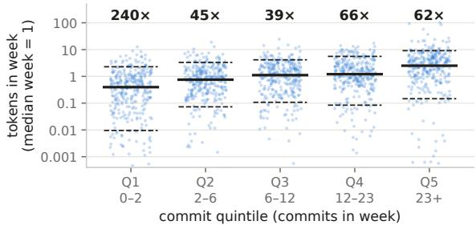  
Fig. 1. Within each weekly-commit quintile, the 90th percentile of token spend is 39 to 240 times the 10th (numbers at the top). Lines mark the 10th, 50th, and 90th percentiles; spend is relative to the median engineer-week. Ties are split at quintile edges, so adjacent ranges share an endpoint.

Analytics vendors divide token cost by merged pull requests and report the ratio as return on investment [8], [9]. Each of these uses assumes that an engineer who spends more produces more. Practitioners have begun to doubt that assumption. Uber spent its 2026 budget for AI coding tools in four months; its COO said that the link between token spend and shipped features “is not there yet” [10]. One critic called token spend “the lines-of-code metric of the AI era: easy to measure, easy to game, and disconnected from actual productivity” [5].

Prior studies of whether more tokens mean more output give mixed answers. On benchmarks, agents that run longer do not reliably solve more tasks [11]–[13]. In deployed use, output rises far less than spend: a press summary of vendor data reports that developers who spend ten times more merge about twice as many pull requests [14], and one enterprise doubled its throughput but raised its spend at least twenty-fold [2]. Outside benchmarks, these comparisons are between engineers, or between organizations. Engineers differ in role, team, and work practices, so a difference in spend between two of them may reflect those differences as much as any difference in what they produced. No study has followed both spend and output for the same engineers over time, so whether an engineer’s spend varies with their output from week to week is not known. Telemetry from one agent shows how widely usage varies across users but does not have output data to compare it with [1], and recent panel studies measure agent use by days [3], interactions [15], or lines the agent wrote [2], and report spend only in aggregate, if at all.

In this paper, we ask what an engineer’s token spend measures and what it can be used for. We study 404 engineers at a software development company whose internal gateway meters the tokens of every coding-agent call. From the gateway counts and the company’s repositories, we follow each engineer’s token spend and commits week by week for five weeks, and we analyze an anonymous survey of the company’s employees about their AI use.

We ask two questions. RQ1: How closely is an engineer’s token spend related to their output? We compare an engineer’s weeks with one another, which holds the engineer fixed, and we compare engineers with each other. RQ2: Where does the token spend that is not tied to repository output go? That spend may be work that never becomes a commit, which studies of repository output would miss, or overhead. The telemetry shows when each call happened and how many tokens it used, but not what it was for, so it cannot distinguish the two. We use the telemetry to estimate the share of spend not tied to output, and the survey to learn what engineers use agents for and how many hours they report saving.

We find that spend depends more on the engineer than on the week’s output (RQ1). A week with twice an engineer’s usual spend has only about 10% more commits, weeks with similar commit counts differ in spend by a factor of 39 to 240 (Figure 1), and the engineers who spend the most are largely the same over the five weeks. Up to about two fifths of spend does not vary with the week’s output, and in 89% of technical respondents’ evaluations of a coding agent, they had used it that week for something other than writing code (RQ2). Engineers choose how much to use agents, so these are associations.

Our contribution is an empirical study that links engineers metered token spend to their repository output and to their own accounts of agent use. It shows that token spend measures how much an engineer works through agents, not what they produce, so it should not be used as a measure of productivity.

## II. RELATED WORK

Organizations started adopting token spend as a management metric before peer-reviewed research could examine it, so we follow multivocal review guidance [16] and include grey literature (vendor reports, practitioner accounts, and technical press) alongside academic work.

## A. Measuring developer productivity

Lines of code became a productivity measure because they were cheap to count, and they have long been criticized for penalizing expressive languages and inviting padding [17]– [20]. Still, they stayed in use because program size is associated with effort closely enough to support cost models [19]. That history suggests that an indicator that is convenient to collect is not automatically a valid proxy for the attribute of interest [20], and that a measure that becomes a target ceases to be a good measure [21]. SPACE [22] and DORA [23], which replace single numbers with several, measure outputs, outcomes, and processes, but not the resources used, a reasonable omission while the main input was human time. For DX Core 4, which builds on both, AI makes the metrics noisier, because “the same number can now be produced by very different combinations of human and AI behavior” [24]. Empirical studies of AI-assisted development mostly observe work through commits, pull requests, and reviews [2], [3], [25], [26]. Agent telemetry adds a record of the resources used, metered per person, including the interactions that don’t produce any artifact.

## B. Task-level evidence

Most academic work on token consumption studies agent trajectories on benchmarks such as SWE-bench [27]. Accumulated context and cache reads, not generated output, account for most tokens and most cost [1], [11], [28], [29]. Spending more does not reliably increase success: accuracy peaks at intermediate cost, failed attempts cost more than successful ones, and the extra tokens go to repeated file views, retry loops, and generation after a passing solution [1], [11]–[13]. Much of the variance is unrelated to the task: consumption depends on model, scaffold, and language, and only weakly on expert-rated difficulty [11]–[13].

Token counts are also an unstable proxy for cost. Since cost became an evaluation dimension [30], many methods reduce tokens [31]–[36], but fewer tokens do not always mean lower cost. Removing 38.4% of tool-output tokens increased billed cost by 6.8%, because the agent spent extra turns diagnosing and re-reading the removed context [29]. With feature, review gate, and model held constant, cost per merged feature varies about 2.5-fold across harnesses [37]. If token counts are an unreliable measure of cost at the task level, they are unlikely to be a reliable measure of value at the organizational level.

## C. Individual- and organization-level evidence

We did not find any peer-reviewed study of how token spend relates to engineering outcomes across developers or organizations. Telemetry studies show that spend varies 50- fold or more between users but do not report outcomes [1], [38], and a single-developer case study links higher token use to a lower fix-commit ratio but changed model and harness at the same time [39]. Adoption studies find more commits or merged pull requests after adoption, with the gains shrinking before release [3], [25], [26], [40], [41], but they compare use with non-use and do not measure tokens. Two panel studies closest to ours measure how intensively engineers use AI tools, though also not in tokens. He et al. count AI-written lines and find that a mandate to double merged pull requests raised throughput 2.09-fold while spend increased at least 20- fold [2]; Heilman et al. count Copilot interactions and find 40.5% more completed pull requests in an engineer’s weeks of heaviest use than in weeks without use [15]. Self-reported speedups can diverge from measured time: in a randomized trial, developers took 19% longer with AI tools but thought they were faster [42].

Only analytics vendors have joined token telemetry to delivery data across organizations, and they report that throughput rises far less than spend. From the lowest to the highest usage decile, weekly pull requests nearly tripled while cost per merged pull request rose about 300-fold [8], and merged output per dollar fell by about 70% during 2026 [9]. Alongside the throughput gains, other reports find more bugs and churn, and lower acceptance once later revisions are counted [14], [43]. None of these reports is peer reviewed, and their methods are only partly disclosed.

Practitioners also disagree on what token spend is. Some treat it as a measure of engagement, equating good engineering with heavy use [6] or setting a daily token threshold for adoption [44], [45]. Others treat it as a cost to cap [46] or to divide by output, or as a proxy for output itself, a practice called tokenmaxxing [5]; one practitioner observes that lines of code now correlate highly with token spend [47]. Reports of employees inflating their usage [4], [5], [48], [49] fit Goodhartstyle gaming [21] but remain anecdotal.

## D. Synthesis and open questions

Prior work has not answered two questions about the engineers behind the telemetry. The first is what an individual’s spend reflects. Studies that join spend to output compare deciles of users or follow organizations [2], [8], [9], so they cannot separate how much an engineer habitually works through agents from how their use changes with the work at hand. The second is how much agent-assisted work ends up in the repository. Half of production agent turns are exploration or reasoning, not editing [1], yet adoption studies measure outcomes through repository artifacts [2], [25] and look for lost gains only after the first commit [41]; no study has estimated how much consumption never leads to a commit. Token counts depend on model, harness, and caching regime [11], [29], [39], so our person-week panel addresses both questions within a single tooling environment, where the counts are comparable.

## III. METHODS

We combine gateway telemetry of agent use at JetBrains with repository records of the same engineers’ output. We also draw on an anonymous internal survey on AI tools that the company ran during the study period; survey responses cannot be linked to individual engineers’ telemetry or repository data. Because engineers choose how much to use the agents, all our estimates are associations, not causal effects.

## A. Setting and data

JetBrains builds software development tools and had about 2,600 employees at the time of the study.1 We study codingagent use as recorded by the company’s internal gateway, which logs every agent call in a consistent format.

We extracted pseudonymized data from internal systems on the 584 engineers who committed to one of the company’s main IDE products in our study window, 2026-05-10 to 2026- 08-08. The commit data spans the window, but our access to the gateway’s token data spans only its last weeks; we analyze the five complete weeks in that period, 2026-06-29 to 2026-08-02 (the analysis weeks). We exclude the final six days (2026-08-03 to 2026-08-08), because commits during that period may have been merged after the extract date. The seven weeks before the analysis weeks (the pre-period) have commit data but no token data. Engineers had access to AI tools in the pre-period too, so it is not a period without AI. We use the pre-period data to describe each engineer’s prior work mix (Section III-B).

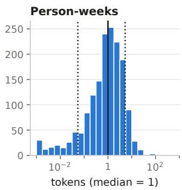

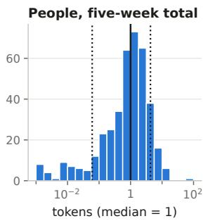  
Fig. 2. Token spend relative to the median, per metered person-week (left, $n = 1 , 5 9 9 )$ and per engineer (right, $n = 3 9 7 )$ , over the five analysis weeks. Solid lines: medians. Dotted lines: 10th and 90th percentiles, at 0.05 and 5.3 times the median for person-weeks and 0.06 and 4.3 for engineers. Values under a thousandth of the median are pooled in the first bin.

From the company directory we extract each engineer’s team, job title, and manager flag. We assign each engineer a role (developer, QA engineer, team lead or manager, intern, other) from keywords in the job title. QA and developer keywords take precedence over lead and manager, so a lead QA engineer is a QA engineer. The agent telemetry contains 3.1 million agent calls by 406 of the 584 engineers from 2026- 06-29 to 2026-08-08. Each call records a timestamp, the agent (two agents account for nearly all tokens: Agent A for 69% and Agent B for 31%), the model, the number of tokens, and the credits charged. Most tokens are context re-sent on every turn: the median call sends about 400 times as many tokens as it receives. We measure spend in tokens; credits, the company’s cost unit, rank engineers almost identically (Spearman $\rho = 0 . 9 7 )$ and serve as a sensitivity check. Tokens measure only the inference part of the input; the engineers own time, the larger cost, is not in our data. Spend varies widely between engineers (Figure 2): over the five analysis weeks, the engineer at the 90th percentile used 71 times as many tokens as the engineer at the 10th.

For output we measure the number of commits. We date each commit by its author date, when the change was written and the agent was used, not by the commit date, which rebases and squash merges change to be the merge time. For each commit we also know its size (lines added and deleted and files changed, recorded in bins; we use bin midpoints), whether it changes the shared IDE platform or a surrounding project, and the issues referenced in its message, with the issue’s type (bug, task, feature) from the issue tracker. In the analysis weeks, 71% of commits change the platform and 35% reference an issue. Commit counts miss code quality and work that does not change the code, such as review and design. We also considered pull requests, as some prior work did [2], [8], but lacked the data.

## B. The telemetry panel

a) Person-weeks: Our unit of analysis is the person-week (Monday to Sunday): we relate an engineer’s total token spend in a week to their total commits in that week. Weeks 0 to 4 (2026-06-29 to 2026-08-02) form the panel, and weeks −7 to −1 serve only as a pre-period. A person-week is in the panel if it has any metered tokens or commits; of the 2,030 personweeks of the 406 metered engineers, we treat the 203 with neither as weeks the person was away and leave them out. The panel has 404 engineers (the other two used the agents only after week 4; 397 with metered use in these weeks) and 1,827 person-weeks, 88% with metered use, of which 12.9% have no commit. The median active week has 8 commits. The 178 engineers with no metered use are not in the panel; in the pre-period they committed slightly more than metered users (median 65 vs. 52 commits, Mann–Whitney $p = 0 . 0 8 )$ and differ from them by at most 0.24 standard deviations on any pre-period covariate. The gateway does not meter chatbots or other assistants, so engineers outside the panel may use AI.

b) Analysis approach common to all RQs: We answer each RQ between engineers and from week to week within an engineer, since the two can disagree: heavy users may also ship a lot, yet a busier week need not cost an engineer more than a slower one. We model weekly token counts with Poisson regression estimated by quasi-maximum likelihood [50], which keeps zero-token weeks and estimates the mean consistently however dispersed spend is [51]. Withinperson models include person and week fixed effects [52], i.e., they compare each engineer’s weeks with one another after removing the engineer’s level and anything common to all engineers in a week, such as a model release. A new frontier model arrived in week 3 and accounted for 45% of all spend within two weeks; week effects absorb such a change only on average. For engineer i in week t, the within-person model is

$$
E [ \mathrm { t o k e n s } _ { i t } ] = \exp ( c _ { i } + d \log ( \mathrm { c o m m i t s } _ { i t } ) + t _ { t } ) ,\tag{1}
$$

where $c _ { i }$ is the engineer’s own level, $t _ { t }$ the week, and the elasticity d is the percentage change in tokens per percentage change in commits. Between-person slopes are least-squares fits on engineers’ log averages over the five weeks. Where we compare the two levels, we fit them jointly in the within– between (Mundlak) form [53], [54], so that their difference has a confidence interval. Confidence intervals are 95% percentile intervals from a cluster bootstrap over engineers [55]. The replication package (Section VII) gives the full specifications.

c) RQ1: How closely is an engineer’s token spend related to their output?: We answer RQ1 in two steps, which Section IV-A follows: how closely a week’s spend varies with that week’s output, and what else in our data explains the rest.

If spend rises in proportion to work, a week with twice the commits should cost about twice as much, as cost-per-output metrics assume. We test this with the elasticity d in the Poisson model of Equation 1: $d \ = \ 1$ means spend doubles when commits double, and d = 0 means it does not vary with them. The log of commits is undefined at zero, so we fit this model to the 1,347 engineer-weeks with both tokens and commits, from the 344 engineers who have at least two such weeks to compare. We also estimate the reverse slope, of commits on tokens; when spend and output are closely correlated, the two slopes are near reciprocals. Two things could make d look smaller than it is. Commit counts only approximate a week’s work, which biases slopes toward zero [56]. We therefore reestimate d by instrumental variables with lines changed as the instrument [52], which ignores squashing or splitting commits because they change the count but not the lines. And output may arrive later than the spend behind it; we check this with day-level cross-correlations of spend and commits at leads and lags of up to ten working days. We repeat the estimate with lines changed and days with a commit as the output, at time units from one day to four weeks, with commit-count categories in place of log commits, and with spend split into agent calls and tokens per call, and test whether heavier-spend weeks’ commits differ in size, platform share, or issue linkage.

If spend does not co-vary with commits, it may reflect other parts of the work. We first measure how much spend varies among weeks with similar output, as the ratio of the 90th to the 10th percentile of weekly spend within each quintile of weeks ranked by commits. We then ask how much of weekly tokens the metrics in our data predict: commits, lines changed, bug-linked commits, and days with a commit; then add issuetracker activity, role, manager status, team (grouped into divisions and product ecosystems), and each engineer’s prior work mix (commit rate, commit size, and share of commits whose message references a bug). For each set we compute the share of deviance it explains relative to an interceptonly model, the Poisson counterpart of $R ^ { 2 }$ [57], computed by cross-validation [58] on held-out engineers (ten folds) for differences between engineers and on held-out weeks (five folds) for changes within an engineer. Finally, we correlate each engineer’s spend with their teammates’ average spend, excluding their own (a leave-one-out mean), and repeat the within- and between-person estimates on team-weeks.

d) RQ2: Where does the token spend that is not tied to repository output go?: We answer RQ2 in two parts, which Section IV-B follows: from the telemetry, how much spend is not tied to output and what the weeks with such spend look like; and from the survey (Section III-C), what engineers use the agents for and how many hours they report saving.

We cannot identify the spend not tied to output directly, because the telemetry does not link agent calls to repository artifacts (Section III-A): in a week with no output, none of that week’s spend led to output; in a week with output, we cannot tell which part did. We therefore estimate a lower and an upper bound on the share, assuming that the spend and the commits made with it happen in the same week. We test this assumption with the lead–lag analysis of RQ1 and by repeating both bounds at time units from one day to four weeks.

For the lower bound, the floor, we count only the unambiguous case, the share of all tokens spent in person-weeks with no commits, restricted to weeks with above-median spend (other cutoffs in Supplementary Material (SM) A). It misses spend not tied to output in weeks with commits. For the upper bound, the curve estimate, we predict an engineer’s spend in a week with no output from how their spend varies with output. It extends the Poisson model of Equation 1, replacing d log(commits) with $b ^ { \top } s ( \mathrm { o u t p u t } )$

$$
E [ \mathrm { t o k e n s } _ { i t } ] = \exp \left( c _ { i } + b ^ { \top } s ( \mathrm { o u t p u t } _ { i t } ) + t _ { t } \right) ,\tag{2}
$$

where $s ( \cdot )$ transforms output to set the shape of the curve: raw counts, square root, log $( 1 + x )$ , or a linear spline in $\log ( 1 + x )$ , each with $s ( 0 ) = 0$ . We sum the prediction for a week with no output, $\exp ( c _ { i } + t _ { t } )$ , over person-weeks and divide by total spend to obtain the share of tokens that does not vary with output. This share includes the fixed cost of using an agent at all and the spend behind hand-written output, so it overestimates. Because the share depends on the shape, we fit all four shapes and compare them on calibration in weeks with no output, out-of-sample deviance under five-fold cross-validation [58], and agreement with negative-binomial and gamma models [50], which match the Poisson mean only if the shape is right [51]. We repeat the estimate with commit size, issue type, and tool mix as predictors, and within groups.

We also test whether spend precedes later output, by comparing an engineer’s commits, relative to their own mean, after a heavy-spend period with no output with those after other periods. To relate a week’s spend beyond what its output predicts to how the agent was used, we correlate each week’s residual with the engineer’s agent use that week (calls, days of use, context per call, share of generated text, tool mix, and session length) and with the next week’s bug-linked commits. A session is a run of calls separated by at most 30 minutes.

## C. The survey

a) The questionnaire: The company ran an anonymous internal survey on the AI tools that employees use. Respondents indicated which company-paid AI tools they had used in the past work week and were assigned one of them to evaluate (the tool with the fewest evaluations at that point); those who had used more than one could evaluate a second tool of their choice. For each tool, respondents reported what they had used it for in the past work week, what value it had provided, and whether it had enabled work in the past month they would otherwise not have done. They also reported whether it had saved or cost them time that week and how many hours, how many colleagues the work would otherwise have involved, and its effect on six aspects of their work on a five-point scale (productivity, quality of output, efficiency on routine and on complex tasks, cognitive load, and finding information). A final question asked whether they had handled colleagues’ material they suspected was AI-generated and how much time it cost them. Free-text questions asked for the main value, the work enabled, and what saved and what cost time.

b) Respondents: The survey had 412 respondents (15.8% of employees; 525 evaluations in total): 400 evaluated at least one AI tool, 125 evaluated a second; 12 did not use any company-paid AI tool. Most respondents (72%) held technical roles, and 16% were team leads. The company invited employees without incentives through an internal post that also asked colleagues skeptical of AI to take part; 3% of respondents indicated they did not use any company-paid AI tool, a share consistent with the rest of the company.

c) What engineers use the agents for: For RQ2, we analyze the 197 evaluations of the two coding agents (99.8% of metered tokens) by 184 respondents in technical roles. We report answers to the multiple-choice questions as percentages of the evaluations that answered each question; a respondent who evaluated both agents counts twice. Hours saved is the number respondents gave, negative when the tool cost time; it is a self-report about the past week. We report medians and interquartile ranges. The 289 answers to the four freetext questions were coded thematically [59] with an AI tool, and one author reviewed every code manually; the codebook is inductive, per question, with multiple codes per answer (1.6 on average). We report themes as shares of substantive answers, with quotations.

d) Relating the answers: To see which kinds of use go with larger reported time savings, we regress hours saved on the other answers at once, because the answers overlap: respondents who use the agent for more kinds of work also more often report enabled work and name more colleagues that the work would otherwise have needed. The predictors are coding use, the number of non-coding activity types, enabled work, and the number of colleagues the work would otherwise have needed; the controls are the tool, the division, and whether the week’s only reported value was experiments and learning. We model hours on an inverse hyperbolic sine scale, which keeps zeros and losses, standardize the coefficients, and compute bootstrap intervals over respondents (SM B). We also compare the coded free text with the closed survey items.

## D. Ethical considerations

This study examines workplace records and survey responses from employees of JetBrains, where some of the authors work. Only one author had access to the raw workplace records, and they pseudonymized them before sharing them. The Carnegie Mellon authors had access to the pseudonymized data, in which JetBrains employees are not individually identifiable, and used them only for secondary analysis. The survey was anonymous and could not be linked to individual telemetry records or to specific employees. The data analyzed in this study are not used to evaluate individual employee performance, and we report only aggregate results. We do not release individual-level records or survey responses to protect employee privacy. The study followed applicable ethical standards and the ICC/ESOMAR International Code [60].

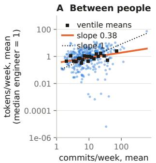

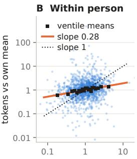  
Fig. 3. Spend vs. commits, both on log10 scales (slope 1 is proportional; lines are least-squares fits; squares are means of 5% slices). (A) Engineers average weeks. (B) Engineer-weeks relative to the engineer’s own mean.

## IV. RESULTS

A. RQ1: How closely is an engineer’s token spend related to their output?

1) A week’s spend varies only weakly with that week’s output: A week with twice an engineer’s usual commits costs about 20% more tokens. The elasticity of tokens on commits, d in Eq. 1, is 0.26 [0.19, 0.32] (0.28 by least squares in Figure 3B). In the other direction, the slope of commits on tokens is 0.13 [0.03, 0.32], so a week with twice the usual tokens has about 10% more commits. If spend increased in proportion to output, both slopes would be near one; their product is 0.03, and proportionality $( d \ : = \ : 1 )$ is rejected at every time unit $( p < 0 . 0 0 1 )$ . Output itself varies widely across weeks: an engineer’s weekly commits typically differ from their own average by a factor of about two, i.e., half or double.

Two things could make d look smaller than it is, but neither explains the gap. First, commit counts are a noisy measure of work. Instrumenting commits with lines changed raises the within-person slope d to 0.48, still well short of proportional. Second, output may arrive after the spend: the day-level crosscorrelation between spend and commits peaks on the same day (0.33) and is gone after about four working days (Figure 11 in SM A), so a week contains most of the lag between spend and the commits made with it. Nor does the result depend on how output and time are measured: the slope is similar for days (0.30) and two-week periods (0.21), and with lines changed (0.19) or days with a commit (0.40) as the output. With commit-count categories and no shape imposed, spend rises along the same constant-elasticity line at every output level (SM A). Nor are the commits of heavier-spend weeks different commits: no measure of their size, platform share, or issue linkage changes at $p < 0 . 0 5$ . A busier week brings more agent calls (0.25), each with about the same number of tokens (+0.01, $p = 0 . 6 2 )$ . The within-person correlation is weakest among light users, 0.01 for engineers who spend under a third of the median week compared with 0.37 for those who spend over three times it, and every role, tool, and usage group stays below proportional (SM A).

Between engineers, the association is somewhat stronger (Figure 3A). On person means, the slope is 0.38 with each engineer counted once and 0.44 with engineers weighted by their number of weeks with metered use, compared with 0.26 within a person. In the other direction, engineers who spend twice as much have about 8% more commits (slope 0.11). Fitted jointly, the between-minus-within difference is 0.15 [−0.04, 0.36], so engineers who commit more may be heavier users beyond what their weekly output explains, but five weeks per person is too short to be sure (Poisson fits give larger slopes, driven by five engineers).

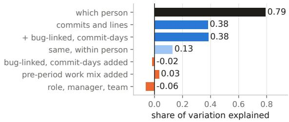  
Fig. 4. Share of variation in weekly token use that each set of predictors explains. “Which person” is fit in sample; “same, within person” is tested on held-out weeks; every other set on held-out people. “Added” bars are separate fits. A negative share means the set predicts held-out people worse than the week’s average spend alone.

2) Output and the other metrics explain little of the dif ferences in spend: Output alone explains little of the spread in spend. Within every quintile of weekly commit counts, the engineer-week at the 90th percentile of spend uses 39 to 240 times the tokens of the one at the 10th (Figure 1).

The four activity metrics (commits, lines changed, buglinked commits, commit-days) explain 38% of the betweenperson variation in weekly tokens on held-out people and 13% of the within-person variation on held-out weeks (Figure 4). Commits and lines changed alone do just as well (38% between); bug-linked commits and commit-days add nothing (−2 points), nor does issue-tracker activity, and how engineers worked in the pre-period (their commit rate, commit size, and share of bug-linked commits) adds 3 points. Given all four, the 90th-percentile person-week still uses 58 times the 10th.

The engineer’s role and team explain even less. Role, the manager flag, and team together predict held-out people worse than each week’s average spend does (−6%), possibly because spend varies widely among engineers on the same team: an engineer’s spend correlates at 0.24 with the leave-one-out mean of their division or ecosystem and at 0.13 with that of their team. Summed to teams, spend is no more closely related to output than for individuals: the within-team slope is 0.31 for team paths and 0.27 for product ecosystems, compared with 0.25 for the same engineers (SM A). The person does account for the spread, explaining 79% of the deviance in our sample.

Which engineers spend the most is stable over the five weeks; who has the highest cost per commit is not (SM A).

B. RQ2: Where does the token spend that is not tied to repository output go?

1) Up to two fifths of spend is not tied to the week’s output: Weeks with no commit account for 4% of all tokens, but by the curve estimate the share that does not vary with the week’s output is about two fifths. Most of the spend not tied to output falls inside weeks that did produce commits. Throughout this section, “output” means commits. Time spent on code review, design, or repositories outside our sample therefore counts as not directly tied to output, as does time spent on exploration, learning, and abandoned attempts.

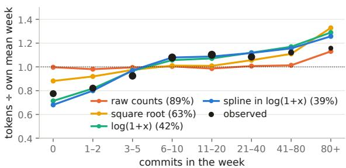  
Fig. 5. Tokens relative to the engineer’s average week, by the week’s commit count: observed (dots) and predicted by each curve shape (lines), with the share of tokens attributed to zero output under each shape in parentheses.

a) The floor: The lower bound is small. Of the 1,599 engineer-weeks with any metered use, 207 have no commit, mostly light-use weeks. The 49 with above-median spend account for 3.0% [1.8%, 4.5%] of all tokens; all 207 together account for 4%. By construction, the floor depends on the time unit; it is 25% for single days and 1% for two-week periods. We use the week because spend and its commits usually fall within four working days (Section IV-A).

b) The curve estimate: The upper bound is an order of magnitude larger. A week with no commit still costs 77% of the engineer’s average week (Figure 5), and the share of all tokens this implies depends on the shape of the curve. Raw counts attribute 89% [79%, 97%] of all tokens to zero output, the square root 63%, log(1 + x) 42% [33%, 51%], and the spline 39% [31%, 46%]. We trust the last two. Spend rises steeply over the first few commits of a week and then flattens, a shape an exponential-in-counts curve cannot take, and all three diagnostics from Section III rank counts last (SM A). Adding commit size and tool mix to the model, or fitting it to the first four weeks alone, changes the estimate by at most a few points (SM A). Even so, 39% remains an upper bound, since it includes the fixed cost of using an agent at all and the spend behind commits written by hand (Section III).

c) Where the share differs: We split the share by role and division, and by how much engineers use the agents (Figure 6). Across the groups that spend most of the tokens, the share barely varies: developers, team leads and managers (a role inferred from job titles), and each of the two large divisions range from 37% to 42%. It is higher only where the job is expected to produce fewer commits or the agent is used less: 50% for QA engineers, 59% for interns, and 51% and 52% for the middle and lightest thirds of users, relative to 36% for the heaviest third, who spend 79% of all tokens. The share varies far more between individual engineers than between any of these groups: per engineer the median is 46%, the middle 80% of engineers range from 31% to 68%, and the 10th and 90th percentiles of each engineer’s level of such spend differ 59- fold. Team, role, the manager flag, and prior work mix together explain only 11% of this variation on held-out people, as they explained little of spend overall (Section IV-A).

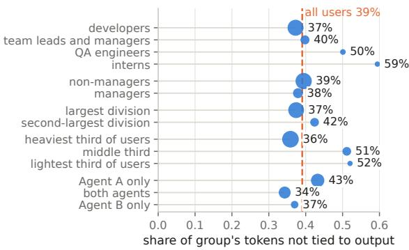  
Fig. 6. Share of each group’s tokens not tied to output, by the spline. Dot area is the group’s share of all tokens; the dashed line marks all users.

d) What the weeks with excess spend look like: A week’s spend beyond what its commit output predicts could reflect a costlier model or agent, or the same tools used differently. Our data point to both. In such weeks engineers used more of the newly released model: within person, the residual correlates with the week’s share of tokens on that model at 0.15 $( p ~ < ~ 0 . 0 0 1 )$ , though not with the share from either agent or from frontier models as a group, which includes older frontier models. They also worked in longer sessions: 31% of calls fall in sessions longer than two hours, compared to 18% in the person’s other weeks. Generated text is under 1% of tokens in either kind of week (0.6% vs. 0.9%), so the excess is context sent to the agent rather than code returned. The excess also does not predict bug fixes in the following week: the residual correlates with that week’s bug-linked commits at 0.03.

2) Engineers use the agents for far more than coding, and report saving more hours the broader that use: Of the 197 evaluations of the two coding agents by technical respondents, 167 answered the questions about past-week use. In 91% of these, respondents reported that the tool had saved them time that week (median 10 hours, interquartile range 5–20), and in 88%, they reported a positive effect on overall productivity. Respondents reported using these agents for coding in 63% of evaluations and for at least one non-coding activity in 89% overall (83% among the 100 evaluations of assigned tools): processing and analyzing data (52%), brainstorming (49%), research on a topic (44%), planning work (39%), learning (28%), and writing (23%) (Figure 7). Median hours saved rise from 3 for respondents who used the agent only for coding to 10 for those who reported two or more non-coding activities (Figure 8A). In the model of Section III-C, which relates hours saved to all of these answers at once (Figure 8B), the count of non-coding activity types is associated with hours saved (0.24 [0.06, 0.43]), as is the number of colleagues otherwise needed (0.43 [0.23, 0.61]), but coding is not (0.08 [−0.10,

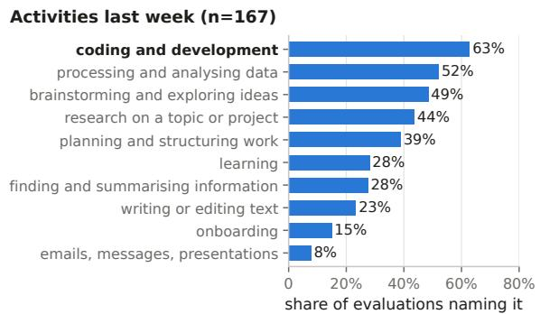  
Fig. 7. Activities for which technical respondents reported using the two coding agents in the past work week. (n = 167; multiple selections allowed).

0.27]). Enabled work has a similar estimate whose interval includes zero (0.19 [−0.01, 0.39]). Respondents who report enabled work also chose more activities and name more colleagues, so with 134 answers we cannot separate the three (SM A).

In their own words, respondents describe much of the coding-agent use as work outside their usual tasks: in unfamiliar code, domains, or technologies, on tasks they would otherwise have deferred, and in exploration. Asked for the agent’s main value, they split between speed on their usual tasks (31% of 74 substantive answers) and work in unfamiliar code, domains, or technologies (30%); 24% described exploration and a wider set of tasks worth attempting (“I can try things that I was scared to $\operatorname { t r y } ^ { * } ;$ Figure 13B in SM B). The 44 substantive descriptions of work done in the past month only because the agent existed show the same pattern. Of these, 36% describe work in an unfamiliar codebase, language, stack, or area (“fixed a bug in [system] despite having no prior knowledge of that codebase”). Another 25% describe tasks that would otherwise have been deferred or handed to someone else (a type-inference problem “that would otherwise take weeks so we would never have picked it up”). Prototypes and experiments account for 23%, internal tools 20%, and documents and reports 11% (Figure 9B). Only one of the 44 says the work would have happened anyway, just slower. Much of this work produces understanding before it produces a commit, or no commit at all in our data. Asked what kind of value the week’s tasks created, 59% named “experiments and learning that have not yet brought tangible value”.

Respondents see part of agent use as not producing valuable output. Of the 67 substantive answers on what cost time, 49% describe wrong, plausible-but-wrong, or low-quality output (“a plausibly-looking but ultimately [useless] symptom fix”). Another 24% describe tooling friction unrelated to the model (setup, credentials, outages, quota limits), 21% the cost of prompting, context management, and steering, and 18% the cost of verifying output, which sometimes exceeds the time saved (“there is a point where time spent on prompting and reviewing exceeds the time savings”; Figure 9A). Naming a cost is not associated with a lower overall productivity rating. Respondents whose answer was coded as non-valuable output rate productivity at 4.2 compared with 4.3 and report the same median hours saved (9). The survey’s hours question asks only how much time the respondent’s own tool saved or cost them, so two costs that other questions measure are not part of that figure: the cognitive load of working with agents, and the time spent on colleagues’ AI-generated material. Among technical agent users, 31% report higher cognitive load because of AI agents and 51% lower (Figure 10). The cognitive-load rating is nearly uncorrelated with reported hours saved $( \rho = 0 . 1 1$ compared with 0.57 for overall productivity); respondents describe the trade (“I do more, but my brain gets much more tired”). Colleagues bear part of the cost: 55% [49%, 60%] of the 299 who answered report handling colleagues’ material they suspected was AI-generated, costing a mean 1.6 hours a week [1.2, 2.1]. Team leads handle it more often (73% vs. 50%; odds ratio 2.7, $p = 0 . 0 0 6 )$ , with no more reported benefit.

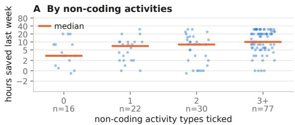

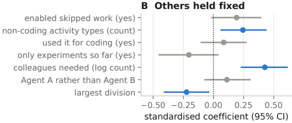  
Fig. 8. Self-reported time savings or losses from coding-agent use among technical respondents. (A) Hours saved or lost in the past work week, grouped by the number of non-coding activity types reported. Each dot is one evaluation and the bar its group’s median; the vertical axis is compressed above 2 hours. (B) Associations with reported time savings from a regression model including all seven predictors simultaneously (134 evaluations; $\mathbf { R } ^ { 2 } =$ $0 . 4 3 )$ . Predictors were standardized, and the outcome was asinh-transformed. Points show coefficient estimates; lines show 95% bootstrap confidence intervals. Blue intervals exclude zero.

## V. DISCUSSION

We discuss what token spend measures, what that implies for its three uses (measuring productivity, monitoring adoption, and setting budgets), and what to measure instead.

What token spend measures. Token spend records how much an engineer uses agents, scaled by the context included in each call and by the model in use, and in our data it varied far more between engineers than with the week’s output. Who the engineer was accounted for 79% of the variation in weekly tokens in our sample; on held-out data, output metrics predicted under two fifths of the differences between engineers and 13% of the variation within them, and role and team alone predicted held-out engineers worse than the weekly average.

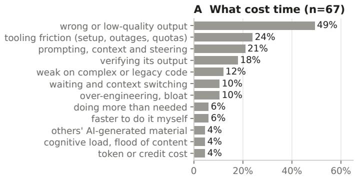

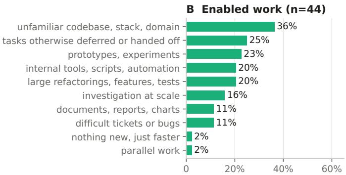  
share of answers coded to the theme

Fig. 9. Thematic coding of the free-text answers on what cost time and on enabled work. Figure 13 in SM B shows the other two questions.  
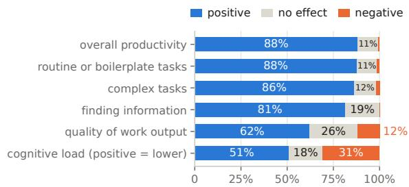  
Fig. 10. Effect of the coding agents on six work aspects, tech. respondents.

Within an engineer, a week with twice the usual commits had only about a fifth more tokens (Section IV-A). Token spend has been called “the lines-of-code metric of the AI era” [5], and our data support the comparison: both are easy to count and loosely related to what engineers accomplish. The two differ in what they count. Lines of code count output, and stayed in use because program size sufficiently reflected the effort behind it (Section II-A); tokens count an input, recorded whether or not anything is produced, and in our data they reflect output only weakly. Organizations should therefore treat spend as a record of agent use and not as a measure of output.

Prior estimates and ours agree that output rises far less than spend. Ten times the spend corresponds to about 40% more output across Jellyfish’s usage deciles [8], to twice the output in a press summary of vendor data [14], and to at most 76% more under the mandate He et al. study [2] (our calculations, assuming constant elasticity). In our data (the slope of commits on tokens) it corresponds to about 30% more output between engineers and 35% within [7%, 109%]. The prior figures compare different engineers, grouped by spend, or follow an organization over time, during which other things changed. Our within-engineer estimate holds the engineer fixed and is similar, so the weak association is not only an artifact of comparing different engineers. Engineers chose their weekly spend, so this estimate is still not the effect that an imposed budget or target would have.

By our best-fitting curves, up to about two fifths of spend does not vary with the week’s commits. This upper bound includes the fixed cost of using an agent at all and the spend behind commits written by hand (Section IV-B1); the rest may be work the repository does not record, or waste. In the survey, respondents reported uses that need not end in a commit (analysis, research, planning) and named wrong or low-quality output as the most common cost (49% of answers; Section IV-B2), so agent use in general includes both. A token spent on a prototype that informs a design counts the same as one spent on output that is discarded, so the count alone cannot separate the two.

The setting may limit how far our estimates transfer. Jet-Brains builds AI coding tools, so some metered use may be testing of its own agents; its engineers work on established codebases, the type where He et al. report smaller AI gains [2]; and use was voluntary, with no target or mandate, so differences in spend reflect, in part, engineers’ own choices.

Measuring productivity. Leaderboards [4], spending expected in proportion to salary [6], and minimum spending targets [7] all reward higher spend, and the salary comparison equates it with better engineering. Some companies have since dropped such measures after reports that engineers inflated their usage to rank higher: Meta told engineers that token counts will not be used to evaluate their impact [48], and Amazon shut down a usage leaderboard and called token usage a “deeply flawed” measure of teams’ AI use [49]. Gaming is the familiar fate of a measure that becomes a target [21], but our data suggest that spend is a weak measure of output even without a target: in our setting, where the company did not set a spending target, the 90th percentile of weekly spend within each commit quintile was 39 to 240 times the 10th. If the within-engineer association were causal, doubling an engineer’s spend through a target would raise their commits by about 10% (2% to 25%). Removing a leaderboard addresses the gaming but not these weaknesses, so companies should not evaluate engineers output or impact by their spend, even where no one games it, and should not expect spending targets to raise output much.

Dividing spend by output, as analytics vendors do when they report token cost per merged pull request as a return on investment [8], [9], does not show the return on the spend, or how efficiently engineers use the agent. First, the ratio falls, on average, as commits rise: a week with twice an engineer’s usual commits has about 1.2 times the tokens, so its tokens per commit are $1 . 2 / 2 = 0 . 6$ times the usual, i.e., 40% lower. An engineer thus tends to look more efficient in a week with more commits. Second, the ratio ranks engineers consistently overall (projected reliability 0.80) but not at the top: only 17 of the 34 engineers in the top decile by tokens per commit in odd weeks remain there in even weeks (SM A). Third, a company that divides tokens by commits treats every token as going to a commit and every commit as coming from tokens, so agent work that ends without a commit counts as cost without return, and a commit written by hand as return without cost. Fourth, the ratio changes with the model: in our data, weeks on the newer model had about 45% more tokens at the same commit count (SM A), so a company’s ratio can rise with a model release without any change in commits. Companies that want to judge whether engineers use agents efficiently should compare their spend on comparable tasks, which requires the task records described below.

Monitoring adoption. A token-based count of adopters depends on the token threshold chosen to define an adopter. When Steve Yegge called AI adoption at Google shallow, Google answered with 40,000 weekly agent users and Yegge with a threshold of four million tokens a day [44], [45], [61]. Both numbers can be right, because they count the two ends of one skewed distribution. In our data, the heaviest third of users accounted for 79% of all tokens, so a headcount of weekly users can be high while few engineers cross a high threshold. Because weeks on the newer model had more tokens at the same commit count, the share above a fixed threshold would also likely rise with a model release. A token threshold is arbitrary, and the share above it changes with model releases, so organizations that monitor adoption could report the weekly headcount alongside a count that does not scale with context size, such as the share of engineers who use agents on most working days.

Setting budgets. To decide how much to spend, companies need to know what the spend returns. One vendor reports merged output per dollar as a “return on token spend” and finds that it fell by about 70% during 2026 [9]. Such a decline need not mean the added spend was wasted, for two reasons. When output rises less than proportionally with spend, as it did with tokens within engineers in our data, output per unit of spend declines as spend grows even if the additional spend serves useful work; and output per dollar changes with token prices and models. In output per dollar, only merged work counts as output, so companies that use it should weigh benefits that commits do not capture. Respondents report several, which self-reports can overstate [42]: hours saved, tasks they would otherwise have skipped, and work that would otherwise have needed colleagues (Section IV-B2). The value of these benefits depends on how the work is used later, for example whether a prototype informs a decision, and need not grow with the tokens spent on it. Companies should weigh these benefits against costs that are not on the bill: 31% of technical agent users reported higher cognitive load from agents, and

55% of the 299 respondents who answered reported handling colleagues’ material they suspected was AI-generated, from any AI tool, at a mean cost of 1.6 hours a week.

For setting budgets, spend is more useful summed over several weeks: five-week totals rank engineers consistently (projected rank reliability 0.87), whereas two single weeks rank-correlate at only 0.4 to 0.6. With ranks this stable, a team’s past spend shows which members will need the most budget; the budget’s level should be revised after a model release. Cutting spend is harder. A company may cap it per person [46], which limits mostly the heaviest users. Their share of spend not tied to output is the lowest (36%, vs. 51% and 52% for the other thirds), plausibly because the fixed cost of using an agent weighs less in their spend; but because they spend 79% of all tokens, they also account for most of the spend not tied to output (Section IV-B1). A company that caps therefore cuts spend tied to output along with spend that is not, and the token count does not show which. Lowering what each call costs may avoid that problem, since it leaves engineers use of agents unchanged. Most tokens are context sent to the agent, much of it re-sent on every turn, and in weeks with more spend than their output predicted, engineers used more of the newly released model and worked in longer sessions, in which that context accumulates. Companies that need to cut could therefore try managing or compressing context [31], [33], [35], caching repeated context, and routing routine calls to cheaper models before capping engineers. They should measure billed cost rather than tokens, since reducing context can raise cost when the agent re-reads what was removed [29].

What to measure instead. Organizations want to know what agent-assisted engineering is worth; Amazon now asks its teams to measure long-term outcomes [49]. Billing records supply the inference cost and the token count supplies the amount of agent use; the value needs other records. Two changes would begin to provide them, although some of that value, such as what engineers learn, may remain hard to measure. First, record at the gateway which issue or task each session served. With such a record, a company could join spend to each task’s outcome, such as a substantial product improvement or a decision that a prototype informed, rather than only to whether it produced code. Second, develop measures of the value of agent-assisted work. SPACE and DORA [22], [23] were designed for code that people wrote, and their metrics become noisier when the same number can come from different mixes of human and agent work [24]. We know of no validated measures of value across the outer loop of development, from what ships to how products and businesses improve; until there are, a company can record how often engineers report taking on tasks they would otherwise have skipped (58% of coding-agent evaluations here; SM A), as a sign of new work rather than of its value.

Research that measures the outcomes of AI use through commits and pull requests [2], [25] observes only the agent work that ends in a commit; joining those records to agent telemetry would bound how much agent work does not.

Analyses that use spend as exposure, such as comparisons of usage deciles [8], should separate variation within engineers from variation between them, because spend is largely a stable trait of the engineer (Section IV-A2).

## VI. CONCLUSION

In this paper, we asked what an engineer’s token spend measures, and whether it is, as one critic has claimed [5], the lines-of-code metric of the AI era. In five weeks of metered agent use and commits from 404 engineers at one company, spend varied far more between engineers than with their output: a week with twice an engineer’s usual commits had only about a fifth more tokens, and up to two fifths of spend did not vary with the week’s commits. Survey respondents reported using agents for analysis, research, and planning as well as for coding. Token spend therefore records how much engineers use agents, and, like lines of code, it says little about what that use produced. Because spend was weakly related to output even where the company had not set a spending target, we recommend that companies not evaluate engineers’ output by their spend; and because output rose far less than spend, that they not expect spending targets to raise output much, or divide spend by commit or pull request counts to judge how efficiently engineers use agents. Two steps would begin to make the value of agent-assisted work measurable: records that link agent sessions to tasks, and measures of the value of work that people and agents do together. We hope our results motivate research on both.

## VII. DATA AVAILABILITY

The raw data and survey responses cannot be published, but anonymized records may be available under a non-disclosure agreement; interested readers should contact the JetBrains authors. Our replication package github.com/CMUSTRUDEL/token-study-replication contains the analysis scripts and supplementary material.

Acknowledgment. We used AI for help with data analysis and reporting. All research design decisions are our own; we reviewed all outputs and take full responsibility.

## REFERENCES

[1] B. Liu, H. Qiu, ´I. Goiri, R. Fonseca, R. Bianchini, and E. Choukse, “Agentic coding in the wild: Characterizing GitHub Copilot traces at production scale,” 2026. [Online]. Available: https://arxiv.org/abs/2608 .00101

[2] H. He, S. Agarwal, Y. Denisov-Blanch, P. Azaletskiy, S. Koyejo, and B. Vasilescu, “Ai writes faster than humans can review: A longitudinal study of an enterprise 2x mandate,” arXiv preprint arXiv:2607.01904, 2026.

[3] E. Murphy-Hill, J. Butler, and A. Savelieva, “Adoption and impact of command-line AI coding agents: A study of Microsoft’s early 2026 rollout of Claude Code and GitHub Copilot CLI,” 2026, arXiv:2607.01418.

[4] J. Munis, “A Meta employee created a dashboard so coworkers can compete to be the company’s No. 1 AI token user—and Zuckerberg doesn’t even rank in the top 250,” Fortune. https://fortune.com/2026/0 4/09/meta-killed-employee-ai-token-dashboard/, Apr. 2026, accessed: Oct. 13, 2026.

[5] A. Bilic Arar, “Tokenmaxxing and the search for AI metrics that matter,”´ LeadDev. https://leaddev.com/ai/tokenmaxxing-and-the-search-for-ai-m etrics-that-matter, Apr. 2026, accessed: Oct. 24, 2026.

[6] R. Nieva, “The ‘AI gods’ spending as much as they can on AI tokens,” Forbes. https://www.forbes.com/sites/richardnieva/2026/03/31/the-ai-g ods-spending-as-much-as-they-can-on-ai-tokens/, Mar. 2026, accessed: Oct. 13, 2026.

[7] G. Orosz, “The Pulse: ‘Tokenmaxxing’ as a weird new trend,” The Pragmatic Engineer. https://blog.pragmaticengineer.com/the-pulse-t okenmaxxing-as-a-weird-new-trend/, Apr. 2026, accessed: Oct. 21, 2026.

[8] G. Axelrod, “Is “tokenmaxxing” cost effective? New data from Jellyfish explains,” Jellyfish blog. https://jellyfish.co/blog/is-tokenmaxxing-cos t-effective-new-data-from-jellyfish-explains/, Apr. 2026, accessed: Oct. 13, 2026.

[9] Weave, “Weave index: Return on token spend,” https://weaveos.com/ data/return-on-token-spend, 2026, data for January–September 2026, snapshot of Oct. 7, 2026. Accessed: Oct. 13, 2026.

[10] A. Bharade, “Uber’s COO says it’s getting harder to justify the money spent on AI tokenmaxxing,” Business Insider, via Yahoo Finance. https: //finance.yahoo.com/sectors/technology/articles/ubers-coo-says-getting -harder-050841491.html, May 2026, accessed: Oct. 13, 2026.

[11] L. Bai, Z. Huang, X. Wang, J. Sun, R. Mihalcea, E. Brynjolfsson, A. Pentland, and J. Pei, “How do AI agents spend your money? Analyzing and predicting token consumption in agentic coding tasks,” 2026, arXiv:2604.22750.

[12] Z. Fan, K. Vasilevski, D. Lin, B. Chen, Y. Chen, Z. Zhong, J. M. Zhang, P. He, and A. E. Hassan, “SWE-Effi: Re-evaluating software AI agent system effectiveness under resource constraints,” 2025, arXiv:2509.09853.

[13] Z. Wu, C. J. Anderson, and A. Guha, “The best programming language for tokenmaxxing: An investigation of coding agent behavior across programming languages,” 2026, arXiv:2607.22807.

[14] T. Fernholz, “‘Tokenmaxxing’ is making developers less productive than they think,” TechCrunch. https://techcrunch.com/2026/04/17/tokenmax xing-is-making-developers-less-productive-than-they-think/, Apr. 2026, accessed: Oct. 13, 2026.

[15] A. Heilman, A. Kyllo, and E. Murphy-Hill, “GitHub Copilot and developer productivity: An observational dose-response analysis,” 2026, arXiv:2606.00438.

[16] V. Garousi, M. Felderer, and M. V. Mantyl¨ a, “Guidelines for including¨ grey literature and conducting multivocal literature reviews in software engineering,” Information and Software Technology, vol. 106, pp. 101– 121, 2019.

[17] A. J. Albrecht, “Measuring application development productivity,” in Proceedings of the Joint SHARE/GUIDE/IBM Application Development Symposium, 1979, pp. 83–92.

[18] C. Jones, Programming Productivity. McGraw-Hill, 1986.

[19] N. E. Fenton and S. L. Pfleeger, Software Metrics: A Rigorous and Practical Approach, 2nd ed. PWS Publishing, 1997.

[20] C. Kaner and W. P. Bond, “Software engineering metrics: What do they measure and how do we know?” in 10th International Software Metrics Symposium (METRICS), 2004.

[21] M. Strathern, “‘Improving ratings’: Audit in the British university system,” European Review, vol. 5, no. 3, pp. 305–321, 1997.

[22] N. Forsgren, M.-A. Storey, C. Maddila, T. Zimmermann, B. Houck, and J. Butler, “The SPACE of developer productivity: There’s more to it than you think,” ACM Queue, vol. 19, no. 1, pp. 20–48, 2021.

[23] N. Forsgren, J. Humble, and G. Kim, Accelerate: The Science of Lean Software and DevOps. IT Revolution Press, 2018.

[24] B. Houck, “Revisiting the DX Core 4 in the age of AI,” DX Newsletter. https://newsletter.getdx.com/p/revisiting-the-dx-core-4, Jun. 2026, accessed: Oct. 24, 2026.

[25] S. Agarwal, H. He, and B. Vasilescu, “AI IDEs or autonomous agents? Measuring the impact of coding agents on software development,” in Proceedings of the 23rd International Conference on Mining Software Repositories (MSR), 2026, pp. 857–862.

[26] Y. Denisov-Blanch, S. Agarwal, P. Azaletskiy, H. He, R. Schaeffer, B. Miranda, B. Vasilescu, and S. Koyejo, “A few pages of markdown: Committed AI configuration and lower quality cost after coding-agent adoption,” 2026, arXiv:2608.25241.

[27] C. E. Jimenez, J. Yang, A. Wettig, S. Yao, K. Pei, O. Press, and K. R. Narasimhan, “SWE-bench: Can language models resolve realworld GitHub issues?” in International Conference on Learning Representations (ICLR), 2024.

[28] M. Salim, J. Latendresse, S. Khatoonabadi, and E. Shihab, “Tokenomics: Quantifying where tokens are used in agentic software engineering,” 2026. [Online]. Available: https://arxiv.org/abs/2601.14470

[29] S. Weinberger and A. Hozez, “Token reduction is not cost reduction: An empirical study of end-to-end efficiency in API-based coding agents,” 2026, arXiv:2607.12161.

[30] S. Kapoor, B. Stroebl, Z. S. Siegel, N. Nadgir, and A. Narayanan, “AI agents that matter,” Transactions on Machine Learning Research, 2025.

[31] P. Gao and C. Peng, “More with less: An empirical study of turncontrol strategies for efficient coding agents,” in Proceedings of the 48th IEEE/ACM International Conference on Software Engineering (ICSE), 2026, pp. 956–967.

[32] Y. Guo, Y. Xiao, J. M. Zhang, M. Harman, Y. Lou, Y. Liu, and Z. Chen, “EET: Experience-driven early termination for cost-efficient software engineering agents,” in Findings of the Association for Computational Linguistics: ACL 2026, 2026, pp. 33 008–33 024.

[33] Y.-A. Xiao, P. Gao, C. Peng, and Y. Xiong, “Reducing cost of LLM agents with trajectory reduction,” Proceedings of the ACM on Software Engineering, vol. 3, no. FSE, p. FSE056, 2026.

[34] L. Solovyeva and F. Castor, “Babbling suppression: Making LLMs greener one token at a time,” 2026, arXiv:2604.06755.

[35] Z. Sun, C. Yang, X. Du, Z. Yang, L. Li, and D. Lo, “Token sugar: Making source code sweeter for LLMs through token-efficient shorthand,” in Proceedings of the 40th IEEE/ACM International Conference on Automated Software Engineering (ASE), 2025, pp. 2440–2451.

[36] D. Pan, Z. Sun, C. Zhang, D. Lo, and X. Du, “The hidden cost of readability: How code formatting silently consumes your LLM budget,” in Proceedings of the 48th IEEE/ACM International Conference on Software Engineering (ICSE), 2026, pp. 2888–2899.

[37] V.-M. Vanamo, “Token price is the wrong number: What a merged feature actually costs across a dozen coding agents,” Insight Services APAC Blog. https://blog.insight-services-apac.dev/2026/07/06/cost-to-a -merged-feature, Jul. 2026, accessed: Oct. 24, 2026.

[38] C. Wong, V. Das, and H. Dhami, “The token efficiency index: A peer-benchmarked composite indicator for AI token efficiency,” 2026, arXiv:2608.07304.

[39] S.-W. Peng, Y.-H. Lin, and Y.-P. Lee, “Inference economics of enterprise coding agents: A case study of cloud vs. on-premise LLMs,” 2026, arXiv:2607.13080.

[40] H. He, C. Miller, S. Agarwal, C. Kastner, and B. Vasilescu, “Speed at¨ the cost of quality: How Cursor AI increases short-term velocity and long-term complexity in open-source projects,” in Proceedings of the 23rd International Conference on Mining Software Repositories (MSR), 2026, pp. 181–193.

[41] M. Demirer, L. Musolff, and L. Yang, “Writing code vs. shipping code: Productivity effects across generations of AI coding tools,” National Bureau of Economic Research, NBER Working Paper 35275, May 2026.

[42] J. Becker, N. Rush, E. Barnes, and D. Rein, “Measuring the impact of early-2025 AI on experienced open-source developer productivity,” 2025, arXiv:2507.09089.

[43] N. Dunlap, “Tokenmaxxing: Why token consumption isn’t AI engineering productivity,” Faros AI blog. https://www.faros.ai/blog/tokenmaxxi ng, Apr. 2026, accessed: Oct. 13, 2026.

[44] B. D. Griffiths, “The drama between a software engineering veteran and Google is heating up—and playing out in public,” Business Insider, via Yahoo Tech. https://tech.yahoo.com/ai/gemini/articles/drama-between -software-engineering-veteran-235723761.html, Apr. 2026, accessed: Oct. 24, 2026.

[45] VentureBeat, “Google leaders including Demis Hassabis push back on claim of uneven AI adoption internally,” VentureBeat. https://ventureb eat.com/orchestration/google-leaders-including-demis-hassabis-push-b ack-on-claim-of-uneven-ai-adoption-internally, Apr. 2026.

[46] A. M. Constantin, “The tokenmaxxing era is over. Now companies are ‘Tokenminimizing’,” The Next Web. https://thenextweb.com/news/to kenminimizing- companies- cap- employee- ai- spending, Jun. 2026, accessed: Oct. 21, 2026.

[47] M. Hill, “The 8 software engineering metrics AI broke,” LeadDev. https: //leaddev.com/ai/the-8-software-engineering-metrics-ai-broke, Jun. 2026, quotes N. Arcolano (Jellyfish). Accessed: Oct. 24, 2026.

[48] M. Cooter, “Meta minimizes role of token maxing in employee evaluations,” CIO. https://www.cio.com/article/4218661/meta-minimizes -role-of-token-maxing-in-employee-evaluations-2.html, Sep. 2026, accessed: Nov. 7, 2026.

[49] A. Palmer, “Amazon’s anti-tokenmaxxing memo says engineers should be pickier about using AI,” CNBC. https://www.cnbc.com/2026/10/2 7/amazon-ai-coding-tokenmaxxing.html, Oct. 2026, accessed: Nov. 7, 2026.

[50] A. C. Cameron and P. K. Trivedi, Regression Analysis of Count Data, 2nd ed. Cambridge: Cambridge University Press, 2013.

[51] J. M. C. Santos Silva and S. Tenreyro, “The log of gravity,” The Review of Economics and Statistics, vol. 88, no. 4, pp. 641–658, 2006.

[52] J. M. Wooldridge, Econometric Analysis of Cross Section and Panel Data, 2nd ed. Cambridge, MA: MIT Press, 2010.

[53] Y. Mundlak, “On the pooling of time series and cross section data,” Econometrica, vol. 46, no. 1, pp. 69–85, 1978.

[54] A. Bell and K. Jones, “Explaining fixed effects: Random effects modeling of time-series cross-sectional and panel data,” Political Science Research and Methods, vol. 3, no. 1, pp. 133–153, 2015.

[55] A. C. Cameron and D. L. Miller, “A practitioner’s guide to cluster-robust inference,” Journal of Human Resources, vol. 50, no. 2, pp. 317–372, 2015.

[56] W. A. Fuller, Measurement Error Models. New York: Wiley, 1987.

[57] A. C. Cameron and F. A. G. Windmeijer, “R-squared measures for count data regression models with applications to health-care utilization,” Journal of Business & Economic Statistics, vol. 14, no. 2, pp. 209–220, 1996.

[58] T. Hastie, R. Tibshirani, and J. Friedman, The Elements of Statistical Learning: Data Mining, Inference, and Prediction, 2nd ed. New York: Springer, 2009.

[59] V. Braun and V. Clarke, “Using thematic analysis in psychology,” Qualitative Research in Psychology, vol. 3, no. 2, pp. 77–101, 2006.

[60] ESOMAR, “ICC/ESOMAR International Code on Market, Opinion and Social Research and Data Analytics,” https://standards.esomar.org/asset s/documents/icc-esomar-code-2025.pdf, 2025, accessed: Oct. 7, 2026.

[61] S. Yegge, “My tweet last week about Google’s AI adoption drew a lot of pushback, to say the least,” Post on X. https://x.com/Steve Yegge/s tatus/2046260541912707471, Apr. 2026, accessed: Oct. 24, 2026.

[62] C. Spearman, “Correlation calculated from faulty data,” British Journal of Psychology, vol. 3, no. 3, pp. 271–295, 1910.

[63] W. Brown, “Some experimental results in the correlation of mental abilities,” British Journal of Psychology, vol. 3, no. 3, pp. 296–322, 1910.

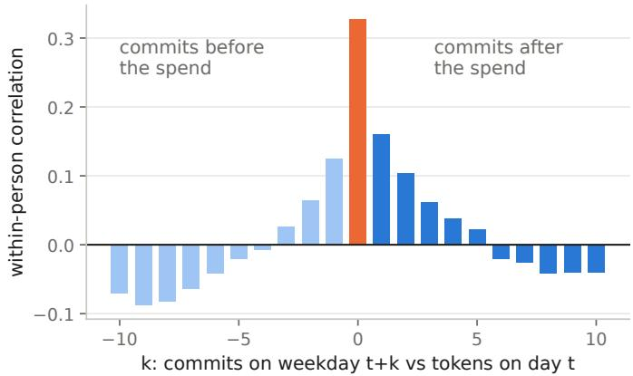  
Fig. 11. Within-person correlation between an engineer’s tokens on a working day and their commits k working days later, both as log(1 + x) with person and day means removed. Small negative values at long lags are expected once each engineer’s mean over five weeks is removed.

## SM A

## ADDITIONAL RESULTS

This section of the supplementary material reports further results, sensitivity analyses, and subgroup estimates for Section IV, in the order of the RQs.

a) Coupling (RQ1): With commit-count categories and no shape assumed, spend rises along the constant-elasticity line, and the day-level cross-correlation is slightly stronger one to three days forward than backward (0.16, 0.10, 0.06 vs. 0.13, 0.06, 0.03; Figure 11). Split by average weekly commits (under 5, 5–12, 12–25, over 25), the within-person slopes are 0.07, 0.26, 0.28, and 0.27. Split by average weekly tokens, the within-person correlation is 0.01 for engineers under about 0.3 times the median week, 0.08 for 0.3 to 1 times, 0.25 for 1 to 3 times, and 0.37 for those over 3 times. By dominant tool, the slope is 0.20 on Agent A-dominant weeks and 0.49 on Agent B-dominant weeks (65 people), and by job family it ranges from 0.22 for developers to 0.30 for team leads, 0.41 for interns, and 0.62 for QA engineers (differences significant at $p = 0 . 0 4$ after correction); every group is far below one.

b) Teams (RQ1): Summing the panel to team-weeks does not make spend more closely related to output. We estimate the within-team slope of tokens on commits, with team and week effects, for the 28 team paths with at least five metered members (176 engineers, median 6 per team): it is 0.31 (95% team-cluster bootstrap CI [0.16, 0.50]), and 0.28 with the number of active members as a control. For the 22 product ecosystems with at least five members (376 engineers), it is 0.27 [0.11, 0.41], and 0.21 with the control. On the same engineers, the within-person slope is 0.25. Summing any group of engineers removes some week-to-week noise, so we compare each estimate with random groups of the same sizes drawn from the same engineers: they give 0.27 for teams and 0.21 for ecosystems, and 32% and 26% of random groupings reach the actual slope, so the team structure adds nothing we can detect. Least squares on logs gives higher within-team slopes (0.37 and 0.46), which only 8% and 7% of random groupings reach, so aggregation may strengthen the association on the log scale; under the Poisson model used throughout, it does not. Between teams, per active member, the slope is 0.10 [−0.28, 0.56] for teams and 0.29 [−0.21, 0.80] for ecosystems.

c) Stability (RQ1): If spend is a property of the engineer, an engineer’s rank should persist across weeks. For spend, commits, the engineer’s level of spend given output (ci at the common elasticity), and tokens per commit, we split each engineer’s weeks into odd and even and compute the Spearman rank correlation between the two halves, projected to five weeks with the Spearman–Brown formula [62], [63]. The split-half correlation is 0.77 for spend and 0.77 for commits, which the formula projects to 0.87 for the full five-week total; it is 0.84 for the level and 0.80 for tokens per commit (split-half 0.72 and 0.67; Figure 12B). Adjacent weeks rankcorrelate at only about 0.6 and weeks four apart at about 0.4 (Figure 12A). Output is stable too: an engineer’s commit rates in the pre-period and in the analysis weeks correlate at 0.70, and spend in the analysis weeks is almost as closely related to engineers’ pre-period output $( \rho = 0 . 3 2 )$ as to their concurrent output $( \rho = 0 . 4 4 )$ . A per-person elasticity would need far more productive weeks than the median of four here; computed anyway, it correlates across halves at $\rho = - 0 . 0 7$ Cost per commit is stable overall but not at the top. Because spend rises much more slowly than output within a person $( \bar { T } / Y \propto Y ^ { d - 1 } )$ , weeks with more commits have lower tokens per commit (Spearman $\rho = - 0 . 5 1$ within a person, −0.32 between engineers), and of the 34 engineers in the top decile by tokens per commit in odd weeks, only 17 remain there in even weeks (Figure 12B).

d) Thefloor and the curve (RQ2): With the person’s own median as the cut, the floor is 2.4%. Counted by three-day blocks it is 10%, and by four-week blocks 0.4%. At shorter time units, the ordinary one-day delay between spend and its commit appears as spend not tied to output; at longer ones, a week without commits is hidden behind a single commit. For a week with no commit, the square-root and log(1 + x) forms predict 88% and 71% of the engineer’s average week, the raw-counts form 100%, and the spline 68%, compared with the observed 77%; the spline is within a few percent of the observed values in every other bin. We measure calibration as observed over fitted tokens, summed over weeks with no output (so weighted by tokens, unlike the per-engineer 77%). It is 0.62 under counts, 0.71 under the square root, 0.91 under log(1 + x), and 0.96 under the spline, so the counts form predicts far more spend for those weeks than they held. Under counts, the Poisson, negative-binomial, and gamma shares are 84%, 60%, and 64% on our output set, 24 points apart, a sign that the mean is misspecified; under log(1 + x) they are 42%, 39%, and 37%. In five-fold cross-validation the log(1 + x) and spline forms have the lowest held-out deviance for every output set, and counts the highest. With a natural cubic spline in raw commits, with one interior knot at the median positive-commit week as in the linear spline, the estimate is 45% (calibration 0.86). Adding lines changed to the count leaves the spline share at 38.9%, and adding the type of issue a commit names (bug, task, feature) moves it by under a point. By day the spline estimate is 77%, by three days 53%, and by two weeks 40% (log(1 + x) on our output set: 73% by day and 48% by two weeks); as with the floor, the day-level figure is inflated because two thirds of days have no commit. With size and work type in the model, adjusting for the share of tokens from each agent and from the new model moves the $\log ( 1 + x )$ estimate from 44% to 45%, since tool mix is not output. Tool mix is still associated with consumption: a week with all its tokens on the new frontier model has 45% more tokens than one with none, at the same commit count $( p = 0 . 0 3 )$ . The first four weeks alone give 46%.

e) Groups and trend (RQ2): By dominant tool, the share is 43% for Agent A-only engineers, 37% for Agent B-only, and 34% for those using both. The top tenth of people by this component account for 38% of it compared with 45% of all tokens, so heavy users’ tokens are more tied to their output than light users’. Refitted on the first two analysis weeks alone, the share is 39%, and on the last three 30%, while weekby-week fits of the log(1 + x) form stay between 42% and 44% with no trend. Five weeks is too short to say whether the difference is a trend, and the trajectory with experience cannot be identified from a panel in which 162 people already have token use on its first day.

f) What the spend precedes (RQ2): At the day level, a working day with above-median token spend and no commit is followed by 1.18 times the person’s average daily commits, compared with 1.20 after a day with commits, 1.00 after a no-commit day with light spend, and 0.62 after a day with no activity; the difference from the light no-commit day is +15% within person $( p = 0 . 2 4 )$ . At the week level, heavy no-commit weeks are followed by 150% more commits than light ones $( p = 0 . 0 0 8 \mathrm { . }$ , 148 weeks); among weeks with four or more active days the estimate is similar but imprecise (+146%, $p = 0 . 0 8 .$ , 65 weeks), so the records cannot separate a catch-up in commits from the light group returning from absence. Highresidual weeks have 1.8 times the calls per active day, 1.6 times the calls per session, 1.4 times the tokens per call, and a lower share of generated text (−0.52; 0.6% vs. 0.9%); within person, the residual correlates with agent calls at 0.74, with days of use at 0.59, and with context per call at 0.53. The shares of tokens from either agent and from frontier models as a group do not distinguish them; the share on the newly released model does (within-person correlation 0.15, $p < 0 . 0 0 1 )$ . The share of commits naming a bug is 12.0% after high-residual weeks compared with 13.0% after the person’s other weeks, and next week’s bug-linked commits change by −2% per unit of residual with next week’s total commits held fixed $( p = 0 . 7 5 )$ , whereas a friction account predicts an increase. Technical survey respondents likewise report a median of one hour a week reading colleagues’ AI-generated material and none reworking it.

g) Enabled work in the survey model (RQ2): On the closed enablement question, respondents in 58% of the technical coding-agent evaluations said the agent let them complete tasks in the past month they would otherwise have skipped. These respondents say they would otherwise have needed two colleagues rather than one, and report a median of 12 hours saved in the past week compared with 4 for the rest and a productivity rating of 4.5 compared with 4.1. With activity breadth and colleagues named held fixed (Figure 8B), the hours gap is no longer separable from them (0.19, −0.01 to 0.39): respondents reporting enabled work also tick more activities and name more colleagues (Cliff’s δ 0.41 and 0.36), and with 134 answers the three cannot be told apart.

## SM B

## SURVEY DETAILS

a) The survey model: The model is a least-squares regression of asinh(hours saved) on seven predictors, fitted to the 134 technical coding-agent evaluations (127 respondents) with a numeric hours answer and every predictor observed. The predictors are whether the agent enabled work in the past month that would otherwise have been skipped; the number of non-coding activity types ticked; whether coding was among the activities; whether the week’s value was only experiments so far; log(1 + the number of colleagues otherwise needed); whether the tool is Agent A (vs. Agent B); and whether the respondent is in the division with the most respondents in the survey, which also has the most engineers in our telemetry. All predictors are standardized. Intervals are 95% percentiles of 3,000 bootstrap draws that resample respondents, keeping both evaluations of a respondent together. $R ^ { 2 }$ is 0.43.

b) The hours measure: Self-reported time savings or losses correlate with the overall productivity rating at $\rho = 0 . 5 7$ and with the ratings of efficiency in completing routine and complex tasks at 0.56, and with cognitive load and information-finding at about 0.1; the first two provide some evidence of convergent validity for the self-reported time savings measure.

A Rank agreement between weeks  
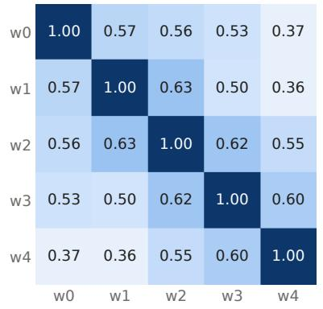

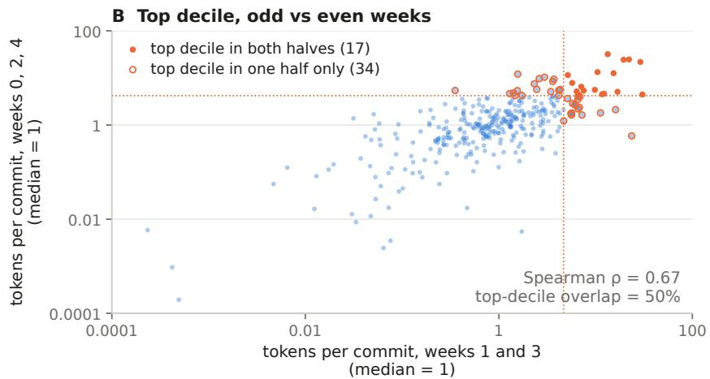  
Fig. 12. (A) Rank correlation of weekly tokens between every pair of analysis weeks, over engineers active in both. (B) Tokens per commit over weeks 0, 2, and 4 vs. weeks 1 and 3; filled dots are in the top decile of both halves (17 engineers), open dots in the top decile of only one (34 engineers).

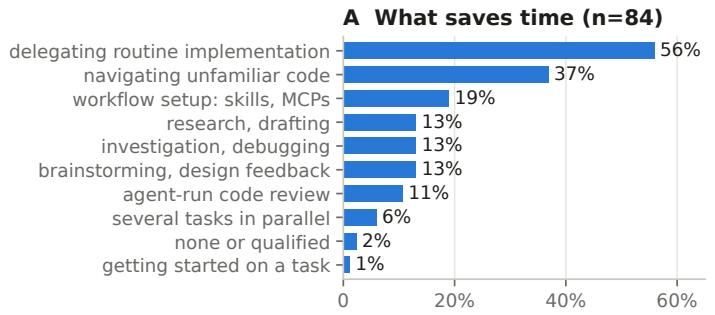

B Main value (n=74)  
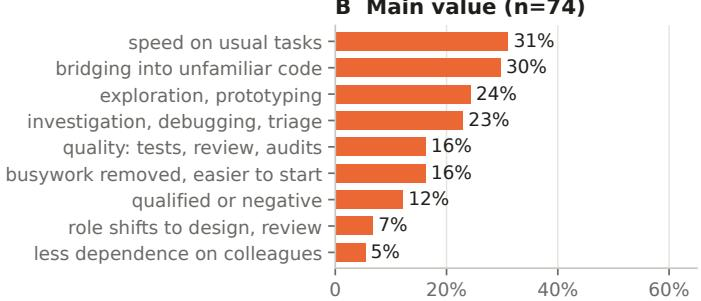  
share of answers coded to the theme  
Fig. 13. Thematic coding of answers by respondents in technical roles to open-ended questions about what saved them time while working with agents and the agent’s main perceived value (AI-assisted coding, checked by one author), as in Figure 9.