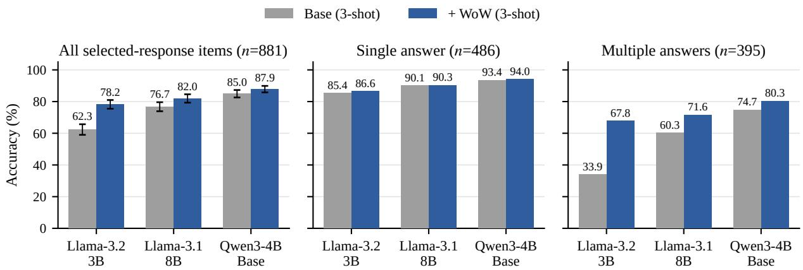
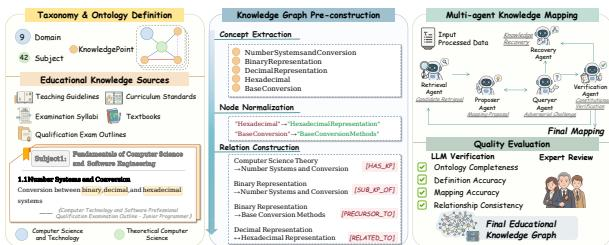

# The WoW: A Large-Scale World Knowledge Corpus for Full-Lifecycle LLM Training

Tianze Sun Harbin Institute of Technology

Yongyao Duan OpenCSG

Sam Chen OpenCSG

## Abstract

Existing Chinese educational corpora often suffer from fragmented coverage and a lack of systematic organization. In this paper, we propose WoW (World Knowledge), a large-scale dataset designed for the full-cycle training of foundation models. The construction of this dataset is driven by an Educational Knowledge Graph, which serves as a taxonomic backbone for the systematic collection and completion of missing educational modules across all levels. Compared to previous versions, this iteration provides enhanced systematicity, superior quality, and a larger scale, while incorporating multimodal signals and supporting every stage of model development. Experiments demonstrate that WoW significantly improves model performance across diverse benchmarks. To facilitate community research, we further provide an interactive platform for graph-based data selection and retrieval. The link is .

## 1 Introduction

The knowledge and reasoning ability of large language models (LLMs) is shaped by the data they are trained on at every stage, from pre-training corpora to instruction data and evaluation suites. Small models trained on “textbook-quality” data can rival far larger ones (Gunasekar et al., 2023; Li et al., 2023b), and a few thousand carefully chosen instructions suffice to align a strong base model (Zhou et al., 2023). Recent corpus efforts have therefore shifted from sheer scale to curation: web corpora are filtered with educational-quality classifiers (Penedo et al., 2024; Yu et al., 2025), mixed by explicit data recipes (Li et al., 2024; Soldaini et al., 2024), mined for mathematical content (Paster et al., 2024; Shao et al., 2024; Azerbayev et al., 2024), or assembled for a single domain such as law (Henderson et al., 2022; Niklaus et al., 2024), chemistry (Mirza et al., 2026), biomedicine (Lozano et al., 2025; Touchent et al., 2026), or source code (Kocetkov et al., 2022). Instruction data has followed a similar path, from aggregated task collections (Wang et al., 2022; Longpre et al., 2023) and model-generated instructions (Wang et al., 2023b; Xu et al., 2024; Mukherjee et al., 2023) to instructions synthesized from raw documents (Cheng et al., 2024b,a; Yue et al., 2024b) and domain-specific collections for scientific reasoning (Zhang et al., 2024a), molecular tasks (Fang et al., 2024; Yu et al., 2024), and textbook-grounded tutoring (Wang et al., 2024; Dan et al., 2023). A growing family of benchmarks measures disciplinary knowledge in English and Chinese (Hendrycks et al., 2020b; Huang et al., 2023; Li et al., 2023a; Wang et al., 2023a; Sun et al., 2024).

Educational data, and Chinese educational data in particular, nevertheless remains difficult to use systematically. We identify three gaps. First, coverage is organized by source rather than by knowledge. Corpora are collected per website, per publisher, or per discipline, and are indexed by quality scores or source labels (Table 9); without a model of what a curriculum should contain, missing modules, cross-disciplinary links, and prerequisite structure are invisible, so gaps can be neither measured nor filled (Zhao et al., 2022; Liang et al., 2026). Second, document-derived supervision trades off grounding against difficulty. Question– answer pairs extracted from documents tend to restate isolated facts or turn passages into readingcomprehension exercises (Cheng et al., 2024b), whereas freely generated problems drift away from their sources and become under-specified; neither yields instances that are at once faithful to the source, self-contained, and demanding enough to elicit reasoning. Imitating the surface form of strong models’ answers without the underlying knowledge, moreover, improves style more than capability (Gudibande et al., 2023). Third, resources are fragmented across the training lifecycle: pretraining corpora, instruction data, and benchmarks are built independently, with different taxonomies and little provenance linking them, which makes it hard to trace a model’s behavior back to the knowledge it was trained on.

We address these gaps with WoW (World knoWledge), a large-scale corpus for full-lifecycle LLM training built around an Educational Knowledge Graph. The graph serves as a taxonomic backbone: it organizes domains, subjects, and fine-grained KnowledgePoints under a unified ontology aligned with national discipline standards (Standardization Administration of China, 2009), maps resources from different stages and sources into a shared semantic space, and exposes undercovered modules that guide further collection (Appendix B.1). On top of this backbone, a four-phase construction pipeline (§2) turns heterogeneous documents into supervision. Phase I recovers coherent passages and abstracts them into knowledge units— key equations, central propositions, and result tables, with tightly coupled objects kept together as macro units—and retrieves a sufficient evidence set for each. Phase II composes each grounded unit into a multi-step research case whose subproblems depend on one another. Phase III filters candidates with hard synthesis, transformation, and dependency tests and scores them for reasoning depth, knowledge synthesis, and centrality. Phase IV diversifies the response format while preserving the reasoning signal. Every instance keeps documentlevel provenance.

Applied to fourteen source collections spanning computer science, the natural sciences, engineering, economics and management, law, and the humanities and social sciences, the pipeline processes 309K documents, abstracts 2.1M knowledge units, and releases 188K instruction instances totaling 146M tokens (§3).

We fine-tune three base models of different strength—Llama-3.2-3B, Llama-3.1-8B (Grattafiori et al., 2024), and Qwen3-4B-Base (Yang et al., 2025)—on this data with a single, conservative recipe, and evaluate them on a heldout split of documents unseen in training and on eight external benchmarks. Before training, we correct two format artifacts of synthetic selectedresponse supervision. Rationales that open with the answer teach models to commit before reasoning, forfeiting the benefit of chain-of-thought (Wei et al., 2022), and skewed answer counts and positions in multiple-choice items induce systematic biases. We therefore rewrite the same records to reason before concluding, rebalance their answer distributions, and shuffle their options. Fine-tuning improves held-out accuracy for every model, by 15.9, 5.2, and 2.8 points respectively, almost entirely through multiple-answer problems that require judging each option against a formal specification. The gain shrinks as the base model grows stronger, and the fine-tuned 3B model surpasses the 8B base model. On external benchmarks, the benefit concentrates where the data is concentrated. The 3B model improves on SciEval by 5.5 points, driven by its chemistry (+7.3) and biology (+6.4) portions, and on ScienceQA and MoleculeQA, while the larger models gain slightly on science benchmarks. Knowledge outside the scope of WoW is largely preserved: the stronger models stay within 0.7 points of their base checkpoints on broad-coverage exams (MMLU, CMMLU, C-Eval) and on an out-ofdomain medical control (MedMCQA). Consistent with prior observations of forgetting under continual fine-tuning (Luo et al., 2023), only the smallest model pays a cost, of 1.1–2.6 points.

Our contributions are as follows:

• We present WoW, an educational corpus whose collection and completion are driven by an Educational Knowledge Graph, together with an interactive platform for graph-based data selection and retrieval.

• We propose a four-phase, provenancepreserving pipeline that converts heterogeneous documents into grounded, selfcontained, and reasoning-intensive supervision, and we release 188K instances built from 309K documents.

• We provide a detailed analysis of the corpus, including pipeline yield, the composition of knowledge units and cognitive skills, and quality-score distributions.

• We fine-tune three base models on WoW and show consistent gains on held-out disciplinary problems, gains on aligned science benchmarks, and preserved broad knowledge for 4B–8B models, using an evaluation protocol that does not depend on the chat format.

## 2 Data Construction Pipeline

## 2.1 Overview

Our goal is to transform heterogeneous educational documents into challenging and verifiable supervision. A useful training instance must satisfy three properties. It must be grounded in the source, self-contained for a reader who has not seen the source, and sufficiently demanding to elicit reasoning rather than retrieval. These requirements are coupled. Increasing difficulty without improving context creates underspecified questions, while adding context without controlling question design produces trivial extraction tasks.

We address this tension with a four-phase pipeline. Given a source document $d ,$ context generation produces a structured knowledge unit k and an evidence set E that supports it. Problem generation maps $( k , E )$ to a question and reference answer $( q , a )$ . Quality control retains only candidates that satisfy grounding and reasoning constraints. The final phase chooses an appropriate response format and converts the retained instances into training records. The overall transformation is

$$
{ \begin{array} { r l } & { d { \xrightarrow { \mathrm { \ c o n t e x t } } } \left( k , E \right) { \xrightarrow { \mathrm { \ g e n e r a t i o n } } } \left( q , a \right) , } \\ & { \left( q , a \right) { \xrightarrow { \mathrm { \ q u a l i t y } } } \left( q ^ { * } , a ^ { * } \right) { \xrightarrow { \mathrm { \ f o r m a t t i n g } } } x . } \end{array} }\tag{1}
$$

All operations preserve document-level provenance, which allows every retained statement to be traced to its source. Domain adaptation is introduced through domain-specific concept definitions, cognitive skills, and demonstrations, while the fourphase procedure remains unchanged.

## 2.2 Phase I: Context Generation

The first phase converts an unstructured document into the minimal context needed to formulate and solve a rigorous problem. It has two objectives. The first is to recover coherent semantic units from noisy and heterogeneous sources. The second is to identify assessable knowledge and retrieve sufficient evidence for it.

Coherence-Aware Segmentation. We first normalize PDF, HTML, Markdown, and article archives into a common document representation. [What is the common document representation? Define its schema.] Layout-aware parsing [What is layout-aware parsing? How is layout used?] preserves headings, equations, tables, and their reading order, while deterministic cleaning removes encoding artifacts, boilerplate, and duplicate passages. Low-information articles are filtered using source metadata and content length before model inference. [What metadata? Length threshold?]

Document headings provide useful but imperfect segmentation. A heading boundary may separate an assumption from the proposition it qualifies, whereas a long section may contain several independent arguments. We therefore use headings only to obtain an initial sequence of chunks

$$
{ \mathcal { C } } = ( c _ { 1 } , c _ { 2 } , \ldots , c _ { N } ) .
$$

Each chunk is summarized into a compact semantic descriptor $s _ { i }$ . For every adjacent pair, a language model predicts a coherence relation

$$
r _ { i } = J ( s _ { i } , s _ { i + 1 } ) , \qquad r _ { i } \in \{ 0 , 1 \} ,
$$

where $r _ { i } = 1$ indicates that the two chunks should be interpreted as one unit. Maximal contiguous runs connected by positive relations are merged. [Example? e.g. merge a definition with the claim it scopes $( r { = } 1 )$ ; keep a liability section separate $( r { = } 0 ) . ]$ This operation restores local dependencies while preventing unrelated sections from being combined. Structurally obligatory but pedagogically uninformative sections, such as references and administrative statements, are removed before consolidation.

The resulting representation is a sequence of self-contained passages rather than a sequence determined solely by document layout. This distinction is important because all subsequent extraction and generation operate independently on these passages.

Knowledge Abstraction. From the consolidated passages, we extract knowledge units that can support explicit assessment. Each unit is centered on one of three source objects: a key equation, a central proposition, or a result table. These objects cover formal mechanisms, testable claims, and empirical evidence while excluding intermediate algebra, peripheral claims, descriptive tables, and routine robustness checks.

An isolated object is not always an adequate unit of reasoning. For example, a proposition may depend on an assumption set and a defining equation, and a regression table may depend on an identification specification. We therefore preserve tightly coupled objects as one macro unit. Formally, a knowledge unit is

$$
k _ { i } = ( O _ { i } , h _ { i } , z _ { i } , T _ { i } ) ,
$$

where $O _ { i }$ is an atomic object or an ordered set of dependent objects, $h _ { i }$ is its source section, $z _ { i }$ is a concise semantic description, and $T _ { i }$ is a set of cognitive skills supported by the source. Typical skills include derivation, interpretation, causal analysis, and assumption critique. Duplicate objects are retained only at their first defining occurrence.

This representation separates content from assessment intent. The source objects determine what may be asked, while the skill set determines the reasoning expected from the learner. Domain-specific ontologies instantiate both components without changing the extraction procedure.

Query Intent and Evidence Grounding. For each $k _ { i }$ , we first construct a query intent that integrates all skills in $T _ { i }$ . The skills are not expanded into independent questions. Instead, they are arranged as a dependency chain. A derivation can establish a result, an interpretation can explain its meaning, and an assumption critique can determine when the result remains valid. This produces a single coherent assessment objective rather than a collection of parallel prompts.

We then retrieve evidence directly from the source document. The evidence set contains the passages that establish the focal result and the supporting material required to understand it. Supporting material includes definitions of named concepts, meanings of symbols, assumptions, institutional settings, and any table or mapping used by the intended solution. References to other sections or appendices are followed recursively.

Evidence retrieval is constrained by sufficiency rather than lexical relevance alone. Let $\Gamma ( q )$ denote the set of concepts, symbols, assumptions, and operations required by a query intent. A valid evidence set must satisfy

$$
\forall g \in \Gamma ( q ) , \quad { \mathrm { s u p p o r t } } ( g , E ) = 1 .\tag{2}
$$

The retriever is restricted to source selection and may not introduce paraphrased facts. If Equation 2 is not satisfied, retrieval continues across the document. If the source does not define a required element, the query intent is rejected. Phase I therefore outputs not only relevant context, but a certificate that the planned problem can be made selfcontained.

## 2.3 Phase II: Problem Generation

Problem generation turns each grounded pair (k, E) into a compact research case. The generated problem contains a contextual setup, a formal specification, and a sequence of questions. The setup introduces the scientific or technical setting. The specification presents every equation, assumption, table, and symbol needed for a solution. The questions then transform this material into an escalating reasoning process.

We impose a dependency structure on the questions. If $q _ { j }$ denotes the jth subproblem, then for every $j > 1$ , solving $q _ { j }$ must require either the result of an earlier subproblem or a combination of evidence not previously used. This rule excludes lists of independent questions that merely share a topic. At least one subproblem must require an explicit derivation or an equivalently rigorous analytical argument. The final subproblem applies the established reasoning to a counterfactual condition, a parameter change, an identification challenge, or a synthesis of theory and evidence.

The reference answer is generated from the same evidence and follows the dependency order of the questions. Claims copied from the source remain directly grounded in $E .$ Claims required by a new scenario must be derivable from the supplied specification. Thus, novelty is introduced through inference over source-supported premises, not through the introduction of unsupported knowledge.

Before a candidate leaves this phase, a completeness audit checks that every symbol and requested concept is defined before use, every numerical operation has the necessary values, and every lookup operation has its mapping. Candidates with unresolved dependencies are revised or discarded.

## 2.4 Phase III: Quality Control

Generation is intentionally permissive, while selection is conservative. We first group candidates by the major argumentative threads of their source document. Compatible candidates are consolidated when they share assumptions and form a stronger reasoning chain. Candidates are kept separate when consolidation would mix incompatible models or create several unrelated difficulty peaks.

Each candidate must pass three hard tests. The synthesis test requires the solution to combine at least two distinct pieces of information. The transformation test requires reasoning beyond quotation or paraphrase. The dependency test requires later subproblems to build on earlier results. Failure on any test removes the candidate.

Candidates that pass the hard tests are scored for reasoning depth $A ,$ knowledge synthesis $B ,$ and conceptual centrality $C ,$ each on a ten-point scale.

We compute

$$
Q = 0 . 4 A + 0 . 4 B + 0 . 2 C .\tag{3}
$$

We retain candidates only when $A \ge 6 , B \ge 6$ and $Q \geq 7$ . Near-duplicate candidates are resolved in favor of the higher-scoring and more central problem. This stage produces two broad families: problems that require quantitative reasoning over tables and problems that emphasize derivation, interpretation, or conceptual analysis.

## 2.5 Phase IV: Diversification and Formatting

The final phase adapts response format without weakening the reasoning signal. Open-ended form is the default because it preserves intermediate reasoning. A problem is converted to selected response only when its conclusion is unambiguous and its common failure modes admit diagnostic distractors. We score these two properties as answer uniqueness $U$ and distractor quality $D _ { : }$ , and permit conversion only when

$$
{ \frac { 1 } { 2 } } ( U + D ) \geq 9 .
$$

Selected-response distractors are derived from plausible conceptual reversals, omitted reasoning steps, sign or unit errors, and misuse of related formulas. They are not generated as arbitrary false statements. The full context and formal specification are retained so that conversion changes only the response interface, not the knowledge available to the learner.

Finally, each retained instance is serialized in both conversational and instruction-oriented schemas. Selected-response answers may include a concise explanation of the correct option and the error represented by each distractor. Samples are shuffled with a fixed seed and divided into training and validation subsets at the document level. The released records retain source provenance, question type, and quality score, supporting both reproducible filtering and downstream analysis.

## 3 Data Statistics and Analysis

Scale and Composition. Table 1 summarizes the composition of WoW. The corpus is built from about 2.7 TB of raw educational material covering web articles, textbooks, monographs, disciplinary repositories, and legal texts. Applying the pipeline to these sources yields 188.7K supervised instances grounded in 100.5K source documents. Selection is deliberately conservative. Most documents contribute only the single problem that passes every grounding and reasoning test, which favors depth of supervision over volume. Each instance keeps its document-level provenance and its assigned KnowledgePoint, so it can be traced both to the text that supports it and to its position in the graph.

Knowledge-Graph Organization. WoW is organized by the EKG, not by source. The graph spans 9 Domains, 55 Subjects, and 76,364 KnowledgePoints. They are connected by 318K typed edges, of which lateral (RELATED\_TO), prerequisite (PRECURSOR\_TO), and contrastive (CONTRAST\_TO) relations make up more than 70%. Instances cover 53 Subjects and 21,731 KnowledgePoints (Table 2). This organization matters because no single source corresponds to a single discipline. Even an individual publisher’s catalog spreads across dozens of Subjects. A textbook series may therefore contribute to civil engineering, applied economics, and business administration at the same time. Grouping instances by Knowledge-Point brings together material on the same concept from different sources and media. A source-based layout would scatter that material.

Instance Characteristics. Open-ended analytical problems make up 69.6% of instances. The rest are single-choice (15.6%), multiple-choice (12.7%), and table-grounded quantitative problems (2.1%). Selected-response formats appear mostly in shorter, self-contained technical material. Problems derived from textbooks and monographs are almost always open-ended, because their conclusions seldom satisfy the uniqueness and distractorquality criteria needed for conversion. Because every instance must be self-contained, instances are long. The average prompt, which includes the setup, the formal specification, and the dependent subquestions, has 2.0K characters, and the average reference answer has 1.5K. Book-derived problems are about twice as long as those from web articles (3.5K versus 1.6K characters per prompt), reflecting the larger evidence sets needed to ground reasoning in textbook chapters. Source passages stay in their original language and all metadata is normalized to English, which makes WoW a bilingual Chinese–English resource.

Coverage Analysis. The graph turns corpus balance into a quantity we can measure. Computer science is the most densely covered Domain: 88.6% of its KnowledgePoints have attached instances. Coverage of other Domains is much sparser, and Medical & Health Sciences is the sparsest at 7.8%. This per-node view supports targeted rather than opportunistic data collection. Under-covered Domains and Subjects can be identified directly, and new sources can be sought along the corresponding graph partitions. Several collections in WoW were obtained this way, including the economics, social-science, and legal repositories, and they increased coverage of their Domains. Because coverage is defined over KnowledgePoints rather than over sources, the contribution of any new collection can be stated precisely as the set of graph nodes it fills.

Table 1: Detailed composition of WoW. Discipline and Subject report the dominant Domain and the two most frequent Subjects assigned by our Educational Knowledge Graph (EKG) to each collection. Size gives the raw source volume and the number of retained supervised instances. Collections marked ⋆ were acquired along EKG Domain and Subject partitions to complete under-covered modules.
<table><tr><td>Discipline</td><td>Subject</td><td>Type</td><td>Format</td><td>Size</td><td>Source (KG-driven)</td></tr><tr><td>Computer Sci.</td><td>Software; Applications</td><td>Web article</td><td>JSONL</td><td>45GB / 119.8K</td><td>CSDN technical community</td></tr><tr><td>Computer Sci.</td><td>Software; Applications</td><td>Curated notes</td><td>Markdown</td><td>1.6GB / 6.5K</td><td>Disciplinary Knowledge Repository (CS)*</td></tr><tr><td>Computer Sci.</td><td>Software; Architecture</td><td>Book/Textbook</td><td>PDF→MD+Img</td><td>1.5TB / 8.1K</td><td>High-Quality Structured Documents (CS)</td></tr><tr><td>Computer Sci.</td><td>Software; Applications</td><td>Book</td><td>PDF</td><td>19GB / 4.1K</td><td>Publishing House of Electronics Industry</td></tr><tr><td>Computer Sci.</td><td>Software; Applications</td><td>Book</td><td>PDF</td><td>3.5GB / 0.2K</td><td>Posts &amp; Telecom Press</td></tr><tr><td>Engineering</td><td>Mechanical; Electrical &amp; Electronics</td><td>Book</td><td>PDF</td><td>196GB / 1.7K</td><td>China Machine Press</td></tr><tr><td>Engineering / Econ.</td><td>Civil &amp; Architectural; Applied Econ.</td><td>Textbook</td><td>PDF</td><td>124GB / 3.8K</td><td>Peking University Press e-Textbooks</td></tr><tr><td>Natural Sci.</td><td>Mathematics; Biology</td><td>Book/Textbook</td><td>PDF→MD+Img</td><td>592GB / 7.4K</td><td>High-Quality Structured Documents (NatSci)</td></tr><tr><td>Natural Sci.</td><td>Astronomy &amp; Earth Sci.; Physics</td><td>Monograph</td><td>PDF</td><td>6.1GB / 0.2K</td><td>Science Press</td></tr><tr><td>Multi-disc.</td><td>Mathematics; Computer Software</td><td>Book</td><td>PDF</td><td>41GB / 0.3K</td><td>Tsinghua University Press</td></tr><tr><td>Econ. &amp; Mgmt.</td><td>Applied Econ.; Business Admin.</td><td>Book</td><td>Markdown</td><td>3.8GB / 2.1K</td><td>Disciplinary Knowledge Repository (Econ.)*</td></tr><tr><td>Humanities &amp; Soc.</td><td>Philosophy &amp; History; Sociology &amp; Pol. Sci.</td><td>Book/Textbook</td><td>PDF→MD+Img</td><td>161GB / 4.7K</td><td>High-Quality Structured Documents (Soc.)</td></tr><tr><td>Humanities / Soc. Edu. Law</td><td>Philosophy &amp; History; Cultural Aesthetics</td><td>K-12 Textbook/Book</td><td>Markdown</td><td>4.3GB / 10.8K 0.7GB / 19.0K</td><td>Disciplinary Knowledge Repository (Social)*</td></tr><tr><td></td><td>Legal Systems &amp; Practice; Specific Legal Branches</td><td>Statute/Regulation</td><td>Markdown</td><td></td><td>Disciplinary Knowledge Repository (Law)*</td></tr><tr><td>Total</td><td>53 Subjects</td><td></td><td></td><td>2.7TB / 188.7K</td><td>14 collections, 100.5K source documents</td></tr></table>

Table 2: Domain-level coverage of the EKG by WoW. A KnowledgePoint (KP) is covered if at least one instance is attached to it.
<table><tr><td>Domain</td><td>KPs</td><td>Covered KPs</td><td>Instances</td></tr><tr><td>Computer Science &amp; Technology</td><td>3,941</td><td>3,492 (88.6%)</td><td>135,139 (71.6%)</td></tr><tr><td>Law &amp; Institutional Studies</td><td>10,137</td><td>2,882 (28.4%)</td><td>14,088 (7.5%)</td></tr><tr><td>Natural Sciences &amp; Technology</td><td>14,305</td><td>4,126 (28.8%)</td><td>10,036 (5.3%)</td></tr><tr><td>Humanities &amp; Social Sciences</td><td>11,523</td><td>3,636 (31.6%)</td><td>9,858 (5.2%)</td></tr><tr><td>Engineering &amp; Technology</td><td>7,162</td><td>2,320 (32.4%)</td><td>8,230 (4.4%)</td></tr><tr><td>Social Edu. &amp; Literacy</td><td>14,409</td><td>3,031 (21.0%)</td><td>6,298 (3.3%)</td></tr><tr><td>Economics &amp; Management</td><td>3,776</td><td>1,373 (36.4%)</td><td>3,627 (1.9%)</td></tr><tr><td>Medical &amp; Health Sciences</td><td>11,068</td><td>861 (7.8%)</td><td>1,404 (0.7%)</td></tr><tr><td>Unclassified &amp; General KB</td><td>43</td><td>10 (23.3%)</td><td>13 (0.0%)</td></tr><tr><td>Total</td><td>76,364</td><td>21,731 (28.5%)</td><td>188,693</td></tr></table>

## 4 Experiments

We test whether supervision built by the pipeline improves models in the domains it covers, and what it costs elsewhere. We fine-tune three base models of different strength on the instruction subset of WoW and evaluate them on the held-out split of WoW and on eight external benchmarks drawn from Table 9.

## 4.1 Setup

Models and training. We fine-tune Llama-3.2- 3B, Llama-3.1-8B (Grattafiori et al., 2024), and Qwen3-4B-Base (Yang et al., 2025) with fullparameter supervised fine-tuning on 183K training instances (148.6M tokens with the Llama tokenizer). All three use the same recipe: one epoch, learning rate $5 \times 1 0 ^ { - 6 }$ with cosine decay, an effective batch of 128 sequences of up to 4,096 tokens, and a loss computed only on response tokens. Training data, prompts, and evaluation items share the chat template of each model, with thinking disabled for Qwen3 and no system prompt, so that models are trained under the same conditions in which they are tested. Appendix A gives the full configuration.

Training data. Models are trained on the released instances after the cleaning described in §3 and two format corrections of the selected-response items, both of which rewrite existing records without regenerating them. First, each answer states its reasoning before its conclusion: in the raw records, the chosen option opens the answer and the justification follows, which teaches models to commit before reasoning. Second, answer distributions are rebalanced. One quarter of the multiple-answer items now have a single correct option, obtained by re-framing single-answer items as “select all that apply,” since their distractors are false by construction. Options are also shuffled so that the correct letter is uniformly distributed (it was B in 64% of the raw single-answer items). Training and validation splits are drawn at the document level, so no document contributes to both training and evaluation.

Evaluation. Held-out split. The 3,175 test instances come from 1,688 documents unseen in training. We report accuracy on its 881 selectedresponse items (486 single-answer, 395 multipleanswer) under exact match of the predicted option set, and F1 for the multiple-answer items. Base and fine-tuned models are evaluated identically: each question is given as plain text after three exemplars of the same question type drawn from the training split, which base models can follow without a chat format. External benchmarks. We evaluate knowledge with the base-model protocol of lm-evaluation-harness (Gao et al., 2024): plain-text prompts, the benchmark’s own few-shot format, and prediction by the highest next-token probability among the option letters. This protocol does not depend on the chat template, so base and fine-tuned models are compared on equal terms. We use broad-coverage exams in English and Chinese (MMLU, CMMLU, C-Eval; 5-shot), science benchmarks aligned with our sources (ChemBench, ScienceQA, SciEval, MoleculeQA; 0-shot), and MedMCQA (0-shot) as an out-of-domain control, since our sources contain almost no medicine. For every comparison we report the paired difference between base and fine-tuned model with a 95% bootstrap confidence interval over items.

## 4.2 Results on the Held-out Split

Figure 1 shows that fine-tuning improves heldout accuracy for all three models, with paired gains of +15.9 points for Llama-3.2-3B, +5.2 for Llama-3.1-8B, and +2.8 for Qwen3-4B-Base; all three confidence intervals exclude zero. Two regularities stand out. First, the gain shrinks as the base model becomes stronger. The fine-tuned 3B model (78.2%) surpasses the 8B base model (76.7%), whereas Qwen3-4B-Base already solves 85.0% of the items before fine-tuning. Second, the gains come almost entirely from multiple-answer items (+33.9, +11.4, and +5.6 points). Singleanswer accuracy changes by at most 1.2 points, and no single-answer change is significant. Multipleanswer items require judging every option against the problem’s specification rather than recognizing the most plausible one, and this is the skill that the reasoning-first answers in WoW demonstrate. Multiple-answer F1 rises accordingly, from 82.5 to 91.1, 89.7 to 92.4, and 92.8 to 95.4.

## 4.3 Results on External Benchmarks

Table 3 reports knowledge-oriented accuracy on the external benchmarks. For Llama-3.2-3B, finetuning improves three of the four science benchmarks significantly: SciEval by +5.5 points, ScienceQA by +2.1, and MoleculeQA by +1.4. Within SciEval, the gain comes from the disciplines our sources cover, with chemistry improving by +7.3, biology by +6.4, and physics by +3.9. Its medical portion (MedQA), which our sources do not cover, decreases by 3.7 (§3). For the two stronger models, the science benchmarks are stable or improve slightly. Llama-3.1-8B gains +1.7 points on MoleculeQA and +0.5 on SciEval, and Qwen3-4B-Base gains +0.6 on ChemBench and +0.4 on both SciEval and MoleculeQA.

Knowledge outside the scope of WoW is largely preserved, and the cost that remains is concentrated in the smallest model. On the broad-coverage exams, about half of whose items lie in subjects our sources do not cover, such as psychology and clinical medicine (Appendix A.1), Llama-3.2-3B loses 1.1–2.6 points. The two larger models stay within 0.7 points of their base checkpoints, and Qwen3- 4B-Base even gains 0.4 points on MMLU. The outof-domain control shows the same pattern: MedM-CQA decreases by 2.3 points for Llama-3.2-3B but by only 0.6 points for Llama-3.1-8B and Qwen3- 4B-Base. This is consistent with prior observations that forgetting under continual fine-tuning is more pronounced in smaller models (Luo et al., 2023): with more capacity, the new disciplinary supervision displaces less of the existing knowledge.

## 5 Conclusion

We presented WoW, a large-scale educational corpus designed to support full-lifecycle LLM training. Its Educational Knowledge Graph organizes heterogeneous resources under a shared taxonomy, makes knowledge coverage measurable, and guides targeted collection and completion. A four-phase pipeline transforms source documents into grounded, self-contained, and reasoningintensive supervision while preserving documentlevel provenance. We release 188K instruction instances together with an interactive platform for graph-based data selection and retrieval.

Fine-tuning three base models on WoW consistently improves disciplinary problem solving and yields modest gains of 0.1–0.3 percentage points in mean accuracy across eight external benchmarks. External gains concentrate on aligned science benchmarks, while the 4B and 8B models largely preserve broad knowledge. These findings support the value of systematically organized educational data for disciplinary specialization. Future work will extend evaluation to open-ended reasoning and the corpus’s pre-training and multimodal components.

  
Figure 1: Selected-response accuracy on the held-out split of WoW. Error bars in the left panel are 95% bootstrap confidence intervals. Fine-tuning gains over the base model (paired, 95% CI): +15.9 [12.6, 19.3] for Llama-3.2-3B, +5.2 [2.4, 8.2] for Llama-3.1-8B, and +2.8 [0.8, 5.0] for Qwen3-4B-Base; all gains come from multiple-answer items.

Table 3: Knowledge evaluation on external benchmarks (accuracy, %; plain-text prompts, next-token prediction over option letters). MMLU, CMMLU, and C-Eval are 5-shot; the others are 0-shot. ChemBench is restricted to its 2,147 single-answer items, ScienceQA to its 2,224 text-only test items, and SciEval to the 10,704 multiple-choice items of its test set. ∆: difference to the base model; ∗: the paired 95% bootstrap confidence interval excludes zero.
<table><tr><td rowspan="2" colspan="2">Model</td><td colspan="3">Broad-coverage exams</td><td colspan="4">Science</td><td>Control</td><td rowspan="2"></td></tr><tr><td>MMLU</td><td>CMMLU</td><td>C-Eval</td><td>ChemBench</td><td>ScienceQA</td><td>SciEval</td><td>MoleculeQA</td><td>MedMCQA</td></tr><tr><td rowspan="3">Llama-3.2-3B</td><td>Base</td><td>56.5</td><td>44.3</td><td>44.3</td><td>49.2</td><td>76.8</td><td>53.4</td><td>27.4</td><td>50.4</td><td>50.3</td></tr><tr><td>+ WoW</td><td>55.2</td><td>43.2</td><td>41.7</td><td>50.3</td><td>78.9</td><td>58.8</td><td>28.8</td><td>48.1</td><td>50.6</td></tr><tr><td> $\Delta$ </td><td>-1.2*</td><td>-1.1*</td><td>-2.6*</td><td>+1.1</td><td>+2.1*</td><td>+5.5*</td><td>+1.4*</td><td>-2.3*</td><td>+0.3</td></tr><tr><td rowspan="3">Llama-3.1-8B</td><td>Base</td><td>65.3</td><td>52.9</td><td>52.5</td><td>53.9</td><td>82.7</td><td>64.6</td><td>29.3</td><td>58.0</td><td>57.4</td></tr><tr><td>+ WoW</td><td>65.0</td><td>52.2</td><td>52.7</td><td>54.2</td><td>82.9</td><td>65.1</td><td>31.0</td><td>57.4</td><td>57.6</td></tr><tr><td> $\Delta$ </td><td>-0.3</td><td>-0.7</td><td>+0.2</td><td>+0.3</td><td>+0.2</td><td>+0.5</td><td>+1.7</td><td>-0.6</td><td>+0.2</td></tr><tr><td rowspan="3">Qwen3-4B-Base</td><td>Base</td><td>73.0</td><td>77.6</td><td>78.6</td><td>57.2</td><td>86.8</td><td>77.6</td><td>34.0</td><td>58.9</td><td>68.0</td></tr><tr><td>+ WoW</td><td>73.4</td><td>77.2</td><td>78.4</td><td>57.8</td><td>87.0</td><td>78.0</td><td>34.4</td><td>58.3</td><td>68.1</td></tr><tr><td> $\Delta$ </td><td>+0.4</td><td>-0.4</td><td>-0.2</td><td>+0.6</td><td>+0.2</td><td>+0.4</td><td>+0.4</td><td>-0.6</td><td>+0.1</td></tr><tr><td colspan="2">#Items</td><td>14,042</td><td>11,582</td><td>1,346</td><td>2,147</td><td>2,224</td><td>10,704</td><td>5,786</td><td>4,183</td><td>一</td></tr></table>

## References

Zhangir Azerbayev, Hailey Schoelkopf, Keiran Paster, Marco Dos Santos, Stephen McAleer, Albert Q. Jiang, Jia Deng, Stella Biderman, and Sean Welleck. 2024. Llemma: An open language model for mathematics. In The Twelfth International Conference on Learning Representations.

Afzal Badshah, Anwar Ghani, Ali Daud, Ateeqa Jalal, Muhammad Bilal, and Jon Crowcroft. 2023. Towards

smart education through internet of things: A survey. ACM Computing Surveys, 56(2):1–33.

Zhiyu Chen, Wenhu Chen, Charese Smiley, Sameena Shah, Iana Borova, Dylan Langdon, Reema Moussa, Matt Beane, Ting-Hao Huang, Bryan R Routledge, et al. 2021. Finqa: A dataset of numerical reasoning over financial data. In Proceedings ofthe 2021 Conference on Empirical Methods in Natural Language Processing, pages 3697–3711.

Daixuan Cheng, Yuxian Gu, Shaohan Huang, Junyu Bi, Minlie Huang, and Furu Wei. 2024a. Instruction pretraining: Language models are supervised multitask learners. In Proceedings of the 2024 Conference on Empirical Methods in Natural Language Processing.

Daixuan Cheng, Shaohan Huang, and Furu Wei. 2024b. Adapting large language models via reading comprehension. In The Twelfth International Conference on Learning Representations.

Yuhao Dan, Zhikai Lei, Yiyang Gu, Yong Li, Jianghao Yin, Jiaju Lin, et al. 2023. Educhat: A large-scale

language model-based chatbot system for intelligent education. arXiv preprint arXiv:2308.02773.

Rocktim Jyoti Das, Simeon Emilov Hristov, Haonan Li, Dimitar Iliyanov Dimitrov, Ivan Koychev, and Preslav Nakov. 2024. Exams-v: A multi-discipline multilingual multimodal exam benchmark for evaluating vision language models. arXiv preprint arXiv:2403.10378.

Pradeep Dasigi, Kyle Lo, Iz Beltagy, Arman Cohan, Noah A Smith, and Matt Gardner. 2021. A dataset of information-seeking questions and answers anchored in research papers. In Proceedings of the 2021 Conference of the North American Chapter of the Associationfor Computational Linguistics: Human Language Technologies, pages 4599–4610.

Denis Emelin, Ronan Le Bras, Jena D Hwang, Maxwell Forbes, and Yejin Choi. 2021. Moral stories: Situated reasoning about norms, intents, actions, and their consequences. In Proceedings ofthe 2021 Conference on Empirical Methods in Natural Language Processing, pages 698–718.

Yin Fang, Xiaozhuan Liang, Ningyu Zhang, Kangwei Liu, Rui Huang, Zhuo Chen, Xiaohui Fan, and Huajun Chen. 2024. Mol-instructions: A large-scale biomolecular instruction dataset for large language models. In International Conference on Learning Representations, volume 2024, pages 48221–48251.

Maxwell Forbes, Jena D Hwang, Vered Shwartz, Maarten Sap, and Yejin Choi. 2020. Social chemistry 101: Learning to reason about social and moral norms. In Proceedings of the 2020 Conference on Empirical Methods in Natural Language Processing (EMNLP), pages 653–670.

Leo Gao, Jonathan Tow, Baber Abbasi, Stella Biderman, Sid Black, et al. 2024. A framework for few-shot language model evaluation.

Aaron Grattafiori, Abhimanyu Dubey, Abhinav Jauhri, Abhinav Pandey, Abhishek Kadian, et al. 2024. The Llama 3 herd of models. arXiv preprint arXiv:2407.21783.

Arnav Gudibande, Eric Wallace, Charlie Snell, Xinyang Geng, Hao Liu, Pieter Abbeel, Sergey Levine, and Dawn Song. 2023. The false promise of imitating proprietary LLMs. arXiv preprint arXiv:2305.15717.

Neel Guha, Julian Nyarko, Daniel Ho, Christopher Ré, Adam Chilton, Alex Chohlas-Wood, Austin Peters, Brandon Waldon, Daniel Rockmore, Diego Zambrano, et al. 2023. Legalbench: A collaboratively built benchmark for measuring legal reasoning in large language models. Advances in neural information processing systems, 36:44123–44279.

Suriya Gunasekar, Yi Zhang, Jyoti Aneja, Caio César Teodoro Mendes, Allie Del Giorno, Sivakanth Gopi, Mojan Javaheripi, Piero Kauffmann, Gustavo de Rosa, Olli Saarikivi, et al. 2023. Textbooks are all you need. arXiv preprint arXiv:2306.11644.

Xiaotian Han, Yiren Jian, Xuefeng Hu, Haogeng Liu, Yiqi Wang, Qihang Fan, Yuang Ai, Huaibo Huang, Ran He, Zhenheng Yang, et al. 2024. Infimmwebmath-40b: Advancing multimodal pre-training for enhanced mathematical reasoning. arXiv preprint arXiv:2409.12568, 4.

Momchil Hardalov, Todor Mihaylov, Dimitrina Zlatkova, Yoan Dinkov, Ivan Koychev, and Preslav Nakov. 2020. Exams: A multi-subject high school examinations dataset for cross-lingual and multilingual question answering. In Proceedings ofthe 2020 Conference on Empirical Methods in Natural Language Processing.

Majd Hawasly, Muhammad Tasnim Mohiuddin, Hamdy Mubarak, and Sabri Boughorbel. 2025. Arabicwebedu: Educational quality data for arabic llm training. In Proceedings of The Third Arabic Natural Language Processing Conference, pages 436–447.

Chaoqun He, Renjie Luo, Yuzhuo Bai, Shengding Hu, Zhen Thai, Junhao Shen, Jinyi Hu, Xu Han, Yujie Huang, Yuxiang Zhang, et al. 2024. Olympiadbench: A challenging benchmark for promoting agi with olympiad-level bilingual multimodal scientific problems. In Proceedings of the 62nd Annual Meeting of the Association for Computational Linguistics (Volume 1: Long Papers), pages 3828–3850.

Peter Henderson, Mark Krass, Lucia Zheng, Neel Guha, Christopher D Manning, Dan Jurafsky, and Daniel Ho. 2022. Pile of law: Learning responsible data filtering from the law and a 256gb open-source legal dataset. Advances in Neural Information Processing Systems, 35:29217–29234.

Dan Hendrycks, Collin Burns, Steven Basart, Andrew Critch, Jerry Li, Dawn Song, and Jacob Steinhardt. 2020a. Aligning ai with shared human values. arXiv preprint arXiv:2008.02275.

Dan Hendrycks, Collin Burns, Steven Basart, Andy Zou, Mantas Mazeika, Dawn Song, and Jacob Steinhardt. 2020b. Measuring massive multitask language understanding. arXiv preprint arXiv:2009.03300.

Jinchang Hou, Chang Ao, Haihong Wu, Xiangtao Kong, Zhigang Zheng, Daijia Tang, Chengming Li, Xiping Hu, Ruifeng Xu, Shiwen Ni, and Min Yang. 2024. Eeval: A comprehensive chinese k-12 education evaluation benchmark for large language models. arXiv preprint arXiv:2401.15927.

Yuzhen Huang, Yuzhuo Bai, Zhihao Zhu, Junlei Zhang, Jinghan Zhang, Tangjun Su, Junteng Liu, Chuancheng Lv, Yikai Zhang, Jiayi Lei, Yao Fu, Maosong Sun, and Junxian He. 2023. C-eval: A multi-level multi-discipline chinese evaluation suite for foundation models. In Advances in Neural Information Processing Systems.

Zhen Huang, Zengzhi Wang, Shijie Xia, Xuefeng Li, Haoyang Zou, Ruijie Xu, Run-Ze Fan, Lyumanshan

Ye, Ethan Chern, Yixin Ye, et al. 2024. Olympicarena: Benchmarking multi-discipline cognitive reasoning for superintelligent ai. Advances in Neural Information Processing Systems, 37:19209–19253.

Carlos E Jimenez, John Yang, Alexander Wettig, Shunyu Yao, Kexin Pei, Ofir Press, and Karthik Narasimhan. 2024. Swe-bench: Can language models resolve real-world github issues? In International Conference on Learning Representations, volume 2024, pages 54107–54157.

Denis Kocetkov, Raymond Li, Loubna Ben Allal, Jia Li, Chenghao Mou, Carlos Muñoz Ferrandis, Yacine Jernite, Margaret Mitchell, Sean Hughes, Thomas Wolf, et al. 2022. The stack: 3 tb of permissively licensed source code. arXiv preprint arXiv:2211.15533.

Guokun Lai, Qizhe Xie, Hanxiao Liu, Yiming Yang, and Eduard Hovy. 2017. Race: Large-scale reading comprehension dataset from examinations. In Proceedings of the 2017 conference on empirical methods in natural language processing, pages 785–794.

Hugo Laurençon, Lucile Saulnier, Thomas Wang, Christopher Akiki, Albert Villanova del Moral, Teven Le Scao, Leandro Von Werra, Chenghao Mou, Eduardo González Ponferrada, Huu Nguyen, et al. 2022. The bigscience roots corpus: A 1.6 tb composite multilingual dataset. Advances in Neural Information Processing Systems, 35:31809–31826.

Jon M Laurent, Joseph D Janizek, Michael Ruzo, Michaela M Hinks, Michael J Hammerling, Siddharth Narayanan, Manvitha Ponnapati, Andrew D White, and Samuel G Rodriques. 2024. Lab-bench: Measuring capabilities of language models for biology research. arXiv preprint arXiv:2407.10362.

Haonan Li, Yixuan Zhang, Fajri Koto, Yifei Yang, Hai Zhao, Yeyun Gong, Nan Duan, and Timothy Baldwin. 2023a. Cmmlu: Measuring massive multitask language understanding in chinese. arXiv preprint arXiv:2306.09212.

Jeffrey Li, Alex Fang, Georgios Smyrnis, Maor Ivgi, Matt Jordan, Samir Gadre, Hritik Bansal, Etash Guha, Sedrick Keh, Kushal Arora, et al. 2024. Datacomplm: In search of the next generation of training sets for language models. Advances in Neural Information Processing Systems, 37:14200–14282.

Junxian Li, Di Zhang, Xunzhi Wang, Zeying Hao, Jingdi Lei, Qian Tan, Cai Zhou, Wei Liu, Yaotian Yang, Xinrui Xiong, et al. 2025. Chemvlm: Exploring the power of multimodal large language models in chemistry area. In Proceedings of the AAAI Conference on Artificial Intelligence, volume 39, pages 415–423.

Yuanzhi Li, Sébastien Bubeck, Ronen Eldan, Allie Del Giorno, Suriya Gunasekar, and Yin Tat Lee. 2023b. Textbooks are all you need II: phi-1.5 technical report. arXiv preprint arXiv:2309.05463.

Hao Liang, Qihan Lin, Zhaoyang Han, Xiaochen Ma, Zhen Hao Wong, Meiyi Qiang, Linzhuang

Sun, and Wentao Zhang. 2026. K12-kgraph: A curriculum-aligned knowledge graph for benchmarking and training educational llms. arXiv preprint arXiv:2605.09635.

Chuang Liu, Renren Jin, Yuxi Ren, Yujie Wu, Dong Liu, Ji Liu, Xiaokang Liu, and Deyi Liu. 2023. M3ke: A massive multi-level multi-subject knowledge evaluation benchmark for chinese large language models. arXiv preprint arXiv:2305.10263.

Wentao Liu, Qianjun Pan, Yi Zhang, Zhuo Liu, Ji Wu, Jie Zhou, Aimin Zhou, Qin Chen, Bo Jiang, and Liang He. 2025. Cmm-math: A chinese multimodal math dataset to evaluate and enhance the mathematics reasoning of large multimodal models. In Proceedings of the 33rd ACM International Conference on Multimedia, pages 12585–12591.

Kyle Lo, Lucy Lu Wang, Mark Neumann, Rodney Kinney, and Daniel S Weld. 2020. S2orc: The semantic scholar open research corpus. In Proceedings of the 58th annual meeting of the association for computational linguistics, pages 4969–4983.

Shayne Longpre, Le Hou, Tu Vu, Albert Webson, Hyung Won Chung, Yi Tay, Denny Zhou, Quoc V. Le, Barret Zoph, Jason Wei, and Adam Roberts. 2023. The flan collection: Designing data and methods for effective instruction tuning. In Proceedings of the 40th International Conference on Machine Learning, volume 202 of Proceedings of Machine Learning Research.

Alejandro Lozano, Min Woo Sun, James Burgess, Liangyu Chen, Jeffrey J Nirschl, Jeffrey Gu, Ivan Lopez, Josiah Aklilu, Anita Rau, Austin Wolfgang Katzer, et al. 2025. Biomedica: An open biomedical image-caption archive, dataset, and vision-language models derived from scientific literature. In Proceedings of the Computer Vision and Pattern Recognition Conference, pages 19724–19735.

Pan Lu, Swaroop Mishra, Tony Xia, Liang Qiu, Kai-Wei Chang, Song-Chun Zhu, Oyvind Tafjord, Peter Clark, and Ashwin Kalyan. 2022. Learn to explain: Multimodal reasoning via thought chains for science question answering. In Advances in Neural Information Processing Systems.

Xingyu Lu, He Cao, Zijing Liu, Shengyuan Bai, Leqing Chen, Yuan Yao, Hai-Tao Zheng, and Yu Li. 2024. Moleculeqa: A dataset to evaluate factual accuracy in molecular comprehension. In Findings of the Association for Computational Linguistics: EMNLP 2024, pages 3769–3789.

Yun Luo, Zhen Yang, Fandong Meng, Yafu Li, Jie Zhou, and Yue Zhang. 2023. An empirical study of catastrophic forgetting in large language models during continual fine-tuning. arXiv preprint arXiv:2308.08747.

Ahmed Masry, Jia Qing Tan, Shafiq Joty, Enamul Hoque, et al. 2022. Chartqa: A benchmark for question answering about charts with visual and logical

reasoning. In Findings ofthe associationfor compu tational linguistics: ACL 2022, pages 2263–2279.

Adrian Mirza, Nawaf Alampara, Sreekanth Kunchapu, Martiño Ríos-García, Benedict Emoekabu, Aswanth Krishnan, Tanya Gupta, Mara Schilling-Wilhelmi, Macjonathan Okereke, Anagha Aneesh, et al. 2024. Are large language models superhuman chemists? arXiv preprint arXiv:2404.01475.

Adrian Mirza, Nawaf Alampara, Martiño Ríos-García, Mohamed Abdelalim, Jack Butler, Bethany Connolly, Tunca Dogan, Marianna Nezhurina, Bünyamin ¸Sen, Santosh Tirunagari, et al. 2026. Chempile: A 250 gb diverse and curated dataset for chemical foundation models. Advances in Neural Information Processing Systems, 38.

Subhabrata Mukherjee, Arindam Mitra, Ganesh Jawahar, Sahaj Agarwal, Hamid Palangi, and Ahmed Awadallah. 2023. Orca: Progressive learning from complex explanation traces of GPT-4. arXiv preprint arXiv:2306.02707.

Joel Niklaus, Veton Matoshi, Matthias Stürmer, Ilias Chalkidis, and Daniel Ho. 2024. Multilegalpile: A 689gb multilingual legal corpus. In Proceedings of the 62nd Annual Meeting of the Association for Computational Linguistics (Volume 1: Long Papers), pages 15077–15094.

Jonathan Osborne and Daniel Pimentel. 2022. Science, misinformation, and the role of education. Science, 378(6617):246–248.

Andreas Östling, Holli Sargeant, Huiyuan Xie, Ludwig Bull, Alexander Terenin, Leif Jonsson, Måns Magnusson, and Felix Steffek. 2023. The cambridge law corpus: A dataset for legal ai research. Advances in Neural Information Processing Systems, 36:41355– 41385.

Ankit Pal, Logesh Kumar Umapathi, and Malaikannan Sankarasubbu. 2022. Medmcqa: A large-scale multi-subject multi-choice dataset for medical domain question answering. In Conference on health, inference, and learning, pages 248–260. PMLR.

Keiran Paster, Marco Dos Santos, Zhangir Azerbayev, and Jimmy Ba. 2024. OpenWebMath: An open dataset of high-quality mathematical web text. In The Twelfth International Conference on Learning Representations.

Guilherme Penedo, Hynek Kydlícek, Anton Lozhkov,ˇ Margaret Mitchell, Colin Raffel, Leandro Von Werra, Thomas Wolf, et al. 2024. The fineweb datasets: Decanting the web for the finest text data at scale. Advances in Neural Information Processing Systems, 37:30811–30849.

Yupei Ren, Hongyi Wu, Zhaoguang Long, Shangqing Zhao, Xinyi Zhou, Zheqin Yin, Xinlin Zhuang, Xiaopeng Bai, and Man Lan. 2024. Ceamc: corpus and empirical study of argument analysis in education via llms. In Findings of the Association for Computational Linguistics: EMNLP 2024, pages 6949–6966.

Zhihong Shao, Peiyi Wang, Qihao Zhu, Runxin Xu, Junxiao Song, et al. 2024. DeepSeekMath: Pushing the limits of mathematical reasoning in open language models. arXiv preprint arXiv:2402.03300.

Luca Soldaini, Rodney Kinney, Akshita Bhagia, Dustin Schwenk, David Atkinson, Russell Authur, Ben Bogin, Khyathi Chandu, Jennifer Dumas, Yanai Elazar, et al. 2024. Dolma: An open corpus of three trillion tokens for language model pretraining research. In Proceedings of the 62nd Annual Meeting of the Associationfor Computational Linguistics (Volume 1: Long Papers), pages 15725–15788.

Yu Song, Santiago Miret, and Bang Liu. 2023. Matscinlp: Evaluating scientific language models on materials science language tasks using text-to-schema modeling. In Proceedings ofthe 61st Annual Meeting of the Association for Computational Linguistics (Volume 1: Long Papers), pages 3621–3639.

Standardization Administration of China. 2009. GB/T 13745—2009 Classification and Code of Disciplines. National Standard of the People’s Republic of China. Issued on May 6, 2009; implemented on Nov. 1, 2009.

Liangtai Sun, Yang Han, Zihan Zhao, Da Ma, Zhennan Shen, Baocai Chen, Lu Chen, and Kai Yu. 2024. Scieval: A multi-level large language model evaluation benchmark for scientific research. In Proceedings of the AAAI Conference on Artificial Intelligence, volume 38, pages 19053–19061.

Rian Touchent, Nathan Godey, and Éric Clergerie. 2026. Biomed-enriched: Data-efficient biomedical pretraining via paragraph-level annotation. In Findings of the Association for Computational Linguistics: ACL 2026, pages 34276–34287.

Junling Wang, Jakub Macina, Nico Daheim, Sankalan Pal Chowdhury, and Mrinmaya Sachan. 2024. Book2dial: Generating teacher-student interactions from textbooks for cost-effective development of educational chatbots. In Findings of the Association for Computational Linguistics: ACL 2024.

Lintao Wang, Encheng Su, Jiaqi Liu, Pengze Li, Jiabei Xiao, Wenlong Zhang, Xi Chen, Yuan Meng, LEI BAI, Wanli Ouyang, et al. 2025. Physunibench: A multi-modal physics reasoning benchmark at undergraduate level.

Xiaoxuan Wang, Ziniu Hu, Pan Lu, Yanqiao Zhu, Jieyu Zhang, Satyen Subramaniam, Arjun R Loomba, Shichang Zhang, Yizhou Sun, and Wei Wang. 2023a. Scibench: Evaluating college-level scientific problem-solving abilities of large language models. arXiv preprint arXiv:2307.10635.

Yizhong Wang, Yeganeh Kordi, Swaroop Mishra, Alisa Liu, Noah A. Smith, Daniel Khashabi, and Hannaneh Hajishirzi. 2023b. Self-instruct: Aligning language models with self-generated instructions. In Proceedings ofthe 61st Annual Meeting ofthe Associationfor

Computational Linguistics (Volume 1: Long Papers), pages 13484–13508.

Yizhong Wang, Swaroop Mishra, Pegah Alipoormolabashi, Yeganeh Kordi, Amirreza Mirzaei, Atharva Naik, Arjun Ashok, Arut Selvan Dhanasekaran, Anjana Arunkumar, David Stap, et al. 2022. Supernaturalinstructions: Generalization via declarative instructions on 1600+ nlp tasks. In Proceedings of the 2022 conference on empirical methods in natural language processing, pages 5085–5109.

Jason Wei, Xuezhi Wang, Dale Schuurmans, Maarten Bosma, Brian Ichter, Fei Xia, Ed Chi, Quoc V. Le, and Denny Zhou. 2022. Chain-of-thought prompting elicits reasoning in large language models. In Advances in Neural Information Processing Systems, volume 35, pages 24824–24837.

Kun Xiang, Heng Li, Terry Jingchen Zhang, Yinya Huang, Zirong Liu, Peixin Qu, Jixi He, Jiaqi Chen, Yu-Jie Yuan, Jianhua Han, et al. 2026. Seephys: Does seeing help thinking?–benchmarking vision-based physics reasoning. Advances in Neural Information Processing Systems, 38.

Qianqian Xie, Weiguang Han, Xiao Zhang, Yanzhao Lai, Min Peng, Alejandro Lopez-Lira, and Jimin Huang. 2023. Pixiu: A comprehensive benchmark, instruction dataset and large language model for finance. In Advances in Neural Information Processing Systems, volume 36, pages 33469–33484. Curran Associates, Inc.

Can Xu, Qingfeng Sun, Kai Zheng, Xiubo Geng, Pu Zhao, Jiazhan Feng, Chongyang Tao, Qingwei Lin, and Daxin Jiang. 2024. WizardLM: Empowering large pre-trained language models to follow complex instructions. In The Twelfth International Conference on Learning Representations.

Xin Xu, Qiyun Xu, Tong Xiao, Tianhao Chen, Yuchen Yan, Jiaxin Zhang, Shizhe Diao, Can Yang, and Yang Wang. 2025. Ugphysics: A comprehensive benchmark for undergraduate physics reasoning with large language models. arXiv preprint arXiv:2502.00334.

An Yang, Anfeng Li, Baosong Yang, Beichen Zhang, Binyuan Hui, et al. 2025. Qwen3 technical report. arXiv preprint arXiv:2505.09388.

Weihao You, Pengcheng Wang, Changlong Li, Zhilong Ji, and Jinfeng Bai. 2024. Ck12: a rounded k12 knowledge graph based benchmark for chinese holistic cognition evaluation. In Proceedings ofthe AAAI Conference on Artificial Intelligence, volume 38, pages 19431–19439.

Botao Yu, Frazier N Baker, Ziqi Chen, Xia Ning, and Huan Sun. 2024. Llasmol: Advancing large language models for chemistry with a large-scale, comprehensive, high-quality instruction tuning dataset. arXiv preprint arXiv:2402.09391.

Yijiong Yu, Ziyun Dai, Zekun Wang, Wei Wang, Ran Chen, and Ji Pei. 2025. Opencsg chinese corpus: A

series of high-quality chinese datasets for llm training. arXiv preprint arXiv:2501.08197.

Xiang Yue, Yuansheng Ni, Kai Zhang, Tianyu Zheng, Ruoqi Liu, Ge Zhang, Samuel Stevens, Dongfu Jiang, Weiming Ren, Yuxuan Sun, et al. 2024a. Mmmu: A massive multi-discipline multimodal understanding and reasoning benchmark for expert agi. In Proceedings of the IEEE/CVF conference on computer vision and pattern recognition, pages 9556–9567.

Xiang Yue, Tuney Zheng, Ge Zhang, and Wenhu Chen. 2024b. MAmmoTH2: Scaling instructions from the web. In Advances in Neural Information Processing Systems, volume 37.

Dan Zhang, Ziniu Hu, Sining Zhoubian, Zhengxiao Du, Kaiyu Yang, Zihan Wang, Yisong Yue, Yuxiao Dong, and Jie Tang. 2024a. Sciinstruct: a self-reflective instruction annotated dataset for training scientific language models. Advances in Neural Information Processing Systems, 37:1443–1473.

Ge Zhang, Xinrun Du, Bei Chen, Yiming Liang, Tongxu Luo, et al. 2024b. Cmmmu: A chinese massive multi-discipline multimodal understanding benchmark. arXiv preprint arXiv:2401.11944.

Wenxuan Zhang, Sharifah Mahani Aljunied, Chang Gao, Yew Ken Chia, and Lidong Bing. 2023. M3exam: A multilingual, multimodal, multilevel benchmark for examining large language models. arXiv preprint arXiv:2306.05179.

Xinyu Zhang, Yuxuan Dong, Yanrui Wu, Jiaxing Huang, Chengyou Jia, Basura Fernando, Mike Zheng Shou, Lingling Zhang, and Jun Liu. 2025. Physreason: A comprehensive benchmark towards physics-based reasoning. In Proceedings ofthe 63rd Annual Meeting ofthe Associationfor Computational Linguistics (Volume 1: Long Papers), pages 16593–16615.

Bowen Zhao, Jiuding Sun, Bin Xu, Xingyu Lu, Yuchen Li, Jifan Yu, Minghui Liu, Tingjian Zhang, Qiuyang Chen, Hanming Li, et al. 2022. Edukg: a heterogeneous sustainable k-12 educational knowledge graph. arXiv preprint arXiv:2210.12228.

Chunting Zhou, Pengfei Liu, Puxin Xu, Srini Iyer, Jiao Sun, Yuning Mao, Xuezhe Ma, Avia Efrat, Ping Yu, Lili Yu, et al. 2023. LIMA: Less is more for alignment. In Advances in Neural Information Processing Systems, volume 36.

Pengfei Zhou, Xiaopeng Peng, Fanrui Zhang, Zhaopan Xu, Jiaxin Ai, Yansheng Qiu, Wangbo Zhao, Jiajun Song, Chuanhao Li, Weidong Tang, et al. 2026. Mdk12-bench: a multi-discipline benchmark for evaluating reasoning in multimodal large language models. In Proceedings of the AAAI Conference on Artificial Intelligence, volume 40, pages 28982–28990.

Fengbin Zhu, Wenqiang Lei, Youcheng Huang, Chao Wang, Shuo Zhang, Jiancheng Lv, Fuli Feng, and Tat-Seng Chua. 2021. Tat-qa: A question answering benchmark on a hybrid of tabular and textual content

in finance. In Proceedings ofthe 59th annual meeting of the Association for Computational Linguistics and the 11th international joint conference on natural language processing (volume 1: long papers), pages 3277–3287.

## Contents

Introduction 1   
2 Data Construction Pipeline 2   
2.1 Overview 2   
2.2 Phase I: Context Generation 3   
2.3 Phase II: Problem Generation . 4   
2.4 Phase III: Quality Control . 4   
2.5 Phase IV: Diversification and For  
matting 5   
3 Data Statistics and Analysis 5   
4 Experiments 6   
4.1 Setup 6   
4.2 Results on the Held-out Split 7   
4.3 Results on External Benchmarks 7   
5 Conclusion 7   
A Experimental Settings 13   
A.1 Subject Composition of the Exter  
nal Benchmarks 14   
B More Implementation Details 14   
B.1 Educational Knowledge Graph   
Construction . 14   
B.2 Ontology Design and Taxonomy 14   
B.3 Knowledge Node Pre-construction 15   
B.4 Knowledge Mapping 16   
B.5 Quality Evaluation 17   
B.6 LLM screening 17   
B.7 Expert review 17   
C Related Works 18

## A Experimental Settings

Models. We fine-tune three pre-trained base checkpoints: Llama-3.2-3B, Llama-3.1-8B, and Qwen3-4B-Base. The Llama base checkpoints ship without a chat template; we use the Llama 3 turn format (<|start\_header\_id|>role<|end\_header $\dots < | \in \cot \_ { \mathrm { { d d } } } | > )$ without the date preamble of the instruct template, so that rendering is deterministic. Qwen3-4B-Base uses its own ChatML template with an empty thinking block, i.e. the non-thinking format of Qwen3. The template is saved with each fine-tuned checkpoint.

Training data. The training split contains 183,048 instances (2,122 for validation and 3,175 for testing), split at the document level with stratification by source collection and question type. Instances longer than 4,096 tokens are dropped rather than truncated (48 instances for the Llama tokenizer, 57 for Qwen), so that no derivation is cut off before its conclusion. We train on the messages schema without its system prompt. The loss covers only the assistant turn, including its end-of-turn token. The selected-response items carry the three format corrections described in §4.1: reasoning before the conclusion (44,166 items rewritten), singleanswer re-framing of 7,235 items, which makes single-answer items 25.0% of the multiple-answer pool (previously 1.8%), and option shuffling, which brings the gold-letter distribution of single-answer items from (A 21.2, B 64.0, C 12.2, D 2.6)% to (25.0, 27.4, 24.4, 23.2)%. Options are shuffled only when every reference to an option letter in the answer can be rewritten unambiguously (46,172 of 51,999 items); the remaining items keep their original order.

Hyperparameters. Table 4 lists the training configuration. All models use the same optimization settings; for Llama-3.1-8B, the per-device batch is halved and gradient accumulation doubled to fit memory, which leaves the effective batch unchanged.

Table 4: Training configuration.  
Fine-tuning full-parameter SFT   
Epochs 1 (≈1,430 steps)   
Effective batch size 128 sequences   
Per-device batch × accumulation 4 × 8 (8B: 2 × 16)   
Max sequence length 4,096 tokens   
Optimizer AdamW (β =0.9, β =0.95)   
Peak learning rate 5 × 10−6   
Schedule cosine, 3% linear warm-up   
Weight decay / grad. clipping 0.0 / 1.0   
Precision bf16 compute, fp32 master weights   
Parallelism FSDP (full shard) + activation ckpt.   
Batching length-grouped   
Seed 42

Hardware and software. Each model is trained id|>on four NVIDIA A800-SXM4 80 GB GPUs. Training takes 2.4 hours for Llama-3.2-3B, 3.3 hours for Qwen3-4B-Base, and 5.3 hours for Llama-3.1-8B. Final validation losses are 0.712, 0.553, and 0.583, respectively. We use PyTorch 2.12, Transformers

4.57.6, and Accelerate 1.13 for training, and vLLM   
0.11 for inference.

Held-out evaluation. Generation is greedy with a limit of 4,096 new tokens. Base and finetuned models receive the same plain-text prompt (Question: ... Answer:) preceded by three exemplars of the same question type, sampled with a fixed seed from the training split, and generation stops at the next Question:. The chosen options are extracted with rules that look for an explicit answer statement (e.g. “The correct answer is B”, “Answer: A, C”). The rules take the last such statement, ignore negated mentions (“the incorrect option is C”), and map statement numbers to the matching option in combination items (“1, 2, and 4”). A prediction is correct if the extracted set equals the gold set; multiple-answer items are additionally scored by F1. Items without an extractable answer are counted as wrong.

External benchmarks. All benchmarks are evaluated without a chat template. A prompt ends with the benchmark’s answer cue (Answer: or its Chinese equivalent in CMMLU and C-Eval), and the prediction is the option letter with the highest probability among the 20 most likely next tokens. MMLU (Hendrycks et al., 2020b) uses its test split and the five development examples of each subject with the original prompt. CMMLU (Li et al., 2023a) uses its test split, and C-Eval (Huang et al., 2023) its validation split, because test answers are not public; both are 5-shot from their development splits with the answer-only prompts of the original papers. ChemBench (Mirza et al., 2024) is restricted to the 2,147 items with a single correct option (2–9 options), since one next-token prediction cannot express an answer set or a number. ScienceQA (Lu et al., 2022) uses the 2,224 test items without an image. SciEval (Sun et al., 2024) uses the 10,704 multiple-choice items of its locally released test set. MoleculeQA (Lu et al., 2024) uses its test split with the molecule given as SMILES. MedMCQA (Pal et al., 2022) uses its validation split. All are 0-shot except the three exams. Confidence intervals come from 2,000 paired bootstrap resamples of the per-item differences.

## A.1 Subject Composition of the External Benchmarks

Table 5 groups the subjects of the three broadcoverage exams into the disciplines of our sources, using keyword rules on the subject names. More than half of the items in each exam fall outside these disciplines; the largest such subjects are moral scenarios, psychology, history, philosophy, and clinical medicine in MMLU, Chinese history, literature, culture, and medicine in CMMLU, and civil-service, teacher-qualification, and physician examinations in C-Eval. Table 6 describes the composition of the science benchmarks and the control.

Table 5: Discipline composition of the broad-coverage exams (number of items and share). Other collects subjects outside the disciplines of our sources.
<table><tr><td>Discipline</td><td>MMLU</td><td>CMMLU</td><td>C-Eval</td></tr><tr><td>Mathematics</td><td>1,064 (7.6%)</td><td>711 (6.1%)</td><td>90 (6.7%)</td></tr><tr><td>Physics</td><td>640 (4.6%)</td><td>422 (3.6%)</td><td>57 (4.2%)</td></tr><tr><td>Chemistry</td><td>303 (2.2%)</td><td>132 (1.1%)</td><td>63 (4.7%)</td></tr><tr><td>Biology</td><td>855 (6.1%)</td><td>662 (5.7%)</td><td>62 (4.6%)</td></tr><tr><td>Computer science</td><td>557 (4.0%)</td><td>669 (5.8%)</td><td>133 (9.9%)</td></tr><tr><td>Law</td><td>1,763 (12.6%)</td><td>1,129 (9.7%)</td><td>47 (3.5%)</td></tr><tr><td>Economics &amp; mgmt.</td><td>1,461 (10.4%)</td><td>1,072 (9.3%)</td><td>186 (13.8%)</td></tr><tr><td>Other</td><td>7,399 (52.7%)</td><td>6,785 (58.6%)</td><td>708 (52.6%)</td></tr><tr><td>Total</td><td>14,042</td><td>11,582</td><td>1,346</td></tr></table>

## B More Implementation Details

## B.1 Educational Knowledge Graph Construction

Existing educational datasets are often organized by individual disciplines and represented with catalog-style or tree-based structures (Penedo et al., 2024; Liu et al., 2025; Östling et al., 2023). These structures support retrieval within a discipline, but they are less effective in modeling cross disciplinary links, concept aliases, granularity differences, and prerequisite dependencies in educational knowledge (Zhao et al., 2022). To address this issue, we construct the Educational Knowledge Graph WoW-EKG as the central structure of the dataset. WoW-EKG is guided by a unified educational ontology and uses KnowledgePoints as the minimal indexable units. It maps educational content from different stages, disciplines, and sources into a shared semantic space. As shown in Figure 2, the construction process includes ontology and taxonomy definition, knowledge graph preconstruction, multi-agent knowledge mapping, and quality evaluation.

## B.2 Ontology Design and Taxonomy

We define the educational knowledge graph as a structured semantic system consisting of entity types, relation types, and attribute constraints. The ontology contains three entity levels, seven relation types, and corresponding attribute specifications. Entity and relation definitions follow educational cognition principles and national education standards to ensure structural consistency and reliability.

Table 6: Composition of the science benchmarks and the out-of-domain control, restricted to the items we evaluate.
<table><tr><td>Benchmark</td><td>Items</td><td>Composition</td></tr><tr><td>ChemBench</td><td>2,147</td><td>Single-answer items. Chemical preference 1,000 (pairwise choice between candidate molecules, hence two options), organic 384, toxicity and safety 341, analytical 99, general 98, physical 83, materials science 57, inorganic 49, tech-</td></tr><tr><td>ScienceQA</td><td>2,224</td><td>nical chemistry 36. Text-only test items (K-12). Natural science 1,043 (biology 397, units and measurement 207, physics 192, chemistry 119, earth science 65), language sci- ence 1,056 (writing strategies, figurative language, reference skills, punctuation,</td></tr><tr><td>SciEval</td><td>10,704</td><td>grammar), social science 125 (mainly economics and civics). 2–4 options. Multiple-choice items of the test set. Chemistry 5,796, biology 2,288, and physics 1,478 (SocraticQA), and medicine 1,142 (MedQA).</td></tr><tr><td>MoleculeQA</td><td>5,786</td><td>Questions about a molecule given as SMILES, covering its structure, source, properties, and applications; four options.</td></tr><tr><td>MedMCQA</td><td>4,183</td><td>Validation split of Indian medical entrance exams: dental 1,318, surgery 369, pathology 337, medicine 295, pharmacology 243, anatomy 234, pediatrics 234, and 14 further clinical and basic-science subjects. Our sources contain almost no medicine.</td></tr></table>

  
Figure 2: Overview of the Educational Knowledge Graph construction framework

## B.2.1 Entity Hierarchy

The ontology organizes entities into three levels.

• Domain. Domain is the top-level educational category and serves as the entry point for global knowledge indexing. Its design follows official discipline classification standards (Standardization Administration of China, 2009). It covers both disciplinary education and literacy oriented education. Disciplinary education includes Chinese, Mathematics, English, Physics, Chemistry, Biology, and History. Literacy oriented education includes Core Literacy and General Competence, which correspond to value formation and key ability development (Osborne and Pimentel, 2022; Badshah et al., 2023). Each domain includes an Other category to accommodate emerging interdisciplinary and peripheral knowledge.

• Subject. Subject is the second-level category under each domain. Subjects are defined according to official education standards, with fallback categories retained for later expansion.

• KnowledgePoint. KnowledgePoint is the core unit of the graph and the minimal indexable unit. Each KnowledgePoint represents an educational concept or skill that can be taught, retrieved, and assessed independently. Each node contains a globally unique ID, a standard name, and a concise academic definition.

This hierarchy reduces semantic heterogeneity across sources while preserving flexibility at the KnowledgePoint level. It keeps the graph aligned with official standards and allows adaptation to different education stages and textbook versions.

## B.2.2 Relation Types

As shown in Table 7 Seven semantic relation types are defined according to educational cognition and application needs (Zhao et al., 2022). Mandatory relations form the basic graph structure, while recommended and optional relations provide additional semantic links.

## B.3 Knowledge Node Pre-construction

Knowledge node pre-construction extracts candidate KnowledgePoints from authoritative educational materials and builds initial node and relation sets under ontology constraints.

Table 7: Education-Oriented Semantic Relation Schema
<table><tr><td>Relation Type</td><td>Source → Target</td><td>Semantic Meaning</td><td>Level</td></tr><tr><td>HAS_SUBJECT</td><td>Domain → Subject</td><td>A domain contains a subject</td><td>Mandatory</td></tr><tr><td>HAS_KP</td><td>Subject → KnowledgePoint</td><td>A subject contains a knowledge point</td><td>Mandatory</td></tr><tr><td>PRECURSOR_TO</td><td>KnowledgePoint → KnowledgePoint</td><td>A knowledge point is a prerequisite for another</td><td>Mandatory</td></tr><tr><td>SUB_KP_OF</td><td>KnowledgePoint → KnowledgePoint</td><td>A knowledge point is a subpoint of another</td><td>Mandatory</td></tr><tr><td>RELATED_TO</td><td>KnowledgePoint → KnowledgePoint</td><td>Two knowledge points are laterally related</td><td>Recommended</td></tr><tr><td>SAME_AS</td><td>KnowledgePoint → KnowledgePoint</td><td>Two knowledge points are equivalent or aliases</td><td>Recommended</td></tr><tr><td>CONTRAST_TO</td><td>KnowledgePoint → KnowledgePoint</td><td>Two knowledge points are easily confused and should be contrasted</td><td>Optional</td></tr></table>

## B.3.1 Data Preparation

The main sources include curriculum standards, examination syllabi, training programs, vocational qualification syllabi, and authoritative textbooks. These materials define stable content boundaries, specify stage-level knowledge and ability requirements, and follow relatively stable revision cycles.

We collect 125 official documents across four education stages. For compulsory education, we use the Compulsory Education Curriculum Plan and Curriculum Standards, together with Core Competencies and Values for Chinese Students’ Development. For senior high school, we use the General High School Curriculum Standards. For graduate education, we use the national postgraduate entrance examination syllabi. For vocational qualification, we use qualification examination syllabi from fields such as law, medicine, engineering, and information technology. All documents are converted into plain text and processed through format cleaning, section segmentation, and noise removal.

## B.3.2 Concept Extraction and Standardization

Rule based screening is first applied to extract candidate teaching concepts. Regular expressions are designed according to the hierarchical structure of curriculum standards and examination syllabi. Section hierarchies are then used to establish preliminary parent child relations among candidates.

The candidates are further refined with Qwen-2.5-72B-Instruct, which is tuned for educational instructions. The model removes non-conceptual items such as teaching methods, assessment methods, and organizational forms. It also checks concept granularity by splitting overly broad concepts and merging overly fragmented procedural items. Finally, KnowledgePoint names are normalized with an education terminology dictionary covering all stages. Each KnowledgePoint is assigned a concise definition based on the original standards to improve semantic consistency.

## B.3.3 Relation Construction

Initial semantic relations are constructed from document structure and terminology resources. Parent child relations are extracted from section hierarchies. Prerequisite relations are identified from temporal and progression expressions in teaching requirements. Lateral relations are extracted from parallel concepts within the same section. Synonym relations are obtained from the standardized terminology dictionary.

## B.4 Knowledge Mapping

A single extraction method cannot fully balance precision and recall, and LLM-generated knowledge may contain hallucinations. We therefore design a multi-agent mapping framework to improve mapping accuracy and support error correction. The framework consists of five agents: Retrieval Agent, Proposer Agent, Queryer Agent, Verification Agent, and Recovery Agent.

Retrieval Agent. The Retrieval Agent retrieves candidate KnowledgePoints for each educational resource segment. It combines exact matching and semantic retrieval. Exact matching uses keywords and the terminology dictionary to identify KnowledgePoints with identical names or highly similar aliases. Semantic retrieval uses BGE-M3 to encode resource segments and KnowledgePoint definitions into the same vector space. The top-3 candidates are retrieved by cosine similarity. The two result sets are deduplicated, reranked, and fused with source weights to form the final candidate set.

Proposer Agent. The Proposer Agent generates initial mapping proposals from the candidate set. It considers the resource segment, candidate definitions, subject, education stage, and contextual evidence. Each proposal contains the target KnowledgePoint, relation type, confidence score, and supporting evidence. Evidence may include key terms, definition fragments, curriculum standard entries, or section context.

Queryer Agent. The Queryer Agent reviews each proposal from an adversarial perspective. It checks semantic consistency, relation validity, and evidence sufficiency. Semantic consistency examines whether the resource segment falls within the definition of the candidate KnowledgePoint. Relation validity checks whether the proposed relation follows ontology constraints and educational logic. Evidence sufficiency checks whether the mapping is supported by reliable evidence rather than surface lexical similarity. When a problem is found, the Queryer Agent asks the Proposer Agent to revise or justify the proposal.

Verification Agent. The Verification Agent coordinates proposal review and makes the final decision. The maximum number of interaction rounds is set to three. In each round, the Verification Agent sends the Queryer Agent’s feedback to the Proposer Agent, which may add evidence, adjust candidate ranking, or revise the relation type. If the agents agree on semantic scope, relation type, and evidence, the mapping is accepted and written into the graph. Otherwise, the sample is marked as failed and passed to the Recovery Agent.

Recovery Agent. The Recovery Agent repairs failed samples through expanded retrieval, clustering, and structural revision. For failures caused by missing candidates, retrieval is expanded with alias extension, parent concept recall, and cross-source semantic search. For failures caused by vague definitions, the agent checks whether nodes should be merged or definitions refined. For failures caused by unclear relation boundaries, the error is traced to relation recognition, node granularity, or ontology design. For long-tail KnowledgePoints with limited evidence or overly fine granularity, the agent clusters them with adjacent or higher-level nodes and merges them when appropriate to reduce graph fragmentation.

## B.5 Quality Evaluation

Graph quality is evaluated through automatic screening and expert review. An LLM first checks all nodes, relations, and mappings, and marks samples with low confidence, potential conflicts, or structural anomalies. Experts fully review highrisk samples, while low-risk samples are validated through 5% random sampling.

## B.6 LLM screening

GPT-5.4-mini is used for large-scale screening of graph nodes, relations, and mappings. Each sample is scored from 0 to 1 on four dimensions: ontology completeness, definition accuracy, mapping accuracy, and relation consistency. The four dimensions are equally weighted, and their average is used as the final score. Samples below 0.6 are marked for expert review, samples below 0.3 are removed, and samples at or above 0.9 are treated as high-confidence samples.

Ontology completeness checks the coverage of predefined Domain and Subject levels, isolated nodes, unlinked edges, and missing required attributes. Definition accuracy checks whether KnowledgePoint names and definitions follow authoritative sources such as curriculum standards and examination syllabi. Mapping accuracy checks whether each resource segment is correctly linked to the target KnowledgePoint and relation type. Relation consistency checks cyclic prerequisites, contradictory relations, redundant relations, and prerequisite links that conflict with educational cognition.

After screening, removed samples are deleted from the graph, samples marked for review are sent to experts, and high-confidence samples enter sampling validation.

## B.7 Expert review

We organize a panel of 16 experts, including 10 subject experts, 2 ontology experts, and 4 educational technology experts. Subject experts check factual correctness across basic, higher, and vocational education. Ontology experts review semantic structure and ontology compliance. Educational technology experts examine resource mapping and data consistency. Before formal review, all experts complete guideline training and annotate 100 pilot samples to align their criteria.

The review follows a double-blind independent process. Each flagged sample is reviewed by at least two experts from the same field. Cohen’s kappa reaches 0.70 in the pilot annotation, indicating acceptable inter-annotator agreement. We also report the disagreement rate and adjudication rate to describe review stability. A three-member panel, resolve disagreements and unresolved major cases are decided by the lead expert.

Experts review samples from three perspectives. Content accuracy checks names, definitions, semantic relations, and mappings against authoritative documents and educational logic. System completeness checks whether the graph covers required knowledge and key competencies, including prerequisite and interdisciplinary relations. Ontology compliance checks required attributes, relation types, terminology consistency, and logical constraints.

Based on expert feedback, the knowledge graph is revised by correcting, removing, merging, or decomposing nodes and relations. The final statistics of WoW-EKG are shown in Table 8.

## C Related Works

Table 9 compares WoW with representative training corpora, instruction datasets, and evaluation benchmarks along three dimensions: how the data is organized (Fragmentation and Organization), what supervision it provides (Supervision and Quality), and which stage of model development it serves (Model Utility). We discuss each group below and then position WoW.

Pre-training corpora. Large general-purpose corpora are assembled from mixtures of web and curated sources: ROOTS (Laurençon et al., 2022) spans 1.6 TB in many languages, Dolma (Soldaini et al., 2024) provides 3T tokens for open pretraining research, and DataComp-LM (Li et al., 2024) turns corpus construction into a controlled benchmark over a 240T-token pool. A second line filters web text for educational value. FineWeb-Edu (Penedo et al., 2024) scores English pages with an educational-quality classifier and retains 1.3T tokens; Chinese FineWeb-Edu V2 (Yu et al., 2025) and ArabicWeb-Edu (Hawasly et al., 2025) apply the same idea to Chinese and Arabic. A third line builds domain corpora: S2ORC (Lo et al., 2020) for academic papers, The Stack (Kocetkov et al., 2022) for source code, Pile of Law (Henderson et al., 2022) and MultiLegalPile (Niklaus et al., 2024) for legal text, InfiMM-WebMath-40B (Han et al., 2024) for interleaved mathematical web pages, Biomed-Enriched (Touchent et al., 2026) and BIOMEDICA (Lozano et al., 2025) for biomedical text and figures, and ChemPile (Mirza et al., 2026) for chemistry. These corpora differ greatly in scope, but they share an organizing principle: data is grouped by source (a website, a repository, a jurisdiction, a programming language) or ranked by a quality score. Neither tells a practitioner which concepts a corpus covers, how those concepts depend on one another, or which parts of a curriculum are missing. Most of these corpora also provide raw text without explicit supervision, so they serve pre-training but not instruction tuning or evaluation.

Instruction and supervision data. Instruction datasets add explicit supervision but are typically organized by task. Super-NaturalInstructions (Wang et al., 2022) collects 1,616 NLP tasks with declarative definitions, and MatSci-NLP (Song et al., 2023) frames materials-science text as seven NLP tasks. In the natural sciences, SMolInstruct (Yu et al., 2024) and Mol-Instructions (Fang et al., 2024) provide millions of molecular and biomolecular instructions grouped into task families, and SciInstruct (Zhang et al., 2024a) contributes 254K scientific-reasoning instructions organized by field and source subject. PIXIU (Xie et al., 2023) pairs financial instructions with an evaluation suite. Closest to our setting, EduChat (Dan et al., 2023) builds a Chinese educational assistant from an educational corpus and instructions, and Book2Dial (Wang et al., 2024) grounds teacher–student dialogues in textbooks. These resources show that domainand textbook-grounded supervision is valuable, but each covers a single domain or interaction format, and none links its instances to a shared model of educational knowledge across stages and disciplines.

Evaluation benchmarks. Broad-coverage exams measure knowledge across many subjects. MMLU (Hendrycks et al., 2020b) covers 57 subjects in English, and C-Eval (Huang et al., 2023), CMMLU (Li et al., 2023a), and M3KE (Liu et al., 2023) provide Chinese counterparts organized by subject and education level. EXAMS (Hardalov et al., 2020) and M3Exam (Zhang et al., 2023) extend school exams to many languages, RACE (Lai et al., 2017) tests reading comprehension on middle- and high-school exams, and E-EVAL (Hou et al., 2024) targets Chinese K–12 education. Multimodal benchmarks such as MMMU (Yue et al., 2024a), CMMMU (Zhang et al., 2024b), EXAMS-V (Das et al., 2024), ScienceQA (Lu et al., 2022), and ChartQA (Masry et al., 2022) add images, diagrams, and charts to disciplinary questions. A large group of benchmarks probes individual disciplines in depth. In the natural sciences, these include SciBench (Wang et al., 2023a) and SciEval (Sun et al., 2024) for collegelevel and research-oriented science; ChemBench (Mirza et al., 2024), ChemVLM/MMChemBench (Li et al., 2025), and MoleculeQA (Lu et al., 2024) for chemistry; OlympiadBench (He et al., 2024), PhysUniBench (Wang et al., 2025), UGPhysics (Xu et al., 2025), SeePhys (Xiang et al., 2026), and PhysReason (Zhang et al., 2025) for physics; OlympicArena (Huang et al., 2024) for olympiad problems across fields; and LAB-Bench (Laurent et al., 2024) for biology research tasks. Other domains are covered by MedMCQA (Pal et al., 2022) for medicine, LegalBench (Guha et al., 2023) for law, TAT-QA (Zhu et al., 2021) and FinQA (Chen et al., 2021) for financial reasoning over tables and text, QASPER (Dasigi et al., 2021) for questions over scientific papers, and SWE-bench (Jimenez et al., 2024) for software engineering. Benchmarks on values and argumentation, such as ETHICS (Hendrycks et al., 2020a), Moral Stories (Emelin et al., 2021), Social-Chem-101 (Forbes et al., 2020), and CEAMC (Ren et al., 2024), assess literacyoriented competence beyond disciplinary knowledge. These benchmarks are indispensable for measuring capabilities, but most provide no training split, and their taxonomies (subject labels, exam levels, task types) are defined independently for each benchmark, so results cannot be traced back to the training data that a model has seen.

Table 8: Educational domain taxonomy and the statistics of WOW-EKG. |V|: KnowledgePoints (including one fallback “Other” node per subject); |E|: edges, counting the subject’s HAS\_SUBJECT and HAS\_KP edges and the semantic relations that start from its KnowledgePoints; |C|: instruction instances mapped to its KnowledgePoints. “–”: defined in the taxonomy but not yet instantiated.
<table><tr><td>Domain</td><td>Subjects</td><td>Nodes (|V|)</td><td>Edges (|E|)</td><td>Chunks (|C|)</td></tr><tr><td colspan="3">Formal Disciplinary Education (Narrow Sense)</td><td></td><td></td></tr><tr><td rowspan="6">Computer Science &amp; Technology</td><td>Theoretical Computer Science Computer Architecture</td><td>102 420</td><td>534 2,120</td><td>3,166 12,203</td></tr><tr><td></td><td></td><td></td><td></td></tr><tr><td>Computer Software</td><td>1,605</td><td>7,149</td><td>66,923</td></tr><tr><td>Computer Networks</td><td>835</td><td>3,811</td><td>12,791</td></tr><tr><td>Artificial Intelligence</td><td>114</td><td>539</td><td>7,683</td></tr><tr><td>Computer Applications</td><td>865</td><td>3,664</td><td>32,373</td></tr><tr><td rowspan="14">Engineering &amp; Technology</td><td>Others</td><td></td><td></td><td></td></tr><tr><td>Mechanical Engineering</td><td>266</td><td>1,060</td><td>798</td></tr><tr><td>Electrical &amp; Electronics Engineering Control Science &amp; Engineering</td><td>272</td><td>1,023</td><td>795</td></tr><tr><td></td><td>45</td><td>212</td><td>332</td></tr><tr><td>Civil &amp; Architectural Engineering</td><td>3,448</td><td>13,077</td><td>2,337</td></tr><tr><td>Chemical &amp; Materials Engineering</td><td>62</td><td>205</td><td>91</td></tr><tr><td>Optical Engineering &amp; Instrumentation</td><td>一</td><td>一</td><td>一</td></tr><tr><td>Energy &amp; Power Engineering</td><td>19</td><td>59</td><td>10</td></tr><tr><td>Information &amp; Communication Engineering Aerospace &amp; Transportation Engineering</td><td>757</td><td>3,177</td><td>700</td></tr><tr><td>Environmental Science &amp; Engineering</td><td>22 1,012</td><td>75</td><td>29</td></tr><tr><td>Others</td><td>1,259</td><td>3,655 5,092</td><td>1,572 1,566</td></tr><tr><td>Theoretical Economics</td><td>14</td><td>54</td><td></td></tr><tr><td>Applied Economics</td><td>1,834</td><td>6,890</td><td>17 1,939</td></tr><tr><td>Business Administration</td><td>1,482</td><td>5,782</td><td>1,209</td></tr><tr><td>Economics &amp; Management</td><td>Management Science &amp; Engineering</td><td>435</td><td>1,813</td><td>408</td></tr><tr><td rowspan="5"></td><td>Public Administration</td><td>8</td><td>19</td><td>9</td></tr><tr><td>Others</td><td>3</td><td>7</td><td>45</td></tr><tr><td>Linguistics</td><td>3,455</td><td>14,592</td><td>799</td></tr><tr><td>Education</td><td>2,626</td><td>11,048</td><td>1,755</td></tr><tr><td>Literature</td><td>1,656</td><td>6,484</td><td></td></tr><tr><td>Humanities &amp; Social Sciences</td><td></td><td>2,406</td><td>9,744</td><td>1,054 3,674</td></tr><tr><td rowspan="6">Natural Sciences &amp; Technology</td><td>Philosophy &amp; History Sociology &amp; Political Science</td><td>1,309</td><td>5,245</td><td>2,473</td></tr><tr><td>Others</td><td>71</td><td>229</td><td>103</td></tr><tr><td></td><td></td><td></td><td></td></tr><tr><td>Mathematics</td><td>4,203</td><td>21,500</td><td>3,724</td></tr><tr><td>Physics Chemistry</td><td>1,549</td><td>7,098 15,709</td><td>2,179</td></tr><tr><td>Biology</td><td>3,627 3,543</td><td>14,558</td><td>1,441</td></tr><tr><td rowspan="5"></td><td>Astronomy &amp; Earth Sciences</td><td>995</td><td>4,137</td><td>2,018 476</td></tr><tr><td>Others</td><td>388</td><td>1,674</td><td>198</td></tr><tr><td></td><td></td><td></td><td></td></tr><tr><td>Legal Theory</td><td>38</td><td>147</td><td>45</td></tr><tr><td>Specific Legal Branches Legal Systems &amp; Practice</td><td>2,819</td><td>11,989</td><td>5,520</td></tr><tr><td rowspan="5">Medical &amp; Health Sciences</td><td>Others</td><td>7,280 一</td><td>33,539</td><td>8,523</td></tr><tr><td>Clinical Medicine</td><td></td><td>一 28,225</td><td></td></tr><tr><td>Public Health &amp; Preventive Medicine</td><td>7,376 3,535</td><td>11,669</td><td>449 942</td></tr><tr><td>Pharmacy</td><td>125</td><td>425</td><td>10</td></tr><tr><td>Nursing &amp; Rehabilitation Medicine</td><td>24</td><td>91</td><td>2</td></tr><tr><td>Others</td><td></td><td>8</td><td>31</td><td>1</td></tr><tr><td colspan="2">General &amp; Social Education (Broad Sense)</td><td></td><td></td><td></td></tr><tr><td rowspan="5">Social Edu. &amp; Literacy</td><td>General &amp; Comprehensive Literacy Education</td><td>2,998</td><td>12,732</td><td></td></tr><tr><td>Social-Emotional &amp; Ethical Education</td><td>1,402</td><td>5,424</td><td>850 1,170</td></tr><tr><td>Cognitive Skills &amp; Learning Literacy</td><td>2,127</td><td>9,137</td><td>572</td></tr><tr><td>Life Practices &amp; Social Adaptation</td><td>3,882</td><td>15,785</td><td>1,179</td></tr><tr><td>Cultural Aesthetics &amp; Classical Literacy</td><td>3,994</td><td>16,943</td><td>2,525</td></tr><tr><td rowspan="4">Unclassified &amp; General KB</td><td>Others</td><td>6</td><td>19</td><td>2</td></tr><tr><td>Comprehensive Reference Materials</td><td>8</td><td>19</td><td>1</td></tr><tr><td>General Tools &amp; Methods</td><td>5</td><td>15</td><td>0</td></tr><tr><td>Interdisciplinary &amp; Unclassified Content</td><td>30</td><td>103</td><td>12</td></tr><tr><td></td><td>Others</td><td></td><td></td><td></td></tr><tr><td>Total (9 domains, 57 subjects)</td><td>19</td><td>76,364</td><td>318,328</td><td>188,693</td></tr></table>

## Knowledge-structured educational resources.

A few resources organize educational content around explicit knowledge points. CK12 (You et al., 2024) builds a Chinese K–12 benchmark on a knowledge graph of 2,573 knowledge points; MDK12-Bench (Zhou et al., 2026) annotates 140K multimodal K–12 exam instances with 6,827 knowledge points; and K12-KGraph (Liang et al., 2026) constructs a curriculum-aligned graph of 10,685 nodes and 23,278 edges together with a science benchmark and a small training set. These works demonstrate that a knowledge structure makes coverage measurable and evaluation interpretable. However, they are confined to K–12 education and mostly to the natural sciences, and the graph is used to index evaluation items rather than to drive the collection and construction of training data at scale.

Positioning of WoW. WoW differs from prior resources along all three dimensions of Table 9. In organization, an Educational Knowledge Graph with 76K KnowledgePoints and 318K typed edges across nine domains and four education stages serves as the taxonomic backbone (Appendix B.1); it is about seven times larger in nodes and fourteen times larger in edges than K12-KGraph, the largest curriculum graph in the table. Every instance is mapped to a KnowledgePoint, so coverage can be measured and gaps can be filled systematically. In supervision, WoW provides problems with reference answers that are grounded in evidence retrieved from their source documents and filtered by explicit quality criteria (§2), whereas most corpora in the table offer either raw text or task-specific labels. In utility, WoW supports training as well as evaluation, with document-level provenance linking the two, so that a model’s behavior can be traced back to the knowledge it was trained on. Across all rows of the table, WoW is the only resource that combines a knowledge-graph backbone, multi-disciplinary coverage beyond K–12, and support for both training and evaluation.

Table 9: Comparison of representative training-oriented corpora and evaluation benchmarks.
<table><tr><td></td><td colspan="5">Fragmentation and Organization</td><td colspan="3">Supervision and Quality Model Utility</td><td></td></tr><tr><td>Dataset</td><td>Scale</td><td>Domain</td><td>Scope / Form</td><td>Taxonomy Backbone</td><td>Lang.</td><td>MM</td><td>Sup.</td><td>Train Eval.</td></tr><tr><td colspan="9">Training Corpora &amp; Instruction Data</td></tr><tr><td>S2ORC (Lo et al., 2020)</td><td>81.1M papers; 8.1M full texts</td><td>MultiDisc</td><td>Academic papers</td><td>Paper metadata</td><td>EN</td><td></td><td></td><td></td><td></td></tr><tr><td>The Stack (Kocetkov et al., 2022)</td><td>3.1TB code</td><td>CS</td><td>Source code</td><td>Language</td><td>Code</td><td></td><td></td><td></td><td></td></tr><tr><td>Pile of Law (Henderson et al., 2022)</td><td>256GB</td><td>LawInst</td><td>Legal text</td><td>Legal source</td><td>EN</td><td></td><td></td><td></td><td></td></tr><tr><td>Super-NaturalInstructions (Wang et al., 2022)</td><td>1,616 tasks</td><td>CS</td><td>Instruction tasks</td><td>Task definition</td><td>EN</td><td></td><td></td><td></td><td></td></tr><tr><td>ROOTS (Laurençon et al., 2022)</td><td>1.6TB corpus</td><td>MultiDisc</td><td>Web / text Materials science text</td><td>Source mix NLP task type</td><td>Multi EN</td><td></td><td></td><td></td><td></td></tr><tr><td>MatSci-NLP (Song et al., 2023) EduChat (Dan et al., 2023)</td><td>33K abstracts; 7 NLP tasks Edu corpus; inst.</td><td>EngTech PanEdu</td><td>Edu chatbot</td><td>Prompt / instruction</td><td>ZH</td><td></td><td></td><td></td><td></td></tr><tr><td>MultiLegalPile (Niklaus et al., 2024)</td><td>689GB; 24 lang.; 17 juris.</td><td>LawInst</td><td>Legal corpus</td><td>Jurisdiction / source</td><td>Multi</td><td></td><td></td><td></td><td></td></tr><tr><td>SWE-bench (Jimenez et al., 2024)</td><td>2,294 issue-pull pairs</td><td>EngTech</td><td>Software engineering</td><td>GitHub repo / issue</td><td>EN</td><td></td><td></td><td></td><td></td></tr><tr><td></td><td>3T tok.</td><td>MultiDisc</td><td>General pretrain</td><td></td><td>EN</td><td></td><td></td><td></td><td></td></tr><tr><td>Dolma (Soldaini et al., 2024)</td><td>1.3T tok.</td><td>PanEdu</td><td>Edu web</td><td>Source mix</td><td>EN</td><td></td><td></td><td></td><td></td></tr><tr><td>FineWeb-Edu (Penedo et al., 2024) DataComp-LM (Li et al., 2024)</td><td>240T tok. pool; 2.6T baseline</td><td></td><td>Web pretrain</td><td>Quality score</td><td>EN</td><td></td><td></td><td></td><td></td></tr><tr><td></td><td></td><td>MultiDisc NatTech</td><td>Interleaved web</td><td>Data recipe Page-level interleave</td><td>EN/ZH</td><td></td><td></td><td></td><td></td></tr><tr><td>InfiMM-WebMath-40B (Han et al., 2024) Book2Dial (Wang et al., 2024)</td><td>24M pages; 40B tok.; 85M imgs.</td><td>PanEdu</td><td>Textbook dialogue</td><td>Textbook grounding</td><td>EN</td><td></td><td></td><td></td><td></td></tr><tr><td></td><td>Textbook-grounded dial.</td><td></td><td>Chinese edu web</td><td></td><td>ZH</td><td></td><td></td><td></td><td></td></tr><tr><td>Chinese FineWeb-Edu V2 (Yu et al., 2025)</td><td>188M texts; 420B tok.</td><td>PanEdu</td><td>Arabic edu web</td><td>Quality score</td><td></td><td></td><td></td><td></td><td></td></tr><tr><td>ArabicWeb-Edu (Hawasly et al., 2025)</td><td>1M labeled docs; 800B tok. exp.</td><td>PanEdu</td><td></td><td>Quality class</td><td>AR</td><td></td><td></td><td></td><td></td></tr><tr><td>Biomed-Enriched (Touchent et al., 2026)</td><td>400K labeled paras.; PMC-OA scale</td><td>MedHealth</td><td>Biomedical text</td><td>Quality / domain label</td><td>EN</td><td></td><td></td><td></td><td></td></tr><tr><td>BIOMEDICA (Lozano et al., 2025)</td><td>6M+ articles; 24M image-text pairs</td><td>MedHealth</td><td>Biomedical image-text</td><td>Article / figure</td><td>EN</td><td></td><td></td><td></td><td></td></tr><tr><td>ChemPile (Mirza et al., 2026)</td><td>255GB; 76.7B tok.; 260M docs.</td><td>NatTech</td><td>Chemistry foundation corpus</td><td>7 content families</td><td>EN</td><td></td><td></td><td></td><td></td></tr><tr><td>SMolInstruct (Yu et al., 2024)</td><td>3.3M pairs; 1.6M molecules; 14 tasks</td><td>NatTech</td><td>Molecular instructions</td><td>4 families / 14 tasks</td><td>EN</td><td></td><td></td><td></td><td></td></tr><tr><td>Mol-Instructions (Fang et al., 2024) SciInstruct (Zhang et al., 2024a)</td><td>2,043,587 inst.; 17 tasks 254,051 inst.; 123,869 phys./chem.</td><td>NatTech NatTech</td><td>Biomolecular instructions Scientific reasoning inst.</td><td>3 components / 17 tasks Field / source subject</td><td>EN Multi</td><td></td><td></td><td></td><td></td></tr><tr><td colspan="10">Evaluation Benchmarks</td></tr><tr><td>RACE (Lai et al., 2017)</td><td>28K passages; 100K Qs</td><td>PanEdu</td><td>Middle/high exams</td><td>Passage / question</td><td>EN</td><td></td><td></td><td></td><td></td></tr><tr><td>EXAMS (Hardalov et al., 2020)</td><td>24K+ Qs; 16 lang.; 24 subj.</td><td>PanEdu</td><td>High-school exams</td><td>Exam / subject</td><td>Multi</td><td></td><td></td><td></td><td></td></tr><tr><td>Social-Chem-101 (Forbes et al., 2020)</td><td>292K rules; 4.5M ann.</td><td>PanEdu</td><td>Social norms</td><td>Norm dimension</td><td>EN</td><td></td><td></td><td></td><td></td></tr><tr><td>MMLU (Hendrycks et al., 2020b)</td><td>15.9K Qs; 57 subj.</td><td>MultiDisc</td><td>Multi-task exam</td><td>Subject label</td><td>EN</td><td></td><td></td><td></td><td></td></tr><tr><td>ETHICS (Hendrycks et al., 2020a)</td><td>130K+ examples</td><td>PanEdu</td><td>Ethical reasoning</td><td>Value category</td><td>EN</td><td></td><td></td><td></td><td></td></tr><tr><td>Moral Stories (Emelin et al., 2021)</td><td>Structured moral narratives</td><td>PanEdu</td><td>Moral reasoning</td><td>Narrative schema</td><td>EN</td><td></td><td></td><td></td><td></td></tr><tr><td>QASPER (Dasigi et al., 2021)</td><td>5,049 Qs; 1,585 papers</td><td>CS</td><td>Scientific papers</td><td>Paper / evidence</td><td>EN</td><td></td><td></td><td></td><td></td></tr><tr><td>TAT-QA (Zhu et al., 2021)</td><td>Financial reports QA</td><td>EconMgmt</td><td>Table-text QA</td><td>Table / text</td><td>EN</td><td></td><td></td><td></td><td></td></tr><tr><td>FinQA (Chen et al., 2021)</td><td>Financial QA; gold programs</td><td>EconMgmt</td><td>Numerical QA</td><td>Program / report</td><td>EN</td><td></td><td></td><td></td><td></td></tr><tr><td>ScienceQA (Lu et al., 2022)</td><td>21,208 QA</td><td>NatTech</td><td>K-12 science QA</td><td>QA / rationale</td><td>EN</td><td></td><td></td><td></td><td></td></tr><tr><td>ChartQA (Masry et al., 2022)</td><td>9.6K human Qs; 23.1K gen. Qs</td><td>PanEdu</td><td>Chart QA</td><td>Chart / table</td><td>EN</td><td></td><td></td><td></td><td></td></tr><tr><td>MedMCQA (Pal et al., 2022)</td><td>194K+ MCQs; 21 subj</td><td>MedHealth</td><td>Medical exams</td><td>Medical subject</td><td>EN</td><td></td><td></td><td></td><td></td></tr><tr><td>PIXIU (Xie et al., 2023)</td><td>136K inst.; 4 eval tasks</td><td>EconMgmt</td><td>Finance inst. &amp; eval</td><td>Financial NLP task</td><td>EN ZH</td><td></td><td></td><td></td><td></td></tr><tr><td>C-Eval (Huang et al., 2023)</td><td>13,948 MCQs; 52 subj.</td><td>MultiDisc</td><td>Chinese exams</td><td>Subject / level</td><td></td><td></td><td></td><td></td><td></td></tr><tr><td>CMMLU (Li et al., 2023a)</td><td>11,528 Qs; 67 subj.</td><td>MultiDisc</td><td>Chinese knowledge</td><td>Subject label</td><td>ZH</td><td></td><td></td><td></td><td></td></tr><tr><td>M3KE (Liu et al., 2023)</td><td>20,477 Qs; 71 tasks</td><td>PanEdu</td><td>Multi-level exams</td><td>Level / task</td><td>ZH</td><td></td><td></td><td></td><td></td></tr><tr><td>M3Exam (Zhang et al., 2023)</td><td>12,317 Qs; 9 lang.; 3 levels</td><td>PanEdu</td><td>Multilingual exams</td><td>Exam / level</td><td>Multi EN</td><td></td><td></td><td></td><td></td></tr><tr><td>LegalBench (Guha et al., 2023) E-EVAL (Hou et al., 2024)</td><td>162 tasks 4,351 MCQs</td><td>LawInst PanEdu</td><td>Legal reasoning Chinese K-12</td><td>Legal task Stage / subject</td><td>ZH</td></table>

Note: CS = Computer Science & Technology; EngTech = Engineering & Technology; EconMgmt = Economics & Management; HumSoc = Humanities & Social Sciences; NatTech = Natural Sciences & Technology; LawInst = Law & Institutional Studies; MedHealth = Medical & Health Sciences; PanEdu = Social Edu. & Literacy; MultiDisc = multi-disciplinary knowledge. Scope / Form describes the data form or usage scenario, while Taxonomy Backbone describes the organizing principle. MM = multimodal data; Sup. = explicit supervision signals such as answers, rationales, explanations, programs, dialogues, argument labels, quality labels, or expert annotations. Train = support for pre-training, fine-tuning, instruction tuning, or supervised training splits; Eval. = benchmark-style evaluation support. KPs = knowledge points; tok. = tokens; Qs = questions; ann. = annotations; paras. = paragraphs; abs. = abstracts. ✓ denotes explicit support and ✗ denotes no explicit support.