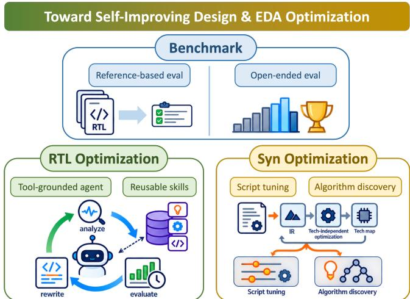
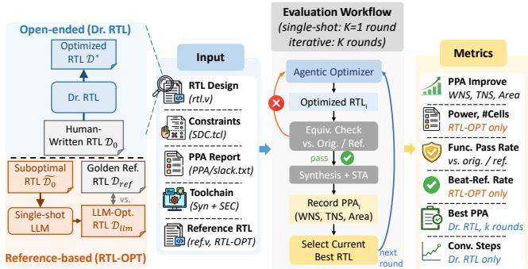
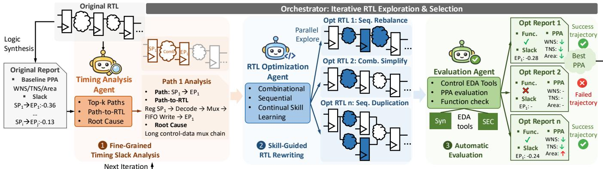
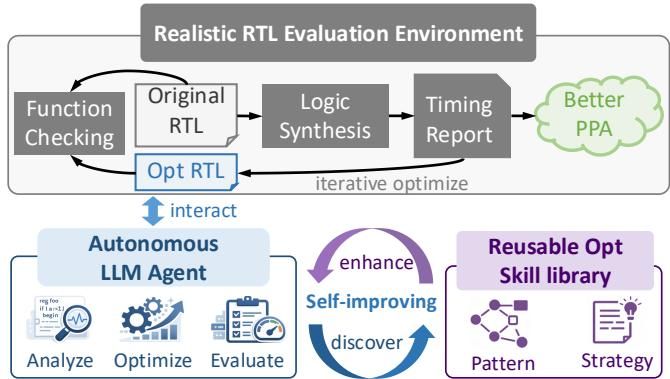
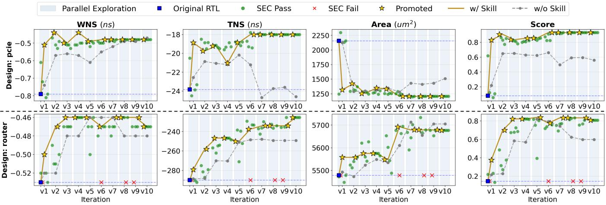
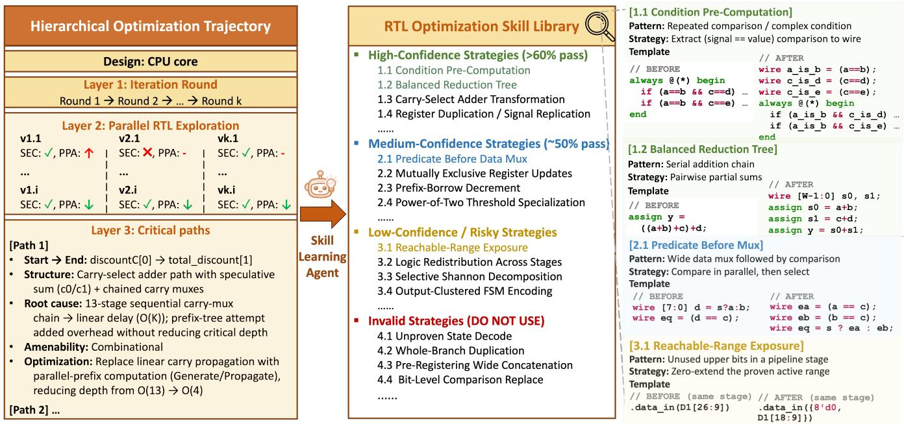
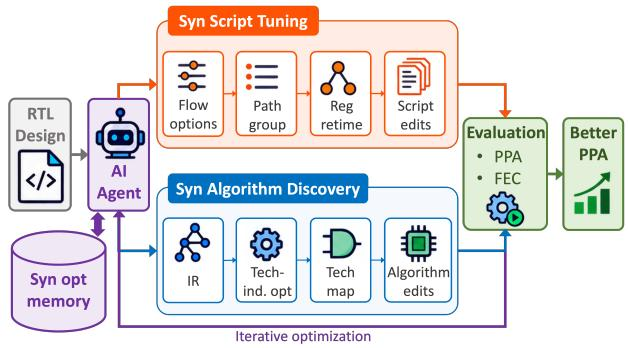
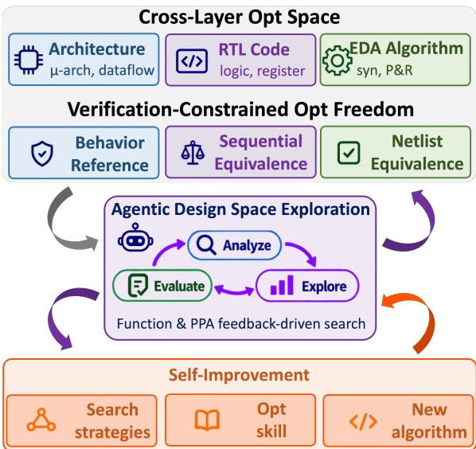

# Toward Autonomous RTL and Synthesis Optimization: Benchmarking and Self-Improving Agents

Invited Paper

Wenji Fang†, Yao Lu†, Jinghua Wang, Zhiyao Xie★ Hong Kong University of Science and Technology

## ABSTRACT

Recent advances in large language models (LLMs) and autonomous agents are creating new opportunities for hardware design opti mization. This paper examines three connected directions toward autonomous RTL and synthesis optimization: (1) Realistic benchmarking. We discuss reference-based and open-ended RTL optimization benchmarks that evaluate optimization opportunities under realistic EDA workflows. (2) Tool-grounded RTL optimization. We present Dr. RTL, a multi-agent framework that automates criticalpath analysis, RTL rewriting, and implementation-level evaluation, while continuously improving through reusable optimization skills. Evaluated on 20 real-world RTL designs, Dr. RTL achieves average WNS/TNS improvements of 21%/17% with a 6% area reduction over commercial synthesis. (3) Design-specific synthesis optimization. We explore agent-driven synthesis script tuning and the discovery of executable synthesis algorithms across intermediate representations, technology-independent optimization, and technology mapping. Finally, we envision AI-native design automation that jointly explores architectural, RTL, and EDA algorithm design spaces, guided by verification constraints and implementation feedback.

## 1 INTRODUCTION

RTL optimization and logic synthesis are two synergistic processes that jointly determine the power, performance, and area (PPA) of digital circuits. Given a hardware architecture, RTL optimization explores alternative implementations through logic restructuring, resource sharing, and sequential transformations, while synthesis and place-and-route (P&R) tools further opti mize the circuit through logic synthesis and physical implementation [14, 34]. The two optimization processes are highly synergistic: RTL structure determines the optimization opportunities available to downstream tools, while synthesis and physical design feedback reveals circuit bottlenecks that can guide further RTL transforma tions. Achieving better PPA therefore requires considering RTL optimization and downstream EDA optimization together through an iterative, tool-grounded process.

This synergy also raises a fundamental question: Which RTL optimization opportunities remain after synthesis optimizations? Modern synthesis tools can automatically simplify, restructure, and map complex logic, potentially absorbing many source-level RTL transformations. Consequently, an RTL rewrite that improves PPA under a weak synthesis flow may ofer little additional benefit under a stronger commercial tool. However, existing RTL optimization studies often evaluate manually degraded designs using open-source synthesis flows, as in RTLRewriter [40] and SymRTLo [35]. Such evaluations may emphasize recovering injected ineficiencies or transformations already handled by advanced synthesis. More meaningful RTL optimization should target opportunities that remain beyond realistic synthesis, while improvements to synthesis algorithms themselves can further extend the achievable PPA.

  
Figure 1: Three connected directions toward autonomous RTL and synthesis optimization. Realistic benchmarking establishes evaluation settings, tool-grounded agents optimize RTL beyond synthesis, and synthesis optimization extends agentic search from flow tuning to algorithm discovery.

This perspective motivates two fundamental research challenges toward autonomous RTL and synthesis optimization:

• How to benchmark RTL optimization? Establish realistic RTL designs and evaluation settings that distinguish genuine optimization opportunities from improvements already achievable through synthesis.

• How to automate and improve optimization? Develop tool-grounded agents that explore RTL implementations and synthesis strategies, while accumulating reusable optimization knowledge.

These challenges connect three research directions: realistic RTL optimization benchmarking, agentic RTL optimization, and synthesis tool optimization. We briefly review their recent progress and remaining challenges below.

Benchmarking realistic RTL optimization. Recent advances in LLM-based RTL generation [13] include domain-specific models [18], verification-guided generation [28], and agentic frameworks [9, 44]. Corresponding benchmarks, such as VerilogEval [17], RTLLM [20], OpenLLM-RTL [19], and CVDP [26], primarily evaluate functional correctness. RTL optimization additionally requires measuring implementation quality after synthesis while preserving functional equivalence. Existing evaluations often rely on manually degraded RTL and relatively weak synthesis flows, leaving a gap between benchmark results and optimization under industrial conditions. This motivates realistic benchmarks that evaluate both known optimization targets and open-ended improvements on original human-written RTL, with synthesis quality and verification incorporated into the evaluation.

Tool-grounded RTL optimization. With realistic synthesis evaluation, the next challenge is to discover RTL transformations that provide additional PPA improvements. Their efectiveness depends on how downstream tools restructure and map the resulting logic, making implementation feedback essential. Existing approaches explore verified rewriting [8], LLM-based RTL optimization [40], symbolic reasoning [35], timing-oriented transformations [39], evolutionary optimization [15, 27], and multi-agent collaboration [4]. Related studies investigate retrieval-guided circuit optimization [7] and PPA-aware RTL generation [31, 32]. Finegrained timing analysis [11] can reveal bottlenecks that remain after synthesis, while equivalence checking ensures correctness. These capabilities motivate self-improving agents that use detailed EDA feedback to explore RTL transformations and learn reusable optimization strategies.

Synthesis tool optimization. The synergy between RTL and synthesis also suggests another optimization direction: improving the synthesis procedures themselves. Existing synthesis techniques explore Boolean rewriting [3], technology-aware optimization [6], and symbolic equality saturation [41]. Automated flow tuning further explores synthesis parameters [45], configuration selection [37], and optimization sequences [23]. More recently, Al phaEvolve [25] has demonstrated the feasibility of AI-driven algorithm discovery, while Self-Evolved ABC [42] applies code evolution to improve general-purpose logic synthesis. These advances motivate design-specific synthesis optimization, where agents can tune commercial synthesis flows and discover customized algorithms that better exploit individual circuit structures. Together with RTL optimization, this opens opportunities for more comprehensive RTL–EDA co-optimization.

In this paper, we review three connected research directions toward autonomous RTL and synthesis optimization and present our recent progress in each direction, as illustrated in Figure 1. Our contributions are summarized as follows:

• Realistic benchmarking of RTL optimization. We introduce two complementary benchmarking settings: referencebased optimization through RTL-OPT and open-ended optimization on original human-written RTL through Dr. RTL. Together, they evaluate both known optimization opportunities and further PPA improvements under realistic synthesis and formal verification workflows.

• Tool-grounded, self-improving agentic RTL optimization. We present Dr. RTL, a multi-agent framework that combines fine-grained timing analysis, parallel RTL exploration, sequential equivalence checking, and group-relative skill learning. Across 20 human-written RTL designs, Dr. RTL achieves average WNS and TNS improvements of 21.3% and 16.9%, respectively, with a 5.8% reduction in area over commercial synthesis.

• From synthesis flow tuning to design-specific algorithm discovery. We explore two levels of synthesis optimization: agent-driven script tuning for commercial synthesis tools and design-specific algorithm discovery for opensource synthesis tools. Across eight designs, commercial synthesis tuning improves average WNS/TNS by 7.4%/11.1%, while open-source algorithm discovery reduces area-delay product (ADP) by 18.7%.

Looking ahead, we envision a self-improving AI-driven design automation paradigm built on verification-constrained optimization spaces. These spaces span three levels: architecture, RTL implementation, and EDA algorithms. At the architectural level, agents explore microarchitectures, dataflows, and resource organizations. At the RTL level, they optimize circuit implementations, while at the EDA tool level, they improve synthesis and physical design procedures. Verification defines what must be preserved at each level, establishing the boundaries for optimization. With these spaces and constraints clearly defined, a key research direction is to develop more efective agentic design-space exploration across abstraction levels. Accumulated optimization strategies and verification knowledge can support continual self-improvement and the joint optimization of hardware implementations and EDA tools.

## 2 BENCHMARKING RTL OPTIMIZATION

## 2.1 Overview

RTL optimization benchmarks must evaluate both functional correctness and implementation quality after synthesis. Since the PPA benefit of RTL transformations depends on downstream synthesis, benchmark quality is determined by the starting RTL designs, synthesis toolchain, verification flow, and evaluation metrics. In particular, a realistic benchmark should capture optimization opportunities that remain meaningful under strong synthesis tools.

We introduce two complementary evaluation settings, as illustrated in Figure 2. Reference-based evaluation starts from suboptimal RTL and measures optimization against human-optimized references. Open-ended evaluation starts from original human-written RTL and measures further improvements beyond commercial synthesis. The former provides known optimization targets, while the latter evaluates the ability to discover additional optimization opportunities without predefined references.

## 2.2 Background and Related Work

RTL generation benchmarks. LLM-based hardware design has motivated several benchmarks for evaluating RTL generation from natural-language specifications, such as VerilogEval [17], RTLLM [20], and OpenLLM-RTL [19]. These benchmarks primarily evaluate syntactic and functional correctness. RTL optimization additionally requires measuring PPA improvements while preserving the original design functionality.

RTL optimization evaluations. Existing RTL optimization methods are evaluated under diferent design and toolchain settings. RTLRewriter [40] and SymRTLo [35] explore RTL rewriting using their respective synthesis and verification workflows. POET [27] investigates power-oriented optimization, while CODMAS [4] uses multi-agent collaboration for RTL optimization. Diferences in starting designs, optimization objectives, and synthesis tools make their results dificult to compare directly.

  
Figure 2: Two complementary RTL optimization evaluation settings. Reference-based evaluation measures improvements against human-optimized RTL references, while openended evaluation measures further PPA improvements on original human-written designs. Both settings assess implementation quality after synthesis and functional verification.

Many existing evaluations use manually degraded RTL, where optimization aims to recover injected ineficiencies. Such settings provide controlled tasks, but the measured gains depend on how degradation is introduced and how efectively synthesis handles the resulting structures. This motivates complementary benchmarks that evaluate both known optimization gaps and open-ended improvement opportunities under realistic synthesis conditions.

## 2.3 Reference-Based RTL Optimization: RTL-OPT

2.3.1 BenchmarkDescription. RTL-OPT [21] introduces a referencebased benchmark using paired suboptimal and designer-optimized RTL implementations. Each task provides a functionally correct but suboptimal RTL design and a corresponding human-optimized ref erence. The benchmark contains 36 handcrafted optimization tasks covering arithmetic logic, control logic, finite-state machines, and pipelined datapaths. These tasks are designed to expose RTL-level optimization opportunities that persist after synthesis.

2.3.2 Evaluation Metrics. RTL-OPT evaluates functional correctness and post-synthesis PPA quality. Candidate implementations are checked for functional equivalence and synthesized to measure power, timing, and area, including total power, worst negative slack (WNS), total negative slack (TNS), cell area, and cell count.

Optimization capability is summarized by two fractions over all tasks. The first is the fraction of candidates whose PPA outperforms the suboptimal input, and the second is the fraction whose PPA outperforms the human-optimized reference. The individual PPA metrics are still reported alongside these fractions, so that the tradeofs among diferent optimization objectives are preserved.

2.3.3 Evaluation Results. Under commercial compile\_ultra synthesis, 35 of the 36 human-optimized references outperform their corresponding suboptimal implementations, confirming that the benchmark retains meaningful optimization opportunities after synthesis. As shown in Table 1, existing LLMs show limited ability to recover these improvements. The highest fraction of tasks outperforming the suboptimal input is 41.7%, while only 13.9% exceed the human-optimized reference. These results highlight the dificulty of finding RTL transformations that translate into better implementations under commercial synthesis.

Table 1: Comparison of LLM-based RTL optimization under (a) reference-based and (b) open-ended evaluation settings.
<table><tr><td colspan="5">(a) Reference-based: RTL-OPT</td></tr><tr><td colspan="2">Method</td><td>1 Func. Pass</td><td>&gt;Subopt.</td><td>&gt;Ref.</td></tr><tr><td rowspan="4">Single-Shot LLM</td><td>GPT-4o-mini</td><td>75.0%</td><td>19.4%</td><td>5.6%</td></tr><tr><td>Gemini-2.5</td><td>69.4%</td><td>30.6%</td><td>5.6%</td></tr><tr><td>DeepSeek V3</td><td>69.4%</td><td>27.8%</td><td>13.9%</td></tr><tr><td>DeepSeek R1</td><td>61.1%</td><td>41.7%</td><td>13.9%</td></tr><tr><td colspan="5">(b) Open-ended: Original RTL</td></tr><tr><td colspan="2">Method</td><td>二 WNS</td><td>TNS</td><td>Area</td></tr><tr><td rowspan="3">Single-Shot LLM</td><td>Claude Opus</td><td>-2.4%</td><td>-2.8%</td><td>-0.7%</td></tr><tr><td>GPT 5.3</td><td>-1.2%</td><td>0.3%</td><td>0.6%</td></tr><tr><td>RTLRewriter [40]</td><td>-4.9%</td><td>-6.3%</td><td>-3.1%</td></tr><tr><td rowspan="2">Baselines* Ours</td><td>SymRTLo [35]</td><td>-7.1%</td><td>-5.7%</td><td>-1.4%</td></tr><tr><td>Dr. RTL</td><td>-21.3%</td><td>-16.9%</td><td>-5.8%</td></tr></table>

★ The iterative RTL optimization baselines use the same backbone LLM, Claude Opus, as Dr. RTL. >Subopt. and >Ref. indicate the fractions of tasks whose PPA exceeds the suboptimal input and the human-optimized reference, respectively. In the open-ended setting, negative percentage changes indicate reductions in timing violations or area.

## 2.4 Open-Ended RTL Optimization Evaluation

2.4.1 Benchmark Description. Open-ended evaluation measures optimization opportunities remaining in original human-written RTL implementations, without assuming a known optimized reference. This setting is introduced and adopted in Dr. RTL [12], using 20 designs collected from diverse open-source projects, including processors, communication interfaces, bufers, and signalprocessing modules. The designs average 812 lines of code and three modules, with more complex structures and hierarchies than typical small-scale RTL optimization tasks.

The evaluation uses commercial logic synthesis for implementation quality and sequential equivalence checking (SEC) for functional correctness. Starting from human-written RTL provides a more challenging optimization setting, where improvements must go beyond those already achieved by the synthesis tool.

2.4.2 Evaluation Metrics. The benchmark measures PPA improvements relative to the original RTL after commercial synthesis. Timing is evaluated using WNS and TNS, while implementation cost is measured using cell area. SEC verifies that candidate implementations preserve the original sequential behavior. Power is excluded from the current optimization objective because reliable power estimation requires workload-dependent switching activity.

Beyond final PPA, the open-ended setting also supports evaluating iterative optimization through functional pass rates and optimization trajectories. These metrics characterize both the quality of the optimized implementations and the reliability of the optimization methods that produce them.

2.4.3 Evaluation Results. As shown in Table 1, open-ended evaluation reveals substantial diferences in optimization capability under commercial synthesis. Single-shot LLMs provide limited improvements on original human-written RTL, while representative iterative baselines achieve average WNS improvements of 4.9%– 7.1%. In comparison, the Dr. RTL optimizer achieves average WNS and TNS improvements of 21.3% and 16.9%, respectively, with a 5.8% reduction in area.

Figure 3: Overview of Dr. RTL. The framework coordinates critical-path analysis, parallel RTL rewriting, and tool-based evaluation. Commercial synthesis provides implementation feedback, while sequential equivalence checking verifies functional correctness.  
  
Figure 4: Dr. RTL automates RTL PPA optimization through closed-loop interaction with EDA tools and distills optimization trajectories into reusable skills for continual selfimprovement.

These results demonstrate that meaningful RTL optimization opportunities remain beyond commercial synthesis, while their discovery requires efective optimization methods. The Dr. RTL framework is detailed in Section 3.

## 3 AGENTIC RTL OPTIMIZATION WITH DR. RTL

## 3.1 Overview

Dr. RTL [12] is a tool-grounded, self-improving agentic framework for optimizing RTL implementations beyond commercial synthesis. As illustrated in Figure 4, it automates the iterative optimization process through interaction with EDA tools and continuously accumulates reusable optimization knowledge.

The framework combines two complementary components. First, a multi-agent optimization workflow performs fine-grained criticalpath analysis, parallel RTL rewriting, and tool-based evaluation under sequential equivalence checking (SEC). Second, group-relative skill learning distills successful and unsuccessful optimization experiences into reusable pattern–strategy skills. Together, these components enable agents to explore functionally equivalent RTL implementations, learn from implementation feedback, and improve subsequent searches without updating the LLM parameters.

## 3.2 Background and Related Work

RTL optimization explores functionally equivalent implementations for better post-synthesis PPA. Its efectiveness depends on downstream synthesis, requiring tool-grounded evaluation and equivalence checking.

RTL rewriting and optimization. Existing approaches include verified e-graph rewriting in ROVER [8], LLM-guided rewriting in RTLRewriter [40], symbolic reasoning in SymRTLo [35], and timingoriented transformations [39]. Related studies explore retrievalguided circuit optimization [7] and PPA-aware RTL generation [31– 33].

Agentic RTL optimization. Recent methods employ multiagent collaboration in CODMAS [4], power-oriented evolutionary search in POET [27], and LLM-driven evolution in EvolVE [15]. Agentic RTL generation further explores multi-agent design [44], context evolution [10], and reinforcement learning [43].

Tool feedback and reusable knowledge. Fine-grained RTL timing analysis [11] localizes implementation bottlenecks, while sequential equivalence checking [30] ensures correctness. Agentic memory [38] and skill learning [36] enable experience reuse. Dr. RTL combines critical-path feedback, commercial synthesis, and group-relative skill learning for self-improving RTL optimization.

## 3.3 Method: Tool-Grounded Self-Improving RTL Optimization

Automating RTL optimization. As shown in Figure 3, Dr. RTL formulates RTL optimization as an iterative, tool-grounded search. Starting from an original human-written RTL implementation, Dr. RTL searches for functionally equivalent designs with better timing and area under a fixed commercial synthesis flow. The optimization preserves pipeline latency and micro-architectural behavior while allowing combinational and sequential RTL transformations.

The framework coordinates three specialized agents: (1) a timing analysis agent that examines post-synthesis timing reports, maps critical paths to RTL structures, and diagnoses bottlenecks; (2) an RTL optimization agent that generates multiple candidate transformations in parallel; and (3) an evaluation agent that runs commercial synthesis and SEC to obtain PPA and correctness feedback. An orchestrator coordinates these agents, records optimization trajectories, and selects the best equivalent candidate for the next iteration.

  
Figure 5: Optimization trajectories of Dr. RTL across iterations for two designs (router and pcie). WNS, TNS, area, and optimization score improve over successive iterations while preserving functional equivalence. The skill-enhanced variant converges faster and achieves better PPA than the variant without learned skills.

This closed-loop workflow connects optimization decisions directly to measured implementation quality. Fine-grained timing analysis identifies specific bottlenecks, such as deep combinational paths, high-fanout signals, and complex control–data interactions. Parallel exploration evaluates diferent transformations under the same design constraints, while SEC ensures that selected implementations preserve functionality.

Learning reusable optimization skills. Beyond optimizing in dividual designs, Dr. RTL learns reusable knowledge from previous optimization attempts. Each trajectory records the diagnosed bottleneck, applied RTL transformation, and resulting PPA and SEC outcomes. Because optimization efects depend on the design and synthesis environment, Dr. RTL introduces group-relative skill learning to identify efective transformations under comparable conditions.

Candidates generated from the same parent RTL are compared using their relative optimization outcomes. A skill-learning agent analyzes these comparisons and extracts reusable pattern–strategy pairs. Patterns describe recurring bottlenecks, such as deep decode logic, high fanout, or mux-heavy selection, while strategies describe corresponding transformations, such as condition pre-computation, signal replication, or arithmetic restructuring.

The extracted skills are stored in a confidence-aware library, with their reliability updated using empirical PPA improvements and SEC results. Successful strategies are prioritized for reuse, while inefective or invalid transformations are recorded to avoid repeated exploration. When optimizing a new design, the agent applies relevant learned skills or explores new transformations when no suitable skill is available. The resulting experience further updates the library, creating a continual self-improvement loop.

## 3.4 Experimental Results

Experimental setup. We evaluate Dr. RTL on 20 original humanwritten Verilog designs covering processors, communication interfaces, bufers, signal-processing modules, and other digital systems. The designs contain 812 lines of RTL on average. We use Synopsys Design Compiler for commercial synthesis, the Nangate 45 nm standard-cell library [29], and Cadence JasperGold SEC [30] for verification. Each design is optimized over 10 iterations with five parallel candidates per iteration.

RTL optimization performance. As summarized in Table 1, Dr. RTL improves timing on all 20 designs, achieving average WNS and TNS improvements of 21.3% and 16.9%, respectively, with a 5.8% reduction in area over commercial synthesis. Nine designs achieve Pareto improvements in timing and area, and the average SEC pass rate is 86%. These results demonstrate substantial RTL optimization opportunities beyond commercial synthesis, even for original human-written designs. We also visualize the optimization trajectory in Figure 5.

Compared with RTLRewriter [40] and SymRTLo [35] under the same commercial evaluation flow, Dr. RTL achieves substantially larger timing improvements. The iterative baselines use the same backbone LLM and optimization budget, supporting the benefit of tool-grounded multi-agent exploration and reusable optimization knowledge.

Skill generalization and interpretability. We evaluate crossdesign skill transfer through four-fold cross-validation, learning skills from 15 designs and applying them to five unseen designs in each fold. Dr. RTL extracts 47 pattern–strategy entries: 12 highconfidence, 16 medium-confidence, six low-confidence, and 13 avoid strategies. As illustrated in Figure 6, these skills connect criticalpath patterns with optimization strategies and their empirical outcomes, providing interpretable knowledge for future searches.

Overall, Dr. RTL demonstrates two complementary capabilities: autonomous RTL optimization through commercial EDA feedback and continual improvement through reusable optimization knowledge. While Dr. RTL explores alternative implementations under a fixed synthesis procedure, the next section extends agentic optimization to the synthesis procedures themselves.

## 4 AGENTIC SYNTHESIS OPTIMIZATION AND ALGORITHM DISCOVERY

## 4.1 Overview

Beyond RTL optimization, further PPA improvements can be achieved by optimizing the synthesis procedures themselves. We investigate two complementary levels of design-specific synthesis optimization: (1) agentic script tuning, which explores the configuration space of commercial synthesis tools through tool-grounded search and reusable optimization skills, and (2) synthesis algorithm discovery, which develops customized optimization procedures for individual designs. These approaches extend agentic optimization from hardware implementations to the algorithms that produce them, enabling a broader exploration of the RTL–synthesis optimization space.

  
Figure 6: Distilling hierarchical optimization trajectories into a reusable skill library. Trajectories are organized across iterations parallel candidates, and critical paths, supporting the extraction of optimization strategies with diferent confidence levels and associated transformation templates.

## 4.2 Background and Related Work

Logic synthesis transforms RTL into a technology-mapped netlist through intermediate representations, technology-independent optimization, and technology mapping [3, 14]. Existing research improves these procedures through technology-aware rewriting [6], equality saturation [5, 41], learning-guided synthesis [22], and technology mapping optimization [24]. We focus on two complementary directions for adapting synthesis to individual designs.

Synthesis flow tuning. Flow tuning optimizes the configurations and sequences of existing synthesis operations. SynTun-Sys [45] automates synthesis parameter exploration, while FIST [37] uses feature importance to guide parameter selection. FlowTune [23] explores logic optimization flows through bandit-based search, and FlowTuner [16] uses knowledge transfer for multi-stage EDA flow tuning. These studies demonstrate the benefits of adapting synthesis configurations to diferent designs. Recent advances in AI agents create further opportunities for autonomous strategy selection, tool interaction, and learning reusable optimization knowledge.

Synthesis algorithm discovery. AlphaEvolve [25] demonstrates the feasibility of AI-driven algorithm discovery through evaluatorguided code evolution. Building on this paradigm, Self-Evolved ABC [42] applies multi-agent code evolution to improve generalpurpose logic synthesis algorithms. However, circuit structures and optimization bottlenecks vary across designs, and general-purpose algorithms may leave design-specific optimization opportunities unexplored. With increasingly capable and inexpensive AI coding, we envision customizing synthesis algorithms for each individual design to explore its optimization space more thoroughly and achieve better PPA.

  
Figure 7: Our two levels of agentic synthesis optimization: script tuning for the commercial tool and design-specific algorithm discovery for the open-source tool.

## 4.3 Method: Agentic Script Tuning and Algorithm Discovery

Figure 7 illustrates two levels of agentic synthesis optimization. Script tuning explores the configuration space of an existing synthesis engine, while algorithm discovery expands the search space by modifying the underlying optimization procedures. Both approaches follow a feedback-driven process under fixed RTL, technology libraries, and design constraints.

Agentic synthesis flow tuning. Our first approach extends Dr. RTL with a synthesis-strategy agent that explores design-specific configurations of Synopsys Design Compiler (DC). Starting from the strong commercial compile\_ultra flow, the agent analyzes timing bottlenecks, register connectivity, and previous optimization outcomes to identify opportunities for improving synthesis scripts.

The framework follows an agentic workflow of analysis, strategy generation, tool-based evaluation, and skill learning. The agent explores alternative synthesis configurations, evaluates their PPA through commercial synthesis, and uses the resulting feedback to refine its scripts. The search considers interactions between diferent synthesis operations, allowing optimization efort to be allocated according to the characteristics and critical paths of each design.

(a) Synthesis script tuning 7a) Svnthesis script tw  
Table 2: Results of (a) commercial DC script tuning and (b) open-source synthesis algorithm discovery. Baselines are Dr. RTL’s best RTL under compile\_ultra and agent-tuned Yosys+ABC, respectively. Positive percentages indicate improvement. Mean is arithmetic.
<table><tr><td rowspan="2">Design</td><td colspan="3">Baseline</td><td colspan="3">Reduction ↑</td></tr><tr><td>WNS (ns)</td><td>TNS (ns)</td><td>Area (µm²)</td><td>WNS</td><td>TNS</td><td>Area</td></tr><tr><td>FIFO</td><td>-0.45</td><td>-1801.81</td><td>34987</td><td>7.0%</td><td>2.5%</td><td>0.1%</td></tr><tr><td>SHA3</td><td>-0.74</td><td>-1494.83</td><td>33639</td><td>4.1%</td><td>12.9%</td><td>-0.2%</td></tr><tr><td>SPI</td><td>-0.24</td><td>-25.67</td><td>1881</td><td>6.9%</td><td>14.8%</td><td>0.5%</td></tr><tr><td>UART</td><td>-0.35</td><td>-22.40</td><td>1035</td><td>3.9%</td><td>5.8%</td><td>0.2%</td></tr><tr><td>ctrl</td><td>-0.35</td><td>-548.55</td><td>17259</td><td>10.4%</td><td>6.4%</td><td>-7.3%</td></tr><tr><td>arm_cpu1</td><td>-2.21</td><td>-2002.67</td><td>24785</td><td>9.5%</td><td>17.0%</td><td>-1.6%</td></tr><tr><td>arm_cpu2</td><td>-0.86</td><td>-597.70</td><td>13342</td><td>11.8%</td><td>18.9%</td><td>-4.7%</td></tr><tr><td>i2c</td><td>-0.33</td><td>-28.05</td><td>1369</td><td>6.1%</td><td>10.2%</td><td>0.7%</td></tr><tr><td>Mean</td><td>-0.69</td><td>-815.21</td><td>16037</td><td>7.4%</td><td>11.1%</td><td>-1.6%</td></tr></table>

(b) Algorithm discovery
<table><tr><td rowspan="2">Design</td><td colspan="2">Baseline</td><td colspan="3">Reduction ↑</td></tr><tr><td>Area (µm²)</td><td>Delay (ns)</td><td>Area</td><td>Delay</td><td>ADP</td></tr><tr><td>picorv32</td><td>18200</td><td>0.56</td><td>12.2%</td><td>2.7%</td><td>14.6%</td></tr><tr><td>aes128</td><td>15458</td><td>0.60</td><td>10.0%</td><td>1.2%</td><td>11.1%</td></tr><tr><td>sha256</td><td>15075</td><td>1.11</td><td>3.6%</td><td>22.8%</td><td>25.6%</td></tr><tr><td>spi_master</td><td>2999</td><td>0.67</td><td>16.5%</td><td>20.0%</td><td>33.2%</td></tr><tr><td>sasc_uart</td><td>958</td><td>0.29</td><td>11.1%</td><td>14.3%</td><td>23.8%</td></tr><tr><td>usb_phy</td><td>799</td><td>0.26</td><td>11.8%</td><td>8.2%</td><td>19.0%</td></tr><tr><td>wb_conmax</td><td>26610</td><td>0.60</td><td>10.3%</td><td>3.5%</td><td>13.4%</td></tr><tr><td>vga_lcd</td><td>129958</td><td>1.00</td><td>8.9%</td><td>0.0%</td><td>8.9%</td></tr><tr><td>Mean</td><td>一</td><td>一</td><td>10.6%</td><td>9.1%</td><td>18.7%</td></tr></table>

To support self-improvement, the agent also accumulates synthesis optimization skills. These skills capture efective configuration strategies, their applicable circuit characteristics, and their observed PPA outcomes. The accumulated knowledge guides subsequent optimization attempts, extending Dr. RTL’s skill-based learning from RTL transformations to synthesis strategies. This enables agents to systematically explore the capabilities of commercial synthesis tools while reusing experience across designs.

Design-specific synthesis algorithm discovery. Our second approach expands the optimization space from synthesis configurations to synthesis algorithms. In principle, a synthesis engine capable of finding the globally optimal implementation within the allowed design space would eliminate the need for separate RTL optimization within that same space. In practice, existing synthesis algorithms are limited by their circuit representations, available transformations, search heuristics, and computational budgets. Consequently, RTL optimization can expose better implementations that existing synthesis procedures fail to discover directly.

This observation motivates a broader direction: improving the synthesis algorithms themselves. As AI coding becomes increasingly powerful and inexpensive, we can trade additional optimization time for better PPA by developing a customized synthesizer for each design. Rather than requiring a single algorithm to work well across all circuits, agents can specialize synthesis procedures to exploit the structural characteristics and optimization opportunities of the target design. The objective is to explore the available implemen tation space more thoroughly and approach better design-specific PPA solutions.

We explore algorithm discovery across three synthesis stages, as illustrated in Figure 7:

• Intermediate representation (IR). Agents explore circuit representations and decomposition procedures that expose designspecific structures and optimization opportunities.

• Technology-independent optimization. Agents develop rewriting, factoring, restructuring, and logic-sharing algorithms tailored to the target circuit.

• Technology mapping. Agents adapt functional matching, covering, and cell-selection algorithms to improve area and timing under the target technology library.

The three stages provide complementary optimization freedom, from choosing circuit representations to transforming logic structures and selecting physical cells. Exploring them together allows agents to discover optimization procedures that are particularly efective for individual designs.

Algorithm discovery follows a verification-guided code evolution loop. The agent modifies executable synthesis code, regenerates a netlist from the original RTL, checks functional equivalence, and evaluates area and delay. Critical-path and implementation feedback guide subsequent algorithm revisions, while successful program variants are retained. The resulting customized synthesizer can reproduce the optimized implementation from the original RTL.

## 4.4 Evaluation Results

We evaluate the two approaches on eight designs each, using commercial and open-source synthesis environments, respectively. Script tuning targets Synopsys Design Compiler, while algorithm discovery uses Yosys+ABC. Both experiments use fixed RTL, design constraints, and the Nangate 45 nm technology library.

Commercial synthesis script tuning. We evaluate script tuning on RTL already optimized by Dr. RTL, using DC compile\_ultra as the baseline. The agent explores path grouping through group\_path and retiming through optimize\_registers, combining four strategies for each in a 4 × 4 search matrix. We perform five additional search rounds using WNS, TNS, and area feedback.

As shown in Table 2(a), script tuning improves WNS and TNS on all eight designs, with average improvements of 7.4% and 11.1%, respectively, at a 1.6% average area overhead. These results demonstrate further timing optimization opportunities beyond Dr. RTL under commercial synthesis.

Open-source synthesis algorithm discovery. We compare design-specific algorithm evolution with agent-tuned Yosys+ABC. Each evolved synthesis program must generate a functionally equivalent netlist from the original RTL.

As shown in Table 2(b), algorithm discovery achieves average reductions of 10.6% in area, 9.1% in delay, and 18.7% in area–delay product (ADP), with seven of eight designs improving both area and delay. These results demonstrate the potential of design-specific algorithms to improve PPA beyond agent-tuned general-purpose synthesis flows.

Together, these experiments show the benefits of agentic optimization at both the synthesis configuration and algorithmic levels, motivating joint exploration of RTL implementations and EDA optimization procedures.

## 5 FUTURE VISION: TOWARD VERIFICATION-GUIDED AGENTIC DSE

## 5.1 Hierarchical Optimization Spaces

Existing AI-driven hardware optimization methods largely focus on individual design stages, such as architectural exploration, RTL optimization, or synthesis tool optimization. However, these stages are closely coupled, and optimizing them independently limits the available design space. We envision a broader cross-layer optimization space organized across three levels: architecture, RTL implementation, and EDA algorithms, as illustrated in Figure 8. At the architectural level, the design space covers microarchitectures, dataflows, and resource organizations [1, 2]. At the RTL level, it includes logic restructuring, resource sharing, and sequential transformations. At the EDA tool level, it covers synthesis and physical design configurations, transformations, and algorithms.

These spaces interact across abstraction levels: architectural decisions shape the RTL implementation space, while synthesis and physical design procedures influence the achievable PPA ofdiferent implementations. Joint exploration can therefore discover optimization opportunities that are dificult to identify when each stage is optimized independently. Clearly defining these spaces and their relationships provides a foundation for cross-layer agentic DSE.

## 5.2 Verification-Constrained Optimization Freedom

Cross-layer optimization requires a clear definition of what must be preserved and what can be changed at each level. We envision verification constraints that separate verified invariants from optimization freedom. Architectural exploration preserves functional behavior and interface requirements, RTL optimization preserves sequential behavior, and EDA algorithm optimization ensures netlist correctness and implementation constraints. These requirements can be checked through simulation, equivalence checking, or other verification techniques.

Importantly, cross-layer exploration may involve coordinated changes across multiple design stages. Explicit verification constraints define which changes are valid and help maintain correctness as optimization moves between architecture, RTL, and EDA algorithms. This enables agents to explore a broader joint optimization space with reliable correctness feedback.

## 5.3 Toward Self-Improving Agentic Design-Space Exploration

Moving from single-stage optimization to cross-layer DSE introduces a substantially larger and more interconnected search space. AI agents ofer opportunities to coordinate optimization across abstraction levels using circuit characteristics, implementation feed back, and accumulated experience. However, efective exploration requires deciding which design levels to optimize, how to coordinate transformations, and how to allocate search efort across the joint space.

This raises an important research question: How can AI agents continuously improve their DSE capabilities across interconnected hardware design spaces? Future research can explore adaptive crosslayer optimization strategies and the reuse of knowledge learned from previous searches, including efective transformations, search policies, and optimization algorithms. Ultimately, we envision selfimproving AI-native EDA systems that jointly optimize hardware architectures, RTL implementations, and the EDA procedures used to realize them.

  
Figure 8: Future vision of self-improving cross-layer agentic DSE. Optimization spans architecture, RTL, and EDA algorithms, with verification defining the allowable freedom at each level. Tool feedback and reusable knowledge support continual improvement across design stages.

## 6 CONCLUSION

This paper presents three connected directions toward autonomous RTL and synthesis optimization: realistic benchmarking, agentic tool-grounded RTL optimization, and design-specific synthesis optimization. We introduce complementary benchmarking settings to evaluate meaningful PPA improvements beyond synthesis, and present Dr. RTL, a self-improving agentic framework that achieves substantial timing and area improvements over commercial synthesis. We further demonstrate the potential of agent-driven synthesis flow tuning and design-specific algorithm discovery for additional PPA gains. Looking ahead, we envision verification-guided agentic DSE across architecture, RTL, and EDA algorithms. By organizing optimization spaces, defining verification constraints, and accumulating reusable optimization knowledge, future agents can progressively improve both hardware implementations and the EDA procedures that realize them.

## 7 ACKNOWLEDGEMENT

This work is supported by Hong Kong Research Grants Council (RGC) CRF-YCRG C6003-24Y, 16200724, T46-415/25-R, and JLFS-YSF/E-605/26. It was partially conducted by ACCESS – AI Chip Center for Emerging Smart Systems, supported by the InnoHK initiative of the Innovation and Technology Commission of the Hong Kong Special Administrative Region Government.

## REFERENCES

[1] Chen Bai, Jiayi Huang, Xuechao Wei, Yuzhe Ma, Sicheng Li, Hongzhong Zheng, Bei Yu, and Yuan Xie. 2023. ArchExplorer: Microarchitecture exploration via bottleneck analysis. In International Symposium on Microarchitecture (MICRO).

[2] Chen Bai, Qi Sun, Jianwang Zhai, Yuzhe Ma, Bei Yu, and Martin DF Wong. 2021. BOOM-Explorer: RISC-V BOOM microarchitecture design space exploration framework. In International Conference on Computer-Aided Design (ICCAD).

[3] Alan Brayton, Robert Mishchenko, and A Mishchenko. 2006. Scalable logic synthesis using a simple circuit structure. In International Workshop on Logic and Synthesis (IWLS).

[4] Che-Ming Chang, Prashanth Vijayaraghavan, Ashutosh Jadhav, Charles Mackin, Hsinyu Tsai, Vandana Mukherjee, and Ehsan Degan. 2026. CODMAS: A Dialectic Multi-Agent Collaborative Framework for Structured RTL Optimization. In Proceedings ofthe 19th Conference ofthe European Chapter ofthe Association for Computational Linguistics (Volume 5: Industry Track). 777–788.

[5] Chen Chen, Guangyu Hu, Cunxi Yu, Yuzhe Ma, and Hongce Zhang. 2025. Emorphic: Scalable Equality Saturation for Structural Exploration in Logic Synthe sis. arXiv preprint arXiv:2504.11574 (2025).

[6] Chen Chen, Guangyu Hu, Dongsheng Zuo, Cunxi Yu, Yuzhe Ma, and Hongce Zhang. 2024. E-syn: E-graph rewriting with technology-aware cost functions for logic synthesis. In Design Automation Conference (DAC).

[7] Animesh Basak Chowdhury, Marco Romanelli, Benjamin Tan, Ramesh Karri, and Siddharth Garg. 2024. Retrieval-guided reinforcement learning for boolean circuit minimization. In International Conference on Learning Representations (ICLR).

[8] Samuel Coward, Theo Drane, and George A Constantinides. 2024. Rover: Rtl optimization via verified e-graph rewriting. IEEE Transactions on Computer-Aided Design of Integrated Circuits and Systems (2024)

[9] Chenhui Deng, Yun-Da Tsai, Guan-Ting Liu, Zhongzhi Yu, and Haoxing Ren. 2025. Scalertl: Scaling llms with reasoning data and test-time compute for accurate rtl code generation. In 2025 ACM/IEEE 7th Symposium on Machine Learning for CAD (MLCAD). IEEE, 1–9.

[10] Chenhui Deng, Zhongzhi Yu, Guan-Ting Liu, Nathaniel Pinckney, and Haoxing Ren. 2026. ACE-RTL: When Agentic Context Evolution Meets RTL-Specialized LLMs. arXiv preprint arXiv:2602.10218 (2026).

[11] Wenji Fang, Shang Liu, Hongce Zhang, and Zhiyao Xie. 2024. Annotating Slack Directly on Your Verilog: Fine-Grained RTL Timing Evaluation for Early Optimization. In Design Automation Conference (DAC).

[12] Wenji Fang, Yao Lu, Shang Liu, Jing Wang, Ziyan Guo, Junxian He, Fengbin Tu, and Zhiyao Xie. 2026. Dr. RTL: Autonomous Agentic RTL Optimization through Tool-Grounded Self-Improvement. In International Conference on Computer-Aided Design (ICCAD).

[13] Wenji Fang, Jing Wang, Yao Lu, Shang Liu, Yuchao Wu, Yuzhe Ma, and Zhiyao Xie. 2025. A survey of circuit foundation model: Foundation ai models for vlsi circuit design and eda. arXiv preprint arXiv:2504.03711 (2025).

[14] Soha Hassoun and Tsutomu Sasao. 2012. Logic synthesis and verification. Vol. 654. Springer Science & Business Media.

[15] Wei-Po Hsin, Ren-Hao Deng, Yao-Ting Hsieh, En-Ming Huang, and Shih-Hao Hung. 2026. EvolVE: Evolutionary Search for LLM-based Verilog Generation and Optimization. arXiv preprint arXiv:2601.18067 (2026).

[16] Rongjian Liang, Jinwook Jung, Hua Xiang, Lakshmi Reddy, Alexey Lvov, Jiang Hu, and Gi-Joon Nam. 2021. FlowTuner: A multi-stage EDA flow tuner exploiting parameter knowledge transfer. In International Conference on Computer-Aided Design (ICCAD).

[17] Mingjie Liu, Nathaniel Pinckney, Brucek Khailany, and Haoxing Ren. 2023. VerilogEval: Evaluating Large Language Models for Verilog Code Generation. arXiv preprint arXiv:2309.07544 (2023).

[18] Shang Liu, Wenji Fang, Yao Lu, Qijun Zhang, Hongce Zhang, and Zhiyao Xie. 2024. RTLCoder: Fully Open-Source and Eficient LLM-Assisted RTL Code Generation Technique. IEEE Transactions on Computer-Aided Design of Integrated Circuits and Systems (TCAD) (2024).

[19] Shang Liu, Yao Lu, Wenji Fang, Mengming Li, and Zhiyao Xie. 2024. OpenLLM-RTL: Open Dataset and Benchmark for LLM-Aided Design RTL Generation. In International Conference on Computer-Aided Design (ICCAD).

[20] Yao Lu, Shang Liu, Qijun Zhang, and Zhiyao Xie. 2024. RTLLM: An Open-Source Benchmark for Design RTL Generation with Large Language Model. In Asia and South Pacific Design Automation Conference (ASP-DAC).

[21] Yao Lu, Shang Liu, Hangan Zhou, Wenji Fang, Qijun Zhang, and Zhiyao Xie. 2026. A New Benchmark for the Appropriate Evaluation of RTL Code Optimization. arXiv preprint arXiv:2601.01765 (2026).

[22] Walter Lau Neto, Max Austin, Scott Temple, Luca Amaru, Xifan Tang, and Pierre-Emmanuel Gaillardon. 2019. LSOracle: A logic synthesis framework driven by artificial intelligence. In International Conference on Computer-Aided Design (ICCAD).

[23] Walter Lau Neto, Yingjie Li, Pierre-Emmanuel Gaillardon, and Cunxi Yu. 2022. Flowtune: End-to-end automatic logic optimization exploration via domainspecific multiarmed bandit. IEEE Transactions on Computer-Aided Design of Integrated Circuits and Systems (TCAD) (2022).

[24] Walter Lau Neto, Matheus T Moreira, Yingjie Li, Luca Amarù, Cunxi Yu, and Pierre-Emmanuel Gaillardon. 2021. SLAP: A Supervised Learning Approach for Priority Cuts Technology Mapping. In Design Automation Conference (DAC).

[25] Alexander Novikov, Ngân Vu, Marvin Eisenberger, Emilien Dupont, Po-Sen˜ Huang, Adam Zsolt Wagner, Sergey Shirobokov, Borislav Kozlovskii, Francisco J. R. Ruiz, Abbas Mehrabian, M. Pawan Kumar, Abigail See, Swarat Chaudhuri, George Holland, Alex Davies, Sebastian Nowozin, Pushmeet Kohli, and Matej Balog. 2025. AlphaEvolve: A Coding Agent for Scientific and Algorithmic Discovery. arXiv preprint arXiv:2506.13131 (2025). https://doi.org/10.48550/arXiv.2506.13131

[26] Nathaniel Pinckney, Chenhui Deng, Chia-Tung Ho, Yun-Da Tsai, Mingjie Liu, Wenfei Zhou, Brucek Khailany, and Haoxing Ren. 2025. Comprehensive Verilog design problems: A next-generation benchmark dataset for evaluating large language models and agents on rtl design and verification. arXiv preprint arXiv:2506.14074 (2025).

[27] Heng Ping, Peiyu Zhang, Zhenkun Wang, Shixuan Li, Anzhe Cheng, Wei Yang, Paul Bogdan, and Shahin Nazarian. 2026. POET: Power-Oriented Evolutionary Tuning for LLM-Based RTL PPA Optimization. arXiv preprint arXiv:2603.19333 (2026).

[28] Humza Sami, Pierre-Emmanuel Gaillardon, Valerio Tenace, et al. 2024. Aivril: Aidriven rtl generation with verification in-the-loop. arXiv preprint arXiv:2409.11411 (2024).

[29] Si2. 2018. NanGate 45nm Open Cell Library.

[30] Cadence Design Systems. 2026. Cadence JasperGold Sequential Equivalence Checking App. https://www.cadence.com/en\_US/home/tools/systemdesign-and-verification/formal-and-static-verification/jasper-verificationplatform/jaspergold-sequential-equivalence-checking-app.html.

[31] Kimia Tasnia, Alexander Garcia, Tasnuva Farheen, and Sazadur Rahman. 2025. Veriopt: Ppa-aware high-quality verilog generation via multi-role llms. In 2025 IEEE/ACM International Conference On Computer Aided Design (ICCAD). IEEE, 1–9.

[32] Kiran Thorat, Jiahui Zhao, Yaotian Liu, Amit Hasan, Hongwu Peng, Xi Xie, Bin Lei, and Caiwen Ding. 2025. LLM-VeriPPA: Power, Performance, and Area Optimization aware Verilog Code Generation with Large Language Models. In 2025 ACM/IEEE 7th Symposium on Machine Learning for CAD (MLCAD). IEEE, 1–7.

[33] Kiran Thorat, Jiahui Zhao, Yaotian Liu, Hongwu Peng, Xi Xie, Bin Lei, Jef Zhang, and Caiwen Ding. 2023. Advanced Large Language Model (LLM)-Driven Verilog Development: Enhancing Power, Performance, and Area Optimization in Code Synthesis. arXiv preprint arXiv:2312.01022 (2023).

[34] Frank Vahid. 2010. Digital design with RTL design, VHDL, and Verilog. John Wiley & Sons.

[35] Yiting Wang, Wanghao Ye, Ping Guo, Yexiao He, Ziyao Wang, Bowei Tian, Shwai He, Guoheng Sun, Zheyu Shen, Sihan Chen, et al. 2025. Symrtlo: Enhancing rtl code optimization with llms and neuron-inspired symbolic reasoning. In Advances in Neural Information Processing Systems (NeurIPS).

[36] Peng Xia, Jianwen Chen, Hanyang Wang, Jiaqi Liu, Kaide Zeng, Yu Wang, Siwei Han, Yiyang Zhou, Xujiang Zhao, Haifeng Chen, et al. 2026. SkillRL: Evolving Agents via Recursive Skill-Augmented Reinforcement Learning. arXiv preprint arXiv:2602.08234 (2026).

[37] Zhiyao Xie, Guan-Qi Fang, Yu-Hung Huang, Haoxing Ren, Yanqing Zhang, Brucek Khailany, Shao-Yun Fang, Jiang Hu, Yiran Chen, and Erick Carvajal Barboza. 2020. FIST: A feature-importance sampling and tree-based method for automatic design flow parameter tuning. In Asia and South Pacific Design Automation Conference (ASP-DAC).

[38] Wujiang Xu, Zujie Liang, Kai Mei, Hang Gao, Juntao Tan, and Yongfeng Zhang. 2025. A-mem: Agentic memory for llm agents. arXiv preprint arXiv:2502.12110 (2025).

[39] Zhihao Xu, Bixin Li, and Lulu Wang. 2025. Rethinking LLM-Based RTL Code Optimization Via Timing Logic Metamorphosis. arXiv preprint arXiv:2507.16808 (2025).

[40] Xufeng Yao, Yiwen Wang, Xing Li, Yingzhao Lian, Ran Chen, Lei Chen, Mingxuan Yuan, Hong Xu, and Bei Yu. 2024. Rtlrewriter: Methodologies for large models aided rtl code optimization. In Proceedings ofIEEE/ACM International Conference on Computer-Aided Design (ICCAD).

[41] Jiaqi Yin, Zhan Song, Chen Chen, Qihao Hu, and Cunxi Yu. 2025. Boole: Exact symbolic reasoning via boolean equality saturation. In 2025 62nd ACM/IEEE Design Automation Conference (DAC). IEEE, 1–7.

[42] Cunxi Yu and Haoxing Ren. 2026. Autonomous Evolution of EDA Tools: Multi-Agent Self-Evolved ABC. In Proceedings ofthe 63rd ACM/IEEE Design Automation Conference. https://doi.org/10.1145/3770743.3804221

[43] Xinyu Zhang, Zhiteng Chao, Yonghao Wang, Bin Sun, Tianyun Ma, Tianmeng Yang, Jianan Mu, Jing Justin Ye, and Huawei Li. 2026. RTLSeek: Boosting the LLM-Based RTL Generation with Multi-Stage Diversity-Oriented Reinforcement Learning. arXiv preprint arXiv:2603.27630 (2026).

[44] Yujie Zhao, Hejia Zhang, Hanxian Huang, Zhongming Yu, and Jishen Zhao. 2025. Mage: A multi-agent engine for automated rtl code generation. In 2025 62nd ACM/IEEE Design Automation Conference (DAC). IEEE, 1–7.

[45] Matthew M Ziegler, Hung-Yi Liu, George Gristede, Bruce Owens, Ricardo Nigaglioni, and Luca P Carloni. 2016. A synthesis-parameter tuning system for autonomous design-space exploration. In 2016 Design, Automation & Test in Europe Conference & Exhibition (DATE). IEEE, 1148–1151.