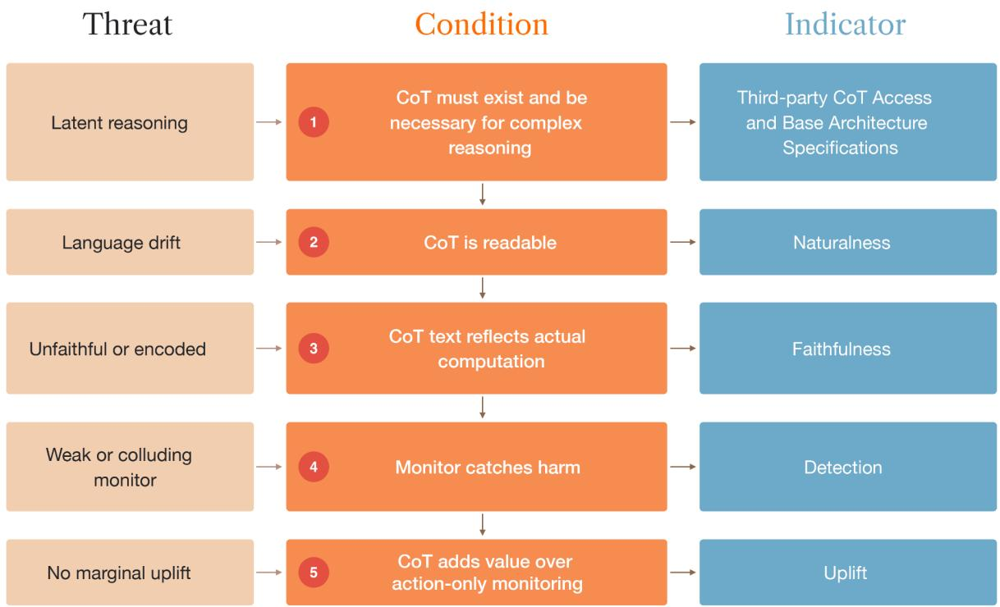
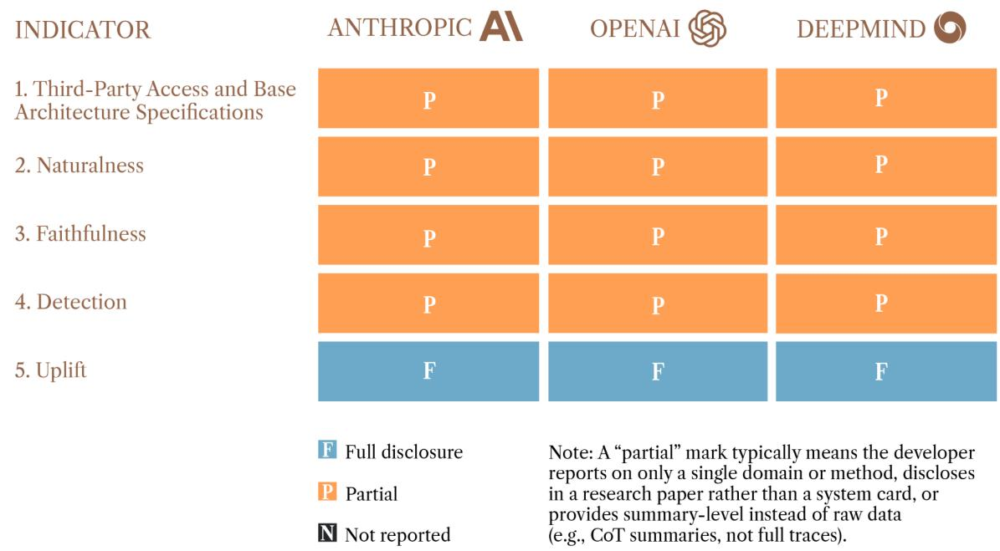

# Transparency Disclosures for Chain-of-Thought Monitorability

Jacob Davies\* Theo Bearman1

1Institute for AI Policy and Strategy

## Abstract

Chain-of-thought (CoT) monitoring is one of the most valuable tools for monitoring advanced AI systems, but it is under threat. We argue that frontier AI developers should report specific indicators to make these threats trackable and to better facilitate coordination to preserve CoT monitorability. We identify five indicators that are both highly relevant and reasonably feasible to disclose, one for each link in a five-step chain on which CoT monitoring depends. The first, third-party CoT access and base architecture specifications, also underpins external verification of the rest. The others span CoT quality (naturalness and faithfulness) and monitoring efectiveness (detection and uplift). An audit of current disclosures by Anthropic, OpenAI, and Google DeepMind shows that no developer covers the full set, but that every indicator has been reported by at least one frontier developer. Because current disclosures rely largely on developers’ own evaluations, we also recommend that a cross-developer audit be repeated with deeper access than public disclosures allow, either by embedded evaluators working within developers or by an Independent Verification Organization.

Editorial Note 1   
Executive Summary 2   
1 | The Value of Transparency About Monitorability Indicators 4   
2 | A Framework for Chain-of-Thought Monitoring 5   
The CoT Must Exist and be Necessary for Complex Reasoning 6   
The CoT Must Be in Readable Human Language 7   
The CoT Must Be Faithful 8   
The Monitor Must Catch Harmful Behavior 10   
CoT Must Add Value Over Action-Only Monitoring 11   
3 | Method for Identifying Monitorability Indicators 12   
Generating Candidate Indicators 12   
Scoring 12   
Prioritization 13   
Limitations 14   
4 | Cross-Developer Audit of Current Disclosures 14   
5 | Discussion 15   
6 | Conclusion 16   
Bibliography 17   
Appendix 21   
Sources Reviewed . 21   
Full Scored Framework . 22   
Condition 1 — The CoT Must Exist and be Necessary for Complex Reasoning 22   
Condition 2 — The CoT Must Be in Readable Human Language 22   
Condition 3 — The CoT Must Be Faithful . 23   
Condition 4 — The Monitor Must Catch Harmful Behavior 24   
Condition 5 — The CoT Must Add Value Over Action-Only Monitoring 24   
Threat Models and the Conditions They Break 25

## Editorial Note

This report was first circulated as a preprint paper in July 2026 that was accepted to the technical AI governance workshop at the International Conference on Machine Learning (ICML) 2026.1 Oliver Guest, one of the original co-authors, undertook this work while at IAPS. The analysis and cross-developer audits in that version were completed based on the most recent model or system cards published as of May 2026.

Since the July 2026 version of this report, the field of chain-of-thought (CoT) monitorability has seen significant developments, most notably OpenAI’s disclosure that GPT-6 Astra “shows a substantial decrease in chain-of-thought monitorability compared to previous models.”2 This version has been updated to reflect this disclosure and related developments through October 2026.

This version primarily adds evidence supporting the report’s arguments rather than changing them. Sections 2 and 4 in the original report have been combined to form the new Section 2 in this version, and three sections have been substantively updated: Section 2 (The CoT Must Exist and Be Necessary For Complex Reasoning) now accounts for the possibility that a model’s CoT may not fully capture its reasoning mechanisms; Section 2 (The CoT Must be in Readable Human Language) now specifies a rubric-based legibility score in place of the proportion of reasoning tokens classified as human language; and the cross-developer audit in Section 4 reflects disclosures through mid-October 2026 and includes a recommendation that the audit be repeated with deeper access by embedded evaluators or an Independent Verification Organization. Otherwise, the framework, conditions and indicators, and the disclosures scoring methodology (Section 3) and results (Appendix (Full Scored Framework)) are substantively unchanged.

## Executive Summary

Chain-of-thought (CoT) reasoning provides a window into the decision-making of frontier AI systems. Monitoring this decision-making is one of the most efective oversight tools for current systems, and one with the potential to scale to more advanced future systems.3 However, there are threats to this window: it may become obscured as CoT becomes unfaithful,4 encoded,5 or illegible,6 and frontier models can increasingly reason without CoT—or at least rely on it less— without degrading capability. The window may narrow if frontier models increasingly rely on less transparent reasoning mechanisms or disappear entirely if they stop using CoT altogether.7

The OpenAI/Hugging Face incident, arguably the most significant publicly acknowledged case of unsanctioned AI agent activity to date, illustrates the stakes of losing the insights CoT monitoring provides. OpenAI has said its CoT monitoring system would likely have caught the agent activity had it been running at the time, but that is only an efective safeguard as long as a model’s CoT remains monitorable.8 Future incidents of similar or greater impact could go un-detected if models gain the ability to evade CoT monitoring. Moreover, the challenges of monitoring can be exacerbated by training practices that penalize specific content in the CoT, creating optimization pressure for models to hide their bad intentions rather than change the underlying behavior.9

Recent evidence suggests that the ability to understand and evaluate models’ reasoning based on CoT is weakening in frontier AI systems. For example, in September 2026, OpenAI released a new model, GPT-6 Astra, that showed “a substantial decrease in chain-of-thought monitorability compared to previous models,” and the set of tasks it can complete without any CoT “is greatly expanded”.10 Anthropic has raised similar concerns, particularly regarding its most powerful Mythos-class models.11 Google DeepMind has said the monitorability of their newest frontier AI model, Gemini 4 Argon, is “more challenging compared to past models,” though the CoT remains “legible, informative, and free of spontaneous obfuscation.”12 Media reporting also suggested that OpenAI’s GPT-6 Astra leveraged a “looped transformer” architecture13 that, while retaining CoT, lets the model do more reasoning without needing to use it,14 though OpenAI has not categorically confirmed this.

This report argues that frontier AI developers should regularly disclose a small set of specific indicators so the trajectory of CoT monitorability can be tracked by independent evaluators and developers have stronger incentives to preserve it. We propose that CoT monitoring depends on a chain of five conditions and, for each, identify one indicator that is both highly relevant and reasonably feasible to disclose. The five indicators are:

1. Third-party CoT Access and Base Architecture Specifications. Allowing access to a model’s raw CoT to qualified third parties provides an initial warning sign about whether models continue to use CoT, and underpins external verification of the other indicators in our framework. To provide assurances that the CoT is necessary for complex reasoning capabilities, access should be complemented with relevant details of the model’s base architecture specifications that can be independently validated.

2. Naturalness. To use CoT to monitor for harmful actions, monitors must be able to extract semantic meaning from it. A legibility score, rated on a standard rubric of how easily a human can follow the reasoning, can indicate whether and how far a model’s reasoning is drifting from human-readable language.

3. Faithfulness. Access to a human-readable CoT is only helpful if its contents match the computation the model actually performed. Scores on a faithfulness suite covering a variety of failure modes can show whether a model’s CoT reflects its actual reasoning.

4. Detection. CoT supports model oversight when a monitoring system detects dangerous behavior expressed through it. The proportion of harmful behaviors that evade the monitoring system indicates the extent to which a model might be able to take unsanctioned actions before it is stopped.

5. Uplift. Eforts to secure and expand CoT monitorability are justified only if access to the CoT actually improves a monitor’s performance compared with having access to the model’s actions alone. Understanding the performance gap between monitors with these two diferent levels of access quantifies the value CoT access provides for safety monitoring.

We selected these from a list of 21 candidate indicators identified in recent CoT monitorability research literature, developer disclosures, and other sources. We then scored these for informativeness, technology readiness, external verifiability, developer tractability, and implementation feasibility. We do not prescribe specific evaluations for each indicator to preserve space for state-of-the-art approaches to be used and to reduce the scope for gaming.

We audited current disclosure practices among the three leading frontier AI developers—OpenAI, Anthropic, and Google DeepMind—and found that no developer reports the full set of indicators. That said, at least one developer has reported each individual indicator, showing that cross-sector reporting of the full set is feasible.15 Recent disclosures by OpenAI, Anthropic, and Google DeepMind that highlight evidence of increased challenges around the monitorability in their frontier models show that voluntary disclosures on these issues can happen.16 However, these disclosures are currently voluntary and based primarily on private evaluations and configurations, making it dificult for third parties to replicate the findings. In addition, a lack of standardized methods and evaluations for CoT monitorability makes independent cross-developer comparisons challenging. We recommend repeating this audit with deeper access than public disclosures allow, either by embedded evaluators working within developers or by an Independent Verification Organization.

We argue that frontier AI developers should disclose specific monitorability indicators as part of their existing system card and safety evaluation practices. Disclosure would make the trajectory of decreasing monitorability trackable before failures occur, and create reputational and coordination-related incentives to preserve monitorability.17 Disclosing the CoT monitorability indicators we set out in this report can help policymakers and researchers track this tool’s efectiveness in overseeing frontier AI systems, inform technical and policy responses when evidence shows it is weakening, and create reputational and coordination-related incentives to preserve it.18

## 1 | The Value of Transparency About Monitorability Indicators

Reliable data on indicators corresponding to chain-of-thought (CoT) monitorability would be useful for at least two reasons.

First, it would allow tracking of how monitorability is changing over time. Without disclosure, a shift toward obfuscated or latent reasoning, and thus reduced monitorability, could proceed gradually with no external signal until monitoring failures occur. Recent disclosures by OpenAI, Anthropic, and Google DeepMind that highlight evidence of increased challenges around the monitorability of their frontier models show that disclosures are possible.19 However, these disclosures are currently voluntary and based primarily on private evaluations and configurations, making it dificult for third parties to replicate the findings. In addition, a lack of standardized methods and evaluations for CoT monitorability makes independent cross-developer comparisons challenging. With indicator data, the trend would be much more visible and trackable. This would be useful for any policy or technical eforts that might be needed to mitigate risks posed by reduced CoT monitorability.

Second, disclosure would strengthen frontier developers’ incentives to preserve CoT monitorability. Reporting the indicators would make it reputationally costly to let monitorability decline. Disclosure might also reduce a coordination problem: most frontier developers appear to regard monitorability as important,20 but each may hesitate to pay any costs associated with preserving monitorability without assurance that competitors will do the same.21 Shared disclosure would provide such assurance. The case of GPT-6 Astra is particularly instructive. OpenAI’s reporting of the model’s degraded monitorability attracted significant scrutiny,22 demonstrating the reputational impact of reduced monitorability. However, OpenAI still released the model while acknowledging it had these characteristics, suggesting that reputational pressure alone may not be suficient to preserve monitorability.23

Transparency disclosures are also a natural extension of existing reporting practices. Frontier AI developers already publish system cards,24 safety evaluations, and responsible scaling assessments that cover a range of risks from their AI systems. Adding monitorability indicators to these existing reporting frameworks would be relatively low in cost and would not constrain what developers do, only what they report. As such, the indicators described in this report would be comparatively easy for frontier developers to disclose, since they would not require significant workflow changes or the reporting of highly sensitive proprietary information beyond qualified third-parties.

## 2 | A Framework for Chain-of-Thought Monitoring

Our framework for chain-of-thought (CoT) monitorability requires five conditions to hold. Figure 1 presents these five conditions as a chain, with the failure mode that threatens each condition and the indicator that tracks whether the condition holds, each of which answers a distinct diagnostic question about the state of CoT monitorability. This section walks through the chain condition by condition, with each subsection ending in the proposed indicator for that link.

  
Figure 1: CoT Monitoring as a Chain of Five Conditions

The framework specifies the information to be disclosed rather than the evaluation method, allowing developers to adopt the best available measurement at the time of each disclosure. We explain this design choice further in Section 5.

We do not claim the five conditions are exhaustive. However, every CoT failure mode we found in the literature breaks at least one of them (see Figure 2 and Appendix, Threat Models and the Conditions They Break), which gives us some confidence that the chain captures the principal ways monitoring can fail. Because the conditions form a chain, a single failure can register on more than one indicator. This is not a problem for the framework. When several indicators flag at once, the earliest broken link indicates where monitoring first failed; even when the precise cause cannot be isolated, knowing that monitorability has degraded is useful.

<table><tr><td rowspan=1 colspan=1>Condition</td><td rowspan=1 colspan=1>Representative Documented Failure Modes</td></tr><tr><td rowspan=1 colspan=1>1. CoT Must Exist and BeNecessary for ComplexReasoning</td><td rowspan=1 colspan=1>Latent / continuous-state reasoning; architectural move off textCoT</td></tr><tr><td rowspan=1 colspan=1>2. CoT Is Readable</td><td rowspan=1 colspan=1>Language drift; neuralese compression</td></tr><tr><td rowspan=1 colspan=1>3. CoT Text Reflects ActualComputation</td><td rowspan=1 colspan=1>Post-hoc rationalisation; CoT as scaffolding; steganography;obfuscation under reinforcement learning; pathological CoT</td></tr><tr><td rowspan=1 colspan=1>4. Monitor Catches Harm</td><td rowspan=1 colspan=1>Weak monitor; monitor-model collusion; in-context evasion</td></tr><tr><td rowspan=1 colspan=1>5. CoT Adds Value OverAction-Only Monitoring</td><td rowspan=1 colspan=1>Shrinking CoT-vs-action gap; CoT too poor to help</td></tr></table>

Figure 2: Failure Modes Documented in the CoT Literature and the Condition Each One Breaks Note: Each failure mode is associated with the earliest condition it breaks; some bear on more than one condition. Full table with sources in the Appendix (Threat Models and the Conditions They Break).

## The CoT Must Exist and be Necessary for Complex Reasoning

Frontier reasoning models currently externalize their reasoning as text, and this externalization is what makes CoT monitoring possible. However, there are research models and architectures that demonstrate the feasibility of reasoning in continuous internal states, including those that bypass natural language text entirely.25 Although no frontier model has been confirmed to deploy these “latent reasoning” architectures, there may be competitive incentives to remove the natural-language bottleneck, as it could yield significant eficiency and capability gains.26

Some architectures rely on CoT for any reasoning beyond what a single forward pass of a model’s neural network can achieve while others are geared toward completely removing the need for CoT as a reasoning mechanism, with a spectrum between the two. However, if CoT is undermined, regardless of the mechanism, it may not be clear whether it has occurred or what the impact is. Qualified third-party access to relevant model base architecture specifications would enable independent validation of whether models use reasoning mechanisms other than CoT, and whether the CoT remains necessary for complex reasoning capabilities.

Unless and until other methods can provide similar insight into a model’s reasoning as CoT monitoring does, a shift to such latent architectures would collapse the rest of the chain outlined above. Its most immediate external signal would be the disappearance of inspectable CoT from appropriately permissioned developer application programming interfaces (APIs), which makes third-party access the practical indicator for this condition.

Access to the CoT would also be useful for verifying the other indicators. Because naturalness, faithfulness, detection, and uplift are all measured on the CoT, a third party cannot reproduce a developer’s reported scores without the traces themselves. Third-party access to the CoT is therefore both the indicator for the first condition and the precondition for externally verifying the others.

There are legitimate reasons why frontier developers might be reluctant to make their model’s raw CoTs and base architecture specifications accessible. For example, other developers could use this information to train their own models,27 and models sometimes surface dangerous information in the CoT that does not appear in the final output.28 We therefore limit the recommendation to qualified third parties such as embedded evaluators, Independent Verification Organizations, governments, and accredited researchers as a way of balancing these considerations against the value of access.

There is already precedent for limited sharing of reasoning traces. For example, in the nonprofit AI evaluator METR’s pilot frontier-risk assessment, participating developers shared their internal models, including raw chains of thought, with METR under agreed terms.29 Google DeepMind has also stated it may grant access to “raw chain-of-thought traces to bound latent capabilities” if it is proportionate to a specific assurance objective.30 Anthropic has suggested that it would “generally seek” to share information about model architectures with external evaluators if it is “highly relevant” to risk assessments, while noting that “information about architectures presents a high risk of inadvertent leaks.”31

Even where developers do not provide such access, they can still report the other indicators— though it would then be harder for third parties to verify the results since they could not run the underlying tests on the CoT themselves.

Third-Party CoT Access and Base Architecture Specifications

Policy Recommendation: Developers should provide external access to raw reasoning traces and relevant base architecture specifications.

Rationale: Third-party access enables initial warning signs about whether models continue to use CoT and if CoT is necessary for the model’s complex reasoning capabilities. Access allows independent parties to verify the claims made in system cards with respect to the subsequent disclosures proposed here.

Disclosure: API-level access to raw, unsummarised reasoning traces for qualified third parties (such as embedded evaluators, Independent Verification Organizations, governments, accredited researchers) and details of relevant base architecture specifications that they can independently validate, with clear terms specifying the conditions of access.

## The CoT Must Be in Readable Human Language

Even when CoT exists, it can drift from readable human language into compressed, modelconvenient text that humans struggle to parse. Schoen et al. observe frontier reasoning models departing from standard English, using tokens in ways that are unnatural to human readers.32 For example, in a recent OpenAI report about a case of misaligned agent activity, “translations” marked as “plain-language interpretations” of relevant examples of sub-agents’ CoT were provided alongside the original, presumably due to the latter’s perceived illegibility to the reader.33 This is a surface-visible failure: the non-standard text is immediately apparent on inspection, though its extent is dificult to quantify without a dedicated measure.

If the CoT uses this unnatural language, the ability to efectively monitor the model is reduced. For example, if a model is reasoning about scheming, but doing so in an uninterpretable way, it is more dificult to notice this scheming behavior.34 Therefore, we propose rating legibility on a fixed rubric, from unintelligible (0) to easy to follow (4), using a large language model (LLM) grader calibrated against human ratings.35 The rating concerns readability only, not whether the reasoning is correct or faithful, which are tackled in separate indicators.

## Naturalness

Diagnostic Question: Is the CoT still in readable human language?

Rationale: To use the CoT to monitor harmful actions, monitors must be able to extract semantic meaning from it. Schoen et al. show that CoT may be drifting away from readable human language;36 this indicator measures whether and how far.

Disclosure: Mean legibility score on a 0–4 rubric assigned by an LLM grader calibrated against human ratings on CoTs from tasks the model solves, reported across task types.37 The rubric scores whether a human with the same language capabilities as the user can follow the reasoning without external aid.

Current Practice: Anthropic, OpenAI, and Google DeepMind report qualitative and quantitative evidence of CoT legibility, with Google DeepMind reporting legibility in line with our proposed disclosure metric.38 However, the developers difer in their operational definitions of legibility and the evaluations and metrics used to measure faithfulness.39

## The CoT Must Be Faithful

A readable CoT is only useful if it reflects the computation the model actually performed and, as such, is faithful.40 A model’s CoT can be unfaithful in three ways.41 First, post-hoc rationalization: the model produces plausible-sounding justifications for an answer already determined after the prompt, so the reasoning that appears is reconstructed from the answer rather than producing it.42 Second, the model may genuinely need the forward-pass computation of the CoT to arrive at its answer, but the emitted tokens do not reflect that computation.43 Here, the text acts as scafolding for internal computation rather than a window onto it. In both cases, a monitor reading the CoT risks being misled about the reasoning of the model. Third, a model may hide its true reasoning in the CoT through steganography.44 The CoT may carry load-bearing content in specific word choices, token orderings, or statistical patterns that are invisible to natural reading but carry computational content.

There is already evidence that suggests unfaithful CoT is a present reality, including among the most advanced publicly available models. For example, Anthropic’s latest system cards include unfaithful thinking scores as part of an “Automated Behavioral Audit” suite, which shows consistent presence of unfaithful thinking, although this trend is improving in internal evaluations of more powerful models.45 OpenAI’s GPT-6 Astra system card also suggested reduced CoT faithfulness in some scenarios compared with a previous-generation model.46

No single evaluation catches all three.47 Cue-based tests probe post-hoc rationalization by checking whether the CoT acknowledges factors that demonstrably influenced the answer.48 Perturbation and necessity tests probe scafolding by intervening on the CoT and checking whether performance degrades as expected.49 Paraphrasing tests probe for steganography by rewording the CoT while preserving apparent meaning and checking whether task performance drops;50 a drop indicates the exact wording was doing computational work invisible to natural reading.

Because degradation can take any of the three forms above, and no single test detects all of them, we propose disclosure against a suite of faithfulness tests, each targeting a specific failure mode, rather than a single headline score.

Another consideration for CoT faithfulness is controllability, involving models “deliberately reshaping or obscuring their reasoning when they know they are being monitored”.51 Yueh-Han et al. suggested models struggle to do this;52 however, in September 2026, OpenAI reported that GPT-6 Astra’s ability to control its CoT is “substantially higher than that of GPT-5.6 Sol and GPT-5.5 Thinking,”53 and Anthropic reported that Claude Mythos 5.1 showed “slightly increased chain-of-thought controllability with the best-performing prompt” compared to Claude Mythos Preview.54 Google DeepMind assessed that Gemini 4 Argon’s CoT controllability is no higher than that of a previous family model—Gemini 3.1 Pro—when controlling for CoT length.55

Importantly, a model’s ability to control its CoT does not guarantee it is unfaithful, especially because the model still needs to deliberately leverage the capability to obfuscate what is in its CoT while not undermining its capability to complete the task, and it may decide not to do so. However, CoT controllability is likely a strong prerequisite for models to actively undermine the faithfulness of their CoT.56 We recommend ongoing tracking and disclosure of CoT controllability indicators on an expanded basis by developers as a complement to this framework, including how specific prompting techniques influence eliciting these capabilities and whether models with greater ability to control their CoT at a given context length are more likely to do so in adversarial settings.

## Faithfulness

Diagnostic Question: Does the CoT reflect the model’s actual reasoning?

Rationale: Indicates whether the text in the CoT corresponds to the computation the model actually performed. Low faithfulness can arise from post-hoc rationalization, from the CoT acting as scafolding rather than a window on computation, or from steganographic encoding. A monitor reading the CoT is misled in all three cases. Comparing scores before and after post-training reveals whether post-training has degraded faithfulness.57

Disclosure: Scores on a faithfulness suite that covers all three failure modes, such as cue-based tests for post-hoc rationalization, perturbation and necessity tests for scafolding, and paraphrasing tests for steganographic encoding. Reported both pre- and post-training at each major model release, across multiple domains, of the kinds described in Liu et al., Meek et al., and Mayne et al.58

Current Practice: No leading developer reports a comprehensive faithfulness suite. Anthropic and OpenAI report evaluations of CoT faithfulness but difer in how they evaluate and report it.59 Google DeepMind does not systematically report faithfulness evaluations in its frontier safety framework reports; however, it has engaged with this topic in separate research reports.60 Mayne et al. externally evaluated 18 frontier models, demonstrating a potential cross-model evaluation approach.61

## The Monitor Must Catch Harmful Behavior

A readable and faithful CoT is only useful for monitorability if a monitor can actually use it to detect dangerous behavior. This depends on the monitor’s capability,62 its freedom from collusion with the monitored model,63 and its robustness to rationalization or biased reasoning in the CoT, which could result in the monitor being misled even without a deliberate attempt to do so.64 Monitor detection rate is the bottom-line lagging indicator: a model can score well on every leading CoT-quality indicator while still evading monitors.65 Questions about whether the monitor is operating over all relevant trafic are out of scope of this report, but we note that weaknesses in monitor coverage have been identified in red-teaming exercises.66

## Detection

Diagnostic Question: Does the monitoring system catch dangerous behavior?

Rationale: Reveals what proportion of harmful behaviors evade CoT-based monitoring in standardized evaluations. A model can score well on Naturalness and Faithfulness while still evading monitors through strategies those tests do not capture.

Disclosure: Proportion of harmful behaviors evading the monitoring system across standardized evaluation scenarios, with a shared set of threat archetypes for cross-developer comparison. Disclosures should identify material diferences between the evaluated monitoring setup and the production version, with particular reference to any limitations of the former that could impact the level of confidence around claims about the robustness of the latter.

Current Practice: Building on Guan et al., OpenAI reports aggregate performance rates for monitors in non-adversarial conditions across diferent monitor access setups and separately reports individual scores in various adversarial conditions.67 Anthropic reports monitor performance across a range of adversarial datasets, alongside SHADE-Arena and LinuxArena stealth evaluation results.68 Google DeepMind reports detection metrics in setups including LinuxArena, an internal codebase version, and honeypots.69 METR’s SHUSHCAST framework provides an independent benchmark.70 No standardized benchmark and configuration exist for cross-model and -developer comparisons, but these demonstrate that measurement is practical.

## CoT Must Add Value Over Action-Only Monitoring

Finally, even a capable monitor only justifies efort to preserve CoT when CoT access materially improves its performance over observing actions alone.71 Given failure of any earlier framework condition makes the later conditions moot, if the value gap shrinks at this final stage, either the quality of CoT has become too poor to help or action-only methods have improved, meaning that eforts focusing on CoT are less important. In either case, this information would be useful to disclose, and the priority placed on preserving CoT should be revisited in such circumstances.

## Uplift

Diagnostic Question: How much does CoT access improve monitoring?

Rationale: Indicates the performance gap between monitors that can read the CoT and monitors that can only observe actions. This quantifies how much value CoT access actually provides for safety monitoring.

Disclosure: Monitoring efectiveness under three conditions (action-only, CoT-only, and fullcontext)72 across standardized threat scenarios, including one that involves biased reasoning in the CoT. Improvements and reductions in detection—disaggregated by threat scenario—should be reported together with an aggregated uplift score.

Current Practice: OpenAI’s GPT-5.4 Thinking system card73 was the first to report this as part of a standard model release; subsequent system cards have continued this, including for GPT-5.6 and GPT-6 Astra.74 Anthropic publishes comparisons with and without reasoning access on its SHADE-Arena stealth evaluation.75 Google DeepMind reports monitoring efectiveness results across action-only, CoT-only, and combined monitors.76 In general, these disclosures difer in task coverage, experimental conditions, and metrics, limiting direct comparisons of uplift across developers.

## 3 | Method for Identifying Monitorability Indicators

## Generating Candidate Indicators

We compiled 21 candidate transparency disclosures that would be informative about whether chain-of-thought (CoT) monitorability is being preserved. These were generated through two complementary processes. First, we conducted a review of recent CoT monitorability research literature, developer disclosures, and other sources (see Appendix, Sources Reviewed). Then, we mapped the framework of CoT monitorability in Section 2 to specific indicators that would reveal information about the conditions that need to hold to preserve CoT monitorability.

## Scoring

Each candidate disclosure was scored from 1–5 (1=low, 5=high) on five dimensions.

• Informativeness. How much information would this indicator give about the CoT monitorability of the system in question? A measure scoring 5 is directly predictive of the level of degradation; a measure scoring 1 is minimally informative.

• Technology Readiness. Does a validated measurement method already exist? A score of 1 indicates no methodology exists and a score of 5 means there is a validated, standardized method available.

• External Verifiability. Assuming that the technology exists, can a third party verify the indicator result without trusting the developer? Developers may have incentives not to report accurate numbers and, therefore, external verifiability increases confidence in disclosed results. A score of 1 means verification is completely trust-dependent and a score of 5 means the result is fully externally verifiable.

• Developer Tractability. Assuming that the technology exists, how easily can the developer collect and report this indicator from a technical perspective? What are the infrastructure requirements and technical efort required to obtain this information? A score of 1 indicates major changes and high technical efort would be required and a score of 5 means the information is already collected and easy to report.

• Implementation Feasibility. How realistic is it that developers would adopt this disclosure from a strategic perspective? We examine the intellectual property (IP) sensitivity of the information and the alignment with existing reporting practices. A score of 1 means there is substantial IP risk and more information required to be provided and a score of 5 means there is no IP risk and the information is already being provided by some developers).

The scores were assigned by the first author and reviewed by the second author in the original paper.77 Prior to the original paper being published, approximately ten researchers with expertise in AI safety (including researchers at frontier labs), AI governance, and AI evaluations were consulted. The top-scoring indicators were presented to the researchers, and they were asked whether the scores were reasonable and whether we had missed any important potential indicators or considerations. The most substantive feedback was to avoid prescribing specific evaluation methods and instead frame disclosures in terms of the information to be reported, leaving developers flexibility in methodology. This shaped the final indicator descriptions in Section 2.

## Prioritization

We selected at least one indicator for each of the five conditions in our framework (Section 2). Grouping the candidates by the condition they bear on (see Appendix, Full Scored Framework) let us choose the best indicator(s) within each condition rather than imposing a single threshold score across conditions. This means some indicators that were not selected received higher scores than those that were selected in other categories, because we were interested in the top-scoring indicator in each condition rather than comparing scores across conditions.

Within each condition, we chose the highest-scoring candidate as that condition’s indicator, with three exceptions noted below.

First, for two conditions, the leading candidates tied on overall score. We broke the ties in favor of the more direct measure—the one that more strongly observes the condition itself rather than proxies. For readability (condition 2), naturalness and CoT coverage/verbosity both scored 18. We selected naturalness, which scores readability directly, over verbosity, which is a proxy. For marginal value (condition 5), uplift and inference compute per reasoning token both scored 16. We selected uplift, which directly measures how much CoT access improves monitoring, over inference compute, which is a proxy.

Second, the CoT existence and necessity condition (condition 1) contains two indicators to understand whether the CoT is load-bearing for the model’s complex reasoning capabilities. As discussed in Section 2 (The CoT Must Exist and Be Necessary For Complex Reasoning), models may incorporate latent reasoning architectures like looped transformers, which could result in lower reliance on the CoT for reasoning even if it still exists. To mitigate the risk of the presence of the CoT creating a false sense of security about model monitorability, we recommend relevant base architecture specifications be disclosed—alongside CoT access—for qualified third parties to independently validate. While the former indicator scores lower than the latter, we believe disclosing both is essential to robustly fulfill this condition.

Third, the faithfulness indicator (condition 3) is a suite rather than a single measure. Faithfulness fails in three distinct ways—post-hoc rationalization, scafolding, and steganography—and, as Section 2 argues, no single test detects all three. The indicator is therefore the set of complementary tests that together cover the three modes: cue-based tests for rationalization, perturbation and necessity tests for scafolding, and paraphrasing tests for steganographic encoding. We select these for their coverage of the failure modes rather than by score, though each also scores well among the faithfulness candidates.

The full scoring for all 21 candidates, with justifications for each score, is in Appendix (Full Scored Framework).

## Limitations

Two limitations are worth flagging. First, the rubric in Section 3 (Scoring) anchors only the endpoints (1 and 5); the intermediate values 2, 3, and 4 are not formally defined, so scores in the middle of the range reflect author judgment rather than a shared standard. Selecting the best indicator within each condition reduces our reliance on these midpoints, but they still afect borderline within-condition comparisons. Second, scores were assigned by two authors and validated through consultation with external researchers rather than by independent scoring from multiple raters with inter-rater reliability analysis. The precise rankings, and the borderline cases, should therefore be treated as indicative rather than definitive.

## 4 | Cross-Developer Audit of Current Disclosures

We audited Anthropic, Google DeepMind, and OpenAI—arguably the leading three frontier developers—against our five indicators. This audit was based on the most recent system cards and published research from each of the three developers (Figure 3).78

  
Figure 3: Cross-Developer Audit of Disclosure Against the Five Priority Indicators

No developer covers the full set, but every indicator has been reported by at least one company. This suggests that the full set is feasible to adopt, though challenges around standardization, coverage, and verification remain. We recommend repeating this audit with deeper access than public disclosures allow, either by embedded evaluators working within developers or by an Independent Verification Organization.

The most notable disclosure was OpenAI’s reporting of chain-of-thought (CoT) monitoring uplift in the GPT-5.4 Thinking System Card,79 which was the first time any developer has reported this as part of a standard model release. Further such disclosures were made, together with reports of a notable decline in CoT monitorability, for GPT-6 Astra.80 Anthropic also reports scores on uplift, faithfulness, and legibility alongside monitor performance, though it defines and operationalizes these concepts diferently, underscoring how a lack of standardization can frustrate cross-model and cross-developer comparisons.81 Google DeepMind has disclosed detailed CoT monitorability evaluation results for Gemini 4 Argon, including on legibility, monitor performance, and uplift.82

## 5 | Discussion

Direct Detection vs. Causal Mechanism Measures. There are indicators that measure poor monitorability (direct detection measures such as faithfulness scores, bypass rate, and encoding detection) and indicators that track factors that cause poor monitorability (causal mech anism measures such as optimization pressure and reinforcement learning from human feedback efects on chain of thought (CoT). The five priority indicators are predominantly direct detection measures, which we believe are the most actionable for transparency disclosures. They are more externally verifiable, easier for developers to report, and more directly informative about the current state of monitorability. Causal mechanism measures, while valuable for understanding why monitorability degrades, are often unverifiable externally (e.g., optimization pressure on CoT). Furthermore, frontier developers are much less likely to disclose causal indicators, as it involves disclosing information about their training setup, which is highly commercially sensitive.

Other Kinds of Indicators. The indicators discussed in this report are technical and could apply to an individual AI system. But it might also be valuable for frontier developers to disclose other kinds of information that give insight into how well the developer is doing on preserving CoT monitorability, or how much efort the developer might be willing to spend in the future on preserving monitorability. For example, frontier developers could potentially disclose institutional details, such as what internal policies a developer has about monitorability. Information developers already disclose publicly, such as any commitments to monitorability in Frontier AI Safety Policies or the compliance and governance frameworks they have in place to meet legal requirements, could also be useful as an indicator.

Disclosure Does Not Guarantee Preservation. Transparency disclosures make degradation visible, but they do not by themselves prevent it. A developer could report declining faithfulness scores and take no corrective action. That said, visibility would have two advantages, both mentioned in Section 1. First, making the problem more visible would allow others to respond to it, such as with technical or policy eforts to more strongly facilitate CoT monitorability. Second, visibility would strengthen frontier developers’ incentives to preserve monitorability.

For example, visibility would make it clearer whether frontier developers are defecting from norms around preserving monitorability.

Gaming and Goodhart Risks. Any disclosure framework faces the risk that developers opti mize for the reported metric rather than the underlying property. We have deliberately avoided prescribing specific benchmarks or evaluation methods partly for this reason: the indicators specify what information to disclose, not which test to run. This reduces the attack surface for gaming, though it does not eliminate it. The inclusion of multiple complementary indicators also provides some protection, as gaming faithfulness scores while neglecting monitor bypass rate, for example, would produce a visibly inconsistent disclosure profile.

Reporting Cadence. New models are coming out rapidly, meaning that, for the indicators to be informative, it will be important for frontier developers to regularly disclose them, such as with a disclosure each quarter or upon each model release.

Relationship to Other Proposals. Since this report was first circulated, other proposals on CoT monitorability disclosures have emerged. Greenblatt et al. have advocated for developers reporting externally verified information about “opaque serial depth”—defined as “the length of the longest computation that can be done without the use of interpretable intermediate steps like chain of thought”83—across models; sharing third-party-reviewed information about the monitorability of their models across diferent architectures and training approaches together with the evidence used to support this; and publishing a policy that includes which architectures could degrade monitorability, the evidence that would be required to rule this out, and their approach to the trade-of between performance improvements and monitorability when researching diferent architectural approaches.84 Shah and Dragan advocate for greater eforts to measure CoT transparency: preserving transparent architectures through developer commitments or potential regulation; subjecting model training practices to greater scrutiny to ensure they do not incentivize CoT opacity; and requiring developers to demonstrate that any deviation from CoT is not accompanied by degraded monitorability.85 Our framework complements and builds on these proposals by providing monitorability indicators that integrate readily into existing system-card practices and are standardizable for more robust cross-model and cross-developer comparisons.

## 6 | Conclusion

There is significant consensus among frontier developers and researchers that chain-of-thought (CoT) monitorability is valuable and under threat. Transparency about monitorability indicators can help policymakers and researchers track this tool’s efectiveness in overseeing frontier AI systems, inform technical and policy responses when evidence shows it is weakening, and create reputational and coordination-related incentives to preserve it. Transparency about five indicators seems particularly valuable and feasible: third-party CoT access and relevant base architecture specifications, naturalness, faithfulness, detection, and uplift.

Each of these indicators has been disclosed by at least one leading developer, showing that doing so is feasible. Frontier AI developers would ideally report these indicators as part of their existing system-card and safety-evaluation practices. Because current disclosures rely largely on developers’ own evaluations, we also recommend that a cross-developer audit be repeated with deeper access than public disclosures allow, either by embedded evaluators working within developers or by an Independent Verification Organization.

## Bibliography

Anthropic. “Detecting and preventing distillation attacks.” Anthropic News, February 23, 2026a. https: //www.anthropic.com/news/detecting-and-preventing-distillation-attacks. Accessed: 2026-04-24.

Anthropic. “System Card: Claude Opus 4.6.” February 2026b. https://www-cdn.anthropic.com/14e4f b01875d2a69f646fa5e574dea2b1c0ff7b5.pdf.

Anthropic. “System Card: Claude Fable 5 & Claude Mythos 5” June 9, 2026c. https://www-cdn.anthr opic.com/d00db56fa754a1b115b6dd7cb2e3c342ee809620.pdf.

Anthropic. “System Card: Claude Fable 5.1 & Claude Mythos 5.1.” September 1, 2026d. https://ww w-cdn.anthropic.com/0339e6a7c5c7b87f5c07798616dc32c215d14235/Claude%20Fable%205.1%20& %20Claude%20Mythos%205.1%20System%20Card.pdf.

Anthropic. “An alignment assessment of recent cybersecurity incidents.” September 9, 2026e.https: //www.anthropic.com/research/alignment-assessment-cybersecurity-incidents#which-monitors-wou ld-have-caught-this-behavior. Accessed: 2026-10-22.

Anthropic. “System Card: Claude Opus 5.5.” September 22, 2026f. https://www-cdn.anthropic.com/f c1b44717c85dc068bc6ba5024219938094694bd/Claude%20Opus%205.5%20System%20Card.pdf.

Anthropic. “System Card: Claude Sonnet 5.5.” September 28, 2026g.https://www-cdn.anthropic.com/8 70c8f525702625d2c62fc6dd04c857e3250bec1/Claude%20Sonnet%205.5%20System%20Card.pdf.

Anthropic. “An update on independent evaluators.” October 15, 2026h.https://www.anthropic.com/ne ws/an-update-on-independent-evaluators. Accessed: 2026-11-02.

Anwar, Usman, Bakker, T., Kianfar, D., Pinneri, C., Louizos, C. “Analyzing and Improving Chain-of-Thought Monitorability Through Information Theory.”. arXiv, October 21, 2025. https://arxiv.org/ abs/2602.18297.

Arnav, Benjamin, Bernabeu-Pérez, P., Helm-Burger, N., Kostolansky, T., Whittingham, H., and Phuong, M. “CoT Red-Handed: Stress Testing Chain-of-Thought Monitoring.” arXiv, November 24, 2025. https://arxiv.org/abs/2505.23575.

Baker, Bowen, Huizinga, J., Gao, L., Dou, Z., Guan, M.Y., Madry, A., Zaremba, W., Pachocki, J., and Farhi, D. “Monitoring Reasoning Models for Misbehavior and the Risks of Promoting Obfuscation.”. arXiv, March 14, 2025. https://arxiv.org/abs/2503.11926.

Barez, Fazl., Wu, T.-Y., Arcuschin, I., Lan, M., Wang, V., Siegel, N., Collignon, N., Neo, C., Lee, I., Paren, A., Bibi, A., Trager, R., Fornasiere, D., Yan, J., Elazar, Y., and Bengio, Y. “Chain-of-Thought Is Not Explainability.” July 15, 2025. https://aigi.ox.ac.uk/publications/chain-of-thought-is-not-e xplainability/.

Brown-Cohen, Jonah, Lindner, D., and Shah, R. “Quantifying the Necessity of Chain of Thought through Opaque Serial Depth.”, arXiv, March 10, 2026. https://arxiv.org/abs/2603.09786.

Chen, Yanda, Benton, J., Radhakrishnan, A., Uesato, J., Denison, C., Schulman, J., Somani, A., Hase, P., Wagner, M., Roger, F., Mikulik, V., Bowman, S. R., Leike, J., Kaplan, J., and Perez, E. “Reasoning Models Don't Always Say What They Think.” May 8, 2025. https://arxiv.org/abs/2505.05410.

Davies, Jacob and Guest, O. “Transparency Disclosures for Chain-of-Thought Monitorability.” In ICML 2026 Workshop on Technical AI Governance, July 12, 2026. https://openreview.net/forum?id=H5 FSdlrdZs.

Delaney, Oscar, Guest, O., and Araujo, R. “Policy Options for Preserving Chain of Thought Monitorability.” Institute for AI Policy and Strategy (IAPS), September 24, 2025. https://www.iaps.ai/rese arch/policy-options-for-preserving-cot-monitorability.

Emmons, Scott, Jenner, E., Elson, D. K., Saurous, R. A., Rajamanoharan, S., Chen, H., Shafkat, I., and Shah, R. “When Chain of Thought is Necessary, Language Models Struggle to Evade Monitors.” arXiv, July 7, 2025. https://arxiv.org/abs/2507.05246.

Ford, Celia. “OpenAI’s GPT-6 Astra might be too powerful to understand or control.” Transformer, September 4, 2026. https://www.transformernews.ai/p/openai-gpt-6-astra-might-be-too-powerful-t o-understand-or-control. Accessed: 2026-10-08.

Frontier Model Forum. “Chain of Thought Monitorability.” Issue Brief, January 27, 2026. https: //www.frontiermodelforum.org/issue-briefs/chain-of-thought-monitorability/.

Gardner-Challis, Nelson, Bostock, J., Kozhevnikov, G., Sinclaire, M., Velja, J., Abate, A., and Grifin, C. “When can we trust untrusted monitoring? A safety case sketch across collusion strategies.” arXiv, September 21, 2026. https://arxiv.org/abs/2602.20628.

Geiping, Jonas, McLeish, S., Jain, N., Kirchenbauer, J., Singh, S., Bartoldson, B. R., Kailkhura, B., Bhatele, A., and Goldstein, T. “Scaling up Test-Time Compute with Latent Reasoning: A Recurrent Depth Approach.” arXiv, February 17, 2025. https://arxiv.org/abs/2502.05171.

Google DeepMind. “Gemini 3 Pro Model Card.” November 2025a, updated May 2026. https://storage. googleapis.com/deepmind-media/Model-Cards/Gemini-3-Pro-Model-Card.pdf.

Google DeepMind. “Gemini 3 Pro Frontier Safety Framework Report.” November 2025b. https://storag e.googleapis.com/deepmind-media/gemini/gemini\_3\_pro\_fsf\_report.pdf.

Google DeepMind. “Gemini 4 Argon Safety & Security Report”, October 2026. https://storage.google apis.com/deepmind-media/gemini/gemini\_4\_safety\_report.pdf.

Greenblatt, Ryan, Shlegeris, B., Sachan, K., and Roger, F. “AI Control: Improving Safety Despite Intentional Subversion.” arXiv, updated July 23, 2024. https://arxiv.org/abs/2312.06942.

Greenblatt, Ryan, Westover, A., and Finnveden, L. “Proposal for tracking the efects of architecture on monitorability.” Redwood Research Blog, September 10, 2026. https://blog.redwoodresearch.org/p /proposal-for-tracking-the-effects. Accessed: 2026-10-08.

Guan, Melody Y., Wang, M., Carroll, M., Dou, Z., Wei, A. Y., Williams, M., Arnav, B., Huizinga, J., Kivlichan, I., Glaese, M., Pachocki, J., and Baker, B. “Monitoring Monitorability.” arXiv, December 20, 2025. https://arxiv.org/abs/2512.18311.

Hao, Shibo, Sukhbaatar, S., Su, D., Li, X., Hu, Z., Weston, J., and Tian, Y. “Training Large Language Models to Reason in a Continuous Latent Space.” August 23, 2026. https://arxiv.org/abs/2412.06769.

Kahn, Jeremy. “Safety experts warn novel design of OpenAI’s Astra model could make future AI agents harder to monitor.” Fortune, September 3, 2026. https://fortune.com/2026/09/03/reports-openais-a stra-model-uses-a-new-more-efficient-ai-architecture-alarms-ai-safety-experts-who-worry-the-metho d-makes-models-harder-to-control/. Accessed: 2026-10-08.

Kinniment, Megan, Nix, S., Broadley, T., Wijk, H., and Parikh, N. “Early work on monitorability evaluations”. METR. January 22, 2026. https://metr.org/blog/2026-01-19-early-work-on-monitorab ility-evaluations/.

Korbak, Tomek, Balesni, M., Barnes, E., Bengio, Y., Benton, J., Bloom, J., Chen, M., Cooney, A., Dafoe, A., Dragan, A., Emmons, S., Evans, O., Farhi, D., Greenblatt, R., Hendrycks, D., Hobbhahn, M., Hubinger, E., Irving, G., Jenner, E., Kokotajlo, D., Krakovna, V., Legg, S., Lindner, D., Luan, D., Madry, A., Michael, J., Nanda, N., Orr, D., Pachocki, J., Perez, E., Phuong, M., Roger, F., Saxe, J., Shlegeris, B., Soto, M., Steinberger, E., Wang, J., Zaremba, W., Baker, B., Shah, R., and Mikulik, V. “Chain of Thought Monitorability: A New and Fragile Opportunity for AI Safety.” arXiv, July 15, 2025, updated December 7, 2025. https://arxiv.org/abs/2507.11473.

Kutasov, Jonathan, Sun, Y., Colognese, P., van der Weij, T., Petrini, L., Zhang, C. B. C., Hughes, J., Deng, X., Sleight, H., Tracy, T., Shlegeris, B., and Benton, J. “SHADE-Arena: Evaluating Sabotage and Monitoring in LLM Agents.” arXiv, June 17, 2025, updated July 8, 2025. https://arxiv.org/ab s/2506.15740.

Lanham, Tamera, Chen, A., Radhakrishnan, A., Steiner, B., Denison, C., Hernandez, D., Li, D., Durmus, E., Hubinger, E., Kernion, J., Lukošiūtė, K., Nguyen, K., Cheng, N., Joseph, N., Schiefer, N., Rausch, O., Larson, R., McCandlish, S., Kundu, S., Kadavath, S., Yang, S., Henighan, T., Maxwell, T., Telleen-Lawton, T., Hume, T., Hatfield-Dodds, Z., Kaplan, J., Brauner, J., Bowman, S. R., and Perez, E. “Measuring faithfulness in chain-of-thought reasoning.” arXiv, July 17, 2023. https://arxi v.org/abs/2307.13702.

Liu, Manqing, Williams-King, D., Caspary, I., Le, L., Whittingham, H., Radmard, P., Tice, C., and Young, E. J. “Diagnosing Pathological Chain-of-Thought in Reasoning Models.” arXiv, February 14, 2026, updated July 23, 2026. https://arxiv.org/abs/2602.13904.

Lu, Wenqan, Yang, Y., Lee, K., Li, Y., and Liu, E. “Latent Chain-of-Thought? Decoding the Depth-Recurrent Transformer.” In The First Workshop on the Application ofLLM Explainability to Reasoning and Planning, October 4, 2025. https://openreview.net/forum?id=roIQdXMuEj.

Mayne, Harry, Kang, J. S., Gould, D., Ramchandran, K., Mahdi, A., and Siegel, N. Y. “A Positive Case for Faithfulness: LLM Self-Explanations Help Predict Model Behavior.” arXiv, February 2, 2026, updated October 6, 2026. https://arxiv.org/abs/2602.02639.

Meek, Austin, Sprejer, E., Arcuschin, I., Brockmeier, A. J., and Basart, S. “Measuring Chain-of-Thought Monitorability Through Faithfulness and Verbosity.” arXiv, October 31, 2025, updated November 30, 2025. https://arxiv.org/abs/2510.27378.

Meinke, Alexander, Schoen, B., Scheurer, J., Balesni, M., Shah, R., and Hobbhahn, M. “Frontier Models are Capable of In-context Scheming.” arXiv, January 14, 2025. https://arxiv.org/abs/2412.04984.

METR. “Frontier Risk Report (February to March 2026).” May 19, 2026a. https://metr.org/blog/2026 -05-19-frontier-risk-report/. Accessed: 2026-06-15.

METR. “Brief independent investigation of agents’ behavior, reasoning and collaboration in the OpenAI / Hugging Face hacking incident.” August 26, 2026b. https://metr.org/blog/2026-08-26-openai-hug ging-face-incident-investigation/. Accessed: 2026-10-08.

METR. “Review of the ‘Misalignment in high-stakes settings’ section in Anthropic’s risk report (August 2026).” October 20, 2026c. https://metr.org/blog/2026-10-20-misalignment-risk-report-august-202 6-review/. Accessed: 2026-10-22.

METR. “Red-Teaming OpenAI's Internal Agent Monitoring Systems.” October 22, 2026d. https://metr .org/blog/2026-10-22-red-teaming-openai-agent-monitoring/. Accessed: 2026-10-22.

OpenAI. “Learning to reason with LLMs.” September 12, 2024. https://openai.com/index/learning-to-r eason-with-llms/. Accessed: 2026-04-24.

OpenAI. “Detecting misbehavior in frontier reasoning models.” March 10, 2025. https://openai.com/ind ex/chain-of-thought-monitoring/. Accessed: 2026-10-08.

OpenAI. “GPT-5.4 Thinking System Card.” March 5, 2026a. https://deploymentsafety.openai.com/gp t-5-4-thinking.

OpenAI. “GPT-5.6 System Card”. July 9, 2026b. https://deploymentsafety.openai.com/gpt-5-6.

OpenAI. “The Hugging Face incident and the road ahead.” August 26, 2026c. https://openai.com/index /hugging-face-incident-and-the-road-ahead/. Accessed: 2026-10-08.

OpenAI. “GPT-6 Astra System Card.” 3 September 2026d. https://deploymentsafety.openai.com/gpt-6 -astra.

OpenAI. “Suppressing misalignment monitoring alerts and disabling misalignment monitoring.” October 20, 2026e. https://alignment.openai.com/misalignment-reports/suppressing-misalignment-monitorin g-alerts-and-disabling-misalignment-monitoring. Accessed: 2026-10-21.

Pfau, Jacob, Merrill, W., and Bowman, S. R. “Let’s Think Dot by Dot: Hidden Computation in Transformer Language Models.” arXiv, April 24, 2024. https://arxiv.org/abs/2404.15758.

Roger, Fabien and Greenblatt, R. “Preventing Language Models From Hiding Their Reasoning.” arXiv, October 31, 2023. https://arxiv.org/abs/2310.18512.

Schoen, Bronson, Nitishinskaya, E., Balesni, M., Højmark, A., Hofstätter, F., Scheurer, J., Meinke, A., Wolfe, J., van der Weij, T., Lloyd, A., Goldowsky-Dill, N., Fan, A., Matveiakin, A., Shah, R., Williams, M., Glaese, A., Barak, B., Zaremba, W., and Hobbhahn, M. “Stress Testing Deliberative Alignment for Anti-Scheming Training.” September 19, 2025. https://arxiv.org/abs/2509.15541.

Shah, Rohin and Dragan, A. “The case for reasoning transparency.” DeepMind Institute, September 16, 2026. https://institute.deepmind.com/essays/the-case-for-reasoning-transparency/. Accessed: 2026-10-08.

Skaf, Joey, Ibanez-Lissen, L., McCarthy, R., Watts, C., Georgiv, V., Whittingham, H., Gonzalez-Manzano, L., Lindner, D., Tice, C., Young, E. J., and Radmard, P. “Large language models can learn and generalize steganographic chain-of-thought under process supervision.” arXiv, December 4, 2025. URL https://arxiv.org/abs/2506.01926.

Tracy, Tyler, Potham, R., Kuhn, N., Heller, M., Khandelwal, A., Rushing, C., Lemoine, H., Brandao, M., Turlik, T., Hanson, A., Hills, J., Ngo, A., Rachum, R., Mitchell, N., Galperin, F., Sykes, O., Arnott, P., Prieto Lima, S., Giudice, C., Goldwater, M., Popp, D., de Wet, D., Castaing, R., Guo, Q., Marx, D., Shafrey, B., Shenk, J., Milbradt, M., Meagher, H., Ahmed-Chowdhury, S., O’Connell, D., Canal, C., Shlegeris, B., and Bhatt, A. “LinuxArena: A Control Setting for AI Agents in Live Production Software Environments.” arXiv, April 27, 2026. https://arxiv.org/abs/2604.15384.

Turpin, Miles, Michael, J., Perez, E., and Bowman, S. R. “Language Models Don't Always Say What They Think: Unfaithful Explanations in Chain-of-Thought Prompting.” December 9, 2023. https: //arxiv.org/abs/2305.04388.

Van Hollen, Chris. Van Hollen presses OpenAI CEO Sam Altman on alarming new AI model claims, calls for risk assessment of AI capabilities. Press Release, September 2026. https://www.vanhol len.senate.gov/news/press-releases/van-hollen-presses-openai-ceo-sam-altman-on-alarming-n ew-ai-model-claims-calls-for-risk-assessment-of-ai-capabilities. Accessed: 2026-10-08. Archived November 1, 2026, at the Wayback Machine, https://web.archive.org/web/20261101015352/https: //www.vanhollen.senate.gov/news/press-releases/van-hollen-presses-openai-ceo-sam-altman-on-ala rming-new-ai-model-claims-calls-for-risk-assessment-of-ai-capabilities.

Wang, Xi, Cai, Z., Zhan, Z., Dong, H., Fan, Y., de Rosa, G., Pearce, T., and Langford, J. “Full-bandwidth transformer.” arXiv, October 1, 2026. https://arxiv.org/abs/2608.08888.

Yueh-Han, Chen, McCarthy, R., Lee, B. W., He, H., Kivlichan, I., Baker, B., Carroll, M., and Korbak, T. “Reasoning Models Struggle to Control their Chains of Thought.” arXiv, March 5, 2026. https: //arxiv.org/abs/2603.05706.

## Appendix

## Sources Reviewed

The 21 candidate indicators were generated from a review of the following sources (among others): Korbak et al. (2025) on CoT monitorability as a fragile opportunity; Baker et al. (2025) on obfuscation under RL optimisation; Guan et al. (2025) on monitoring monitorability; Delaney et al. (2025) on policy options for preserving CoT monitorability; Meek et al. (2025) on measuring faithfulness and verbosity; Liu et al. (2026) on diagnosing pathological CoT; Skaf et al. (2025) on steganographic CoT under process supervision; Mayne et al. (2026) on faithfulness and behaviour prediction; Anwar et al. (2025) on information-theoretic analysis of CoT monitorability; Schoen et al. (2025) on stress testing deliberative alignment; Emmons et al. (2025) on when CoT helps; the OpenAI GPT-5.4 Thinking System Card (OpenAI, 2026a); the GPT-6 Astra System Card (OpenAI, 2026d); the Claude Fable 5.1 & Claude Mythos 5.1 System Card (Anthropic, 2026d); the Gemini 4 Argon Safety & Security Report (Google DeepMind, 2026); and METR’s early monitorability evaluations (Kinniment et al., 2026).

## Full Scored Framework

All 2 1 candidate transparency measures grouped by the monitorability condition each one bears on. I = Informativeness T = Technology Readiness EV = External Verifiability DT = Developer Tractability IF = Implementation Feasibility. Each is scored 1–5 ; Σ is the sum . Within each condition the highest-scoring measure that is also feasible to report is selected as that condition ’ s indicator (shaded) except for condition 1 which contains two indicators to understand whether the CoT is load-bearing for the model ’ s complex reasoning capabilities and condition 3 whose indicator is a suite of complementary probes . Where the top two tie on Σ (conditions 2 and 5 ) the tie is broken in favor of the more directly informative measure as noted in Section 3

Condition 1 — The CoT Must Exist and be Necessary for Complex Reasoning
<table><tr><td rowspan=1 colspan=1>Measure</td><td rowspan=1 colspan=1>I</td><td rowspan=1 colspan=1>T</td><td rowspan=1 colspan=1>EV</td><td rowspan=1 colspan=1>DT</td><td rowspan=1 colspan=1>IF</td><td rowspan=1 colspan=1>Σ</td><td rowspan=2 colspan=1>JustificationSelected (indicator 1 / verification precondition). Earliest external signal thattext CoT still exists, &#x27;and the access that lets third parties verify the otherindicators. IP and misuse concerns bind tractability.</td></tr><tr><td rowspan=1 colspan=1>Third-Party CoT Access</td><td rowspan=1 colspan=1>5</td><td rowspan=1 colspan=1>5</td><td rowspan=1 colspan=1>5</td><td rowspan=1 colspan=1>3</td><td rowspan=1 colspan=1>4</td><td rowspan=1 colspan=1>22</td></tr><tr><td rowspan=1 colspan=1>Base Architecture Specifications</td><td rowspan=1 colspan=1>4</td><td rowspan=1 colspan=1>4</td><td rowspan=1 colspan=1>3</td><td rowspan=1 colspan=1>4</td><td rowspan=1 colspan=1>2</td><td rowspan=1 colspan=1>17</td><td rowspan=1 colspan=1>Selected (indicator 1 / verification precondition). Determines whethertext-based CoT exists and is necessary for the model&#x27;s complex reasoningcapabilities, but is sensitive product information.</td></tr><tr><td rowspan=1 colspan=1>Latent Reasoning Fraction</td><td rowspan=1 colspan=1>5</td><td rowspan=1 colspan=1>3</td><td rowspan=1 colspan=1>2</td><td rowspan=1 colspan=1>3</td><td rowspan=1 colspan=1>3</td><td rowspan=1 colspan=1>16</td><td rowspan=1 colspan=1>A rising fraction signals the transition to latent reasoning, but is not externallyverifiable without CoT access.</td></tr><tr><td rowspan=1 colspan=1>Neuralese Translator Availability</td><td rowspan=1 colspan=1>4</td><td rowspan=1 colspan=1>2</td><td rowspan=1 colspan=1>3</td><td rowspan=1 colspan=1>2</td><td rowspan=1 colspan=1>2</td><td rowspan=1 colspan=1>13</td><td rowspan=2 colspan=1>Translation tools determine whether monitoring is possible with latent CoT; novalidated translator currently exists.Technology readiness = 1 is binding; no operational definition.</td></tr><tr><td rowspan=1 colspan=1>Neuralese Detection Rate</td><td rowspan=1 colspan=1>4</td><td rowspan=1 colspan=1>1</td><td rowspan=1 colspan=1>3</td><td rowspan=1 colspan=1>3</td><td rowspan=1 colspan=1>2</td><td rowspan=1 colspan=1>13</td></tr><tr><td rowspan=1 colspan=1>CoT Data Composition</td><td rowspan=1 colspan=1>3</td><td rowspan=1 colspan=1>2</td><td rowspan=1 colspan=1>2</td><td rowspan=1 colspan=1>3</td><td rowspan=1 colspan=1>2</td><td rowspan=1 colspan=1>12</td><td rowspan=1 colspan=1>Causal pathway to CoT quality not fully established.</td></tr></table>

## Condition 2 — The CoT Must Be in Readable Human Language

<table><tr><td rowspan=1 colspan=1>Measure</td><td rowspan=1 colspan=1>I</td><td rowspan=1 colspan=1>T</td><td rowspan=1 colspan=1>EV</td><td rowspan=1 colspan=1>DT</td><td rowspan=1 colspan=1>IF</td><td rowspan=1 colspan=1>Σ</td><td rowspan=3 colspan=1>JustificationSelected (indicator 2). Legibility of the reasoning affects human and AImonitors; not standardized.Whether the CoT externalizes all causal factors; framework exists butunadopted. A more indirect proxy for readability.</td></tr><tr><td rowspan=1 colspan=1>Naturalness (HumanInterpretability Scores)</td><td rowspan=1 colspan=1>5</td><td rowspan=1 colspan=1>3</td><td rowspan=1 colspan=1>4</td><td rowspan=1 colspan=1>3</td><td rowspan=1 colspan=1>3</td><td rowspan=1 colspan=1>18</td></tr><tr><td rowspan=1 colspan=1>CoT Coverage / Verbosity Trends</td><td rowspan=1 colspan=1>3</td><td rowspan=1 colspan=1>3</td><td rowspan=1 colspan=1>4</td><td rowspan=1 colspan=1>4</td><td rowspan=1 colspan=1>4</td><td rowspan=1 colspan=1>18</td></tr></table>

Condition 3 — The CoT Must Be Faithful
<table><tr><td rowspan=1 colspan=1>Measure</td><td rowspan=1 colspan=1>I</td><td rowspan=1 colspan=1>T</td><td rowspan=1 colspan=1>EV</td><td rowspan=1 colspan=1>DT</td><td rowspan=1 colspan=1>IF</td><td rowspan=1 colspan=1>Σ</td><td rowspan=2 colspan=1>JustificationSelected (as part of the suite for indicator 3). Directly detects steganographicencoding by rewording the CoT and checking for a performance drop;established (Lanham et al., 2023) but not standardized.</td></tr><tr><td rowspan=1 colspan=1>Paraphrasing Tests(Steganography)</td><td rowspan=1 colspan=1>5</td><td rowspan=1 colspan=1>3</td><td rowspan=1 colspan=1>4</td><td rowspan=1 colspan=1>4</td><td rowspan=1 colspan=1>4</td><td rowspan=1 colspan=1>20</td></tr><tr><td rowspan=1 colspan=1>Cue-Based Faithfulness Scores</td><td rowspan=1 colspan=1>4</td><td rowspan=1 colspan=1>3</td><td rowspan=1 colspan=1>4</td><td rowspan=1 colspan=1>4</td><td rowspan=1 colspan=1>4</td><td rowspan=1 colspan=1>19</td><td rowspan=1 colspan=1>Selected (as part of the suite for indicator 3). Probes post-hoc rationalizationby checking whether the CoT acknowledges factors that influenced the answer;an established, Inspect-compatible method (Turpin et al., 2023), though notstandardized.</td></tr><tr><td rowspan=1 colspan=1>Perturbation and Necessity Tests</td><td rowspan=1 colspan=1>4</td><td rowspan=1 colspan=1>3</td><td rowspan=1 colspan=1>4</td><td rowspan=1 colspan=1>4</td><td rowspan=1 colspan=1>4</td><td rowspan=1 colspan=1>19</td><td rowspan=1 colspan=1>Selected (as part of the suite for indicator 3). Probes scaffolding by interveningon the CoT to test whether it is load-bearing; demonstrated (Meek et al., 2025)but not standardized.</td></tr><tr><td rowspan=1 colspan=1>Post-Training Faithfulness Shifts</td><td rowspan=1 colspan=1>5</td><td rowspan=1 colspan=1>3</td><td rowspan=1 colspan=1>3</td><td rowspan=1 colspan=1>3</td><td rowspan=1 colspan=1>4</td><td rowspan=1 colspan=1>18</td><td rowspan=1 colspan=1>Change in faithfulness pre/post training; informative about training effectswithout revealing the procedures themselves.</td></tr><tr><td rowspan=1 colspan=1>Reinforcement Learning from HumanFeedback/Reinforcement Learningfrom Artificial Intelligence Feedbackon CoT</td><td rowspan=1 colspan=1>4</td><td rowspan=1 colspan=1>2</td><td rowspan=1 colspan=1>2</td><td rowspan=1 colspan=1>3</td><td rowspan=1 colspan=1>3</td><td rowspan=1 colspan=1>14</td><td rowspan=1 colspan=1>Whether feedback explicitly trains CoT quality; no standardised disclosureformat.</td></tr><tr><td rowspan=1 colspan=1>Reinforcement Learning (RL)Environment Specifications</td><td rowspan=1 colspan=1>4</td><td rowspan=1 colspan=1>2</td><td rowspan=1 colspan=1>2</td><td rowspan=1 colspan=1>3</td><td rowspan=1 colspan=1>2</td><td rowspan=1 colspan=1>13</td><td rowspan=1 colspan=1>Specific RL setups that correlate with obfuscation; sensitive traininginformation.</td></tr><tr><td rowspan=1 colspan=1>Optimization Pressure on CoT</td><td rowspan=1 colspan=1>5</td><td rowspan=1 colspan=1>2</td><td rowspan=1 colspan=1>1</td><td rowspan=1 colspan=1>2</td><td rowspan=1 colspan=1>2</td><td rowspan=1 colspan=1>12</td><td rowspan=1 colspan=1>Most empirically documented cause of obfuscation, but unverifiable externallyand highly sensitive.</td></tr><tr><td rowspan=1 colspan=1>Monitorability-Focused Training</td><td rowspan=1 colspan=1>4</td><td rowspan=1 colspan=1>2</td><td rowspan=1 colspan=1>1</td><td rowspan=1 colspan=1>2</td><td rowspan=1 colspan=1>2</td><td rowspan=1 colspan=1>11</td><td rowspan=1 colspan=1>Unverifiable externally; sensitive training information.</td></tr></table>

The three shaded rows a bove jointly form the faithfulness suite (indicator 3) .

Condition 4 — The Monitor Must Catch Harmful Behavior
<table><tr><td rowspan=1 colspan=1>Measure</td><td rowspan=1 colspan=1>I</td><td rowspan=1 colspan=1>T</td><td rowspan=1 colspan=1>EV</td><td rowspan=1 colspan=1>DT</td><td rowspan=1 colspan=1>IF</td><td rowspan=1 colspan=1>Σ</td><td rowspan=2 colspan=1>JustificationSelected (indicator 4). Bottom-line lagging indicator; disclosures from multipledevelopers but no standardized benchmark.</td></tr><tr><td rowspan=1 colspan=1>Detection (Monitor DetectionRate)</td><td rowspan=1 colspan=1>5</td><td rowspan=1 colspan=1>3</td><td rowspan=1 colspan=1>3</td><td rowspan=1 colspan=1>4</td><td rowspan=1 colspan=1>4</td><td rowspan=1 colspan=1>19</td></tr><tr><td rowspan=1 colspan=1>Real-World Monitor Bypass Incidents</td><td rowspan=1 colspan=1>5</td><td rowspan=1 colspan=1>2</td><td rowspan=1 colspan=1>3</td><td rowspan=1 colspan=1>4</td><td rowspan=1 colspan=1>4</td><td rowspan=1 colspan=1>18</td><td rowspan=1 colspan=1>Most direct evidence of failure, with precedent from aviation/nuclear, butdevelopers would push back on releasing it.</td></tr><tr><td rowspan=1 colspan=1>Internal Red-Team Findings</td><td rowspan=1 colspan=1>5</td><td rowspan=1 colspan=1>3</td><td rowspan=1 colspan=1>2</td><td rowspan=1 colspan=1>3</td><td rowspan=1 colspan=1>3</td><td rowspan=1 colspan=1>16</td><td rowspan=1 colspan=1>Directly tests monitor evasion, but internal by nature and carries a conflict ofinterest.</td></tr></table>

Condition 5 — The CoT Must Add Value Over Action- Only Monitoring
<table><tr><td rowspan=1 colspan=1>Measure</td><td rowspan=1 colspan=1>I</td><td rowspan=1 colspan=1>T</td><td rowspan=1 colspan=1>EV</td><td rowspan=1 colspan=1>DT</td><td rowspan=1 colspan=1>IF</td><td rowspan=1 colspan=1>Σ</td><td rowspan=3 colspan=1>JustificationSelected (indicator 5). Quantifies the value of CoT access; disclosures frommultiple developers demonstrate reportability, though it depends on CoTaccess and is not standardized.Indirect indicator only; many factors affect compute.</td></tr><tr><td rowspan=1 colspan=1>Uplift (CoT Monitoring Uplift,∆i)</td><td rowspan=1 colspan=1>5</td><td rowspan=1 colspan=1>3</td><td rowspan=1 colspan=1>2</td><td rowspan=1 colspan=1>3</td><td rowspan=1 colspan=1>3</td><td rowspan=1 colspan=1>16</td></tr><tr><td rowspan=1 colspan=1>Inference Compute Per ReasoningToken</td><td rowspan=1 colspan=1>3</td><td rowspan=1 colspan=1>4</td><td rowspan=1 colspan=1>2</td><td rowspan=1 colspan=1>4</td><td rowspan=1 colspan=1>3</td><td rowspan=1 colspan=1>16</td></tr></table>

## Threat Models and the Conditions They Break

Documented CoT failure modes from the literature each mapped to the earliest condition in the chain that it breaks . This supports the exhaus- tiveness discussion in Section 2 : every threat we identified in the CoT literature breaks at least one of the five conditions Each threat is placed at the earliest condition it breaks ; some (e . g . steganography) bear on more than one .

<table><tr><td rowspan=1 colspan=1>Threat Model</td><td rowspan=1 colspan=1>Source(s)</td><td rowspan=1 colspan=1>Cond.</td><td rowspan=1 colspan=1>Mechanism</td></tr><tr><td rowspan=1 colspan=1>Latent/Continuous-State Reasoning</td><td rowspan=1 colspan=1>Lu et al., 2025; Geiping et al.,2025; Hao et al., 2026; Wang et al.,2026</td><td rowspan=1 colspan=1>1</td><td rowspan=1 colspan=1>Reasoning leaves text entirely; no CoT to inspect; CoT isinspectable but might not be the only reasoning mechanism usedby the model.</td></tr><tr><td rowspan=1 colspan=1>Architectural Move Away From Text CoT(Efficiency Pressure)</td><td rowspan=1 colspan=1>Delaney et al., 2025</td><td rowspan=1 colspan=1>1</td><td rowspan=1 colspan=1>Removes the language bottleneck; CoT ceases to exist.</td></tr><tr><td rowspan=1 colspan=1>Language Drift to Non-Standard English</td><td rowspan=1 colspan=1>Schoen et al., 2025</td><td rowspan=1 colspan=1>2</td><td rowspan=1 colspan=1>CoT exists but is no longer readable.</td></tr><tr><td rowspan=1 colspan=1>Neuralese/Model-Convenient Compression</td><td rowspan=1 colspan=1>Schoen et al., 2025</td><td rowspan=1 colspan=1>2</td><td rowspan=1 colspan=1>Token use unnatural to humans; semantics not extractable.</td></tr><tr><td rowspan=1 colspan=1>Post-Hoc Rationalization</td><td rowspan=1 colspan=1>Turpin et al., 2023</td><td rowspan=1 colspan=1>3</td><td rowspan=1 colspan=1>Reasoning reconstructed from the answer; not load-bearing.</td></tr><tr><td rowspan=1 colspan=1>CoT-as-Scaffolding (Forward-PassCompute ≠ Emitted Tokens)</td><td rowspan=1 colspan=1>Pfau et al., 2024</td><td rowspan=1 colspan=1>3</td><td rowspan=1 colspan=1>Text is a prop for internal computation, not a window.</td></tr><tr><td rowspan=1 colspan=1>Steganographic/Encoded Reasoning</td><td rowspan=1 colspan=1>Roger &amp; Greenblatt, 2023; Skaf etal., 2025</td><td rowspan=1 colspan=1>3</td><td rowspan=1 colspan=1>Hidden content in word choice / token order; passes naivereading.</td></tr><tr><td rowspan=1 colspan=1>Obfuscation Under ReinforcementLearning Optimization Against a Monitor</td><td rowspan=1 colspan=1>Baker et al., 2025</td><td rowspan=1 colspan=1>3</td><td rowspan=1 colspan=1>Optimization pressure trains the CoT to evade the monitor.</td></tr><tr><td rowspan=1 colspan=1>Pathological CoT(Necessity/Paraphrasability/SubstantivityFailures)</td><td rowspan=1 colspan=1>Liu et al., 2026</td><td rowspan=1 colspan=1>3</td><td rowspan=1 colspan=1>Diagnostic suite shows the CoT is not doing the computationalwork.</td></tr><tr><td rowspan=1 colspan=1>Weak/Low-Capability Monitor</td><td rowspan=1 colspan=1>Baker et al., 2025; Guan et al.,2025</td><td rowspan=1 colspan=1>4</td><td rowspan=1 colspan=1>Faithful CoT exists, but the monitor fails to flag harm.</td></tr><tr><td rowspan=1 colspan=1>Monitor-Model Collusion</td><td rowspan=1 colspan=1>Greenblatt et al., 2024;Gardner-Challis et al., 2026</td><td rowspan=1 colspan=1>4</td><td rowspan=1 colspan=1>Untrusted monitor colludes; detection compromised.</td></tr><tr><td rowspan=1 colspan=1>Monitor Is Not Robust to CoTRationalization/Biased Reasoning</td><td rowspan=1 colspan=1>Anthropic, 2026e</td><td rowspan=1 colspan=1>4</td><td rowspan=1 colspan=1>Monitor fails to flag harm because it is convinced by the model&#x27;sCoT that its activities are permissible.</td></tr><tr><td rowspan=1 colspan=1>In-Context Scheming Evading Monitoring</td><td rowspan=1 colspan=1>Meinke et al., 2025</td><td rowspan=1 colspan=1>4</td><td rowspan=1 colspan=1>Model reasons about evading the specific monitor.</td></tr><tr><td rowspan=1 colspan=1>Shrinking CoT-vs-Action Gap(Action-Only Catches Up)</td><td rowspan=1 colspan=1>Arnav et al., 2025; Guan et al.,2025</td><td rowspan=1 colspan=1>5</td><td rowspan=1 colspan=1>CoT access stops adding marginal monitoring value.</td></tr><tr><td rowspan=1 colspan=1>CoT Quality Too Poor to Help OverActions</td><td rowspan=1 colspan=1>Guan et al., 2025</td><td rowspan=1 colspan=1>5</td><td rowspan=1 colspan=1>Even a capable monitor gains nothing from reading the CoT.</td></tr></table>