# When Should Agents Remember? Falsification-Gated Self-Evolution for LLM Agents

Runxuan Tang<sup>1,∗</sup> Haoyu Gao<sup>2,∗</sup> Yuyan Ding<sup>3</sup> Junyi Yao<sup>4</sup> Zihao Zheng<sup>4</sup> Zecheng Sheng<sup>5</sup> Liwei Hou<sup>6,†</sup>

<sup>1</sup>Nanyang Technological University <sup>2</sup>Georgia Institute of Technology <sup>3</sup>University of Washington <sup>4</sup>Washington University in St. Louis <sup>5</sup>The University of Sydney <sup>6</sup>National University of Singapore TANG0609@e.ntu.edu.sg gao.howard517@gmail.com   
yuyand2@uw.edu j.yao@wustl.edu z.zihaogary@wustl.edu zshe0457@uni.sydney.edu.au liweihou@u.nus.edu <sup>∗</sup>Equal contribution. <sup>†</sup>Corresponding author.

## Abstract

LLM agents increasingly operate in long-horizon, verifier-rich environments, but current self-improvement mechanisms often write episode-derived lessons directly into memory, making local success an unreliable signal for reusable and safe knowledge. This paper addresses the core question of when an experience-derived behavioral update should be admitted into persistent agent state. We propose Falsification-Gated Self-Evolution (FGSE), a verifier-grounded framework that represents each candidate lesson as a structured hypothesis with an explicit precondition, behavior change, expected effect, and verifier. FGSE applies the hypothesis only in a temporary state, tests it on target-transfer, falsification, and archivedregression probes, and then commits, refines, or rejects it according to measured gain and risk. Across web, app, tool-use, and long-term memory benchmarks, FGSE achieves strong task performance, including 39.8 WebArena success rate, 78.8 AppWorld average completion, and 0.724/0.487 Pass<sup>1</sup> on τ -Retail/τ -Airline, while reducing falsification failures to 5.0%, regression damage to 1.3%, and harmful committed updates to 3.6%. These results suggest that testing memory updates as hypotheses supports more reliable long-term adaptation.

## 1 Introduction

Large language model (LLM) agents are increasingly expected to operate in long-horizon, interactive environments where they must reason, call tools, update internal context, and recover from mistakes [Yao et al., 2023]. This capability supports web navigation, app-level tool use, and user-facing assistance [Zhou et al., 2024, Trivedi et al., 2024, Yao et al., 2024]; embodied interaction additionally requires grounding language in visual and gestural context [Li et al., 2023]. Continual deployment requires agents to solve current tasks and safely learn reusable behavioral knowledge from experience.

Recent work has made substantial progress toward self-improving agents through self-feedback and reflection [Madaan et al., 2023], verbal reinforcement from past failures [Shinn et al., 2023], reusable skill memory [Wang et al., 2023, Li et al., 2026b], agentic long-term memory organization [Xu et al., 2025], and evolving symbolic contexts or playbooks [Zhou et al., 2025, Zhang et al., 2026f]. These methods show that storing lessons, memories, playbooks, or revised contexts can improve future performance without necessarily updating model weights. An episode-derived update may improve tasks that resemble the triggering episode while overgeneralizing to superficially similar but semantically different situations, conflicting with previously successful behaviors, or accumulating as stale persistent memory. Even in verifier-rich environments, where task success can often be checked after execution, existing self-evolution mechanisms lack a principled criterion for assessing an update’s transferability, retention value, and commitment risk. The central question is how to govern the transition from temporary experience to persistent agent state under transfer, safety, and regression constraints.

We study when an experience-derived behavioral update should enter an LLM agent’s longterm memory. Our approach treats persistent updates as testable hypotheses. As shown in Fig. 1, our approach temporarily applies each candidate update, evaluates its transfer beyond the source episode, robustness to targeted counterexamples, and preservation of archived successful behavior, and then commits, refines, or rejects it.

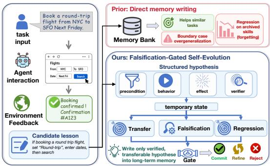

We make the following contributions: (i) We identify a core failure mode of self-evolving agents: target improvement alone is an unreliable signal for persistent memory writing, because many apparently useful updates encode unsafe shortcuts or overly broad applicability conditions. (ii) We introduce Falsification-Gated Self-Evolution (FGSE), a verifier-grounded framework that treats candidate updates as testable hypotheses and performs structured commit–refine–reject triage before long-term retention. (iii) Across web, app,

Figure 1: A locally useful episode-derived lesson may overgeneralize or regress archived skills if directly written into memory. FGSE tests each lesson as a structured hypothesis in a temporary state and commits only verified, transferable updates to long-term memory.

tool-use, and long-term memory settings, FGSE improves task performance while reducing falsification failures, regression damage, harmful committed updates, and post-commit violations compared with reflection-, memory-, and context-evolution baselines.

## 2 Related Work

Interactive language agents and verifier-rich environments. LLM agents combine reasoning with external actions, from ReAct [Yao et al., 2023] to tool use [Qin et al., 2024, Chen and Liu, 2026, Xiao et al., 2026b], while LLM-derived traffic context also augments motion prediction [Zheng et al., 2024]. This progress has enabled realistic web, app, and tool-use benchmarks [Zhou et al., 2024, Trivedi et al., 2024, Yao et al., 2024, Debenedetti et al., 2024], where success can often be checked by executable validators, database states, user goals, or safety constraints. Healthcare-agent evaluation protocols additionally assess episode-level state continuity, evidence traceability, and escalation decisions [Yao et al., 2026]. Complementary work verifies and repairs synthetic web environments before agent training [Zhang et al., 2026a]. A YANG-grounded LLM agent supports multi-vendor OpenROADM management through schema retrieval and validation of generated configurations [Xiao et al., 2026c]. Complementary network-diagnosis work uses multi-head graph attention to jointly address alarm correlation and root alarm detection in optical transport networks [Xiao et al., 2025]. Medical-agent security combines risk perception, evidence constraints, and knowledge-consistency verification [Hu, 2026]. Broader security research studies quantitative vulnerability assessment [Shao, 2026b], SHAP-based explanations for network anomaly detection [Shao, 2026a], APT attribution over heterogeneous threat knowledge graphs [Wang et al., 2026], and provenance-graph anomaly detection [Ma et al., 2026]. FGSE builds on verifier-rich settings and applies verification to candidate behavioral updates before persistent commitment, testing transfer, falsification, and regression safety.

Memory and context-based self-improvement. Another line improves agents without updating model weights. Self-Refine [Madaan et al., 2023] and Reflexion [Shinn et al., 2023] revise future behavior through self-feedback or verbal reinforcement, while Voyager [Wang et al., 2023] stores reusable executable skills. Persistent-memory systems such as Generative Agents [Park et al., 2023], MemoryBank [Zhong et al., 2024], MemGPT [Packer et al., 2023], and A-Mem [Xu et al., 2025] organize memories for retrieval, reflection, and personalization, with LoCoMo [Maharana et al., 2024] and LongMemEval [Wu et al., 2024] evaluating long-horizon memory utility. Recent context-evolution methods, including Symbolic Learning [Zhou et al., 2025], Lighthouse [Yang et al., 2025], and ACE [Zhang et al., 2026f], further revise prompts, playbooks, critiques, or contexts from execution feedback. These methods show that textual updates can improve agents, but they may overgeneralize local lessons, accumulate stale or conflicting memories, or degrade useful context during iterative rewriting, echoing concerns about unreliable self-correction [Huang et al., 2024, Liu et al., 2026b] and unsafe misevolution [Shao et al., 2026]. Adjacent retrieval studies distinguish semantic relevance from factual consistency in RAG [Ye et al., 2026] and show benefits of exemplar diversity under matched context budgets for multi-turn intent understanding [Lin et al., 2026]. FGSE treats each lesson as a structured, verifier-grounded hypothesis and commits it only after falsification and regression testing.

Capability-level contribution evidence. Xu et al. [2026c] propose an observable evidence standard for added planning capabilities, separating presence, opportunity to act, executed-plan change, and incremental operational consequence under controlled replay, with explicit treatment of equivalence, uncertainty, and operating scope. Their analysis requires capability-specific contribution evidence for acceptance, beyond aggregate policy gains or proxy diagnostics. For memory updates, contribution likewise depends on verified behavioral effects beyond storage or retrieval. FGSE evaluates each update against the current agent in a temporary state and requires target-transfer gain, falsification resistance, and regression preservation before commitment (Eq. (8)); subsequent activation requires a matching precondition and a violation record below threshold (Section 4.3). These conditions link contribution evidence to verification and bounded activation of memory updates.

Automated agent optimization and self-evolution. Beyond memory writing, recent work optimizes agent systems by searching over prompts, graph structures, workflows, or multi-agent state machines [Yang et al., 2024, Zhuge et al., 2024, Zhang et al., 2025a, Hu et al., 2025, Zhang et al., 2025b], and improves reasoning policies through test-time reinforcement learning, self-generated curricula, or tool-integrated co-evolution [Zuo et al., 2025, Tian et al., 2025, Huang et al., 2026a, Xia et al., 2025]. In Text-to-SQL, an autonomy-based taxonomy highlights execution-guided self-correction and modular agent collaboration [Su et al., 2027]. Continual adaptation also studies how to preserve knowledge under bounded resources: CoMem [Zhou et al., 2026] uses concept-graph memory and feature-space rehearsal for vision–language adaptation; InduceKV [Chen et al., 2026] externalizes multimodal adaptation into budgeted key–value memories; and Meta-UCF [Xiao et al., 2026d] generates task-conditioned LoRA updates with a shared hypernetwork. Compo-ReAlign [Xiao et al., 2026a] preserves compositional structure through reversible alignment and sensitivity-constrained updates, while Affordance-First Decomposition [Xu et al., 2026b] separates a stable affordance substrate from query-routed, conflict-aware adaptation in video–language learning. These lines address adaptation capacity, retention, and resource efficiency, alongside cross-domain studies of recoverable model pruning [Lu et al., 2026], multi-scale and attention-based visual processing [Zhang et al., 2023, 2024, 2026d], activation design and LLM-guided fusion for forecasting [Zhang et al., 2026b,c], and operational decision making through semantic evidence for inspection allocation [He et al., 2026], causal intervention ranking [Huang et al., 2026b], and accuracy–stability trade-offs in forecasting [Li et al., 2026a]. FGSE addresses a complementary update-level problem: it falsifies each episode-derived update before persistent commitment, preserving self-evolution plasticity while controlling unsafe transfer and regression.

## 3 Preliminary Study

A common self-improvement strategy is to summarize completed episodes into reflective text or experiential insights and store them in memory for future decision making [Shinn et al., 2023]. While such updates can help on similar tasks, they may overgeneralize, disrupt previously solved behaviors, or encode brittle shortcuts. We characterize these failure modes in a diagnostic study.

Diagnostic setup. For each completed episode, the base agent generates a free-form update u, such as a rule, reminder, or behavioral correction, which we inject into the memory prompt and compare against the original agent. For analysis, we evaluate u on four case groups: source replay, near transfer, boundary contrast, and archived success, corresponding to the original episode neighborhood, intended-pattern transfer, superficially similar non-trigger cases, and previously solved tasks. For each group C, we measure the average verifier-score change induced by u:

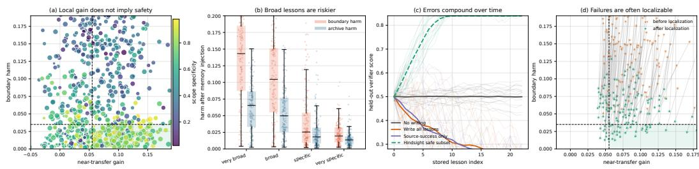  
Figure 2: Exploratory diagnostics for naive episode-derived self-updates. (a) Many updates combine near-transfer gains with boundary harm. (b) Broad and underspecified updates produce substantially higher boundary and archive harm than more specific updates. (c) Sequentially writing free-form lessons into memory can accumulate errors, especially when updates are selected only by source-episode improvement. (d) A post-hoc scope-localization analysis shows that many harmful but useful updates can be repaired by narrowing their applicability, motivating an explicit refinement mechanism.

$$
\Delta _ { } c ( u ) = \frac { 1 } { | \mathcal { C } | } \sum _ { x \in \mathcal { C } } \left[ J ( \Theta \oplus u , x ) - J ( \Theta , x ) \right] ,\tag{1}
$$

where Θ is the original agent state and $\Theta \oplus u$ denotes the same agent with the free-form lesson u appended to memory. We report near-transfer gain $\Delta _ { \mathrm { n e a r } } ( u )$ , boundary harm $[ - \Delta _ { \mathrm { b o u n d a r y } } ( u ) ] _ { + }$ and archive harm $[ - \Delta _ { \mathrm { a r c h i v e } } ( u ) ] _ { + }$ . We also annotate each lesson with a coarse scope-specificity score in [0, 1], where lower values indicate broader and less conditional updates.

Findings. Figure 2 shows that naive memory writing is useful but unreliable. Free-form lessons often improve near-transfer cases but can cause boundary harm, indicating that locally valid behavior may be applied in inappropriate contexts. This failure is closely tied to scope: broad, underspecified lessons produce larger boundary and archive degradation than more specific ones, and sequentially writing them into memory accumulates errors despite short-term source gains. Post-hoc localization further shows that some harmful updates contain valid rules with overly broad applicability; narrowing their scope can retain transfer benefits while reducing harm. These findings motivate FGSE, which treats episode-derived lessons as structured, falsifiable hypotheses, tests them temporarily on target, boundary, and archived cases, and commits or refines them only when supported by evidence.

## 4 Method

## 4.1 Overview

We propose Falsification-Gated Self-Evolution (FGSE), a verifier-grounded framework for reliable long-term improvement of language agents. Given an episode, FGSE converts the observed success or failure into a structured behavioral hypothesis that specifies its precondition, behavior change, expected effect, and verifier. The hypothesis is applied only temporarily and evaluated on targettransfer probes and falsification probes. It is committed to persistent agent state only when it improves target cases, survives targeted falsification, and preserves previously solved behavior. Hypotheses with localized failures are refined once through precondition narrowing and reevaluated; hypotheses that still fail are rejected. Figure 3 summarizes the pipeline, with probe construction and refinement details provided in Appendix A.2 and Appendix A.3.

## 4.2 Falsification-Gated Self-Evolution

Verifier-grounded agent state. At episode t, the agent receives a task $x _ { t }$ and acts under persistent state

$$
\Theta _ { t } = ( \mathcal { M } _ { t } , \pi _ { t } ) , \qquad J _ { v } ( \Theta , x ) = \mathbb { E } _ { \tau \sim p _ { \Theta } ( \cdot | x ) } \left[ v ( x , \tau ) \right] .\tag{2}
$$

Here, $\mathcal { M } _ { t }$ is the retrievable memory of committed evolution units, $\pi _ { t }$ is the current agent policy, $p _ { \Theta } ( \tau \mid x )$ is the trajectory distribution induced by state Θ on task $x ,$ and $v ( x , \tau ) \in [ 0 , 1 ]$ is a verifier-

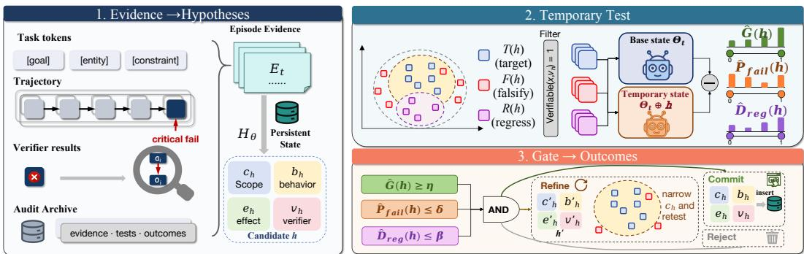  
Figure 3: Overview of Falsification-Gated Self-Evolution (FGSE). FGSE first converts episode evidence into a structured behavioral hypothesis, temporarily evaluates it with target-transfer, falsification, and regression probes, and then commits, refines, or rejects the hypothesis according to verifier-grounded gain and risk criteria.

grounded score. The expectation accounts for stochastic decoding, tool uncertainty, and multi-step interaction. A completed episode yields a trajectory $\tau _ { t }$ and verifier result $r _ { t } = v _ { t } ( x _ { t } , \tau _ { t } )$ , from which FGSE forms an evidence packet $E _ { t } = ( x _ { t } , \tau _ { t } , r _ { t } , \mathcal { A } _ { t } )$ ) using the audit archive $\boldsymbol { A } _ { t }$

Structured evolution hypothesis. Each candidate update is represented as

$$
\boldsymbol { h } = ( c _ { h } , b _ { h } , e _ { h } , v _ { h } ) .\tag{3}
$$

The precondition $c _ { h } : \mathcal { Z }  [ 0 , 1 ]$ assigns an applicability score to an interaction state $z = ( x , \tau _ { < \ell } )$ The behavior transformation $b _ { h }$ maps the current policy to a modified policy $b _ { h } [ \pi _ { \Theta } ]$ . The expectedeffect checker $e _ { h }$ specifies the verifier-observable outcome that should hold after applying the update. The verifier $v _ { h }$ provides the task-level score used to evaluate improvement, failure, and regression. The proposer $H _ { \phi }$ maps the evidence packet to a schema-constrained hypothesis, $h _ { t } = H _ { \phi } ( \bar { E } _ { t } )$ . The proposer generates candidates; the commitment gate determines their retention.

The hypothesis is activated only when its precondition is satisfied:

$$
g _ { h } ( z ) = \mathbb { I } [ c _ { h } ( z ) \geq \gamma _ { h } ] , \qquad \pi _ { \Theta _ { t } \oplus h } ( a \mid z ) = ( 1 - \lambda _ { h } g _ { h } ( z ) ) \pi _ { \Theta _ { t } } ( a \mid z ) + \lambda _ { h } g _ { h } ( z ) b _ { h } [ \pi _ { \Theta _ { t } } ] ( a \mid z ) .\tag{4}
$$

Here, $\gamma _ { h }$ is the activation threshold, $\lambda _ { h } \in [ 0 , 1 ]$ is the intervention strength, and $\Theta _ { t } \oplus h$ denotes temporary application of h without changing persistent memory. The temporary policy remains a valid action distribution because Eq. (4) is a convex combination of two valid policies.

Verifier-grounded probes. For a candidate hypothesis h, FGSE constructs a target-transfer set $\mathcal { T } ( h )$ , a falsification set $\mathcal { F } ( h )$ , and a regression set $\mathcal { R } ( h )$

$$
\mathcal { P } ( h ) = \mathcal { T } ( h ) \cup \mathcal { F } ( h ) \cup \mathcal { R } ( h ) .\tag{5}
$$

The target-transfer set contains cases where the hypothesis is expected to help. The falsification set contains cases designed to expose overgeneralization. The regression set $\bar { \mathcal { R } ( h ) }$ contains archived cases that the current agent already solves and that must not be degraded. $\mathbf { A }$ probe x is admitted only when Verifiable $( x , v _ { h } ) = 1$ , ensuring that the gate is based on executable or externally checkable signals. FGSE builds falsification probes from boundary cases, precondition violations, regression cases, and decoys; their construction is described in Appendix $\bar { \mathbf { A . } 2 }$

Temporary evaluation. FGSE evaluates h by comparing the original state $\Theta _ { t }$ with the temporary state $\Theta _ { t } \oplus h$ on the same probes:

$$
\Delta _ { h } ( x ) = J _ { v _ { h } } ( \Theta _ { t } \oplus h , x ) - J _ { v _ { h } } ( \Theta _ { t } , x ) .\tag{6}
$$

A positive $\Delta _ { h } ( x )$ means that the hypothesis improves verifier-grounded performance on $x ,$ while a negative value indicates harm. Empirical estimation under repeated rollouts is given in Appendix A.4.

Let $E _ { h } ( \Theta , x ) \in \{ 0 , 1 \}$ denote whether the expected effect $e _ { h }$ is satisfied under state $\Theta$ on task x. FGSE computes

$$
\begin{array} { r l } & { \quad \widehat { G } ( h ) = \displaystyle \frac { 1 } { \vert { \mathcal T } ( h ) \vert } \sum _ { x \in { \mathcal T } ( h ) } \Delta _ { h } ( x ) , } \\ & { \widehat { P } _ { \mathrm { f a i l } } ( h ) = \displaystyle \frac { 1 } { \vert { \mathcal F } ( h ) \vert } \sum _ { x \in { \mathcal F } ( h ) } { \mathbb I } [ \Delta _ { h } ( x ) < - \epsilon \vee E _ { h } ( \Theta _ { t } \oplus h , x ) = 0 ] , } \\ & { \widehat { D } _ { \mathrm { r e g } } ( h ) = \displaystyle \frac { 1 } { \vert { \mathcal R } ( h ) \vert } \sum _ { x \in { \mathcal R } ( h ) } [ - \Delta _ { h } ( x ) ] _ { + } . } \end{array}\tag{7}
$$

Here, $\epsilon \geq 0$ is the tolerated verifier-score drop and $[ \cdot ] _ { + } = \operatorname* { m a x } ( \cdot , 0 )$ . The three statistics measure useful transfer, targeted falsification risk, and regression damage.

Commitment gate. The commitment decision is

$$
\mathsf { C o m m i t } ( h ) = \mathbb { I } \left[ \widehat { G } ( h ) \geq \eta \wedge \widehat { P } _ { \mathrm { f a i l } } ( h ) \leq \delta \wedge \widehat { D } _ { \mathrm { r e g } } ( h ) \leq \beta \right] ,\tag{8}
$$

where $\eta > 0$ is the minimum target-transfer gain, $\delta \in [ 0 , 1 ]$ is the maximum falsification rate, and $\beta \geq 0$ is the maximum regression damage. If $\widehat { G } ( h ) \geq \eta$ but failures are concentrated outside a separable sub-scope, FGSE performs one precondition-refinement pass and reevaluates the refined hypothesis. The refinement objective and separability criterion are given in Appendix A.3. A hypothesis that fails after refinement is rejected.

The persistent state is updated by

$$
\Theta _ { t + 1 } = { \left\{ \begin{array} { l l } { \Theta _ { t } \oplus h , } & { { \mathsf { C o m m i t } } ( h ) = 1 , } \\ { \Theta _ { t } , } & { { \mathsf { C o m m i t } } ( h ) = 0 . } \end{array} \right. }\tag{9}
$$

A committed hypothesis is stored together with its precondition, behavior change, verifier, evaluated probes, verifier outcomes, and post-commit violation record. Rejected hypotheses are excluded from retrievable memory.

## 4.3 Runtime Use and Monitoring

During future inference, FGSE retrieves committed hypotheses whose preconditions match the current interaction state and whose violation records remain below threshold. Activated hypotheses modify the policy through the same behavior-transformation interface as Eq. (4). When multiple hypotheses are active, FGSE combines them by normalized precondition scores while preserving a nonzero basepolicy contribution. Post-commit violations update a running violation score; hypotheses exceeding the violation threshold are removed from retrieval. The retrieval, combination, and monitoring rules are provided in Appendix A.5.

## 5 Theoretical Analysis

We analyze whether a hypothesis that passes the finite-probe commitment gate is reliable on the underlying target, falsification, and regression probe distributions. Fix a round t and condition on the pre-evaluation history, so the current state $\Theta _ { t } ,$ evidence packet, and finite candidate set $\mathcal { H } _ { t }$ are fixed. If scope refinement is used, refinement is performed on a development split, while final commitment uses fresh probes.

For each $\textit { h } \in \ \mathcal { H } _ { t }$ , let $\mathcal { D } _ { T } ( h ) , \mathcal { D } _ { F } ( h )$ , and $\mathcal { D } _ { R } ( h )$ denote the target-transfer, falsification, and regression probe distributions. We define

$$
\begin{array} { r l } & { \quad G ( h ) = \mathbb { E } _ { x \sim \mathcal { D } _ { T } ( h ) } \left[ \Delta _ { h } ( x ) \right] , } \\ & { \quad P _ { \mathrm { f a i l } } ( h ) = \mathbb { P } _ { x \sim \mathcal { D } _ { F } ( h ) } \left[ \Delta _ { h } ( x ) < - \epsilon \lor E _ { h } ( \Theta _ { t } \oplus h , x ) = 0 \right] , } \\ & { \quad D _ { \mathrm { r e g } } ( h ) = \mathbb { E } _ { x \sim \mathcal { D } _ { R } ( h ) } \left[ \left[ - \Delta _ { h } ( x ) \right] + \right] . } \end{array}\tag{10}
$$

These quantities measure useful transfer, falsification risk, and regression damage, respectively. Let $\mathrm { L C } \bar { \mathrm { B } } _ { T } ( h )$ $\mathrm { U C B } _ { F } ( h )$ , and $\mathrm { U C B } _ { R } ( h )$ be one-sided confidence bounds for these three quantities, computed from fresh final probes using empirical-Bernstein bounds for real-valued gains and Bernoulli-KL bounds for falsification events. Their finite-sample forms are given in Appendix B.2.

Algorithm 1 Falsification-Gated Self-Evolution   
Require: Agent state $\Theta _ { t } ,$ task $x _ { t } ,$ , trajectory $\tau _ { t } ,$ verifier result $r _ { t } .$ , audit archive $\boldsymbol { A } _ { t }$   
Ensure: Updated state $\Theta _ { t + 1 }$   
1: Form evidence packet $\begin{array} { r } { \dot { E } _ { t } = ( x _ { t } , \tau _ { t } , r _ { t } , \mathcal { A } _ { t } ) . } \end{array}$   
2: Propose structured hypothesis $h = H _ { \phi } ( E _ { t } )$ with fields $( c _ { h } , b _ { h } , e _ { h } , v _ { h } ) .$   
3: Construct ${ \mathcal { T } } ( h ) , { \mathcal { F } } ( { \dot { h } } )$ , and $\mathcal { R } ( h )$ under verifier constraint Verifiable $( x , v _ { h } ) = 1$   
4: Temporarily apply h and evaluate $\Delta _ { h } ( x )$ for all $x \in { \mathcal { T } } ( h ) \cup { \mathcal { F } } ( h )$   
5: Compute ${ \widehat { G } } ( h ) , { \widehat { P } } _ { \mathrm { f a i l } } ( h )$ , and ${ \widehat { D } } _ { \mathrm { r e g } } ( h )$ using Eq. (7).   
6: if Commit $( \dot { h } ) = 1$ then   
7: Set $\Theta _ { t + 1 } \dot { = } \Theta _ { t } \oplus h$ and record the evaluated evidence.   
8: else if ${ \widehat { G } } ( h ) \geq \eta$ and the failures satisfy the refinement criterion in Appendix A.3 then   
9: Refine the precondition, reevaluate the refined hypothesis, and apply Eq. (9).   
10: else   
11: Reject h and set $\Theta _ { t + 1 } = \Theta _ { t }$   
12: end if

Theorem 1 (Generalization of the confidence-gated commitment rule). Suppose that, conditional on the pre-evaluation history, thefinal probesfor each $h \in \mathcal { H } _ { t }$ are sampled from $\mathcal { D } _ { T } ( h ) , \mathcal { D } _ { F } ( h )$ , and $\mathcal { D } _ { R } ( h )$ . Then, with probability at least $1 - \alpha ,$ all $h \in \mathcal { H } _ { t }$ simultaneously satisfy

$$
G ( h ) \geq \mathrm { L C B } _ { T } ( h ) , \qquad P _ { \mathrm { f a i l } } ( h ) \leq \mathrm { U C B } _ { F } ( h ) , \qquad D _ { \mathrm { r e g } } ( h ) \leq \mathrm { U C B } _ { R } ( h ) .\tag{11}
$$

Consequently, any hypothesis satisfying

$$
\mathrm { L C B } _ { T } ( h ) \geq \eta , \qquad \mathrm { U C B } _ { F } ( h ) \leq \delta , \qquad \mathrm { U C B } _ { R } ( h ) \leq \beta\tag{12}
$$

also satisfies the population constraints

$$
G ( h ) \geq \eta , \qquad P _ { \mathrm { f a i l } } ( h ) \leq \delta , \qquad D _ { \mathrm { r e g } } ( h ) \leq \beta .\tag{13}
$$

Proof sketch. Conditioning on the pre-evaluation history fixes $\mathcal { H } _ { t }$ and prevents final probes from being reused for hypothesis construction. Empirical-Bernstein inequalities control the bounded target-transfer and regression quantities, while a Bernoulli-KL bound controls falsification risk. A union bound over hypotheses and statistics gives the simultaneous high-probability event, under which the confidence-gated rule implies the corresponding population constraints.

Corollary 1 (Probe complexity of safe commitment). Up to logarithmicfactors in $| \mathcal { H } _ { t } | , 1 / \alpha ,$ , and the number of falsification probes, it suffices to use

$$
n _ { T } = \widetilde { \cal O } \left( \frac { 1 } { \zeta _ { T } ^ { 2 } } \right) , \qquad n _ { R } = \widetilde { \cal O } \left( \frac { 1 } { \zeta _ { R } ^ { 2 } } \right) , \qquad n _ { F } = \widetilde { \cal O } \left( \frac { 1 } { \mathrm { k l } ( \delta _ { - } \| \delta ) } \right)\tag{14}
$$

final target, regression, andfalsification probes to ensure that any hypothesis with empirical target margin $\zeta _ { T } ,$ , empirical regression margin $\zeta _ { R } ,$ , and empiricalfalsification rate at most $\delta _ { - } < \delta$ satisfies $G ( \bar { h ) \geq \eta } , P _ { \mathrm { f a i l } } ( h ) \leq \delta ,$ , and $D _ { \mathrm { r e g } } ( h ) \leq \beta$ with probability at least $1 - \alpha$ . The exactfinite-sample statement is proved in Appendix B.7.

## 6 Experiments

## 6.1 Experimental Setup

Datasets. We evaluate FGSE on verifier-grounded agentic tasks where updates can be tested before persistent commitment. The benchmark suite covers web and browser control with WebArena [Zhou et al., 2024] and BrowserGym [Le Sellier de Chezelles et al., 2025], app and API interaction with App-World [Trivedi et al., 2024] and τ-bench [Yao et al., 2024], adversarial tool-use robustness with Agent-Dojo [Debenedetti et al., 2024], and long-term memory reliability with LongMemEval [Wu et al., 2024] and LoCoMo [Maharana et al., 2024]. We also include verifier-rich coding and reasoning diagnostics on HumanEval [Chen et al., 2021], MBPP [Austin et al., 2021], SWE-bench Verified [Jimenez et al., 2024, Chowdhury et al., 2024], GSM8K [Cobbe et al., 2021], and MATH [Hendrycks et al., 2021]. Details are provided in App. C.

Table 1: Main comparison on web, app, and tool-interaction benchmarks. For AppWorld, Avg. is the mean of Test-Normal and Test-Challenge task-goal completion. Best and second-best scores in each column are shown in bold and underlined, respectively.
<table><tr><td>Method</td><td>Backbone / Setting</td><td>WebArena SR↑</td><td>AppWorld Normal ↑</td><td>AppWorld Challenge ↑</td><td>AppWorld Avg. ↑</td><td>τ-Retail Pass1 ↑</td><td>τ-Airline Pass1 ↑</td></tr><tr><td colspan="8">Web / browser-control agents: methods primarily designed or evaluated for browser navigation and web interaction.</td></tr><tr><td>GPT-4 Agent [Zhou et al., 2024]</td><td>GPT-4</td><td>14.4</td><td>43.2</td><td>25.4</td><td>34.3</td><td>0.553</td><td>0.378</td></tr><tr><td>AutoEval [Pan et al., 2024]</td><td>GPT-4</td><td>20.2</td><td>45.8</td><td>28.7</td><td>37.3</td><td>0.579</td><td>0.391</td></tr><tr><td>BrowserGym [Le Sellier de Chezelles et al., 2025]</td><td>GPT-40</td><td>24.3</td><td>46.5</td><td>29.1</td><td>37.8</td><td>0.585</td><td>0.402</td></tr><tr><td>CERonline [Liu et al., 2025]</td><td>GPT-40</td><td>33.2</td><td>51.9</td><td>33.4</td><td>42.7</td><td>0.622</td><td>0.424</td></tr><tr><td>CERoffline [Liu et al., 2025]</td><td>GPT-40</td><td>33.4</td><td>52.6</td><td>34.1</td><td>43.4</td><td>0.631</td><td>0.429</td></tr><tr><td>CERhybrid [Liu et al., 2025]</td><td>GPT-40</td><td>36.7</td><td>53.0</td><td>35.5</td><td>44.3</td><td>0.638</td><td>0.437</td></tr><tr><td colspan="8">App / API-interaction agents: methods primarily evaluated on app-level tool use, database-state goals, and API execution.</td></tr><tr><td>IPFunCall [Trivedi et al., 2024]</td><td>GPT-40</td><td>11.8</td><td>32.1</td><td>18.0</td><td>25.1</td><td>0.482</td><td>0.309</td></tr><tr><td>FullCodeRefl [Trivedi et al., 2024]</td><td>GPT-40</td><td>12.7</td><td>33.9</td><td>19.2</td><td>26.6</td><td>0.497</td><td>0.318</td></tr><tr><td>PlanExec [Trivedi et al., 2024]</td><td>GPT-40</td><td>15.9</td><td>44.6</td><td>19.7</td><td>32.2</td><td>0.534</td><td>0.347</td></tr><tr><td>ReAct [Yao et al., 2023, Trivedi et al., 2024]</td><td>GPT-40</td><td>18.1</td><td>48.8</td><td>30.2</td><td>39.5</td><td>0.558</td><td>0.325</td></tr><tr><td>ReAct + ICL [Zhang et al., 2026f]</td><td>DeepSeek-V3.1</td><td>19.6</td><td>64.3</td><td>46.0</td><td>55.2</td><td>0.615</td><td>0.408</td></tr><tr><td>ReAct + GEPA [Agrawal et al., 2026, Zhang et al., 2026f]</td><td>DeepSeek-V3.1</td><td>20.1</td><td>64.9</td><td>46.0</td><td>55.5</td><td>0.620</td><td>0.415</td></tr><tr><td>ReAct + DC [Suzgun et al., 2026, Zhang et al., 2026f]</td><td>DeepSeek-V3.1</td><td>20.6</td><td>65.5</td><td>52.3</td><td>58.9</td><td>0.630</td><td>0.421</td></tr><tr><td>ReAct + ACEoffline [Zhang et al., 2026f]</td><td>DeepSeek-V3.1</td><td>25.7</td><td>76.2</td><td>57.3</td><td>66.8</td><td>0.654</td><td>0.448</td></tr><tr><td>ReAct + ACEonline [Zhang et al., 2026f]</td><td>DeepSeek-V3.1</td><td>26.4</td><td>69.6</td><td>66.7</td><td>68.2</td><td>0.665</td><td>0.456</td></tr><tr><td colspan="8">Tool-user interaction agents: methods centered on multi-turn user simulation, tool calling, and domain-policy execution.</td></tr><tr><td>Tool-Calling [Yao et al., 2024]</td><td>GPT-4o</td><td>17.3</td><td>50.4</td><td>31.6</td><td>41.0</td><td>0.604</td><td>0.420</td></tr><tr><td>Tool-Calling [Yao et al., 2024]</td><td>Claude-3.5-Sonnet</td><td>18.6</td><td>54.2</td><td>34.7</td><td>44.5</td><td>0.692</td><td>0.460</td></tr><tr><td>Act [Yao et al., 2024]</td><td>GPT-40</td><td>15.8</td><td>47.7</td><td>28.2</td><td>38.0</td><td>0.545</td><td>0.365</td></tr><tr><td>ReAct [Yao et al., 2023, 2024]</td><td>GPT-40</td><td>16.4</td><td>48.1</td><td>29.0</td><td>38.6</td><td>0.521</td><td>0.325</td></tr><tr><td colspan="8">Long-term memory agents: methods primarily designed for persistent memory, conversational memory, or memory-augmented retrieval.</td></tr><tr><td>Offline Reading [Wu et al., 2024]</td><td>GPT-4o oracle</td><td>3.5</td><td>12.4</td><td>6.3</td><td>9.4</td><td>0.180</td><td>0.121</td></tr><tr><td>Coze [Wu et al., 2024]</td><td>GPT-40</td><td>9.4</td><td>24.0</td><td>12.9</td><td>18.5</td><td>0.410</td><td>0.270</td></tr><tr><td>ChatGPT [Wu et al., 2024]</td><td>GPT-40</td><td>13.8</td><td>43.0</td><td>26.0</td><td>34.5</td><td>0.560</td><td>0.390</td></tr><tr><td>GPT-4o + Chain-of-Note [Wu et al., 2024]</td><td>long-context</td><td>14.6</td><td>45.0</td><td>28.5</td><td>36.8</td><td>0.575</td><td>0.399</td></tr><tr><td>ChatGPT [Wu et al., 2024]</td><td>GPT-4o-mini</td><td>12.2</td><td>36.5</td><td>20.9</td><td>28.7</td><td>0.520</td><td>0.348</td></tr><tr><td>ReadAgent [Xu et al., 2025]</td><td>GPT-4o-mini</td><td>7.4</td><td>25.3</td><td>12.6</td><td>19.0</td><td>0.420</td><td>0.260</td></tr><tr><td>MemoryBank [Xu et al., 2025]</td><td>GPT-4o-mini</td><td>6.8</td><td>22.9</td><td>10.4</td><td>16.7</td><td>0.390</td><td>0.247</td></tr><tr><td>MemGPT [Xu et al., 2025]</td><td>GPT-4o-mini</td><td>10.7</td><td>29.7</td><td>16.2</td><td>23.0</td><td>0.450</td><td>0.286</td></tr><tr><td>LoCoMo [Maharana et al., 2024, Xu et al., 2025]</td><td>GPT-4o-mini</td><td>11.5</td><td>31.6</td><td>17.3</td><td>24.5</td><td>0.463</td><td>0.300</td></tr><tr><td>A-Mem [Xu et al., 2025]</td><td>GPT-4o-mini</td><td>14.9</td><td>38.2</td><td>22.5</td><td>30.4</td><td>0.544</td><td>0.368</td></tr><tr><td></td><td></td><td></td><td></td><td></td><td></td><td></td><td></td></tr><tr><td>FGSE (Ours)</td><td>GPT-4o-mini</td><td>38.6 ± 1.8</td><td>82.7 ± 2.2</td><td>66.1 ± 2.0</td><td>74.4 ± 1.6 76.6 ± 1.8</td><td>0.707 ± 0.015</td><td>0.478 ± 0.012</td></tr><tr><td>FGSE (Ours) FGSE (Ours)</td><td>GPT-4o DeepSeek-V3.1</td><td>39.2 ± 1.5 39.8 ± 1.2</td><td>84.8 ± 1.3 88.2 ± 1.5</td><td>68.3 ± 1.8 69.4 ± 1.0</td><td>78.8 ± 1.7</td><td>0.716 ± 0.012 0.724 ± 0.010</td><td>0.471 ± 0.010 0.487 ± 0.008</td></tr></table>

Evaluation metrics. We report each benchmark’s official task metric, including success rate, taskgoal completion, pass rate or $\mathrm { p a s s } ^ { k }$ , utility and security success, QA accuracy/F1, pass@1, resolved rate, and exact-match accuracy. To evaluate safe self-evolution, we additionally report target-transfer gain ${ \widehat { G } } ,$ , falsification failure rate $\widehat { P } _ { \mathrm { f a i l } }$ <sub>l</sub>, regression damage ${ \widehat { D } } _ { \mathrm { r e g } } ,$ post-commit violation rate, and harmful update rate.

Baselines. We compare FGSE with non-evolving agents, including direct prompting and ReAct [Yao et al., 2023], as well as self-update baselines such as Self-Refine [Madaan et al., 2023], Reflexion [Shinn et al., 2023], Voyager-style skill memory [Wang et al., 2023], and naive episodic memory. We further compare with recent self-evolving or agent-optimization methods, including Symbolic Learning [Zhou et al., 2025], AlphaLLM [Tian et al., 2024], GPTSwarm [Zhuge et al., 2024], AFlow [Zhang et al., 2025a], ADAS [Hu et al., 2025], MetaAgent [Zhang et al., 2025b], A-Mem [Xu et al., 2025], Lighthouse [Yang et al., 2025], and

<table><tr><td></td><td></td><td>G (%)</td><td>Ptail (%)</td><td>Dreg (%)</td><td>Harmful updates (%) metric intensity</td><td>Column-normalized high</td></tr><tr><td rowspan="2">Web</td><td>WebArena</td><td>9.6</td><td>10.5</td><td>2.3</td><td>6.6</td><td rowspan="10"></td></tr><tr><td>BrowserGym</td><td>8.9</td><td>9.4</td><td>2.0</td><td>5.8</td></tr><tr><td rowspan="2">App</td><td>AppWorld-Normal</td><td>12.8</td><td>11.4</td><td>2.5</td><td>7.2</td></tr><tr><td>AppWorld-Challenge</td><td>14.4</td><td>17.4</td><td>3.8</td><td>10.8</td></tr><tr><td rowspan="2">Tool-use</td><td>τ-Retail</td><td>11.5</td><td>13.7</td><td>2.9</td><td>8.2</td></tr><tr><td>τ-Airline</td><td>10.6</td><td>15.6</td><td>3.4</td><td>9.4</td></tr><tr><td>Security</td><td>AgentDojo</td><td>7.5</td><td>19.8</td><td>4.1</td><td>12.0</td></tr><tr><td rowspan="2">Memory</td><td>LongMemEval</td><td>9.8</td><td>14.7</td><td>4.8</td><td>12.4</td></tr><tr><td>LoCoMo</td><td>10.4</td><td>15.4</td><td>5.0</td><td>13.1</td></tr><tr><td rowspan="3">Code</td><td>HumanEval</td><td>6.9</td><td>5.0</td><td>1.2</td><td>2.9</td></tr><tr><td>MBPP</td><td>7.2</td><td>5.0</td><td>1.3</td><td>2.8</td></tr><tr><td>SWE-bench Verified</td><td>8.8</td><td>9.5</td><td>2.6</td><td>6.9</td></tr><tr><td rowspan="2">Math</td><td>GSM8K</td><td>5.7</td><td>3.8</td><td>0.8</td><td>1.9</td></tr><tr><td>MATH</td><td>6.3</td><td>5.9</td><td>1.4</td><td>3.1</td></tr></table>

ACE [Zhang et al., 2026f]. For methods requiring workflow search, external data, or model updates, we separate controlled comparisons from native-setting results, since FGSE modifies only the persistent agent state and commitment rule.

Implementation details. The default backbone is a ReAct-style executor with persistent memory retrieval. FGSE proposes at most B = 3 candidate hypotheses per episode and evaluates each using target-transfer, falsification, and regression probes with default budgets $| \mathcal { T } ( h ) | = 8 , | \mathcal { F } ( h ) | = 1 \bar { 6 }$ and $| \mathcal { R } ( h ) | = 1 6 .$ . We tune only $\eta , \delta ,$ , and $\beta$ on the development split, using defaults $\eta = 0 . 0 3$ $\delta = 0 . 0 5 , \beta = 0 . 0 1 , \epsilon = 0 , \gamma _ { h } = 0 . 5$ , and $\lambda _ { h } = 0 . 8$ . Stochastic settings use three random seeds, and we report mean performance with bootstrap confidence intervals. Refer to App. C for more details.

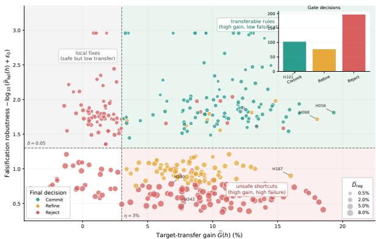  
(a) Transfer–Falsification profile

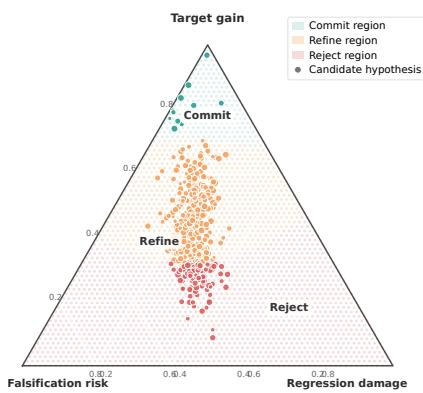  
(b) Decision simplex  
Figure 5: Interpreting FGSE update selection. (a) Transfer–Falsification volcano plot for candidate hypotheses. The x-axis shows target-transfer gain ${ \widehat { G } } ,$ the y-axis shows $- \log _ { 1 0 } ( \widehat { P } _ { \mathrm { f a i l } } + \epsilon _ { 0 } )$ , point size encodes regression damage $\widehat { D } _ { \mathrm { r e g } }$ , and color indicates the final FGSE decision. The dashed lines mark the useful-transfer and falsification thresholds. (b) Decision simplex over normalized target gain, falsification risk, and regression damage. The shaded area shows the gate-induced decision regions.

## 6.2 Main Results

Overall comparison. Table 1 shows that FGSE improves over memory-writing and reflectionstyle baselines across verifier-rich web, app, tool-use, and memory benchmarks. The gains are especially clear on verifier-rich settings such as WebArena, AppWorld, and τ-bench, where tool-state and database-state validators provide reliable evidence for pre-commitment testing. Appendix D.1 further shows that FGSE improves long-term memory reliability while reducing falsification failures, regression damage, and harmful committed updates.

Domain-level update diagnostics. Beyond task success, Figure 4 reports update-centric metrics across domains, including ${ \widehat { G } } , { \widehat { P } } _ { \mathrm { f a i l } } , { \widehat { D } } _ { \mathrm { r e g } }$ , and harmful update rate. AppWorld, τ -bench, AgentDojo, and long-term memory benchmarks show both meaningful gains and higher safety risks, indicating greater vulnerability to overgeneralized self-updates. Coding and math tasks exhibit lower falsification and regression risks due to cleaner executable or exact-match verifiers, while SWE-bench remains regression-prone because repository-level changes are highly contextual. These results support verifier-grounded falsification over commitment based only on target improvement.

## 6.3 Ablation and Mechanism Analysis

Single-factor ablation. We isolate FGSE components by removing or replacing one component at a time and report both task performance and update reliability. Blue values in parentheses denote absolute changes from full FGSE, with negative values indicating drops for higher-is-better metrics and positive values indicating worse lower-is-better metrics. Tables 2 and 6 show that each component contributes. Removing structured hypotheses causes the largest drop, reducing WebArena SR by 4.2 points, AppWorld Avg. by 5.9 points, and LoCoMo Avg. R-L by 4.78 points, confirming the need for scoped, verifier-aware updates. Target-transfer probes improve useful generalization, as $\widehat { G }$ drops from 12.9% to 9.8% without them, while falsification probes prevent unsafe overgeneralization, with $\widehat { P } _ { \mathrm { f a i l } }$ increasing from 5.0% to 18.6% and harmful updates from 3.6% to 10.6% when removed. The regression archive reduces $\widehat { D } _ { \mathrm { r e g } }$ from 5.2% to 1.3%, and scope refinement, post-commit monitoring, and executable verifiers further improve the transfer-safety trade-off.

Transferability of candidate updates. We assess whether episode-derived updates capture reusable rules that transfer beyond the triggering case. We therefore evaluate each candidate before commitment using three temporary statistics: target-transfer gain $\widehat { G } ( h )$ , falsification failure rate ${ \widehat { P } } _ { \mathrm { f a i l } } ( h )$ , and regression damage ${ \widehat { D } } _ { \mathrm { r e g } } ( h )$ . Figure ${ \mathfrak { I } } ( { \mathfrak { a } } )$ plots candidates in a Transfer–Falsification volcano plot, with ${ \widehat { G } } ( h )$ on the x-axis, $- \log _ { 1 0 } ( \widehat { P } _ { \mathrm { f a i l } } ( h ) + \epsilon _ { 0 } )$ on the y-axis, point size encoding ${ \widehat { D } } _ { \mathrm { r e g } } ( h )$ , and color indicating the gate decision. The plot reveals three groups: committed updates in the upper right with high transfer and low risk, unsafe shortcuts in the lower right, and safe but low-transfer local fixes in the upper left. In this run, FGSE commits 104/380 candidates, achieving average $\widehat { G } = 1 0 . 7 7 \%$ $\widehat { P } _ { \mathrm { f a i l } } = 1 . 2 8 \%$ , and $\widehat { D } _ { \mathrm { r e g } } = 0 . 6 0 \%$ . The 101 rejected candidates that exceed the gain threshold η show much higher falsification and regression risk, with $\widehat { P } _ { \mathrm { f a i l } } = 2 2 . 8 2 \%$ and $\widehat { D } _ { \mathrm { r e g } } = 4 . 8 5 \%$ . Refined candidates lie between these groups, suggesting that many useful but unsafe updates require scope narrowing before commitment.

Table 2: Single-factor ablation on task-level performance.
<table><tr><td>Variant</td><td>WebArena SR↑</td><td>AppWorld  $\mathbf { A v g } , \uparrow$ </td><td>τ-Retail  $\mathbf { P a s s ^ { 1 } } \uparrow$ </td><td>LongMemEval Acc. ↑</td><td>LoCoMo Avg. R-L ↑</td></tr><tr><td>Full FGSE</td><td>39.8</td><td>78.8</td><td>0.724</td><td>0.748</td><td>37.62</td></tr><tr><td>w/o structured hypothesis</td><td>35.6(-4.2)</td><td>72.9(-5.9)</td><td>0.664(-0.060)</td><td>0.692(-0.056)</td><td>32.84(-4.78)</td></tr><tr><td>w/o target-transfer probes</td><td>36.8 (-3.0)</td><td>74.9 (-3.9)</td><td>0.684(-0.040)</td><td>0.710(-0.038)</td><td>34.72(-2.90)</td></tr><tr><td>w/o falsification probes</td><td>37.4(-2.4)</td><td>75.8 (-3.0)</td><td>0.697 (-0.027)</td><td>0.713 (-0.035)</td><td>35.10(-2.52)</td></tr><tr><td>w/o regression archive</td><td>38.2(-1.6)</td><td>76.9 (-1.9)</td><td>0.706(-0.018)</td><td>0.719 (-0.029)</td><td>35.87(-1.75)</td></tr><tr><td>w/o scope refinement</td><td>37.1 (-2.7)</td><td>75.4 (-3.4)</td><td>0.690(-0.034)</td><td>0.716(-0.032)</td><td>34.96(-2.66)</td></tr><tr><td>LLM-judge gate</td><td>36.7(-3.1)</td><td>74.1 (-4.7)</td><td>0.681 (-0.043)</td><td>0.707 (-0.041)</td><td>34.18 (-3.44)</td></tr><tr><td>w/o post-commit monitoring</td><td>39.0(-0.8)</td><td>77.2(-1.6)</td><td>0.713 (-0.011)</td><td>0.726(-0.022)</td><td>35.92 (-1.70)</td></tr></table>

Commit–refine–reject decision boundary. To examine the gate, we map each candidate into a simplex over normalized target gain, falsification risk, and regression damage. For each candidate $h ,$ we normalize the three statistics across candidates and project them onto simplex coordinates $( g _ { h } , f _ { h } , r _ { h } )$ with $\begin{array} { r } { g _ { h } + f _ { h } + r _ { h } = 1 } \end{array}$ . Figure 5(b) shows the joint role of the three statistics: COMMIT lies in the high-gain, low-risk region, REJECT concentrates near the high-risk, high-regression edge, and REFINE forms a transition band between them. This pattern indicates that FGSE performs structured triage, committing gain-dominant updates, refining repairable but ambiguous ones, and rejecting risk-dominant candidates.

## 7 Conclusion

We studied reliable self-evolution for long-horizon LLM agents, focusing on when episode-derived lessons should enter persistent memory. FGSE treats each candidate update as a structured, verifiergrounded hypothesis and commits it only after target-transfer, falsification, and regression testing. Our results show that safe adaptation requires evaluating usefulness, boundary failures, and regression on previously solved behavior alongside source-task improvement. Future work can extend falsificationgated update control to multimodal agents [Xu et al., 2026a, Dong et al., 2026, Liu et al., 2026a, Zhang et al., 2026e, Kang et al., 2026], collaborative tool-use systems [Fan et al., 2026], and settings where verifiers must be learned or approximated.

## Acknowledgments and Disclosure of Funding

We thank Airon Tech for providing computing resources and data-processing support for this work.   
The authors declare no competing interests.

## References

Lakshya A. Agrawal, Shangyin Tan, Dilara Soylu, Noah Ziems, Rishi Khare, Krista Opsahl-Ong, Arnav Singhvi, Herumb Shandilya, Michael J. Ryan, Meng Jiang, Christopher Potts, Koushik Sen, Alex Dimakis, Ion Stoica, Dan Klein, Matei Zaharia, and Omar Khattab. GEPA: Reflective prompt evolution can outperform reinforcement learning. In International Conference on Learning Representations (ICLR), 2026. URL https://proceedings.iclr.cc/paper\_files/paper/ 2026/hash/0e9e708b6f48e14fd0ac29e167413f76-Abstract-Conference.html.

Jacob Austin, Augustus Odena, Maxwell Nye, Maarten Bosma, Henryk Michalewski, David Dohan, Ellen Jiang, Carrie Cai, Michael Terry, Quoc Le, et al. Program synthesis with large language models. arXiv preprint arXiv:2108.07732, 2021.

Mark Chen, Jerry Tworek, Heewoo Jun, Qiming Yuan, Henrique Ponde De Oliveira Pinto, Jared Kaplan, Harri Edwards, Yuri Burda, Nicholas Joseph, Greg Brockman, et al. Evaluating large language models trained on code. arXiv preprint arXiv:2107.03374, 2021.

Qianyu Chen, Ziteng Feng, Canran Xiao, and Runxuan Tang. InduceKV: Fixed-footprint continual adaptation of multimodal LLMs via inducing KV memories. In Advances in Neural Information Processing Systems (NeurIPS), 2026. URL https://arxiv.org/abs/2607.02010.

Qibai Chen and Zeming Liu. SemVerBench: Benchmarking LLM comprehension of versionconstraint resolution semantics, 2026. URL https://arxiv.org/abs/2609.11180.

Neil Chowdhury, James Aung, Chan Jun Shern, Oliver Jaffe, Dane Sherburn, Giulio Starace, Evan Mays, Rachel Dias, Marwan Aljubeh, Mia Glaese, Carlos E. Jimenez, John Yang, Leyton Ho, Tejal Patwardhan, Kevin Liu, and Aleksander Madry. Introducing SWE-bench Verified. OpenAI, August 2024. URL https://openai.com/index/introducing-swe-bench-verified/. Published August 13, 2024.

Karl Cobbe, Vineet Kosaraju, Mohammad Bavarian, Mark Chen, Heewoo Jun, Lukasz Kaiser, Matthias Plappert, Jerry Tworek, Jacob Hilton, Reiichiro Nakano, et al. Training verifiers to solve math word problems. arXiv preprint arXiv:2110.14168, 2021.

Edoardo Debenedetti et al. AgentDojo: A dynamic environment to evaluate prompt injection attacks and defenses for LLM agents. In Advances in Neural Information Processing Systems (NeurIPS), Datasets and Benchmarks Track, 2024. URL https://openreview.net/forum? id=m1YYAQjO3w. Spotlight presentation.

Kairui Ding, Boyuan Chen, Yuchen Su, Huan-ang Gao, Bu Jin, Chonghao Sima, Xiaohui Li, Wuqiang Zhang, Paul Barsch, Hongyang Li, and Hao Zhao. Hint-AD: Holistically aligned interpretability in end-to-end autonomous driving. In Proceedings of The 8th Conference on Robot Learning, volume 270 of Proceedings ofMachine Learning Research, pages 3742–3765. PMLR, 2025. URL https://proceedings.mlr.press/v270/ding25a.html.

Guangyuan Dong, Chuang Liu, Haoyu Wang, Yangchen Zeng, Jiaqi Zhang, Li Jiuxing, Xiaoyang Yu, Pinlong Zhao, Yuchao Hou, Ziwei Li, Zheng Lin, Alexander Lim Han Yang, and Yusen Wu. When images look right and retrieve wrong: Coverage-guided cross-scale re-indexing for knowledge-faithful generative perception. arXiv preprint arXiv:2608.20810, 2026. URL https://arxiv.org/abs/2608.20810.

Enguang Fan, Anfeng Peng, Matthew Caesar, Jae Kim, Josh Eckhardt, Greg Kimberly, and Denis Osipychev. Towards effective swarm-based GPS spoofing detection in disadvantaged platforms. In Proceedings ofthe 2023 IEEE Military Communications Conference (MILCOM), pages 722–728. IEEE, 2023. doi: 10.1109/MILCOM58377.2023.10356314.

Enguang Fan, Yifan Chen, Zihan Shan, Klara Nahrstedt, Matthew Caesar, and Jae Kim. Communication-aware multi-agent reinforcement learning for decentralized cooperative UAV deployment, 2026. URL https://arxiv.org/abs/2603.16141.

Jiani He, Dingyan Shang, Yihua Xu, Shiqi Huang, Yan Lyu, Jize Li, and Shangjing Tang. Semantic signal-assisted inspection and recovery allocation in reverse logistics, 2026. URL https:// arxiv.org/abs/2609.02116.

Dan Hendrycks, Collin Burns, Saurav Kadavath, Akul Arora, Steven Basart, Eric Tang, Dawn Song, and Jacob Steinhardt. Measuring mathematical problem solving with the math dataset. arXiv preprint arXiv:2103.03874, 2021.

Saisai Hu. Research on security enhancement methods for adversarial robust large language model intelligent agents for medical decision-making tasks. In 2026 7th International Seminar on Artificial Intelligence, Networking and Information Technology (AINIT), pages 599–603. IEEE, 2026. URL https://arxiv.org/abs/2605.08257.

Shengran Hu et al. Automated design of agentic systems. In International Conference on Learning Representations (ICLR), 2025. URL https://openreview.net/forum?id=t9U3LW7JVX.

Chengsong Huang et al. R-Zero: Self-evolving reasoning LLM from zero data. In International Conference on Learning Representations (ICLR), 2026a. URL https://arxiv.org/abs/2508. 05004.

Jie Huang, Xinyun Chen, Swaroop Mishra, Huaixiu Steven Zheng, Adams Wei Yu, Xinying Song, and Denny Zhou. Large language models cannot self-correct reasoning yet. In International Conference on Learning Representations (ICLR), 2024. URL https://openreview.net/forum? id=IkmD3fKBPQ.

Shiqi Huang, Jiani He, Dingyan Shang, Yihua Xu, Jize Li, Yan Lyu, and Lakshmi Muraleedharan Nair. DACRI: Decision-aware causal intervention ranking for critical supply chains, 2026b. URL https://arxiv.org/abs/2608.11154.

Carlos E Jimenez, John Yang, Alexander Wettig, Shunyu Yao, Kexin Pei, Ofir Press, and Karthik Narasimhan. Swe-bench: Can language models resolve real-world github issues? In 12th International Conference on Learning Representations, ICLR 2024, 2024.

Zhaolu Kang, Tailong Luo, Lei Wei, Guangyuan Dong, Sihan Liu, Yingjie He, Siheng Wang, Shuaibo Li, Rongchao Zhang, Zhen Tian, Richeng Xuan, and Zhichao Hu. DRILL: Training world models to improve policies, not predict pixels. arXiv preprint arXiv:2610.30814, 2026. URL https://arxiv.org/abs/2610.30814. Accepted at NeurIPS 2026.

Thibault Le Sellier de Chezelles, Maxime Gasse, Alexandre Lacoste, Massimo Caccia, Alexandre Drouin, Léo Boisvert, Megh Thakkar, Tom Marty, Rim Assouel, Sahar Omidi Shayegan, Lawrence Keunho Jang, Xing Han Lù, Ori Yoran, Dehan Kong, Frank F. Xu, Siva Reddy, Graham Neubig, Quentin Cappart, Russ Salakhutdinov, and Nicolas Chapados. The BrowserGym ecosystem for web agent research. Transactions on Machine Learning Research, 2025. ISSN 2835-8856. URL https://openreview.net/forum?id=5298fKGmv3. Expert Certification.

Jize Li, Jiani He, Dishu Yang, Dingyan Shang, Jingjing Liu, and Shiqi Huang. Accuracy-preserving stability regularization for large-scale retail demand forecasting, 2026a. URL https://arxiv. org/abs/2607.13331.

Wei Li, Rui Shao, Jie He, Lingsen Zhang, Ziwei Liu, and Liqiang Nie. UniMPA: A unified memoryprediction-action model via action-grounded transition modeling. arXiv preprint arXiv:2609.11875, 2026b.

Yang Li, Xiaoxue Chen, Hao Zhao, Jiangtao Gong, Guyue Zhou, Federico Rossano, and Yixin Zhu. Understanding embodied reference with Touch-Line Transformer. In International Conference on Learning Representations (ICLR), 2023. URL https://arxiv.org/abs/2210.05668.

Zhiming Lin, Canran Xiao, and Kai Zhao. Beyond more context: Retrieval diversity boosts multiturn intent understanding. In Proceedings of the ACM Web Conference 2026, pages 2320–2329. Association for Computing Machinery, 2026. doi: 10.1145/3774904.3792567. URL https: //doi.org/10.1145/3774904.3792567.

Jiaxin Liu, Ding Zhong, Yue Wang, Zhidong Yang, Zhaolu Kang, Guangyuan Dong, Qishi Zhan, Pengcheng Fang, and Aofan Liu. Dual-pathway circuits of object hallucination in vision-language models. arXiv preprint arXiv:2605.13156, 2026a. URL https://arxiv.org/abs/2605.13156. Accepted at NeurIPS 2026.

Jingjing Liu, Dishu Yang, Hongbo Qin, and Hansong Zhang. Passing tests, missing semantics: Evidence of interpretive lock-in in plan-based DataFrame code generation, 2026b. URL https: //arxiv.org/abs/2610.15797.

Yitao Liu, Chenglei Si, Karthik R Narasimhan, and Shunyu Yao. Contextual experience replay for self-improvement of language agents. In Proceedings of the 63rd Annual Meeting of the Association for Computational Linguistics (Volume 1: Long Papers), pages 14179–14198, 2025.

Yao Lu, Tengfei Ma, Zeyu Wang, Zhuangzhi Chen, Dongwei Xu, Yun Lin, Qi Xuan, and Guan Gui. FCOS: A two-stage recoverable model pruning framework for automatic modulation recognition. IEEE Transactions on Cognitive Communications and Networking, 2026.

Mingjun Ma, Saisai Hu, Tiantian Zhu, Yitian Lin, Jiachen Sun, Zhengqiu Weng, Dehao Li, and Yajie Zhang. MuSK: Multi-scale knowledge learning for provenance-graph anomaly detection. Computer Networks, page 112728, 2026. doi: 10.1016/j.comnet.2026.112728. URL https: //doi.org/10.1016/j.comnet.2026.112728.

Aman Madaan, Niket Tandon, Prakhar Gupta, Skyler Hallinan, Luyu Gao, Sarah Wiegreffe, Uri Alon, Nouha Dziri, Shrimai Prabhumoye, Yiming Yang, Shashank Gupta, Bodhisattwa Prasad Majumder, Katherine Hermann, Sean Welleck, Amir Yazdanbakhsh, and Peter Clark. Self-Refine: Iterative refinement with self-feedback. In Advances in Neural Information Processing Systems (NeurIPS), 2023. URL https://openreview.net/forum?id=S37hOerQLB.

Adyasha Maharana et al. Evaluating very long-term conversational memory of LLM agents, 2024. URL https://arxiv.org/abs/2402.17753.

Charles Packer, Sarah Wooders, Kevin Lin, Vivian Fang, Shishir G Patil, Ion Stoica, and Joseph E Gonzalez. Memgpt: Towards llms as operating systems. arXiv preprint arXiv:2310.08560, 2023.

Jiayi Pan, Yichi Zhang, Nicholas Tomlin, Yifei Zhou, Sergey Levine, and Alane Suhr. Autonomous evaluation and refinement of digital agents. In First Conference on Language Modeling, 2024.

Joon Sung Park, Joseph O’Brien, Carrie Jun Cai, Meredith Ringel Morris, Percy Liang, and Michael S Bernstein. Generative agents: Interactive simulacra of human behavior. In Proceedings of the 36th annual acm symposium on user interface software and technology, pages 1–22, 2023.

Yujia Qin et al. ToolLLM: Facilitating large language models to master 16000+ real-world APIs. In International Conference on Learning Representations (ICLR), 2024. URL https: //openreview.net/forum?id=dHng2O0Jjr.

Shuai Shao et al. Your agent may misevolve: Emergent risks in self-evolving LLM agents. In International Conference on Learning Representations (ICLR), 2026. URL https://openreview. net/pdf?id=Fd1jgQQW28.

Wanru Shao. Interpretable ensemble learning for network traffic anomaly detection: A SHAP-based explainable AI framework for embedded systems security. In 2026 14th International Symposium on Digital Forensics and Security (ISDFS), pages 1–4. IEEE, 2026a. doi: 10.1109/ISDFS69419. 2026.11459069. URL https://doi.org/10.1109/ISDFS69419.2026.11459069.

Wanru Shao. Policy-driven vulnerability risk quantification framework for large-scale cloud infrastructure data security. In Proceedings of the 2026 5th International Conference on Cyber Security, Artificial Intelligence and Digital Economy, pages 40–45, New York, NY, USA, 2026b. Association for Computing Machinery. doi: 10.1145/3819836.3819842. URL https://doi.org/10.1145/3819836.3819842.

Noah Shinn, Federico Cassano, Ashwin Gopinath, Karthik Narasimhan, and Shunyu Yao. Reflexion: Language agents with verbal reinforcement learning. In Advances in Neural Information Processing Systems (NeurIPS), 2023. URL https://openreview.net/forum?id=vAElhFcKW6.

Yiyun Su, Huiying Zhu, Yu Tian, Changruo Zhao, Zujun Peng, Yuting Liu, Luyan Zhang, Liang Fan, and Baihua Li. Agentic-SQL Taxonomy: The research of autonomous and interactive Text-to-SQL with LLMs. In Advanced Intelligent Computing Technology and Applications, volume 16655 of Lecture Notes in Computer Science, pages 323–334. Springer Nature Singapore, 2027. doi: 10. 1007/978-981-92-3438-7\_27. URL https://doi.org/10.1007/978-981-92-3438-7\_27.

Mirac Suzgun, Mert Yuksekgonul, Federico Bianchi, Dan Jurafsky, and James Zou. Dynamic cheatsheet: Test-time learning with adaptive memory. In Proceedings of the 19th Conference of the European Chapter of the Association for Computational Linguistics (Volume 1: Long Papers), pages 7080–7106, 2026.

Wanxin Tian et al. SEEA-R1: Tree-structured reinforcement fine-tuning for self-evolving embodied agents. In Advances in Neural Information Processing Systems (NeurIPS), 2025. URL https: //openreview.net/forum?id=dAwKePZvcN.

Ye Tian et al. ALPHALLM: Toward self-improvement of large language models via imagination, searching, and criticizing. In Advances in Neural Information Processing Systems (NeurIPS), 2024. URL https://openreview.net/pdf?id=tPdJ2qHkOB.

Harsh Trivedi et al. AppWorld: A controllable world of apps and people for benchmarking interactive coding agents. In Annual Meeting of the Association for Computational Linguistics (ACL), 2024. URL https://arxiv.org/abs/2407.18901.

Guanzhi Wang, Yuqi Xie, Yunfan Jiang, Ajay Mandlekar, Chaowei Xiao, Yuke Zhu, Linxi Fan, and Anima Anandkumar. Voyager: An open-ended embodied agent with large language models, 2023. URL https://openreview.net/forum?id=ehfRiF0R3a.

Mengxiao Wang and Nitesh Saxena. Trading agents or market crashers? dissecting robustness and security failures in academic financial LLM trading schemes, 2026. URL https://arxiv.org/ abs/2609.19705.

Zijun Wang, Saisai Hu, Tiantian Zhu, Wenrui Cheng, Zhengqiu Weng, Haiting Chen, Xiangyang Zheng, and Suyu Zhang. Trident: Dual-stream APT attribution over heterogeneous threat knowledge graphs. Computers & Security, 171:105094, 2026. doi: 10.1016/j.cose.2026.105094. URL https://doi.org/10.1016/j.cose.2026.105094.

D. Wu et al. LongMemEval: Benchmarking chat assistants on long-term memory, 2024. URL https://arxiv.org/abs/2410.10813.

Peng Xia et al. Agent0: Unleashing self-evolving agents from zero data via tool-integrated reasoning, 2025. URL https://arxiv.org/abs/2511.16043.

Canran Xiao, Tianxiang Xu, SiYuan Ma, Yiyang Jiang, Haoyu Gao, and Yuhan Wu. Reversible primitive–composition alignment for continual vision–language learning. In International Conference on Learning Representations (ICLR), 2026a. URL https://proceedings.iclr.cc/paper\_files/paper/2026/hash/ 8f0d446441a938d9de420a8ab8d7fd36-Abstract-Conference.html.

Linqi Xiao, Venkateswarlu Gudepu, and Andrea Fumagalli. Joint alarm correlation and root alarm detection in optical transport networks with graph-attention. In 2025 IEEE 30th International Workshop on Computer Aided Modeling and Design of Communication Links and Networks (CAMAD), pages 1–6. IEEE, 2025. doi: 10.1109/CAMAD67323.2025.11229899.

Linqi Xiao, Venkateswarlu Gudepu, and Andrea Fumagalli. CORA: A conversational AI-agent for intelligent automation of OpenROADM multi-vendor optical transport networks. In Applications ofMachine Learning 2026, volume 14218 of Proceedings ofSPIE, page 142180Y. SPIE, 2026b. doi: 10.1117/12.3113861.

Linqi Xiao, Aparaajitha Gomathinayakam Latha, Venkateswarlu Gudepu, and Andrea Fumagalli. A YANG-grounded LLM agent supporting multi-vendor OpenROADM optical transport networks. In Proceedings of the ACM SIGCOMM 2026 Conference, pages 2109–2115. Association for Computing Machinery, 2026c. doi: 10.1145/3789240.3822606.

Shilin Xiao, Tianxiang Xu, Canran Xiao, Weihao Luo, Liwei Hou, and Chuangxin Zhao. Meta-UCF: Unified task-conditioned LoRA generation for continual learning in large language models. In International Conference on Learning Representations (ICLR), 2026d. URL https://proceedings.iclr.cc/paper\_files/paper/2026/hash/ 12202970782399ee67981dc5269c3b8a-Abstract-Conference.html.

Junhao Xu, Zheng Liu, Mengqi Zhang, Guangyuan Dong, and Zhumin Chen. Lever can move the earth: Towards adaptive semantic capacity balance for image-text retrieval. IEEE Transactions on Multimedia, pages 1–14, 2026a. doi: 10.1109/TMM.2026.3723619. URL https://doi.org/ 10.1109/TMM.2026.3723619.

Mengzhu Xu, Hanzhi Liu, Ningkang Peng, Qianyu Chen, and Canran Xiao. Affordance-first decomposition for continual learning in video-language understanding. In Proceedings of the IEEE/CVF Conference on Computer Vision and Pattern Recognition (CVPR), pages 3908–3919, June 2026b. URL https://openaccess.thecvf.com/content/CVPR2026/html/xu\_ Affordance-First\_Decomposition\_for\_Continual\_Learning\_in\_Video-Language\_ Understanding\_CVPR\_2026\_paper.html.

Wujiang Xu et al. A-Mem: Agentic memory for LLM agents. In Advances in Neural Information Pro cessing Systems (NeurIPS), 2025. URL https://openreview.net/forum?id=FiM0M8gcct.

Yihua Xu, Yan Lyu, Jize Li, Jiani He, You Lin, Yidan Hu, and Rubing Qiang. When does an added planning capability create operational value? an observable evidence standard, 2026c. URL https://arxiv.org/abs/2610.27305.

Chengrun Yang, Xuezhi Wang, Yifeng Lu, Hanxiao Liu, Quoc V. Le, Denny Zhou, and Xinyun Chen. Large language models as optimizers. In International Conference on Learning Representations (ICLR), 2024. URL https://openreview.net/forum?id=Bb4VGOWELI.

Dishu Yang, Jingjing Liu, and Jize Li. Balancing privacy, utility, and safety in LLM alignment through preference optimization, 2026a. URL https://arxiv.org/abs/2608.30141.

Dishu Yang, Qi Su, Hongbo Qin, and Hansong Zhang. Measurement-first auditing of agentic leaderboards: Contamination susceptibility, matched-control re-evaluation, and scorer validation, 2026b. URL https://arxiv.org/abs/2610.05830.

Ruihan Yang et al. The lighthouse of language: Enhancing LLM agents via critique-guided improvement. In Advances in Neural Information Processing Systems (NeurIPS), 2025. URL https://openreview.net/forum?id=D88yhLFzDR.

Junyi Yao, Baichuan Li, Zihao Zheng, and Jiayu Long. Toward workflow-aware benchmarking for healthcare NLP agents, 2026. URL https://arxiv.org/abs/2609.00296.

Shunyu Yao, Jeffrey Zhao, Dian Yu, Nan Du, Izhak Shafran, Karthik Narasimhan, and Yuan Cao. ReAct: Synergizing reasoning and acting in language models. In International Conference on Learning Representations (ICLR), 2023. URL https://openreview.net/forum?id=WE\_ vluYUL-X.

Shunyu Yao et al. τ-bench: A benchmark for tool-agent-user interaction in real-world domains, 2024. URL https://arxiv.org/abs/2406.12045.

Hua Ye, Siyuan Chen, Ziqi Zhong, Canran Xiao, Haoliang Zhang, Yuhan Wu, and Fei Shen. Seeing through the conflict: Transparent knowledge conflict handling in retrieval-augmented generation. In Proceedings ofthe AAAI Conference on Artificial Intelligence, volume 40, pages 34423–34431, 2026. doi: 10.1609/aaai.v40i40.40740. URL https://ojs.aaai.org/index.php/AAAI/ article/view/40740.

Chenghao Zhang, Yuxi Cheng, Saisai Hu, Canran Xiao, Yikai Mao, and Dan Roth. Training needs trustworthy worlds: Verified synthetic web environments for agent learning. arXiv preprint arXiv:2608.21898, 2026a. URL https://arxiv.org/abs/2608.21898.

Fan Zhang, Gongguan Chen, Hua Wang, Jinjiang Li, and Caiming Zhang. Multi-scale video superresolution transformer with polynomial approximation. IEEE Transactions on Circuits and Systems for Video Technology, 33(9):4496–4506, 2023.

Fan Zhang, Gongguan Chen, Hua Wang, and Caiming Zhang. CF-DAN: Facial-expression recognition based on cross-fusion dual-attention network. Computational Visual Media, 10(3):593–608, 2024. doi: 10.1007/s41095-023-0369-x.

Fan Zhang, Shiming Fan, and Hua Wang. Rethinking activation function: A simple path to efficient and accurate time series forecasting. IEEE Transactions on Knowledge and Data Engineering, 2026b.

Fan Zhang, Shiming Fan, and Hua Wang. TimeSAF: Towards LLM-guided semantic asynchronous fusion for time series forecasting. In Proceedings of the 64th Annual Meeting of the Association for Computational Linguistics (Volume 1: Long Papers), pages 26267–26284. Association for Computational Linguistics, 2026c. doi: 10.18653/v1/2026.acl-long.1208. URL https://aclanthology.org/2026.acl-long.1208/.

Fan Zhang, Zhiwei Gu, and Hua Wang. Decoding with structured awareness: Integrating directional, frequency-spatial, and structural attention for medical image segmentation. In Proceedings of the AAAI Conference on Artificial Intelligence, volume 40, pages 12421–12429, 2026d. doi: 10.1609/aaai.v40i15.38235.

Jiaqi Zhang, Zheng Pang, Mengting Li, Yiqi Wang, Guangyuan Dong, Chao Xue, Yusen Wu, Zihao Li, Huy Phan, Sicheng Zhao, Björn Schuller, and Jiachen Luo. Modality disentangled learning for incomplete multimodal emotion recognition: A primitive memory distillation perspective. In Hung-Yi Lee, Sunipa Dev, Jessy Li, and Desmond Elliott, editors, Findings of the Association for Computational Linguistics: EMNLP 2026, pages 47534–47552, Budapest, Hungary, October 2026e. Association for Computational Linguistics. ISBN 979-8-89176-462-0. doi: 10.18653/2026. findings-emnlp.2220. URL https://aclanthology.org/2026.findings-emnlp.2220/.

Jiayi Zhang et al. AFlow: Automating agentic workflow generation. In International Conference on Learning Representations (ICLR), 2025a. URL https://openreview.net/forum?id= z5uVAKwmjf. Oral presentation.

Qizheng Zhang, Changran Hu, Shubhangi Upasani, Boyuan Ma, Fenglu Hong, Vamsidhar Kamanuru, Jay Rainton, Chen Wu, Mengmeng Ji, Hanchen Li, Urmish Thakker, James Zou, and Kunle Olukotun. Agentic context engineering: Evolving contexts for self-improving language models. In International Conference on Learning Representations (ICLR), 2026f. URL https://arxiv. org/abs/2510.04618.

Yaolun Zhang et al. MetaAgent: Automatically constructing multi-agent systems based on finite state machines. In International Conference on Machine Learning (ICML), 2025b. URL https: //openreview.net/forum?id=vOxaD3hhPt.

Xiaoji Zheng, Lixiu Wu, Zhijie Yan, Yuanrong Tang, Hao Zhao, Chen Zhong, Bokui Chen, and Jiangtao Gong. Large language models powered context-aware motion prediction in autonomous driving. In 2024 IEEE/RSJ International Conference on Intelligent Robots and Systems (IROS), pages 980–985. IEEE, 2024. URL https://arxiv.org/abs/2403.11057.

Zihao Zheng, Junyi Yao, Baichuan Li, and Jiayu Long. Auditing escalation reliability in healthcare LLM agents: A perturbation-controlled benchmark of workflow-state failures, 2026. URL https: //arxiv.org/abs/2610.21270.

Wanjun Zhong, Lianghong Guo, Qiqi Gao, He Ye, and Yanlin Wang. Memorybank: Enhancing large language models with long-term memory. In Proceedings of the AAAI conference on artificial intelligence, volume 38(17), pages 19724–19731, 2024.

Heng Zhou, Jing Tang, Jusheng Zhang, Yanshu Li, Canran Xiao, Liwei Hou, Zong Ke, and Jiawei Yao. CoMem: Compositional concept-graph memory for vision–language adaptation. In International Conference on Learning Representations (ICLR), 2026. URL https: //openreview.net/forum?id=xp7wDU9JBW.

Shuyan Zhou, Frank F. Xu, Hao Zhu, Xuhui Zhou, Robert Lo, Abishek Sridhar, Xianyi Cheng, Yonatan Bisk, Daniel Fried, Uri Alon, and Graham Neubig. WebArena: A realistic web environment for building autonomous agents. In International Conference on Learning Representations (ICLR), 2024. URL https://openreview.net/forum?id=oKn9c6ytLx.

Wangchunshu Zhou et al. Symbolic learning enables self-evolving agents. AI Open, 2025. URL https://www.sciencedirect.com/science/article/pii/S2666651025000208.

Mingchen Zhuge et al. GPTSwarm: Language agents as optimizable graphs. In International Conference on Machine Learning (ICML), 2024. URL https://openreview.net/forum?id= uTC9AFXIhg. Oral presentation.

Yuxin Zuo et al. TTRL: Test-time reinforcement learning. In Advances in Neural Information Processing Systems (NeurIPS), 2025. URL https://openreview.net/forum?id=VuVhgEiu20.

<table><tr><td>Appendix</td><td>Second-Level Headings</td></tr><tr><td>Appendix A Additional Technical Details</td><td>A.1 Details of the Exploratory Preliminary Study A.2</td></tr><tr><td></td><td>Verifier-Grounded Probe Construction Precondition Refinement</td></tr><tr><td>A.3</td><td></td></tr><tr><td>A.4 A.5</td><td>Empirical Estimation Under Stochastic Rollouts</td></tr><tr><td></td><td>Runtime Retrieval, Combination, and Monitoring</td></tr><tr><td>A.6 A.7</td><td>Audit Record</td></tr><tr><td></td><td>Detailed Algorithm with Refinement</td></tr><tr><td>Appendix B Proofs for the Commitment</td><td>B.1 Conditional Setup B.2</td></tr><tr><td>Gate Generalization</td><td>Confidence Bounds Used by the Commitment Gate B.3</td></tr><tr><td></td><td>Concentration Tools</td></tr><tr><td>B.4</td><td>Uniform Confidence Event</td></tr><tr><td></td><td>B.5 Proof of Theorem 1 B.6</td></tr><tr><td></td><td>Exact Probe Complexity Statement</td></tr><tr><td></td><td>B.7 Proof of Corollary 1</td></tr><tr><td></td><td>Remarks on Adaptivity and Scope Refinement</td></tr><tr><td>Appendix C Additional Experimental Details</td><td>Benchmark Details Evaluation Metrics</td></tr><tr><td></td><td></td></tr><tr><td></td><td>Fair Comparison Protocol C.4</td></tr><tr><td></td><td>Baseline Implementation Details</td></tr><tr><td></td><td>C.5 FGSE Hyperparameters</td></tr><tr><td></td><td>C.6 Ablation Studies</td></tr><tr><td></td><td>Compute Resources</td></tr><tr><td>Appendix D</td><td>D.1 Additional Reliability and Ablation Results D.2</td></tr><tr><td>Additional Experimental</td><td>Update-Selection and Falsification Analysis</td></tr><tr><td>Results</td><td>Mechanistic Analysis of Long-Term Self-Evolution</td></tr><tr><td></td><td>Cost and Scalability</td></tr><tr><td>Appendix E</td><td></td></tr><tr><td>Broader Impacts</td></tr><tr><td>Appendix F</td></tr></table>

## A Additional Technical Details

## A.1 Details of the Exploratory Preliminary Study

The preliminary study in Section 3 examines naive episode-derived memory writing. The agent directly summarizes a completed episode into a free-form lesson and writes it into persistent memory.

Episode-derived lessons. For each completed episode, the base agent observes the task instruction x, its interaction trajectory τ, and the verifier outcome r. It then produces a natural-language lesson

$$
u = { \mathrm { S u m m a r i z e L e s s o n } } ( x , \tau , r ) ,\tag{15}
$$

which may take the form of a rule, reminder, correction, or behavioral heuristic. The updated agent state is obtained by simply appending u to the memory context:

$$
\Theta \oplus u = ( \mathcal { M } \cup \{ u \} , \pi ) ,\tag{16}
$$

where M denotes the current memory and π denotes the unchanged base policy. This direct memorywriting procedure is a common self-improvement baseline that exposes unsafe updates.

Probe groups. To analyze the effect of a lesson $u ,$ we evaluate the original agent Θ and the memory-augmented agent $\Theta \oplus u$ on four groups of diagnostic cases. The source-replay group $\mathcal { C } _ { \mathrm { s r c } } ( u )$

contains the original episode and minor perturbations that preserve the same intended solution. The near-transfer group $\dot { \mathcal { C } _ { \mathrm { n e a r } } } ( u )$ contains tasks that share the same underlying behavioral pattern but differ in surface form, entities, or context. The boundary-contrast group $\bar { \boldsymbol { \mathcal { C } } } _ { \mathrm { b d r y } } ( \boldsymbol { u } )$ contains cases that are superficially similar to the source episode but should not trigger the same lesson. The archived-success group $\mathcal { C } _ { \mathrm { a r c h } } ( u )$ contains previously solved cases sampled from the agent’s historical archive. The first two groups measure whether the lesson captures a useful pattern, while the latter two groups measure whether it overgeneralizes or interferes with existing behavior.

Verifier-score changes. For a case x, we estimate the verifier-grounded performance of an agent state Θ as

$$
J ( \Theta , x ) = \frac { 1 } { L } \sum _ { \ell = 1 } ^ { L } v ( x , \tau ^ { ( \ell ) } ) , \qquad \tau ^ { ( \ell ) } \sim p _ { \Theta } ( \cdot \mid x ) ,\tag{17}
$$

where $v ( x , \tau ) \in [ 0 , 1 ]$ is the task verifier and $L$ is the number of repeated rollouts. For deterministic tasks, $L = 1$ is sufficient. The effect of lesson u on a case group C is

$$
\Delta _ { } c ( u ) = \frac { 1 } { | \mathcal { C } | } \sum _ { x \in \mathcal { C } } \left[ J ( \Theta \oplus u , x ) - J ( \Theta , x ) \right] .\tag{18}
$$

We report source gain $\Delta _ { \mathrm { s r c } } ( u )$ , near-transfer gain $\Delta _ { \mathrm { n e a r } } ( u )$ , boundary harm

$$
H _ { \mathrm { b d r y } } ( u ) = \left[ - \Delta _ { \mathcal { C } _ { \mathrm { b d r y } } } ( u ) \right] _ { + } ,\tag{19}
$$

and archive harm

$$
H _ { \mathrm { a r c h } } ( u ) = [ - \Delta _ { \mathcal { C } _ { \mathrm { a r c h } } } ( u ) ] _ { + } .\tag{20}
$$

A lesson is considered locally useful if it improves near-transfer cases, but it is considered unsafe if it also induces large boundary or archive harm.

Scope-specificity annotation. To understand why some useful lessons are harmful, we annotate each free-form lesson with a coarse scope-specificity score $s ( u ) \in [ 0 , 1 ]$ . A lesson receives a higher score when it contains explicit applicability conditions, contextual triggers, exception clauses, or task-specific constraints. It receives a lower score when it is phrased as a broad heuristic without clear conditions. This analysis-only score tests whether overgeneralization is associated with underspecified lesson scope; update selection in the preliminary study proceeds without it.

Sequential memory-writing analysis. To study error accumulation, we simulate sequential memory writing over a stream of candidate lessons. After writing k lessons, the agent state is

$$
\Theta _ { k } = \Theta _ { 0 } \oplus \{ u _ { 1 } , \ldots , u _ { k } \} ,\tag{21}
$$

and its held-out verifier score is measured on a fixed evaluation set $\varepsilon \colon$

$$
S _ { k } = { \frac { 1 } { | { \mathcal { E } } | } } \sum _ { x \in { \mathcal { E } } } J ( \Theta _ { k } , x ) .\tag{22}
$$

We compare three diagnostic memory-writing strategies: writing all lessons, writing only lessons that improve the source episode, and a hindsight safe subset. The hindsight subset keeps lessons with high near-transfer gain and low boundary/archive harm, and is used only as an oracle diagnostic upper bound. It is not available to the agent during deployment. This comparison isolates the main observation that source improvement alone is insufficient for stable long-term self-evolution.

Post-hoc scope localization. For lessons that are useful but harmful, we conduct a post-hoc localization analysis. Given a lesson u with positive near-transfer gain but high boundary harm, we inspect the boundary failures and rewrite the lesson into a narrower version u<sup>′</sup> by adding an explicit applicability condition. We then reevaluate $u ^ { \prime }$ on the same near-transfer and boundary-contrast groups. We summarize the effect of localization by the transfer-retention ratio

$$
R _ { \mathrm { r e t a i n } } ( u ^ { \prime } ) = \frac { \Delta _ { \mathrm { n e a r } } ( u ^ { \prime } ) } { \Delta _ { \mathrm { n e a r } } ( u ) + \varepsilon } ,\tag{23}
$$

and the boundary-harm reduction ratio

$$
R _ { \mathrm { r e d u c e } } ( u ^ { \prime } ) = \frac { H _ { \mathrm { b d r y } } ( u ) - H _ { \mathrm { b d r y } } ( u ^ { \prime } ) } { H _ { \mathrm { b d r y } } ( u ) + \varepsilon } ,\tag{24}
$$

where $\varepsilon$ is a small constant for numerical stability. This separate diagnostic motivates explicit applicability conditions and refinement of useful but overly broad candidates in the main method.

Connection to the method. The preliminary study supports three design choices. First, testing episode-derived updates before persistence can expose unsafe free-form lessons. Second, contrastive and archived cases expose boundary failures that source or near-transfer cases can miss. Third, scope refinement can repair some harmful lessons while retaining their useful content. These observations motivate the structured hypothesis representation, temporary evaluation, verifier-grounded commitment, and scope refinement introduced in Section 4.

## A.2 Verifier-Grounded Probe Construction

FGSE constructs probes from three candidate sources: archived solved tasks, verifier-preserving perturbations of the triggering episode, and language-model-generated candidates filtered by executable verifiers. The verifier filter is applied before evaluation:

Verifiable $( x , v _ { h } ) = 1 \quad \Longleftrightarrow \quad v _ { h } ( x , \tau )$ returns a stable score for every evaluated rollout τ. (25)

Tasks that cannot be checked by $v _ { h }$ are excluded from the gate.

The falsification set is decomposed as

$$
{ \mathcal { F } } ( h ) = { \mathcal { F } } _ { \mathrm { b d } } ( h ) \cup { \mathcal { F } } _ { \mathrm { p v } } ( h ) \cup { \mathcal { F } } _ { \mathrm { r g } } ( h ) \cup { \mathcal { F } } _ { \mathrm { d c } } ( h ) .\tag{26}
$$

Here, ${ \mathcal { F } } _ { \mathrm { b d } }$ contains boundary probes near the activation threshold of $c _ { h } , { \mathcal { F } } _ { \mathrm { p v } }$ contains preconditionviolation probes that are similar to the claimed scope but should not activate the rule, $\mathcal { F } _ { \mathrm { r g } }$ contains regression probes from previously solved cases, and ${ \mathcal { F } } _ { \mathrm { d c } }$ contains decoy probes that are superficially similar to target cases but require different behavior.

For each probe type $q \in \{ \mathrm { b d } , \mathrm { p v } , \mathrm { r g } , \mathrm { d c } \}$ , FGSE assigns a risk score

$$
\rho _ { q } ( x ; h ) = \left\{ \begin{array} { l l } { \exp ( - | c _ { h } ( x ) - \gamma _ { h } | / \sigma ) , } & { q = \mathrm { b d } , } \\ { ( 1 - c _ { h } ( x ) ) \sin ( x , h ) , } & { q = \mathrm { p v } , } \\ { \mathbb { I } [ J _ { v _ { h } } ( \Theta _ { t } , x ) \geq \zeta ] \sin ( x , h ) , } & { q = \mathrm { r g } , } \\ { \sin ( x , h ) \mathbb { I } [ c _ { h } ( x ) < \gamma _ { h } ] , } & { q = \mathrm { d c } . } \end{array} \right.\tag{27}
$$

In Eq. $( 2 7 ) , \sigma > 0$ controls the width of the boundary region, sim $( x , h )$ measures semantic or structural similarity between x and the triggering context of $h ,$ and $\zeta$ is the score threshold for considering an archived case solved.

The selected probes are

$$
\begin{array} { r } { \mathcal { F } _ { q } ( h ) = \mathrm { T o p K } _ { x \in \mathcal { X } _ { q } } \left\{ \rho _ { q } ( x ; h ) : \mathrm { V e r i f i a b l e } ( x , v _ { h } ) = 1 \right\} , } \end{array}\tag{28}
$$

where $\mathcal { X } _ { q }$ is the candidate pool for probe type $q .$ Boundary probes test whether the hypothesis changes behavior too aggressively near its activation threshold. Precondition-violation probes test whether the rule fires outside its intended condition. Regression probes measure damage to cases already solved by $\Theta _ { t }$ . Decoy probes test whether superficial similarity causes the wrong behavior change.

The target-transfer set $\mathcal { T } ( h )$ is selected from verifiable candidates satisfying $c _ { h } ( x ) \geq \gamma _ { h }$ . FGSE prioritizes candidates that match the precondition while differing from the triggering task in surface form, tool trace, or problem instance. This tests transfer beyond memorization of the original episode.

## A.3 Precondition Refinement

Refinement is used when a hypothesis improves target probes but fails on falsification probes that can be separated by a more precise precondition. FGSE forms the safe and falsifying sets

$$
\begin{array} { r l } & { \mathcal { P } _ { h } ^ { + } = \{ x \in \mathcal { T } ( h ) \cup \mathcal { F } ( h ) : \Delta _ { h } ( x ) \geq 0 , \ E _ { h } ( \Theta _ { t } \oplus h , x ) = 1 \} , } \\ & { \mathcal { P } _ { h } ^ { - } = \{ x \in \mathcal { F } ( h ) : \Delta _ { h } ( x ) < - \epsilon \vee \ E _ { h } ( \Theta _ { t } \oplus h , x ) = 0 \} . } \end{array}\tag{29}
$$

The refined precondition is obtained by

$$
c _ { h } ^ { \prime } = \arg \operatorname* { m i n } _ { c \in \mathfrak { C } } \left[ \Omega ( c ) + \lambda _ { + } \sum _ { x \in \mathcal { P } _ { h } ^ { + } } \ell ( 1 , c ( x ) ) + \lambda _ { - } \sum _ { x \in \mathcal { P } _ { h } ^ { - } } \ell ( 0 , c ( x ) ) \right] .\tag{30}
$$

Here, C is the precondition class, $\Omega ( c )$ penalizes overly complex conditions, ℓ is binary cross-entropy, and $\lambda _ { + } , \lambda _ { - } \ge 0$ weight safe and falsifying probes.

FGSE triggers refinement only when the following separability score is below a threshold:

$$
\mathrm { S e p } ( h ) = \operatorname* { m i n } _ { c \in \mathfrak { C } } \left[ \frac { 1 } { | { \mathcal P } _ { h } ^ { + } | } \sum _ { x \in { \mathcal P } _ { h } ^ { + } } \mathbb I [ c ( x ) < \gamma _ { h } ] + \frac { 1 } { | { \mathcal P } _ { h } ^ { - } | } \sum _ { x \in { \mathcal P } _ { h } ^ { - } } \mathbb I [ c ( x ) \ge \gamma _ { h } ] \right] \le \alpha _ { \mathrm { s e p } } .\tag{31}
$$

A refined hypothesis is $\boldsymbol { h } ^ { \prime } = ( c _ { h } ^ { \prime } , b _ { h } , e _ { h } , v _ { h } )$ . FGSE performs one refinement pass. The refined hypothesis is then evaluated by the same equations used in the main method. If it fails the gate after refinement, it is rejected.

## A.4 Empirical Estimation Under Stochastic Rollouts

The verifier-grounded score in Eq. (2) is estimated with repeated rollouts:

$$
\widehat { J } _ { v } ( \Theta , x ) = \frac { 1 } { n } \sum _ { j = 1 } ^ { n } v ( x , \tau ^ { ( j ) } ) , \qquad \tau ^ { ( j ) } \sim p _ { \Theta } ( \cdot \mid x ) .\tag{32}
$$

The empirical update effect is

$$
\widehat { \Delta } _ { h } ( x ) = \widehat { J } _ { v _ { h } } ( \Theta _ { t } \oplus h , x ) - \widehat { J } _ { v _ { h } } ( \Theta _ { t } , x ) .\tag{33}
$$

In experiments with deterministic verifiers and deterministic decoding, $n = 1$ is sufficient. With stochastic decoding or nondeterministic tool responses, FGSE uses paired random seeds for $\Theta _ { t }$ and $\Theta _ { t }$ ⊕ h when the environment supports seed control. This reduces variance in $\widehat { \Delta } _ { h } ( x )$ because both states are evaluated under matched rollout conditions.

For finite probe budgets, FGSE reports the conservative falsification score

$$
S _ { \mathrm { f a i l } } ( h ) = \widehat { P } _ { \mathrm { f a i l } } ( h ) + \kappa | \mathcal { F } ( h ) | ^ { - 1 / 2 } ,\tag{34}
$$

where $\kappa \geq 0$ controls the penalty for small falsification sets. This score is used for analysis and ablations. The main gate in Eq. (8) uses the empirical falsification rate ${ \widehat { P } } _ { \mathrm { f a i l } } ( h )$ ).

## A.5 Runtime Retrieval, Combination, and Monitoring

At inference time, FGSE retrieves committed hypotheses whose preconditions match the current interaction state $z = ( x , \tau _ { < \ell } )$

$$
\mathcal { H } _ { t } ( z ) = \{ h \in \mathcal { M } _ { t } : c _ { h } ( z ) \geq \gamma _ { h } , \ u _ { t } ( h ) \leq u _ { \operatorname* { m a x } } \} ,\tag{35}
$$

where $u _ { t } ( h )$ is the post-commit violation score and $u _ { \mathrm { m a x } }$ is the maximum allowed violation level.

When $\mathcal { H } _ { t } ( z )$ is nonempty, FGSE assigns normalized weights

$$
w _ { h } ( z ) = \frac { \exp ( c _ { h } ( z ) / \rho ) } { \sum _ { h ^ { \prime } \in \mathcal { H } _ { t } ( z ) } \exp ( c _ { h ^ { \prime } } ( z ) / \rho ) } , \qquad h \in \mathcal { H } _ { t } ( z ) ,\tag{36}
$$

where $\rho > 0$ is the temperature. The runtime policy is

$$
\pi _ { t } ^ { \mathrm { F G S E } } ( a \mid z ) = ( 1 - \lambda ( z ) ) \pi _ { \Theta _ { t } } ( a \mid z ) + \lambda ( z ) \sum _ { h \in \mathcal { H } _ { t } ( z ) } w _ { h } ( z ) b _ { h } [ \pi _ { \Theta _ { t } } ] ( a \mid z ) ,\tag{37}
$$

where $\lambda ( z ) \in [ 0 , 1 ]$ is the total intervention strength. This form preserves a nonzero base-policy contribution even when several hypotheses are active.

After a committed hypothesis is activated, FGSE records whether its expected effect is violated:

$$
V _ { t } ( h , x _ { t } ) = \mathbb { I } \left[ E _ { h } ( \Theta _ { t } , x _ { t } ) = 0 \vee J _ { v _ { h } } ( \Theta _ { t } , x _ { t } ) < \zeta _ { h } \right] ,\tag{38}
$$

where $\zeta _ { h }$ is the minimum acceptable verifier score associated with hypothesis h. The violation score is updated by

$$
u _ { t + 1 } ( h ) = \rho _ { u } u _ { t } ( h ) + ( 1 - \rho _ { u } ) V _ { t } ( h , x _ { t } ) ,\tag{39}
$$

where $\rho _ { u } \in [ 0 , 1 )$ controls the memory of previous violations. If $u _ { t + 1 } ( h ) > u _ { \mathrm { m a x } } ,$ , the hypothesis is removed from the active retrieval set. Removed hypotheses remain in the audit archive and are not used for future action selection.

## A.6 Audit Record

Each committed hypothesis is stored with an audit record

$$
\mathrm { R e c o r d } ( h ) = \Big ( h , \mathcal { T } ( h ) , \mathcal { F } ( h ) , \mathcal { R } ( h ) , \{ \Delta _ { h } ( x ) \} _ { x \in \mathcal { P } ( h ) } , \widehat { G } ( h ) , \widehat { P } _ { \mathrm { f a i l } } ( h ) , \widehat { D } _ { \mathrm { r e g } } ( h ) , u _ { t } ( h ) \Big )\tag{40}
$$

The audit record supports post-hoc inspection of why a rule was committed, which probes were used to falsify it, and whether the rule later accumulated violations.

## A.7 Detailed Algorithm with Refinement

Algorithm 2 FGSE with One-Pass Precondition Refinement   
Require: State $\Theta _ { t } ,$ evidence packet $E _ { t }$ , audit archive $A _ { t } ,$ thresholds $( \eta , \delta , \beta , \alpha _ { \mathrm { s e p } } )$   
Ensure: Updated state $\Theta _ { t + 1 }$   
1: Propose $h = ( c _ { h } , b _ { h } , e _ { h } , v _ { h } ) = H _ { \phi } ( E _ { t } )$   
2: Build $T ( h ) , { \dot { \mathcal { F } } } ( h )$ , and $\mathcal { R } ( \dot { h } ) .$   
3: Evaluate ${ \widehat { G } } ( h ) , { \widehat { P } } _ { \mathrm { f a i l } } ( h )$ , and ${ \widehat { D } } _ { \mathrm { r e g } } ( h )$   
4: if ${ \widehat { G } } ( h ) \geq \eta$ and $\widehat { P } _ { \mathrm { f a i l } } ( h ) \leq \delta$ and $\widehat { D } _ { \mathrm { r e g } } ( h ) \leq \beta$ then   
5: Commit h and set $\Theta _ { t + 1 } = \Theta _ { t } \oplus h .$   
6: else if $\widehat { G } ( h ) \geq \eta$ and Sep $( h ) \leq \alpha _ { \mathrm { s e p } }$ then   
7: Compute $c _ { h } ^ { \prime }$ by Eq. (30) and set $\dot { h } ^ { \prime } = ( c _ { h } ^ { \prime } , b _ { h } , e _ { h } , v _ { h } )$   
8: Rebuild probes for $h ^ { \prime }$ and reevaluate the gate.   
9: if $h ^ { \prime }$ satisfies Eq. (8) then   
10: Commit $h ^ { \prime }$ and set $\Theta _ { t + 1 } = \Theta _ { t } \oplus h ^ { \prime } .$   
11: else   
12: Reject $h ^ { \prime }$ and set $\Theta _ { t + 1 } = \Theta _ { t } .$   
13: end if   
14: else   
15: Reject h and set $\Theta _ { t + 1 } = \Theta _ { t }$   
16: end if

Practical representation of hypotheses. In implementation, each hypothesis is stored as a schemaconstrained JSON object. The precondition field is a natural-language predicate together with a scoring function implemented by a lightweight LLM classifier or rule-based matcher. The behavior field specifies a bounded prompt/tool-policy patch. The expected-effect field specifies a verifierobservable condition, and the verifier field points to the benchmark validator or executable checker. Audits of synthetic healthcare workflows also expose escalation errors under conflicting evidence and brittle routing rules under unseen paraphrases [Zheng et al., 2026].

```json
JSON example
{
"precondition": "The task asks for a round-trip flight booking with explicit
origin, destination, and dates.",
"behavior": "Before searching, set trip_type=’round_trip’ and fill both
departure and return dates.",
"expected_effect": "Search query contains both outbound and return dates and
trip_type=’round_trip’.",
"verifier": "booking_database_state_validator"
}
```

## B Proofs for the Commitment Gate Generalization

## B.1 Conditional Setup

We prove Theorem 1 and Corollary 1. Fix a round t. Let $\mathcal { F } _ { t }$ denote the sigma-field containing the current agent state $\Theta _ { t } .$ , the evidence packet, the audit archive, the proposal and refinement randomness

before final evaluation, and the finite candidate set $\mathcal { H } _ { t }$ . Throughout the proof, we condition on $\mathcal { F } _ { t }$ Thus, the candidate set is fixed before the final evaluation probes are sampled.

For each $h \in \mathcal { H } _ { t }$ , define the target-transfer random variable

$$
X _ { h } ^ { T } = \Delta _ { h } ( x ) , \qquad x \sim \mathcal { D } _ { T } ( h ) .\tag{41}
$$

Because verifier scores lie in [0, 1], we have

$$
X _ { h } ^ { T } \in [ - 1 , 1 ] .\tag{42}
$$

The population and empirical target-transfer gains are

$$
G ( h ) = \mathbb { E } [ X _ { h } ^ { T } ] , \qquad { \widehat { G } } ( h ) = { \frac { 1 } { n _ { T } } } \sum _ { i = 1 } ^ { n _ { T } } X _ { h , i } ^ { T } .\tag{43}
$$

The empirical target-transfer variance is

$$
\widehat { V } _ { T } ( h ) = \frac { 1 } { n _ { T } } \sum _ { i = 1 } ^ { n _ { T } } \left( X _ { h , i } ^ { T } - \widehat { G } ( h ) \right) ^ { 2 } .\tag{44}
$$

For falsification probes, define the Bernoulli random variable

$$
X _ { h } ^ { F } = \mathbb { I } \left[ \Delta _ { h } ( x ) < - \epsilon \vee E _ { h } ( \Theta _ { t } \oplus h , x ) = 0 \right] , \qquad x \sim \mathcal { D } _ { F } ( h ) .\tag{45}
$$

Then

$$
X _ { h } ^ { F } \in \{ 0 , 1 \} .\tag{46}
$$

The population falsification risk and empirical failure rate are

$$
{ P } _ { \mathrm { f a i l } } ( h ) = \mathbb { E } [ X _ { h } ^ { F } ] , \qquad { \widehat { P } } _ { \mathrm { f a i l } } ( h ) = { \frac { 1 } { n _ { F } } } \sum _ { i = 1 } ^ { n _ { F } } X _ { h , i } ^ { F } .\tag{47}
$$

For regression probes, define

$$
X _ { h } ^ { R } = [ - \Delta _ { h } ( x ) ] _ { + } , \qquad x \sim \mathcal { D } _ { R } ( h ) .\tag{48}
$$

Since $\Delta _ { h } ( x ) \in [ - 1 , 1 ]$ , we have

$$
X _ { h } ^ { R } \in [ 0 , 1 ] .\tag{49}
$$

The population and empirical regression damages are

$$
D _ { \mathrm { r e g } } ( h ) = \mathbb { E } [ X _ { h } ^ { R } ] , \qquad { \widehat { D } } _ { \mathrm { r e g } } ( h ) = { \frac { 1 } { n _ { R } } } \sum _ { i = 1 } ^ { n _ { R } } X _ { h , i } ^ { R } .\tag{50}
$$

The empirical regression variance is

$$
\widehat { V } _ { R } ( h ) = \frac { 1 } { n _ { R } } \sum _ { i = 1 } ^ { n _ { R } } \left( X _ { h , i } ^ { R } - \widehat { D } _ { \mathrm { r e g } } ( h ) \right) ^ { 2 } .\tag{51}
$$

The analysis treats the randomness in $X _ { h } ^ { T } , X _ { h } ^ { F }$ , and $X _ { h } ^ { R }$ as including both probe sampling and any rollout randomness used to estimate verifier outcomes. The only properties needed are boundedness and conditional independence of the final evaluation samples for each fixed $h .$

## B.2 Confidence Bounds Used by the Commitment Gate

Let $n _ { T } , n _ { F } , n _ { R }$ be the numbers of final target, falsification, and regression probes. Let $\alpha _ { T } , \alpha _ { F } , \alpha _ { R } >$ 0 satisfy

$$
\alpha _ { T } + \alpha _ { F } + \alpha _ { R } = \alpha .\tag{52}
$$

Define the logarithmic factors

$$
L _ { T } = \log \frac { 2 | \mathcal { H } _ { t } | } { \alpha _ { T } } , \qquad L _ { R } = \log \frac { 2 | \mathcal { H } _ { t } | } { \alpha _ { R } } , \qquad L _ { F } = \log \frac { ( n _ { F } + 1 ) | \mathcal { H } _ { t } | } { \alpha _ { F } } .\tag{53}
$$

The empirical-Bernstein slacks are

$$
\varepsilon _ { T } ( h ) = \sqrt { \frac { 2 \widehat { V } _ { T } ( h ) L _ { T } } { n _ { T } } } + \frac { 1 4 L _ { T } } { 3 ( n _ { T } - 1 ) } , \qquad \varepsilon _ { R } ( h ) = \sqrt { \frac { 2 \widehat { V } _ { R } ( h ) L _ { R } } { n _ { R } } } + \frac { 7 L _ { R } } { 3 ( n _ { R } - 1 ) } .\tag{54}
$$

The target lower confidence bound and regression upper confidence bound are

$$
\operatorname { L C B } _ { T } ( h ) = \widehat { G } ( h ) - \varepsilon _ { T } ( h ) , \qquad \operatorname { U C B } _ { R } ( h ) = \widehat { D } _ { \mathrm { r e g } } ( h ) + \varepsilon _ { R } ( h ) .\tag{55}
$$

For $p , q \in [ 0 , 1 ]$ , define the binary KL divergence

$$
\operatorname { k l } ( p \| q ) = p \log { \frac { p } { q } } + ( 1 - p ) \log { \frac { 1 - p } { 1 - q } } ,\tag{56}
$$

with the standard continuous extension at the boundary. The KL upper confidence bound for falsification risk is

$$
\mathrm { U C B } _ { F } ( h ) = \operatorname* { s u p } \left\{ q \in [ \widehat { P } _ { \mathrm { f a i l } } ( h ) , 1 ] : \operatorname { k l } \left( \widehat { P } _ { \mathrm { f a i l } } ( h ) \| q \right) \leq \frac { L _ { F } } { n _ { F } } \right\} .\tag{57}
$$

## B.3 Concentration Tools

We use two concentration results. The first controls bounded real-valued random variables using empirical variance.

Lemma 1 (One-sided empirical Bernstein inequality). Let $Y _ { 1 } , \dots , Y _ { n }$ be independent random variables taking values in an interval of length b. Let

$$
\mu = \mathbb { E } [ Y _ { 1 } ] , \qquad { \widehat { \mu } } = { \frac { 1 } { n } } \sum _ { i = 1 } ^ { n } Y _ { i } ,\tag{58}
$$

and

$$
{ \widehat { V } } = { \frac { 1 } { n } } \sum _ { i = 1 } ^ { n } ( Y _ { i } - { \widehat { \mu } } ) ^ { 2 } .\tag{59}
$$

For any $\rho \in ( 0 , 1 )$ and $n \geq 2 ,$ , with probability at least $1 - \rho ,$

$$
\mu - \widehat { \mu } \leq \sqrt { \frac { 2 \widehat { V } \log ( 2 / \rho ) } { n } } + \frac { 7 6 \log ( 2 / \rho ) } { 3 ( n - 1 ) } .\tag{60}
$$

The same inequality also holds with ${ \widehat { \mu } } - \mu$ on the left-hand side.

Proof. This is the standard one-sided form of the empirical Bernstein inequality for bounded random variables. The lower-tail statement follows by applying the same result $\mathrm { t o } - Y _ { i } ,$ , whose range length remains b. □

The second result gives a KL confidence bound for Bernoulli variables.

Lemma 2 (Bernoulli KL confidence bound). Let $B _ { 1 } , \ldots , B _ { n }$ be i.i.d. Bernoulli random variables with mean $p ,$ and let

$$
{ \widehat { p } } = { \frac { 1 } { n } } \sum _ { i = 1 } ^ { n } B _ { i } .\tag{61}
$$

Then, for any $u > 0 ,$

$$
\mathbb { P } \left( \mathrm { k l } ( \widehat { p } \| p ) \geq u \right) \leq ( n + 1 ) \exp ( - n u ) .\tag{62}
$$

Proof. For each $k \in \{ 0 , 1 , \ldots , n \}$ , let

$$
q _ { k } = { \frac { k } { n } } .\tag{63}
$$

The event $\widehat { p } = q _ { k }$ has probability

$$
\mathbb { P } ( \widehat { p } = q _ { k } ) = { \binom { n } { k } } p ^ { k } ( 1 - p ) ^ { n - k } .\tag{64}
$$

Using the type-counting bound

$$
{ \binom { n } { k } } \leq \exp ( n H ( q _ { k } ) ) ,\tag{65}
$$

where

$$
H ( q ) = - q \log q - ( 1 - q ) \log ( 1 - q ) ,\tag{66}
$$

we obtain

$$
\begin{array} { l } { \displaystyle \mathbb { P } ( \widehat { p } = q _ { k } ) = \binom { n } { k } p ^ { n q _ { k } } ( 1 - p ) ^ { n ( 1 - q _ { k } ) } } \\ { \displaystyle \qquad \leq \exp \left( n H ( q _ { k } ) + n q _ { k } \log p + n ( 1 - q _ { k } ) \log ( 1 - p ) \right) } \\ { \displaystyle \qquad = \exp \left( - n \left[ q _ { k } \log \frac { q _ { k } } { p } + ( 1 - q _ { k } ) \log \frac { 1 - q _ { k } } { 1 - p } \right] \right) } \\ { \displaystyle \qquad = \exp \left( - n \mathrm { k l } ( q _ { k } \| p ) \right) . } \end{array}\tag{67}
$$

Therefore,

$$
\begin{array} { r l } { \mathbb { P } \left( \mathrm { k l } ( \widehat { p } | | p ) \geq u \right) = \displaystyle \sum _ { k : \mathrm { k l } ( q _ { k } | | p ) \geq u } \mathbb { P } ( \widehat { p } = q _ { k } ) } & { } \\ { \leq \displaystyle \sum _ { k : \mathrm { k l } ( q _ { k } | | p ) \geq u } \exp \left( - n \mathrm { k l } ( q _ { k } | | p ) \right) } & { } \\ { \leq \displaystyle \sum _ { k = 0 } ^ { n } \exp ( - n u ) } & { } \\ { = ( n + 1 ) \exp ( - n u ) . } \end{array}\tag{68}
$$

This proves the claim.

## B.4 Uniform Confidence Event

We now prove that the three confidence bounds hold simultaneously for all hypotheses in $\mathcal { H } _ { t }$

Lemma 3 (Uniform confidence event). With probability at least $1 - \alpha ,$ , every $h \in \mathcal { H } _ { t }$ simultaneously satisfies

$$
G ( h ) \geq \mathrm { L C B } _ { T } ( h ) , \qquad P _ { \mathrm { f a i l } } ( h ) \leq \mathrm { U C B } _ { F } ( h ) , \qquad D _ { \mathrm { r e g } } ( h ) \leq \mathrm { U C B } _ { R } ( h ) .\tag{69}
$$

Proof. We prove the target, regression, and falsification bounds separately and then apply a union bound.

First consider target-transfer gain. For a fixed $h ,$ apply Lemma 1 to $X _ { h } ^ { T }$ . Its range length is

$$
{ \mathfrak { b } } _ { T } = 2 .\tag{70}
$$

Set

$$
\rho _ { T } = \frac { \alpha _ { T } } { | \mathcal { H } _ { t } | } .\tag{71}
$$

Then

$$
\log \frac { 2 } { \rho _ { T } } = \log \frac { 2 | \mathcal { H } _ { t } | } { \alpha _ { T } } = L _ { T } .\tag{72}
$$

For this fixed $h ,$ Lemma 1 gives

$$
\begin{array} { r l r } {  { G ( h ) - \widehat { G } ( h ) \geq - [ \sqrt { \frac { 2 \widehat { V } _ { T } ( h ) L _ { T } } { n _ { T } } } + \frac { 7 { \mathfrak b } _ { T } L _ { T } } { 3 ( n _ { T } - 1 ) } ] } } \\ & { } & { = - [ \sqrt { \frac { 2 \widehat { V } _ { T } ( h ) L _ { T } } { n _ { T } } } + \frac { 1 4 L _ { T } } { 3 ( n _ { T } - 1 ) } ] } \\ & { } & { = - \varepsilon _ { T } ( h ) . } \end{array}\tag{73}
$$

Thus,

$$
G ( h ) \geq { \widehat { G } } ( h ) - \varepsilon _ { T } ( h ) = \operatorname { L C B } _ { T } ( h ) .\tag{74}
$$

A union bound over $h \in \mathcal { H } _ { t }$ gives

$$
\begin{array} { r } { \mathbb { P } \left( \forall h \in \mathcal { H } _ { t } : G ( h ) \geq \mathrm { L C B } _ { T } ( h ) \right) \geq 1 - \alpha _ { T } . } \end{array}\tag{75}
$$

Next consider regression damage. For a fixed h, apply Lemma 1 to $X _ { h } ^ { R }$ . Its range length is

$$
{ \mathfrak { b } } _ { R } = 1 .\tag{76}
$$

Set

$$
\rho _ { R } = \frac { \alpha _ { R } } { | \mathcal { H } _ { t } | } .\tag{77}
$$

Then

$$
\log \frac { 2 } { \rho _ { R } } = \log \frac { 2 | \mathcal { H } _ { t } | } { \alpha _ { R } } = L _ { R } .\tag{78}
$$

For this fixed h, Lemma 1 gives

$$
\begin{array} { r l } & { D _ { \mathrm { r e g } } ( h ) - \widehat { D } _ { \mathrm { r e g } } ( h ) \leq \sqrt { \frac { 2 \widehat { V } _ { R } ( h ) L _ { R } } { n _ { R } } } + \frac { 7 { \mathfrak b } _ { R } L _ { R } } { 3 \left( n _ { R } - 1 \right) } } \\ & { \qquad = \sqrt { \frac { 2 \widehat { V } _ { R } ( h ) L _ { R } } { n _ { R } } } + \frac { 7 L _ { R } } { 3 \left( n _ { R } - 1 \right) } } \\ & { \qquad = \varepsilon _ { R } ( h ) . } \end{array}\tag{79}
$$

Therefore,

$$
D _ { \mathrm { r e g } } ( h ) \leq \widehat { D } _ { \mathrm { r e g } } ( h ) + \varepsilon _ { R } ( h ) = \mathrm { U C B } _ { R } ( h ) .\tag{80}
$$

A union bound over $h \in \mathcal { H } _ { t }$ gives

$$
\mathbb { P } \left( \forall h \in \mathcal { H } _ { t } : D _ { \mathrm { r e g } } ( h ) \leq \mathrm { U C B } _ { R } ( h ) \right) \geq 1 - \alpha _ { R } .\tag{81}
$$

Finally consider falsification risk. For a fixed $h ,$ apply Lemma 2 to $X _ { h } ^ { F }$ . Let

$$
u _ { F } = \frac { L _ { F } } { n _ { F } } .\tag{82}
$$

Then

$$
\begin{array} { r l } & { \mathbb { P } \left( \mathrm { k l } \left( \widehat { P } _ { \mathrm { f a i l } } ( h ) \| P _ { \mathrm { f a i l } } ( h ) \right) > \frac { L _ { F } } { n _ { F } } \right) \leq ( n _ { F } + 1 ) \exp ( - L _ { F } ) } \\ & { \qquad = ( n _ { F } + 1 ) \exp \left( - \log \frac { \left( n _ { F } + 1 \right) \lvert \mathcal { H } _ { t } \rvert } { \alpha _ { F } } \right) } \\ & { \qquad = \frac { \alpha _ { F } } { \lvert \mathcal { H } _ { t } \rvert } . } \end{array}\tag{83}
$$

A union bound over $h \in \mathcal { H } _ { t }$ yields

$$
\mathbb { P } \left( \forall h \in \mathcal { H } _ { t } : \mathrm { k l } \left( \widehat { P } _ { \mathrm { f a i l } } ( h ) \vert \vert P _ { \mathrm { f a i l } } ( h ) \right) \leq \frac { L _ { F } } { n _ { F } } \right) \geq 1 - \alpha _ { F } .\tag{84}
$$

On the event in Eq. (84), we prove that $P _ { \mathrm { f a i l } } ( h ) \leq \mathrm { U C B } _ { F } ( h )$ for every h. Fix h. If $P _ { \mathrm { f a i l } } ( h ) \leq$ ${ \widehat { P } } _ { \mathrm { f a i l } } ( h )$ , then

$$
P _ { \mathrm { f a i l } } ( h ) \leq \widehat { P } _ { \mathrm { f a i l } } ( h ) \leq \mathrm { U C B } _ { F } ( h ) ,\tag{85}
$$

because $q = { \widehat { P } } _ { \mathrm { f a i l } } ( h )$ is feasible in the definition of $\mathrm { U C B } _ { F } ( h )$ . If $P _ { \mathrm { f a i l } } ( h ) > \widehat { P } _ { \mathrm { f a i l } } ( h )$ , then $q =$ $P _ { \mathrm { f a i l } } ( h )$ lies in $[ \widehat { P } _ { \mathrm { f a i l } } ( h ) , 1 ]$ , and the KL event gives

$$
\mathrm { k l } \left( \widehat { P } _ { \mathrm { f a i l } } ( h ) \Vert P _ { \mathrm { f a i l } } ( h ) \right) \leq \frac { L _ { F } } { n _ { F } } .\tag{86}
$$

Thus $P _ { \mathrm { f a i l } } ( h )$ is feasible in the supremum defining $\mathrm { U C B } _ { F } ( h )$ , which implies

$$
P _ { \mathrm { f a i l } } ( h ) \leq \mathrm { U C B } _ { F } ( h ) .\tag{87}
$$

Combining the two cases gives

$$
\forall h \in \mathcal { H } _ { t } : P _ { \mathrm { f a i l } } ( h ) \leq \mathrm { U C B } _ { F } ( h ) .\tag{88}
$$

Let $\mathcal { E } _ { T } , \mathcal { E } _ { F }$ , and $\mathcal { E } _ { R }$ denote the target, falsification, and regression confidence events. Combining Eq. (75), Eq. (81), and Eq. (84), we have

$$
\begin{array} { r l } & { \mathbb { P } \big ( \mathcal { E } _ { T } \cap \mathcal { E } _ { F } \cap \mathcal { E } _ { R } \big ) = 1 - \mathbb { P } ( \mathcal { E } _ { T } ^ { c } \cup \mathcal { E } _ { F } ^ { c } \cup \mathcal { E } _ { R } ^ { c } ) } \\ & { \qquad \ge 1 - \mathbb { P } ( \mathcal { E } _ { T } ^ { c } ) - \mathbb { P } ( \mathcal { E } _ { F } ^ { c } ) - \mathbb { P } ( \mathcal { E } _ { R } ^ { c } ) } \\ & { \qquad \ge 1 - \alpha _ { T } - \alpha _ { F } - \alpha _ { R } } \\ & { \qquad = 1 - \alpha . } \end{array}\tag{89}
$$

On this event, all three bounds in Eq. (69) hold simultaneously for every $h \in \mathcal { H } _ { t }$ . This proves the lemma. □

## B.5 Proof of Theorem 1

Proof. By Lemma 3, with probability at least 1 − α, all $h \in \mathcal { H } _ { t }$ simultaneously satisfy

$$
G ( h ) \geq \mathrm { L C B } _ { T } ( h ) , \qquad P _ { \mathrm { f a i l } } ( h ) \leq \mathrm { U C B } _ { F } ( h ) , \qquad D _ { \mathrm { r e g } } ( h ) \leq \mathrm { U C B } _ { R } ( h ) .\tag{90}
$$

This proves Eq. (11).

Now suppose that h satisfies the confidence-gated commitment rule:

$$
\operatorname { L C B } _ { T } ( h ) \geq \eta , \qquad \operatorname { U C B } _ { F } ( h ) \leq \delta , \qquad \operatorname { U C B } _ { R } ( h ) \leq \beta .\tag{91}
$$

For target-transfer gain, Eq. (90) and Eq. (91) imply

$$
\begin{array} { r } { G ( h ) \geq \mathrm { L C B } _ { T } ( h ) } \\ { \geq \eta . } \end{array}\tag{92}
$$

For falsification risk,

$$
\begin{array} { r c l } { { P _ { \mathrm { f a i l } } ( h ) \leq \mathrm { U C B } _ { F } ( h ) } } \\ { { \leq \delta . } } \end{array}\tag{93}
$$

For regression damage,

$$
\begin{array} { l } { { D _ { \mathrm { r e g } } ( h ) \leq \mathrm { U C B } _ { R } ( h ) } } \\ { { \qquad \leq \beta . } } \end{array}\tag{94}
$$

Combining Eq. (92), Eq. (93), and Eq. (94), we obtain

$$
G ( h ) \geq \eta , \qquad P _ { \mathrm { f a i l } } ( h ) \leq \delta , \qquad D _ { \mathrm { r e g } } ( h ) \leq \beta .\tag{95}
$$

This proves Eq. (13).

## B.6 Exact Probe Complexity Statement

We now give the exact finite-sample version of Corollary 1. Let $\zeta _ { T } , \zeta _ { R } > 0$ be target and regression margins, and let $0 \leq \delta _ { - } < \delta \leq 1$ be empirical and population falsification thresholds.

Corollary 2 (Exact probe complexity). Suppose

$$
n _ { T } \geq 1 + \operatorname* { m a x } \left\{ \frac { 8 L _ { T } } { \zeta _ { T } ^ { 2 } } , \frac { 2 8 L _ { T } } { 3 \zeta _ { T } } \right\} ,\tag{96}
$$

$$
n _ { R } \geq 1 + \operatorname* { m a x } \left\{ \frac { 2 L _ { R } } { \zeta _ { R } ^ { 2 } } , \frac { 1 4 L _ { R } } { 3 \zeta _ { R } } \right\} ,\tag{97}
$$

and

$$
n _ { F } \ge \frac { L _ { F } } { \operatorname { k l } ( \delta _ { - } \| \delta ) } .\tag{98}
$$

Then, with probability at least $1 - \alpha ,$ , any $h \in \mathcal { H } _ { t }$ satisfying

$$
\widehat { G } ( h ) \geq \eta + \zeta _ { T } , \qquad \widehat { P } _ { \mathrm { f a i l } } ( h ) \leq \delta _ { - } , \qquad \widehat { D } _ { \mathrm { r e g } } ( h ) \leq \beta - \zeta _ { R }\tag{99}
$$

also satisfies

$$
G ( h ) \geq \eta , \qquad P _ { \mathrm { f a i l } } ( h ) \leq \delta , \qquad D _ { \mathrm { r e g } } ( h ) \leq \beta .\tag{100}
$$

## B.7 Proof of Corollary 2

Proof. We first control the target-transfer confidence radius. Since $X _ { h } ^ { T } \in [ - 1 , 1 ]$ , its empirical variance satisfies

$$
{ \widehat { V } } _ { T } ( h ) \leq 1 .\tag{101}
$$

Therefore,

$$
\begin{array} { l } { \displaystyle \varepsilon _ { T } ( h ) = \sqrt { \frac { 2 \widehat { V } _ { T } ( h ) L _ { T } } { n _ { T } } } + \frac { 1 4 L _ { T } } { 3 ( n _ { T } - 1 ) } } \\ { \displaystyle \leq \sqrt { \frac { 2 L _ { T } } { n _ { T } } } + \frac { 1 4 L _ { T } } { 3 ( n _ { T } - 1 ) } . } \end{array}\tag{102}
$$

If

$$
n _ { T } \geq \frac { 8 L _ { T } } { \zeta _ { T } ^ { 2 } } ,\tag{103}
$$

then

$$
\sqrt { \frac { 2 L _ { T } } { n _ { T } } } \leq \frac { \zeta _ { T } } { 2 } .\tag{104}
$$

If

$$
n _ { T } - 1 \geq \frac { 2 8 L _ { T } } { 3 \zeta _ { T } } ,\tag{105}
$$

then

$$
\frac { 1 4 L _ { T } } { 3 ( n _ { T } - 1 ) } \leq \frac { \zeta _ { T } } { 2 } .\tag{106}
$$

Combining Eq. (102), Eq. (104), and Eq. (106), we get

$$
\varepsilon _ { T } ( h ) \leq \zeta _ { T } .\tag{107}
$$

We next control the regression confidence radius. Since $X _ { h } ^ { R } \in [ 0 , 1 ]$ , its empirical variance satisfies

$$
\widehat V _ { R } ( h ) \leq \frac { 1 } { 4 } .\tag{108}
$$

Thus,

$$
\begin{array} { l } { \displaystyle \varepsilon _ { R } ( h ) = \sqrt { \frac { 2 \widehat V _ { R } ( h ) L _ { R } } { n _ { R } } } + \frac { 7 L _ { R } } { 3 ( n _ { R } - 1 ) } } \\ { \displaystyle \leq \sqrt { \frac { L _ { R } } { 2 n _ { R } } } + \frac { 7 L _ { R } } { 3 ( n _ { R } - 1 ) } . } \end{array}\tag{109}
$$

If

$$
n _ { R } \geq \frac { 2 L _ { R } } { \zeta _ { R } ^ { 2 } } ,\tag{110}
$$

then

$$
\sqrt { \frac { L _ { R } } { 2 n _ { R } } } \leq \frac { \zeta _ { R } } { 2 } .\tag{111}
$$

If

$$
n _ { R } - 1 \geq \frac { 1 4 L _ { R } } { 3 \zeta _ { R } } ,\tag{112}
$$

then

$$
{ \frac { 7 L _ { R } } { 3 ( n _ { R } - 1 ) } } \leq { \frac { \zeta _ { R } } { 2 } } .\tag{113}
$$

Combining Eq. (109), Eq. (111), and Eq. (113), we obtain

$$
\varepsilon _ { R } ( h ) \leq \zeta _ { R } .\tag{114}
$$

We now control the falsification upper confidence bound. Assume $\widehat { P } _ { \mathrm { f a i l } } ( h ) \leq \delta _ { - }$ . For fixed $q = \delta$ the function $p \mapsto \operatorname { k l } ( p \Vert \delta )$ is decreasing on $p \in [ 0 , \delta ]$ . Indeed,

$$
\frac { \partial } { \partial p } \mathrm { k l } ( p \| \delta ) = \log \frac { p ( 1 - \delta ) } { \delta ( 1 - p ) } ,\tag{115}
$$

and for $p < \delta ,$

$$
\log \frac { p ( 1 - \delta ) } { \delta ( 1 - p ) } < 0 .\tag{116}
$$

Therefore,

$$
\mathrm { k l } \left( \widehat { P } _ { \mathrm { f a i l } } ( h ) \Vert \delta \right) \geq \mathrm { k l } ( \delta _ { - } \Vert \delta ) .\tag{117}
$$

By Eq. (98),

$$
\frac { L _ { F } } { n _ { F } } \leq \mathrm { k l } ( \delta _ { - } \| \delta ) \leq \mathrm { k l } \left( \widehat { P } _ { \mathrm { f a i l } } ( h ) \| \delta \right) .\tag{118}
$$

For fixed $p = \widehat { P } _ { \mathrm { f a i l } } ( h )$ , the map $q \mapsto \operatorname { k l } ( p \Vert q )$ is increasing on $q \in [ p , 1 ]$ . Hence every $q > \delta$ satisfies

$$
\mathrm { k l } \left( \widehat { P } _ { \mathrm { f a i l } } ( h ) | | q \right) > \frac { L _ { F } } { n _ { F } } .\tag{119}
$$

Thus no $q > \delta$ is feasible in the supremum defining $\mathrm { U C B } _ { F } ( h )$ , and we have

$$
\mathrm { U C B } _ { F } ( h ) \leq \delta .\tag{120}
$$

Now suppose h satisfies the empirical margin condition in Eq. (99). Combining Eq. (107), Eq. (114), and Eq. (120), we get

$$
\operatorname { L C B } _ { T } ( h ) \geq \eta , \qquad \operatorname { U C B } _ { F } ( h ) \leq \delta , \qquad \operatorname { U C B } _ { R } ( h ) \leq \beta .\tag{121}
$$

Applying Theorem 1 yields

$$
G ( h ) \geq \eta , \qquad P _ { \mathrm { f a i l } } ( h ) \leq \delta , \qquad D _ { \mathrm { r e g } } ( h ) \leq \beta .\tag{122}
$$

This proves the corollary.

## B.8 Remarks on Adaptivity and Scope Refinement

The proof requires that the final evaluation probes are not reused to construct or refine the hypothesis being certified. This condition prevents adaptive overfitting to the finite falsification set. In practice, this can be implemented in two equivalent ways. The first is sample splitting: use a development split for scope refinement and a fresh evaluation split for final commitment. The second is to define $\mathcal { H } _ { t }$ as the enlarged finite set containing all hypotheses that can be produced by proposal and refinement before final evaluation; the same proof then applies with $| \mathcal { H } _ { t } |$ replaced by the size of this enlarged set.

The theorem certifies reliability with respect to the probe-generation distributions $\mathcal { D } _ { T } ( h ) , \mathcal { D } _ { F } ( h )$ , and $\mathcal { D } _ { R } ( h )$ . If these distributions differ from the deployment distribution, an additional distribution-shift term is needed. For example, if the deployment falsification distribution is within total variation distance $\rho$ of $\mathcal { D } _ { F } ( h )$ , then the certified falsification risk increases by at most $\rho .$ The commitment gate controls statistical generalization from finite probes to the specified probe distributions, while the quality of the probe generator determines how well those distributions cover deployment-time boundary cases.

## C Additional Experimental Details

## C.1 Benchmark Details

Web and browser-control tasks. For WebArena [Zhou et al., 2024] and BrowserGym [Le Sellier de Chezelles et al., 2025], we follow the official environment setup and success validators. Each task provides a natural-language instruction, an initial browser state, and an environment-specific completion condition. We use these validators as the verifier $v _ { h }$ whenever possible. For FGSE, target-transfer probes are constructed from tasks sharing the same high-level interaction pattern, while falsification probes are selected from tasks with similar surface forms but different completion conditions, websites, forms, or required constraints. Regression probes are drawn from previously solved held-out tasks and are never used to propose the candidate hypothesis.

Tool-use and app-interaction tasks. For AppWorld [Trivedi et al., 2024], we evaluate on the official Normal and Challenge splits and report task-goal completion using the benchmark-provided database-state evaluator. For τ-bench [Yao et al., 2024], we evaluate both retail and airline domains and use the official database-state comparison and pass<sup>k</sup> reliability protocol. In both benchmarks, a hypothesis may modify the agent’s tool-use policy, retrieval memory, or instruction-level strategy, but the available tools, API schemas, and domain policies are fixed across all methods. Holding tool access fixed isolates the effect of the update mechanism.

Security and adversarial tool-output tasks. AgentDojo [Debenedetti et al., 2024] is used to evaluate whether self-evolution increases susceptibility to prompt injection or malicious tool outputs. We report utility success on benign tasks, security success under attacks, and the joint utility-security score. For FGSE, falsification probes include decoy tool outputs, conflicting instructions, and previously solved benign cases. A candidate update is rejected if it improves utility but increases attack success or violates a high-priority system or user constraint.

Long-term memory tasks. For LongMemEval [Wu et al., 2024] and LoCoMo [Maharana et al., 2024], we evaluate whether committed hypotheses improve memory use without corrupting persistent user or task state. We report the official QA accuracy or F1 metrics, temporal reasoning accuracy, knowledge-update accuracy, and abstention accuracy when available. We also measure memory pollution rate, defined as the fraction of committed updates that are later contradicted by held-out evidence or cause a regression on archived successful examples.

Code and mathematical reasoning diagnostics. We use HumanEval [Chen et al., 2021], MBPP [Austin et al., 2021], and SWE-bench Verified [Chowdhury et al., 2024] as verifier-rich coding environments because unit tests provide executable feedback. SWE-bench Verified is a human-validated subset of the original SWE-bench [Jimenez et al., 2024], released by OpenAI in collaboration with the SWE-bench authors [Chowdhury et al., 2024]. We report pass@1 on HumanEval and MBPP and resolved rate on SWE-bench Verified. For mathematical reasoning, we use GSM8K [Cobbe et al., 2021] and MATH [Hendrycks et al., 2021], reporting exact-match solve rate after answer normalization. These datasets are used primarily for controlled analysis of update quality because their verifiers allow clean construction of target, boundary, and regression probes.

## C.2 Evaluation Metrics

Let D denote a held-out evaluation set and let $v ( x , \tau ) \in [ 0 , 1 ]$ be the benchmark-specific verifier score. The standard task success rate is

$$
\mathrm { S R } = { \frac { 1 } { | { \mathcal { D } } | } } \sum _ { x \in { \mathcal { D } } } v ( x , \tau _ { x } ) .\tag{123}
$$

For binary task validators, this reduces to the fraction of solved tasks. For benchmarks with official non-binary scores, we use the official normalized score.

For each committed or rejected hypothesis h, we compute the three FGSE-specific statistics:

$$
\widehat { G } ( h ) = \frac { 1 } { | \mathcal { T } ( h ) | } \sum _ { x \in \mathcal { T } ( h ) } \left[ J _ { v _ { h } } ( \Theta \oplus h , x ) - J _ { v _ { h } } ( \Theta , x ) \right] ,\tag{124}
$$

$$
\widehat { P } _ { \mathrm { f a i l } } ( h ) = \frac { 1 } { | \mathcal { F } ( h ) | } \sum _ { x \in \mathcal { F } ( h ) } \mathbb { I } \left[ J _ { v _ { h } } ( \Theta \oplus h , x ) - J _ { v _ { h } } ( \Theta , x ) < - \epsilon \vee E _ { h } ( \Theta \oplus h , x ) = 0 \right] ,\tag{125}
$$

$$
\widehat { D } _ { \mathrm { r e g } } ( h ) = \frac { 1 } { | \mathcal { R } ( h ) | } \sum _ { x \in \mathcal { R } ( h ) } \left[ J _ { v _ { h } } ( \Theta , x ) - J _ { v _ { h } } ( \Theta \oplus h , x ) \right] _ { + } .\tag{126}
$$

We also report:

• Harmful update rate: the fraction of committed updates that cause held-out regression larger than ϵ.

• Accepted-update precision: the fraction of committed updates that yield positive held-out target-transfer gain without measurable regression.

• Falsification hit rate: the fraction of rejected or refined updates for which at least one falsification probe exposes a failure.

• Post-commit violation rate: the fraction of future activations where a committed hypothesis violates its expected-effect checker.

• Cost: total LLM calls, verifier calls, wall-clock time, and token usage per committed update.

## C.3 Fair Comparison Protocol

All controlled comparisons follow the same protocol [Yang et al., 2026b]:

1. Same backbone: every method uses the same base LLM and the same ReAct-style executor unless the method intrinsically requires a different executor.

2. Same tools: all methods receive identical tool schemas, browser actions, API access, and environment observations.

3. Same memory budget: methods with persistent memory are allowed the same maximum number of stored units and the same retrieval top-k.

4. Same update budget: methods that propose self-updates receive the same number of completed training episodes and the same maximum number of update attempts.

5. No test leakage: hypotheses, reflections, playbooks, workflows, and memory entries are constructed only from training or development episodes. Test tasks are used only for final evaluation.

6. Same verifier access: if a verifier is available during development, all methods may use it under the same budget. During final evaluation, verifier outputs are used only for scoring.

For workflow-search or architecture-search methods such as AFlow [Zhang et al., 2025a], ADAS [Hu et al., 2025], GPTSwarm [Zhuge et al., 2024], and MetaAgent [Zhang et al., 2025b], we report a controlled-budget version when code and prompts are available. Methods requiring a substantially larger search budget, extra training data, reinforcement learning, or model fine-tuning are reported in a separate native-setting table, outside the controlled FGSE comparisons.

## C.4 Baseline Implementation Details

Direct and ReAct. The direct baseline uses the base LLM without persistent memory or postepisode updates. The ReAct baseline [Yao et al., 2023] uses the same action space and tool interface as FGSE but does not modify its persistent state after each episode.

Self-Refine and Reflexion. Self-Refine [Madaan et al., 2023] performs within-episode critique and revision under the same maximum number of refinement calls as FGSE’s hypothesis proposal calls. Reflexion [Shinn et al., 2023] writes natural-language reflections after failed or low-scoring episodes and retrieves them in future tasks. Reflexion commits reflections without requiring structured preconditions, falsification probes, or regression tests.

Voyager-style skill memory. The Voyager-style baseline [Wang et al., 2023] stores reusable skills or lessons from successful episodes and retrieves them for related future tasks. For non-Minecraft benchmarks, we adapt the skill library into a text-based rule or tool-use strategy library while keeping the same retrieval budget as FGSE.

Memory and context-evolution methods. A-Mem [Xu et al., 2025] is implemented as an agentic memory organization baseline that dynamically indexes, links, and updates memories. ACE [Zhang et al., 2026f] is implemented as an evolving playbook baseline that incrementally revises persistent context using execution feedback. Both methods are evaluated with the same memory capacity and retrieval top-k as FGSE.

Workflow and agent-design optimization methods. AFlow [Zhang et al., 2025a], ADAS [Hu et al., 2025], GPTSwarm [Zhuge et al., 2024], and MetaAgent [Zhang et al., 2025b] provide comparisons at the agentic-workflow level, complementing update-level memory methods. Because these methods may search over a larger design space than FGSE, we distinguish controlled-budget and native-budget results.

Table 3: Default FGSE hyperparameters used in controlled experiments.
<table><tr><td>Hyperparameter</td><td>Symbol</td><td>Default value</td></tr><tr><td>Candidate hypotheses per episode</td><td>B</td><td>3</td></tr><tr><td>Target-transfer probes</td><td> $| \mathcal { T } ( h ) |$ </td><td>8</td></tr><tr><td>Falsification probes</td><td> $| { \mathcal { F } } ( h )$ </td><td>16</td></tr><tr><td>Regression probes</td><td> $| \mathcal { R } ( h ) |$ </td><td>16</td></tr><tr><td>Minimum target gain</td><td>η</td><td>0.03</td></tr><tr><td>Maximum falsification rate</td><td>δ</td><td>0.05</td></tr><tr><td>Maximum regression damage</td><td>β</td><td>0.01</td></tr><tr><td>Tolerated verifier-score drop</td><td>€</td><td>0</td></tr><tr><td>Precondition activation threshold</td><td>Yh</td><td>0.5</td></tr><tr><td>Intervention strength</td><td>λh</td><td>0.8</td></tr><tr><td>Retrieved committed hypotheses</td><td>k</td><td>5</td></tr><tr><td>Post-commit violation threshold</td><td>ρmax</td><td>0.10</td></tr></table>

## C.5 FGSE Hyperparameters

All hyperparameters are selected on development tasks and then fixed for test evaluation.

## C.6 Ablation Studies

We conduct the following ablations:

• No falsification: commit every proposed hypothesis that improves the source episode.

• Random probes: replace targeted falsification probes with randomly sampled held-out tasks.

• LLM-judge gate: replace executable or environment verifiers with an LLM-only judgment.

• No regression archive: remove $\mathcal { R } ( h )$ from the commitment rule.

• No scope narrowing: reject all hypotheses that fail falsification without allowing precondition refinement.

• Free-form memory: store unstructured natural-language lessons instead of structured $( c _ { h } , b _ { h } , e _ { h } , v _ { h } )$ hypotheses.

• Probe-budget sweep: vary the number of falsification probes to measure the trade-off between update safety and computation.

These ablations isolate whether FGSE’s gains come from verifier grounding, targeted counterexample construction, regression protection, structured update representation, or scope refinement.

## C.7 Compute Resources

FGSE uses frozen language models without training or fine-tuning. All reported experiments access frozen LLM backbones through provider-hosted APIs, with no author-side GPU use for model training or inference. The provider-side serving compute for GPT-4o, GPT-4o-mini, and DeepSeek-V3.1 is not observable to us and is not included in the reported compute. Our local compute consists of agent orchestration, environment simulation, browser/app execution, sandboxed code execution, probe construction, verifier calls, logging, and result aggregation.

Unless otherwise stated, experiments were orchestrated on CPU workers with 8 vCPUs and 32GB memory per worker. For code-execution and repository-level diagnostics such as SWE-bench Verified, we used sandbox workers with 16 vCPUs and 64GB memory. We used up to 32 workers concurrently. We report compute in terms of LLM calls, verifier calls, parallel wall-clock time, and aggregate client-side CPU usage. One LLM call denotes one model completion request, including action generation, reflection, hypothesis proposal, scope refinement, and LLM-judge calls when used by a baseline. One verifier call denotes one execution of an official benchmark validator, unit test, database-state checker, security checker, or exact-match evaluator.

The full project also included preliminary diagnostics, pilot prompt variants, failed verifier configurations, and exploratory ablations that are not included in Table 4. These exploratory runs used approximately 1.6× the compute of the final reported experiments. In total, the project used approximately $8 . 9 \times 1 0 ^ { 5 }$ LLM calls, $1 . 3 5 \times 1 0 ^ { 6 }$ verifier calls, and $\mathrm { \bar { 7 } . 9 \times 1 0 ^ { 3 } }$ client CPU-hours. Most additional compute came from early probe-construction variants and unsuccessful target-only or LLM-judge gating configurations.

Table 4: Approximate compute used by the reported experiments. LLM calls include agent rollouts, hypothesis proposal/refinement, and baseline-specific reflection or judging calls. Verifier calls include official success validators, database-state checkers, unit tests, security validators, and exact-match evaluators. CPU-hours denote client-side orchestration and environment/verifier execution only. Provider-side LLM serving compute is not included because all LLM backbones are accessed through hosted APIs.
<table><tr><td>Experiment group</td><td>LLM calls</td><td>Verifier calls</td><td>Wall-clock time</td><td>Client CPU-hours</td></tr><tr><td>Web/browser-control tasks</td><td> $\approx 7 . 8 \times 1 0 ^ { 4 }$ </td><td> $\approx 1 . 1 \times 1 0 ^ { 5 }$ </td><td>≈ 39 h</td><td> $\approx 1 . 1 \times 1 0 ^ { 3 }$ </td></tr><tr><td>App/API-interaction tasks</td><td> $\approx 1 . 4 6 \times 1 0 ^ { 5 }$ </td><td> $\approx 2 . 1 8 \times 1 0 ^ { 5 }$ </td><td>≈ 32 h</td><td> $\approx 9 . 0 \times 1 0 ^ { 2 }$ </td></tr><tr><td>τ-bench tool-user tasks</td><td> $\approx 8 . 4 \times 1 0 ^ { 4 }$ </td><td> $\approx 1 . 2 4 \times 1 0 ^ { 5 }$ </td><td>≈ 28 h</td><td> $\approx 7 . 2 \times 1 0 ^ { 2 }$ </td></tr><tr><td>AgentDojo security diagnostics</td><td> $\approx 3 . 6 \times 1 0 ^ { 4 }$ </td><td> $\approx 6 . 8 \times 1 0 ^ { 4 }$ </td><td>≈ 12 h</td><td> $\approx 3 . 0 \times 1 0 ^ { 2 }$ </td></tr><tr><td>Long-term memory benchmarks</td><td> $\approx 6 . 4 \times 1 0 ^ { 4 }$ </td><td> $\approx 8 . 7 \times 1 0 ^ { 4 }$ </td><td>≈ 16 h</td><td> $\approx 4 . 2 \times 1 0 ^ { 2 }$ </td></tr><tr><td>Code/math diagnostics</td><td> $\approx 5 . 2 \times 1 0 ^ { 4 }$ </td><td> $\approx 9 . 6 \times 1 0 ^ { 4 }$ </td><td>≈ 21 h</td><td> $\approx 7 . 6 \times 1 0 ^ { 2 }$ </td></tr><tr><td>Ablations and sensitivity analyses</td><td> $\approx 9 . 5 \times 1 0 ^ { 4 }$ </td><td> $\approx 1 . 3 8 \times 1 0 ^ { 5 }$ </td><td>≈ 27 h</td><td> $\approx 7 . 4 \times 1 0 ^ { 2 }$ </td></tr><tr><td>Total reported experiments</td><td> $\approx 5 . 5 5 \times 1 0 ^ { 5 }$ </td><td> $\approx 8 . 4 1 \times 1 0 ^ { 5 }$ </td><td>≈ 175 h</td><td> $\approx 4 . 9 4 \times 1 0 ^ { 3 }$ </td></tr></table>

## D Additional Experimental Results

## D.1 Additional Reliability and Ablation Results

Memory and update reliability. Table 5 further evaluates long-term memory performance and controlled self-evolution reliability. FGSE obtains the strongest memory performance while also reducing unsafe update commitment, falsification failure, and regression damage. These results support improving future target performance while preserving previously solved behaviors and rejecting overgeneralized updates.

Additional ablation results Table6 presents the results of additional ablation experiments.

## D.2 Update-Selection and Falsification Analysis

Plasticity–safety Pareto frontier Effective self-evolution combines useful agent improvements with protection against harmful or regressive memory updates. We examine the plasticity–safety Paretofrontier for update selection and compare FGSE’s position with alternative strategies.

We sweep a broad range of update-selection configurations and compare representative strategies, including FGSE, FGSE W/O REFINE, TARGET-ONLY, LLM-JUDGE GATE, CONSERVATIVE GATE, EXHAUSTIVE VERIFIER, RANDOM KEEP, and NO PERSISTENT UPDATE. For each configuration c, we measure: (i) update gain $\Delta _ { \mathrm { u p d } } ( c )$ , defined as the average improvement after applying the selected update; (ii) harmful update rate $H ( c )$ , i.e., the fraction of committed updates that later induce safety violations or incorrect behavior on held-out probes; (iii) regression damage $R ( c )$ , i.e., the average degradation on archived successful behaviors; and (iv) verifier cost $C ( c )$ , measured as the average number of verifier calls per candidate update. Figure 6 visualizes the resulting trade-off. The left panel plots $\Delta _ { \mathrm { u p d } }$ against $H ,$ , while the right panel plots $\Delta _ { \mathrm { u p d } }$ against R. Each point corresponds to one configuration, point size encodes verifier cost, and the black dashed curve marks the empirical Pareto frontier.

Figure 6 reveals a clear plasticity–safety frontier. First, FGSE traces the dominant lower-right boundary in both panels over a broad range of medium-cost configurations, achieving substantially larger update gain at similar or lower harm than competing strategies. In the harmful-update panel, frontier configurations of FGSE achieve roughly $9 \% - 1 2 \%$ update gain while keeping the harmful update rate within 2.5%–4.5%, typically with only 20–40 verifier calls per candidate update. At comparable gain levels, TARGET-ONLY and LLM-JUDGE GATE incur much larger harmful update rates, often exceeding $8 \% - 1 5 \%$ , indicating that target improvement alone is an unreliable proxy for safe transfer.

Table 5: Long-term memory and controlled update-reliability comparison. The Offline Reading result on LongMemEval is an oracle-style upper bound and is not ranked. Gray 0.0 entries indicate methods without persistent self-update, for which update-reliability metrics are not ranked. Gb measures target-transfer gain; $\widehat { P } _ { \mathrm { f a i l } }$ measures falsification failure rate; ${ \widehat { D } } _ { \mathrm { r e g } }$ measures regression damage. Lower is better for the last four columns among self-updating methods. Best and secondbest ranked scores in each column are shown in bold and underlined, respectively.
<table><tr><td>Method</td><td>Backbone / Setting</td><td>LongMemEval Acc. ↑</td><td>LoCoMo Avg. R-L ↑</td><td>G (%) ↑</td><td> $\widehat { P } _ { \mathrm { f a i l } } \left( \% \right) \downarrow$ </td><td> $\widehat { D } _ { \mathrm { r e g } } \left( \% \right) \downarrow$ </td><td>Harmful Updates (%) ↓</td><td>Post-commit Violations (%) ↓</td></tr><tr><td colspan="9">Web / browser-control agents: methods primarily designed or evaluated for browser navigation and web-interaction self-improvement.</td></tr><tr><td colspan="9">GPT-4 Agent [Zhou et al., 2024]</td></tr><tr><td>AutoEval [Pan et al., 2024]</td><td>GPT-4 GPT-4</td><td>0.552 0.548</td><td>22.84 23.11</td><td>0.0 2.4</td><td>0.0 19.7</td><td>0.0 5.3</td><td>0.0 13.2</td><td>0.0 11.7</td></tr><tr><td></td><td></td><td></td><td></td><td></td><td>18.9</td><td>5.1</td><td>12.8</td><td>11.1</td></tr><tr><td>BrowserGym [Le Sellier de Chezelles et al., 2025]</td><td>GPT-40</td><td>0.560</td><td>24.02</td><td>2.8</td><td></td><td></td><td>12.1</td><td></td></tr><tr><td>CERonline [Liu et al., 2025]</td><td>GPT-40</td><td>0.591</td><td>26.37</td><td>8.6</td><td>17.4</td><td>4.9</td><td></td><td>10.8</td></tr><tr><td>CERoffline [Liu et al., 2025]</td><td>GPT-40 GPT-40</td><td>0.598 0.607</td><td>26.91 27.58</td><td>8.8 9.1</td><td>17.1 16.8</td><td>4.8 4.7</td><td>11.9 11.5</td><td>10.5 10.2</td></tr><tr><td colspan="9">CERhybrid [Liu et al., 2025]</td></tr><tr><td colspan="9">App / API-interaction agents: methods primarily evaluated on app-level tool use, database-state goals, and API execution.</td></tr><tr><td>IPFunCall [Trivedi et al., 2024]</td><td>GPT-40</td><td>0.507</td><td>18.24</td><td>1.9</td><td>27.6</td><td>7.0</td><td>20.1</td><td>17.5</td></tr><tr><td>FullCodeRefl [Trivedi et al., 2024]</td><td>GPT-40</td><td>0.512</td><td>18.69</td><td>3.2</td><td>24.9</td><td>6.5</td><td>18.4</td><td>15.9</td></tr><tr><td>PlanExec [Trivedi et al., 2024]</td><td>GPT-40</td><td>0.518</td><td>20.15</td><td>3.8</td><td>23.5</td><td>6.2</td><td>17.9</td><td>15.2</td></tr><tr><td>ReAct [Yao et al., 2023, Trivedi et al., 2024]</td><td>GPT-40</td><td>0.560</td><td>22.46</td><td>0.0</td><td>0.0</td><td>0.0</td><td>0.0</td><td>0.0</td></tr><tr><td>ReAct + ICL [Zhang et al., 2026f]</td><td>DeepSeek-V3.1</td><td>0.572</td><td>23.46</td><td>6.4</td><td>18.6</td><td>4.9</td><td>13.1</td><td>11.4</td></tr><tr><td>ReAct + GEPA [Agrawal et al., 2026, Zhang et al., 2026f]</td><td>DeepSeek-V3.1</td><td>0.575</td><td>23.91</td><td>7.2</td><td>17.9</td><td>4.7</td><td>12.4</td><td>10.9</td></tr><tr><td>ReAct + DC [Suzgun et al., 2026]</td><td>DeepSeek-V3.1</td><td>0.590</td><td>26.42</td><td>9.4</td><td>14.8</td><td>4.4</td><td>10.9</td><td>9.6</td></tr><tr><td>ReAct + ACEoffline [Zhang et al., 2026f]</td><td>DeepSeek-V3.1</td><td>0.661</td><td>31.86</td><td>10.3</td><td>12.4</td><td>3.6</td><td>8.4</td><td>7.3</td></tr><tr><td>ReAct + ACEonline [Zhang et al., 2026f]</td><td>DeepSeek-V3.1</td><td>0.672</td><td>32.91</td><td>10.8</td><td>11.6</td><td>3.3</td><td>7.9</td><td>6.8</td></tr><tr><td colspan="9">Tool-user interaction agents: methods centered on multi-turn user simulation, tool calling, and domain-policy execution.</td></tr><tr><td>Tool-Calling [Yao et al., 2024]</td><td>GPT-40</td><td>0.557</td><td>22.15</td><td>2.6</td><td>22.8</td><td>6.1</td><td>16.9</td><td>14.6</td></tr><tr><td>Tool-Calling [Yao et al., 2024]</td><td>Claude-3.5-Sonnet</td><td>0.581</td><td>24.63</td><td>3.1</td><td>21.4</td><td>5.8</td><td>15.7</td><td>13.9</td></tr><tr><td>Act [Yao et al., 2024]</td><td>GPT-40</td><td>0.538</td><td>21.37</td><td>2.3</td><td>23.6</td><td>6.4</td><td>17.6</td><td>15.1</td></tr><tr><td>ReAct [Yao et al., 2023, 2024]</td><td>GPT-40</td><td>0.545</td><td>21.80</td><td>0.0</td><td>0.0</td><td>0.0</td><td>0.0</td><td>0.0</td></tr><tr><td colspan="9">Long-term memory agents: methods primarily designed for persistent memory, conversational memory, or memory-augmented retrieval.</td></tr><tr><td>Offline Reading [Wu et al., 2024]</td><td></td><td></td><td></td><td></td><td>0.0</td><td>0.0</td><td>0.0</td><td></td></tr><tr><td>Coze [Wu et al., 2024]</td><td>GPT-4o oracle</td><td>0.918</td><td>30.15</td><td>0.0</td><td>26.8</td><td>6.9</td><td>20.7</td><td>0.0 17.2</td></tr><tr><td>ChatGPT [Wu et al., 2024]</td><td>GPT-40</td><td>0.330</td><td>18.90 25.32</td><td>4.1</td><td>0.0</td><td>0.0</td><td>0.0</td><td>0.0</td></tr><tr><td>GPT-4o + Chain-of-Note [Wu et al., 2024]</td><td>GPT-40</td><td>0.577</td><td></td><td>0.0</td><td>19.9</td><td>5.5</td><td>14.8</td><td>12.6</td></tr><tr><td>ChatGPT [Wu et al., 2024]</td><td>long-context GPT-4o-mini</td><td>0.640 0.711</td><td>29.84</td><td>5.6</td><td>0.0</td><td>0.0</td><td>0.0</td><td>0.0</td></tr><tr><td>ReadAgent [Xu et al., 2025]</td><td>GPT-4o-mini</td><td>0.612</td><td>27.66 9.61</td><td>0.0 4.8</td><td>24.2</td><td>6.3</td><td>18.8</td><td>15.7</td></tr><tr><td>MemoryBank [Xu et al., 2025]</td><td>GPT-4o-mini</td><td>0.598</td><td></td><td>4.2</td><td>25.7</td><td>6.6</td><td>19.6</td><td>16.4</td></tr><tr><td>MemGPT [Xu et al., 2025]</td><td>GPT-4o-mini</td><td>0.630</td><td>6.96 29.19</td><td>6.7</td><td>23.1</td><td>6.0</td><td>17.3</td><td>14.9</td></tr><tr><td>LoCoMo [Maharana et al., 2024, Xu et al., 2025]</td><td>GPT-4o-mini</td><td>0.651</td><td>32.68</td><td>7.3</td><td>20.5</td><td>5.4</td><td>15.5</td><td>13.4</td></tr><tr><td>A-Mem [Xu et al., 2025]</td><td>GPT-4o-mini</td><td>0.684</td><td>35.49</td><td>9.9</td><td>13.2</td><td>3.8</td><td>8.7</td><td>7.6</td></tr><tr><td colspan="9">FGSE variants: the same falsification-gated update mechanism instantiated with different base LLM backbones.</td></tr><tr><td>FGSE (Ours)</td><td></td><td></td><td></td><td></td><td>6.2</td><td>1.8</td><td>4.5</td><td>3.9</td></tr><tr><td>FGSE (Ours)</td><td>GPT-4o-mini GPT-4o</td><td>0.721</td><td>36.41</td><td>12.5 12.1</td><td>5.5</td><td>1.5</td><td>40</td><td>3.5</td></tr><tr><td>FGSE (Ours)</td><td>DeepSeek-V3.1</td><td>0.736 0.748</td><td>36.98 37.62</td><td>12.9</td><td>5.0</td><td>1.3</td><td>3.6</td><td>3.1</td></tr></table>

Table 6: Single-factor ablation on update reliability. $\widehat { G }$ measures target-transfer gain; $\widehat { P } _ { \mathrm { f a i l } }$ measures falsification failure rate; $\widehat { D } _ { \mathrm { r e g } }$ measures regression damage. For ${ \overset { \vartriangle } { G } } ,$ higher is better; for the remaining metrics, lower is better. Blue numbers in parentheses denote the absolute degradation compared with the full FGSE model.
<table><tr><td>Variant</td><td> ${ \widehat { G } } \left( { \mathcal { \% } } \right) \uparrow$ </td><td> $\widehat { P } _ { \mathrm { f a i l } } \left( \% \right) \downarrow$ </td><td> $\widehat { D } _ { \mathrm { r e g } } \left( \% \right) \downarrow$ </td><td>Harmful Updates (%) ↓</td><td>Post-commit Violations (%) ↓</td></tr><tr><td>Full FGSE</td><td>12.9</td><td>5.0</td><td>1.3</td><td>3.6</td><td>3.1</td></tr><tr><td>w/o structured hypothesis</td><td> $9 . 2 ( - 3 . 7 ) $ </td><td> $1 6 . 7 ( + 1 1 . 7 )$ </td><td> $4 . 8 ( + 3 . 5 ) $ </td><td> $1 1 . 3 ( + 7 . 7 ) $ </td><td> $1 0 . 1 \left( + 7 . 0 \right)$ </td></tr><tr><td>w/o target-transfer probes</td><td> $9 . 8 ( - 3 . 1 ) $ </td><td> $1 1 . 9 ( + 6 . 9 )$ </td><td> $3 . 1 \left( + 1 . 8 \right)$ </td><td> $8 . 2 \left( + 4 . 6 \right)$ </td><td> $7 . 0 ( + 3 . 9 )$ </td></tr><tr><td>w/o falsification probes</td><td> $1 1 . 7 ( - 1 . 2 )$ </td><td> $1 8 . 6 ( + 1 3 . 6 ) $ </td><td> $4 . 1 \left( + 2 . 8 \right)$ </td><td> $1 0 . 6 ( + 7 . 0 )$ </td><td> $9 . 4 ( + 6 . 3 ) $ </td></tr><tr><td>w/o regression archive</td><td>12.2(-0.7)</td><td> $8 . 9 ( + 3 . 9 ) $ </td><td> $5 . 2 ( + 3 . 9 ) $ </td><td> $8 . 1 \left( + 4 . 5 \right)$ </td><td> $7 . 4 ( + 4 . 3 )$ </td></tr><tr><td>w/o scope refinement</td><td> $1 0 . 6 ( - 2 . 3 )$ </td><td> ${ \underline { { 6 . 4 } } } ( + 1 . 4 )$ </td><td> $\underline { { 1 . 8 } } ( + 0 . 5 )$ </td><td> ${ \underline { { 4 . 4 } } } ( + 0 . 8 )$ </td><td> $\underline { { 3 . 9 } } ( + 0 . 8 )$ </td></tr><tr><td>LLM-judge gate</td><td>10.1 (-2.8)</td><td> $1 3 . 8 \left( + 8 . 8 \right)$ </td><td> $3 . 9 ( + 2 . 6 ) $ </td><td> $9 . 4 ( + 5 . 8 ) $ </td><td> $8 . 5 ( + 5 . 4 )$ </td></tr><tr><td>w/o post-commit monitoring</td><td>12.5 (-0.4)</td><td>7.4(+2.4)</td><td>2.6(+1.3)</td><td>6.5 (+2.9)</td><td>10.6(+7.5)</td></tr></table>

Second, a purely conservative policy is also suboptimal. CONSERVATIVE GATE combines low harm with much smaller update gain in the lower-left region. This shows that effective self-improvement also requires sufficient plasticity to capture reusable behavioral rules. Conversely, EXHAUSTIVE VERIFIER pushes harm slightly lower than FGSE in a few settings, but does so at much higher verifier cost and with little or no gain advantage, indicating that aggressive verification yields diminishing returns.

Third, the comparison between FGSE and FGSE W/O REFINE highlights the functional role of scope refinement. Without refinement, many configurations move upward in both panels: they retain some gain but suffer higher harmful update rates and larger regression damage. This suggests that a substantial fraction of risky updates retain utility and become safe only after narrowing their applicability conditions. Overall, the Pareto analysis supports FGSE’s better trade-off between plasticity and safety, placing it in a more favorable region of the update-selection design space.

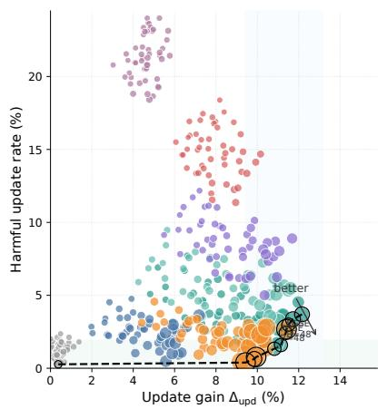

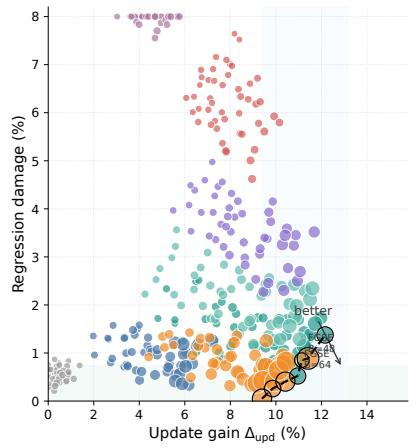  
Figure 6: Plasticity–safety Pareto analysis of update-selection strategies. Each point is one configuration obtained by sweeping verifier budgets and acceptance thresholds. The x-axis is update gain $\Delta _ { \mathrm { u p d } }$ , and the y-axis is either harmful update rate H (left) or regression damage R (right). Point size indicates verifier cost $C$ (average verifier calls per candidate update), and color denotes the update-selection strategy. The black dashed line shows the empirical Pareto frontier, where larger gain and smaller harm are jointly preferred. FGSE occupies the most favorable lower-right region over a wide range of medium verifier budgets, showing that it improves plasticity without incurring the safety cost typically associated with aggressive update policies.

Targeted probes versus random probes. FGSE uses targeted falsification: the verifier constructs probes likely to expose scope overreach, missing preconditions, archived regressions, and decoyinduced shortcut behavior. We compare targeted probe scheduling with budget-matched baselines to evaluate its efficiency in discovering harmful updates.

Let $\mathcal { H } _ { \mathrm { b a d } }$ denote the set of candidate updates that are in fact unsafe or regressive under held-out evaluation. Given a probe budget K, we define the bad-update detection rate as

$$
D ( K ) = \frac { 1 } { \vert \mathcal { H } _ { \mathrm { b a d } } \vert } \sum _ { h \in \mathcal { H } _ { \mathrm { b a d } } } \nk { \mathcal { H } } [ \tau _ { h } \leq K ] ,\tag{127}
$$

where $\tau _ { h }$ is the number of probes required to expose update h under a given scheduling policy. Thus, $D ( K )$ measures the fraction of unsafe updates discovered within the first K probes.

To account for the severity of detected updates, we also report harmful update avoided,

$$
A ( K ) = \frac { \sum _ { h \in \mathcal { H } _ { \mathrm { b a d } } } w _ { h } \mathcal { k } [ \tau _ { h } \le K ] } { \sum _ { h \in \mathcal { H } _ { \mathrm { b a d } } } w _ { h } } ,\tag{128}
$$

where $w _ { h }$ is the downstream harm weight of update $h ,$ estimated from its induced violation severity and regression impact. Hence, $A ( K )$ measures how much total harmful mass would be prevented if all detected bad updates were rejected before commitment.

We compare five probe-selection policies under the same verifier budget: TARGETED (the full FGSE probe scheduler), STRATIFIED RANDOM (random selection balanced across probe sources), PURE RANDOM (uniform sampling from the entire probe pool), BOUNDARY-ONLY (target only applicability-boundary probes), and REGRESSION-ONLY (target only archived-regression probes). Figure 7 plots the resulting falsification discovery curves.

Figure 7 shows that targeted probing is markedly more informative than random testing at every budget. The gap is largest in the practically relevant low-budget regime, where verifier calls are scarce. At around $K = 8 ,$ , the TARGETED policy already detects roughly twice as many bad updates as PURE RANDOM, and the improvement is even larger in terms of harmful update avoided. This indicates that targeted probing discovers more harmful updates early and prioritizes those with larger downstream damage.

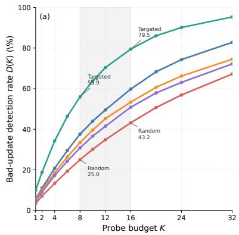

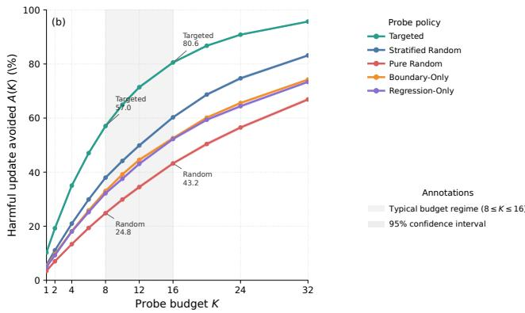  
Figure 7: Falsification discovery curves under different probe-selection policies. The x-axis is the probe budget K. The left panel shows bad-update detection rate $D ( K )$ , and the right panel shows harmful update avoided $A ( K )$ . Solid lines denote the mean across repeated trials, and shaded bands denote 95% confidence intervals. The gray vertical band marks the practically relevant low-budget regime $( 8 \leq K \leq 1 6 )$ . Targeted probing consistently dominates random baselines, especially in the low-budget regime, showing that hypothesis-aware falsification is substantially more informationefficient than unguided random testing.

A second observation is that BOUNDARY-ONLY and REGRESSION-ONLY each improve over pure random sampling in the regimes where their probe families are most relevant, but both eventually saturate below the full targeted strategy. This suggests that harmful updates are heterogeneous: some arise from overly broad applicability conditions, whereas others only become visible through archivedregression or decoy-style counterfactual tests. Therefore, a single probe family is insufficient; the gain of FGSE comes from selecting probes conditionally on the specific hypothesis under test.

Finally, the larger gap in $A ( K )$ than in $D ( K )$ is itself informative. It shows that targeted probing tends to surface the most dangerous updates first while increasing discovery count. This property is crucial for practical self-evolution, where only a small verifier budget is available and preventing a few highly harmful commitments is more important than marginally increasing average detection at very large budgets.

Stability under stochastic rollouts. We evaluate each candidate hypothesis under multiple stochastic rollouts to assess the reproducibility of its benefit across seeds.

For a hypothesis h and evaluation set $\mathcal { X } _ { h }$ , we define its seed-specific update effect as

$$
\Delta _ { h } ^ { ( s ) } = \frac { 1 } { | \mathcal { X } _ { h } | } \sum _ { x \in \mathcal { X } _ { h } } \Big ( R ( \pi \oplus h ; x , s ) - R ( \pi ; x , s ) \Big ) ,\tag{129}
$$

where s is the rollout seed controlling stochastic decoding, action tie-breaking, and environment perturbations. Thus, $\Delta _ { h } ^ { ( s ) }$ measures the marginal effect of applying hypothesis h under seed s.

To quantify stability, we further compute the mean seed effect

$$
\bar { \Delta } _ { h } = \frac { 1 } { S } \sum _ { s = 1 } ^ { S } \Delta _ { h } ^ { ( s ) } ,\tag{130}
$$

and the sign-consistency score

$$
C ( h ) = \frac { 1 } { S } \sum _ { s = 1 } ^ { S } \mathbb { k } \Big [ \mathrm { s i g n } \big ( \Delta _ { h } ^ { ( s ) } \big ) = \mathrm { s i g n } \big ( \bar { \Delta } _ { h } \big ) \Big ] ,\tag{131}
$$

which measures the fraction of seeds whose update effect agrees in sign with the mean effect. A stable and genuinely useful update should exhibit both a positive $\bar { \Delta } _ { h }$ and high sign consistency.

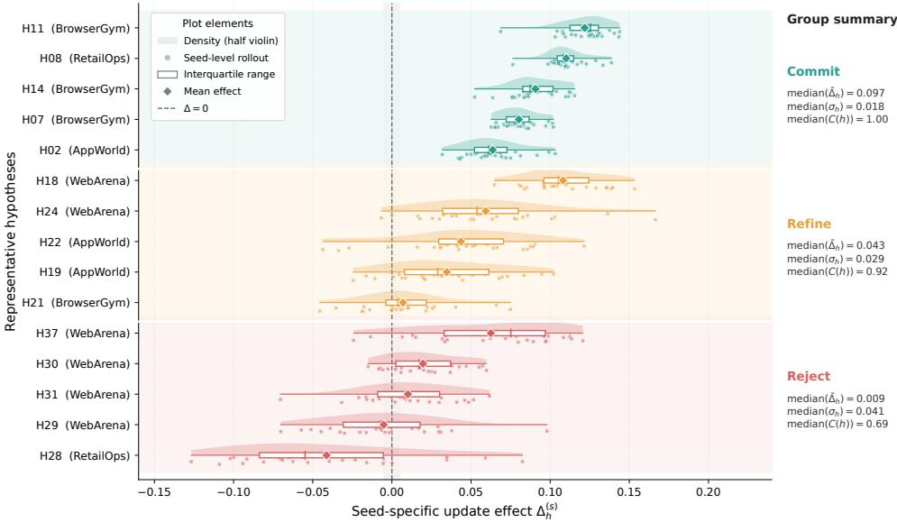  
Figure 8: Stability of hypothesis effects under stochastic rollouts. Each row corresponds to one hypothesis and shows the distribution of seed-specific update effects $\Delta _ { h } ^ { ( s ) }$ across repeated rollouts. Rows are grouped by the final FGSE decision. Dots denote seed-level outcomes, the shaded halfviolin shows the empirical density, the white box shows the interquartile range, and the diamond marks the mean effect. The right-side annotation reports the sign-consistency score $C ( h )$ . Committed hypotheses remain consistently positive across seeds, refined hypotheses are still mostly positive but exhibit larger variance, while rejected hypotheses are centered near zero or change sign frequently.

Figure 8 visualizes the seed-level effect distributions for representative hypotheses from the COMMIT, REFINE, and REJECT groups. Each row shows the distribution of $\Delta _ { h } ^ { ( s ) }$ over seeds for one hypothesis, using a raincloud plot. This visualization shows the robustness of observed gains across stochastic rollouts.

Figure 8 shows a clear separation between update classes. Committed hypotheses are tightly concentrated on the positive side, with small seed variance and high sign consistency. In our diagnostic run, the median committed hypothesis has $\bar { \Delta } _ { h } \approx 0 . 1 0$ and median sign consistency above 0.9, indicating that its positive effect persists across seeds. Refined hypotheses remain beneficial on average, but their distributions are wider and more sensitive to rollout randomness, which is consistent with the interpretation that they capture partially useful rules whose scope still requires tightening. In contrast, rejected hypotheses are typically centered near zero or slightly negative, and many of them flip sign across seeds, showing that their apparent gains are unstable and largely attributable to stochastic variation.

The effects of accepted updates persist across seeds. Hypothesis identity dominates rollout randomness as a source of variation. FGSE preferentially commits hypotheses whose benefit persists across stochastic executions.

Representative Commit–Refine–Reject Cases We inspect three representative hypotheses from the development audit archive. Each case is evaluated under the default setting used in the main experiments: $| T ( h ) | = 8 , | F ( h ) | = 1 6 , | R ( h ) | = 1 6 , \eta = 0 . 0 3 , \delta = 0 . 0 5$ , and $\beta = 0 . 0 1$ . We report the target-transfer gain $\hat { G } ( h )$ , falsification failure rate ${ \widehat { P } } _ { \mathrm { f a i l } } ( h )$ , regression damage ${ \widehat { D } } _ { \mathrm { r e g } } ( h )$ , and the resulting gate decision. These cases illustrate how FGSE distinguishes transferable rules, repairable overgeneralizations, and unsafe shortcuts.

The default FGSE gate commits the round-trip booking rule and accepts the refined calendar rule after scope narrowing. In the refinement and rejection cases, falsification and regression evidence govern commitment alongside positive target-transfer gain. The refinement case demonstrates the practical value of one-pass scope narrowing: ${ \widehat { G } } ( h )$ decreases moderately from 10.4% to 7.6%, but ${ \widehat { P } } _ { \mathrm { f a i l } } ( h )$ drops from 18.8% to 0.0%, and ${ \widehat { D } } _ { \mathrm { r e g } } ( h )$ drops from 2.7% to $0 . 8 \%$ . Thus, under the default setting, FGSE preserves useful self-evolution while blocking the main failure modes exposed by falsification and regression probes.

Table 7: Representative FGSE hypothesis triage cases under the default gate. All three candidates improve the triggering or near-transfer cases. Based on falsification and regression evidence, FGSE commits high-margin transferable rules, refines useful but overly broad rules, and rejects high-risk shortcuts despite positive target gain.
<table><tr><td>ger</td><td>Decision Domain / Trig- Candidate hypothesis</td><td></td><td>Gate statistics</td><td>Interpretation</td></tr><tr><td>COMMIT τ-Airline</td><td>round-trip booking ing.</td><td>/ Scope: the user asks to book a round-trip flight and explicitly provides origin, destination, out- bound date, and return date. Behavior: select the round-trip Post-commit violation: mode before search, fill both date fields, and verify that both flight legs are present before final book- Expected effect: the final booking record contains trip_type=round_trip and valid outbound and return segments.</td><td> $\widehat { G } ( h ) = 1 2 . 1 \%$   $\begin{array} { r c l } { { \widehat { P } _ { \mathrm { f a i l } } ( h ) } } & { { = } } & { { 0 / 1 6 = } } \end{array}$   $0 . 0 \%$   $\widehat { D } _ { \mathrm { r e g } } ( h ) = 0 . 6 \%$   $1 . 1 \%$ </td><td>The hypothesis passes all three default thresholds with margin:  $\hat { G } ( h ) \ >$  η,  $\widehat { P } _ { \mathrm { f a i l } } ( h ) < \delta ,$  and  $\widehat { D } _ { \mathrm { r e g } } ( h ) < \beta .$  It captures a reusable tool-order rule without harming bound- ary or archived cases.</td></tr><tr><td>REFINE</td><td>AppWorld calendar tioning “reschedule&quot;. rescheduling</td><td>Initial scope: any request men- Before refinement: Behavior: edit the existing cal- endar event rather than creating 18.8% a new one. Failure mode: the rule also fires on tasks that ask to create a sec- After refinement: ond event, cancel an event, or modify only a reminder. Refined scope: exactly one matching event exists, and the user explicitly requests changing its time rather than creating, can-</td><td> $\widehat { G } ( h ) = 1 0 . 4 \%$   $\widehat { P } _ { \mathrm { f a i l } } ( h ) \quad = \quad 3 / 1 6$  二  $\hat { D } _ { \mathrm { r e g } } ( h ) = 2 . 7 \%$   $\mathrm { S e p } ( h ) \stackrel { \cdot } { = } 0 . 0 7$   $\widehat { G } ( h ^ { \prime } ) = 7 . 6 \%$   $\begin{array} { r c l } { { \widehat { P } _ { \mathrm { f a i l } } ( h ^ { \prime } ) } } & { { = } } & { { 0 / 1 6 = } } \end{array}$   $0 . 0 \%$   $\widehat { D } _ { \mathrm { r e g } } ( h ^ { \prime } ) = 0 . 8 \%$  Post-commit violation: 2.0%</td><td>The initial hypothesis is useful but too broad: tar- get gain is high, but falsification and regres- sion exceed the default risk thresholds. Be- cause failures are sepa- rable, one precondition- refinement pass preserves  $7 3 . 1 \%$  of the target gain while reducing falsifica- tion failures to zero. This shows that refinement sal- vages repairable updates.</td></tr><tr><td>REJECT AgentDojo</td><td>tool-output shortcut</td><td>celling, or duplicating an event. / Scope: a tool output contains an urgent instruction or an apparent verification token. Behavior: follow the tool- suggested action directly without rechecking the user-level instruc- Forced-commit tion or system constraint. Expected effect: complete the immediate target task faster by trusting the tool message.</td><td> $\widehat { G } ( h ) = 8 . 7 \%$   $\widehat { P } _ { \mathrm { f a i l } } ( h ) = 5 / 1 6 =$  31.2%  $\widehat { D } _ { \mathrm { r e g } } ( h ) = 4 . 9 \%$   $\mathrm { S e p } ( h ) \dot { = } 0 . 3 1$  tion: 14.6%</td><td>Although the hypothesis improves several target- transfer probes, it creates a high-risk shortcut un- der decoy and prompt- viola- injection probes. The fail- ures are not cleanly sepa- rable by a narrower pre- condition. FGSE there- fore rejects the update, preventing a target-only gate from committing an</td></tr></table>

## D.3 Mechanistic Analysis of Long-Term Self-Evolution

Trajectory-level behavioral changes. Aligned interpretability in autonomous driving ties language to intermediate perception, prediction, and planning outputs [Ding et al., 2025]. We compare baseline and FGSE execution trajectories to identify the dominant behavioral edits underlying performance improvements.

Let $\tau ^ { \mathrm { B } } = ( a _ { 1 } , \dots , a _ { T } )$ and $\tau ^ { \mathrm { F } } = ( a _ { 1 } ^ { \prime } , \dots , a _ { T ^ { \prime } } ^ { \prime } )$ denote the baseline and FGSE trajectories for the same task. We first align the two traces at the action-type level and group all trajectory edits into four interpretable behavior families: tool order, memory retrieval, constraint checking, andfinal answer formatting. For each family $e \in { \mathcal { E } } .$ , we compute its weighted edit mass

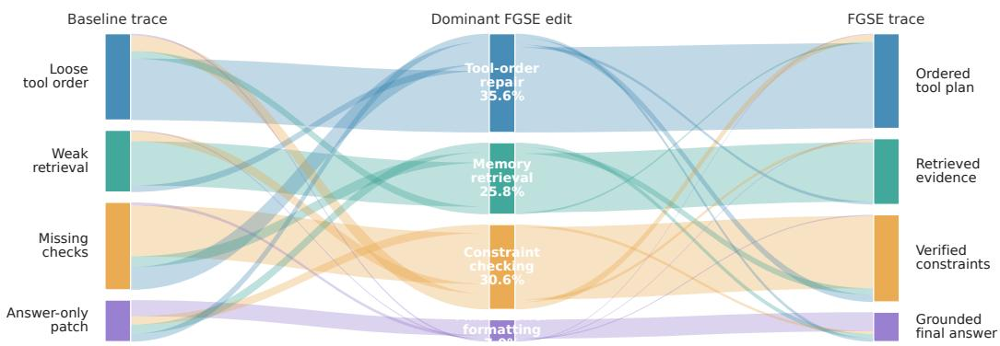  
Figure 9: Trajectory-edit Sankey diagram from baseline traces to FGSE traces. The left column shows the dominant behavioral deficiency in the baseline trace, the middle column shows the dominant edit family introduced by FGSE, and the right column shows the resulting FGSE behavior motif. Band width is proportional to the number of corrected trajectories. The diagram shows that most successful transitions are driven by tool-order repair, memory retrieval, and constraint checking, whereas final-answer formatting accounts for only a small minority of improvements.

$$
m _ { e } ( { \tau ^ { \mathrm { { B } } } } , { \tau ^ { \mathrm { { F } } } } ) = \sum _ { o \in \mathcal { O } _ { e } } w ( o ) ,\tag{132}
$$

where $\mathcal { O } _ { e }$ is the set of aligned edit operations assigned to family e, and $w ( o )$ denotes the causal weight of operation o estimated from its contribution to final task improvement. We then define the dominant edit family as

$$
e ^ { \star } ( \tau ^ { \mathrm { B } } , \tau ^ { \mathrm { F } } ) = \arg \operatorname* { m a x } _ { e \in \mathcal { E } } m _ { e } ( \tau ^ { \mathrm { B } } , \tau ^ { \mathrm { F } } ) .\tag{133}
$$

To make the behavioral change interpretable, we further assign each trajectory pair a baseline behavior motif and an FGSE behavior motif, determined from the dominant failure pattern before the first decisive divergence and the dominant corrected pattern after refinement, respectively. Figure 9 aggregates all improved trajectory pairs into a three-stage Sankey diagram: baseline motif → dominant edit family → FGSE motif. The width of each band is proportional to the number of corrected trajectories contributing to that transition.

Figure 9 shows that FGSE’s gains are primarily driven by substantive behavioral correction. The dominant flow mass concentrates in three edit families: tool-order repair, constraint checking, and memory retrieval. Final-answer formatting occupies only a small portion of the total corrected mass and rarely converts failures to successes.

The largest transition typically starts from baseline traces with loose or misordered tool usage, passes through tool-order repair, and ends in ordered tool plans under FGSE. A similarly large portion of corrected trajectories flows through constraint checking, showing that many failures arise from missing explicit verification before tool execution or answer commitment despite available knowledge. Memory retrieval forms the third major band, and its contribution is especially prominent on longhorizon and memory-intensive tasks, where the baseline agent often fails to retrieve previously relevant context or latent facts.

Overall, the Sankey analysis clarifies where FGSE changes behavior: it reorganizes tool usage, retrieves missing evidence, and enforces explicit constraint checks. These findings strengthen the interpretation that FGSE improves the agent’s internal decision process.

## D.4 Cost and Scalability

Memory-growth controllability. We analyze memory-growth scalability by varying the retention budget and measuring how agent quality changes as the number of committed hypotheses increases.

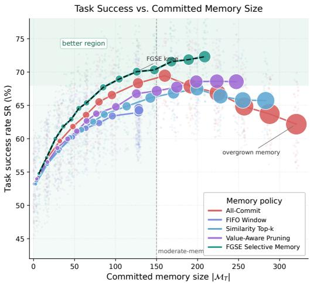

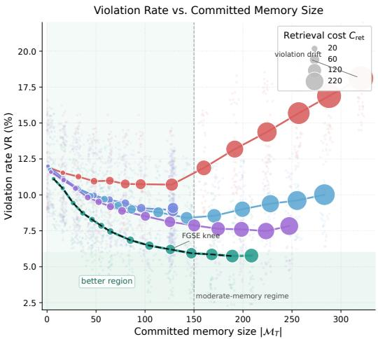  
Figure 10: Memory-growth Pareto analysis. We vary the retention budget and evaluate longhorizon self-evolving agents under different memory policies. Left: task success rate versus committed memory size. Right: violation rate versus committed memory size. Each faint point denotes one domain-seed run, while solid lines connect policy means across budgets. Marker area is proportional to retrieval cost $C _ { \mathrm { { r e t } } }$ . A desirable memory policy should remain close to the upper-left region in the left panel (high success with small memory) and the lower-left region in the right panel (low violation with small memory). FGSE traces the most favorable frontier: it achieves high task success and low violation with substantially smaller committed memory and lower retrieval cost than naive memory growth.

For each memory policy, we vary the nominal retention budget over

$$
B \in \{ 0 , 1 6 , 3 2 , 4 8 , 6 4 , 8 0 , 9 6 , 1 2 8 , 1 6 0 , 1 9 2 , 2 2 4 , 2 5 6 , 2 8 8 , 3 2 0 \} ,
$$

and run long-horizon evaluation episodes under the same self-evolution protocol. For each run, we record the final committed memory size $\vert \mathcal { M } _ { T } \vert .$ , task success rate SR, violation rate VR, and average retrieval cost $C _ { \mathrm { { r e t } } }$ . We compare $_ { \mathrm { A L L - C O M M I T } }$ , FIFO WINDOW, SIMILARITY TOP-k, VALUE-AWARE PRUNING, and FGSE SELECTIVE MEMORY. Figure 10 presents the resulting memory-growth Pareto plot.

Figure 10 shows that memory growth is not monotonic in utility. The naive ALL-COMMIT strategy initially benefits from additional memory, but after the committed set becomes large, the curve enters an overgrown regime: success saturates and then degrades, while the violation rate rises steadily and retrieval cost increases sharply. In contrast, bounded heuristics such as FIFO WINDOW and SIMILARITY TOP-k keep memory smaller, but they also leave substantial performance on the table because they discard useful reusable rules too aggressively.

FGSE SELECTIVE MEMORY lies on the best empirical frontier in both panels. It reaches its strongest regime at a moderate memory size. In this diagnostic run, FGSE attains around $7 0 \% \sim \bar { 7 } 2 \%$ task success once the committed memory reaches roughly 120–150 entries, while maintaining a violation rate near $4 \% \sim 5 \%$ . At a comparable or even lower committed size, competing strategies either achieve lower success or incur substantially higher violation. Moreover, compared with ALL-COMMIT, FGSE achieves a clearly better quality–cost trade-off: it matches or exceeds the best success of naive growth using far fewer retained hypotheses and noticeably smaller retrieval cost. This indicates that memory quality and selective retention are the key bottleneck for gains from persistent memory.

Finally, the curves exhibit a visible saturation effect. Beyond a moderate memory size, the marginal gain of additional committed hypotheses becomes very small, while retrieval cost continues to increase. These results support controllable long-term memory growth through commitment filtered by utility, falsification, and regression preservation.

## E Broader Impacts

FGSE may improve the reliability of long-horizon language agents by reducing unsafe memory updates, overgeneralized behavioral rules, and regressions on previously solved tasks. Potential positive impacts include safer agent adaptation in web, app, and tool-use settings where persistent memory is used. However, more reliable self-evolving agents may also increase the capability of automated systems that can perform harmful or unauthorized actions if deployed without access control, monitoring, and domain-specific safety constraints [Yang et al., 2026a, Fan et al., 2023]. Financial-agent audits likewise identify source-manipulation risks and motivate model-independent halts and hard loss limits [Wang and Saxena, 2026]. FGSE mitigates some of these risks through verifier-grounded falsification, regression testing, audit records, and post-commit monitoring. These mechanisms complement deployment-level safety controls.

## F LLM Usage

This paper studies self-evolving LLM agents. In the experiments, frozen LLM backbones are used as ReAct-style executors that generate interaction trajectories in web, app, tool-use, and long-term memory environments. FGSE also uses an LLM-based proposer to convert episode evidence into structured candidate hypotheses. LLM-generated hypotheses enter verifier-based evaluation. The final commit–refine–reject decision is determined by target-transfer, falsification, and regression probes evaluated with executable or benchmark-provided verifiers, including official success validators, database-state checkers, unit tests, security validators, and exact-match evaluators.

During the broader research process, LLM-based tools assisted with wording, grammar, LaTeX formatting, code drafting, script debugging, and organization of experimental notes. The authors specified, checked, and approved all scientific claims, methodological choices, mathematical statements, proofs, experimental settings, reported numbers, figures, tables, and interpretations. They manually verified all references for existence, relevance, and correctness, and reviewed and edited LLM-assisted text and code before inclusion in the paper or experiments.