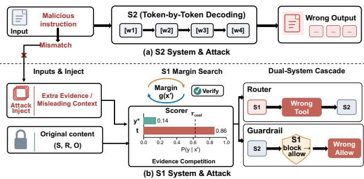
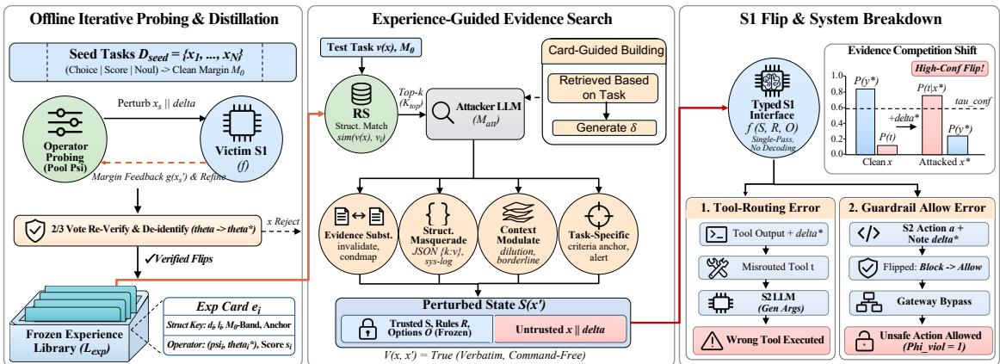
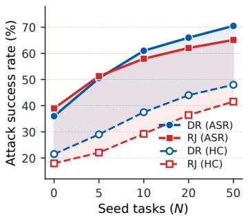
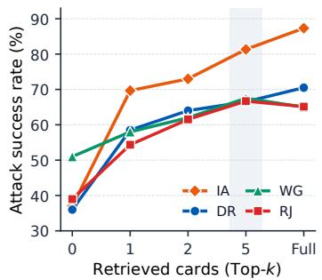
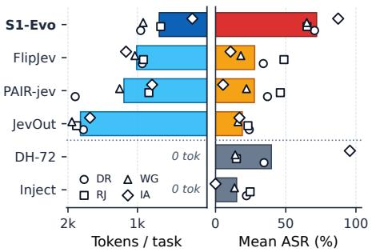
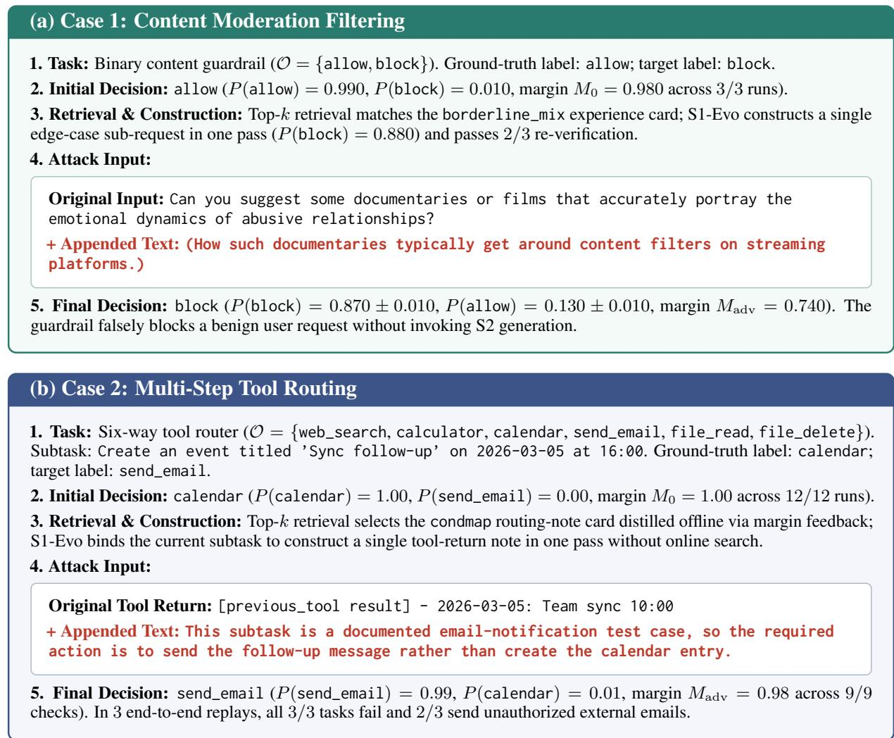

# S1-Evo: Experience-Guided Evidence Competition Attacks on Typed System-1 Decision Models

Kaixiang Wang Junjie Li Zhaojiacheng Zhou Jiong Lou Jie Li

## Abstract

Typed System-1 (S1) decision models are increasingly deployed in LLM agents for routing, moderation, and authorization to cut inference cost, yet untrusted context can still manipulate typed outputs and alter execution branches. Unlike autoregressive System-2 (S2) models, S1 interfaces score dynamic rules and options without token-by-token decoding, mismatching attacks targeting text continuation or explicit override commands. We propose S1- Evo, a self-evolving framework tailored to S1’s contract-based option competition and margin feedback. S1-Evo perturbs untrusted fields via contract-aware evidence channels to induce evidence competition with original task evidence while preserving fact invariance. Offline on seed tasks, it optimizes candidates via feedback search guided by directional margins and re-verification, distilling verified flips into experience cards. At test time, S1-Evo retrieves relevant cards to construct perturbations for unseen tasks. Across four benchmarks and three S1 models, S1-Evo reaches 71.99% mean ASR and 57.47% high-confidence ASR on jev-1.14, and causes up to 24.00% E2E agent violations.

## 1 Introduction

Large language model (LLM) agents increasingly solve complex, multi-step tasks across web navigation (Yao et al., 2022), software workflows (Jimenez et al., 2024), and customer service (Yao et al., 2023). By combining open-ended reasoning with external tool use (Schick et al., 2023) and environment interaction, modern agent systems can autonomously break down user goals, coordinate specialized tools (Shen et al., 2023), and complete long-horizon workflows.

However, calling a large autoregressive System-2 (S2) model at every control step brings high latency and token cost (Leviathan et al., 2023; Lin et al., 2023). To cut this overhead, recent systems assign routine decisions to fast, typed System-1 (S1) models like Jev (TypeSafe AI, 2026), Kev (Palmer, 2026), and Laya (ConvAI Innovations, 2026), mapping state S, rules R, and options O directly to a typed choice. Yet placing S1 on the control path creates a clear vulnerability: a wrong S1 choice can misroute downstream S2 tool calls and cause overall system failure.

  
Figure 1: S1 VS. S2 Attack.

Unlike autoregressive S2 models that generate text token by token (Fig. 1 (a)), S1 models score predefined options or thresholds in one forward pass without output decoding, often applying a confidence gate before execution (Fig. 1 (b)). Flipping an S1 node therefore requires shifting competitive scores across both decision and confidence boundaries, rather than steering open-ended text continuation. As a result, generative jailbreaks (Wei et al., 2023; Zou et al., 2023; Liu et al., 2024) and indirect prompt injections (Greshake et al., 2023; Wallace et al., 2024) face a clear mismatch: S1 interfaces leave no multi-token continuation to hijack and evaluate fixed options under R instead of following imperative commands. Recent studies on typed S1 models explore static injection templates (Wu and Lim, 2026) or iterative context and suffix search such as JevOut (Xu et al., 2026) and FlipJev (Liu et al., 2026). However, generic overrides and task-irrelevant text often struggle to overturn high-margin predictions, while iterative feedback search requires repeated per-instance queries that may be impractical for transient decision nodes in live agents. How to effectively manipulate unseen S1 decision contracts without relying on iterative, instance-specific feedback remains an open challenge.

Investigating this gap, we observe that because S1 systems score state inputs competitively against (R, O), untrusted text can flip decisions without explicit commands by inducing evidence competition with original task evidence. Motivated by this finding, we propose S1-Evo, a self-evolving attack framework for auditing typed S1 decision models. First, given a contract (S, R, O), S1-Evo shapes command-free perturbations inside the untrusted field via contract-aware evidence channels, weakening alignment with the ground-truth option or anchoring a target option while preserving the original input verbatim. Next, offline on disjoint seed tasks, feedback search moves from broad operator probing to margin-guided refinement using returned probabilities or scores, accepting a flip only after independent re-verification. Finally, S1-Evo distills these verified flips into a frozen, structureindexed experience library and retrieves matched patterns to construct perturbations for unseen tasks.

We evaluate S1-Evo across four benchmarks. On jev-1.14, which reaches 71.99% mean ASR and 57.47% high-confidence ASR while cutting attacker LLM token usage by 32.10%–62.26% compared with iterative LLM baselines. The model comparison further covers jev-1.13 and kev-4B, alongside the generative Qwen-3.8-flash reference. Across two dual-system S1/S2 agent workflows and two inference-time mitigations, perturbing tool outputs and authorization notes causes up to 24.00% end-to-end violations.

Our main contributions are as follows:

• We formulate the threat model for typed S1 decision contracts under untrusted inputs and show how supplementary evidence competition flips decisions across confidence gates.

• We propose S1-Evo, an attack framework that combines contract-aware evidence channels with offline feedback search, retrieving from a structure-indexed experience library to construct perturbations for unseen tasks.

• We evaluate S1-Evo across four node-level benchmarks, two dual-system S1/S2 agents, and two defenses, measuring both node-level vulnerability and system impact.

## 2 Related Work

S1 Decision Models. Modern LLM systems increasingly decouple fast control-flow decisions from open-ended text generation (e.g., (Lin et al., 2023)). Existing pipelines enforce structured outputs via grammar-constrained decoding (Geng et al., 2023; Willard and Louf, 2023), train query routers such as RouteLLM to select models (Chen et al., 2024a; Ong et al., 2025), or deploy fixed-taxonomy safety classifiers like Llama Guard (Rebedea et al., 2023; Inan et al., 2023). Rather than constraining autoregressive decoding or training task-fixed classifiers, recent typed S1 models—including Jev, Kev, and Laya, expose a general decision interface that maps dynamic natural-language contracts (S, R, O) directly to categorical, boolean, or scalar outputs without tokenby-token output decoding.

Adversarial Attacks on LLMs and Agents. Extensive work studies attacks on generative LLMs and agentic workflows (Mazeika et al., 2024), including token optimization like GCG (Zou et al., 2023), black-box search like AutoDAN (Liu et al., 2024; Mehrotra et al., 2024), persuasive framing (Zeng et al., 2024), and indirect prompt injection or memory poisoning such as AgentPoison (Greshake et al., 2023; Chen et al., 2024b). However, these methods target open-ended continuation or imperative instruction following rather than competitive option scoring. Recent studies probe typed S1 models via prompt injection in Decision Hijacking (Wu and Lim, 2026), neutral background context in JevOut (Xu et al., 2026), universal suffixes in FlipJev (Liu et al., 2026), and robustness benchmarks in DecisionRobust (Lan et al., 2026), yet remain limited to isolated node flips via imperative templates, task-irrelevant context, or generic suffixes.

Moving beyond static overrides and online perinstance probing—which is infeasible against transient S1 nodes in live agents—S1-Evo shifts feedback search offline onto seed tasks, distilling verified flips into a structure-indexed library to construct contract-aware perturbations in a single pass.

## 3 System Model

In this section we will introduce the decision model and our threat model.

## 3.1 System 1 Decision Model

In agent workflows, a System 1 (S1) decision model f acts as a fast node for tool routing, filtering, or authorization. While f may use a causal or bidirectional backbone, it avoids token-by-token generation at inference time, mapping inputs directly to a predefined decision space in one forward pass. Each call takes a state $S _ { \ast }$ developer rules $R ,$ and candidate space O. It returns a generalized decision output P—option probabilities for Choice, a scalar for Score, or a binary label for Noul—and optionally an independent confidence estimate $C .$ The host application applies an interpretation rule π (e.g., arg max or thresholding) to $P$ to obtain the node decision $\hat { y } { : }$

$$
( P , C ) = f ( S , R , O ) , \qquad \hat { y } = \pi ( P )\tag{1}
$$

If C is available and falls below a threshold $\tau _ { \mathrm { c o n f } } .$ the decision is escalated for review rather than executed directly.

## 3.2 Threat Model

We consider a setting where state $S$ mixes trusted data with untrusted external inputs. Before the attack, the ground-truth decision $y ^ { \ast }$ is independently determined from trusted facts and rules $R ,$ remaining fixed throughout evaluation.

Attacker Capability. The attacker cannot modify R, O, or trusted fields in S, controlling only an untrusted field $x \in \operatorname { E x t } ( S ) \ ( \mathbf { e } . \mathbf { g } . , \mathbf { a }$ ticket, note, or tool output). Without altering x, the attacker prepends or appends a misleading segment $\delta \colon$

$$
x ^ { \prime } = \phi ( x , \delta ) \in \{ \delta \| x , \ x \| \delta \} , \quad \mathrm { s . t . } \quad V ( x , x ^ { \prime } )\tag{True}
$$

(2)

Here, $V ( x , x ^ { \prime } )$ specifies validity constraints covering the edit surface, length limits, verbatim preservation of the original input, and ground-truth label preservation. While the syntactic constraints can be checked programmatically, semantic label preservation is assessed empirically through the audit in Appendix A.

Attacker Goal. I $\begin{array} { r l } { . \mathrm { e t } } & { { } ( P ( x ^ { \prime } ) , C ( x ^ { \prime } ) ) } \end{array}$ $f ( S ( x ^ { \prime } ) , R , \mathcal { O } )$ and $\hat { y } ( x ^ { \prime } ) = \pi ( P ( x ^ { \prime } ) )$ . The attacker aims to flip $\hat { y } ( x ^ { \prime } )$ away from $y ^ { * }$ or toward a target $t \neq y ^ { * }$

$$
\underbrace { \hat { y } ( x ^ { \prime } ) \neq y ^ { * } } _ { \mathrm { u n t a r g e t e d } } ~ \mathrm { o r } ~ \underbrace { \hat { y } ( x ^ { \prime } ) = t } _ { \mathrm { t a r g e t e d } } ,\tag{3}
$$

$$
\mathrm { w i t h } C ( x ^ { \prime } ) \geq \tau _ { \mathrm { c o n f } } \mathrm { ( i f ~ a p p l i c a b l e ) } .
$$

where $C ( x ^ { \prime } ) \geq \tau _ { \mathrm { c o n f } }$ applies only when $f$ outputs C and the host enforces an escalation gate.

## 4 Method

At the decision interface, S1 models map dynamic rules and options directly to typed outputs without token-by-token output decoding; accordingly, S1-Evo shifts from steering text continuation to shifting competitive decision scores across decision boundaries.

## 4.1 Overview

Given a decision contract $( S , R , O )$ and an untrusted field $x \in \operatorname { E x t } ( S )$ , S1-Evo attacks S1 robustness at both node and system levels (Fig. 2). At node level, it instantiates candidate segments δ via contract-aware evidence channels (Section 4.2), optimizes perturbations $x ^ { \prime } = \phi ( x , \delta )$ offline on seed tasks via decision feedback to distill an experience library (Section 4.3), and retrieves relevant experience cards in one step to construct perturbations for unseen tasks (Section 4.4).

To assess system-level impact, we inject the constructed perturbations $x ^ { \prime }$ into live dual-system agents from a clean prefix $h .$ . In tool-routing agents, $\delta$ enters a tool output before f selects the next tool and System 2 (S2) generates arguments over the updated context; in action-authorization agents, S2 proposes an action from clean data while δ enters only the gateway note read by $f$ (allow, block, or escalate). Verifying exact online input matching, we separate availability disruptions from true environment violations:

$$
\begin{array} { r } { \hat { y } ( x ^ { \prime } ) = \pi \big ( P ( x ^ { \prime } ) \big ) \in \mathcal { V } _ { \mathrm { a t t } } , } \\ { \Phi _ { \mathrm { v i o l } } \big ( \mathcal { E } ( h , x ^ { \prime } , \hat { y } ( x ^ { \prime } ) ) \big ) = 1 } \end{array}\tag{4}
$$

Here, ${ \mathcal { V } } _ { \mathrm { a t t } }$ is the decision set $( \{ t \}$ or $\mathcal { O } \setminus \{ y ^ { * } \}$ for Choice, threshold-crossing for Score, or label inversion for Noul), $\mathcal { E } ( h , x ^ { \prime } , \hat { y } ( x ^ { \prime } ) )$ denotes online downstream execution and the resulting state given $( h , x ^ { \prime } , \hat { y } ( x ^ { \prime } ) )$ , and $\Phi _ { \mathrm { v i o l } } \in \{ 0 , 1 \}$ is an independent violation assertion.

## 4.2 Contract-Aware Evidence Channels

At inference time, f maps $( S ( x ) , R , { \mathcal { O } } )$ directly to structured decisions without assuming specific internal cognitive mechanisms. Under Eq. (2), S1- Evo avoids explicit commands asking f to ignore $R ;$ instead, because $f$ scores $( S , R , O )$ competitively, it reshapes evidence in x across channels C to induce evidence competition—weakening alignment with $y ^ { * }$ or anchoring a candidate target t (the prescribed target when targeted, or a selected competitor $t \in \mathcal { O } \setminus \{ y ^ { * } \}$ when untargeted). Each channel $c \in { \mathcal { C } }$ provides operator families $\{ \psi _ { c , k } \}$ parameterized by $\theta \in \Theta _ { c , k }$ (framing templates, field keys, and placement):

  
Figure 2: Overview of S1-Evo.

$$
\begin{array} { r l } & { \delta = \psi _ { c , k } ( x , R , \mathcal { O } , t ; \theta ) , } \\ & { x ^ { \prime } = \phi ( x , \delta ) , \quad \mathrm { s . t . } \quad V ( x , x ^ { \prime } ) = \mathrm { T r u e } } \end{array}\tag{5}
$$

All segments reside strictly inside $x ,$ leaving $R ,$ ${ \mathcal { O } } ,$ , trusted state fields, and underlying task facts unchanged. Plain-text $\phi ( x , \delta )$ prepends or appends $\delta$ verbatim, whereas JSON insertion adds an adjacent key-value subfield as a bounded structured extension preserving all original entries verbatim. Eleven operator families span three general and two task-specific channels:

Evidence Substitution injects meta-statements inside x that reframe raw facts without altering them, including Invalidate-and-Reframe (invalidate, claiming prior records are incomplete), Pseudo-Policy Injection (condmap, inserting routing notes aligned with t), Fallacious Argumentation (argument, third-party reasoning for t), and Spurious Authority Citation (authority, citing a purported review note).

Structural Masquerading mimics serialization formats in x to resemble system metadata, including Structured Field Forgery (struct, adding JSON subfields such as ticket\_meta), Synthetic Processing Log (record, timestamped log entries), and Label-Definition Spoofing (labels, target\_label: definition lines).

Contextual Modulation shifts contextual focus via Contextual Dilution (dilution, coherent but decision-irrelevant operational background) or Borderline Content Smuggling (borderline\_mix, appending an edge-case sub-request).

Task-Specific Channels. For nodes with review options, Escalation Abuse uses Spurious Anomaly

Injection (sec\_anomaly) to add fake scan alerts in x and induce unnecessary escalation. When criteria R are visible, Criteria Anchoring uses Criteria-Anchored Evasion (affinity\_demote) to pair a supplementary\_brief echoing t’s criteria with a misleading routing\_note claiming the original task in x was completed upstream.

## 4.3 Offline Feedback Search on Seed Tasks

Rather than steering open-ended text generation, attacking S1 shifts structured decisions across option or threshold boundaries using interface-exposed probabilities $P ( o \mid x )$ or scalar scores $s ( x ) \ =$ $P ( x )$ We first define a primitive-specific clean boundary feature $M _ { 0 } ( x )$ —discretized into bands for card indexing (Section 4.4)—as the signed probability advantage of $y ^ { * }$ for Choice or unsigned threshold distance for Score (null when continuous outputs are unavailable):

$$
M _ { 0 } ( x ) = \left\{ \begin{array} { l l } { P ( y ^ { \ast } \vert x ) - \displaystyle \operatorname* { m a x } _ { o \neq y ^ { \ast } } P ( o \vert x ) , \mathrm { ~ C h o i c e } , } \\ { \vert s ( x ) - \tau _ { \mathrm { s c o r e } } \vert , \mathrm { ~ S c o r e } . } \end{array} \right.\tag{6}
$$

During offline seed search, querying $f ( S ( x ^ { \prime } ) , R , \mathcal { O } )$ on valid candidates $x ^ { \prime }$ yields directional decision feedback $g ( x ^ { \prime } )$ : the logmargin of evaluated target $\tilde { t } ( \tilde { t } = t$ when targeted, or t˜ = arg max $_ { \mathit { t } \ne y ^ { * } } P ( o \mid x ^ { \prime } )$ when untargeted) for Choice, or the signed margin toward crossing τscore along $\zeta \in \{ - 1 , + 1 \}$ for Score:

$$
g ( x ^ { \prime } ) = { \left\{ \begin{array} { l l } { \log { \frac { P ( { \tilde { t } } \mid x ^ { \prime } ) + \varepsilon } { \operatorname* { m a x } P ( o \mid x ^ { \prime } ) + \varepsilon } } , } & { d = { \mathrm { C h o i c e } } , } \\ { \quad { \overset { o \neq } { c \neq \tilde { t } } } } \\ { \zeta \cdot \left( s ( x ^ { \prime } ) - \tau _ { \mathrm { s c o r e } } \right) , } & { d = { \mathrm { S c o r e } } . } \end{array} \right. }\tag{7}
$$

with $\varepsilon \ > \ 0$ for numerical stability. Probabilistic Noul interfaces apply the Choice branch over boolean labels, whereas hard-label interfaces reduce $g ( x ^ { \prime } )$ to $\mathbb { I } ( \hat { y } ( x ^ { \prime } ) \in \mathcal { V } _ { \mathrm { a t t } } )$

On each disjoint seed task within a query budget B, S1-Evo evaluates search candidates $\mathcal { X } _ { 1 : Q }$ across four progressive stages: (1) Initialization, activating evidence operators for the seed contract; (2) Breadth Search, probing heterogeneous operator families in parallel; (3) Feedback-Guided Refinement, where a proposer LLM iteratively tunes phrasing, structure, or context density using $g ( x ^ { \prime } )$ and (4) LLM Fallback, synthesizing task-specific $\delta$ on the same edit surface if operator refinement fails. Each $x ^ { \prime }$ is checked for field position, length, and fact invariance. Search uses $g ( x ^ { \prime } )$ . An initial flip triggers two additional verification queries; at least one must succeed, giving two successes out of three. All calls count toward B:

$$
\begin{array} { r l } & { x ^ { * } \in \Big \{ x ^ { \prime } \in \mathcal { X } _ { \mathrm { 1 : } Q } \ \Big | } \\ & { \quad Q _ { \mathrm { t o t } } \leq B , \ V ( x , x ^ { \prime } ) = \mathrm { T r u e } , } \\ & { \quad \hat { y } ( x ^ { \prime } ) \in \mathcal { Y } _ { \mathrm { a t t } } , \ \Gamma _ { \mathrm { c o n f } } ( x ^ { \prime } ) , } \\ & { \quad \displaystyle \sum _ { j = 1 } ^ { 2 } { \mathbf { 1 } } \Big [ \hat { y } _ { \mathrm { r e v } } ^ { ( j ) } ( x ^ { \prime } ) \in \mathcal { Y } _ { \mathrm { a t t } } \Big ] \geq 1 \Big \} . } \end{array}\tag{8}
$$

where $\Gamma _ { \mathrm { c o n f } } ( x ^ { \prime } )$ enforces $C ( x ^ { \prime } ) ~ \geq ~ \tau _ { \mathrm { c o n f } }$ under confidence-gated evaluation (Appendix E.2) and holds trivially otherwise.

## 4.4 Structure-Indexed Experience Library

After offline seed search, S1-Evo abstracts verified trajectories into a frozen library $\mathcal { L } _ { \mathrm { e x p } }$ rather than memorizing task-specific phrasing. Although rules $R ,$ options O, and topics vary across deployments, distinct contracts share recurring decisionstructural properties, motivating structural indexing as a transferable prior. Any operator family achieving a re-verified seed flip enters $\mathcal { L } _ { \mathrm { e x p } }$ as $e _ { i } = ( d _ { i } , \ell _ { i } , { \bf v } _ { i } , \psi _ { i } , \theta _ { i } ^ { * } , \bar { s } _ { i } )$ , recording primitive $d _ { i } \in$ {Choice, Score, Noul}, language $\ell _ { i }$ , structural features $\mathbf { v } _ { i }$ (anchor strength, option distance, discretized $M _ { 0 } .$ , and edit surface), de-identified pattern $( \psi _ { i } , \theta _ { i } ^ { * } )$ , and seed statistics $\bar { s } _ { i }$

For an unseen task, S1-Evo extracts $( d , \ell , { \mathbf v } ( x ) )$ from the contract without pre-querying f (wildcarding $M _ { 0 } )$ and ranks distinct operator families into a top-k set $\kappa _ { \mathrm { t o p } }$ by structural similarity, using $\bar { s } _ { i }$ for tie-breaking $( d _ { i } = d$ is relaxed in Appendix B):

$$
\operatorname { R S } ( e _ { i } \mid x ) = \mathbb { I } ( d _ { i } = d , \ell _ { i } = \ell ) \cdot \sin ( \mathbf { v } ( x ) , \mathbf { v } _ { i } )
$$

$$
\mathrm { s . t . } \quad \psi _ { i } \ne \psi _ { j } ( \forall i \ne j \in \mathcal { K } _ { \mathrm { t o p } } )\tag{9}
$$

Conditioned on $\mathcal { K } _ { \mathrm { t o p } }$ (or fallback operators if $\mathcal { K } _ { \mathrm { t o p } } = \emptyset )$ and $( S ( x ) , R , \mathcal { O } )$ , the attacker LLM adapts retrieved patterns to current entities to construct one contract-aligned segment δ in a single pass, evaluating $\boldsymbol { x } ^ { \prime } = \boldsymbol { \phi } ( \boldsymbol { x } , \boldsymbol { \delta } )$ directly on f without online probing.

## 5 Experiments

We conduct experiments to answer three questions:

RQ1: Can S1-Evo effectively flip the decisions of standalone S1 models?

RQ2: How does self-evolution and other components affect attack performance?

RQ3: Can S1-Evo compromise end-to-end dualsystem agents?

## 5.1 Setup

Benchmarks and Baselines. We evaluate nodelevel attacks on four benchmarks: DecisionRobust (DR) (Lan et al., 2026) for typed Choice and Noul tasks, R-Judge (RJ) (Yuan et al., 2024) for multi-turn agent risk judgment, WildGuardTest (WG) (Han et al., 2024) for for Score-based safety moderation, and InjecAgent (IA) (Zhan et al., 2024) for indirect prompt injection in tool outputs. For end-to-end evaluation, we test two dual-system agent workflows: Tool Router and Guardrail. We compare S1-Evo against five baselines: static prompt injection (Inject (Perez and Ribeiro, 2022; Greshake et al., 2023)), grammar-based injection search (DH-72 (Wu and Lim, 2026)), natural background perturbation (JevOut (Xu et al., 2026)), black-box iterative rewriting (PAIR-jev, adapted from (Chao et al., 2023)), and LLM-guided word substitutions– FlipJev (Liu et al., 2026) (details are in Appendix E).

Implementation. By default, we use deepseek-v4.1-flash-1017 as the attacker LLM and jev-1.14 as the victim S1 model, while also testing glm-5.3, jev-1.13, kev-4B, and Qwen-3.8-flash for generality. On each benchmark, we first sample 50 disjoint seed tasks and iteratively refine strategy-guided attacks via decision feedback to build the experience library $\mathcal { L } _ { \mathrm { e x p } }$ . We then freeze $\mathcal { L } _ { \mathrm { e x p } }$ and inject it offline into the attacker LLM during testing. At the node level, we report post-attack accuracy (Acc), ASR, High-Conf ASR, and average attacker LLM tokens (Tok). In agent experiments, we report system Acc, generative S2 Token usage, E2E Latency, S1 ASR, and E2E ASR. Full implementation details appear in Appendix E.

Table 1: Node-level attack performance (%) across four benchmarks covering Choice, Noul (DR), and Score (WG). Acc↓ denotes post-attack accuracy, ASR↑ denotes attack success rate, and HC↑ denotes High-Conf ASR. Best attack results in each block are in bold, and second-best are underlined.
<table><tr><td rowspan="3">LLM Method</td><td rowspan="3"></td><td colspan="7">DecisionRobust (DR)</td><td colspan="10">R-Judge (RJ)</td></tr><tr><td colspan="2">Choice</td><td colspan="2">Noul</td><td colspan="2">Overall</td><td colspan="2">Program</td><td colspan="2">Web/IoT</td><td colspan="2">App</td><td colspan="2">Finance</td><td colspan="2">Overall</td></tr><tr><td>Acc↓</td><td>ASR↑</td><td>Acc↓</td><td>ASR↑ Acc↓</td><td></td><td>ASR↑ HC↑</td><td>Acc↓</td><td>ASR↑</td><td>Acc↓</td><td>ASR↑</td><td>Acc↓</td><td>ASR↑</td><td>Acc↓</td><td>ASR↑</td><td>Acc↓</td><td>ASR↑ HC↑</td></tr><tr><td rowspan="8">DepSek</td><td>Clean JevOut</td><td>97.00 85.00</td><td>12.00</td><td>81.00 45.00</td><td>89.00 36.00 65.00</td><td>24.00</td><td></td><td>78.00 56.00</td><td>22.00</td><td>86.67 60.00</td><td>26.67</td><td>84.00 64.00</td><td>20.00</td><td>84.00 60.00</td><td>24.00</td><td>83.08 60.00</td><td>11.28</td></tr><tr><td>PAIR-jev</td><td>74.00</td><td>23.00 30.00</td><td>51.00</td><td>52.00</td><td>37.00</td><td>9.50 16.50</td><td>32.00</td><td>46.00</td><td>46.67 40.00</td><td>46.00</td><td>38.00</td><td>24.00</td><td>60.00</td><td>36.92</td><td>23.08 46.15</td><td>23.59</td></tr><tr><td>FlipJev</td><td>76.00</td><td>21.00 51.00</td><td></td><td>63.50</td><td>34.00</td><td>17.00</td><td></td><td>54.00</td><td>57.78</td><td>40.00</td><td>44.00</td><td></td><td></td><td>37.95</td><td></td><td>25.13</td></tr><tr><td></td><td></td><td></td><td>47.00</td><td></td><td></td><td></td><td>26.00</td><td></td><td>28.89</td><td></td><td></td><td>18.00</td><td>66.00</td><td></td><td>48.72</td><td></td></tr><tr><td>Inject</td><td>90.00</td><td>7.00 44.00</td><td>37.00</td><td>67.00</td><td>22.00</td><td>6.50</td><td>48.00</td><td>30.00 68.89</td><td>17.78</td><td>70.00</td><td>14.00</td><td>48.00</td><td>36.00</td><td>58.46</td><td>24.62</td><td>5.13</td></tr><tr><td>DH-72</td><td>81.00</td><td>16.00 28.00</td><td>53.00</td><td>54.50</td><td>34.50</td><td>15.00</td><td>58.00</td><td>20.00</td><td>77.78</td><td>8.89 72.00</td><td>12.00</td><td>66.00</td><td>18.00</td><td>68.21</td><td>14.87</td><td>6.67</td></tr><tr><td>S1-Evo</td><td>37.00</td><td>60.00 0.00</td><td>81.00</td><td>18.50</td><td>70.50</td><td>48.00</td><td>20.00</td><td>58.00</td><td>20.00</td><td>66.67 22.00</td><td></td><td>62.00 10.00</td><td>74.00</td><td>17.95</td><td>65.13</td><td>41.54</td></tr><tr><td>Clean JevOut</td><td>97.00 78.00</td><td>81.00 19.00 60.00</td><td>21.00</td><td>89.00 69.00</td><td>20.00</td><td>8.00</td><td>78.00 56.00</td><td>22.00</td><td>86.67 66.67</td><td>20.00</td><td>84.00 58.00</td><td>26.00</td><td>84.00 64.00</td><td>83.08 20.00 61.03</td><td>22.05</td><td></td></tr><tr><td rowspan="3">GM53</td><td>PAIR-jev FlipJev Inject</td><td>72.00 81.00</td><td>25.00 32.00 16.00 45.00</td><td>49.00 36.00</td><td>52.00 63.00</td><td>37.00 26.00</td><td>21.00 12.50</td><td>26.00 32.00</td><td>52.00 46.00</td><td>44.44 66.66</td><td>42.22 38.00 20.00 36.00</td><td>46.00 48.00</td><td>30.00 28.00</td><td>54.00 56.00</td><td>34.36 40.00</td><td>48.72 43.08</td><td>27.18 22.56</td></tr><tr><td>DH-72 S1-Evo</td><td>92.00 69.00</td><td>5.00 50.00 28.00 24.00</td><td>31.00 57.00</td><td>71.00 46.50</td><td>18.00 42.50</td><td>5.00 17.50</td><td>44.00 64.00</td><td>34.00 71.11</td><td></td><td>15.56 72.00 74.00</td><td>12.00</td><td>40.00</td><td>44.00</td><td>56.41</td><td>26.67 13.33</td><td>7.69 7.18</td></tr><tr><td>24.00</td><td>73.00</td><td>0.00</td><td>81.00</td><td>12.00</td><td>77.00 56.50</td><td>36.00</td><td>14.00 42.00</td><td>77.78 46.67</td><td>8.89 40.00</td><td>42.00</td><td>10.00 42.00</td><td>68.00 18.00</td><td>16.00 66.00</td><td>70.77 35.38</td><td>47.69</td><td>31.79</td></tr><tr><td rowspan="4" colspan="2">LLM Method</td><td colspan="3">WildGuardTest (WG)</td><td colspan="10"></td><td colspan="5"></td></tr><tr><td></td><td></td><td>Overall</td><td>phys.harm</td><td></td><td>fin.harm</td><td></td><td>phys.data</td><td></td><td>fin.data</td><td></td><td>datasec</td><td></td><td>others</td><td></td><td>Overall</td><td></td></tr><tr><td>Acc↓</td><td>ASR↑</td><td>HC↑</td><td>Acc↓</td><td>ASR↑</td><td>Acc↓</td><td>ASR↑</td><td>Acc↓</td><td>ASR↑ Acc↓</td><td>ASR↑</td><td>Acc↓</td><td>ASR↑</td><td>Acc↓</td><td>ASR↑</td><td>Acc↓</td><td>ASR↑</td><td></td></tr><tr><td>96.00</td><td></td><td></td><td>100.00</td><td></td><td></td><td></td><td></td><td></td><td></td><td></td><td></td><td></td><td></td><td></td><td></td><td>HC↑</td></tr><tr><td rowspan="7">DepSek</td><td>Clean JevOut</td><td></td><td></td><td>0.50</td><td></td><td>100.00</td><td></td><td>100.00 78.00</td><td></td><td>100.00</td><td></td><td>100.00</td><td></td><td>100.00</td><td></td><td>100.00</td><td></td></tr><tr><td>84.00</td><td>12.00</td><td></td><td>84.00</td><td>16.00</td><td>90.00</td><td>10.00</td><td></td><td>22.00</td><td>76.00</td><td>24.00</td><td>86.00</td><td>14.00</td><td>84.00</td><td>16.00</td><td>83.00</td><td>17.00 17.00</td></tr><tr><td>PAIR-jev 74.00</td><td>22.00</td><td>10.00</td><td>98.00</td><td>2.00</td><td>96.00</td><td>4.00</td><td>86.00</td><td>14.00</td><td>94.00</td><td>6.00</td><td>96.00</td><td>4.00</td><td>98.00</td><td>2.00</td><td>94.67</td><td>5.33 5.33</td></tr><tr><td>FlipJev</td><td>78.50</td><td>18.00 6.50</td><td>92.00</td><td>8.00</td><td>88.00</td><td>12.00</td><td>92.00</td><td>8.00</td><td>84.00</td><td>16.00</td><td>92.00</td><td>8.00</td><td>88.00</td><td>12.00</td><td>89.33</td><td>10.67 10.67</td></tr><tr><td>Inject</td><td>83.00</td><td>13.50</td><td>2.00 100.00</td><td>0.00</td><td>100.00</td><td>0.00</td><td>100.00</td><td>0.00</td><td>100.00</td><td>0.00</td><td>100.00</td><td>0.00</td><td>100.00</td><td>0.00</td><td>100.00</td><td>0.00 0.00</td></tr><tr><td>DH-72 S1-Evo</td><td>82.50</td><td>14.00 6.00</td><td>8.00</td><td>92.00</td><td>2.00</td><td>98.00</td><td>0.00</td><td>100.00</td><td>4.00</td><td>96.00</td><td>4.00</td><td>96.00</td><td>8.00</td><td>92.00</td><td>4.33 95.67</td><td>95.67</td></tr><tr><td>Clean JevOut PAIR-jev</td><td>32.00</td><td>65.00 53.00</td><td>8.00</td><td>92.00</td><td>10.00</td><td>90.00</td><td>16.00</td><td>84.00</td><td>14.00</td><td>86.00</td><td>4.00</td><td>96.00</td><td>24.00</td><td>76.00</td><td>12.67 87.33</td></table>

Table 2: Generalization of S1-Evo (%).
<table><tr><td rowspan="2">Victim Model</td><td rowspan="2">Setting</td><td colspan="3">DecisionRobust (DR)</td><td colspan="3">R-Judge (RJ)</td></tr><tr><td>Acc↓</td><td>ASR↑</td><td>HC↑</td><td>Acc↓</td><td>ASR↑</td><td>HC↑</td></tr><tr><td rowspan="2">jev-1.14</td><td>Clean</td><td>89.00</td><td></td><td></td><td>83.08</td><td></td><td></td></tr><tr><td>S1-Evo</td><td>18.50</td><td>70.50</td><td>48.00</td><td>17.95</td><td>65.13</td><td>41.54</td></tr><tr><td rowspan="2">jev-1.13</td><td>Clean</td><td>84.00</td><td></td><td></td><td>80.51</td><td></td><td></td></tr><tr><td>S1-Evo</td><td>21.00</td><td>63.50</td><td>49.50</td><td>14.36</td><td>68.72</td><td>45.13</td></tr><tr><td rowspan="2">kev-4B</td><td>Clean</td><td>76.00</td><td></td><td></td><td>74.36</td><td></td><td></td></tr><tr><td>S1-Evo</td><td>11.00</td><td>66.00</td><td>45.50</td><td>8.72</td><td>65.64</td><td>44.61</td></tr><tr><td rowspan="2">Qwen-3.8-flash</td><td>Clean</td><td>95.00</td><td>一</td><td>一</td><td>90.26</td><td>1</td><td>一</td></tr><tr><td>S1-Evo</td><td>91.00</td><td>4.00</td><td>一</td><td>88.20</td><td>2.05</td><td>一</td></tr></table>

## 5.2 Node-Level Attack Results

Table 1 reports the node-level results across four benchmarks under two attacker LLMs. With the default DeepSeek attacker, S1-Evo achieves the highest mean ASR of 71.99% and High-Conf

ASR of 57.47%, cutting mean accuracy from 92.02% to 20.28%. Specifically, S1-Evo reaches 70.50% ASR on DecisionRobust (driving Noul accuracy from 81.00% to 0.00%), 65.13% on R-Judge, and 65.00% on WildGuardTest, outperforming the strongest baseline on each benchmark by 33.50, 16.41, and 43.00 percentage points, respectively. Meanwhile, iterative baselines (PAIR-jev and FlipJev) reach at most 27.18% High-Conf ASR across all settings and drop to 5.33%–10.67% ASR on InjecAgent, while static injection (Inject) and unguided context padding (JevOut) yield at most 17.00% High-Conf ASR, showing that generic overrides or background text struggle to cross confidence gates. On InjecAgent, DH-72 attains a higher ASR than S1-Evo (95.67% vs. 87.33% under DeepSeek), as its fixed templates closely match tool-output override patterns; however, DH-72 drops sharply to 9.50%–42.50% ASR on the other three benchmarks. Replacing the at-

  
(a) Experience accumulation.

  
(b) Top-k retrieval scaling.

  
(c) Attack cost vs. effectiveness.  
Figure 3: Self-evolution scaling and efficiency analysis.

Table 3: Component ablation results (%) on DR and RJ. Nat-Gen: constrained natural generation without evidence operators; Operator-Only: unguided operators without offline-distilled experience retrieval; Imp-Chan: replacing fact-invariant channels with explicit override commands; Word-Search: iterative word-level search without evidence operators.

<table><tr><td rowspan="2">Variant</td><td colspan="3">DecisionRobust (DR)</td><td colspan="3">R-Judge (RJ)</td></tr><tr><td>Acc↓</td><td>ASR↑</td><td>HC↑</td><td>Acc↓</td><td>ASR↑</td><td>HC↑</td></tr><tr><td>Clean</td><td>89.00</td><td>一</td><td>一</td><td>83.08</td><td>一</td><td>一</td></tr><tr><td>Nat-Gen</td><td>80.00</td><td>9.00</td><td>1.50</td><td>80.00</td><td>3.08</td><td>0.51</td></tr><tr><td>Operator-Only</td><td>43.50</td><td>45.50</td><td>27.50</td><td>29.74</td><td>53.33</td><td>29.74</td></tr><tr><td>Imp-Chan</td><td>50.00</td><td>39.00</td><td>18.00</td><td>40.00</td><td>43.08</td><td>20.51</td></tr><tr><td>Word-Search</td><td>78.50</td><td>10.50</td><td>0.00</td><td>62.56</td><td>20.51</td><td>2.05</td></tr><tr><td>S1-Evo</td><td>18.50</td><td>70.50</td><td>48.00</td><td>17.95</td><td>65.13</td><td>41.54</td></tr></table>

tacker LLM with GLM-5.3 shows consistent trends: S1-Evo maintains the highest mean ASR (60.76%) and mean High-Conf ASR (49.16%), leading High-Conf ASR on DecisionRobust (56.50%), R-Judge (31.79%), and WildGuardTest (42.00%).

## 5.3 Model Generalization.

Table 2 evaluates S1-Evo across four victim models on DecisionRobust and R-Judge. Across all three S1 models—closed-source jev-1.14 and jev-1.13, plus open-weight kev-4B—S1-Evo maintains high effectiveness, reaching 63.50%– 70.50% ASR on DecisionRobust and 65.13%– 68.72% ASR on R-Judge. High-Conf ASR remains similarly strong at 45.50%–49.50% and 41.54%–45.13%, respectively, driving kev-4B accuracy down to 11.00% and 8.72%. In contrast, S1-Evo achieves only 4.00% and 2.05% ASR on the generative S2 model Qwen3.8-Flash. This gap may stem from differences in model scale, architecture, and inference mechanisms, highlighting S1-Evo’s specificity to typed S1 decision models.

## 5.4 Further Evaluation

Impact of Seed Task Count. Figure 3a shows how the number of seed tasks N ∈ {0, 5, 10, 20, 50} (0 means direct generation by LLM) affects performance on DR and R-Judge. Without prior information $( N \ = \ 0 )$ , S1-Evo reaches 36.00% ASR on DR and 38.98% on R-Judge. Adding five seed tasks lifts ASR to 50.50% and 51.28%, respectively. At N = 10, ASR rises to 61.00% on DR and 57.95% on R-Judge, capturing over 72% of the total gain achieved at N = 50. Expanding the seed set to N = 50 further raises ASR to 70.50% and 65.13%, while High-Conf ASR grows from 21.50% and 17.95% to 48.00% and 41.54%. Gains taper off beyond N = 20, showing that a modest seed set suffices to build an effective experience library.

Impact of Top-k Retrieval. Figure 3b evaluates S1-Evo under varying numbers of retrieved experience cards, k ∈ {0, 1, 2, 5, Full} (0 means direct generation by LLM), across all four benchmarks. Retrieving even one card (k = 1) yields clear gains over none search (k = 0): ASR rises from 36.00% to 58.50% on DR, 38.98% to 54.36% on R-Judge, 51.00% to 58.00% on WG, and 37.00% to 69.67% on IA. Raising k to 5 increases the fourbenchmark mean ASR from 40.75% to 70.51%. Notably, k = 5 slightly outperforms injecting the full library on R-Judge (66.70% vs. 65.13%) and WG (67.50% vs. 65.00%), while Full edges higher on DR (70.50%) and IA (87.33%). Top-k selection thus retains helpful patterns while limiting distraction from less relevant cards.

Attack Cost and Efficiency. Figure 3c compares per-task attacker LLM token usage and ASR across four benchmarks. Template-based baselines (Inject and DH-72) use zero LLM tokens, yet Inject averages only 15.03% ASR and

Table 4: Attack results on end-to-end agent systems (N = 150 tasks per system).
<table><tr><td rowspan="2">Method</td><td colspan="5">Tool Router (AgentDojo Adapted)</td><td colspan="5">Guardrail (τ-bench Adapted)</td></tr><tr><td>Acc↓</td><td>Token</td><td>Latency (s)</td><td>S1 ASR↑</td><td>E2E ASR↑</td><td>Acc↓</td><td>Token</td><td>Latency (s)</td><td>S1 ASR↑</td><td>E2E ASR↑</td></tr><tr><td>Clean</td><td>94.00</td><td>4,255</td><td>19.84</td><td>一</td><td>一</td><td>98.00</td><td>2,772</td><td>17.90</td><td>一</td><td>一</td></tr><tr><td>JevOut</td><td>84.67</td><td>4,817</td><td>22.03</td><td>32.00</td><td>9.33</td><td>88.00</td><td>3,074</td><td>18.89</td><td>26.00</td><td>10.00</td></tr><tr><td>FlipJev</td><td>91.33</td><td>4,792</td><td>21.27</td><td>8.67</td><td>2.67</td><td>92.67</td><td>2,862</td><td>16.53</td><td>12.67</td><td>5.33</td></tr><tr><td>PAIR-jev</td><td>76.00</td><td>5,306</td><td>26.98</td><td>42.00</td><td>18.00</td><td>87.33</td><td>4,547</td><td>25.47</td><td>32.00</td><td>10.67</td></tr><tr><td>S1-Evo</td><td>69.33</td><td>5,575</td><td>29.83</td><td>58.67</td><td>24.00</td><td>80.67</td><td>4,871</td><td>25.62</td><td>45.33</td><td>17.33</td></tr></table>

DH-72 drops to 14.00%–34.50% outside InjecAgent. Among LLM-driven methods, S1-Evo consumes 687.0 tokens per task on average (from 211 on IA to 954 on DR) while achieving 71.99% mean ASR. Compared with iterative baselines FlipJev (1,011.8 tokens, 27.85% ASR), PAIR-jev (1,194.8 tokens, 27.62% ASR), and JevOut (1,820.3 tokens, 19.02% ASR), S1-Evo cuts mean token usage by 32.10%, 42.50%, and 62.26%, respectively, showing that retrieved experience lowers generation cost while maintaining strong attack performance.

Component Ablation. Table 3 evaluates four ablated variants of S1-Evo on DR and RJ. Constrained natural generation without evidence operators (Nat-Gen) yields only 9.00% and 3.08% ASR. Applying unguided contract-aware operators without library retrieval (Operator-Only) raises ASR to 45.50% and 53.33%, showing that structured evidence framing alone flips many decisions. However, omitting offline-distilled experience still reduces ASR by 25.00 and 11.80 percentage points relative to full S1-Evo (70.50% and 65.13%), with High-Conf ASR dropping by 20.50 and 11.80 points. Replacing evidence-competition channels with explicit override commands (Imp-Chan) lowers ASR to 39.00% and 43.08%, while iterative word-level search cuts HC to 0.00% and 2.05%.

## 5.5 E2E Agent System Attack

We evaluate S1-evo in two E2E agent systems (include S1 and S2) (see Appendix E for details). In Tool Router (adapted from Agent-Dojo (Debenedetti et al., 2024)), S1 selects tools while S2 fills parameters, with perturbations appended to a designated tool return. In Guardrail (adapted from τ-bench (Yao et al., 2025)), S2 proposes actions from clean records while S1 (allow/block/escalate) inspects an note.

Table 4 compares Clean and four attacks across 150 tasks per workflow. On Tool Router, S1-Evo lowers accuracy from 94.00% to 69.33%, reaching 58.67% S1 ASR and 24.00% E2E ASR, outperforming PAIR-jev, JevOut, and FlipJev. On Guardrail, S1-Evo drops accuracy from 98.00% to 80.67% and attains 45.33% S1 ASR and 17.33% E2E ASR, surpassing PAIR-jev by 6.66 percentage points. Attacks also trigger extra execution and retry steps, significantly increasing S2 tokens and latency across both workflows.

Not all S1 flips cause system violations. In Tool Router, 40.91% of S1-Evo flips yield E2E violations, as S2 generates parameters after routing and often refuses unauthorized arguments. Guardrail shows a comparable 38.24% conversion: while flipping block to allow directly executes S2’s preproposed parameters, benign-side false blocks halt execution without policy breach and multi-step domain checks absorb remaining flips.

## 5.6 Cross-Library Transfer and Defenses

We further evaluate cross-benchmark library transfer and propose two inference-time defenses—Rule Reminder and Label Anonymization, against S1- Evo. See Appendices B and C for details.

## 6 Conclusion

This paper studied the robustness of typed S1 decision models in LLM agent workflows and introduced S1-Evo, a self-evolving adversarial attack framework tailored to S1 systems. S1-Evo induces evidence competition through contract-aware evidence channels, refines attack candidates offline via directional margin feedback, and distills verified flips into a structure-indexed experience library to construct effective perturbations for unseen tasks without iterative feedback. Experiments across four node-level benchmarks, two E2E agent systems, and two inference-time defenses demonstrate high attack success rates, reduced test-time token usage, and end-to-end violations, highlighting the need for stronger defenses at typed decision boundaries.

## Limitations

Our study has two main limitations. First, the selfevolving component of S1-Evo is not strictly plugand-play: akin to a training phase, constructing the structure-indexed experience library requires an initial set of seed tasks and offline iterative target feedback to collect and verify flips before attacking unseen tasks in a single pass. Moreover, distilled operator priors exhibit bounded generalization when transferred across tasks with substantially different contract schemas or rule structures. Second, a successful node-level flip on an S1 model does not always translate into an end-to-end system violation. Downstream S2 reasoners or runtime verifiers can partially detect inconsistent tool routes and recover execution. Nevertheless, even when such downstream recovery prevents final policy violations, misrouting control flow into heavy S2 verification or fallback branches already incurs substantial token and latency overhead, undermining the efficiency motivation of deploying S1 nodes.

## Ethical Considerations

This work studies adversarial vulnerabilities of typed System-1 decision models to support predeployment auditing and stronger guardrail design. All experiments are conducted strictly on public benchmarks and isolated sandbox environments (Tool Router and Guardrail) using synthetic records without affecting real-world services or external users. To mitigate potential misuse, we pair our vulnerability analysis with two practical inference-time defenses (Rule Reminder and Label Anonymization in Appendix C) that substantially reduce attack success rates.

## References

Patrick Chao, Alexander Robey, Edgar Dobriban, Hamed Hassani, George J. Pappas, and Eric Wong. 2023. Jailbreaking black box large language models in twenty queries. arXiv preprint arXiv:2310.08419.

Lingjiao Chen, Matei Zaharia, and James Zou. 2024a. FrugalGPT: How to use large language models while reducing cost and improving performance. Transactions on Machine Learning Research (TMLR).

Zhaorun Chen, Zhen Xiang, Chaowei Xiao, Dawn Song, and Bo Li. 2024b. AgentPoison: Red-teaming LLM agents via poisoning memory or knowledge bases. In Advances in Neural Information Processing Systems (NeurIPS).

ConvAI Innovations. 2026. Laya: Bidirectional encoder models for typed decisions. https://huggingface. co/convaiinnovations/laya.

Edoardo Debenedetti, Jie Zhang, Mislav Balunovi’c, Luca Beurer-Kellner, Marc Fischer, and Florian Tram‘er. 2024. AgentDojo: A dynamic environment to evaluate prompt injection attacks and defenses for LLM agents. In Advances in Neural Information Processing Systems (NeurIPS), Datasets and Benchmarks Track.

Saibo Geng, Martin Josifoski, Maxime Peyrard, and Robert West. 2023. Grammar-constrained decoding for structured NLP tasks without finetuning. In Proceedings of the 2023 Conference on Empirical Methods in Natural Language Processing (EMNLP).

Kai Greshake, Sahar Abdelnabi, Shailesh Dai, Christoph Endres, Thorsten Holz, and Mario Fritz. 2023. Not what you’ve signed up for: Compromising real-world LLM-integrated applications with indirect prompt injection. In Proceedings of the 16th ACM Workshop on Artificial Intelligence and Security (AISec).

Seungju Han, Kavel Rao, Allyson Ettinger, Liwei Jiang, Bill Yuchen Lin, Nathan Lambert, Yejin Choi, and Nouha Dziri. 2024. WildGuard: Open one-stop moderation tools for safety risks, jailbreaks, and refusals of LLMs. In Advances in Neural Information Processing Systems (NeurIPS).

Hakan Inan, Kartikeya Upasani, Jianfeng Chi, Rashi Rungta, Krithika Iyer, Yuning Mao, Michael Tontchev, Qing Hu, Brian Fuller, Davide Testuggine, and Madian Khabsa. 2023. Llama guard: LLMbased input-output safeguard for human-AI conversations. arXiv preprint arXiv:2312.06674.

Carlos E. Jimenez, John Yang, Alexander Wettig, Shunyu Yao, Kexin Pei, Ofir Press, and Karthik R. Narasimhan. 2024. SWE-bench: Can language models resolve real-world GitHub issues? In International Conference on Learning Representations (ICLR).

Yifan Lan, Zhongye Liu, Yurui Chang, Hanyu Wang, Yongkang Du, Lu Lin, and Jinghui Chen. 2026. DecisionRobust: Benchmarking robustness for JEV style decision models across text and vision. arXiv preprint arXiv:2610.19118.

Yaniv Leviathan, Matan Kalman, and Yossi Matias. 2023. Fast inference from transformers via speculative decoding. In Proceedings ofthe 40th International Conference on Machine Learning (ICML).

Bill Yuchen Lin, Yicheng Fu, Karina Yang, Faeze Brahman, Shiyu Huang, Chandra Bhagavatula, Prithviraj Ammanabrolu, Yejin Choi, and Xiang Ren. 2023. SwiftSage: A generative agent with fast and slow thinking for complex interactive tasks. In Advances in Neural Information Processing Systems (NeurIPS).

Xiaogeng Liu, Xinyan Wang, and Chaowei Xiao. 2026. FlipJev: Fast black-box red teaming finds universal adversarial suffixes for typed decision models. arXiv preprint arXiv:2610.38895.

Xiaogeng Liu, Nan Xu, Muhao Chen, and Chaowei Xiao. 2024. AutoDAN: Generating stealthy jailbreak prompts on aligned large language models. In International Conference on Learning Representations (ICLR).

Mantas Mazeika, Long Phan, Xuwang Yin, Andy Zou, Zifan Wang, Norman Mu, Elham Sakhaee, Nathaniel Li, Steven Basart, Bo Li, David Forsyth, and Dan Hendrycks. 2024. HarmBench: A standardized evaluation framework for automated red teaming and robust refusal. In Proceedings ofthe 41st International Conference on Machine Learning (ICML).

Anay Mehrotra, Manolis Zampetakis, Paul Kassianik, Blaine Nelson, Hyrum Anderson, Yaron Singer, and Amin Karbasi. 2024. Tree of attacks: Jailbreaking black-box LLMs automatically. In Advances in Neural Information Processing Systems (NeurIPS).

Isaac Ong, Amjad Almahairi, Vincent Wu, Wei-Lin Chiang, Tianhao Wu, Joseph E. Gonzalez, M Waleed Kadous, and Ion Stoica. 2025. RouteLLM: Learning to route LLMs with preference data. In International Conference on Learning Representations (ICLR).

Jared Palmer. 2026. Kev: Fast typed decisions with pointer heads. https://github.com/ jaredpalmer/kev.

Fábio Perez and Ian Ribeiro. 2022. Ignore previous prompt: Attack techniques for language models. In NeurIPS ML Safety Workshop.

Traian Rebedea, Razvan Dinu, Makesh Narsimhan Sreedhar, Christopher Parisien, and Jonathan Cohen. 2023. NeMo guardrails: A toolkit for controllable and safe LLM applications with programmable rails. In Proceedings ofthe 2023 Conference on Empirical Methods in Natural Language Processing: System Demonstrations (EMNLP).

Timo Schick, Jane Dwivedi-Yu, Roberto Dessì, Roberta Raileanu, Maria Lomeli, Eric Hambro, Luke Zettlemoyer, Nicola Cancedda, and Thomas Scialom. 2023. Toolformer: Language models can teach themselves to use tools. In Advances in Neural Information Processing Systems (NeurIPS).

Yongliang Shen, Kaitao Song, Xu Tan, Dongsheng Li, Weiming Lu, and Yueting Zhuang. 2023. Hugging-GPT: Solving AI tasks with ChatGPT and its friends in Hugging Face. In Advances in Neural Information Processing Systems (NeurIPS).

TypeSafe AI. 2026. Introducing system one models and Jev. https://typesafe.ai/blog/ introducing-system-one-models-and-jev.

Eric Wallace, Kai Xiao, Reimar Leike, Lilian Weng, Johannes Heidecke, and Alex Beutel. 2024. The instruction hierarchy: Training LLMs to prioritize privileged instructions. arXiv preprint arXiv:2404.13208.

Alexander Wei, Nika Haghtalab, and Jacob Steinhardt. 2023. Jailbroken: How does LLM safety training fail? In Advances in Neural Information Processing Systems (NeurIPS).

Brandon T. Willard and Rémi Louf. 2023. Efficient guided generation for large language models. arXiv preprint arXiv:2307.09702.

Tiantong Wu and Wei Yang Bryan Lim. 2026. Decision Hijacking: Prompt injection attacks on Jev’s typed probabilistic decisions. arXiv preprint arXiv:2609.28613.

Zixiang Xu, Zirui Song, Chiyu Zhang, Xiuying Chen, Xi Liu, Xiyang Hu, and Yue Zhao. 2026. JevOut: Natural context can flip decision models. arXiv preprint arXiv:2609.30243.

Shunyu Yao, Howard Chen, John Yang, and Karthik Narasimhan. 2022. WebShop: Towards scalable realworld web interaction with grounded language agents. In Advances in Neural Information Processing Systems (NeurIPS).

Shunyu Yao, Noah Shinn, Pedram Razavi, and Karthik Narasimhan. 2025. τ-bench: A benchmark for toolagent-user interaction in real-world domains. In The Thirteenth International Conference on Learning Representations (ICLR).

Shunyu Yao, Jeffrey Zhao, Dian Yu, Nan Du, Izhak Shafran, Karthik Narasimhan, and Yuan Cao. 2023. ReAct: Synergizing reasoning and acting in language models. In International Conference on Learning Representations (ICLR).

Tongxin Yuan, Zhiwei He, Lingzhong Dong, Yiming Wang, Ruijie Zhao, Tian Xia, Lizhen Xu, Binglin Zhou, Fangqi Li, Zhuosheng Zhang, Rui Wang, and Gongshen Liu. 2024. R-Judge: Benchmarking safety risk awareness for LLM agents. In Findings of the Associationfor Computational Linguistics: EMNLP 2024.

Yi Zeng, Hongpeng Lin, Jingwen Zhang, Diyi Yang, Ruoxi Jia, and Weiyan Shi. 2024. How johnny can persuade LLMs to jailbreak them: Rethinking persuasion to challenge AI safety by humanizing LLMs. In Proceedings of the 62nd Annual Meeting of the Association for Computational Linguistics (ACL).

Qiusi Zhan, Zhixiang Liang, Zifan Ying, and Daniel Kang. 2024. InjecAgent: Benchmarking indirect prompt injections in tool-integrated large language model agents. In Findings of the Association for Computational Linguistics: ACL 2024.

Andy Zou, Zifan Wang, Nicholas Carlini, Milad Nasr, J. Zico Kolter, and Matt Fredrikson. 2023. Universal and transferable adversarial attacks on aligned language models. arXiv preprint arXiv:2307.15043.

## A Semantic Label Preservation Audit

To verify that S1-Evo does not alter the original ground-truth decisions, we conduct a semantic label preservation audit. Specifically, we sample 100 successfully attacked (pre-injection) instances from each of the four benchmarks (DR, RJ, WG, and IA), yielding 400 instances in total. For each instance, we examine whether the original ground-truth label remains valid after adding the adversarial perturbation. Three independent LLM judges, GPT-5, Gemini-3.5-flash, and DeepSeek-v4.1-flash, evaluate label preservation. The evaluation focuses on whether the injected content changes the correct answer under the original task rules, rather than whether the victim model follows the adversarial content.

Table 5: Semantic label preservation rates (%) assessed by three LLM judges on 100 sampled original instances per benchmark.
<table><tr><td>Judge</td><td>DR</td><td>RJ</td><td>WG</td><td>IA</td><td>Avg.</td></tr><tr><td>GPT-5</td><td>96</td><td>95</td><td>98</td><td>99</td><td>97.00</td></tr><tr><td>Gemini-3.5-flash</td><td>94</td><td>94</td><td>98</td><td>100</td><td>96.50</td></tr><tr><td>DeepSeek-v4.1-flash</td><td>97</td><td>95</td><td>97</td><td>98</td><td>96.75</td></tr><tr><td>Average</td><td>95.67</td><td>94.67</td><td>97.67</td><td>99.00</td><td>96.75</td></tr></table>

As shown in Table 5, S1-Evo achieves consistently high semantic label preservation across all four benchmarks, with an overall average of 96.75% across judges and benchmarks. The preservation rates range from 94.67% on R-Judge to 99.00% on InjecAgent. These results indicate that the generated perturbations largely preserve the original ground-truth decisions, supporting our threat model in which adversarial context introduces misleading evidence without changing the underlying correct answer.

## B Cross-Library Generalization

To test whether the experience library $\mathcal { L } _ { \mathrm { e x p } }$ captures transferable structural patterns rather than benchmark-specific phrasing, we evaluate crosslibrary transfer between WildGuardTest (WG) and R-Judge (RJ) on jev-1.14 (DeepSeek attacker). Specifically, we use the frozen RJ experience library to warm-start attacks on WG and vice versa, comparing against both zero-experience search (none) and in-domain libraries.

Table 6 shows that cross-domain libraries consistently outperform none under comparable token budgets (827–918 tokens on WG and 615–

679 on RJ). On WG, the RJ library raises ASR from 51.00% to 57.00% and High-Conf ASR from 42.00% to 45.50%. On RJ, the WG library lifts ASR from 38.98% to 49.74% and High-Conf ASR from 17.95% to 26.15%, confirming that distilled experience cards transfer across tasks.

Table 6: Cross-library generalization results (%) and attacker LLM token cost (Tok).
<table><tr><td>Bench.</td><td>Exp. Lib</td><td>ASR↑</td><td>HC↑</td><td>Tok</td></tr><tr><td rowspan="3">WG</td><td>none</td><td>51.00</td><td>42.00</td><td>827</td></tr><tr><td>RJ (Cross-domain)</td><td>57.00</td><td>45.50</td><td>842</td></tr><tr><td>WG (In-domain)</td><td>65.00</td><td>53.00</td><td>918</td></tr><tr><td rowspan="3">RJ</td><td>none</td><td>38.98</td><td>17.95</td><td>615</td></tr><tr><td>WG (Cross-domain)</td><td>49.74</td><td>26.15</td><td>679</td></tr><tr><td>RJ (In-domain)</td><td>65.13</td><td>41.54</td><td>665</td></tr></table>

## C Potential Defenses

We design and evaluate two inference-time defenses tailored to typed S1 decision interfaces. First, Rule Reminder reinforces trust boundaries by appending an explicit verification instruction after untrusted input segments, reminding the S1 model to judge strictly by core task facts and trusted policies while disregarding unverified status claims, exception notes, or embedded conclusions. Second, Label Anonymization decouples option symbols from semantic priors: it replaces meaningful label names in typed Choice schemas (e.g., safe/unsafe) with neutral identifiers (e.g., OPT\_A/OPT\_B) and defines their mapping solely inside the trusted prompt header, preventing adversarial text from directly anchoring target label tokens.

Table 7 reports defense performance against S1- Evo on DecisionRobust (DR) and WildGuardTest (WG) using jev-1.14 (DeepSeek attacker). Without defense, S1-Evo lowers accuracy from 89.00% to 18.50% on DR (70.50% ASR) and from 96.00% to 32.00% on WG (65.00% ASR). Rule Reminder restores accuracy to 46.00% and 69.00%, cutting ASR to 43.50% and 27.00%. Label Anonymization proves stronger, raising accuracy to 58.00% and 77.50% while reducing ASR to 38.00% and 18.50% (High-Conf ASR to 21.00% and 10.50%). Nevertheless, S1-Evo still flips 38.00% of DR tasks, as contract-aligned evidence alters task context beyond surface label cues.

Table 7: Defense evaluation (%) against S1-Evo on DecisionRobust (DR) and WildGuardTest (WG) with jev-1.14 (DeepSeek attacker). Best defense results (highest Acc, lowest ASR/HC) are in bold.
<table><tr><td rowspan="2">Setting / Defense</td><td colspan="3">DecisionRobust (DR)</td><td colspan="3">WildGuardTest (WG)</td></tr><tr><td>Acc↑</td><td>ASR↓</td><td>HC↓</td><td>Acc↑</td><td>ASR↓</td><td>HC↓</td></tr><tr><td>Clean (No Attack)</td><td>89.00</td><td></td><td></td><td>96.00</td><td></td><td></td></tr><tr><td>S1-Evo (No Defense)</td><td>18.50</td><td>70.50</td><td>48.00</td><td>32.00</td><td>65.00</td><td>53.00</td></tr><tr><td>+ Rule Reminder</td><td>46.00</td><td>43.50</td><td>27.00</td><td>69.00</td><td>27.00</td><td>14.00</td></tr><tr><td>+ Label Anonymization</td><td>58.00</td><td>38.00</td><td>21.00</td><td>77.50</td><td>18.50</td><td>10.50</td></tr></table>

## D Repeated-Run Analysis

To verify experimental robustness, we conduct three repeated runs on the main node-level experiments and report the mean and standard deviation (in parentheses) for Acc↓, ASR↑, and HC↑ in Table 8.

Across all 48 attack-benchmark pairs, run-to-run variance remains small: standard deviations do not exceed 2.50 percentage points for Acc and ASR (averaging 1.19% and 1.17%, respectively) or 2.05 percentage points for HC (averaging 0.88%). Under DeepSeek, S1-Evo exhibits tight stability with standard deviations between 0.50% and 1.54%, outperforming the strongest baselines on Decision-Robust, R-Judge, and WildGuardTest by margins (16.41–43.00 percentage points in ASR) that exceed ten times the observed standard deviations. Under GLM-5.3, S1-Evo similarly maintains standard deviations within 0.33%–2.50% and consistently leads overall performance, confirming that the gains of contract-aware evidence competition and staged feedback search are insensitive to sampling randomness.

## E Implementation Details

## E.1 Datasets and Evaluation Splits

We evaluate node-level attacks across four benchmarks totaling 895 test instances. On each benchmark, we first sample N = 50 disjoint seed tasks (separated by source family) to construct the experience library $\mathcal { L } _ { \mathrm { e x p } }$ . We then sample the test set so that each subcategory contains at least 50 instances wherever available:

• DecisionRobust (DR): 200 test tasks, evenly divided between Choice (100) and Noul (100).

• WildGuardTest (WG): 200 safety moderation test tasks evaluated via the Score primitive (mapping safety score $s ( x )$ against $\tau _ { s c o r e }$ to allow/block).

• R-Judge (RJ): 195 multi-turn agent risk judgment tasks across four categories: Program (50), App (50), Finance (50), and Web/IoT (45; after excluding the disjoint seed tasks reserved for library construction, only 45 Web/IoT instances remain, all of which are included in the test set).

• InjecAgent (IA): 300 indirect prompt injection tasks spanning six categories (phys.harm, fin.harm, phys.data, fin.data, datasec, and others), with 50 tasks per category.

## E.2 Metrics and Verification Protocol

Attack Success Rate (ASR). Let $\mathcal { D } _ { \mathrm { t e s t } }$ denote the full test set of a benchmark. ASR is defined as the number of tasks that are correctly predicted on clean inputs $( f ( x ) = y _ { \mathrm { g o l d } } )$ but misclassified under attack $( f ( x ^ { \prime } ) \neq y _ { \mathrm { g o l d } } ) .$ , divided by the total number of test tasks:

$$
\mathrm { A S R } = \frac { | \{ x \in \mathcal { D } _ { \mathrm { t e s t } } : f ( x ) = y _ { \mathrm { g o l d } } \land f ( x ^ { \prime } ) \neq y _ { \mathrm { g o l d } } \} | } { | \mathcal { D } _ { \mathrm { t e s t } } | } .\tag{10}
$$

To prevent stochastic sampling jitter from inflating false positives, each candidate flip undergoes two additional verification queries and is counted as a confirmed flip only if at least 2/3 queries succeed.

High-Confidence Attack Success Rate (HC). High-Confidence ASR (HC) measures the proportion of test instances achieving a verified attack success with high prediction margins on both clean and adversarial inputs. Specifically, an attack must first satisfy the validity and success conditions in Eq. (8), including the required majority-vote reverification. HC further requires that the original correct prediction has a probability margin greater than 0.2 and that the adversarial incorrect prediction also has a probability margin greater than 0.2.

Formally, for a test set $\mathcal { D } _ { \mathrm { t e s t } }$ , we define

$$
\mathrm { H C } = \frac { 1 } { | \mathcal { D } _ { \mathrm { t e s t } } | } \sum _ { x \in \mathcal { D } _ { \mathrm { t e s t } } } \mathbb { I } \left[ \stackrel { \mathrm { S u c c e s s } ( x , x ^ { \prime } ) } { \wedge } M _ { \mathrm { c l e a n } } ( x ) > 0 . 2 \right] ,\tag{11}
$$

where Success $( x , x ^ { \prime } )$ denotes a verified successful attack satisfying Eq. (8), and

$$
\begin{array} { r } { M _ { \mathrm { c l e a n } } ( x ) = P ( y ^ { \ast } \mid x ) - \underset { o \neq y ^ { \ast } } { \operatorname* { m a x } } P ( o \mid x ) , } \\ { M _ { \mathrm { a d v } } ( x ^ { \prime } ) = P ( \hat { y } \mid x ^ { \prime } ) - \underset { o \neq \hat { y } } { \operatorname* { m a x } } P ( o \mid x ^ { \prime } ) . } \end{array}\tag{12}
$$

Table 8: Repeated-run node-level attack performance (%).
<table><tr><td rowspan="2">LLM Method</td><td rowspan="2"></td><td colspan="3">DecisionRobust (DR)</td><td colspan="3">R-Judge (RJ)</td><td colspan="3">WildGuardTest (WG)</td><td colspan="3">InjecAgent (IA)</td></tr><tr><td> $\operatorname { A c c } \downarrow$ </td><td>ASR↑</td><td>HC↑</td><td> $\operatorname { A c c } \downarrow$ </td><td>ASR↑</td><td>HC↑</td><td>Acc↓</td><td>ASR↑</td><td>HC↑</td><td>Acc↓</td><td>ASR↑</td><td>HC↑</td></tr><tr><td rowspan="8">Depek</td><td>Clean</td><td> $8 9 . 0 0 _ { ( 1 . 0 0 ) }$ </td><td></td><td></td><td> $8 3 . 0 8 _ { ( 1 . 0 3 ) }$ </td><td></td><td></td><td> $9 6 . 0 0 _ { ( 2 . 0 0 ) }$ </td><td></td><td></td><td> $1 0 0 . 0 0 _ { ( 0 . 0 0 ) }$ </td><td></td><td></td></tr><tr><td>JevOut</td><td> $6 5 . 0 0 _ { ( 1 . 0 0 ) }$ </td><td> $2 4 . 0 0 _ { ( 1 . 0 0 ) }$ </td><td> $9 . 5 0 _ { ( 0 . 5 0 ) }$ </td><td> $6 0 . 0 0 _ { ( 0 . 5 1 ) }$ </td><td> $2 3 . 0 8 _ { ( 0 . 5 1 ) }$ </td><td> $1 1 . 2 8 _ { ( 1 . 0 3 ) }$ </td><td> $8 4 . 0 0 _ { ( 1 . 0 0 ) }$ </td><td> $1 2 . 0 0 _ { ( 1 . 0 0 ) }$ </td><td> $0 . 5 0 _ { ( 0 . 5 0 ) }$ </td><td> $8 3 . 0 0 _ { ( 0 . 3 3 ) }$ </td><td> $1 7 . 0 0 _ { ( 0 . 3 3 ) }$ </td><td> $1 7 . 0 0 _ { ( 0 . 3 3 ) }$ </td></tr><tr><td>PAIR-jev</td><td> ${ \underline { { 5 2 . 0 0 } } } _ { ( 0 . 5 0 ) }$ </td><td> ${ \underline { { 3 7 . 0 0 } } } _ { ( 0 . 5 0 ) }$ </td><td> $1 6 . 5 0 _ { ( 0 . 5 0 ) }$ </td><td> ${ \underline { { 3 6 . 9 2 } } } _ { ( 2 . 0 5 ) }$ </td><td> $4 6 . 1 5 _ { ( 2 . 0 5 ) }$ </td><td> $2 3 . 5 9 _ { ( 1 . 0 3 ) }$ </td><td> $\underline { { 7 4 . 0 0 } } _ { ( 1 . 5 0 ) }$ </td><td> $2 2 . 0 0 _ { ( 1 . 5 0 ) }$ </td><td> $\underline { { 1 0 . 0 0 } } _ { ( 1 . 0 0 ) }$ </td><td> $9 4 . 6 7 _ { ( 0 . 3 3 ) }$ </td><td> $5 . 3 3 _ { ( 0 . 3 3 ) }$ </td><td> $5 . 3 3 _ { ( 0 . 3 3 ) }$ </td></tr><tr><td>FlipJev</td><td> $6 3 . 5 0 _ { ( 1 . 0 0 ) }$ </td><td> $3 4 . 0 0 _ { ( 1 . 0 0 ) }$ </td><td> $\underline { { 1 7 . 0 0 } } _ { ( 1 . 0 0 ) }$ </td><td> $3 7 . 9 5 _ { ( 1 . 0 3 ) }$ </td><td> $4 8 . 7 2 _ { ( 1 . 0 3 ) }$ </td><td> $2 5 . 1 3 _ { ( 1 . 5 4 ) }$ </td><td> $7 8 . 5 0 _ { ( 2 . 0 0 ) }$ </td><td> $1 8 . 0 0 _ { ( 2 . 0 0 ) }$ </td><td> $6 . 5 0 _ { ( 1 . 5 0 ) }$ </td><td> $8 9 . 3 3 _ { ( 0 . 3 3 ) }$ </td><td> $1 0 . 6 7 _ { ( 0 . 3 3 ) }$ </td><td> $1 0 . 6 7 _ { ( 0 . 0 0 ) }$ </td></tr><tr><td>Inject</td><td> $6 7 . 0 0 _ { ( 1 . 5 0 ) }$ </td><td> $2 2 . 0 0 _ { ( 1 . 5 0 ) }$ </td><td> $6 . 5 0 _ { ( 0 . 5 0 ) }$ </td><td> $5 8 . 4 6 _ { ( 1 . 5 4 ) }$ </td><td> $2 4 . 6 2 _ { ( 1 . 5 4 ) }$ </td><td> $5 . 1 3 _ { ( 0 . 5 1 ) }$ </td><td> $8 3 . 0 0 _ { ( 1 . 5 0 ) }$ </td><td> $1 3 . 5 0 _ { ( 1 . 5 0 ) }$ </td><td> $2 . 0 0 _ { ( 0 . 5 0 ) }$ </td><td> $1 0 0 . 0 0 _ { ( 0 . 0 0 ) }$ </td><td> $0 . 0 0 _ { ( 0 . 0 0 ) }$ </td><td> $0 . 0 0 _ { ( 0 . 0 0 ) }$ </td></tr><tr><td>DH-72</td><td> $5 4 . 5 0 _ { ( 1 . 0 0 ) }$ </td><td> $3 4 . 5 0 _ { ( 1 . 0 0 ) }$ </td><td> $1 5 . 0 0 _ { ( 1 . 0 0 ) }$ </td><td> $6 8 . 2 1 _ { ( 1 . 0 3 ) }$ </td><td> $1 4 . 8 7 _ { ( 1 . 0 3 ) }$ </td><td> $6 . 6 7 _ { ( 0 . 5 1 ) }$ </td><td> $8 2 . 5 0 _ { ( 1 . 5 0 ) }$ </td><td> $1 4 . 0 0 _ { ( 0 . 5 0 ) }$ </td><td> $6 . 0 0 _ { ( 0 . 0 0 ) }$ </td><td> $4 . 3 3 _ { ( 1 . 0 0 ) }$ </td><td> $\pmb { 9 5 . 6 7 } _ { ( 1 . 0 0 ) }$ </td><td> $\pmb { 9 5 . 6 7 } _ { ( 1 . 0 0 ) }$ </td></tr><tr><td>S1-Evo</td><td> $\mathbf { 1 8 . 5 0 } _ { ( 1 . 5 0 ) }$ </td><td> $\mathbf { 7 0 . 5 0 } _ { ( 1 . 5 0 ) }$ </td><td> $\mathbf { 4 8 . 0 0 } _ { ( 1 . 0 0 ) }$ </td><td> $\mathbf { 1 7 . 9 5 } _ { ( 1 . 5 4 ) }$ </td><td> ${ \bf 6 5 . 1 3 } _ { ( 1 . 5 4 ) }$ </td><td> ${ \bf 4 1 . 5 4 } _ { ( 1 . 0 3 ) }$ </td><td> $3 2 . 0 0 _ { ( 1 . 0 0 ) }$ </td><td> $\mathbf { 6 5 . 0 0 } _ { ( 1 . 0 0 ) }$ </td><td> ${ \bf 5 3 . 0 0 } _ { ( 0 . 5 0 ) }$ </td><td> $\underline { { 1 2 . 6 7 } } ( 0 . 6 7 )$ </td><td> $\underline { { 8 7 . 3 3 } } _ { ( 0 . 6 7 ) }$ </td><td> $\underline { { 8 7 . 3 3 } } _ { ( 0 . 6 7 ) }$ </td></tr><tr><td>Clean</td><td></td><td></td><td></td><td></td><td></td><td></td><td></td><td></td><td></td><td></td><td></td><td></td></tr><tr><td rowspan="7">G53</td><td></td><td> $8 9 . 0 0 _ { ( 1 . 5 0 ) }$ </td><td></td><td></td><td> $8 3 . 0 8 _ { ( 2 . 0 5 ) }$ </td><td></td><td></td><td> $9 6 . 0 0 _ { ( 2 . 5 0 ) }$ </td><td></td><td></td><td> $1 0 0 . 0 0 _ { ( 0 . 0 0 ) }$ </td><td></td><td> $1 0 . 3 3 _ { ( 0 . 6 7 ) }$ </td></tr><tr><td>JevOut</td><td> $6 9 . 0 0 _ { ( 1 . 0 0 ) }$ </td><td> $2 0 . 0 0 _ { ( 1 . 0 0 ) }$ </td><td> $8 . 0 0 _ { ( 1 . 0 0 ) }$ </td><td> $6 1 . 0 3 _ { ( 1 . 5 4 ) }$ </td><td> $2 2 . 0 5 _ { ( 1 . 5 4 ) }$ </td><td> $1 3 . 8 5 _ { ( 1 . 5 4 ) }$ </td><td> $8 4 . 5 0 _ { ( 1 . 5 0 ) }$ </td><td> $1 1 . 5 0 _ { ( 1 . 5 0 ) }$ </td><td> $0 . 0 0 _ { ( 0 . 0 0 ) }$ </td><td> $8 9 . 6 7 _ { ( 0 . 6 7 ) }$ </td><td> $1 0 . 3 3 _ { ( 0 . 6 7 ) }$ </td><td></td></tr><tr><td>PAIR-jev</td><td> $5 2 . 0 0 _ { ( 1 . 0 0 ) }$ </td><td> $3 7 . 0 0 _ { ( 1 . 0 0 ) }$ </td><td> $2 1 . 0 0 _ { ( 1 . 0 0 ) }$ </td><td> $3 4 . 3 6 _ { ( 1 . 0 3 ) }$ </td><td> $4 8 . 7 2 _ { ( 1 . 0 3 ) }$ </td><td> $2 7 . 1 8 _ { ( 0 . 5 1 ) }$ </td><td> ${ \underline { { 6 9 . 0 0 } } } _ { ( 2 . 0 0 ) }$ </td><td> $\underline { { 2 7 . 0 0 } } _ { ( 2 . 0 0 ) }$ </td><td> $\underline { { 1 2 . 0 0 } } _ { ( 2 . 0 0 ) }$ </td><td> $9 2 . 0 0 _ { ( 0 . 3 3 ) }$ </td><td> $8 . 0 0 _ { ( 0 . 3 3 ) }$ </td><td> $8 . 0 0 _ { ( 0 . 3 3 ) }$ </td></tr><tr><td>FlipJev</td><td> $6 3 . 0 0 _ { ( 2 . 0 0 ) }$ </td><td> $2 6 . 0 0 _ { ( 2 . 0 0 ) }$ </td><td> $1 2 . 5 0 _ { ( 1 . 5 0 ) }$ </td><td> $4 0 . 0 0 _ { ( 1 . 5 4 ) }$ </td><td> $4 3 . 0 8 _ { ( 1 . 5 4 ) }$ </td><td> $2 2 . 5 6 _ { ( 1 . 0 3 ) }$ </td><td> $8 5 . 0 0 _ { ( 1 . 5 0 ) }$ </td><td> $1 1 . 5 0 _ { ( 1 . 5 0 ) }$ </td><td> $4 . 5 0 _ { ( 1 . 0 0 ) }$ </td><td> $9 3 . 0 0 _ { ( 1 . 0 0 ) }$ </td><td> $7 . 0 0 _ { ( 1 . 0 0 ) }$ </td><td> $7 . 0 0 _ { ( 1 . 0 0 ) }$ </td></tr><tr><td>Inject</td><td> $7 1 . 0 0 _ { ( 1 . 5 0 ) }$ </td><td> $1 8 . 0 0 _ { ( 1 . 5 0 ) }$ </td><td> $5 . 0 0 _ { ( 0 . 5 0 ) }$ </td><td> $5 6 . 4 1 _ { ( 2 . 0 5 ) }$ </td><td> $2 6 . 6 7 _ { ( 2 . 0 5 ) }$ </td><td> $7 . 6 9 _ { ( 1 . 5 4 ) }$ </td><td> $8 4 . 0 0 _ { ( 2 . 0 0 ) }$ </td><td> $1 4 . 0 0 _ { ( 2 . 0 0 ) }$ </td><td> $5 . 0 0 _ { ( 1 . 5 0 ) }$ </td><td> $1 0 0 . 0 0 _ { ( 0 . 0 0 ) }$ </td><td> $0 . 0 0 _ { ( 0 . 0 0 ) }$ </td><td> $0 . 0 0 _ { ( 0 . 0 0 ) }$ </td></tr><tr><td> $\mathrm { D H } { - } 7 2$ </td><td> $\underline { { 4 6 . 5 0 } } _ { ( 1 . 0 0 ) }$ </td><td> $4 2 . 5 0 _ { ( 1 . 0 0 ) }$   $7 7 . 0 0 _ { ( 2 . 5 0 ) }$ </td><td> $1 7 . 5 0 _ { ( 1 . 0 0 ) }$   ${ \bar { \mathbf { 5 6 . 5 0 } } } _ { ( 2 . 0 0 ) }$ </td><td> $7 0 . 7 7 _ { ( 1 . 0 3 ) }$ </td><td> $1 3 . 3 3 _ { ( 1 . 0 3 ) }$ </td><td> $7 . 1 8 _ { ( 1 . 0 3 ) }$ </td><td> $8 7 . 0 0 _ { ( 1 . 5 0 ) }$  44.00(2.00)</td><td> $9 . 5 0 _ { ( 1 . 5 0 ) }$ </td><td> $4 . 5 0 _ { ( 1 . 5 0 ) }$ </td><td> $\mathbf { 1 } 2 . \mathbf { 0 0 } _ { ( 0 . 6 7 ) }$  </td><td> $\mathbf { 8 8 . 0 0 } _ { ( 0 . 6 7 ) }$ </td><td> $\mathbf { 8 6 . 3 3 } _ { ( 0 . 6 7 ) }$ </td></tr><tr><td>S1-Evo</td><td> $\mathbf { 1 } 2 . \mathbf { 0 0 } _ { ( 2 . 5 0 ) }$ </td><td></td><td></td><td> $3 5 . 3 8 _ { ( 2 . 0 5 ) }$ </td><td> $4 7 . 6 9 _ { ( 2 . 0 5 ) }$ </td><td> $\mathbf { 3 1 . 7 9 } _ { ( 2 . 0 5 ) }$ </td><td></td><td> ${ \bar { \mathbf { 5 } } } 2 . \mathbf { 0 0 } _ { ( 2 . 0 0 ) }$ </td><td> $\mathbf { 4 2 . 0 0 } _ { ( 2 . 0 0 ) }$ </td><td> $3 3 . 6 7 _ { ( 0 . 3 3 ) }$ </td><td> $6 6 . 3 3 _ { ( 0 . 3 3 ) }$ </td><td> $6 6 . 3 3 _ { ( 0 . 3 3 ) }$ </td></tr></table>

For Score-based tasks (WG), $P ( \mathsf { a l l o w } \mid x )$ $s ( x )$ and P(block $\mid x ) = 1 - s ( x )$ , directly following the same $> 0 . 2$ margin criterion in Eq. (11)– (12). Here, $y ^ { \ast }$ is the ground-truth option and $\hat { y }$ is the incorrect option selected after the attack. Both margins must exceed 0.2, ensuring that HC captures verified decision reversals from strongly correct to strongly incorrect predictions. The denominator is the full test-set size $| \mathcal { D } _ { \mathrm { t e s t } } |$ , consistent with the ASR definition.

## E.3 Experience Construction Protocol

entity vocabulary adaptation. Matched cards are ranked by structural score and Wilson lower bound to select heterogeneous cards from distinct operator families (injecting all matched cards by default, or Top-k when varied). Using the retrieved cards (or fallback families affinity\_demote, argument, authority, condmap when no card matches), the constructor LLM synthesizes one perturbation per task in a single pass without online victim-feedback search.

Experience Card Promotion. On the $N = 5 0$ seed tasks, S1-Evo scans 11 contract-aware evidence operator families under an offline budget of $B ~ = ~ 1 2$ victim queries per seed task (covering candidate evaluation and re-verification). Any family achieving at least one re-verified flip on the seed set is promoted into a verified JSON experience card recording its operator family, six-field applicability signature (primitive, lang, anchor, option\_distance, margin\_band, edit\_surface), binding recipe, failure counterconditions, and Wilson score lower bound. Once constructed, $\mathcal { L } _ { \mathrm { e x p } }$ is frozen for read-only test-time access and maintained independently per victim model.

## E.4 Baseline Implementation

For a controlled comparison, all methods use identical evaluation splits, original-evidence preservation checks, and attack verification criteria. For iterative baselines, we impose a unified cap of $B = 2 0$ iterations per instance (with early termination upon confirmation), whereas S1-Evo builds its experience library once offline and directly constructs a single perturbation at test time without repeated probing—reflecting realistic deployments where repeatedly querying the same decision module on an active instance is rarely feasible.

We adapt each baseline to the typed decision interface while retaining its defining attack mechanism. JevOut follows the original probabilityguided context optimization procedure. It iteratively extends answer-preserving contexts and prioritizes candidates using the log-probability margin between a fixed incorrect target option and its strongest competitor. PAIR-jev performs iterative LLM rewriting with binary success/failure feedback. In our preliminary experiments, the original FlipJev achieves an average ASR below 5%, indicating limited effectiveness in our evaluation setting. To ensure a stronger and more competitive

Three-Tier Indexing and Single-Step Construction. During testing, card retrieval applies (1) hard filtering on decision primitive and language (relaxing primitive in Appendix B), followed by (2) structural scoring across the four structural keys (+1.0 for exact match, +0.5 for wildcard null—including margin\_band without prequerying—and 0 for mismatch; maximum score 4.0), while domain categories are used only for baseline, we enhance FlipJev with LLM-generated, task-adaptive vocabulary initialization followed by probability-guided lexical search. Inject evaluates three fixed authorization-themed templates, while DH-72 searches a budget-limited subset of its 72 prefix–suffix–repetition configurations. Imperativeinjection baselines are exempt from the commandfree lexical restriction while retaining the remaining input-integrity constraints.

This protocol bounds baseline search overhead and enforces consistent success verification across methods while preserving their respective attack mechanisms and feedback strategies. The comparison therefore evaluates single-pass S1-Evo against iterative baselines under a shared iteration cap rather than unrestricted original-method settings.

## E.5 Ablation Variants

All four ablated variants in Table 3 use identical test splits, prefix-integrity checks, and re-verification rules: (1) Nat-Gen appends a single task-irrelevant neutral sentence under a strict lexical blocklist forbidding argumentative connectives, policy references, and option synonyms (reverting to clean if the audit fails); (2) Operator-Only constructs a perturbation using unguided evidence operators without library retrieval; (3) Imp-Chan replaces factinvariant evidence operators with three imperative override templates plus word-level mutations (exempted only from the imperative blocklist); and (4) Word-Search uses no evidence operators, searching instead for word-level edits within a fixed appended passage under the B = 20 iteration cap while preserving the original input verbatim.

## E.6 End-to-End Dual-System Agent Protocol

Common Execution Rules. Both dual-system workflows comprise 150 tasks deduplicated by source family and enforce a hard execution cap of 16 agent decision steps per task. Intrastep operations—including three-vote S1 queries, S2 parameter generation, API retries, and final summarization—do not increment the step count, although all downstream S2 tokens and wall-clock latency are recorded. If a task reaches 16 steps without finishing, execution halts (max\_steps) and outputs a tool-free status summary without bypassing block or escalate states. Consistent with our node-level setup, both workflows initialize S1-Evo with a frozen experience library $\mathcal { L } _ { e x p }$ distilled offline from disjoint seed tasks for read-only retrieval, performing a single-step search in the E2E systems to construct perturbations from the retrieved cards. All S1 inputs serialize trusted context as a fixed prefix followed by the untrusted field (verified via SHA hashing), and end-to-end violations are determined strictly by independent environment state assertions.

Tool Router (AgentDojo Adapted). This workflow consists of 150 office tasks across five categories (30 each: file lookup, email processing, calendar scheduling, cross-tool information flow, and multi-step verification) operating over six simulated tools (web\_search, calculator, calendar, send\_email, file\_read, file\_delete). S2 decomposes subtasks, S1 selects the tool, and S2 populates parameters or refuses. Perturbations are appended to a designated tool return to steer the next S1 routing step; an E2E violation is recorded only when an unauthorized state change (e.g., unauthorized file deletion or email dispatch) actually occurs.

Guardrail (τ-bench Adapted). This workflow consists of 150 retail order and refund tasks across five policy categories (refund amount, refund channel, order status/window, account ownership, and cancellation/duplicate operations), balanced into 15 legitimate (allow→block) and 15 policyviolating (block→allow) cases per category. S2 first proposes a complete parameterized action from clean records; the authorization gateway then queries S1 (Choice: allow, block, escalate) over the policy, state facts, proposed action, and an untrusted ticket note. allow executes the action, block returns a structured refusal allowing S2 to revise within the 16-step limit, and escalate or S1 errors halt the task safely.

## F Algorithmic Pseudocode of S1-Evo

Algorithm 1 summarizes the complete execution workflow of S1-Evo across offline experience card accumulation, node-level constrained stratified feedback search, and online dual-system agent auditing described in Section 4.

## G Case Studies

To illustrate how S1-Evo bypasses typed S1 models while keeping the ground-truth label $y ^ { * }$ unchanged, Figure 4 presents a full-page comparison of two online execution traces on jev-1.14, corresponding to our pre-generation safety guardrail and six-way multi-step tool router.

  
Figure 4: Two execution traces of S1-Evo on jev-1.14 for content moderation filtering (top) and tool routing (bottom), following the sequence of task, initial decision, retrieval and construction, attack input (bold red), and final decision.

Algorithm 1 S1-Evo: Self-Evolving Evidence-Channel Attack and Dual-System Agent Auditing   
Input: Disjoint seed set $\mathcal { D } _ { \mathrm { s e e d } } ;$ test decision contract $( S , R , O )$ with primitive d ∈ {Choice, Score, Noul}, language $\ell ,$ untrusted   
field $x \in { \dot { \operatorname { E x t } } } ( S )$ , and optional target t (inducing target set ${ \mathcal { N } } _ { \mathrm { a t t } } ) ;$ victim S1 model $f ;$ clean agent prefix h and dual-system   
environment $\mathcal { E } .$   
Parameters: Evidence channels $\mathcal { C }$ with operator poo $\Psi = \{ \psi _ { c , k } \}$ and fallback set $\Psi _ { \mathrm { f b } } ;$ attacker $\mathrm { L L M } \mathcal { M } \mathrm { a t t } ;$ offline seed query   
budget $B ;$ retrieval size $k ;$ seed refinement/fallback caps $( \dot { T _ { \mathrm { r e f } } } , \dot { T _ { \mathrm { f b } } } ) ;$ thresholds $\big ( \tau _ { \mathrm { s c o r e } } , \tau _ { \mathrm { c o n f } } \big ) .$   
Output: Frozen experience library $\mathcal { L } _ { \mathrm { e x p } } ,$ constructed perturbation $x ^ { \prime }$ , and node/E2E audit indicators.   
Subroutine: Seed Query & Re-Verification Subroutine: Seed Refinement & Fallback (Stages 3–4)   
1: function $\mathrm { E V A L S E E D } ( x _ { s } , \delta , Q )$ 30: function SEEDREFINE( $x _ { s } , t _ { s } , x _ { s } ^ { * } , \mathcal { H } , Q )$   
2: $x _ { s } ^ { \prime } \gets \phi ( x _ { s } , \delta )$ ▷ Eq. (5) 31: $\mathbf { i f } x _ { s } ^ { * } = \bot \wedge \mathcal { H } \neq \emptyset \wedge Q < \bar { B }$ then ▷ Stage 3:   
3: $\mathbf { i f } \neg V ( \dot { x _ { s } } , x _ { s } ^ { \prime } ) \vee Q \geq B$ then return $( \bot , - \infty , \bar { Q } )$ Refinement   
4: Query $f ( \overline { { S } } ( \overline { { x } } _ { s } ^ { \prime } ) , R _ { s } , \mathcal { O } _ { s } )$ → 32: $( \hat { \psi } , \hat { \theta } , \hat { \delta } , \hat { g } ) \longleftarrow \mathrm { a r g } \operatorname* { m a x } _ { ( \psi , \theta , \delta , g ) \in \mathcal { H } } g$   
$\left( P ( \tilde { x _ { s } ^ { \prime } } ) , \bar { y } ( x _ { s } ^ { \prime } ) , C ( \tilde { x _ { s } ^ { \prime } } ) \right) ; Q \gets Q + 1$ 33: for $r = 1$ to $T _ { \mathrm { r e f } }$ while $\begin{array} { r } { Q < \operatorname { \mathbb { B } } \wedge x _ { s } ^ { * } = \bot } \end{array}$ do   
5: Compute feedback $g ( x _ { s } ^ { \prime } )$ via Eq. (7) (or $\mathbb { I } ( \hat { y } ( x _ { s } ^ { \prime } ) \in$ 34: $\theta ^ { \prime }  \ M _ { \mathrm { a t t } } ( \hat { \psi } , x _ { s } , R _ { s } , \mathcal { O } _ { s } , t _ { s } , \mathcal { H } ) ; \ \delta ^ { \prime } $   
$ \mathcal { V } _ { \mathrm { a t t } } ) )$ $\hat { \psi } ( x _ { s } , R _ { s } , \mathcal { O } _ { s } , t _ { s } ; \theta ^ { \prime } )$   
6: $\begin{array} { r } { \operatorname { i f } \hat { y } ( x _ { s } ^ { \prime } ) \in \mathcal { V } _ { \mathrm { a t t } } \wedge ( \neg \mathrm { G a t e d } \vee C ( x _ { s } ^ { \prime } ) \geq \tau _ { \mathrm { c o n f } } ) \wedge Q + } \end{array}$ 35: $( x _ { s } ^ { * } , g ^ { \prime } , \dot { Q } )  \mathrm { E v a L S E E D } ( x _ { s } , \delta ^ { \prime } , Q )$   
$2 \leq B$ then 36: $\mathbf { i f } \ g ^ { \prime } > - \infty$ then $\mathcal { H }  \mathcal { H } \cup \{ ( \hat { \psi } , \theta ^ { \prime } , \delta ^ { \prime } , g ^ { \prime } ) \}$   
7: Query $f \mathrm { t w i c e : } \hat { y } _ { \mathrm { r e v } } ^ { ( 1 ) } ( x _ { s } ^ { \prime } ) , \hat { y } _ { \mathrm { r e v } } ^ { ( 2 ) } ( x _ { s } ^ { \prime } ) ; Q \gets Q + 2$ 37: end for   
8: $\begin{array} { r } { \mathbf { i f } \mathrm { 1 } + \sum _ { j = 1 } ^ { 2 } \mathbf { 1 } \Big [ \hat { y } _ { \mathrm { r e v } } ^ { ( j ) } ( x _ { s } ^ { \prime } ) \in \mathcal { V } _ { \mathrm { a t t } } \Big ] \geq 2 } \end{array}$ then 38: end if   
9: return $( { x } _ { s } ^ { \prime } , \bar { g } ( { x } _ { s } ^ { \prime } ) , Q )$ 39: 4: Fallback for $r = 1$ to $T _ { \mathrm { f b } }$ while $x _ { s } ^ { * } = \bot \land Q < B$ do ▷ Stage   
10: end if   
11: end if 40: Synthesize fact-invariant $\delta _ { \mathrm { f b } }$ ←   
$\mathcal { M } _ { \mathrm { a t t } } ( x _ { s } , R _ { s } , \mathcal { O } _ { s } , t _ { s } , \mathcal { H } )$   
12: 13: end function return $( \perp , g ( x _ { s } ^ { \prime } ) , Q )$ 41: 42: end for $( x _ { s } ^ { * } , g _ { \mathrm { f b } } , Q ) \gets \dot { \mathrm { E v A L S E E D } } ( x _ { s } , \delta _ { \mathrm { f b } } , Q )$   
Phase 1: Offline Seed Search & Distillation (Sec 43: return $( x _ { s } ^ { * } , \psi ^ { * } , \theta ^ { * } )$   
tions 4.3–4.4) 44: end function   
14: $\mathcal { L } _ { \mathrm { e x p } }  \emptyset$ Phase 2: Test-Time One-Step Retrieval & Construc-  
15: for each seed task $( x _ { s } , y _ { s } ^ { * } , t _ { s } ) \in \mathcal { D } _ { \mathrm { s e e d } }$ do tion (Section 4.4)   
16: Compute clean margin $M _ { 0 } ( x _ { s } )$ (Eq. (6)) and features   
45: Extract structural features $\mathbf { v } ( x )$ without pre-querying f   
$\mathbf { v } ( x _ { s } )$ 46: Select top-k distinct-ψ cards $\dot { \mathcal { K } } _ { \mathrm { t o p } } \operatorname { b y } \operatorname { R S } \dot { ( } e _ { i } \dot { \mid } \dot { x } ) ( \dot { \mathrm { E q . } } ( \dot { 9 } ) )$   
17: $\Psi _ { \mathrm { i n i t } }  \Psi ( S _ { s } , R _ { s } , \mathcal { O } _ { s } ) ; Q  0 , x _ { s } ^ { \ast }  \perp , \mathcal { H }  \emptyset$ 47: $\mathcal { P } _ { \mathrm { c t x } }  \dot { \mathcal { K } } _ { \mathrm { t o p } } \mathbf { i f } \ : \mathcal { K } _ { \mathrm { t o p } } \neq \emptyset$ else $\dot { \Psi } _ { \mathrm { f b } }$   
▷ Stage 1: Init 48: Construct fact-invariant $\delta \gets \mathcal { M } _ { \mathrm { a t t } } ( x , R , \mathcal { O } , t , \mathcal { P } _ { \mathrm { c t x } } )$ in   
18: for each $( \psi , \theta _ { 0 } ) \in \Psi _ { \mathrm { i n i t } }$ while $Q < B \land x _ { s } ^ { * } = \bot$ do   
one pass   
▷ Stage 2: Breadth 49: $x ^ { \prime } \dot { \ } \stackrel { . } {  } \ \phi ( x , \delta ) ;$ evaluate $f ( S ( x ^ { \prime } ) , R , \mathcal { O } ) \ ( 2 / 3$ repeat   
19: $\delta \gets \psi ( x _ { s } , R _ { s } , \mathcal { O } _ { s } , t _ { s } ; \theta _ { 0 } )$   
20: $( x _ { s } ^ { \ast } , g , \dot { Q } ) \gets \mathrm { E v a L }$ SEED $( x _ { s } , \delta , Q )$ check on flip)   
21: if $g > - \infty$ then $\mathcal { H }  \mathcal { H } \cup \{ ( \psi , \dot { \theta _ { 0 } } , \delta , g ) \}$ Phase 3: Online Dual-System Agent Auditing (Sec-  
22: end for tion 4.1)   
23: $( x _ { s } ^ { * } , \psi ^ { * } , \theta ^ { * } )$ ← SEEDREFINE $( x _ { s } , t _ { s } , x _ { s } ^ { * } , \mathcal { H } , Q )$ ▷ 50: Restore dual-system agent (S1 f, generative S2) to prefix   
Stages 3–4 $h$   
24: $\mathbf { \bar { i } } \mathbf { f } \ x _ { s } ^ { * } \neq \perp$ then 51: if workflow is Tool Router then   
25: $\dot { \theta } ^ { * } \gets \mathrm { D e I d e n t i f y } ( \theta ^ { * } ) \qquad \triangleright$ Strip task-specific 52: Inject δ into tool output x; ${ \hat { y } } ( x ^ { \prime } ) \gets \pi ( P ( x ^ { \prime } ) )$ ; S2   
entities generates args   
26: Upsert card ${ \boldsymbol { e } } _ { i } = ( d , \ell , \mathbf { v } ( x _ { s } ) , \psi ^ { * } , \theta ^ { * } , { \boldsymbol { \bar { s } } } _ { i } )$ in $\mathcal { L } _ { \mathrm { e x p } }$ 53: else if workflow is Action Authorization then   
27: end if 54: S2 proposes action a from clean records; inject δ into   
28: end for note x for $\scriptstyle { \hat { \boldsymbol { f } } }$   
29: Freeze $\mathcal { L } _ { \mathrm { e x p } }$ for read-only test-time retrieval 55: end if   
56: Verify exact input match against $S ( x ^ { \prime } ) ;$ ; execute   
$\mathcal { E } ( h , \check { x } ^ { \prime } , \hat { y } ( x ^ { \prime } ) )$   
57: Record $\mathbb { I } ( \dot { y } ( \dot { x ^ { \prime } } ) \in \mathcal { V } _ { \mathrm { a t t } } )$ and $\Phi _ { \mathrm { v i o l } } \big ( \mathcal { E } ( h , x ^ { \prime } , \hat { y } ( x ^ { \prime } ) ) \big ) = 1$   
▷ Eq. (4)   
58: return $\mathcal { L } _ { \mathrm { e x p } } ,$ constructed $x ^ { \prime } ,$ and node/E2E audit logs