# SPADE: Soft Prompts for Ai-text DEtection

Alex Jiang1,2, Didier Schwab2, Chuyuan Li2

1ChapsVision, France

2Univ. Grenoble Alpes, CNRS, Grenoble INP\*, LIG, 38000 Grenoble, France ajiang@chapsvision.com

## Abstract

The easy access to Large Language Models (LLMs) has made AI-generated texts on the web increasingly ubiquitous, making AI-text detection a crucial task. Prompts greatly influence the generation process, but existing detectors focus solely on the generated texts — supervised methods learn from labeled texts only, and zero-shot methods rely on the text’s probability distributions — ignoring the underlying generation process, which limits their robustness in open-world scenarios. We introduce SPADE: Soft Prompts for Ai-text DEtection, a novel framework for detecting AI-generated text that transfers better across datasets. Specifically, we measure the prompt’s influence and use it as a discriminative signal. We characterize the prompt’s influence by introducing a Pointwise Mutual Information (PMI) term that captures how much a prompt explains a text. Based on this quantity, SPADE trains one soft prompt per class to amplify the separation, and predicts the class whose prompt best explains the candidate text. Extensive experiments on several benchmarks against various detectors demonstrate the robustness and effectiveness of our method, achieving state-of-theart (SOTA) performance on out-of-distribution (OOD) datasets.

## 1 Introduction

Large Language Models (LLMs) such as GPT (OpenAI et al., 2024), LLaMA (Grattafiori et al., 2024), or Gemini (Team et al., 2025) have transformed text generation by producing artificial content that is reasonable, fluent, and contextually relevant. This breakthrough has dramatically lowered technical barriers to produce automatically artificial contents, enabling large-scale automated disinformation and phishing campaigns, and academic dishonesty. The proportion of synthetic content has increased in some media, from 1% in 2022 to almost 20% in 2024 (Brooks et al., 2024), and this trend continues. In practice, prior works focus on two possible formulations of the detection task: model attribution, i.e., identifying the source model (Sun et al., 2025), and binary classification, i.e, deciding whether a text is human-written or AI-generated (Solaiman et al., 2019; Zellers et al., 2019). In this paper, we follow the predominant formulation and treat AI-text detection as a binary classification task.

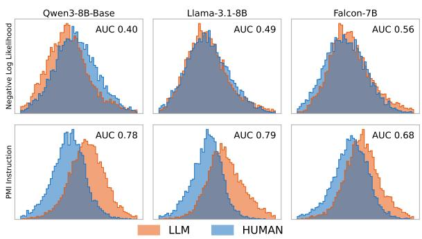  
Figure 1: Histograms of the negative log-likelihood (NLL) (above) and PMI (below) using a generic instruction prompt "Make this text more formal and professional:" across three backbones (Qwen, LLaMA, Falcon) on MIRAGE-DIG (Fu et al., 2025) test split. The prompt’s influence PMI is a better discriminative signal than NLL.

LLM generation is inherently conditioned on the input prompt, and different prompts can induce substantially different output distributions and textual characteristics (Jiang et al., 2020). In practice, recovering the exact generative context of either class is infeasible, as it remains unknown at test time. As a result, existing detectors often conflate prompt-induced characteristics with those intrinsic to LLM generation, leading to inconsistent performance across prompts (Koike et al., 2024).

Most classical detectors do not explicitly account for this conditioning variable. Supervised detectors learn from labeled data using pre-trained models or hand-crafted features (Guo et al., 2023;

Verma et al., 2024). They perform well in-domain (Macko et al., 2025), but are typically trained on AI-generated texts elicited by a limited set of hard prompts, potentially capturing prompt-specific patterns that hinder generalization to unseen prompts. On the other hand, zero-shot detectors (Bao et al., 2024; Hans et al., 2024) use statistical measures computed from the logits of some scoring models. They generalize better but rely on scoring models that closely resemble the source models (Sun et al., 2026), and overlook the influence of prompts on generation distributions by deriving detection signals solely from the generated text.

Instead, we find that conditioning text likelihood (PMI) on even a generic instruction can substantially improve the separation between AI-generated and human-written texts, and this holds across different language models (see Figure 1). This suggests that the generative context provides discriminative information beyond text likelihood alone. Based on this, we hypothesize that each class is characterized by a distinct latent context: AIgenerated texts are conditioned on instructions, whereas human-written texts reflect a different, implicit writing context.

In this line, regeneration-based methods—both supervised (Mao et al., 2024; Yu et al., 2024; Hao et al., 2025) and zero-shot methods (Yang et al., 2024)—try to bring the conditioning variable to the detection task. They prompt an LLM to regenerate a given text, and then compare the regenerated texts and the given text through features. All of them focus on using a hard prompt, and they use it only to reproduce the text rather than to measure how well it explains the text.

Since the generative context is unknown at test time, and human-written texts have no explicit prompt. We instead address this challenge by learning two class-specific soft prompts that approximate the latent contexts underlying AI-generated and human-written texts, respectively. We term this approach SPADE: Soft Prompts for Ai-text DEtection. We further use the log-likelihood ratio under these two learned contexts as a detection score, measuring which class-specific context better explains a given text.

Extensive experiments on two benchmarks (EvoBench and RAID) confirm the effectiveness, robustness, and transferability of SPADE. Additionally, we evaluate the robustness of our method across different LLM backbones and text lengths, achieving state-of-the-art (SOTA) performance against several supervised and zero-shot baselines. In summary, the main contributions are as follows:

• We introduce a new formulation of AI-text detection based on learning class-specific soft prompts.

• State-of-the-art performance across two benchmarks, particularly at low false positive rates.

• Better generalizability in cross-dataset and cross-family while remaining inferenceefficient and storage-light, requiring only two learned soft prompts and a frozen backbone.

## 2 Related Work

## 2.1 Existing detection methods

Supervised methods train a classifier to distinguish AI-generated text from Human-written text. Some methods train a BERT-like model on labeled texts (Guo et al., 2023; Macko et al., 2025), fine-tune encoders to learn representations that separate the two classes via contrastive learning (Rivera Soto et al., 2024; Guo et al., 2024; Ta et al., 2026), or train adversarially to improve robustness against perturbation attacks (Hu et al., 2023; Li et al., 2025). Another line of works trains ensemble-based classifiers using linguistic features (Kumarage et al., 2023) and statistical features (Verma et al., 2024; Basani and Chen, 2026). Although these methods achieve strong performance in-distribution, they often lack robustness against unseen domains and models, and tend to overfit easily (Mitchell et al., 2023).

Zero-shot methods often use statistical cues to make their decisions. These cues are, for instance, probability-based such as Log-Likelihood (Solaiman et al., 2019), Entropy (Gehrmann et al., 2019), Negative log-curvature (Mitchell et al., 2023; Bao et al., 2024), log-likelihood log-rank ratio (Su et al., 2023), Cross-Perplexity (Hans et al., 2024), normalized temperature sensitivity (Ma et al., 2026) computed from the logits of one or several scoring models. In a real-world scenario, the LLM that generated a given text is unknown and often comes from black-box model, making the extraction of the true logits impossible. Therefore, zero-shot methods need to use some surrogate models to approximate black-box distributions, intuitively lacking robustness to distributional shift between the source and scoring models.

Concurrently, EchoPrompt (Bao et al., 2026) proposed an implicit reward modeling approach (Liu et al., 2025; Chen et al., 2026), amplified by the PMI. Unlike EchoPrompt, SPADE explicitly trains two soft prompts and derives its signal entirely from the prompt by comparing the PMI of the text under two learned soft prompts.

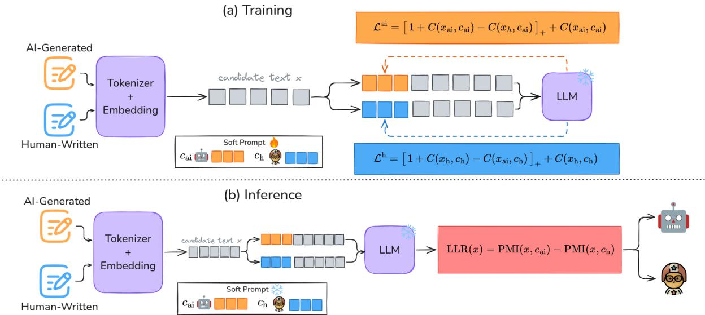  
Figure 2: Overview of SPADE: (a) Training. We propose a contrastive loss to learn two discriminative soft prompts to model each class writing process. (b) Inference. We employ a log-likelihood ratio test between the two trained soft prompts for Human $c _ { h }$ and AI $c _ { \mathrm { a i } }$ . SPADE classifies by selecting the soft prompt whose PMI best explains the candidate text.

## 2.2 Parameter-Efficient Fine-tuning

Soft prompting offers an efficient alternative to full fine-tuning by adapting frozen LLMs to downstream tasks, such as summarization (Liu et al., 2022) and sentiment classification (Wu and Shi, 2022), without requiring manually crafted prompts or updates to the model parameters. Unlike conventional soft prompting, which steers generation toward downstream tasks, SPADE learns classspecific soft prompts to enhance the discriminative signal shown in Figure 1 for AI-text detection.

LoRA (Hu et al., 2022) is another alternative to full fine-tuning, alongside soft prompts. ImBD (Chen et al., 2025) uses LoRA to tune the model for the detection task. However, LoRA modifies the model’s internal behavior, whereas our method keeps the pre-trained model untouched to study how it responds to a prompt.

## 3 Method

We propose SPADE (Soft Prompts for Ai-text DEtection), a detection framework that learns classspecific soft prompts to distinguish AI-generated from human-written texts. As illustrated in Figure 2, we train two soft prompts to learn both contexts and perform a log-likelihood ratio to test which of the two soft prompts best explains a given text.

## 3.1 Notation

We denote any conditioning information for a text as a context c. A context can be a hard prompt, a learned soft prompt, or an implicit conditioning underlying the text’s creation (e.g., the writer’s background, task, or register). Given a context c, a tokenized input text x, and a backbone LLM $q ,$ , the pointwise mutual information (PMI) is:

$$
\mathrm { P M I } ( x , c ) = \log q ( x | c ) - \log q ( x ) ,\tag{1}
$$

where $C ( x , c ) = - \log q ( x | c )$ is the conditional negative log-likelihood. The PMI is computed by subtracting the conditional negative log-likelihood (CNLL) from the negative log-likelihood (NLL) of the input text. It measures how much the context helps the model generate a specific text.

In the following section, we consider two classes $y \in \{ \mathrm { a i } , \mathrm { h } \}$ as AI-generated and Human-written. We denote $x _ { y }$ an input text of class $y , c _ { y }$ the soft prompt associated to class $y ,$ and $x _ { \bar { y } }$ an input text from the opposite class.

## 3.2 Training the Soft Prompt

A natural loss to train the soft prompt $c _ { y }$ is to minimize $C ( x _ { y } , c _ { y } )$ of the texts of class y. However, simply minimizing $C$ may increase the likelihood of both classes, leading to a soft prompt that explains both classes similarly. Therefore, we propose a hinge loss on the CNLL to learn a more discriminative signal.

However, a pure hinge loss is invariant to a global shift since it constrains only the relative gap between the two conditional scores. To ensure that the class-specific prompt also assigns high likelihood to its own class, we also minimize its in-class CNLL. The final loss thus becomes:

$$
{ \mathcal { L } } _ { y } = \underbrace { C ( x _ { y } , c _ { y } ) } _ { \mathrm { C N L L } } + \underbrace { \left[ m + C ( x _ { y } , c _ { y } ) - C ( x _ { \bar { y } } , c _ { y } ) \right] _ { + } } _ { \mathrm { H i n g e } } ,\tag{2}
$$

where $[ z ] _ { + } = \operatorname* { m a x } ( 0 , z ) , m > 0$ is the margin (we use $m = 1$ in all experiments), and C is the CNLL.

Intuitively, the hinge loss forces the soft prompt $c _ { y }$ to explain $x _ { y }$ better than $x _ { \bar { y } }$ by at least a margin m. In practice, since the two soft prompts share only a frozen backbone $q ,$ they can be trained in parallel by batching both prompts through a single forward pass.

## 3.3 Detection using a log-likelihood ratio test

Given a candidate text x and the two soft prompts $c _ { \mathrm { a i } }$ and $c _ { h }$ , the log-likelihood ratio (LLR) test between the two PMIs is defined as:

$$
\mathrm { L L R } ( x ) = \mathrm { P M I } ( x , c _ { \mathrm { a i } } ) - \mathrm { P M I } ( x , c _ { h } ) .\tag{3}
$$

The ratio aims to test which context best explains the candidate text x: we classify x as AI-generated $\operatorname { i f } \operatorname { L L R } ( x ) > \tau$ , and human-written otherwise.

The detection signal focuses solely on a comparison between $\mathrm { P M I } ( x , c _ { \mathrm { a i } } )$ and $\mathrm { P M I } ( x , c _ { h } )$

By Equation 1, we can write LLR as the difference between the two CNLLs:

$$
\mathrm { L L R } ( x ) = C ( x , c _ { h } ) - C ( x , c _ { \mathrm { a i } } ) .\tag{4}
$$

This simplification of the LLR speeds up the inference time, since we only need to compute a single forward with a batch of 2 and can skip the NLL computation.

## 4 Experimental Setup

## 4.1 Datasets and Evaluation Metrics

Training dataset. We train and validate on MI-RAGE (Fu et al., 2025), containing both humanwritten texts and AI-generated texts from 9 families of instruct LLMs across 5 domains and 3 prompt types. MIRAGE proposes two datasets: (1) Disjoint-Input Generation (DIG), each humanwritten text is paired with a unique AI-generated text from one of the 9 families. (2) Shared-Input Generation (SIG), each 2,384 human-written texts is paired with one AI-generated text per family. For each of 3 random seeds, we draw a train/validation/test split of MIRAGE-DIG, and one split per family for MIRAGE-SIG.

Evaluation dataset. We evaluate on two datasets completely out-of-distribution (OOD) to serve as our primary benchmarks: (1) RAID (Dugan et al., 2024), comprising 8 domains, 11 models, and various text perturbations. We restrict RAID to 7 instruction-tuned model, since they are the most widely used, and use the subset sampled by Ma et al. (2026); (2) EvoBench (Yu et al., 2025), comprising 5 domains and 6 model families; to keep the evaluation fully OOD, we remove XSum, which is also part of MIRAGE. Details for each dataset are given in Appendix A.

Metrics. Following prior work, we use AUROC (AUC) (Mitchell et al., 2023; Bao et al., 2024) and the true positive rate at a fixed false positive rate of 5% (TPR) (Hans et al., 2024) as our main evaluation metrics. In addition, we report the macro F1-score for all experiments in the Appendix D. On EvoBench, we compute each metric separately per domain on every generator family to avoid any imbalance and report the mean over families; On RAID, we average over all generators within each domain.

## 4.2 Baselines

(I) Zero-shot detectors score a text with a scoring model: (1) Likelihood and Entropy, the mean token log-likelihood and entropy; (2) DNA-GPT (Yang et al., 2024), the log-likelihood gap between the original continuation of a truncated text and K regenerated ones; (3) Fast-DetectGPT (Bao et al., 2024), the conditional probability curvature; (4) Binoculars (Hans et al., 2024), the perplexity normalized by the cross-perplexity between two models; (5) NTS (Ma et al., 2026), the normalized sensitivity of the token distribution to temperature.

(II) Supervised detectors are trained on labeled data: (1) RoBERTa, a fine-tuned encoder classifier; (2) RAIDAR (Mao et al., 2024), a multi-layer perceptron (MLP) on n-gram and edit-distance features between the text and its LLM rewrites; (3) DPIC (Yu et al., 2024), a MLP on the embeddings of the text and of a response regenerated from its reconstructed prompt; (4) ImBD (Chen et al.,

<table><tr><td></td><td colspan="2">harmful</td><td colspan="2">peerread</td><td colspan="2">pubmed</td><td colspan="2">writing</td><td colspan="2">Avg.</td></tr><tr><td>Detector</td><td>AUC</td><td>TPR</td><td>AUC</td><td>TPR</td><td>AUC</td><td>TPR</td><td>AUC</td><td>TPR</td><td>AUC</td><td>TPR</td></tr><tr><td colspan="9">Zero-Shot Detectors</td><td></td></tr><tr><td>Likelihood</td><td>57.1</td><td>8.45</td><td>82.6</td><td>37.6</td><td>90.8</td><td>62.1</td><td>97.4</td><td>89.1</td><td>82.0</td><td>49.3</td></tr><tr><td>Entropy</td><td>55.6</td><td>6.16</td><td>59.1</td><td>10.5</td><td>90.7</td><td>68.3</td><td>96.7</td><td>86.0</td><td>75.5</td><td>42.8</td></tr><tr><td>DNA-GPT (Yang et al., 2024)</td><td>54.7</td><td>5.49</td><td>89.0</td><td>52.2</td><td>87.5</td><td>48.7</td><td>90.4</td><td>59.3</td><td>80.4</td><td>41.4</td></tr><tr><td>Fast-DetectGPT (Bao et al., 2024)</td><td>56.0</td><td>6.32</td><td>86.6</td><td>50.0</td><td>71.3</td><td>22.3</td><td>80.7</td><td>41.8</td><td>73.6</td><td>30.1</td></tr><tr><td>Binoculars (Hans et al., 2024)</td><td>54.4</td><td>6.96</td><td>86.6</td><td>51.5</td><td>69.1</td><td>24.0</td><td>82.8</td><td>51.0</td><td>73.2</td><td>33.4</td></tr><tr><td>NTS (Ma et al., 2026)</td><td>48.9</td><td>6.54</td><td>73.3</td><td>28.0</td><td>46.2</td><td>1.41</td><td>59.8</td><td>16.8</td><td>57.1</td><td>13.2</td></tr><tr><td colspan="9">Supervised Detectors</td><td></td><td></td></tr><tr><td>RoBERTa</td><td>95.31.7</td><td>75.98.2</td><td>89.40.8</td><td> $6 3 . 5 _ { 4 . 8 }$ </td><td> $7 4 . 1 _ { 1 . 3 }$ </td><td> $2 7 . 4 5 . 2$ </td><td> $9 6 . 1 _ { 1 . 2 }$ </td><td>86.43.9</td><td> $8 8 . 7 _ { 0 . 4 }$ </td><td>63.32.4</td></tr><tr><td>RAIDAR (Mao et al., 2024)</td><td>76.62.3</td><td>26.43.2</td><td>67.30.6</td><td>20.01.6</td><td> $6 4 . 5 3 . 2 $ </td><td>10.73.8</td><td>81.80.8</td><td>35.51.0</td><td>72.61.2</td><td>23.21.2</td></tr><tr><td>DPIC (Yu et al., 2024)</td><td>80.50.7</td><td>46.12.9</td><td>76.1.9</td><td>41.92.9</td><td>66.01.4</td><td>26.21.7</td><td>92.00.1</td><td>72.80.8</td><td>78.60.8</td><td>46.81.8</td></tr><tr><td>ImBD (Chen et al., 2025)</td><td>92.31.9</td><td>63.710.0</td><td>93.21.2</td><td>67.05.2</td><td> $8 7 . 3 _ { 4 . 0 }$ </td><td>49.47.9</td><td> $9 8 . 7 _ { 0 . 5 }$ </td><td> $9 4 . 5 _ { 4 . 5 }$ </td><td>92.91.2</td><td>68.74.0</td></tr><tr><td>SPADE (ours)</td><td> $\mathbf { 9 6 . 7 _ { 0 . 4 } }$ </td><td> $\mathbf { 8 8 . 4 _ { 1 . 4 } }$ </td><td>95.80.9</td><td>89.11.8</td><td>98.30.3</td><td>95.10.5</td><td>99.80.0 98.90.2</td><td></td><td> $\mathbf { 9 7 . 7 _ { 0 . 3 } }$ </td><td>92.90.7</td></tr></table>

Table 1: AUC and TPR on EvoBench. All supervised baselines are trained on MIRAGE-DIG and the reported number corresponds to mean in defined in §4 over three seeds. Bold indicates the best method per column.
<table><tr><td rowspan="2">Detector</td><td colspan="2">Abstracts</td><td colspan="2">Books</td><td colspan="2">News</td><td colspan="2">Poetry</td><td colspan="2">Recipes</td><td colspan="2">Reddit</td><td colspan="2">Reviews</td><td colspan="2">Wiki</td><td colspan="2">Avg.</td></tr><tr><td>AUC</td><td>TPR</td><td>AUC</td><td>TPR</td><td>AUC</td><td>TPR</td><td>AUC</td><td>TPR</td><td>AUC</td><td>TPR</td><td>AUC</td><td>TPR</td><td>AUC TPR</td><td></td><td></td><td>AUC TPR</td><td>AUC</td><td>TPR</td></tr><tr><td></td><td></td><td></td><td></td><td></td><td></td><td>Zero-Shot Detectors</td><td></td><td></td><td></td><td></td><td></td><td></td><td></td><td></td><td></td><td></td><td></td><td></td></tr><tr><td>Likelihood</td><td>75.5</td><td>10.0</td><td>82.9</td><td>11.2</td><td>75.6</td><td>6.67</td><td>75.3</td><td>4.00</td><td>77.1</td><td>14.2</td><td>78.1</td><td>4.70</td><td>81.3</td><td>9.59</td><td>78.6</td><td>4.86</td><td>78.1</td><td>8.16</td></tr><tr><td>Entropy</td><td>68.6</td><td>10.0</td><td>80.8</td><td>11.8</td><td>71.2</td><td>6.00</td><td>75.3</td><td>4.00</td><td>77.7</td><td>16.3</td><td>76.1</td><td>4.70</td><td>78.6</td><td>9.59</td><td>75.2</td><td>4.86</td><td>75.4</td><td>8.41</td></tr><tr><td>DNA-GPT (Yang et al., 2024)</td><td>71.0</td><td>20.7</td><td>77.5</td><td>24.9</td><td>60.1</td><td>10.7</td><td>68.3</td><td>10.7</td><td>67.4</td><td>14.2</td><td>76.2</td><td>15.4</td><td>77.8</td><td>24.0</td><td>75.3</td><td>14.6</td><td>71.7</td><td>16.9</td></tr><tr><td>Fast-DetectGPT (Bao et al., 2024)</td><td>76.6</td><td>32.3</td><td>66.4</td><td>18.9</td><td>73.0</td><td>18.7</td><td>59.4</td><td>19.0</td><td>49.6</td><td>15.6</td><td>72.2</td><td>25.0</td><td>66.5</td><td>28.1</td><td>72.5</td><td>41.7</td><td>67.0</td><td>24.9</td></tr><tr><td>Binoculars (Hans et al., 2024)</td><td>80.7</td><td>50.7</td><td>75.1</td><td>40.8</td><td>76.1</td><td>38.7</td><td>64.9</td><td>27.3</td><td>53.8</td><td>24.1</td><td>76.7</td><td>36.2</td><td>72.3</td><td>34.9</td><td>75.6</td><td>43.8</td><td>71.9</td><td>37.1</td></tr><tr><td>NTS (Ma et al., 2026)</td><td>76.3</td><td>33.3</td><td>67.8</td><td>20.1</td><td>69.1</td><td>16.0</td><td>63.6</td><td>15.3</td><td>74.4</td><td>21.3</td><td>72.9</td><td>20.1</td><td>63.1</td><td>10.3</td><td>63.9</td><td>18.8</td><td>68.9</td><td>19.4</td></tr><tr><td></td><td></td><td></td><td></td><td></td><td></td><td>Supervised Detectors</td><td></td><td></td><td></td><td></td><td></td><td></td><td></td><td></td><td></td><td></td><td></td><td></td></tr><tr><td>RoBERTa</td><td>87.9</td><td>45.1</td><td>83.8</td><td>46.2</td><td>79.4</td><td>43.2</td><td>89.4</td><td>65.6</td><td>78.7</td><td>36.4</td><td>86.7</td><td>50.2</td><td>90.5</td><td>64.2</td><td>80.0</td><td>41.8</td><td>84.6</td><td>49.1</td></tr><tr><td>RAIDAR (Mao et al., 2024)</td><td>59.9</td><td>23.3</td><td>65.0</td><td>27.6</td><td>73.6</td><td>42.2</td><td>64.2</td><td>12.4</td><td>77.9</td><td>22.5</td><td>76.6</td><td>49.4</td><td>71.3</td><td>27.9</td><td>65.5</td><td>24.8</td><td>69.3</td><td>28.8</td></tr><tr><td>DPIC (Yu et al., 2024)</td><td>86.9</td><td>68.9</td><td>87.2</td><td>66.9</td><td>89.6</td><td>72.9</td><td>90.4</td><td>73.6</td><td>82.1</td><td>49.2</td><td>82.4</td><td>56.6</td><td>93.8</td><td>79.2</td><td>80.2</td><td>49.3</td><td>86.6</td><td>64.6</td></tr><tr><td>ImBD (Chen et al., 2025)</td><td>88.0</td><td>15.1</td><td>91.4</td><td>27.8</td><td>85.0</td><td>16.4</td><td>93.4</td><td>58.4</td><td>83.7</td><td>10.9</td><td>89.4</td><td>14.8</td><td>88.1</td><td>25.8</td><td>81.4</td><td>13.2</td><td>87.5</td><td>22.8</td></tr><tr><td>SPADE (ours)</td><td>98.3</td><td>91.1</td><td>96.7</td><td>84.4</td><td>90.2</td><td>77.6</td><td>97.2</td><td>92.1</td><td>94.9</td><td>79.4</td><td>97.9</td><td>85.7</td><td>95.8</td><td>87.0</td><td>94.6</td><td>74.4</td><td>95.7</td><td>84.0</td></tr></table>

Table 2: AUC and TPR on RAID. All supervised baselines are trained on MIRAGE-DIG and the reported number corresponds to the mean defined in §4 over three seeds. Bold indicates the best method per column.

2025), Fast-DetectGPT score under a fine-tuned scoring model with LoRA to prefer AI-generated style.

## 4.3 Implementation

Our experiments use Qwen3-8B (Yang et al., 2025) as the main backbone, and we further test across different backbones (LLaMA-3.1-8B (Grattafiori et al., 2024) and Falcon-7B (Almazrouei et al., 2023)) in §5.2. Each experiment is repeated over three seeds, and we report the mean and standard deviation across them. To ensure a fair comparison, all supervised methods, including SPADE, use the same three splits for training and validation. We details in Appendix C on the hyperparameter choice, initialization, selection metrics, and implementations of all baselines.

## 5 Experiments and Analysis

## 5.1 Main Results

Cross-Dataset Generalization. Table 1 and 2 present the overall performance of SPADE with other baselines on EvoBench and RAID, respectively. Crucially, all baselines struggle in low-

FPR regime: zero-shot detectors have TPR lower than 50%, supervised detectors below 70%. Overall, supervised detectors perform better than zeroshot ones, with an average gain of ∼ 9.7 AUC on EvoBench and RAID, especially in hard domain where the texts are short (e.g., harmful in EvoBench, see §5.4). Supervised detectors trained on the same setup as SPADE transfer only partially to cross-dataset (e.g., ImBD reaches 68.7 TPR on EvoBench but only 22.8 on RAID). In contrast, SPADE outperforms all supervised methods by 4.8–25.1 AUC on EvoBench and 8.2–26.4 AUC on RAID, and maintains a strong TPR score (84–92.9%), highlighting its better transferability in cross-dataset. We find consistent results using LLaMA where SPADE outperforms other baselines (details in §5.2 per backbone). With Falcon, SPADE is competitive on RAID and wins on EvoBench.

Cross-Generator Generalization. We train SPADE on texts from one LLM family in a MIRAGE-SIG and testing it on texts generated by all family models in EvoBench and RAID.

As shown in Figure 3, SPADE achieves the best

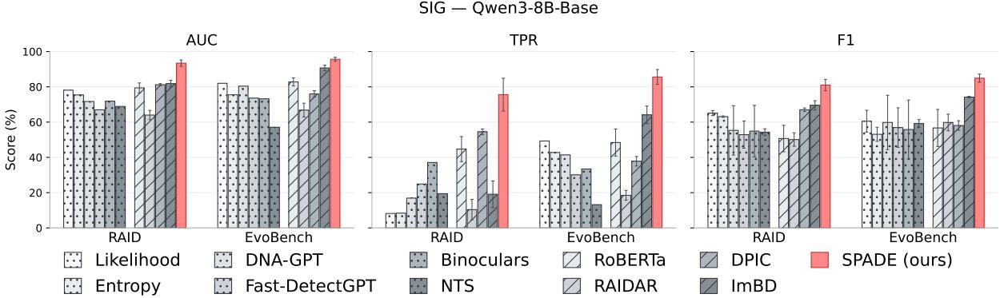  
Figure 3: AUC, TPR, and F1 on EvoBench and RAID. All supervised baselines are trained on per family splits from MIRAGE-SIG (over three seeds). The reported number corresponds to $\mathrm { \ m e a n _ { s t d } }$ over the 9 families of the mean defined in §4 over three seeds per family using Qwen3-8B. Hatched bars are supervised baselines and Dotted bars are for zero-shot baselines.

AUC, TPR, and F1 on both benchmarks, outperforming all baselines. Specifically, SPADE outperforms the supervised baselines by 4.9–28.8 AUC, 21.5–67.1 TPR, and 10.7–26.8 F1 on EvoBench, and by 11.6–29.4 AUC, 21.1–65.2 TPR, and 11.5– 30.9 F1 on RAID (see Appendix D.2 for the exact LLM-family wise scores and mean scores). This shows that SPADE transfers better than the other supervised baselines across datasets even when trained on a single family with only 500 text pairs (see Appendix A.1).

## 5.2 Backbone and Perturbation Robustness

SPADE’s sensitivity to backbone choice. Figure 4 presents the mean performance of SPADE on the two benchmarks with various LLM backbones. We observe substantial variation across backbones, with more recent model families generally yielding stronger performance. Interestingly, model scale alone does not explain the differences: LLaMA-3.2-1B (2024) outperforms (+2.5–11.7 TPR) older but larger models (e.g., Falcon-7B (2023) and GPT-J-6B (2021)), and Qwen3.5-4B (2026) on par with Qwen3-8B (2025). This suggests that the quality of the backbone’s pre-training is the main driver of SPADE’s effectiveness. Overall, we expect SPADE to benefit from future advances in backbone quality without requiring any changes to the method itself.

SPADE vs. others across backbones. The sensitivity to backbone choice is not unique to SPADE, but common to all detectors. Table 3 compares SPADE to other baselines using two additional backbones (LLaMA-3.1-8B and Falcon-7B). A very surprising finding is that complex zero-shot methods (e.g., Fast-DetectGPT, Binoculars) perform substantially better with these two older backbones than with Qwen3-8B. We hypothesize that their degraded performance with Qwen3-8B may stem from differences in model architecture and training, as Qwen3-8B is a more recent hybrid reasoning and instruction-tuned model, potentially altering the likelihood patterns on which these zeroshot methods rely. Regeneration-based methods (e.g, DNA-GPT, RAIDAR, DPIC) remain relatively stable across backbones except for RAIDAR on Falcon-7B-Instruct, where it collapses close to random. With LLaMA-3.1-8B, SPADE remains the best method overall in the main result (see §5.1). With Falcon-7B, Binoculars and NTS are more competitive where SPADE remains the best in AUC (+0.4) but lose in TPR (−0.6).

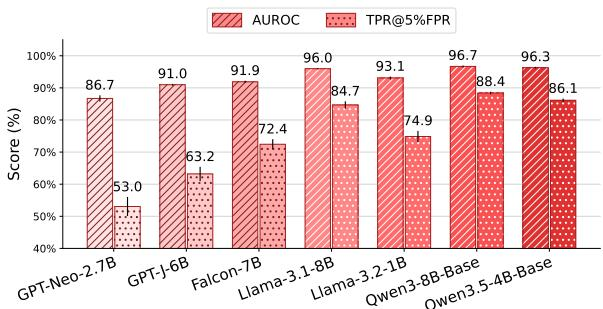  
Figure 4: Impact of the backbone on SPADE’s performance, averaged over EvoBench and RAID.

Perturbation attacks. Existing detectors are known to be vulnerable to various text perturbations, which can substantially degrade their detection performance (Krishna et al., 2023; Sadasivan et al., 2025). We investigate whether SPADE remains robust when AI-generated texts are deliberately perturbed to evade detection. Figure 5 presents the AUC and TPR of SPADE and the four strongest baselines on RAID under several adversarial attacks. With Qwen3-8B-Base, SPADE achieves the best performance on every attack except paraphrasing (82.2 vs. 83.2 AUC for ImBD; 40.6 vs. 42.2 TPR for DPIC). Over the 11 attacks, SPADE significantly outperforms every supervised baseline, including the strongest one, ImBD (95.6 vs. 93.1 AUC, $p \ = \ 0 . 0 0 5 ;$ 84.4 vs. 70.3 TPR, $p \ = \ 0 . 0 0 8 \mathrm { : }$ ; Student’s t-test over the three DIG seeds). With LLaMA-3.1-8B, SPADE is competitive with the strongest detector Binoculars and outperforms it on 5 attacks (e.g., alternative spelling, paragraph insertion, misspelling, synonym substitution and whitespace), but collapses on zero-width space attacks (which hurt all supervised methods) going from 92.1 TPR without attack to 22.7 (details per attack type is presented in Appendix D.3).

<table><tr><td></td><td colspan="2">EvoBench</td><td colspan="2">RAID</td><td colspan="2">Avg.</td></tr><tr><td>Detector</td><td>AUC</td><td>TPR</td><td>AUC</td><td>TPR</td><td>AUC</td><td>TPR</td></tr><tr><td colspan="7">LLaMA-3.1-8B</td></tr><tr><td>Likelihood</td><td>75.4</td><td>36.9</td><td>74.9</td><td>7.5</td><td>75.1</td><td>22.2</td></tr><tr><td>Entropy</td><td>63.4</td><td>26.7</td><td>70.9</td><td>6.8</td><td>67.2</td><td>16.8</td></tr><tr><td>DNA-GPT</td><td>75.2</td><td>32.2</td><td>70.1</td><td>20.4</td><td>72.7</td><td>26.3</td></tr><tr><td>Fast-DetectGPT</td><td>86.4</td><td>55.6</td><td>86.9</td><td>62.1</td><td>86.6</td><td>58.9</td></tr><tr><td>Binoculars</td><td>86.0</td><td>56.9</td><td>89.5</td><td>70.1</td><td>87.7</td><td>63.5</td></tr><tr><td>NTS</td><td>60.2</td><td>20.2</td><td>75.3</td><td>32.1</td><td>67.7</td><td>26.2</td></tr><tr><td>RAIDAR</td><td> $\overline { { 6 4 . 9 _ { 0 . 5 } } }$ </td><td> $\overline { { 1 8 . 8 _ { 1 . 9 } } }$ </td><td> $\overline { { 7 3 . 1 _ { 0 . 6 } } }$ </td><td> $\overline { { 3 7 . 6 _ { 1 . 3 } } }$ </td><td>69.0</td><td>28.2</td></tr><tr><td>DPIC</td><td> $7 7 . 9 \phantom { 0 } _ { 0 . 8 }$ </td><td> $4 5 . 3 _ { 1 . 4 }$ </td><td> $8 6 . 7 _ { 0 . 4 }$ </td><td> $6 5 . 3 _ { 1 . 1 }$ </td><td>82.3</td><td>55.3</td></tr><tr><td>ImBD</td><td>--  $8 8 . 6 _ { 1 . 0 }$ </td><td> $5 5 . 9 _ { 2 . 5 }$ </td><td>93.72.6</td><td> $6 7 . 4 _ { 2 1 . 8 }$ </td><td>91.1</td><td>61.6</td></tr><tr><td>SPADE (ours)</td><td>97.40.0</td><td>89.50.3</td><td>94.50.4</td><td>79.92.6</td><td>96.0</td><td>84.7</td></tr><tr><td colspan="7">Falcon-7B</td></tr><tr><td>Likelihood</td><td>72.0</td><td>29.1</td><td>75.1</td><td>7.9</td><td>73.6</td><td>18.5</td></tr><tr><td>Entropy</td><td>54.3</td><td>9.8</td><td>64.8</td><td>4.4</td><td>59.5</td><td>7.1</td></tr><tr><td>DNA-GPT</td><td>74.0</td><td>35.1</td><td>79.2</td><td>36.0</td><td>76.6</td><td>35.6</td></tr><tr><td>Fast-DetectGPT</td><td>82.1</td><td>51.3</td><td>85.2</td><td>38.0</td><td>83.7</td><td>44.7</td></tr><tr><td>Binoculars</td><td>82.3</td><td>52.3</td><td>89.3</td><td>67.5</td><td>85.8</td><td>59.9</td></tr><tr><td>NTS</td><td>71.3</td><td>29.3</td><td>88.9</td><td>65.2</td><td>80.1</td><td>47.2</td></tr><tr><td>RAIDAR</td><td> $\overline { { 5 0 . 0 _ { 0 . 7 } } }$ </td><td> $\overline { { 8 . 3 _ { 0 . 7 } } }$ </td><td> $\overline { { 5 4 . 7 _ { 1 . 2 } } }$ </td><td> $\overline { { 1 2 . 7 _ { 0 . 2 } } }$ </td><td>52.4</td><td>10.5</td></tr><tr><td>DPIC</td><td> $7 8 . 3 _ { 0 . 4 }$ </td><td> $4 5 . 0 _ { 1 . 1 }$ </td><td> $8 6 . 9 \substack { 0 . 6 }$ </td><td> $6 3 . 4 _ { 1 . 2 }$ </td><td>82.6</td><td>54.2</td></tr><tr><td>ImBD</td><td> $8 6 . 9 _ { 2 . 2 }$ </td><td> $5 2 . 2 _ { 5 . 4 }$ </td><td> $8 7 . 4 _ { 3 . 0 }$ </td><td> $4 0 . 5 _ { 1 5 . 6 }$ </td><td>87.1</td><td>46.3</td></tr><tr><td>SPADE (ours)</td><td> $\mathbf { 9 4 . 1 } _ { 0 . 9 }$ </td><td> $\mathbf { 7 8 . 0 _ { 1 . 2 } }$ </td><td> $\mathbf { 8 9 . 7 _ { 0 . 2 } }$ </td><td> $6 6 . 9 _ { 2 . 0 }$ </td><td>91.9</td><td>72.4</td></tr></table>

Table 3: Performance of SPADE and the baselines with LLaMA-3.1-8B and Falcon-7B. Bold indicates the best method within each backbone.

## 5.3 Ablation Study

We conduct ablation studies to independently assess the contributions of the hinge loss and loglikelihood ratio test to SPADE’s performance. Results are given in Table 4.

Impact of the Hinge Loss. We compare the regularized hinge loss to a simple cross-entropy loss. Without the contrastive term, the discriminative power of each test statistic drops on both benchmarks: $\mathrm { P M } ( x , c _ { \mathrm { a i } } ) { ' } _ { \mathrm { : } }$ s AUC falls by 6.9–36.5 points and its TPR by 13.4–22.2 points, and $\mathrm { P M } ( x , c _ { h } ) ^ { \ast } \mathrm { s }$ AUC falls by 12.3–16.3 points and its TPR by 35.7–

<table><tr><td rowspan="2">Hinge</td><td rowspan="2">Score</td><td colspan="2">EvoBench</td><td colspan="2">RAID</td><td colspan="2">Avg.</td></tr><tr><td>AUC</td><td>TPR</td><td>AUC</td><td>TPR</td><td>AUC</td><td>TPR</td></tr><tr><td>√</td><td>LLR (ours)</td><td>97.7</td><td>92.9</td><td>95.7</td><td>84.0</td><td>96.7</td><td>88.5</td></tr><tr><td>√</td><td> $\mathrm { P M I } ( x , c _ { \mathrm { h } } )$ </td><td>90.7</td><td>81.5</td><td>90.5</td><td>79.8</td><td>90.6</td><td>80.7</td></tr><tr><td>√</td><td> $\underline { { \operatorname { P M I } ( x , c _ { \mathrm { a i } } ) } }$ </td><td>86.3</td><td>57.9</td><td>90.6</td><td>35.4</td><td>88.5</td><td>46.7</td></tr><tr><td>X</td><td>LLR</td><td>95.7</td><td>85.2</td><td>79.7</td><td>46.6</td><td>87.7</td><td>65.9</td></tr><tr><td>x</td><td> $\mathrm { P M I } ( x , c _ { \mathrm { h } } )$ </td><td>78.4</td><td>45.8</td><td>74.2</td><td>33.9</td><td>76.3</td><td>39.9</td></tr><tr><td>x</td><td> $\mathrm { P M I } ( x , c _ { \mathrm { a i } } )$ </td><td>79.4</td><td>44.5</td><td>54.1</td><td>13.2</td><td>66.8</td><td>28.9</td></tr></table>

Table 4: Impact of the hinge loss and the LLR in SPADE’s performance using Qwen3-8B. Hinge: regularized hinge loss (✓) or plain cross-entropy loss (✗). We report the average of the two benchmarks.

45.9 points. Soft prompts learned with a simple cross-entropy perform worse likely because they converge toward a generative optimum rather than a discriminative optimum. Overall, on the LLR, AUC and TPR improves by 2.0–16.0 and 7.7–37.4.

Impact of the Log-likelihood Ratio Test. We compare the log-likelihood ratio (LLR) test, which contrasts the two learned contexts, with scoring a text using a single soft prompt, $\mathrm { P M I } ( x , c _ { \mathrm { a i } } )$ or $\mathrm { P M I } ( x , c _ { h } )$ . The LLR improves over the best single prompt by 7.0 AUC and 11.4 TPR points on EvoBench, and by 5.1 AUC and 4.2 TPR points on RAID. These results validate learning two soft prompts rather than one: modeling both classes and contrasting them yields a more accurate and more robust detector.

## 5.4 Further Investigations

Impact of Text Length Existing detectors performance are known to drop significantly when dealing with short text (Wu et al., 2024). We test SPADE’s robustness by truncating the Writing texts in EvoBench to specific lengths. Figure 6 presents the AUC of SPADE and four different baselines. Interestingly, supervised methods are more robust than zero-shot methods on short text. Zero-shot methods compute a probability-based score that is not optimized for detection and therefore require a substantial longer text to accumulate a reliable score. In contrast, SPADE is optimized to maximize the gap between the two classes, which makes it more robust than the baselines: it reaches 98.2 AUC at 75 tokens, versus 88.6 for ImBD and 78.7 for Binoculars and Fast-DetectGPT.

Inference Speed Existing regeneration-based detectors require regenerating one or several versions of the input text autoregressively limiting their inference speed (Hao et al., 2025). For practical purposes, we compare SPADE’s inference speed with the baselines in Table 5. Our method requires a single forward pass on a batch of two, so it is slower than detectors requiring one forward pass on a single sequence, and faster than Binoculars, which requires two models. Notably, SPADE is much faster than regeneration-based methods (∼ 85.1 × speed-up) while transferring better across datasets.

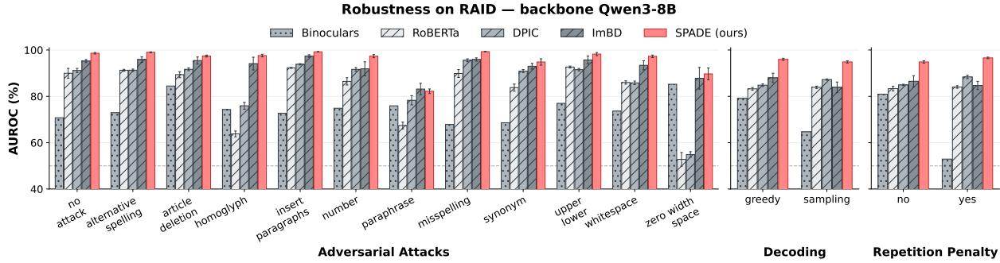  
Figure 5: AUC of SPADE and four baselines on RAID, grouped by adversarial attacks. TPR results are consistent and can be found in Appendix D.3. Hatched bars are supervised baselines and Dotted bar is for zero-shot baseline.

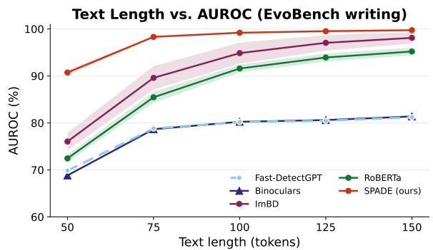  
Figure 6: Impact of the text length on four existing baselines and SPADE on EvoBench (Writing) with Qwen3.

Cross-Lingual Previous research (Wang et al., 2024) propose to assess detector performance on languages other than English. To assess our approach in cross-lingual scenario, we follow DetectRL-X (data details in Appendix A) protocol (Wu et al., 2026), by training and tuning on a single language and testing on others (details in Appendix E). Encouragingly, SPADE shows no collapse on high-complexity languages defined by DetectRL-X (e.g., Arabic, Russian, Chinese) where it reaches 94.97 $F _ { 1 } ^ { B }$ on average, against 95.56 for mediumcomplexity ones (e.g., German, French, Spanish, Portuguese). Similarly, transferring from Indo-European to Semitic or Sino-Tibetan languages costs SPADE nothing (95.68 in-language to 95.54 out-language $F _ { 1 } ^ { B } )$ , whereas Wu et al. (2026) report an average loss of 19.15 points. However, SPADE shows its largest performance drop when transferring from English to German (64.45 $F _ { 1 } ^ { B } )$ despite performing well in the reverse direction (99.51 $F _ { 1 } ^ { B } )$ . We leave further investigation of this asymmetry to future work.

<table><tr><td rowspan=1 colspan=1>Detector</td><td rowspan=1 colspan=1>s / doc</td><td rowspan=1 colspan=1>s / 100 words</td><td rowspan=1 colspan=1>vs. SPADE</td><td rowspan=1 colspan=1>Rank</td></tr><tr><td rowspan=1 colspan=1>RoBERTa</td><td rowspan=1 colspan=1>0.008</td><td rowspan=1 colspan=1> $0 . 0 0 6 _ { 0 . 0 1 0 }$ </td><td rowspan=1 colspan=1>0.06×</td><td rowspan=1 colspan=1>2</td></tr><tr><td rowspan=1 colspan=1>Likelihood</td><td rowspan=1 colspan=1>0.056</td><td rowspan=1 colspan=1> $0 . 0 3 8 _ { 0 . 0 0 6 }$ </td><td rowspan=1 colspan=1>0.39×</td><td rowspan=1 colspan=1>5</td></tr><tr><td rowspan=1 colspan=1>Entropy</td><td rowspan=1 colspan=1>0.058</td><td rowspan=1 colspan=1> $0 . 0 3 9 _ { 0 . 0 0 6 }$ </td><td rowspan=1 colspan=1>0.40×</td><td rowspan=1 colspan=1>8</td></tr><tr><td rowspan=1 colspan=1>NTS</td><td rowspan=1 colspan=1>0.061</td><td rowspan=1 colspan=1> $0 . 0 4 2 _ { 0 . 0 0 7 }$ </td><td rowspan=1 colspan=1>0.43×</td><td rowspan=1 colspan=1>11</td></tr><tr><td rowspan=1 colspan=1>ImBD</td><td rowspan=1 colspan=1>0.066</td><td rowspan=1 colspan=1> $0 . 0 4 6 _ { 0 . 0 0 8 }$ </td><td rowspan=1 colspan=1>0.47×</td><td rowspan=1 colspan=1>4</td></tr><tr><td rowspan=1 colspan=1>Fast-DetectGPT</td><td rowspan=1 colspan=1>0.118</td><td rowspan=1 colspan=1> $0 . 0 8 1 _ { 0 . 0 1 3 }$ </td><td rowspan=1 colspan=1>0.83×</td><td rowspan=1 colspan=1>9</td></tr><tr><td rowspan=1 colspan=1>SPADE (ours)</td><td rowspan=1 colspan=1>0.141</td><td rowspan=1 colspan=1> $0 . 0 9 8 _ { 0 . 0 1 4 }$ </td><td rowspan=1 colspan=1>1×</td><td rowspan=1 colspan=1>1</td></tr><tr><td rowspan=1 colspan=1>Binoculars</td><td rowspan=1 colspan=1>0.262</td><td rowspan=1 colspan=1> $0 . 1 8 2 _ { 0 . 0 2 8 }$ </td><td rowspan=1 colspan=1>1.87×</td><td rowspan=1 colspan=1>6</td></tr><tr><td rowspan=1 colspan=1>DNA-GPT</td><td rowspan=1 colspan=1>10.612</td><td rowspan=1 colspan=1> $7 . 4 7 2 _ { 1 . 5 9 2 }$ </td><td rowspan=1 colspan=1>76.6×</td><td rowspan=1 colspan=1>7</td></tr><tr><td rowspan=1 colspan=1>DPIC</td><td rowspan=1 colspan=1>11.416</td><td rowspan=1 colspan=1> $8 . 0 2 8 _ { 5 . 3 1 8 }$ </td><td rowspan=1 colspan=1>82.3×</td><td rowspan=1 colspan=1>3</td></tr><tr><td rowspan=1 colspan=1>RAIDAR</td><td rowspan=1 colspan=1>13.647</td><td rowspan=1 colspan=1> $9 . 3 9 7 _ { 1 . 9 9 9 }$ </td><td rowspan=1 colspan=1>96.4×</td><td rowspan=1 colspan=1>10</td></tr></table>

Table 5: Inference latency per document, with Qwen3- 8B on NVIDIA RTX A6000. Times are averaged over 180 MIRAGE-DIG test documents with 20 documents used for warm up. s / 100 words: mean $\mathrm { l } _ { \mathrm { S t d } }$ of the perdocument time normalized by length. Ranked by overall AUC and TPR on EvoBench and RAID.

## 6 Conclusion

We presented SPADE, a novel detection framework that learns class-specific soft prompts to distinguish AI-generated from human-written texts. Detection is a log-likelihood ratio test between the PMIs conditioned by the soft prompts. SPADE achieves strong performance in cross-datasets and cross-generator compared to both zero-shot and supervised baselines, while remaining inferenceefficient. Building on our strong performance in cross-generator scenario, we intend to investigate if SPADE can be adapted to model attribution task. Additionally, since the LLR decomposes into pertoken contributions, we plan to investigate at the token level which characteristics is captured.

## Limitations

Our findings indicate that using different backbone LLMs can significantly change the performance of all detectors. A more systematic comparison across all baselines would better clarify the impact of the backbone choice on each detector, in particular contrasting SPADE with the other supervised baselines.

A second limitation is that, like most state-ofthe-art detectors, SPADE’s performance drops on AI-generated texts that was paraphrased to evade existing detectors (see Section 5.2). Since SPADE is supervised, it can be trained on datasets containing perturbed texts, which we leave to future work.

Finally, our evaluation primarily focuses on texts generated by instruction-tuned models. As shown in Table 7 in Appendix B, SPADE performs less effectively on texts from base models. While we leave further investigation to future work, this drop may stem from the exclusive use of instructiontuned models in training or the weaker influence of instructions on base-model generation.

## Ethical Considerations

Datasets. We evaluate on publicly available benchmarks for machine-generated text detection (RAID, EvoBench, DetectRL-X and MIRAGE) and use them only for non-commercial research, in line with their intended purpose and licenses (see Appendix A.5).

Societal Impact. Although SPADE transfers better than the baselines and is practical to deploy thanks to its fast inference and small storage requirements, the prediction itself is not bulletproof. Performance may degrade in specific scenarios, especially regarding calibration on in-domain data. Human judgment remains necessary, especially in high-stakes domains.

## Acknowledgments

This work has been financially supported by ChapsVision and the ANRT through CIFRE grant n°2025/1102. We thank GENCI for granting the access to the HPC resources of IDRIS under the allocation 2026-AD011017568 where most of our computation was done on the Jean-Zay supercomputers.

## References

Aaditya Bhat. 2023. Gpt-wiki-intro (revision 0e458f5).

Ebtesam Almazrouei, Hamza Alobeidli, Abdulaziz Alshamsi, Alessandro Cappelli, Ruxandra Cojocaru, Mérouane Debbah, Étienne Goffinet, Daniel Hesslow, Julien Launay, Quentin Malartic, Daniele Mazzotta, Badreddine Noune, Baptiste Pannier, and Guilherme Penedo. 2023. The falcon series of open language models. Preprint, arXiv:2311.16867.

David Bamman and Noah A. Smith. 2013. New alignment methods for discriminative book summarization. Preprint, arXiv:1305.1319.

Guangsheng Bao, Yanbin Zhao, Zhiyang Teng, Linyi Yang, and Yue Zhang. 2024. Fast-DetectGPT: Efficient zero-shot detection of machine-generated text via conditional probability curvature. In The Twelfth International Conference on Learning Representations.

Hongrui Bao, Yubing Ren, Jinhan You, Fang Fang, Shi Wang, and Yanan Cao. 2026. Once a response, always a response: Detecting llm-generated text via latent prompt restoration. Preprint, arXiv:2608.05741.

Advik Raj Basani and Pin-Yu Chen. 2026. Diversity boosts ai-generated text detection. Preprint, arXiv:2509.18880.

Michał Bien, Michał Gilski, Martyna Maciejewska, Wo-´ jciech Taisner, Dawid Wisniewski, and Agnieszka Lawrynowicz. 2020. RecipeNLG: A cooking recipes dataset for semi-structured text generation. In Proceedings of the 13th International Conference on Natural Language Generation, pages 22–28, Dublin, Ireland. Association for Computational Linguistics.

Creston Brooks, Samuel Eggert, and Denis Peskoff. 2024. The rise of AI-generated content in Wikipedia. In Proceedings of the First Workshop on Advancing Natural Language Processing for Wikipedia, pages 67–79, Miami, Florida, USA. Association for Computational Linguistics.

Jiaqi Chen, Xiaoye Zhu, Tianyang Liu, Ying Chen, Chen Xinhui, Yiwen Yuan, Chak Tou Leong, Zuchao Li, Long Tang, Lei Zhang, Chenyu Yan, Guanghao Mei, Jie Zhang, and Lefei Zhang. 2025. Imitate before detect: aligning machine stylistic preference for machine-revised text detection. In Proceedings of the Thirty-Ninth AAAI Conference on Artificial Intelligence and Thirty-Seventh Conference on Innovative Applications ofArtificial Intelligence and Fifteenth Symposium on Educational Advances in Artificial Intelligence, AAAI’25/IAAI’25/EAAI’25. AAAI Press.

Zheng Chen, Huming Liu, and Jianxiao Tang. 2026. Zero-shot detection of llm-generated text via dualnetwork preference divergence. Expert Systems with Applications, 309:131212.

Liam Dugan, Alyssa Hwang, Filip Trhlík, Andrew Zhu, Josh Magnus Ludan, Hainiu Xu, Daphne Ippolito, and Chris Callison-Burch. 2024. RAID: A shared benchmark for robust evaluation of machinegenerated text detectors. In Proceedings of the 62nd Annual Meeting ofthe Associationfor Computational Linguistics (Volume 1: Long Papers), pages 12463– 12492, Bangkok, Thailand. Association for Computational Linguistics.

Angela Fan, Mike Lewis, and Yann Dauphin. 2018. Hierarchical neural story generation. In Proceedings of the 56th Annual Meeting of the Association for Computational Linguistics (Volume 1: Long Papers), pages 889–898, Melbourne, Australia. Association for Computational Linguistics.

Jiachen Fu, Chun-Le Guo, and Chongyi Li. 2025. Detectanyllm: Towards generalizable and robust detection of machine-generated text across domains and models. In Proceedings of the 33rd ACM International Conference on Multimedia.

Sebastian Gehrmann, Hendrik Strobelt, and Alexander Rush. 2019. GLTR: Statistical detection and visualization of generated text. In Proceedings ofthe 57th Annual Meeting ofthe Associationfor Computational Linguistics: System Demonstrations, pages 111–116, Florence, Italy. Association for Computational Linguistics.

Aaron Gokaslan, Vanya Cohen, Ellie Pavlick, and Stefanie Tellex. 2019. Openwebtext corpus. http: //Skylion007.github.io/OpenWebTextCorpus.

Aaron Grattafiori, Abhimanyu Dubey, Abhinav Jauhri, Abhinav Pandey, Abhishek Kadian, Ahmad Al-Dahle, Aiesha Letman, Akhil Mathur, Alan Schelten, Alex Vaughan, Amy Yang, Angela Fan, Anirudh Goyal, Anthony Hartshorn, Aobo Yang, Archi Mitra, Archie Sravankumar, Artem Korenev, Arthur Hinsvark, and 542 others. 2024. The llama 3 herd of models. Preprint, arXiv:2407.21783.

Derek Greene and Pádraig Cunningham. 2006. Practical solutions to the problem of diagonal dominance in kernel document clustering. In Proceedings ofthe 23rd International Conference on Machine Learning, ICML ’06, page 377–384, New York, NY, USA. Association for Computing Machinery.

Biyang Guo, Xin Zhang, Ziyuan Wang, Minqi Jiang, Jinran Nie, Yuxuan Ding, Jianwei Yue, and Yupeng Wu. 2023. How close is chatgpt to human experts? comparison corpus, evaluation, and detection. Preprint, arXiv:2301.07597.

Xun Guo, Shan Zhang, Yongxin He, Ting Zhang, Wanquan Feng, Haibin Huang, and Chongyang Ma. 2024. Detective: Detecting ai-generated text via multi-level contrastive learning. In Advances in Neural Information Processing Systems, volume 37, pages 88320– 88347. Curran Associates, Inc.

Abhimanyu Hans, Avi Schwarzschild, Valeriia Cherepanova, Hamid Kazemi, Aniruddha Saha,

Micah Goldblum, Jonas Geiping, and Tom Goldstein. 2024. Spotting LLMs with binoculars: Zero-shot detection of machine-generated text. In Proceedings of the 41st International Conference on Machine Learning, volume 235 of Proceedings of Machine Learning Research, pages 17519–17537. PMLR.

Wei Hao, Ran Li, Weiliang Zhao, Junfeng Yang, and Chengzhi Mao. 2025. Learning to rewrite: Generalized LLM-generated text detection. In Proceedings of the 63rd Annual Meeting of the Association for Computational Linguistics (Volume 1: Long Papers), pages 6421–6434, Vienna, Austria. Association for Computational Linguistics.

Tahmid Hasan, Abhik Bhattacharjee, Md. Saiful Islam, Kazi Mubasshir, Yuan-Fang Li, Yong-Bin Kang, M. Sohel Rahman, and Rifat Shahriyar. 2021. XLsum: Large-scale multilingual abstractive summarization for 44 languages. In Findings ofthe Association for Computational Linguistics: ACL-IJCNLP 2021, pages 4693–4703, Online. Association for Computational Linguistics.

Karl Moritz Hermann, Tomas Kocisky, Edward Grefenstette, Lasse Espeholt, Will Kay, Mustafa Suleyman, and Phil Blunsom. 2015. Teaching machines to read and comprehend. In Advances in Neural Information Processing Systems, volume 28. Curran Associates, Inc.

Edward J Hu, Yelong Shen, Phillip Wallis, Zeyuan Allen-Zhu, Yuanzhi Li, Shean Wang, Lu Wang, and Weizhu Chen. 2022. LoRA: Low-rank adaptation of large language models. In International Conference on Learning Representations.

Xiaomeng Hu, Pin-Yu Chen, and Tsung-Yi Ho. 2023. Radar: Robust ai-text detection via adversarial learning. In Advances in Neural Information Processing Systems, volume 36, pages 15077–15095. Curran Associates, Inc.

Albert Q. Jiang, Alexandre Sablayrolles, Arthur Mensch, Chris Bamford, Devendra Singh Chaplot, Diego de las Casas, Florian Bressand, Gianna Lengyel, Guillaume Lample, Lucile Saulnier, Lélio Renard Lavaud, Marie-Anne Lachaux, Pierre Stock, Teven Le Scao, Thibaut Lavril, Thomas Wang, Timothée Lacroix, and William El Sayed. 2023. Mistral 7b. Preprint, arXiv:2310.06825.

Zhengbao Jiang, Frank F. Xu, Jun Araki, and Graham Neubig. 2020. How can we know what language models know? Transactions of the Association for Computational Linguistics, 8:423–438.

Qiao Jin, Bhuwan Dhingra, Zhengping Liu, William Cohen, and Xinghua Lu. 2019. PubMedQA: A dataset for biomedical research question answering. In Proceedings of the 2019 Conference on Empirical Methods in Natural Language Processing and the 9th International Joint Conference on Natural Language Processing (EMNLP-IJCNLP), pages 2567– 2577, Hong Kong, China. Association for Computational Linguistics.

Dongyeop Kang, Waleed Ammar, Bhavana Dalvi, Madeleine van Zuylen, Sebastian Kohlmeier, Eduard Hovy, and Roy Schwartz. 2018. A dataset of peer reviews (PeerRead): Collection, insights and NLP applications. In Proceedings ofthe 2018 Conference ofthe North American Chapter ofthe Associationfor Computational Linguistics: Human Language Technologies, Volume 1 (Long Papers), pages 1647–1661, New Orleans, Louisiana. Association for Computational Linguistics.

Bryan Klimt and Yiming Yang. 2004. The enron corpus: A new dataset for email classification research. In Machine Learning: ECML 2004, pages 217–226, Berlin, Heidelberg. Springer Berlin Heidelberg.

Ryuto Koike, Masahiro Kaneko, and Naoaki Okazaki. 2024. How you prompt matters! Even task-oriented constraints in instructions affect LLM-generated text detection. In Findings of the Association for Computational Linguistics: EMNLP 2024, pages 14384– 14395, Miami, Florida, USA. Association for Computational Linguistics.

Kalpesh Krishna, Yixiao Song, Marzena Karpinska, John Wieting, and Mohit Iyyer. 2023. Paraphrasing evades detectors of ai-generated text, but retrieval is an effective defense. In Advances in Neural Information Processing Systems, volume 36, pages 27469– 27500. Curran Associates, Inc.

Sebastian Kula. 2026. Multilingual models for checkworthy social media posts detection. Preprint, arXiv:2408.06737.

Tharindu Kumarage, Joshua Garland, Amrita Bhattacharjee, Kirill Trapeznikov, Scott Ruston, and Huan Liu. 2023. Stylometric detection of ai-generated text in twitter timelines. Preprint, arXiv:2303.03697.

Brian Lester, Rami Al-Rfou, and Noah Constant. 2021. The power of scale for parameter-efficient prompt tuning. In Proceedings of the 2021 Conference on Empirical Methods in Natural Language Processing, pages 3045–3059, Online and Punta Cana, Dominican Republic. Association for Computational Linguistics.

Yuanfan Li, Zhaohan Zhang, Chengzhengxu Li, Chao Shen, and Xiaoming Liu. 2025. Iron sharpens iron: Defending against attacks in machine-generated text detection with adversarial training. In Proceedings of the 63rd Annual Meeting of the Association for Computational Linguistics (Volume 1: Long Papers), pages 3091–3113, Vienna, Austria. Association for Computational Linguistics.

Runheng Liu, Heyan Huang, Xingchen Xiao, and Zhijing Wu. 2025. Zero-shot detection of llm-generated text via implicit reward model. In Advances in Neural Information Processing Systems, volume 38, Main Conference, pages 167683–167709. Curran Associates, Inc.

Xiaochen Liu, Yang Gao, Yu Bai, Jiawei Li, Yinan Hu, Heyan Huang, and Boxing Chen. 2022. PSP:

Pre-trained soft prompts for few-shot abstractive summarization. In Proceedings of the 29th International Conference on Computational Linguistics, pages 6355–6368, Gyeongju, Republic of Korea. International Committee on Computational Linguistics.

Shixuan Ma, Jiahao Li, Zhendong Mao, and Quan Wang. 2026. Zero-shot detection of LLM-generated text using temperature sensitivity. In Proceedings of the 64th Annual Meeting of the Association for Computational Linguistics (Volume 1: Long Papers), pages 37664–37679, San Diego, California, United States. Association for Computational Linguistics.

Andrew L. Maas, Raymond E. Daly, Peter T. Pham, Dan Huang, Andrew Y. Ng, and Christopher Potts. 2011. Learning word vectors for sentiment analysis. In Proceedings of the 49th Annual Meeting of the Associationfor Computational Linguistics: Human Language Technologies, pages 142–150, Portland, Oregon, USA. Association for Computational Linguistics.

Dominik Macko, Jakub Kopál, Robert Moro, and Ivan Srba. 2025. MultiSocial: Multilingual benchmark of machine-generated text detection of social-media texts. In Proceedings of the 63rd Annual Meeting of the Associationfor Computational Linguistics (Volume 1: Long Papers), pages 727–752, Vienna, Austria. Association for Computational Linguistics.

Chengzhi Mao, Carl Vondrick, Hao Wang, and Junfeng Yang. 2024. Raidar: generative ai detection via rewriting. In International Conference on Learning Representations, volume 2024, pages 6013–6030.

Julian McAuley and Jure Leskovec. 2013. Hidden factors and hidden topics: understanding rating dimensions with review text. In Proceedings of the 7th ACM Conference on Recommender Systems, RecSys ’13, page 165–172, New York, NY, USA. Association for Computing Machinery.

Eric Mitchell, Yoonho Lee, Alexander Khazatsky, Christopher D Manning, and Chelsea Finn. 2023. DetectGPT: Zero-shot machine-generated text detection using probability curvature. In Proceedings of the 40th International Conference on Machine Learning, volume 202 of Proceedings of Machine Learning Research, pages 24950–24962. PMLR.

Shashi Narayan, Shay B. Cohen, and Mirella Lapata. 2018. Don’t give me the details, just the summary! topic-aware convolutional neural networks for extreme summarization. In Proceedings of the 2018 Conference on Empirical Methods in Natural Language Processing, pages 1797–1807, Brussels, Belgium. Association for Computational Linguistics.

OpenAI, Josh Achiam, Steven Adler, Sandhini Agarwal, Lama Ahmad, Ilge Akkaya, Florencia Leoni Aleman, Diogo Almeida, Janko Altenschmidt, Sam Altman, Shyamal Anadkat, Red Avila, Igor Babuschkin, Suchir Balaji, Valerie Balcom, Paul Baltescu, Haiming Bao, Mohammad Bavarian, Jeff Belgum, and

262 others. 2024. Gpt-4 technical report. Preprint, arXiv:2303.08774.

Long Ouyang, Jeffrey Wu, Xu Jiang, Diogo Almeida, Carroll Wainwright, Pamela Mishkin, Chong Zhang, Sandhini Agarwal, Katarina Slama, Alex Ray, John Schulman, Jacob Hilton, Fraser Kelton, Luke Miller, Maddie Simens, Amanda Askell, Peter Welinder, Paul F Christiano, Jan Leike, and Ryan Lowe. 2022. Training language models to follow instructions with human feedback. In Advances in Neural Information Processing Systems, volume 35, pages 27730–27744. Curran Associates, Inc.

Alec Radford, Jeffrey Wu, Rewon Child, David Luan, Dario Amodei, Ilya Sutskever, and 1 others. 2019. Language models are unsupervised multitask learners. OpenAI blog, 1(8):9.

Rafael Rivera Soto, Kailin Koch, Aleem Khan, Barry Chen, Marcus Bishop, and Nicholas Andrews. 2024. Few-shot detection of machine-generated text using style representations. In International Conference on Learning Representations, volume 2024, pages 29392–29412.

Vinu Sankar Sadasivan, Aounon Kumar, Sriram Balasubramanian, Wenxiao Wang, and Soheil Feizi. 2025. Can ai-generated text be reliably detected? Preprint, arXiv:2303.11156.

Abigail See, Peter J. Liu, and Christopher D. Manning. 2017. Get to the point: Summarization with pointergenerator networks. In Proceedings ofthe 55th Annual Meeting ofthe Associationfor Computational Linguistics (Volume 1: Long Papers), pages 1073– 1083, Vancouver, Canada. Association for Computational Linguistics.

Eva Sharma, Chen Li, and Lu Wang. 2019. BIG-PATENT: A large-scale dataset for abstractive and coherent summarization. In Proceedings ofthe 57th Annual Meeting ofthe Associationfor Computational Linguistics, pages 2204–2213, Florence, Italy. Association for Computational Linguistics.

Irene Solaiman, Miles Brundage, Jack Clark, Amanda Askell, Ariel Herbert-Voss, Jeff Wu, Alec Radford, Gretchen Krueger, Jong Wook Kim, Sarah Kreps, Miles McCain, Alex Newhouse, Jason Blazakis, Kris McGuffie, and Jasmine Wang. 2019. Release strategies and the social impacts of language models. Preprint, arXiv:1908.09203.

Jinyan Su, Terry Zhuo, Di Wang, and Preslav Nakov. 2023. DetectLLM: Leveraging log rank information for zero-shot detection of machine-generated text. In Findings of the Association for Computational Linguistics: EMNLP 2023, pages 12395–12412, Singapore. Association for Computational Linguistics.

Ke Sun, Guangsheng Bao, Han Cui, and Yue Zhang. 2026. Minimizing mismatch risk: A prototype-based routing framework for zero-shot LLM-generated text detection. In Proceedings ofthe 43rd International Conference on Machine Learning, volume 306 of

Proceedings of Machine Learning Research, pages 116395–116421. PMLR.

Mingjie Sun, Yida Yin, Zhiqiu Xu, J Zico Kolter, and Zhuang Liu. 2025. Idiosyncrasies in large language models. In Proceedings of the 42nd International Conference on Machine Learning, volume 267 of Proceedings of Machine Learning Research, pages 57854–57885. PMLR.

Minh Ngoc Ta, Dong Cao Van, Duc-Anh Hoang, Minh Le-Anh, Truong Nguyen, My Anh Tran Nguyen, Yuxia Wang, Preslav Nakov, and Dinh Viet Sang. 2026. FAID: Fine-grained AI-generated text detection using multi-task auxiliary and multi-level contrastive learning. In Proceedings of the 19th Conference of the European Chapter of the Association for Computational Linguistics (Volume 1: Long Papers), pages 3275–3296, Rabat, Morocco. Association for Computational Linguistics.

Gemini Team, Rohan Anil, Sebastian Borgeaud, Jean-Baptiste Alayrac, Jiahui Yu, Radu Soricut, Johan Schalkwyk, Andrew M. Dai, Anja Hauth, Katie Millican, David Silver, Melvin Johnson, Ioannis Antonoglou, Julian Schrittwieser, Amelia Glaese, Jilin Chen, Emily Pitler, Timothy Lillicrap, Angeliki Lazaridou, and 1332 others. 2025. Gemini: A family of highly capable multimodal models. Preprint, arXiv:2312.11805.

MosaicML NLP Team. 2023. Introducing mpt-30b: Raising the bar for open-source foundation models. Accessed: 2023-06-22.

Qwen Team. 2026. Qwen3.5-omni technical report. Preprint, arXiv:2604.15804.

Hugo Touvron, Louis Martin, Kevin Stone, Peter Albert, Amjad Almahairi, Yasmine Babaei, Nikolay Bashlykov, Soumya Batra, Prajjwal Bhargava, Shruti Bhosale, Dan Bikel, Lukas Blecher, Cristian Canton Ferrer, Moya Chen, Guillem Cucurull, David Esiobu, Jude Fernandes, Jeremy Fu, Wenyin Fu, and 49 others. 2023. Llama 2: Open foundation and fine-tuned chat models. Preprint, arXiv:2307.09288.

Vivek Verma, Eve Fleisig, Nicholas Tomlin, and Dan Klein. 2024. Ghostbuster: Detecting text ghostwritten by large language models. In Proceedings of the 2024 Conference of the North American Chapter ofthe Associationfor Computational Linguistics: Human Language Technologies (Volume 1: Long Papers), pages 1702–1717, Mexico City, Mexico. Association for Computational Linguistics.

Michael Völske, Martin Potthast, Shahbaz Syed, and Benno Stein. 2017. TL;DR: Mining Reddit to learn automatic summarization. In Proceedings of the Workshop on New Frontiers in Summarization, pages 59–63, Copenhagen, Denmark. Association for Computational Linguistics.

Ben Wang and Aran Komatsuzaki. 2021. GPT-J-6B: A 6 Billion Parameter Autoregressive Language Model. https://github.com/kingoflolz/ mesh-transformer-jax.

Yuxia Wang, Jonibek Mansurov, Petar Ivanov, Jinyan Su, Artem Shelmanov, Akim Tsvigun, Chenxi Whitehouse, Osama Mohammed Afzal, Tarek Mahmoud, Toru Sasaki, Thomas Arnold, Alham Fikri Aji, Nizar Habash, Iryna Gurevych, and Preslav Nakov. 2024. M4: Multi-generator, multi-domain, and multilingual black-box machine-generated text detection. In Proceedings ofthe 18th Conference ofthe European Chapter ofthe Associationfor Computational Linguistics (Volume 1: Long Papers), pages 1369– 1407, St. Julian’s, Malta. Association for Computational Linguistics.

Hui Wu and Xiaodong Shi. 2022. Adversarial soft prompt tuning for cross-domain sentiment analysis. In Proceedings of the 60th Annual Meeting of the Associationfor Computational Linguistics (Volume 1: Long Papers), pages 2438–2447, Dublin, Ireland. Association for Computational Linguistics.

Junchao Wu, Yefeng Liu, Chenyu Zhu, Hao Zhang, Zeyu Wu, Tianqi Shi, Yichao Du, Longyue Wang, Weihua Luo, Jinsong Su, and Derek F. Wong. 2026. DetectRL-X: Towards reliable multilingual and realworld LLM-generated text detection. In Proceedings of the 64th Annual Meeting of the Association for Computational Linguistics (Volume 1: Long Papers), pages 38247–38294, San Diego, California, United States. Association for Computational Linguistics.

Junchao Wu, Runzhe Zhan, Derek Wong, Shu Yang, Xinyi Yang, Yulin Yuan, and Lidia S. Chao. 2024. Detectrl: Benchmarking llm-generated text detection in real-world scenarios. In Advances in Neural Information Processing Systems, volume 37, pages 100369–100401. Curran Associates, Inc.

An Yang, Anfeng Li, Baosong Yang, Beichen Zhang, Binyuan Hui, Bo Zheng, Bowen Yu, Chang Gao, Chengen Huang, Chenxu Lv, Chujie Zheng, Dayiheng Liu, Fan Zhou, Fei Huang, Feng Hu, Hao Ge, Haoran Wei, Huan Lin, Jialong Tang, and 41 others. 2025. Qwen3 technical report. Preprint, arXiv:2505.09388.

Xianjun Yang, Wei Cheng, Yue Wu, Linda Petzold, William Wang, and Haifeng Chen. 2024. Dna-gpt: Divergent n-gram analysis for training-free detection of gpt-generated text. In International Conference on Learning Representations, volume 2024, pages 48572–48597.

Xiao Yu, Yuang Qi, Kejiang Chen, Guoqiang Chen, Xi Yang, Pengyuan Zhu, Xiuwei Shang, Weiming Zhang, and Nenghai Yu. 2024. Dpic: Decoupling prompt and intrinsic characteristics for llm generated text detection. In Advances in Neural Information Processing Systems, volume 37, pages 16194–16212. Curran Associates, Inc.

Xiao Yu, Yi Yu, Dongrui Liu, Kejiang Chen, Weiming Zhang, Nenghai Yu, and Jing Shao. 2025. EvoBench: Towards real-world LLM-generated text detection benchmarking for evolving large language models. In Findings of the Association for Computational

Linguistics: ACL 2025, pages 14605–14620, Vienna, Austria. Association for Computational Linguistics.

Rowan Zellers, Ari Holtzman, Hannah Rashkin, Yonatan Bisk, Ali Farhadi, Franziska Roesner, and Yejin Choi. 2019. Defending against neural fake news. In Advances in Neural Information Processing Systems, volume 32. Curran Associates, Inc.

Xiang Zhang, Junbo Zhao, and Yann LeCun. 2015. Character-level convolutional networks for text classification. In Advances in Neural Information Processing Systems, volume 28. Curran Associates, Inc.

## A Details of Data

The source dataset per domain across all datasets: MIRAGE (Fu et al., 2025), EvoBench (Yu et al., 2025), RAID (Dugan et al., 2024), and DetectRL-X (Wu et al., 2026)) are all different, except for XSum, which appears in both MIRAGE and EvoBench.

## A.1 MIRAGE

We split MIRAGE-DIG at the document level with the ratio 70/15/15. MIRAGE-SIG is split at the document-level using the 2,384 shared humanwritten texts to avoid any leakage. We split by count: 500 training / 942 validation / 942 test pairs. Both SIG and DIG share the same source dataset. All source datasets are chosen as prior to 2021 to avoid any possible AI-generated texts corruption. The selected domains: academic, mail, website, news, comment.

• Academic contains BigPatent (Sharma et al., 2019), NeurIPS, ArXiv, PubMed-Abstracts (Jin et al., 2019) as datasets.

• eMail contains data from Enron-Emails (Klimt and Yang, 2004)

• Website contains data from OpenWebText (Gokaslan et al., 2019)

• News contains data from CNNDaily-Mails(See et al., 2017; Hermann et al., 2015), XSum (Narayan et al., 2018), XLSum (Hasan et al., 2021)

• Comment: Amazon-Review (McAuley and Leskovec, 2013; Zhang et al., 2015)

MIRAGE uses 9 families of instruct LLMs (GPT, Claude, DeepSeek, Gemini, Qwen, LLaMA, Grok, Moonshot, and Doubao) with three types of prompt – continuation, polishing to a specific writing style, and rephrasing.

## A.2 EvoBench

Detection is inconsistent between models and versions of the models. EvoBench provides humanwritten texts from five domains, where each humanwritten text is paired with an AI-generated text from several black-box and white-box LLMs, covering several versions of these LLMs. The source datasets are the following:

• Harmful contains data from (Kula, 2026).

• PeerRead contains data from (Kang et al., 2018)

• PubMed contains data from (Jin et al., 2019)

• Writing contains data from (Fan et al., 2018).

• News contains data from XSum (Narayan et al., 2018).

EvoBench and MIRAGE both draws humanwritten text from PubMed (Jin et al., 2019). However, they take two disjoint part of the dataset: EvoBench uses the Question-Answering dataset; MIRAGE uses the Abstract dataset.

## A.3 RAID

Domains RAID contains human-written and AIgenerated texts spanning eight different domains: Abstracts, Books (Bamman and Smith, 2013), News (Greene and Cunningham, 2006), Poetry1, Recipes (Bien et al. ´ , 2020), Reddit posts (Völske et al., 2017), Movie reviews (Maas et al., 2011), and Wikipedia (Aaditya Bhat, 2023).

Source Models The machine-generated texts come from 11 models: GPT-2 (Radford et al., 2019), GPT-3 (Ouyang et al., 2022), ChatGPT, GPT-4 (OpenAI et al., 2024), MPT and MPT-Chat (Team, 2023), Mistral and Mistral-Chat (Jiang et al., 2023), Cohere and Cohere-Chat, and LLaMA-2- 70B-Chat (Touvron et al., 2023). We focus solely on the instruction-tuned models and remove the base models Mistral, Cohere, GPT-2, and MPT from the evaluation.

## A.4 DetectRL-X

DetectRL-X provides human-written texts and AIgenerated texts on 6 different domains, using both white-box and black-box LLMs, and across 8 languages. The source datasets are the following:

• Academic Writing: from Directory of Open Access Journals (DOAJ).

• News: mostly from BBC.

• Novel: corresponds to the creative fiction texts extracted from Common Crawl.

• SEO: seach engine optimization content from public and private data from the authors’s organization.

• Wiki: encyclopedia entries from Wikipedia across various topics and languages.

• WebText: corresponds to general web content extracted from Common Crawl.

## A.5 License

We use the datasets solely for non-commercial academic evaluation consistent with their intended use and licenses.

<table><tr><td>Dataset</td><td>License</td></tr><tr><td>MIRAGE (Fu et al., 2025)</td><td>Pi-Lab License 1.0</td></tr><tr><td>EvoBench (Yu et al., 2025)</td><td>MIT</td></tr><tr><td>RAID (Dugan et al., 2024)</td><td>MIT</td></tr><tr><td>DetectRL-X (Wu et al., 2026)</td><td>Apache 2.0</td></tr></table>

Table 6: Licenses of the evaluation datasets.

## B Base models vs. Instruct models

A limitation of SPADE is its drop in performance when detecting text generated by base models. To quantify it, we report on RAID the AUROC of SPADE per generator family, for the instruct and the base version of each model.

<table><tr><td>Family</td><td>Instruct</td><td>Base</td><td>∆</td></tr><tr><td>Cohere</td><td>88.4</td><td>76.9</td><td>-11.4</td></tr><tr><td>Mistral</td><td>98.0</td><td>76.7</td><td>-21.3</td></tr><tr><td>MPT</td><td>97.0</td><td>79.0</td><td>-18.0</td></tr><tr><td>Mean</td><td>94.4</td><td>77.6</td><td>-16.9</td></tr></table>

Table 7: AUC of SPADE-DIG on RAID per family, for the instruct and the base version of each generator, with Qwen3-8B-Base as backbone (mean over three seeds). ∆ = Base − Instruct. Bold indicates the higher AUC of the two model types.

## C Implementation Details

All models are run with PyTorch 2.10 and Hugging Face Transformers 5.17 in bfloat16, with FlashAttention-2 (flash-attn 2.8.1) for training. Every detector scores at most the first 512 tokens of a text (backbone tokenizer, no special tokens). AU-ROC, ROC curves and the thresholds (Youden-J, TPR at 5% FPR) are computed with scikit-learn 1.9.1; pAUC@5% FPR is the normalized area under the ROC curve for $\mathrm { F P R } \leq 0 . 0 5$ . F1 is the F1 of the AI class at the Youden-J threshold fitted on the MIRAGE validation split.

## C.1 Backbone type choices

For zero-shot methods, we follow the original implementations with different backbones, keeping each paper’s base/instruct choice where possible. We report in the following table these choices (Table 8).

<table><tr><td>Detector</td><td>Base</td><td>Instruct</td></tr><tr><td>Likelihood</td><td>√</td><td>x</td></tr><tr><td>Entropy</td><td>√</td><td>x</td></tr><tr><td>DNA-GPT</td><td>√</td><td>x</td></tr><tr><td>Fast-DetectGPT</td><td>√</td><td>√</td></tr><tr><td>Binoculars</td><td>√</td><td>√</td></tr><tr><td>NTS</td><td>√</td><td>x</td></tr><tr><td>RAIDAR</td><td>X</td><td>√</td></tr><tr><td>DPIC</td><td>x</td><td>√</td></tr><tr><td>ImBD</td><td>√</td><td>x</td></tr></table>

Table 8: Backbone type used by each baseline.

## C.2 Hyperparameter Selection

For hyperparameter selection, we trained for 3 epochs with a batch size of 16 on MIRAGE-DIG, and for 20 epochs on MIRAGE-SIG. We select checkpoints and hyperparameters with pAUC@5% FPR rather than AUC or TPR, because AUC and TPR approach 1 after only a few epochs, which makes them unsuitable for selection. The only tuned hyperparameter is the learning rate, which differs across backbones. Learning rates are selected on MIRAGE-DIG validation (seed 0, pAUC@5% FPR) from {1e-5, 3e-5, 1e-4, 3e-4}, extended to 1e-3 and 3e-3 when the best value lay at the edge of the grid (Falcon-7B only). The selected learning rates are 3e-4 for Qwen3-8B-Base and LLaMA-3.1-8B, and 3e-3 for Falcon-7B. MIRAGE-SIG uses the same learning rate per backbone. Following Lester et al. (2021), we use a soft prompt of length 64, initialized with the embeddings of random vocabulary tokens.

## C.3 Zero-shot methods

Binoculars (Hans et al., 2024) is a zero-shot method based on the ratio between the perplexity and the cross-perplexity that uses two scoring models: an observer and a performer. The crossperplexity acts as a normalizer measuring whether the tokens are surprising relative to another surrogate model. We use three different model pairs (Falcon-7b / Falcon-7b-Instruct, LLaMA-3.1-8B / LLaMA-3.1-8B-Instruct, and Qwen3-8B-Base / Qwen3-8B).

Fast-DetectGPT (Bao et al., 2024) following DetectGPT (Mitchell et al., 2023) is a zero-shot method using the conditional probability curvature where AI-generated text lives on a local maximum of that curvature. The initial paper uses GPT-J-6B as the sampling and GPT-Neo-2.7B as the scoring models, and the GitHub repository proposes to use LLaMA-3-8B/LLaMA-3-8B-Instruct which is supposed to outperform the previously chosen models. We use three different model pairs (Falcon-7b / Falcon-7b-Instruct, LLaMA-3.1-8B / LLaMA-3.1- 8B-Instruct, and Qwen3-8B-Base / Qwen3-8B).

NTS (Ma et al., 2026) is a zero-shot method using a difference between high-temperature and low-temperature scoring on the input text and uses temperature sensitivity as its detection signal. We use three different model pairs (Falcon-7B, LLaMA-3.1-8B, and Qwen3-8B-Base) as our scoring model.

## C.4 Regeneration-based methods

We generate all regenerated texts of all datasets using vLLM 0.19.1 for efficiency. We carefully choose the three comparison backbones as (Qwen3- 8B without thinking, LLaMA-3.1-8B-Instruct, and Falcon-7B-Instruct) for RAIDAR and DPIC on a single seed 0. As for DNA-GPT, we replace the backbone by their respective base pair (Qwen3-8B-Base, LLaMA-3.1-8B, and Falcon-7B).

We then obtain three splits (train, validation, test) over three different seeds 0, 27, 78 using the same document-level splits.

DNA-GPT (Yang et al., 2024). We use the the original protocol (K = 10, temperature 0.7). We keep the default values for all other parameters. Since we are computing the score using our own scoring model, we run DNA-GPT in the white-box setting.

RAIDAR (Mao et al., 2024). We use the same 7 7 prompts as in the original paper with the specified temperature 0.7 like in their paper. We let the other value per default of the backbone model.

DPIC (Yu et al., 2024). We use the same prompt and the same specified temperature 0.2 like in their paper and vary only the backbone model. We use the same embedding model "Alibaba-NLP/gte-Qwen2-7B-instruct".

## C.5 Supervised methods

We train on the same splits as SPADE so that only the methodology differs.

RoBERTa. We follow the standard training setup for RoBERTa, with a learning rate of 2e-5, 5 epochs and a batch size of 8, and choose the best epoch on the validation set with the same metric, pAUC@5% FPR.

ImBD (Chen et al., 2025). Following their implementation, we optimize it as we do SPADE: same split, learning-rate grid search, and the same validation metric, pAUC@5% FPR. The selected learning rates are 1e-4 for Qwen3-8B-Base and Falcon-7B, and 3e-5 for LLaMA-3.1-8B. ImBD on Falcon-7B degenerates at higher learning rates (validation pAUC@5% FPR drops from 0.88 at 1e-4 to 0.37 at 3e-4) so we did not extend the grid.

## D More details on the Main Results

## D.1 Overall Performances

We report the per-domain results of Section 5.1 with two additional backbone models (LLaMA-3.1-8B and Falcon-7B) for completeness. With LLaMA-3.1-8B, SPADE remains the state-of-theart in both benchmark EvoBench (Table 11) and RAID (Table 12). With Falcon-7B, SPADE is competitive with Binoculars and NTS on RAID (Table 14) but remains the best overall on EvoBench (Table 13). This result is consistent with §5.2, where SPADE’s performance drops on less capable and older backbones.

## D.2 Generalization using one source model

We report the results of supervised detectors across the nine families of Section 5.1 for the three backbone models, and also per family over the three seeds. Although some training families are present in the benchmarks, the three tables 15, 16, and 17 show similar behavior for all supervised methods where some families transfer less well (e.g., Doubao, DeepSeek, and Qwen) than others that are not in-domain (Grok, Moonshot).

## D.3 Backbones and Perturbations robustness

Tables 18, 19, and 20 report the per-attack AUC and TPR of all detectors on RAID for the three backbones, and Figures 9, 10, and 11 show the corresponding plots for Qwen3-8B-Base, LLaMA-3.1- 8B, and Falcon-7B, including the decoding strategy and repetition penalty settings. Paraphrasing is hard for all detectors. SPADE’s main weaknesses are the zero-width space attack (22.7 and 9.28 TPR with LLaMA-3.1-8B and Falcon-7B) and, with Falcon-7B, the homoglyph attack (17.7 TPR).

## E Cross-Lingual

We present in table 21 a more detailed table for the Cross-Lingual task. We additionally report F1 at the fixed threshold 0, the natural choice for a log-likelihood ratio test. Notably, the threshold at 0 yields much higher F1 across all languages, all above 93%.

## F Training Necessity

We report in Table 22 the time and memory needed to train SPADE on MIRAGE-DIG. Training covers the 64,652 training texts (32,326 human/AI pairs) for 3 epochs, with a batch size of 16 and soft prompts of 64 tokens, on a single H100 NVL GPU (94 GB) with FlashAttention-2 and gradient checkpointing. We time one epoch per backbone; epoch times vary by less than 1% across epochs and seeds, so the total is three times the epoch time. Only the soft prompts are optimized (2 × 64 embeddings) and the backbone stays frozen.

<table><tr><td rowspan="2">Detector</td><td colspan="3">harmful</td><td colspan="3">peerread</td><td colspan="3">pubmed TPR</td><td colspan="3">writing</td><td colspan="3">Avg.</td></tr><tr><td>AUC</td><td>TPR</td><td>F1</td><td>AUC</td><td>TPR</td><td>F1</td><td>AUC</td><td></td><td></td><td>AUC</td><td>TPR</td><td>F1</td><td>AUC</td><td>TPR</td><td>F1</td></tr><tr><td colspan="10">Zero-Shot Detectors</td><td colspan="7"></td></tr><tr><td>Likelihood</td><td>57.1</td><td>8.45</td><td> $2 8 . 7 _ { 1 . 2 }$ </td><td>82.6</td><td>37.6</td><td> $4 7 . 7 _ { 2 . 1 }$ </td><td>90.8</td><td>62.1</td><td> $8 2 . 9 \mathrm { _ 0 . 2 }$ </td><td>97.4</td><td>89.1</td><td></td><td> $9 0 . 5 \mathrm { 0 . 5 }$ </td><td>82.0</td><td>49.3</td><td> $6 2 . 4 0 . 9 $ </td></tr><tr><td>Entropy</td><td>55.6</td><td>6.16</td><td> $3 5 . 2 _ { 3 . 8 }$ </td><td>59.1</td><td>10.5</td><td> $1 2 . 9 _ { 2 . 6 }$ </td><td>90.7</td><td>68.3</td><td> $7 5 . 7 _ { 1 . 1 }$ </td><td>96.7</td><td></td><td>86.0</td><td> $8 9 . 1 _ { 1 . 3 }$ </td><td>75.5</td><td>42.8</td><td> $5 3 . 2 _ { 1 . 6 }$ </td></tr><tr><td>DNA-GPT (2024)</td><td>54.7</td><td>5.49</td><td> $3 6 . 2 \mathrm { { z } . 0 }$ </td><td>89.0</td><td>52.2</td><td> $7 3 . 7 _ { 7 . 9 }$ </td><td>87.5</td><td>48.7</td><td> $7 8 . 3 _ { 1 . 6 }$ </td><td>90.4</td><td></td><td>59.3</td><td> $7 5 . 1 8 . 4 $ </td><td>80.4</td><td>41.4</td><td> $6 5 . 9 6 . 2 $ </td></tr><tr><td>Fast-DetectGPT (2024)</td><td>56.0</td><td>6.32</td><td> $3 0 . 6 _ { 2 . 5 }$ </td><td>86.6</td><td>50.0</td><td> $7 8 . 9 _ { 0 . 2 }$ </td><td>71.3</td><td>22.3</td><td> $4 8 . 6 _ { 3 . 6 }$ </td><td>80.7</td><td></td><td>41.8</td><td> $7 2 . 2 _ { 1 . 2 }$ </td><td>73.6</td><td>30.1</td><td> $5 7 . 5 _ { 1 . 9 }$ </td></tr><tr><td>Binoculars (2024)</td><td>54.4</td><td>6.96</td><td> $3 5 . 4 _ { 1 . 4 }$ </td><td>86.6</td><td>51.5</td><td> $7 9 . 2 \mathrm { _ 0 . 4 }$ </td><td>69.1</td><td>24.0</td><td> $5 4 . 4 _ { 1 . 6 }$ </td><td>82.8</td><td>51.0</td><td></td><td> $7 2 . 6 \phantom { 0 } _ { 0 . 8 }$ </td><td>73.2</td><td>33.4</td><td> $6 0 . 4 0 . 9 $ </td></tr><tr><td>NTS (2026)</td><td>48.9</td><td>6.54</td><td> $5 8 . 2 _ { 0 . 9 }$ </td><td>73.3</td><td>28.0</td><td> $6 8 . 9 _ { 0 . 7 }$ </td><td>46.2</td><td>1.41</td><td> $5 6 . 0 _ { 1 . 6 }$ </td><td>59.8</td><td>16.8</td><td></td><td> $5 5 . 6 _ { 1 . 2 }$ </td><td>57.1</td><td>13.2</td><td> $5 9 . 7 _ { 0 . 7 } $ </td></tr><tr><td colspan="10"></td><td colspan="7"></td></tr><tr><td>RoBERTa</td><td> $9 5 . 3 _ { 1 . 7 }$ </td><td> $7 5 . 9 _ { 8 . 2 }$ </td><td> $8 2 . 7 _ { 2 . 6 }$ </td><td> $8 9 . 4 _ { 0 . 8 }$ </td><td> $6 3 . 5 _ { 4 . 8 }$ </td><td> $5 8 . 3 _ { 6 . 2 }$ </td><td> $7 4 . 1 _ { 1 . 3 }$ </td><td> $2 7 . 4 5 . 2$ </td><td>57.17.7</td><td> $9 6 . 1 _ { 1 . 2 }$ </td><td></td><td> $8 6 . 4 _ { 3 . 9 }$ </td><td>90.21.7</td><td> $8 8 . 7 _ { 0 . 4 }$ </td><td>63.32.4</td><td> $7 2 . 1 _ { 3 . 3 }$ </td></tr><tr><td>RAIDAR (2024)</td><td> $7 6 . 6 _ { 2 . 3 }$ </td><td> $2 6 . 4 3 . 2$ </td><td> $6 9 . 2 { _ 3 } { _ 0 }$ </td><td> $6 7 . 3 \phantom { 0 } _ { 0 . 6 }$ </td><td> $2 0 . 0 _ { 1 . 6 }$ </td><td> $5 6 . 8 \mathrm { _ 1 . 5 }$ </td><td> $6 4 . 5 3 . 2 $ </td><td> $1 0 . 7 { 3 . 8 }$ </td><td>49.26.7</td><td> $8 1 . 8 \phantom { 0 } 0 . 8$ </td><td> $3 5 . 5 _ { 1 . 0 }$ </td><td></td><td> $7 6 . 0 \mathrm { { 0 . 5 } }$ </td><td> $7 2 . 6 _ { 1 . 2 }$ </td><td> $2 3 . 2 _ { 1 . 2 }$ </td><td> $6 2 . 8 _ { 2 . 1 }$ </td></tr><tr><td>DPIC (2024)</td><td> $8 0 . 5 _ { 0 . 7 }$ </td><td>46.12.9</td><td> $6 6 . 3 _ { 2 . 3 }$ </td><td>76.11.9 41.92.9</td><td></td><td> $5 5 . 1 _ { 5 . 9 }$ </td><td> $6 6 . 0 _ { 1 . 4 }$ </td><td>26.21.7</td><td> $3 3 . 5 _ { 0 . 0 }$ </td><td>92.00.1</td><td>72.80.8</td><td></td><td> $8 4 . 4 _ { 0 . 2 }$ </td><td>78.60.8</td><td>46.81.8</td><td> $5 9 . 8 _ { 1 . 5 }$ </td></tr><tr><td>ImBD (2025)</td><td> $9 2 . 3 _ { 1 . 9 } $ </td><td> $6 3 . 7 _ { 1 0 . 0 }$ </td><td> $6 9 . 2 \phantom { 0 } 0 . 8 $ </td><td> $9 3 . 2 _ { 1 . 2 }$ </td><td> $6 7 . 0 5 . 2 $ </td><td> $8 3 . 1 _ { 0 . 4 }$ </td><td>87.34.0</td><td> $4 9 . 4 7 . 9 $ </td><td>75.24.5</td><td> $9 8 . 7 _ { 0 . 5 }$ </td><td> $9 4 . 5 _ { 4 . 5 }$ </td><td></td><td> $9 2 . 4 5 . 6 $ </td><td> $9 2 . 9 _ { 1 . 2 }$ </td><td> $6 8 . 7 _ { 4 . 0 }$ </td><td> $8 0 . 0 _ { 0 . 2 }$ </td></tr><tr><td>SPADE (ours)</td><td> $\mathbf { 9 6 . 7 } _ { 0 . 4 }$ </td><td> ${ \bf 8 8 . 4 _ { 1 . 5 } }$ </td><td>87.31.1</td><td> $\mathbf { 9 5 . 8 _ { 0 . 9 } }$ </td><td> $\mathbf { 8 9 . 1 } _ { 1 . 8 }$ </td><td>91.00.8</td><td>98.30.3</td><td>95.10.5</td><td>85.25.2</td><td> $\mathbf { 9 9 . 8 } _ { 0 . 0 }$ </td><td></td><td> $\mathbf { 9 8 . 9 } _ { 0 . 2 }$ </td><td>98.30.5 97.70.3 92.90.7</td><td></td><td></td><td> $\mathbf { 9 0 . 5 } _ { 1 . 7 }$ </td></tr></table>

Table 9: AUC, TPR, and F1 on EvoBench (XSum excluded) with Qwen3-8B-Base as scoring backbone for the zero-shot detectors and SPADE. All supervised baselines are trained on MIRAGE-DIG and the reported number corresponds to mean over three seeds; zero-shot AUC and TPR are single runs. F1 is computed at the Youden-J threshold fitted on each run’s MIRAGE validation split. When a criterion ranks human texts above AI texts on the validation split, no threshold exists and its F1 is 0. Bold indicates the best method per column.

<table><tr><td rowspan="2">Detector</td><td colspan="2">Abstracts</td><td colspan="2"></td><td colspan="2">Books</td><td colspan="2">News</td><td colspan="2"></td><td colspan="2">Poetry</td><td colspan="2">Recipes</td><td colspan="2">AUC</td><td colspan="2">Reddit TPR</td><td colspan="2">Reviews</td><td colspan="2">AUC</td><td colspan="2">Wiki F1</td><td colspan="2">Avg.</td></tr><tr><td></td><td>AUC TPR</td><td></td><td>F1 AUC</td><td>TPR</td><td>F1</td><td>AUC</td><td>TPR</td><td>F1</td><td>AUC</td><td>TPR</td><td>F1</td><td>AUC</td><td>TPR</td><td>F1</td><td></td><td>F1</td><td>AUC</td><td>TPR</td><td>F1</td><td></td><td>TPR</td><td></td><td></td><td>AUC TPR</td><td>F1</td></tr><tr><td></td><td></td><td></td><td></td><td></td><td></td><td></td><td></td><td></td><td></td><td></td><td></td><td>Zero-Shot Detectors</td><td></td><td></td><td></td><td></td><td></td><td></td><td></td><td></td><td></td><td></td><td></td><td></td><td></td><td></td></tr><tr><td>Likelihood</td><td>75.5</td><td>10.0</td><td>61.7</td><td>82.9</td><td>11.2</td><td>75.6</td><td>75.6 6.67</td><td>62.4</td><td>75.3</td><td>4.00</td><td>65.4</td><td>77.1</td><td>14.2</td><td>52.4</td><td>78.1</td><td>4.70</td><td>72.0</td><td>81.3</td><td>9.59</td><td>73.8</td><td>78.6</td><td>4.86</td><td>58.5</td><td>78.1</td><td>8.16</td><td>65.2</td></tr><tr><td>Entropy</td><td>68.6</td><td>10.0</td><td>56.5</td><td>80.8</td><td>11.8</td><td>74.1</td><td>71.2</td><td>6.00 58.8</td><td>75.3</td><td>4.00</td><td>66.4</td><td>77.7</td><td>16.3</td><td>51.6</td><td>76.1</td><td>4.70</td><td>71.3</td><td>78.6</td><td>9.59</td><td>70.4</td><td>75.2</td><td>4.86</td><td>56.4</td><td>75.4</td><td>8.41</td><td>63.2</td></tr><tr><td>DNA-GPT (2024)</td><td>71.0</td><td>20.7</td><td>59.8</td><td>77.5</td><td>24.9</td><td>67.8</td><td>60.1</td><td>10.7</td><td>53.3</td><td>68.3 10.7</td><td>55.6</td><td>67.4</td><td>14.2</td><td>54.0</td><td>76.2</td><td>15.4</td><td>62.6</td><td>77.8</td><td>24.0</td><td>66.2</td><td>75.3</td><td>14.6</td><td>63.7</td><td>71.7</td><td>16.9</td><td>60.4</td></tr><tr><td>Fast-DetectGPT (2024)</td><td>76.6</td><td>32.3</td><td>62.3</td><td>66.4</td><td>18.9</td><td>58.2</td><td>73.0</td><td>18.7</td><td>60.9 59.4</td><td>19.0</td><td>50.5</td><td>49.6</td><td>15.6</td><td>39.1</td><td>72.2</td><td>25.0</td><td>61.1</td><td>66.5</td><td>28.1</td><td>55.6</td><td>72.5</td><td>41.7</td><td>58.1</td><td>67.0</td><td>24.9</td><td>55.7</td></tr><tr><td>Binoculars (2024)</td><td>80.7</td><td>50.7</td><td>64.3</td><td>75.1</td><td>40.8</td><td>65.3</td><td>76.1</td><td>38.7</td><td>64.1 64.9</td><td>27.3</td><td>56.2</td><td>53.8</td><td>24.1</td><td>44.1</td><td>76.7</td><td>36.2</td><td>65.8</td><td>72.3</td><td>34.9</td><td>61.9</td><td>75.6</td><td>43.8</td><td>61.6</td><td>71.9</td><td>37.1</td><td>60.4</td></tr><tr><td>NTS (2026)</td><td>76.3</td><td>33.3</td><td>64.6</td><td>67.8</td><td>20.1</td><td>54.6</td><td>69.1</td><td>16.0</td><td>58.9 63.6</td><td>15.3</td><td>52.4</td><td>74.4</td><td>21.3</td><td>55.4</td><td>72.9</td><td>20.1</td><td>62.8</td><td>63.1</td><td>10.3</td><td>52.1</td><td>63.9</td><td>18.8</td><td>50.0</td><td>68.9</td><td>19.4</td><td>56.4</td></tr><tr><td></td><td></td><td></td><td></td><td></td><td></td><td></td><td></td><td></td><td></td><td></td><td></td><td>Supervised Detectors</td><td></td><td></td><td></td><td></td><td></td><td></td><td></td><td></td><td></td><td></td><td></td><td></td><td></td><td></td></tr><tr><td>RoBERTa</td><td>87.9</td><td>45.1</td><td>54.9</td><td>83.8</td><td>46.2</td><td>66.2</td><td>79.4</td><td>43.2</td><td>57.8</td><td>89.4 65.6</td><td>78.1</td><td>78.7</td><td>36.4</td><td>43.5</td><td>86.7</td><td>50.2</td><td>62.2</td><td>90.5</td><td>64.2</td><td>75.3</td><td>80.0</td><td>41.8</td><td>52.8</td><td>84.6</td><td>49.1</td><td>61.3</td></tr><tr><td>RAIDAR (2024)</td><td>59.9</td><td>23.3</td><td>50.6 78.2</td><td>65.0</td><td>27.6</td><td>55.3</td><td>73.6</td><td>42.2</td><td>62.1 64.2</td><td>12.4</td><td>56.4</td><td>77.9</td><td>22.5</td><td>39.3</td><td>76.6</td><td>49.4</td><td>54.3</td><td>71.3</td><td>27.9</td><td>53.4</td><td>65.5</td><td>24.8</td><td>45.1</td><td>69.3</td><td>28.8</td><td>52.1</td></tr><tr><td>DPIC (2024) ImBD (2025)</td><td>86.9 88.0</td><td>68.9 15.1</td><td>78.8</td><td>87.2 91.4</td><td>66.9</td><td>78.7</td><td>89.6</td><td>72.9</td><td>79.9 90.4</td><td>73.6 58.4</td><td>73.0</td><td>82.1</td><td>49.2</td><td>71.3 76.6</td><td>82.4 89.4</td><td>56.6</td><td>69.6</td><td>93.8</td><td>79.2</td><td>84.4</td><td>80.2</td><td>49.3</td><td>64.4</td><td>86.6</td><td>64.6</td><td>74.9</td></tr><tr><td>SPADE (ours)</td><td>98.3</td><td>91.1</td><td>92.0</td><td></td><td>27.8</td><td>84.2</td><td>85.0</td><td>16.4</td><td>71.1</td><td>93.4 92.1</td><td>68.9</td><td>83.7</td><td>10.9</td><td></td><td></td><td>14.8</td><td>81.9</td><td>88.1</td><td>25.8</td><td>78.9</td><td>81.4</td><td>13.2 74.4</td><td>74.0 81.9</td><td>87.5</td><td>22.8</td><td>76.8</td></tr><tr><td></td><td></td><td></td><td></td><td>96.7</td><td>84.4</td><td>87.4</td><td>90.2</td><td>77.6</td><td>82.0</td><td>97.2</td><td>83.4</td><td>94.9</td><td>79.4</td><td>82.9</td><td>97.9</td><td>85.7</td><td>89.0</td><td>95.8</td><td>87.0</td><td>86.5</td><td>94.6</td><td></td><td></td><td>95.7</td><td>84.0</td><td>85.6</td></tr></table>

Table 10: AUC, TPR, and F1 on RAID with Qwen3-8B-Base as scoring backbone for the zero-shot detectors and SPADE. All supervised baselines are trained on MIRAGE-DIG and the reported number corresponds to the mean over three seeds; zero-shot AUC and TPR are single runs. F1 is computed at the Youden-J threshold fitted on each run’s MIRAGE validation split. When a criterion ranks human texts above AI texts on the validation split, no threshold exists and its F1 is 0. Bold indicates the best method per column.

<table><tr><td rowspan="2">Detector</td><td colspan="3">harmful</td><td rowspan="2"></td><td colspan="2">peerread</td><td colspan="3">pubmed</td><td colspan="3">writing</td><td colspan="3">Avg.</td></tr><tr><td>TPR</td><td>F1</td><td>AUC</td><td>TPR</td><td>F1</td><td>AUC</td><td>TPR</td><td>F1</td><td>AUC</td><td>TPR</td><td>F1</td><td>AUC</td><td>TPR</td><td>F1</td></tr><tr><td></td><td></td><td></td><td></td><td></td><td></td><td>Zero-Shot Detectors</td><td></td><td></td><td></td><td></td><td></td><td></td><td></td><td></td><td></td></tr><tr><td>Likelihood</td><td>46.9</td><td>2.60</td><td> $2 5 . 9 5 . 5$ </td><td>76.9</td><td>30.2</td><td> $4 4 . 1 _ { 7 . 4 }$ </td><td>82.8</td><td>39.5</td><td> $7 5 . 1 _ { 0 . 7 }$ </td><td>94.8</td><td>75.3</td><td> $8 6 . 0 _ { 2 . 2 }$ </td><td>75.4</td><td>36.9</td><td> $5 7 . 7 _ { 3 . 9 }$ </td></tr><tr><td>Entropy</td><td>42.1</td><td>2.48</td><td> $0 . 0 0 _ { 0 . 0 }$ </td><td>45.4</td><td>4.93</td><td> $0 . 0 0 _ { 0 . 0 }$ </td><td>76.7</td><td>32.4</td><td> $0 . 0 0 _ { 0 . 0 }$ </td><td>89.4</td><td>66.9</td><td> $0 . 0 0 _ { 0 . 0 }$ </td><td>63.4</td><td>26.7</td><td> $0 . 0 0 _ { 0 . 0 }$ </td></tr><tr><td>DNA-GPT (2024)</td><td>49.3</td><td>5.30</td><td>37.15.0</td><td>82.0</td><td>39.3</td><td> $6 9 . 4 4 . 7 $ </td><td>82.2</td><td>31.5</td><td> $7 4 . 7 _ { 1 . 4 }$ </td><td>87.5</td><td>52.7</td><td> $7 7 . 5 2 . 4$ </td><td>75.2</td><td>32.2</td><td> $6 4 . 7 _ { 3 . 3 }$ </td></tr><tr><td>Fast-DetectGPT (2024)</td><td>67.0</td><td>15.5</td><td> $3 9 . 4 _ { 2 . 0 }$ </td><td>92.6</td><td>71.8</td><td> $8 2 . 8 _ { 0 . 6 }$ </td><td>87.4</td><td>42.1</td><td> $7 6 . 9 _ { 1 . 0 }$ </td><td>98.5</td><td>93.1</td><td> $8 8 . 1 _ { 0 . 9 }$ </td><td>86.4</td><td>55.6</td><td> $7 1 . 8 _ { 0 . 7 }$ </td></tr><tr><td>Binoculars (2024)</td><td>65.7</td><td>15.3</td><td> $5 1 . 8 \mathrm { _ 0 . 9 }$ </td><td>92.4</td><td>73.9</td><td> $8 5 . 6 _ { 0 . 1 }$ </td><td>86.9</td><td>44.1</td><td> $8 0 . 4 0 . 4$ </td><td>98.8</td><td>94.5</td><td> $9 1 . 0 _ { 0 . 9 } $ </td><td>86.0</td><td>56.9</td><td> $7 7 . 2 _ { 0 . 1 }$ </td></tr><tr><td>NTS (2026)</td><td>49.3</td><td>3.75</td><td> $5 6 . 0 \mathrm { _ 0 . 5 }$ </td><td>72.4</td><td>22.5</td><td> $6 8 . 7 _ { 0 . 1 }$ </td><td>37.6</td><td>0.47</td><td> $4 7 . 9 _ { 1 . 0 }$ </td><td>81.5</td><td>54.2</td><td> $7 2 . 8 _ { 0 . 2 }$ </td><td>60.2</td><td>20.2</td><td> $6 1 . 3 \phantom { 0 } _ { 0 . 4 }$ </td></tr></table>

Supervised Detectors
<table><tr><td>RoBERTa</td><td> $\mathbf { 9 5 . 3 } _ { 1 . 7 }$ </td><td> $7 5 . 9 { 8 . 2 }$ </td><td> $8 2 . 7 _ { 2 . 6 }$ </td><td> $8 9 . 4 0 . 8 $ </td><td> $6 3 . 5 _ { 4 . 8 }$ </td><td> $5 8 . 3 6 . 2 $ </td><td> $7 4 . 1 \mathrm { { 1 . 3 } }$ </td><td> $2 7 . 4 5 . 2$ </td><td> $5 7 . 1 \tau . 7$ </td><td> $9 6 . 1 _ { 1 . 2 }$ </td><td> $8 6 . 4 3 . 9$ </td><td>90.21.7</td><td> $8 8 . 7 _ { 0 . 4 }$ </td><td> $6 3 . 3 _ { 2 . 4 }$ </td><td> $7 2 . 1 { _ { 3 . 3 } }$ </td></tr><tr><td>RAIDAR (2024)</td><td> $6 1 . 5 _ { 1 . 7 }$ </td><td> $1 4 . 8 _ { 3 . 8 }$ </td><td> $6 4 . 3 _ { 1 . 6 }$ </td><td> $6 7 . 7 _ { 1 . 4 }$ </td><td> $2 4 . 0 _ { 6 . 5 }$ </td><td> $6 4 . 3 _ { 0 . 4 }$ </td><td> $5 1 . 9 _ { 2 . 2 }$ </td><td> $5 . 8 9 _ { 1 . 8 }$ </td><td> $5 8 . 9 _ { 1 . 7 }$ </td><td> $7 8 . 6 _ { 0 . 5 }$ </td><td> $3 0 . 6 _ { 1 . 0 }$ </td><td>72.30.5</td><td> $6 4 . 9 \mathrm { _ 0 . 5 }$ </td><td> $1 8 . 8 _ { 1 . 9 }$ </td><td> $6 5 . 0 _ { 0 . 8 }$ </td></tr><tr><td>DPIC (2024)</td><td> $7 9 . 7 _ { 1 . 5 }$ </td><td> $4 6 . 1 _ { 2 . 9 }$ </td><td> $6 7 . 5 \mathrm { { 1 . 2 } }$ </td><td> $7 4 . 0 1 . 6$ </td><td> $3 6 . 4 1 . 9$ </td><td> $4 9 . 6 _ { 1 . 3 }$ </td><td> $6 6 . 4 0 . 4 $ </td><td> $2 6 . 0 _ { 1 . 5 }$ </td><td> $2 7 . 4 _ { 2 . 7 }$ </td><td> $9 1 . 7 _ { 0 . 2 }$ </td><td> $7 2 . 6 _ { 1 . 3 }$ </td><td>83.31.1</td><td> $7 7 . 9 \mathrm { 0 . 8 }$ </td><td> $4 5 . 3 _ { 1 . 4 }$ </td><td> $5 6 . 9 1 . 2 $ </td></tr><tr><td>ImBD (2025)</td><td> $9 1 . 6 _ { 1 . 4 }$ </td><td> $5 9 . 7 _ { 4 . 4 }$ </td><td> $7 3 . 8 _ { 4 . 3 }$ </td><td> $8 2 . 5 _ { 2 . 9 }$ </td><td> $4 0 . 2 _ { 1 2 . 4 }$ </td><td> $7 3 . 8 _ { 1 . 1 }$ </td><td> $8 3 . 7 _ { 1 . 1 }$ </td><td> $3 8 . 5 { } _ { 5 . 7 }$ </td><td>75.41.5</td><td> $9 6 . 5 _ { 0 . 9 } $ </td><td> $8 5 . 0 _ { 4 . 2 }$ </td><td> $8 6 . 3 _ { 1 . 9 }$ </td><td> $8 8 . 6 _ { 1 . 0 }$ </td><td> $5 5 . 9 _ { 2 . 5 }$ </td><td> $7 7 . 3 _ { 2 . 1 }$ </td></tr><tr><td>SPADE (ours)</td><td> $9 4 . 8 _ { 0 . 7 } $ </td><td>–  ${ \bf 7 6 . 9 _ { 2 . 9 } }$ </td><td>85.03.0</td><td> $\mathbf { 9 7 . 7 } _ { 0 . 2 }$ </td><td> $\mathbf { 9 0 . 5 } _ { 0 . 6 }$ </td><td>91.70.9 98.00.1 94.21.3 87.67.5</td><td></td><td></td><td></td><td> $\mathbf { 9 9 . 0 _ { 0 . 4 } }$ </td><td> $\mathbf { 9 6 . 3 _ { 1 . 5 } }$  </td><td> $\mathbf { 9 6 . 0 _ { 1 . 4 } }$ </td><td></td><td>97.40.0 89.50.3</td><td> $\underline { { \mathbf { 9 0 . 1 _ { 2 . 0 } } } }$ </td></tr></table>

Table 11: AUC, TPR, and F1 on EvoBench (XSum excluded) with LLaMA-3.1-8B as scoring backbone for the zero-shot detectors and SPADE. All supervised baselines are trained on MIRAGE-DIG and the reported number corresponds to $\mathrm { \ m e a n _ { s t d } }$ over three seeds; zero-shot AUC and TPR are single runs. F1 is computed at the Youden-J threshold fitted on each run’s MIRAGE validation split. When a criterion ranks human texts above AI texts on the validation split, no threshold exists and its F1 is 0. Bold indicates the best method per column.

<table><tr><td rowspan="2">Detector</td><td colspan="2">Abstracts</td><td colspan="2"></td><td colspan="2">Books</td><td colspan="2">News</td><td colspan="2"></td><td colspan="2">Poetry</td><td colspan="2">Recipes</td><td colspan="2">F1 AUC</td><td colspan="2">Reddit</td><td colspan="2">Reviews</td><td colspan="2">Wiki</td><td colspan="2"></td><td colspan="2">Avg.</td></tr><tr><td></td><td>AUC TPR</td><td>F1</td><td>AUC</td><td>TPR</td><td>F1</td><td>AUC</td><td>TPR</td><td>F1</td><td>AUC</td><td>TPR</td><td>F1</td><td>AUC</td><td>TPR</td><td></td><td>TPR</td><td>F1</td><td>AUC</td><td>TPR</td><td>F1</td><td>AUC</td><td>TPR</td><td>F1</td><td>AUC</td><td>TPR</td><td>F1</td></tr><tr><td></td><td></td><td></td><td></td><td></td><td></td><td></td><td></td><td>56.8</td><td></td><td></td><td>Zero-Shot Detectors</td><td></td><td></td><td></td><td></td><td></td><td></td><td></td><td></td><td></td><td></td><td></td><td></td><td></td><td></td><td></td></tr><tr><td>Likelihood</td><td>73.7</td><td>10.0</td><td>59.1</td><td>79.3</td><td>11.8</td><td>70.0</td><td>71.8</td><td>6.00</td><td>70.3</td><td>4.00</td><td>63.0</td><td>72.9</td><td>8.51</td><td>51.1</td><td>76.0</td><td>5.37</td><td>67.6</td><td>79.7</td><td>9.59</td><td>68.3</td><td>75.1</td><td>4.86</td><td>54.9</td><td>74.9</td><td>7.52</td><td>61.3</td></tr><tr><td>Entropy</td><td>61.8</td><td>10.0</td><td>0.00</td><td>76.4</td><td>11.8</td><td>0.00</td><td>66.0</td><td>5.33</td><td>0.00</td><td>68.9 2.67</td><td>0.00</td><td>73.0</td><td>6.38</td><td>0.00</td><td>72.5</td><td>4.70</td><td>0.00</td><td>76.9</td><td>8.90</td><td>0.00</td><td>71.9</td><td>4.86</td><td>0.00</td><td>70.9</td><td>6.84</td><td>0.00</td></tr><tr><td>DNA-GPT (2024)</td><td>73.1</td><td>33.3</td><td>56.6</td><td>76.7</td><td>33.7</td><td>65.5</td><td>58.0</td><td>17.3</td><td>51.7</td><td>67.1 8.00</td><td>56.9</td><td>66.2</td><td>12.1</td><td>52.6</td><td>74.7</td><td>22.8</td><td>63.2</td><td>73.9</td><td>20.5</td><td>61.2</td><td>70.9</td><td>15.3</td><td>58.2</td><td>70.1</td><td>20.4</td><td>58.2</td></tr><tr><td>Fast-DetectGPT (2024)</td><td>91.1</td><td>73.3</td><td>76.9</td><td>86.3</td><td>60.9</td><td>70.1</td><td>84.9</td><td>57.3</td><td>68.1</td><td>87.5 66.7</td><td>66.7</td><td>82.3</td><td>56.0</td><td>62.9</td><td>89.1</td><td>64.4</td><td>74.6</td><td>87.6</td><td>60.3</td><td>67.4</td><td>86.0</td><td>57.6</td><td>70.7</td><td>86.9</td><td>62.1</td><td>69.7</td></tr><tr><td>Binoculars (2024)</td><td>92.9</td><td>82.7</td><td>78.3</td><td>90.0</td><td>66.9</td><td>77.7</td><td>87.2</td><td>68.7</td><td>72.5 91.6</td><td>77.3</td><td>78.1</td><td>85.2</td><td>70.9</td><td>66.6</td><td>91.8</td><td>71.1</td><td>78.8</td><td>91.2</td><td>65.8</td><td>75.5</td><td>86.0</td><td>57.6</td><td>72.1</td><td>89.5</td><td>70.1</td><td>74.9</td></tr><tr><td>NTS (2026)</td><td>89.2</td><td>56.0</td><td>75.8</td><td>76.4</td><td>36.7</td><td>65.0</td><td>77.8</td><td>31.3</td><td>65.8 67.9</td><td>23.3</td><td>57.1</td><td>70.2</td><td>30.5</td><td>56.0</td><td>76.0</td><td>34.2</td><td>64.1</td><td>73.9</td><td>21.2</td><td>62.5</td><td>70.6</td><td>23.6</td><td>57.4</td><td>75.3</td><td>32.1</td><td>63.0</td></tr><tr><td></td><td></td><td></td><td></td><td></td><td></td><td></td><td></td><td></td><td></td><td></td><td>Supervised Detectors</td><td></td><td></td><td></td><td></td><td></td><td></td><td></td><td></td><td></td><td></td><td></td><td></td><td></td><td></td><td></td></tr><tr><td>RoBERTa</td><td>87.9</td><td>45.1 25.1</td><td>54.9 56.3</td><td>83.8</td><td>46.2</td><td>66.2</td><td>79.4</td><td>43.2</td><td>57.8</td><td>89.4 65.6</td><td>78.1</td><td>78.7</td><td>36.4</td><td>43.5</td><td>86.7</td><td>50.2</td><td>62.2</td><td>90.5</td><td>64.2</td><td>75.3</td><td>80.0</td><td>41.8</td><td>52.8</td><td>84.6</td><td>49.1</td><td>61.3</td></tr><tr><td>RAIDAR (2024) DPIC (2024)</td><td>66.7 87.7</td><td>69.6</td><td>77.9</td><td>69.2</td><td>41.4</td><td>61.2</td><td>76.7</td><td>42.4</td><td>66.2 68.2</td><td>17.1</td><td>55.5</td><td>79.1</td><td>57.4</td><td>71.9</td><td>79.4</td><td>52.1</td><td>58.3</td><td>75.8</td><td>35.6</td><td>64.9</td><td>70.1</td><td>29.6 56.1</td><td></td><td>73.1</td><td>37.6</td><td>61.3</td></tr><tr><td>ImBD (2025)</td><td>92.8</td><td>58.4</td><td>82.7</td><td>88.6 96.6</td><td>69.4 80.1</td><td>78.9 86.3</td><td>86.9</td><td>69.3</td><td>78.0 89.1 96.7</td><td>73.0 86.7</td><td>69.4 68.0</td><td>84.5 90.7</td><td>54.4 52.2</td><td>72.5 74.5</td><td>82.2 95.7</td><td>55.7 74.9</td><td>69.1 89.5</td><td>94.1 95.0</td><td>79.2</td><td>82.6</td><td>80.4</td><td>51.9</td><td>64.4 76.1</td><td>86.7 93.7</td><td>65.3</td><td>74.1 80.2</td></tr><tr><td>SPADE (ours)</td><td>98.0</td><td>88.7</td><td>88.3</td><td>95.0</td><td>83.2</td><td>84.5</td><td>93.5 91.7</td><td>63.1</td><td>82.1 80.2</td><td>94.9 76.1</td><td>76.3</td><td>94.2</td><td>79.5</td><td>80.2</td><td>96.1</td><td>83.7</td><td>86.9</td><td>94.7</td><td>70.8 83.7</td><td>82.3 80.9</td><td>88.3 91.8</td><td>53.0 69.4</td><td></td><td>94.5</td><td>67.4 79.9</td><td>81.7</td></tr><tr><td></td><td></td><td></td><td></td><td></td><td></td><td></td><td></td><td>74.7</td><td></td><td></td><td></td><td></td><td></td><td></td><td></td><td></td><td></td><td></td><td></td><td></td><td></td><td>76.5</td><td></td><td></td><td></td><td></td></tr></table>

Table 12: AUC, TPR, and F1 on RAID with LLaMA-3.1-8B as scoring backbone for the zero-shot detectors and SPADE. All supervised baselines are trained on MIRAGE-DIG and the reported number corresponds to the mean over three seeds; zero-shot AUC and TPR are single runs. F1 is computed at the Youden-J threshold fitted on each run’s MIRAGE validation split. When a criterion ranks human texts above AI texts on the validation split, no threshold exists and its F1 is 0. Bold indicates the best method per column.

$$
0 . 0 0 _ { 0 . 0 }
$$

$$
0 . 0 0 _ { 0 . 0 }
$$

$$
3 7 . 7 _ { 2 . 6 }
$$

$$
2 5 . 1 _ { 1 . 0 }
$$

$$
4 2 . 6 _ { 0 . 4 }
$$

$$
0 . 0 0 _ { 0 . 0 }
$$

$$
0 . 0 0 _ { 0 . 0 }
$$

$$
6 5 . 0 _ { 2 . 5 }
$$

$$
{ \underline { { 5 4 . 5 _ { 1 . 3 } } } }
$$

$$
6 7 . 0 _ { 1 . 0 }
$$

$$
7 4 . 8 \phantom { 0 } _ { 0 . 1 }
$$

$$
0 . 0 0 _ { 0 . 0 }
$$

$$
7 3 . 6 \mathrm { _ 0 . 3 }
$$

$$
0 . 0 0 _ { 0 . 0 }
$$

$$
0 . 0 0 _ { 0 . 0 }
$$

$$
0 . 0 0 _ { 0 . 0 }
$$

$$
8 0 . 4 0 . 4
$$

$$
7 4 . 2 _ { 1 . 1 }
$$

$$
6 7 . 4 _ { 0 . 7 }
$$

$$
0 . 0 0 _ { 0 . 0 }
$$

$$
9 1 . 0 _ { 0 . 5 }
$$

$$
0 . 0 0 _ { 0 . 0 }
$$

$$
6 4 . 2 _ { 1 . 4 }
$$

$$
6 4 . 3 _ { 0 . 6 }
$$

$$
7 2 . 6 \mathrm { _ 0 . 1 }
$$

$$
\mathbf { 9 1 . 1 } _ { 0 . 0 }
$$

$$
\mathbf { 9 5 . 3 } _ { 1 . 7 }
$$

$$
{ \bf 7 5 . 9 _ { 8 . 2 } }
$$

$$
8 2 . 7 _ { 2 . 6 }
$$

$$
4 9 . 6 _ { 1 . 9 } 
$$

$$
5 . 4 5 _ { 0 . 6 }
$$

$$
\underline { { 6 7 . 6 _ { 0 . 5 } } }
$$

$$
8 0 . 5 \mathrm { _ 0 . 5 }
$$

$$
4 5 . 0 6 . 6 
$$

$$
4 4 . 8 _ { 0 . 9 }
$$

$$
\underline { { 6 0 . 3 _ { 0 . 5 } } }
$$

$$
7 0 . 2 _ { 2 . 1 }
$$

$$
8 9 . 4 _ { 0 . 8 }
$$

$$
8 7 . 9 _ { 2 . 2 }
$$

$$
4 9 . 0 { \mathrm { 0 . 0 } }
$$

$$
\underline { { 8 8 . 1 _ { 0 . 6 } } }
$$

$$
5 3 . 8 _ { 0 . 9 }
$$

$$
7 3 . 7 _ { 5 . 5 }
$$

$$
7 5 . 0 _ { 0 . 3 }
$$

$$
6 3 . 5 _ { 4 . 8 }
$$

$$
8 3 . 0 { 5 . 3 }
$$

$$
3 5 . 6 _ { 0 . 8 }
$$

$$
1 1 . 0 _ { 2 . 7 }
$$

$$
5 8 . 3 _ { 6 . 2 }
$$

$$
3 7 . 8 _ { 1 2 . 9 }
$$

$$
4 9 . 6 _ { 0 . 8 }
$$

$$
4 2 . 4 _ { 4 . 3 }
$$

$$
7 4 . 1 _ { 1 . 3 }
$$

$$
7 2 . 9 _ { 2 . 4 }
$$

$$
3 7 . 8 _ { 2 . 9 }
$$

$$
6 5 . 4 _ { 1 . 1 }
$$

$$
2 7 . 4 5 . 2
$$

$$
8 0 . 5 _ { 4 . 8 }
$$

$$
2 . 9 6 _ { 0 . 1 }
$$

$$
2 6 . 2 _ { 3 . 9 }
$$

$$
5 7 . 1 \AA _ { 7 . 7 }
$$

$$
3 6 . 2 _ { 1 3 . 3 }
$$

$$
2 1 . 0 5 . 9
$$

$$
2 4 . 9 _ { 3 . 4 }
$$

$$
9 6 . 1 _ { 1 . 2 }
$$

$$
7 0 . 9 _ { 0 . 6 }
$$

$$
9 2 . 1 _ { 0 . 2 }
$$

$$
9 6 . 3 _ { 0 . 3 }
$$

$$
8 6 . 4 _ { 3 . 9 }
$$

$$
1 3 . 7 _ { 0 . 7 }
$$

$$
9 0 . 2 _ { 1 . 7 }
$$

$$
7 3 . 6 _ { 0 . 8 }
$$

$$
8 5 . 7 _ { 3 . 1 }
$$

$$
4 9 . 5 { 1 . 4 }
$$

$$
8 4 . 1 _ { 0 . 1 }
$$

$$
8 8 . 7 _ { 0 . 4 }
$$

$$
5 0 . 0 _ { 0 . 7 }
$$

$$
8 0 . 7 _ { 4 . 7 }
$$

$$
7 8 . 3 _ { 0 . 4 }
$$

$$
6 3 . 3 _ { 2 . 4 }
$$

$$
8 6 . 9 _ { 2 . 2 }
$$

$$
8 . 2 6 _ { 0 . 7 }
$$

$$
7 2 . 1 _ { 3 . 3 }
$$

$$
4 5 . 0 _ { 1 . 1 }
$$

$$
4 1 . 3 \mathrm { { 3 . 6 } }
$$

$$
5 5 . 4 _ { 2 . 2 }
$$

$$
7 4 . 5 _ { 1 . 8 }
$$

Table 13: AUC, TPR, and F1 on EvoBench (XSum excluded) with Falcon-7B as scoring backbone for the zero-shot detectors and SPADE. All supervised baselines are trained on MIRAGE-DIG and the reported number corresponds to $\mathrm { \ m e a n _ { s t d } }$ over three seeds; zero-shot AUC and TPR are single runs. F1 is computed at the Youden-J threshold fitted on each run’s MIRAGE validation split. When a criterion ranks human texts above AI texts on the validation split, no threshold exists and its F1 is 0. Bold indicates the best method per column.
<table><tr><td rowspan="2">Detector</td><td colspan="2">Abstracts</td><td colspan="2"></td><td colspan="2">Books</td><td colspan="2">News</td><td colspan="2"></td><td colspan="2">Poetry F1</td><td colspan="2">Recipes</td><td colspan="2">Reddit</td><td colspan="2"></td><td colspan="2">Reviews</td><td colspan="2">Wiki</td><td colspan="2">Avg.</td><td colspan="2"></td></tr><tr><td></td><td>AUC TPR</td><td>F1</td><td>AUC</td><td>TPR</td><td>F1</td><td>AUC</td><td>TPR</td><td>F1</td><td>AUC</td><td>TPR</td><td>AUC</td><td>TPR</td><td>F1</td><td>AUC</td><td>TPR</td><td>F1</td><td>AUC</td><td>TPR</td><td>F1</td><td>AUC</td><td>TPR</td><td>F1</td><td>AUC</td><td>TPR</td><td>F1</td></tr><tr><td></td><td></td><td></td><td></td><td></td><td></td><td></td><td></td><td>0.00</td><td>72.1</td><td></td><td>Zero-Shot Detectors</td><td></td><td></td><td></td><td></td><td></td><td></td><td></td><td></td><td></td><td></td><td></td><td></td><td></td><td></td><td></td></tr><tr><td>Likelihood</td><td>72.2</td><td>8.00</td><td>0.00</td><td>78.5</td><td>10.7</td><td>0.00</td><td>71.7 4.00</td><td></td><td></td><td>1.33</td><td>0.00</td><td>74.8</td><td>24.8</td><td>0.00</td><td>76.3</td><td>4.03</td><td>0.00</td><td>78.0</td><td>6.16</td><td>0.00</td><td>77.5</td><td>4.17</td><td>0.00</td><td>75.1</td><td>7.90</td><td>0.00</td></tr><tr><td>Entropy</td><td>51.2</td><td>7.33</td><td>0.00</td><td>69.3</td><td>7.69</td><td>0.00</td><td>57.0</td><td>4.00</td><td>0.00 61.2</td><td>2.00</td><td>0.00</td><td>68.8</td><td>5.67</td><td>0.00</td><td>70.9</td><td>4.03</td><td>0.00</td><td>71.3</td><td>0.68</td><td>0.00</td><td>68.6</td><td>4.17</td><td>0.00</td><td>64.8</td><td>4.45</td><td>0.00</td></tr><tr><td>DNA-GPT (2024)</td><td>82.2</td><td>50.0</td><td>63.8</td><td>83.1</td><td>39.6</td><td>70.2</td><td>71.6</td><td>35.0</td><td>54.4 77.0</td><td>16.0</td><td>67.1</td><td>78.2</td><td>54.6</td><td>53.4</td><td>79.7</td><td>34.9</td><td>64.0</td><td>81.8</td><td>21.9</td><td>66.3</td><td>80.4</td><td>36.1</td><td>62.7</td><td>79.2</td><td>36.0</td><td>62.7</td></tr><tr><td>Fast-DetectGPT (2024)</td><td>87.6</td><td>42.7</td><td>74.8</td><td>88.6</td><td>48.1</td><td>75.1</td><td>83.0</td><td>40.7</td><td>68.9 84.9</td><td>38.3</td><td>68.2</td><td>83.6</td><td>51.8</td><td>71.0</td><td>82.2</td><td>11.1</td><td>72.7</td><td>85.6</td><td>26.0</td><td>70.9</td><td>85.9</td><td>45.5</td><td>72.6</td><td>85.2</td><td>38.0</td><td>71.8</td></tr><tr><td>Binoculars (2024) NTS (2026)</td><td>90.2 92.4</td><td>72.0 72.0</td><td>76.4 75.9</td><td>92.4</td><td>69.8</td><td>81.1</td><td>87.5</td><td>64.0</td><td>75.6 90.3</td><td>71.3</td><td>76.7</td><td>87.3</td><td>75.0</td><td>74.7</td><td>87.5</td><td>54.4</td><td>74.9</td><td>91.4</td><td>67.1</td><td>77.5</td><td>88.1</td><td>66.0</td><td>73.7</td><td>89.3</td><td>67.5</td><td>76.3</td></tr><tr><td></td><td></td><td></td><td></td><td>92.1</td><td>67.5</td><td>77.8</td><td>86.4</td><td>62.0</td><td>72.3 89.9</td><td>72.7</td><td>72.2</td><td>87.9</td><td>67.4</td><td>73.6</td><td>86.3</td><td>61.7</td><td>71.3</td><td>87.5</td><td>56.2</td><td>71.2</td><td>88.9</td><td>61.8</td><td>72.8</td><td>88.9</td><td>65.2</td><td>73.4</td></tr><tr><td>RoBERTa</td><td>87.9</td><td>45.1</td><td>54.9</td><td>83.8</td><td></td><td></td><td></td><td></td><td></td><td></td><td>Supervised Detectors</td><td></td><td></td><td></td><td></td><td></td><td></td><td></td><td></td><td></td><td></td><td></td><td></td><td></td><td></td><td></td></tr><tr><td>RAIDAR (2024)</td><td>52.8</td><td>14.2</td><td>41.5</td><td>52.2</td><td>46.2 8.68</td><td>66.2 46.3</td><td>79.4</td><td>43.2</td><td>57.8 89.4 45.9</td><td>65.6</td><td>78.1</td><td>78.7</td><td>36.4</td><td>43.5 22.4</td><td>86.7</td><td>50.2</td><td>62.2</td><td>90.5</td><td>64.2 75.3</td><td>80.0</td><td>41.8</td><td>52.8 26.1</td><td>84.6</td><td></td><td>49.1</td><td>61.3 38.5</td></tr><tr><td>DPIC (2024)</td><td>87.3</td><td>69.8</td><td>77.8</td><td>89.4</td><td>67.7</td><td>77.4</td><td>59.9 88.3</td><td>18.4 70.2</td><td>56.5 77.9 88.5</td><td>7.56 70.7</td><td>38.2 70.7</td><td>42.5 83.6</td><td>11.8 56.0</td><td>69.8</td><td>73.8 83.3</td><td>22.6 55.3</td><td>45.4 69.7</td><td>60.5 93.5</td><td>10.5 42.4 80.5</td><td></td><td>39.5</td><td>7.87</td><td></td><td>54.7 86.9</td><td>12.7</td><td>73.3</td></tr><tr><td>ImBD (2025)</td><td>83.7</td><td>20.7</td><td>71.8</td><td>92.8</td><td>58.6</td><td>75.1</td><td></td><td></td><td>91.7</td><td>72.7</td><td>63.9</td><td>79.3</td><td>7.80</td><td>62.0</td><td>91.9</td><td></td><td>81.3</td><td>89.7</td><td>73.1 51.8</td><td>72.2</td><td>81.1 84.1</td><td>44.4 36.1</td><td>62.2 69.2</td><td>87.4</td><td>63.4 40.5</td><td>71.4</td></tr><tr><td>SPADE (ours)</td><td>87.5</td><td>63.3</td><td>73.7</td><td>90.9</td><td>62.7</td><td>76.6</td><td>85.7 89.7</td><td>34.9 71.1</td><td>75.4 76.7 88.7</td><td>65.3</td><td>75.9</td><td>86.5</td><td>64.5</td><td>74.2</td><td>95.3</td><td>41.2 78.5</td><td>81.8</td><td>91.5</td><td>69.2</td><td>77.8</td><td>87.5</td><td>60.4</td><td>71.7</td><td>89.7</td><td>66.9</td><td>76.1</td></tr><tr><td></td><td></td><td></td><td></td><td></td><td></td><td></td><td></td><td></td><td></td><td></td><td></td><td></td><td></td><td></td><td></td><td></td><td></td><td></td><td></td><td></td><td></td><td></td><td></td><td></td><td></td><td></td></tr></table>

Table 14: AUC, TPR, and F1 on RAID with Falcon-7B as scoring backbone for the zero-shot detectors and SPADE. All supervised baselines are trained on MIRAGE-DIG and the reported number corresponds to the mean over three seeds; zero-shot AUC and TPR are single runs. F1 is computed at the Youden-J threshold fitted on each run’s MIRAGE validation split. When a criterion ranks human texts above AI texts on the validation split, no threshold exists and its F1 is 0. Bold indicates the best method per column.

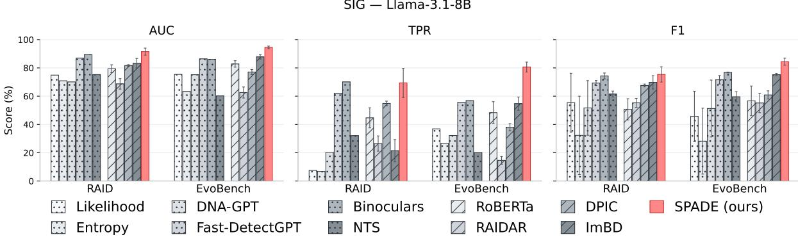  
Figure 7: AUC, TPR, and F1 on EvoBench (XSum excluded) and RAID. All supervised baselines are trained on per family splits from MIRAGE-SIG (over three seeds). The reported number corresponds to $\mathrm { \ m e a n _ { s t d } }$ over the 9 families of the mean over three seeds per family using LLaMA-3.1-8B

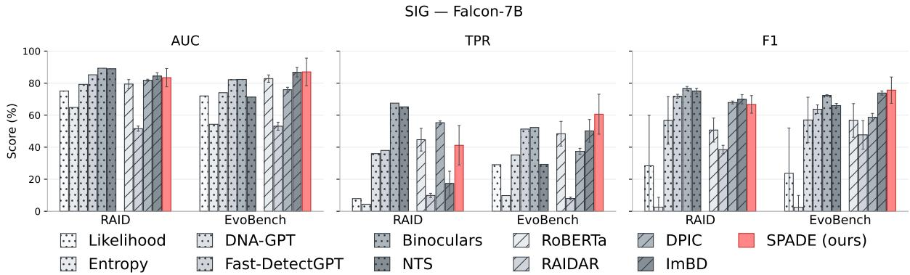  
Figure 8: AUC, TPR, and F1 on EvoBench (XSum excluded) and RAID. All supervised baselines are trained on per family splits from MIRAGE-SIG (over three seeds). The reported number corresponds to $\mathrm { \ m e a n _ { s t d } }$ over the 9 families of the mean over three seeds per family using Falcon-7B

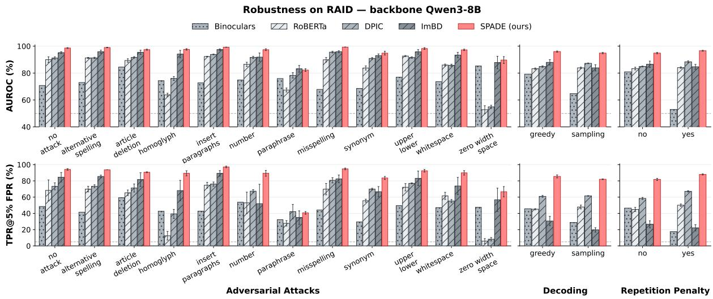  
Figure 9: AUC and TPR of 5 baselines on RAID benchmark against SPADE grouped by adversarial attacks, decoding strategy, and with repetition penalty or not.

<table><tr><td rowspan="2">Train ↓ Method → EvoBench</td><td colspan="3">RoBERTa</td><td colspan="3">RAIDAR</td><td colspan="3">DPIC</td><td colspan="3">ImBD</td><td colspan="3">SPADE (ours)</td></tr><tr><td>AUC</td><td>TPR</td><td>F1</td><td>AUC</td><td>TPR</td><td>F1</td><td>AUC</td><td>TPR</td><td>F1</td><td>AUC</td><td>TPR</td><td>F1</td><td>AUC</td><td>TPR</td><td>F1</td></tr><tr><td colspan="10">IN — training family present in EvoBench</td><td colspan="7"></td></tr><tr><td>Qwen</td><td> $8 3 . 2 _ { 1 . 9 }$ </td><td> $4 9 . 8 _ { 4 . 7 }$ </td><td> $6 6 . 7 _ { 2 . 8 }$ </td><td> $7 0 . 6 _ { 2 . 0 }$ </td><td> $1 9 . 9 _ { 3 . 0 }$ </td><td> $6 8 . 0 _ { 1 . 6 }$ </td><td>76.82.2</td><td>40.22.7</td><td>58.75.0</td><td>91.21.1</td><td>66.3.2</td><td> $7 4 . 3 _ { 1 . 2 }$ </td><td> $9 5 . 3 _ { 0 . 8 }$ </td><td>83.75.3</td><td></td><td> $8 3 . 2 _ { 5 . 4 }$ </td></tr><tr><td>Claude</td><td> $8 1 . 4 _ { 1 . 8 }$ </td><td>50.81.7</td><td> $5 2 . 1 _ { 2 . 4 }$ </td><td> $6 6 . 9 _ { 1 . 7 }$ </td><td> $2 0 . 6 _ { 1 . 1 }$ </td><td> $5 4 . 5 _ { 1 . 7 }$ </td><td> $7 4 . 8 _ { 1 . 4 }$ </td><td>36.31.7</td><td>53.16.9</td><td>88.21.9</td><td>59.26.7</td><td></td><td>74.10.6</td><td>94.61.3</td><td>84.22.9</td><td>85.23.6</td></tr><tr><td>Gemini</td><td> $8 3 . 8 _ { 0 . 9 }$ </td><td>50.63.2</td><td> $5 5 . 5 _ { 2 . 9 }$ </td><td> $6 4 . 1 _ { 1 . 7 }$ </td><td> $1 9 . 8 _ { 1 . 5 }$ </td><td> $5 2 . 6 _ { 1 1 . 7 }$ </td><td>75.61.3</td><td>36.62.4</td><td>58.83.9</td><td>91  $. 9 _ { 0 . 9 }$ </td><td>69.61.5</td><td> $7 4 . 2 _ { 0 . 3 }$ </td><td></td><td>96.30.2</td><td>87.61.1</td><td> $8 7 . 2 _ { 3 . 2 }$ </td></tr><tr><td>GPT</td><td> $8 3 . 1 _ { 2 . 0 }$ </td><td>51.01.0</td><td> $6 1 . 4 6 . 3 $ </td><td> $6 7 . 0 _ { 0 . 9 }$ </td><td> $1 7 . 7 _ { 1 . 3 }$ </td><td> $5 6 . 8 3 . 8 $ </td><td>77.70.5</td><td>38.90.8</td><td>61.85.2</td><td>91.80.4</td><td>65.91.1</td><td></td><td>74.20.5</td><td>96.30.5</td><td> $8 8 . 6 _ { 0 . 4 }$ </td><td>84.31.4</td></tr><tr><td>LLaMA</td><td> $8 5 . 4 _ { 1 . 3 }$ </td><td>55.21.8</td><td> $6 2 . 6 _ { 3 . 5 }$ </td><td> $6 7 . 3 _ { 2 . 0 }$ </td><td> $1 6 . 3 _ { 2 . 1 }$ </td><td> $5 9 . 5 { \mathrm { 9 } } . 1 { \mathrm { } }$ </td><td>77.40.5</td><td> $3 9 . 1 _ { 0 . 4 }$ </td><td>58.52.9</td><td>93.10.4</td><td> $7 1 . 5 _ { 1 . 7 }$ </td><td> $7 4 . 7 _ { 0 . 4 }$ </td><td></td><td>97.00.4</td><td> $8 9 . 4 _ { 1 . 5 }$ </td><td>89.80.7</td></tr><tr><td colspan="10">OUT — training family absent from EvoBench</td><td colspan="7"></td></tr><tr><td>Doubao</td><td> $7 7 . 8 _ { 3 . 5 }$ </td><td> $2 9 . 8 _ { 4 . 3 }$ </td><td> $3 3 . 1 _ { 1 . 7 }$ </td><td>58.63.4</td><td> $1 2 . 7 _ { 4 . 3 }$ </td><td> $6 0 . 6 _ { 4 . 1 }$ </td><td>72.00.4</td><td>31.61.2</td><td>54.61.3</td><td>89.01.7</td><td> $5 5 . 8 _ { 4 . 9 }$ </td><td></td><td>74.00.7</td><td>93.60.1</td><td>76.33.4</td><td>85.32.1</td></tr><tr><td>DeepSeek</td><td> $8 1 . 2 _ { 1 . 1 }$ </td><td> $4 3 . 0 _ { 2 . 6 }$ </td><td>51.17.9</td><td>72.41.9</td><td> $2 2 . 6 _ { 2 . 3 }$ </td><td> $6 3 . 4 _ { 2 . 5 }$ </td><td>76.71.5</td><td>38.31.5</td><td>58.75.9</td><td>89.21.1</td><td>60.61.8</td><td>74.80.6</td><td></td><td>94.90.4</td><td>84.03.5</td><td>83.23.1</td></tr><tr><td>Moonshot</td><td> $8 4 . 8 _ { 1 . 3 }$ </td><td> $5 3 . 6 _ { 0 . 8 }$ </td><td> $6 5 . 4 0 . 3 $ </td><td>68.13.1</td><td> $1 8 . 3 { 3 . 2 }$ </td><td> $6 2 . 8 \mathrm { { z } . 3 }$ </td><td> $7 6 . 5 1 . 1$ </td><td>39.30.8</td><td>58.17.4</td><td>91.31.6</td><td> $6 4 . 8 _ { 6 . 2 }$ </td><td> $7 3 . 4 _ { 1 . 2 }$ </td><td></td><td>96.50.6</td><td>88.12.7</td><td>82.81.0</td></tr><tr><td>Grok</td><td>84.30.5</td><td>51.91.1</td><td> $6 2 . 5 3 . 9$ </td><td>65.92.2</td><td>19.04.0</td><td> $5 9 . 8 3 . 3 $ </td><td>77.00.4</td><td>40.34.3</td><td>60.33.3</td><td>90.70.9</td><td>63.12.8</td><td>74.40.4</td><td></td><td>96.00.7</td><td>88.51.7</td><td>83.23.7</td></tr><tr><td>Mean</td><td> $8 2 . 8 2 . 3 $ </td><td>48.47.7</td><td> $5 6 . 7 _ { 1 0 . 5 }$ </td><td> $6 6 . 8 { } _ { 3 . 9 }$ </td><td> $1 8 . 5 2 . 8 $ </td><td> $5 9 . 8 4 . 7$ </td><td> $7 6 . 0 1 . 8$ </td><td></td><td>58.12.7</td><td> $9 0 . 7 _ { 1 . 6 }$ </td><td></td><td></td><td> $7 4 . 2 \phantom { 3 } 0 . 4 $ </td><td>95.61.1</td><td></td><td>84.92.3</td></tr><tr><td>Train ↓ Method →</td><td colspan="4"></td><td colspan="3">RAIDAR</td><td colspan="3">37.82.7</td><td colspan="3">64.15.0</td><td colspan="3">85.64.2</td></tr><tr><td>RAID</td><td>AUC</td><td>RoBERTa TPR</td><td>F1</td><td>AUC</td><td>TPR</td><td>F1</td><td>AUC</td><td>DPIC TPR</td><td>F1</td><td>AUC</td><td>ImBD TPR</td><td></td><td>F1</td><td>AUC</td><td>SPADE (ours) TPR</td><td>F1</td></tr><tr><td>IN — training family present in RAID</td><td></td><td></td><td></td><td></td><td></td><td></td><td></td><td></td><td></td><td></td><td></td><td></td><td></td><td></td><td></td><td></td></tr><tr><td>GPT</td><td> $7 8 . 2 _ { 2 . 3 }$ </td><td> $4 0 . 3 _ { 3 . 3 }$ </td><td> $5 4 . 7 _ { 6 . 8 }$ </td><td></td><td> $1 4 . 0 _ { 8 . 5 }$ </td><td> $5 0 . 9 _ { 2 . 1 }$ </td><td>81.11.4</td><td>55.71.9</td><td>67.42.0</td><td>82.00.8</td><td> $1 7 . 5 _ { 1 . 8 }$ </td><td></td><td> $7 1 . 6 \phantom { 0 } _ { 0 . 5 }$ </td><td>94.20.9</td><td></td><td>83.71.2</td></tr><tr><td colspan="4">LLaMA 84.41.1</td><td> $6 6 . 2 _ { 2 . 9 }$ </td><td> $1 6 . 0 _ { 7 . 2 }$ </td><td> $5 2 . 5 _ { 3 . 1 }$ </td><td>81.80.2</td><td>56.12.0</td><td>68.21.4</td><td></td><td></td><td> $1 4 . 8 _ { 3 . 8 }$ </td><td> $7 2 . 0 _ { 1 . 5 }$ </td><td> $9 5 . 5 _ { 1 . 3 }$ </td><td> $8 0 . 9 _ { 2 . 4 }$   $8 4 . 1 _ { 3 . 5 }$ </td><td>81.25.8</td></tr><tr><td>OUT — training family absent from RAID</td><td></td><td>56.93.9</td><td> $5 9 . 0 _ { 2 . 8 }$ </td><td> $6 3 . 5 _ { 2 . 6 }$ </td><td></td><td></td><td></td><td></td><td></td><td>82.01.3</td><td></td><td></td><td></td><td></td><td></td><td></td></tr><tr><td>Doubao</td><td></td><td>78.81.2 43.910.4</td><td> $4 3 . 7 _ { 3 . 2 }$ </td><td> $5 8 . 2 _ { 1 . 7 }$ </td><td> $4 . 4 4 _ { 0 . 1 }$ </td><td> $5 0 . 8 _ { 1 . 1 }$ </td><td>80.50.5</td><td>51.81.7</td><td>66.61.0</td><td>81.00.4</td><td> $1 1 . 0 \mathrm { _ { 0 . 5 } }$ </td><td></td><td> $7 0 . 7 _ { 1 . 7 }$ </td><td>89.72.4</td><td> $5 5 . 4 _ { 9 . 3 }$ </td><td>73.72.2</td></tr><tr><td>Grok</td><td> $8 1 . 5 1 . 5$ </td><td> $4 5 . 6 _ { 3 . 6 }$ </td><td> $5 4 . 5 6 . 4 $ </td><td> $6 4 . 3 \phantom { 0 } _ { 0 . 4 }$ </td><td> $4 . 7 5 _ { 0 . 3 }$ </td><td> $5 4 . 0 _ { 0 . 7 }$ </td><td> $8 0 . 9 0 . 8 $ </td><td>54.00.4</td><td>67.60.0</td><td>80.60.3</td><td> $1 5 . 4 0 . 5 $ </td><td></td><td> $6 8 . 7 _ { 2 . 5 }$ </td><td> $9 1 . 7 _ { 1 . 3 } $ </td><td> $6 7 . 6 { 8 . 3 }$ </td><td>78.00.7</td></tr><tr><td>DeepSeek</td><td> $7 4 . 9 _ { 2 . 4 }$ </td><td> $3 1 . 0 _ { 4 . 5 }$ </td><td> $4 2 . 4 _ { 1 1 . 4 }$ </td><td> $6 6 . 4 _ { 1 . 3 }$ </td><td> $1 1 . 8 _ { 7 . 6 }$ </td><td> $4 6 . 1 _ { 4 . 0 }$ </td><td>81.50.6</td><td> $5 4 . 7 _ { 0 . 8 }$ </td><td>67.30.8</td><td>78.65.6</td><td> $1 6 . 1 \mathrm { _ { 7 . 5 } }$ </td><td></td><td> $6 3 . 0 _ { 7 . 8 }$ </td><td> $9 2 . 8 _ { 0 . 4 }$ </td><td> $7 1 . 0 _ { 1 . 4 }$ </td><td> $8 0 . 9 _ { 3 . 1 }$ </td></tr><tr><td>Claude</td><td> $7 7 . 5 _ { 0 . 3 }$ </td><td> $4 4 . 3 _ { 1 . 4 }$ </td><td> $4 0 . 8 _ { 2 . 4 }$ </td><td> $6 2 . 5 { 3 . 8 }$ </td><td> $1 8 . 5 _ { 2 . 5 }$ </td><td> $4 1 . 9 _ { 1 . 3 }$ </td><td>80.00.6</td><td> $5 2 . 6 _ { 0 . 8 }$ </td><td>65.12.0</td><td>85.34.8</td><td> $3 1 . 9 _ { 1 7 . 9 }$ </td><td></td><td> $6 9 . 8 _ { 3 . 9 }$ </td><td> $9 2 . 9 _ { 1 . 5 }$ </td><td> $7 8 . 4 _ { 2 . 5 }$ </td><td> $8 3 . 0 _ { 1 . 6 }$ </td></tr><tr><td>Gemini</td><td> $7 7 . 5 _ { 1 . 7 }$ </td><td> $4 2 . 6 _ { 4 . 5 }$ </td><td> $4 5 . 5 _ { 1 . 6 }$ </td><td> $6 3 . 7 _ { 1 . 5 }$ </td><td> $4 . 4 7 _ { 0 . 7 }$ </td><td> $4 9 . 7 _ { 1 . 1 }$ </td><td> $8 1 . 8 _ { 0 . 2 }$ </td><td> $5 4 . 9 \mathrm { _ 0 . 7 }$ </td><td>66.10.9</td><td> $8 2 . 3 _ { 2 . 3 }$ </td><td> $1 9 . 6 _ { 1 0 . 0 }$ </td><td></td><td> $6 9 . 6 _ { 3 . 6 }$ </td><td> $9 3 . 9 _ { 0 . 6 }$ </td><td> $8 0 . 5 _ { 3 . 9 }$ </td><td> $8 2 . 5 _ { 2 . 3 }$ </td></tr><tr><td>Qwen</td><td> $8 0 . 1 _ { 1 . 3 }$ </td><td> $4 7 . 4 _ { 1 . 5 }$ </td><td> $5 7 . 1 _ { 3 . 5 }$ </td><td> $6 6 . 1 _ { 2 . 2 }$ </td><td> $1 5 . 2 _ { 1 0 . 2 }$ </td><td> $5 1 . 3 _ { 2 . 0 }$ </td><td>81.20.5</td><td> $5 3 . 5 _ { 0 . 9 }$ </td><td>66.80.7</td><td> $8 0 . 4 _ { 1 . 6 }$ </td><td> $1 4 . 2 _ { 1 . 9 }$ </td><td> $6 9 . 9 \mathrm { { 7 . 5 } }$ </td><td> $6 9 . 6 _ { 2 . 3 }$ </td><td> $9 4 . 7 _ { 0 . 6 }$   $9 4 . 9 _ { 0 . 9 } $   $8 1 . 7 _ { 2 . 8 }$ </td><td> $8 0 . 5 _ { 2 . 3 }$ </td><td> $8 3 . 4 _ { 1 . 8 }$   $8 2 . 3 _ { 2 . 1 }$ </td></tr><tr><td>Moonshot Mean</td><td> $8 1 . 8 _ { 2 . 1 }$ </td><td> $5 0 . 1 3 . 2 $   $\underline { { 4 4 . 7 _ { 7 . 1 } } }$ </td><td> $5 9 . 0 2 . 2 $   $5 0 . 7 _ { 7 . 5 }$ </td><td> $6 5 . 1 _ { 0 . 8 }$   $6 4 . 0 _ { 2 . 6 }$ </td><td> $4 . 8 4 _ { 2 . 4 }$  10.45.8</td><td> $5 3 . 4 2 . 6 $ </td><td>81.70.9</td><td> $5 6 . 8 _ { 1 . 1 }$ </td><td>67.70.9 67.01.0</td><td> $\underline { { 8 3 . 6 2 . 6 } }$   $8 1 . 8 _ { 1 . 9 }$ </td><td> $\underline { { 3 1 . 5 1 2 . 2 } }$ </td></table>

Table 15: AUC, TPR, and F1 on EvoBench (top) and RAID (bottom) per training family, with Qwen3-8B-Base as backbone (RoBERTa has none). Each detector is trained on a single MIRAGE generator family and tested on the full benchmark. Per family: mean across three seeds; Mean: $\mathrm { \ m e a n _ { s t d } }$ across the nine training families. Rows are grouped by whether the training family is present in the benchmark (EvoBench: GPT, Claude, Gemini, LLaMA, Qwen; RAID: GPT, LLaMA) or absent from it, and sorted within each group by SPADE’s TPR, lowest first. F1 is computed at the Youden-J threshold fitted on each run’s MIRAGE validation split; when a criterion ranks human texts above AI texts on the validation split, no threshold exists and its F1 is 0. Bold indicates the best method on the cross-family mean.

<table><tr><td rowspan="2">Train ↓ Method → EvoBench</td><td colspan="3">RoBERTa</td><td colspan="3">RAIDAR</td><td colspan="3">DPIC</td><td colspan="3">ImBD</td><td colspan="3">SPADE (ours)</td></tr><tr><td>AUC</td><td>TPR</td><td>F1</td><td>AUC</td><td>TPR</td><td>F1</td><td>AUC</td><td>TPR</td><td>F1</td><td>AUC</td><td>TPR</td><td>F1</td><td>AUC</td><td>TPR</td><td>F1</td></tr><tr><td colspan="10">IN — training family present in EvoBench</td><td colspan="7"></td></tr><tr><td>GPT</td><td>83.12.0</td><td> $5 1 . 0 _ { 1 . 0 }$ </td><td>61.46.3</td><td>65.41.3</td><td> $1 7 . 8 \phantom { 0 } _ { 0 . 1 }$ </td><td> $5 7 . 2 _ { 1 . 3 }$ </td><td> $7 8 . 6 _ { 0 . 9 }$ </td><td> $3 9 . 5 _ { 1 . 0 }$ </td><td>64.01.5</td><td>86.70.3</td><td>52.13.0</td><td>74.60.4</td><td> $9 4 . 3 _ { 1 . 0 }$ </td><td> $7 8 . 5 5 . 0$ </td><td></td><td> $8 4 . 0 _ { 1 . 1 }$ </td></tr><tr><td>Claude</td><td>81.41.8</td><td>50.81.7</td><td>52.12.4</td><td>64.12.5</td><td> $1 5 . 5 _ { 1 . 7 }$ </td><td>51.43.3</td><td>76.10.6</td><td>37.51.2</td><td>58.42.4</td><td>87.50.9</td><td>53.32.6</td><td></td><td>76.00.2</td><td>94.00.5</td><td> $8 0 . 6 _ { 1 . 6 }$ </td><td>81.13.5</td></tr><tr><td>Qwen</td><td>83.21.9</td><td>49  $\phantom { - } 1 . 8 _ { 4 . 7 }$ </td><td> $6 6 . 7 2 . 8 $ </td><td>67.31.4</td><td> $1 5 . 9 1 . 6 $ </td><td>62.63.6</td><td> $7 8 . 2 _ { 0 . 3 }$ </td><td>39.60.5</td><td>61.41.1</td><td>88.01.0</td><td>57.11.9</td><td></td><td>75.10.4</td><td> $9 4 . 5 _ { 1 . 9 } $ </td><td> $8 0 . 8 \mathrm { { z } . 5 }$ </td><td>83.32.4</td></tr><tr><td>Gemini</td><td>83.80.9</td><td>50.63.2</td><td> $5 5 . 5 _ { 2 . 9 }$ </td><td>55.82.3</td><td>11.41.3</td><td>40.83.5</td><td>76.10.9</td><td> $3 5 . 3 _ { 2 . 5 }$ </td><td>60.35.5</td><td>89.40.5</td><td>55.31.3</td><td></td><td>76.30.5</td><td>95.10.2</td><td> $8 1 . 7 _ { 0 . 9 }$ </td><td>86.51.3</td></tr><tr><td>LLaMA</td><td> $8 5 . 4 _ { 1 . 3 }$ </td><td>55.21.8</td><td>62.63.5</td><td>63.71.1</td><td>15.51.4</td><td>56.64.3</td><td>78.30.9</td><td>38.31.4</td><td>63.24.1</td><td>88.62.7</td><td>59.17.2</td><td>75.10.2</td><td></td><td>95.80.2</td><td>85.91.9</td><td>88.30.5</td></tr><tr><td colspan="10">OUT — training family absent from EvoBench</td><td colspan="3"></td><td colspan="3"></td><td colspan="3"></td></tr><tr><td>Doubao</td><td> $7 7 . 8 _ { 3 . 5 }$ </td><td> $2 9 . 8 _ { 4 . 3 }$ </td><td>33.11.7</td><td> $5 7 . 2 _ { 0 . 4 }$ </td><td> $8 . 8 8 _ { 1 . 0 }$ </td><td> $5 7 . 7 _ { 1 . 5 }$ </td><td>73.10.8</td><td>33.02.1</td><td> $5 5 . 9 _ { 2 . 2 }$ </td><td>84.60.9</td><td></td><td>44.14.0</td><td> $7 3 . 3 _ { 0 . 9 }$ </td><td> $9 3 . 1 _ { 0 . 8 }$ </td><td> $7 4 . 0 _ { 4 . 5 }$ </td><td>84.31.5</td></tr><tr><td>DeepSeek</td><td> $8 1 . 2 _ { 1 . 1 }$ </td><td> $4 3 . 0 2 . 6 $ </td><td>51.17.9</td><td>65.61.8</td><td> $1 4 . 9 1 . 0$ </td><td>56.75.6</td><td> $7 7 . 2 \phantom { } 0 . 8 $ </td><td>38.80.8</td><td>58.34.3</td><td>87.51.1</td><td>54.21.1</td><td></td><td>75.31.0</td><td>93.81.1</td><td>78.22.7</td><td>83.54.7</td></tr><tr><td>Moonshot</td><td> $8 4 . 8 _ { 1 . 3 }$ </td><td> $5 3 . 6 _ { 0 . 8 }$ </td><td> $6 5 . 4 _ { 0 . 3 }$ </td><td>62.93.1</td><td> $1 5 . 8 _ { 3 . 7 }$ </td><td> $6 2 . 8 _ { 2 . 3 }$ </td><td> $7 8 . 3 _ { 0 . 9 }$ </td><td> $4 0 . 7 _ { 1 . 4 }$ </td><td> $6 1 . 4 _ { 3 . 7 }$ </td><td>89.02.2</td><td>58.95.8</td><td> $7 5 . 5 _ { 0 . 8 }$ </td><td></td><td> $9 4 . 6 _ { 1 . 5 }$ </td><td> $8 0 . 9 _ { 3 . 7 }$ </td><td> $8 1 . 3 _ { 2 . 3 }$ </td></tr><tr><td>Grok</td><td> $8 4 . 3 \phantom { 0 } _ { 0 . 5 }$ </td><td> $5 1 . 9 \mathrm { 1 . 1 }$ </td><td> $6 2 . 5 3 . 9$ </td><td>61.70.8</td><td> $1 5 . 4 _ { 1 . 4 }$ </td><td> $5 0 . 6 { \mathrm { g } } _ { . 3 }$ </td><td> $7 8 . 1 _ { 0 . 2 }$ </td><td>40.31.6</td><td> $6 4 . 7 _ { 4 . 0 }$ </td><td>89.00.5</td><td>58.12.2</td><td> $7 5 . 6 _ { 1 . 1 }$ </td><td></td><td> $9 5 . 5 _ { 0 . 9 } $ </td><td> $8 4 . 6 _ { 4 . 6 }$ </td><td>87.40.7</td></tr><tr><td>Mean</td><td colspan="4"> $8 2 . 8 2 . 3 $ </td><td colspan="3">14.62.7</td><td colspan="3">38.12.5</td><td colspan="3">54.74.7</td><td colspan="3">80.63.5</td></tr><tr><td>Train ↓ Method →</td><td></td><td>RoBERTa</td><td>56.710.5</td><td>62.63.9</td><td>RAIDAR</td><td>55.26.8</td><td></td><td>DPIC</td><td></td><td>60.92.9 87.81.5</td><td></td><td></td><td>75.20.9</td><td>94.50.9</td><td></td><td>84.42.5</td></tr><tr><td>RAID</td><td colspan="4">AUC TPR</td><td colspan="3">TPR</td><td colspan="3">TPR</td><td colspan="3">ImBD TPR</td><td colspan="3">SPADE (ours) AUC TPR</td></tr><tr><td>IN — training family present in RAID</td><td></td><td></td><td>F1</td><td>AUC</td><td></td><td>F1</td><td>AUC</td><td></td><td>F1</td><td>AUC</td><td></td><td>F1</td><td></td><td></td><td></td><td></td></tr><tr><td>GPT LLaMA</td><td> $7 8 . 2 _ { 2 . 3 }$ </td><td> $4 0 . 3 _ { 3 . 3 }$ </td><td> $5 4 . 7 _ { 6 . 8 }$ </td><td>69.51.4</td><td> $2 9 . 6 _ { 2 . 6 }$ </td><td> $5 6 . 1 _ { 1 . 4 }$ </td><td>81.90.7</td><td>55.81.0</td><td> $6 7 . 7 _ { 0 . 9 }$ </td><td>82.52.1</td><td>12.32.2</td><td> $6 9 . 5 _ { 3 . 9 }$ </td><td> $9 2 . 2 _ { 0 . 6 }$ </td><td></td><td></td><td>76.40.5</td></tr><tr><td colspan="3"> $8 4 . 4 _ { 1 . 1 }$   $5 6 . 9 3 . 9 $  OUT — training family absent from RAID</td><td colspan="10"> $5 9 . 0 2 . 8 $ </td><td colspan="3">74.82.1  $9 4 . 6 _ { 1 . 1 }$ </td><td colspan="3"> $6 9 . 7 _ { 6 . 1 }$ </td></tr><tr><td></td><td></td><td></td><td></td><td>70.40.3</td><td> $3 5 . 3 \phantom { 0 } _ { 1 . 7 }$ </td><td> $5 8 . 6 _ { 1 . 9 }$ </td><td>82.20.5</td><td>55.80.9</td><td>69.10.9</td><td>87.51.8</td><td></td><td>31.02.4</td><td></td><td></td><td>81.93.6</td><td>79.53.2</td></tr><tr><td>Claude</td><td> $7 7 . 5 \mathrm { _ { 0 . 3 } }$ </td><td> $4 4 . 3 _ { 1 . 4 }$ </td><td>40.82.4</td><td>68.82.9</td><td>30.05.7</td><td>51.63.8</td><td>80.70.5</td><td>54.60.8</td><td>66.91.4</td><td>83.31.7</td><td>15.73.4</td><td></td><td>70.63.0</td><td>87.33.8</td><td> $5 2 . 4 _ { 1 2 . 1 }$ </td><td>66.28.4</td></tr><tr><td>Doubao</td><td> $7 8 . 8 _ { 1 . 2 }$ </td><td> $4 3 . 9 _ { 1 0 . 4 }$ </td><td> $4 3 . 7 _ { 3 . 2 }$ </td><td>59.51.2</td><td>16.22.2</td><td>50.03.2</td><td>81.11.1</td><td>51.52.2</td><td>66.61.9</td><td>79.60.8</td><td>17.30.8</td><td>64.61.4</td><td></td><td> $8 7 . 5 _ { 1 . 5 }$ </td><td> $5 2 . 5 _ { 3 . 7 }$ </td><td>66.33.2</td></tr><tr><td>DeepSeek</td><td> $7 4 . 9 _ { 2 . 4 }$ </td><td> $3 1 . 0 _ { 4 . 5 }$ </td><td> $4 2 . 4 _ { 1 1 . 4 }$ </td><td>68.71.4</td><td> $2 6 . 2 _ { 9 . 1 }$ </td><td> $5 2 . 8 _ { 2 . 5 }$ </td><td>82.50.7</td><td>55.40.9</td><td> $6 7 . 7 _ { 0 . 4 }$ </td><td>79.71.7</td><td>14.93.9</td><td>65.11.7</td><td></td><td> $9 0 . 6 _ { 1 . 6 }$ </td><td> $6 9 . 9 _ { 7 . 0 }$ </td><td>78.44.0</td></tr><tr><td>Gemini</td><td> $7 7 . 5 1 . 7$ </td><td> $4 2 . 6 _ { 4 . 5 }$ </td><td> $4 5 . 5 1 . 6$ </td><td>68.91.5</td><td> $2 3 . 3 6 . 2$ </td><td>55.92.5</td><td>81.70.3</td><td>54.91.0</td><td>65.80.5</td><td>82.41.6</td><td>22.66.0</td><td>67.32.3</td><td></td><td> $9 2 . 3 _ { 1 . 7 }$ </td><td> $7 2 . 4 1 0 . 4 $ </td><td>76.43.7</td></tr><tr><td>Qwen</td><td> $8 0 . 1 _ { 1 . 3 }$ </td><td>47.41.5</td><td>57.13.5</td><td>71.41.2</td><td> $2 8 . 8 _ { 4 . 9 }$ </td><td> $5 7 . 5 _ { 1 . 4 }$ </td><td>82.10.3</td><td> $5 5 . 2 _ { 1 . 0 }$ </td><td>68.00.8</td><td>88.21.2</td><td>30.16.0</td><td></td><td>77.01.5</td><td>92.42.6</td><td> $7 2 . 4 _ { 1 1 . 2 }$ </td><td>76.73.8</td></tr><tr><td>Moonshot</td><td>81.82.1  $8 1 . 5 _ { 1 . 5 }$ </td><td> $5 0 . 1 _ { 3 . 2 }$   $4 5 . 6 _ { 3 . 6 }$ </td><td> $5 9 . 0 _ { 2 . 2 }$   $5 4 . 5 _ { 6 . 4 }$ </td><td>72.21.3 68.72.1</td><td> $2 4 . 8 _ { 9 . 3 }$  24.07.1</td><td>59.50.8 55.32.3</td><td>82.20.7 81.20.1</td><td> $5 7 . 4 _ { 0 . 3 }$  53.92.1</td><td>68.91.1 67.90.3</td><td> $8 6 . 8 _ { 2 . 9 }$   $7 9 . 8 _ { 1 . 6 }$ </td><td>32.67.3 16.72.9</td><td></td><td>74.43.5 65.13.6  $9 3 . 2 _ { 1 . 9 } $ </td><td> $9 2 . 9 _ { 1 . 1 }$ </td><td> $7 5 . 3 _ { 2 . 4 }$  77.92.5</td><td>78.43.4 80.30.2</td></tr><tr><td>Grok Mean</td></table>

Table 16: AUC, TPR, and F1 on EvoBench (top) and RAID (bottom) per training family, with LLaMA-3.1-8B as backbone (RoBERTa has none). Each detector is trained on a single MIRAGE generator family and tested on the full benchmark. Per family: meanstd across three seeds; Mean: meanstd across the nine training families. Rows are grouped by whether the training family is present in the benchmark (EvoBench: GPT, Claude, Gemini, LLaMA, Qwen; RAID: GPT, LLaMA) or absent from it, and sorted within each group by SPADE’s TPR, lowest first. F1 is computed at the Youden-J threshold fitted on each run’s MIRAGE validation split; when a criterion ranks human texts above AI texts on the validation split, no threshold exists and its F1 is 0. Bold indicates the best method on the cross-family mean.

Table 17: AUC, TPR, and F1 on EvoBench (top) and RAID (bottom) per training family, with Falcon-7B as backbone (RoBERTa has none). Each detector is trained on a single MIRAGE generator family and tested on the full benchmark. Per family: $\mathrm { \ m e a n _ { s t d } }$ across three seeds; Mean: $\mathrm { \ m e a n _ { s t d } }$ across the nine training families. Rows are grouped by whether the training family is present in the benchmark (EvoBench: $\mathrm { G P T } ,$ Claude, Gemini, LLaMA, Qwen; RAID: GPT, LLaMA) or absent from it, and sorted within each group by SPADE’s TPR, lowest first. F1 is computed at the Youden-J threshold fitted on each run’s MIRAGE validation split. Bold indicates the best method on the cross-family mean.
<table><tr><td rowspan="2">Train ↓ Method → EvoBench</td><td colspan="3">RoBERTa</td><td colspan="3">RAIDAR</td><td colspan="3">DPIC</td><td colspan="3">ImBD</td><td colspan="3">SPADE (ours)</td></tr><tr><td>AUC</td><td>TPR</td><td>F1</td><td>AUC</td><td>TPR</td><td>F1</td><td>AUC</td><td>TPR</td><td>F1</td><td>AUC</td><td>TPR</td><td>F1</td><td>AUC</td><td>TPR</td><td>F1</td></tr><tr><td colspan="10">IN — training family present in EvoBench</td><td></td><td></td><td></td><td></td><td></td><td></td></tr><tr><td>Claude</td><td> $8 1 . 4 _ { 1 . 8 }$ </td><td> $5 0 . 8 _ { 1 . 7 }$ </td><td> $5 2 . 1 _ { 2 . 4 }$ </td><td> $5 6 . 0 _ { 1 . 9 }$ </td><td> $8 . 4 8 _ { 1 . 0 }$ </td><td>52.61.8</td><td> $7 4 . 1 _ { 0 . 7 }$ </td><td> $3 6 . 1 _ { 0 . 9 }$ </td><td> $5 7 . 6 _ { 0 . 5 }$ </td><td> $8 8 . 6 _ { 1 . 6 }$ </td><td> $5 4 . 8 _ { 4 . 4 }$ </td><td> $7 5 . 7 _ { 1 . 4 }$ </td><td> $8 7 . 4 _ { 2 . 3 }$ </td><td> $5 5 . 8 _ { 8 . 7 }$ </td><td> $7 6 . 9 _ { 5 . 4 }$ </td></tr><tr><td>GPT</td><td>83.12.0</td><td> $5 1 . 0 _ { 1 . 0 }$ </td><td> $6 1 . 4 _ { 6 . 3 }$ </td><td> $5 0 . 1 _ { 3 . 1 }$ </td><td> $6 . 8 0 _ { 0 . 9 }$ </td><td>31.45.3</td><td> $7 7 . 3 \mathrm { _ 0 . 5 }$ </td><td> $3 8 . 6 _ { 1 . 0 }$ </td><td> $6 0 . 6 _ { 2 . 9 }$ </td><td> $8 5 . 8 _ { 1 . 9 }$ </td><td> $4 7 . 8 _ { 5 . 3 }$ </td><td> $7 2 . 4 _ { 1 . 0 }$ </td><td>88.82.4</td><td> $5 6 . 7 _ { 1 0 . 2 }$ </td><td> $7 8 . 6 _ { 3 . 0 }$ </td></tr><tr><td>Qwen</td><td> $8 3 . 2 _ { 1 . 9 }$ </td><td> $4 9 . 8 _ { 4 . 7 }$ </td><td>66.72.8</td><td> $5 5 . 4 _ { 3 . 6 }$ </td><td> $8 . 5 4 _ { 1 . 7 }$ </td><td>59.43.3</td><td> $7 7 . 0 _ { 0 . 3 }$ </td><td> $3 8 . 1 _ { 0 . 9 }$ </td><td>59.08.6</td><td> $8 8 . 0 \mathrm { { 0 . 5 } }$ </td><td> $5 3 . 0 _ { 0 . 9 }$ </td><td> $7 3 . 3 _ { 1 . 9 }$ </td><td> $8 9 . 7 _ { 0 . 4 }$ </td><td> $6 6 . 0 4 . 1$ </td><td> $8 1 . 6 _ { 2 . 7 }$ </td></tr><tr><td>Gemini</td><td>83.80.9</td><td> $5 0 . 6 _ { 3 . 2 }$ </td><td> $5 5 . 5 _ { 2 . 9 }$ </td><td> $5 0 . 7 _ { 2 . 8 }$ </td><td> $7 . 5 4 _ { 2 . 1 }$ </td><td> $3 6 . 0 _ { 1 3 . 2 }$ </td><td> $7 5 . 0 _ { 1 . 1 }$ </td><td> $3 5 . 4 _ { 3 . 3 }$ </td><td>56.56.7</td><td> $8 7 . 2 _ { 1 . 7 }$ </td><td> $5 2 . 7 _ { 3 . 7 }$ </td><td> $7 4 . 1 _ { 2 . 4 }$ </td><td> $9 0 . 1 _ { 4 . 1 }$ </td><td> $6 7 . 9 _ { 4 . 9 }$ </td><td> $7 8 . 0 { 5 . 0 }$ </td></tr><tr><td>LLaMA</td><td> $8 5 . 4 _ { 1 . 3 }$ </td><td>55.21.8</td><td>62.63.5</td><td> $5 4 . 9 _ { 2 . 6 }$ </td><td> $8 . 3 1 _ { 0 . 3 }$ </td><td> $5 4 . 3 _ { 2 . 4 }$ </td><td> $7 6 . 9 \mathrm { _ 0 . 9 }$ </td><td> $3 8 . 4 _ { 0 . 4 }$ </td><td> $6 0 . 9 _ { 2 . 4 }$ </td><td> $8 8 . 6 _ { 2 . 2 }$ </td><td> $5 6 . 2 _ { 5 . 8 }$ </td><td> $7 4 . 5 _ { 2 . 1 }$ </td><td> $9 3 . 7 _ { 0 . 8 }$ </td><td> $7 4 . 3 _ { 3 . 2 }$ </td><td> $8 3 . 3 _ { 1 . 1 }$ </td></tr><tr><td colspan="10">OUT — training family absent from EvoBench</td><td colspan="3"></td><td colspan="3"></td></tr><tr><td>Doubao</td><td>77.83.5</td><td>29.84.3</td><td>33.11.7</td><td> $5 0 . 4 _ { 2 . 5 }$ </td><td> $7 . 4 4 _ { 1 . 0 }$ </td><td>48.63.1</td><td> $7 3 . 0 _ { 1 . 0 }$ </td><td> $3 4 . 1 _ { 1 . 0 }$ </td><td> $5 5 . 2 _ { 1 . 6 }$ </td><td> $7 9 . 1 _ { 2 . 5 }$ </td><td> $3 2 . 3 _ { 5 . 6 }$ </td><td> $7 1 . 4 _ { 4 . 6 }$ </td><td> $6 7 . 2 _ { 0 . 5 }$ </td><td> $3 4 . 5 _ { 4 . 5 }$ </td><td>54.60.4</td></tr><tr><td>DeepSeek</td><td> $8 1 . 2 _ { 1 . 1 }$ </td><td> $4 3 . 0 2 . 6 $ </td><td>51.17.9</td><td> $5 6 . 1 _ { 2 . 3 }$ </td><td> $9 . 3 6 _ { 0 . 9 }$ </td><td>49.69.5</td><td> $7 6 . 2 _ { 0 . 9 }$ </td><td> $3 7 . 0 _ { 1 . 2 }$ </td><td> $5 8 . 2 { _ 3 } . 4 $ </td><td> $8 6 . 9 1 . 3 $ </td><td> $5 0 . 7 _ { 4 . 5 }$ </td><td> $7 4 . 3 \mathrm { { 1 . 3 } }$ </td><td> $8 8 . 1 \mathrm { { 1 . 5 } }$ </td><td> $5 7 . 4 1 3 . 6 $ </td><td>81.21.4</td></tr><tr><td>Moonshot</td><td>84.81.3</td><td> $5 3 . 6 \phantom { 0 } 0 . 8 $ </td><td> $6 5 . 4 0 . 3 $ </td><td> $5 1 . 5 3 . 1$ </td><td> $7 . 5 5 2 . 1$ </td><td>51.44.0</td><td> $7 6 . 7 _ { 0 . 4 }$ </td><td> $4 0 . 0 0 . 9 $ </td><td> $6 2 . 8 \mathrm { { 1 . 5 } }$ </td><td> $8 8 . 2 _ { 1 . 7 }$ </td><td> $5 1 . 5 6 . 3$ </td><td> $7 4 . 6 _ { 0 . 9 }$ </td><td> $9 0 . 0 { 3 . 8 }$ </td><td>67.37.5</td><td> $8 0 . 5 \mathrm { 0 . 2 }$ </td></tr><tr><td>Grok</td><td> $8 4 . 3 \mathrm { _ 0 . 5 }$ </td><td> $5 1 . 9 1 . 1$   $\overline { { 4 8 . 4 _ { 7 . 7 } } }$ </td><td> $6 2 . 5 3 . 9$ </td><td> $5 3 . 0 _ { 1 . 4 }$ </td><td> $7 . 8 8 _ { 0 . 5 }$ </td><td> $4 5 . 8 _ { 1 1 . 3 }$ </td><td> $7 6 . 8 \mathrm { _ 0 . 9 }$ </td><td> $3 9 . 1 _ { 1 . 7 }$ </td><td> $5 7 . 4 _ { 2 . 4 }$ </td><td> $8 8 . 5 1 . 3 $ </td><td> $5 2 . 7 _ { 3 . 3 }$ </td><td> $7 3 . 9 \mathrm { { 1 . 2 } }$ </td><td> $9 2 . 5 2 . 2 $ </td><td> $7 2 . 0 _ { 7 . 0 }$ </td><td> $8 1 . 9 2 . 5$ </td></tr><tr><td>Mean</td><td colspan="3"> $8 2 . 8 _ { 2 . 3 }$ </td><td colspan="3"> $5 3 . 1 _ { 2 . 5 }$   $\overline { { 7 . 9 9 _ { 0 . 8 } } }$ </td><td colspan="3"> $7 5 . 9 _ { 1 . 5 }$   $\underline { { 3 7 . 4 _ { 1 . 9 } } }$ </td><td colspan="3"></td><td colspan="3"> ${ \bf 6 1 . 3 } _ { 1 2 . 1 }$   ${ \bf 7 7 . 4 } _ { 8 . 8 }$ </td></tr><tr><td>Train ↓ Method →</td><td></td><td>RoBERTa</td><td></td><td></td><td>RAIDAR</td><td></td><td></td><td>DPIC</td><td></td><td></td><td>ImBD</td><td></td><td></td><td>SPADE (ours)</td><td></td></tr><tr><td>RAID</td><td colspan="3">AUC</td><td>AUC</td><td>TPR</td><td>F1</td><td>AUC</td><td>TPR</td><td> $\overline { { \mathrm { \ F 1 } } }$ </td><td> $\overline { { { \bf A U C } } }$ </td><td>TPR</td><td> $\overline { { \mathrm { F 1 } } }$ </td><td>AUC</td><td>TPR</td><td>F1</td></tr><tr><td>IN — training family present in RAID</td><td></td><td></td><td></td><td></td><td></td><td></td><td></td><td></td><td></td><td></td><td></td><td></td><td></td><td></td><td></td></tr><tr><td>GPT LLaMA</td><td> $7 8 . 2 _ { 2 . 3 }$ </td><td> $4 0 . 3 _ { 3 . 3 }$ </td><td> $5 4 . 7 _ { 6 . 8 }$ </td><td> $4 9 . 9 _ { 1 . 7 }$ </td><td> $9 . 2 7 _ { 1 . 0 }$ </td><td>35.02.3  $4 0 . 7 _ { 2 . 0 }$ </td><td> $8 1 . 4 _ { 0 . 3 }$ </td><td>54.22.2</td><td> $6 7 . 4 _ { 1 . 1 }$ </td><td>82.10.9</td><td> $5 . 7 6 _ { 0 . 8 }$ </td><td> $6 8 . 8 _ { 3 . 9 }$ </td><td> $8 5 . 5 _ { 3 . 6 }$ </td><td> $4 5 . 0 { \mathrm { 9 . 5 } }$ </td><td> $6 6 . 1 _ { 6 . 8 }$ </td></tr><tr><td colspan="10"> $8 4 . 4 _ { 1 . 1 }$   $5 6 . 9 _ { 3 . 9 } $   $5 9 . 0 _ { 2 . 8 }$ </td><td colspan="3"> $2 4 . 7 _ { 2 0 . 2 }$   $7 2 . 7 _ { 4 . 0 }$ </td><td colspan="3"></td></tr><tr><td>OUT — training family absent from RAID</td><td></td><td></td><td></td><td></td><td></td><td></td><td></td><td></td><td></td><td></td><td></td><td></td><td></td><td></td><td></td></tr><tr><td>Doubao</td><td> $7 8 . 8 _ { 1 . 2 }$ </td><td> $4 3 . 9 _ { 1 0 . 4 }$ </td><td> $4 3 . 7 _ { 3 . 2 }$ </td><td> $4 9 . 8 _ { 3 . 2 }$ </td><td> $8 . 3 9 _ { 2 . 4 }$ </td><td>38.53.5</td><td> $8 1 . 0 _ { 0 . 6 }$ </td><td> $5 3 . 8 _ { 0 . 4 }$ </td><td> $6 6 . 6 _ { 0 . 4 }$ </td><td> $8 0 . 4 _ { 1 . 7 }$ </td><td> $1 7 . 2 _ { 1 0 . 3 }$ </td><td> $6 3 . 8 _ { 6 . 5 }$ </td><td> $7 4 . 1 _ { 0 . 7 }$ </td><td> $2 6 . 3 _ { 0 . 6 }$ </td><td> $5 6 . 7 _ { 3 . 2 }$ </td></tr><tr><td>Gemini</td><td> $7 7 . 5 _ { 1 . 7 }$ </td><td> $4 2 . 6 _ { 4 . 5 }$ </td><td> $4 5 . 5 _ { 1 . 6 }$ </td><td> $5 2 . 0 _ { 1 . 5 }$ </td><td> $1 0 . 5 _ { 1 . 6 }$ </td><td>38.82.6</td><td> $8 2 . 9 _ { 0 . 8 }$ </td><td> $5 6 . 2 _ { 0 . 6 }$ </td><td> $6 6 . 7 _ { 0 . 9 }$ </td><td> $8 5 . 4 _ { 1 . 2 }$ </td><td> $2 0 . 8 _ { 6 . 9 }$ </td><td>68.07.7</td><td> $8 3 . 2 _ { 4 . 6 }$ </td><td> $3 6 . 4 _ { 6 . 3 }$ </td><td> $6 4 . 0 _ { 1 4 . 1 }$ </td></tr><tr><td>DeepSeek</td><td> $7 4 . 9 _ { 2 . 4 }$ </td><td> $3 1 . 0 _ { 4 . 5 }$ </td><td> $4 2 . 4 _ { 1 1 . 4 }$ </td><td> $5 2 . 4 _ { 2 . 3 }$ </td><td> $1 0 . 7 _ { 0 . 4 }$ </td><td> $3 5 . 3 _ { 3 . 1 }$  82</td><td> $. 1 _ { 0 . 2 }$ </td><td> $5 5 . 6 _ { 2 . 0 }$ </td><td> $6 8 . 0 _ { 0 . 4 }$ </td><td> $8 3 . 6 _ { 1 . 5 }$ </td><td> $6 . 3 1 _ { 1 . 7 }$ </td><td> $7 0 . 8 _ { 0 . 4 }$ </td><td> $7 9 . 5 _ { 1 . 2 }$ </td><td> $3 6 . 5 _ { 1 4 . 8 }$ </td><td> $6 3 . 4 \tau . 8$ </td></tr><tr><td>Qwen</td><td> $8 0 . 1 _ { 1 . 3 }$ </td><td> $4 7 . 4 _ { 1 . 5 }$ </td><td> $5 7 . 1 _ { 3 . 5 }$ </td><td> $5 4 . 7 _ { 1 . 5 }$ </td><td> $1 1 . 4 _ { 1 . 5 }$ </td><td>42.70.9</td><td> $8 2 . 0 _ { 0 . 5 }$ </td><td> $5 5 . 3 _ { 0 . 4 }$ </td><td> $6 8 . 2 _ { 0 . 3 }$ </td><td> $8 5 . 3 _ { 0 . 5 }$ </td><td> $1 9 . 2 _ { 1 1 . 4 }$ </td><td> $7 3 . 0 _ { 0 . 9 }$ </td><td> $8 3 . 5 _ { 3 . 0 }$ </td><td> $4 9 . 6 _ { 8 . 6 }$ </td><td> $6 6 . 7 _ { 4 . 4 }$ </td></tr><tr><td>Moonshot</td><td> $8 1 . 8 _ { 2 . 1 }$ </td><td> $5 0 . 1 _ { 3 . 2 }$ </td><td> $5 9 . 0 _ { 2 . 2 }$ </td><td> $5 3 . 2 _ { 1 . 3 }$ </td><td> $1 0 . 9 _ { 2 . 2 }$ </td><td> $3 9 . 5 _ { 2 . 2 }$ </td><td> $8 2 . 0 \phantom { 0 } 0 . 8 $ </td><td> $5 5 . 5 _ { 1 . 1 }$ </td><td> $6 8 . 6 _ { 1 . 2 }$ </td><td> $8 5 . 8 _ { 1 . 4 }$ </td><td> $2 7 . 0 { \mathrm { 9 . 3 } }$ </td><td> $7 2 . 1 _ { 2 . 2 }$ </td><td> $8 4 . 9 _ { 6 . 2 }$ </td><td> $5 2 . 7 _ { 1 1 . 9 }$ </td><td> $6 6 . 7 _ { 5 . 9 }$ </td></tr><tr><td>Grok</td><td> $8 1 . 5 \mathrm { { 1 . 5 } }$ </td><td> $4 5 . 6 { 3 . 6 }$ </td><td> $5 4 . 5 6 . 4 $ </td><td> $5 0 . 6 _ { 1 . 4 }$ </td><td> $8 . 9 1 _ { 1 . 4 }$ </td><td>40.63.2</td><td> $8 1 . 8 \mathrm { _ 0 . 5 }$ </td><td> $5 5 . 7 _ { 1 . 1 }$ </td><td> $6 8 . 1 \mathrm { _ { 0 . 7 } }$ </td><td> $8 3 . 7 _ { 1 . 1 }$ </td><td> $1 2 . 3 \mathrm { { 7 . 5 } }$ </td><td> $6 9 . 4 1 . 1 $ </td><td> $8 6 . 9 3 . 8 $ </td><td> $5 4 . 8 9 . 0 $ </td><td> $7 1 . 9 2 . 9$ </td></tr><tr><td>Claude Mean</td><td> $7 7 . 5 \mathrm { 0 . 3 }$   $\overline { { 7 9 . 4 _ { 2 . 8 } } }$ </td><td> $4 4 . 3 _ { 1 . 4 }$   $\overline { { 4 4 . 7 _ { 7 . 1 } } }$ </td><td> $4 0 . 8 _ { 2 . 4 }$   $\overline { { 5 0 . 7 . 5 } }$ </td><td> $5 1 . 6 _ { 1 . 1 }$   $5 1 . 6 _ { 1 . 6 }$ </td><td> $1 1 . 2 1 . 8 $   $\overline { { 9 . 9 1 _ { 1 . 3 } } }$ </td><td>35.71.8 38.52.7</td><td> $\underline { { 8 1 . 2 0 . 4 } }$   $8 1 . 8 _ { 0 . 6 }$ </td><td> $\underline { { 5 4 . 2 1 . 0 } }$   $\overline { { { \bf 5 5 . 3 } _ { 1 . 1 } } }$ </td><td> $6 8 . 0 \mathrm { 0 . 5 }$   $\overline { { 6 7 . 9 _ { 0 . 9 } } }$ </td><td> $8 6 . 2 _ { 1 . 0 }$   $\overline { { 8 4 . 4 _ { 2 . 1 } } }$ </td><td> $2 2 . 5 2 4 . 5$  17.37.7</td><td> $7 0 . 9 _ { 4 . 1 }$   $\mathbf { 6 9 . 9 2 . 9 }$ </td><td> $\underline { { 8 4 . 1 _ { 0 . 9 } } }$ </td><td> $\underline { { 5 5 . 0 5 . 8 } }$ </td><td> $6 2 . 0 \mathrm { { 7 . 7 } }$ </td></tr></table>

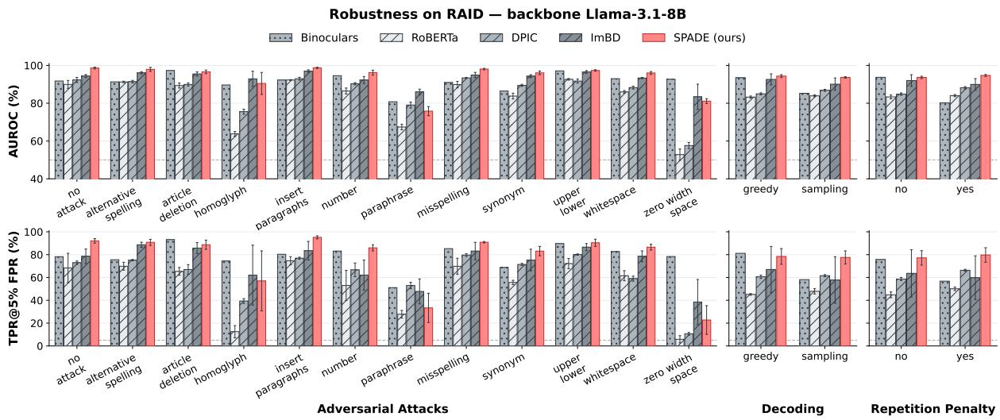  
Figure 10: AUC and TPR of 5 baselines on RAID benchmark against SPADE grouped by adversarial attacks, decoding strategy, and with repetition penalty or not.

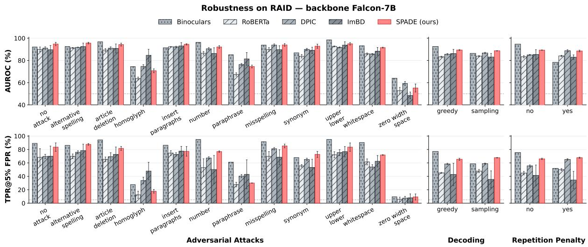  
Figure 11: AUC and TPR of 5 baselines on RAID benchmark against SPADE grouped by adversarial attacks, decoding strategy, and with repetition penalty or not.

<table><tr><td rowspan="2">Attack ↓ Method →</td><td colspan="3">Likelihood</td><td colspan="3">Entropy</td><td colspan="3">DNA-GPT</td><td colspan="3">Fast-DetectGPT</td><td colspan="3">Binoculars</td><td colspan="4">SPADE</td></tr><tr><td>AUC</td><td>TPR</td><td>F1</td><td>AUC</td><td>TPR</td><td>F1</td><td>AUC</td><td>TPR</td><td>F1</td><td>AUC</td><td>TPR</td><td>F1</td><td>AUC</td><td>TPR</td><td>F1</td><td>AUC</td><td>TPR</td><td colspan="2">F1</td></tr><tr><td>No attack</td><td>87.6</td><td>62.4</td><td>70.2</td><td>85.7</td><td>49.5</td><td>68.2</td><td>79.4</td><td>39.6</td><td>65.7</td><td>64.0</td><td>30.7</td><td>55.4</td><td>70.8</td><td>48.5</td><td>62.4</td><td>98.6</td><td>94.1</td><td>94.1</td></tr><tr><td>Alt. spelling</td><td>84.7</td><td>47.9</td><td>67.6</td><td>82.3</td><td>44.7</td><td>64.7</td><td>74.7</td><td>30.9</td><td>62.9</td><td>68.5</td><td>36.2</td><td>56.7</td><td>73.0</td><td>41.5</td><td>61.4</td><td>99.0</td><td>93.6</td><td>94.1</td></tr><tr><td>Article deletion</td><td>87.7</td><td>57.3</td><td>75.6</td><td>82.7</td><td>37.9</td><td>71.2</td><td>80.9</td><td>33.0</td><td>68.7</td><td>80.3</td><td>50.5</td><td>67.1</td><td>84.5</td><td>59.2</td><td>74.7</td><td>97.4</td><td>90.6</td><td>91.9</td></tr><tr><td>Homoglyph</td><td>79.3</td><td>42.6</td><td>52.1</td><td>77.6</td><td>31.9</td><td>52.1</td><td>77.0</td><td>41.5</td><td>53.3</td><td>63.5</td><td>24.0</td><td>51.5</td><td>74.3</td><td>42.6</td><td>57.1</td><td>97.6</td><td>89.3</td><td>89.5</td></tr><tr><td>Insert paragraphs</td><td>86.7</td><td>57.3</td><td>69.6</td><td>85.2</td><td>50.4</td><td>68.9</td><td>79.9</td><td>42.7</td><td>68.1</td><td>68.0</td><td>30.8</td><td>58.3</td><td>72.7</td><td>42.7</td><td>62.7</td><td>99.2</td><td>97.2</td><td>95.1</td></tr><tr><td>Number</td><td>91.7</td><td>71.6</td><td>71.5</td><td>89.1</td><td>58.9</td><td>68.8</td><td>85.4</td><td>51.6</td><td>70.4</td><td>71.7</td><td>42.1</td><td>59.2</td><td>74.9</td><td>53.7</td><td>65.3</td><td>97.4</td><td>89.3</td><td>90.0</td></tr><tr><td>Paraphrase</td><td>67.9</td><td>24.4</td><td>52.3</td><td>61.5</td><td>18.9</td><td>46.4</td><td>63.7</td><td>23.3</td><td>49.4</td><td>65.3</td><td>15.7</td><td>51.5</td><td>75.9</td><td>32.2</td><td>54.2</td><td>82.2</td><td>40.6</td><td>55.3</td></tr><tr><td>Misspelling</td><td>88.5</td><td>61.1</td><td>67.2</td><td>87.4</td><td>53.7</td><td>65.9</td><td>79.1</td><td>40.0</td><td>62.2</td><td>63.1</td><td>32.6</td><td>51.2</td><td>67.9</td><td>44.2</td><td>58.0</td><td>99.3</td><td>94.7</td><td>94.2</td></tr><tr><td>Synonym</td><td>77.0</td><td>34.8</td><td>55.3</td><td>72.0</td><td>19.6</td><td>55.9</td><td>65.4</td><td>16.1</td><td>36.4</td><td>69.7</td><td>22.3</td><td>36.1</td><td>68.6</td><td>29.5</td><td>35.5</td><td>94.8</td><td>83.6</td><td>86.2</td></tr><tr><td>Upper/lower</td><td>86.9</td><td>44.3</td><td>73.8</td><td>80.3</td><td>40.2</td><td>65.1</td><td>81.3</td><td>33.0</td><td>69.7</td><td>72.0</td><td>37.1</td><td>59.6</td><td>77.0</td><td>49.5</td><td>67.1</td><td>98.2</td><td>92.4</td><td>92.3</td></tr><tr><td>Whitespace</td><td>84.9</td><td>54.8</td><td>72.4</td><td>81.0</td><td>42.3</td><td>68.0</td><td>76.4</td><td>38.5</td><td>65.6</td><td>69.4</td><td>37.5</td><td>58.6</td><td>73.6</td><td>47.1</td><td>64.5</td><td>97.3</td><td>89.9</td><td>90.9</td></tr><tr><td>Zero-width space</td><td>85.9</td><td>49.5</td><td>51.2</td><td>78.6</td><td>18.6</td><td>51.2</td><td>83.0</td><td>23.7</td><td>51.2</td><td>80.3</td><td>41.2</td><td>65.1</td><td>85.2</td><td>47.4</td><td>64.0</td><td>89.7</td><td>66.6</td><td>60.5</td></tr><tr><td>Mean</td><td>83.7</td><td>49.6</td><td>64.4</td><td>79.8</td><td>37.9</td><td>61.7</td><td>77.0</td><td>34.0</td><td>59.8</td><td>70.2</td><td>33.6</td><td>55.9</td><td>75.2</td><td>44.5</td><td>60.4</td><td>95.6</td><td>84.4</td><td>85.5</td></tr><tr><td rowspan="2">Attack ↓ Method →</td><td colspan="3">NTS</td><td colspan="3">RoBERTa</td><td colspan="3">RAIDAR</td><td colspan="3">DPIC</td><td colspan="3">ImBD</td><td colspan="4"></td></tr><tr><td>AUC</td><td>TPR</td><td>F1</td><td>AUC</td><td>TPR</td><td>F1</td><td>AUC</td><td>TPR</td><td>F1</td><td>AUC</td><td>TPR</td><td>F1</td><td>AUC</td><td>TPR</td><td>F1</td><td>AUC</td><td>SPADE TPR</td><td colspan="2">F1</td></tr><tr><td>No attack</td><td>74.3</td><td>36.6</td><td>62.6</td><td>90.0</td><td>68.3</td><td>74.9</td><td>69.4</td><td>24.4</td><td>55.6</td><td>91.2</td><td>73.3</td><td>82.7</td><td>95.2</td><td></td><td>87.9</td><td>98.6</td><td></td><td>94.1</td></tr><tr><td>Alt. spelling</td><td>72.8</td><td>28.7</td><td>59.4</td><td>91.3</td><td>69.9</td><td>76.5</td><td>79.0</td><td>28.0</td><td>59.2</td><td>91.3</td><td>73.4</td><td>83.3</td><td>95.9</td><td>84.5 85.5</td><td>89.7</td><td>99.0</td><td>94.1 93.6</td><td>94.1</td></tr><tr><td>Article deletion</td><td>69.1</td><td>22.3</td><td>56.9</td><td>89.4</td><td>65.4</td><td>70.7</td><td>74.0</td><td>29.8</td><td>49.8</td><td>91.7</td><td>71.2</td><td>80.6</td><td>95.5</td><td>81.6</td><td>88.0</td><td>97.4</td><td>90.6</td><td>91.9</td></tr><tr><td>Homoglyph</td><td>73.4</td><td>43.6</td><td>53.6</td><td>63.8</td><td>12.5</td><td>44.5</td><td>40.7</td><td>6.38</td><td>4.61</td><td>75.9</td><td>39.4</td><td>56.2</td><td>94.1</td><td>68.1</td><td>59.4</td><td>97.6</td><td>89.3</td><td>89.5</td></tr><tr><td>Insert paragraphs</td><td>73.3</td><td>23.1</td><td>63.6</td><td>92.3</td><td>74.6</td><td>72.6</td><td>79.3</td><td>29.3</td><td>66.1</td><td>93.9</td><td>76.1</td><td>82.0</td><td>97.4</td><td>89.2</td><td>90.3</td><td>99.2</td><td>97.2</td><td>95.1</td></tr><tr><td>Number</td><td>76.0 67.4</td><td>38.9 22.2</td><td>63.9 53.8</td><td>86.5</td><td>53.0</td><td>68.7</td><td>68.1</td><td>20.0</td><td>48.9</td><td>91.6</td><td>67.4</td><td>80.9</td><td>91.9</td><td>51.9</td><td>80.5</td><td>97.4</td><td>89.3</td><td>90.0</td></tr><tr><td>No attack</td><td>82.9</td><td>43.6</td><td>64.9</td><td>78.7</td><td>29.7</td><td>0.00</td><td>73.9</td><td>11.9</td><td>62.2</td><td>88.9</td><td>71.3</td><td>71.2</td><td>91.8</td><td>78.2</td><td>77.8</td><td>98.6</td><td>92.1</td><td>92.3</td></tr><tr><td>Alt. spelling</td><td>80.1</td><td>29.8</td><td>61.8</td><td>75.8</td><td>20.2</td><td>0.00</td><td>72.0</td><td>20.2</td><td>59.8</td><td>90.4</td><td>71.5</td><td>76.0</td><td>91.3</td><td>75.5</td><td>80.5</td><td>97.9</td><td>90.8</td><td>91.9</td></tr><tr><td>Article deletion</td><td>84.0</td><td>41.7</td><td>68.7</td><td>74.8</td><td>26.2</td><td>0.00</td><td>80.1</td><td>28.2</td><td>66.5</td><td>96.3</td><td>91.3</td><td>85.0</td><td>97.3</td><td>93.2</td><td>91.5</td><td>96.6</td><td>88.7</td><td>86.9</td></tr><tr><td>Homoglyph</td><td>78.4</td><td>51.1</td><td>52.2</td><td>75.3</td><td>36.2</td><td>0.00</td><td>79.5</td><td>37.2</td><td>53.3</td><td>83.3</td><td>55.3</td><td>55.4</td><td>89.7</td><td>74.5</td><td>64.2</td><td>90.4</td><td>57.0</td><td>72.5</td></tr><tr><td>Insert paragraphs</td><td>83.3</td><td>53.0</td><td>66.0</td><td>80.4</td><td>38.5</td><td>0.00</td><td>76.2</td><td>53.8</td><td>60.1</td><td>90.4</td><td>76.9</td><td>75.8</td><td>92.3</td><td>80.3</td><td>83.3</td><td>98.7</td><td>95.2</td><td>94.4</td></tr><tr><td>Number</td><td>88.5</td><td>61.1</td><td>63.9</td><td>84.1</td><td>47.4</td><td>0.00</td><td>80.7</td><td>17.9</td><td>62.9</td><td>92.4</td><td>73.3</td><td>76.1</td><td>94.6</td><td>83.2</td><td>84.8</td><td>96.2</td><td>86.0</td><td>86.2</td></tr><tr><td>Paraphrase</td><td>65.2</td><td>25.6</td><td>49.5</td><td>57.6</td><td>12.2</td><td>0.00</td><td>58.1</td><td>12.2</td><td>47.4</td><td>73.4</td><td>25.8</td><td>51.5</td><td>80.8</td><td>51.1</td><td>54.1</td><td>75.8</td><td>33.3</td><td>54.7</td></tr><tr><td>Misspelling</td><td>85.8</td><td>48.4</td><td>61.2</td><td>82.0</td><td>41.1</td><td>0.00</td><td>77.3</td><td>24.2</td><td>58.4</td><td>90.1</td><td>81.2</td><td>71.8</td><td>91.0</td><td>85.3</td><td>79.1</td><td>98.1</td><td>90.9</td><td>91.7</td></tr><tr><td>Synonym</td><td>74.2</td><td>22.3</td><td>58.3</td><td>65.7</td><td>14.3</td><td>0.00</td><td>68.6</td><td>20.5</td><td>47.7</td><td>86.5</td><td>61.6</td><td>70.4</td><td>86.4</td><td>68.8</td><td>71.7</td><td>96.1</td><td>83.1</td><td>88.0</td></tr><tr><td>Upper/lower</td><td>83.8</td><td>33.0</td><td>66.8</td><td>74.6</td><td>22.7</td><td>0.00</td><td>79.5</td><td>25.8</td><td>65.9</td><td>96.3</td><td>86.6</td><td>85.5</td><td>97.1</td><td>89.7</td><td>89.9</td><td>97.3</td><td>90.4</td><td>90.2</td></tr><tr><td>Whitespace</td><td>80.4</td><td>37.5</td><td>66.7</td><td>76.2</td><td>30.8</td><td>0.00</td><td>73.2</td><td>22.1</td><td>61.3</td><td>92.0</td><td>78.8</td><td>80.7</td><td>93.0</td><td>82.7</td><td>85.7</td><td>96.0</td><td>86.5</td><td>89.0</td></tr><tr><td>Zero-width space</td><td>82.6</td><td>41.2</td><td>51.2</td><td>75.0</td><td>13.4</td><td>0.00</td><td>81.5</td><td>39.2</td><td>51.2</td><td>92.9</td><td>82.7</td><td>55.0</td><td>92.7</td><td>78.4</td><td>57.3</td><td>81.1</td><td>22.7</td><td>55.5</td></tr><tr><td>Mean</td><td>80.6</td><td>40.4</td><td>60.6</td><td>74.7</td><td>27.5</td><td>0.00</td><td>75.1</td><td>27.4</td><td>57.7</td><td>89.5</td><td>71.4</td><td>71.2</td><td>91.5</td><td>78.4</td><td>76.6</td><td>93.1</td><td>75.0</td><td>81.9</td></tr><tr><td rowspan="2">Attack ↓ Method →</td><td rowspan="2"></td><td colspan="3">NTS</td><td colspan="3">RoBERTa</td><td colspan="3">RAIDAR</td><td colspan="3">DPIC</td><td colspan="3">ImBD</td><td colspan="3">SPADE</td></tr><tr><td>AUC</td><td>TPR</td><td>F1</td><td>AUC TPR</td><td>F1</td><td>AUC</td><td>TPR</td><td>F1</td><td>AUC</td><td>TPR</td><td>F1</td><td>AUC</td><td></td><td></td><td></td><td></td><td></td><td>F1</td></tr><tr><td>No attack</td><td>80.8</td><td>55.4</td><td>69.8</td><td>90.0</td><td>68.3</td><td>74.9</td><td>79.1</td><td>35.3</td><td>68.9</td><td>92.3</td><td>72.9</td><td>83.0</td><td>94.4</td><td>TPR 78.5</td><td>F1 87.9</td><td>AUC 98.6</td><td>TPR 92.1</td><td>92.3</td></tr><tr><td>Alt. spelling</td><td>82.7</td><td>46.8</td><td>71.1</td><td>91.3</td><td>69.9</td><td>76.5</td><td>80.8</td><td>31.2</td><td>67.7</td><td>91.4</td><td>75.2</td><td>81.5</td><td>96.1</td><td>88.7</td><td>89.3</td><td>97.9</td><td>90.8</td><td>91.9</td></tr><tr><td>Article deletion</td><td>86.4</td><td>59.2</td><td>77.7</td><td>89.4</td><td>65.4</td><td>70.7</td><td>82.6</td><td>51.1</td><td>71.3</td><td>89.9</td><td>67.0</td><td>79.9</td><td>95.5</td><td>85.8</td><td>86.5</td><td>96.6</td><td>88.7</td><td>86.9</td></tr><tr><td>Homoglyph</td><td>72.0</td><td>43.6</td><td>59.1</td><td>63.8</td><td>12.5</td><td>44.5</td><td>50.9</td><td>3.19</td><td>16.9</td><td>75.5</td><td>39.4</td><td>54.1</td><td>92.9</td><td>62.1</td><td>68.6</td><td>90.4</td><td>57.0</td><td>72.5</td></tr><tr><td>Insert paragraphs</td><td>80.7</td><td>41.9</td><td>70.1</td><td>92.3</td><td>74.6</td><td>72.6</td><td>83.3</td><td>45.0</td><td>72.4</td><td>93.0</td><td>76.9</td><td>81.4</td><td>97.0</td><td>83.5</td><td>87.3 79.8</td><td>98.7 96.2</td><td>95.2 86.0</td><td>94.4 86.2</td></tr><tr><td>Number Paraphrase</td><td>80.4 70.8</td><td>35.8 36.7</td><td>67.2 50.6</td><td>86.5 67.4</td><td>53.0 27.8</td><td>68.7 43.6</td><td>81.1 65.8</td><td>44.2 11.1</td><td>66.4 23.8</td><td>90.3 79.0</td><td>66.7 53.0</td><td>77.9 64.2</td><td>92.3 86.0</td><td>62.1 47.8</td></tr></table>

Table 18: AUC, TPR, and F1 on RAID per adversarial attack, with Qwen3-8B-Base as backbone. Each attack compares the instruct generators’ texts with the human texts carrying the same attack, pooled over the eight domains. Mean averages the eleven attacks, excluding No attack. F1 is computed at the Youden-J threshold fitted on each run’s MIRAGE validation split. When a criterion ranks human texts above AI texts on the validation split, no threshold exists and its F1 is 0. Bold indicates the best method per row and metric within each panel.

Table 19: AUC, TPR, and F1 on RAID per adversarial attack, with LLaMA-3.1-8B as backbone. Each attack compares the instruct generators’ texts with the human texts carrying the same attack, pooled over the eight domains. Mean averages the eleven attacks, excluding No attack. F1 is computed at the Youden-J threshold fitted on each run’s MIRAGE validation split. When a criterion ranks human texts above AI texts on the validation split, no threshold exists and its F1 is 0. Bold indicates the best method per row and metric within each panel.

<table><tr><td rowspan="2">Attack ↓ Method →</td><td colspan="3">Likelihood</td><td colspan="3">Entropy</td><td colspan="3">DNA-GPT</td><td colspan="3">Fast-DetectGPT</td><td colspan="3">Binoculars</td><td colspan="3">SPADE</td></tr><tr><td>AUC</td><td>TPR</td><td>F1</td><td>AUC</td><td>TPR</td><td>F1</td><td>AUC</td><td>TPR</td><td>F1</td><td>AUC</td><td>TPR</td><td>F1</td><td>AUC</td><td>TPR</td><td>F1</td><td>AUC</td><td>TPR</td><td>F1</td></tr><tr><td>No attack</td><td>81.4</td><td>29.7</td><td>0.00</td><td>69.3</td><td>16.8</td><td>0.00</td><td>83.2</td><td>53.5</td><td>65.2</td><td>91.8</td><td>88.1</td><td>77.2</td><td>92.0</td><td>89.1</td><td>83.4</td><td>94.8</td><td>83.5</td><td>87.1</td></tr><tr><td>Alt. spelling</td><td>79.4</td><td>21.3</td><td>0.00</td><td>63.0</td><td>12.8</td><td>0.00</td><td>81.5</td><td>48.9</td><td>64.4</td><td>91.8</td><td>86.2</td><td>79.9</td><td>92.4</td><td>86.2</td><td>84.7</td><td>95.6</td><td>87.6</td><td>89.4</td></tr><tr><td>Article deletion</td><td>84.4</td><td>50.5</td><td>0.00</td><td>63.9</td><td>7.77</td><td>0.00</td><td>89.7</td><td>62.1</td><td>70.8</td><td>96.5</td><td>92.2</td><td>90.0</td><td>96.8</td><td>94.2</td><td>95.0</td><td>94.2</td><td>81.6</td><td>86.8</td></tr><tr><td>Homoglyph</td><td>77.9</td><td>39.4</td><td>0.00</td><td>67.0</td><td>12.8</td><td>0.00</td><td>77.2</td><td>42.6</td><td>53.5</td><td>67.8</td><td>23.4</td><td>52.8</td><td>74.4</td><td>27.7</td><td>59.8</td><td>70.7</td><td>17.7</td><td>28.3</td></tr><tr><td>Insert paragraphs</td><td>82.8</td><td>47.0</td><td>0.00</td><td>70.6</td><td>15.4</td><td>0.00</td><td>81.6</td><td>49.6</td><td>63.8</td><td>91.0</td><td>86.3</td><td>78.7</td><td>91.4</td><td>86.3</td><td>83.4</td><td>94.5</td><td>77.2</td><td>88.3</td></tr><tr><td>Number</td><td>90.5</td><td>64.2</td><td>0.00</td><td>76.9</td><td>17.9</td><td>0.00</td><td>89.6</td><td>64.2</td><td>66.5</td><td>94.8</td><td>85.3</td><td>81.0</td><td>96.2</td><td>94.7</td><td>87.0</td><td>92.1</td><td>76.8</td><td>82.5</td></tr><tr><td>Paraphrase</td><td>67.2</td><td>25.6</td><td>0.00</td><td>55.0</td><td>12.2</td><td>0.00</td><td>66.8</td><td>24.4</td><td>51.7</td><td>75.7</td><td>40.3</td><td>53.4</td><td>85.1</td><td>61.1</td><td>55.7</td><td>74.6</td><td>30.0</td><td>54.8</td></tr><tr><td>Misspelling</td><td>84.5</td><td>38.9</td><td>0.00</td><td>71.0</td><td>20.0</td><td>0.00</td><td>86.3</td><td>65.3</td><td>62.6</td><td>93.1</td><td>89.5</td><td>78.9</td><td>93.8</td><td>91.6</td><td>87.4</td><td>94.0</td><td>85.3</td><td>87.1</td></tr><tr><td>Synonym</td><td>76.4</td><td>30.4</td><td>0.00</td><td>58.2</td><td>9.82</td><td>0.00</td><td>80.6</td><td>43.8</td><td>66.1</td><td>86.7</td><td>64.3</td><td>71.8</td><td>86.8</td><td>67.9</td><td>76.3</td><td>92.8</td><td>72.6</td><td>83.1</td></tr><tr><td>Upper/lower</td><td>84.2</td><td>39.2</td><td>0.00</td><td>64.9</td><td>13.4</td><td>0.00</td><td>89.4</td><td>59.8</td><td>73.2</td><td>97.8</td><td>90.7</td><td>90.2</td><td>98.5</td><td>94.8</td><td>94.3</td><td>94.9</td><td>83.5</td><td>87.3</td></tr><tr><td>Whitespace</td><td>78.9</td><td>41.3</td><td>0.00</td><td>64.0</td><td>10.6</td><td>0.00</td><td>83.1</td><td>62.8</td><td>68.7</td><td>92.8</td><td>87.5</td><td>87.6</td><td>93.2</td><td>90.4</td><td>91.2</td><td>91.5</td><td>71.8</td><td>79.8</td></tr><tr><td>Zero-width space</td><td>62.6</td><td>13.4</td><td>0.00</td><td>52.6</td><td>7.22</td><td>0.00</td><td>57.8</td><td>8.25</td><td>51.2</td><td>59.8</td><td>9.28</td><td>51.2</td><td>64.0</td><td>9.54</td><td>51.2</td><td>55.2</td><td>9.28</td><td>22.1</td></tr><tr><td>Mean</td><td>79.0</td><td>37.4</td><td>0.00</td><td>64.3</td><td>12.7</td><td>0.00</td><td>80.3</td><td>48.3</td><td>63.0</td><td>86.2</td><td>68.6</td><td>74.1</td><td>88.4</td><td>73.1</td><td>78.7</td><td>86.4</td><td>63.0</td><td>71.8</td></tr><tr><td rowspan="2">Attack ↓ Method →</td><td colspan="3">NTS</td><td colspan="3">RoBERTa</td><td colspan="3">RAIDAR</td><td colspan="3">DPIC</td><td colspan="3">ImBD</td><td colspan="3">SPADE</td></tr><tr><td>AUC</td><td>TPR</td><td>F1</td><td>AUC</td><td>TPR</td><td>F1</td><td>AUC</td><td>TPR</td><td>F1</td><td>AUC</td><td>TPR</td><td>F1</td><td>AUC</td><td>TPR</td><td>F1</td><td>AUC</td><td>TPR</td><td>F1</td></tr><tr><td>No attack</td><td>93.2</td><td>86.1</td><td>80.9</td><td>90.0</td><td>68.3</td><td>74.9</td><td>53.9</td><td>15.5</td><td>38.8</td><td>91.1</td><td>69.6</td><td>82.1</td><td>89.6</td><td>70.0</td><td>80.1</td><td>94.8</td><td>83.5</td><td>87.1</td></tr><tr><td>Alt. spelling</td><td>94.1</td><td>80.9</td><td>85.0</td><td>91.3</td><td>69.9</td><td>76.5</td><td>57.0</td><td>16.3</td><td>40.6</td><td>91.7</td><td>75.9</td><td>82.2</td><td>92.4</td><td>78.4</td><td>81.0</td><td>95.6</td><td>87.6</td><td>89.4</td></tr><tr><td>Article deletion</td><td>96.8</td><td>91.3</td><td>89.2</td><td>89.4</td><td>65.4</td><td>70.7</td><td>54.1</td><td>9.06</td><td>41.6</td><td>91.0</td><td>69.3</td><td>80.5</td><td>90.7</td><td>72.5</td><td>79.1</td><td>94.2</td><td>81.6</td><td>86.8</td></tr><tr><td>Homoglyph</td><td>87.5</td><td>66.0</td><td>66.5</td><td>63.8</td><td>12.5</td><td>44.5</td><td>45.0</td><td>9.57</td><td>24.4</td><td>74.6</td><td>33.7</td><td>50.4</td><td>84.6</td><td>47.9</td><td>44.1</td><td>70.7</td><td>17.7</td><td>28.3</td></tr><tr><td>Insert paragraphs</td><td>94.3</td><td>81.2</td><td>83.7</td><td>92.3</td><td>74.6</td><td>72.6</td><td>64.6</td><td>21.7</td><td>50.9</td><td>92.2</td><td>72.6</td><td>79.9</td><td>93.1</td><td>77.5</td><td>79.4</td><td>94.5</td><td>77.2</td><td>88.3</td></tr><tr><td>Number Paraphrase</td><td>94.7 81.3</td><td>71.6 52.2</td><td>82.6 56.6</td><td>86.5 67.4</td><td>53.0 27.8</td><td>68.7 43.6</td><td>50.8 57.8</td><td>5.96 7.41</td><td>31.2 29.8</td><td>90.5 76.4</td><td>67.4 40.4</td><td>77.3 63.0</td><td>86.3 81.4</td><td>50.2 43.0</td><td>72.5 65.6</td><td>92.1 74.6</td><td>76.8 30.0</td><td>82.5 54.8</td></table>

Table 20: AUC, TPR, and F1 on RAID per adversarial attack, with Falcon-7B as backbone. Each attack compares the instruct generators’ texts with the human texts carrying the same attack, pooled over the eight domains. Mean averages the eleven attacks, excluding No attack. F1 is computed at the Youden-J threshold fitted on each run’s MIRAGE validation split. When a criterion ranks human texts above AI texts on the validation split, no threshold exists and its F1 is 0. Bold indicates the best method per row and metric within each panel.

<table><tr><td rowspan="2">Train ↓ Test →</td><td colspan="3">English</td><td colspan="3">Chinese</td><td colspan="3">Spanish</td><td colspan="3">Arabic</td></tr><tr><td>F1B</td><td>F1F</td><td>F1@0</td><td>F1B</td><td>F1F</td><td>F1@0</td><td>F1B</td><td>F1F</td><td>F1@0</td><td>F1B</td><td>F1F</td><td>F1@0</td></tr><tr><td>English</td><td>99.90</td><td>99.90</td><td>99.90</td><td>95.52</td><td>96.67</td><td>98.87</td><td>83.52</td><td>92.37</td><td>99.68</td><td>71.53</td><td>78.64</td><td>95.99</td></tr><tr><td>Chinese</td><td>98.76</td><td>98.76</td><td>99.60</td><td>99.96</td><td>99.96</td><td>99.97</td><td>97.17</td><td>97.17</td><td>97.94</td><td>93.59</td><td>93.59</td><td>97.62</td></tr><tr><td>Spanish</td><td>98.75</td><td>98.75</td><td>99.62</td><td>90.98</td><td>90.98</td><td>98.58</td><td>99.97</td><td>99.97</td><td>100.00</td><td>93.76</td><td>93.76</td><td>96.06</td></tr><tr><td>Arabic</td><td>99.26</td><td>89.31</td><td>99.32</td><td>99.82</td><td>98.36</td><td>99.82</td><td>98.44</td><td>97.64</td><td>98.49</td><td>99.91</td><td>99.77</td><td>99.90</td></tr><tr><td>French</td><td>99.60</td><td>99.60</td><td>99.61</td><td>99.91</td><td>99.91</td><td>99.92</td><td>98.07</td><td>98.07</td><td>98.07</td><td>97.89</td><td>97.89</td><td>98.34</td></tr><tr><td>Russian</td><td>99.24</td><td>52.59</td><td>99.39</td><td>99.96</td><td>99.27</td><td>99.96</td><td>97.35</td><td>96.63</td><td>97.38</td><td>99.77</td><td>99.17</td><td>99.78</td></tr><tr><td>Portuguese</td><td>99.52</td><td>97.26</td><td>99.55</td><td>99.85</td><td>96.50</td><td>99.87</td><td>98.85</td><td>98.31</td><td>98.82</td><td>97.94</td><td>99.14</td><td>98.60</td></tr><tr><td>German</td><td>99.51</td><td>96.35</td><td>99.52</td><td>99.69</td><td>97.96</td><td>99.91</td><td>98.55</td><td>97.76</td><td>98.52</td><td>99.67</td><td>98.92</td><td>99.72</td></tr><tr><td rowspan="2">Train ↓ Test →</td><td colspan="3">French</td><td colspan="3">Russian</td><td colspan="3">Portuguese</td><td colspan="3">German</td></tr><tr><td>F1B</td><td>F1F</td><td>F1@0</td><td>F1B</td><td>F1F</td><td>F1@0</td><td>F1B</td><td>F1F</td><td>F1@0</td><td>F1B</td><td>F1F</td><td>F1@0</td></tr><tr><td>English</td><td>89.99</td><td>93.67</td><td>99.41</td><td>80.43</td><td>83.62</td><td>94.77</td><td>88.85</td><td>93.59</td><td>99.58</td><td>64.45</td><td>72.90</td><td>93.91</td></tr><tr><td>Chinese</td><td>94.96</td><td>94.96</td><td>99.06</td><td>89.51</td><td>89.51</td><td>96.18</td><td>97.92</td><td>97.92</td><td>99.72</td><td>81.89</td><td>81.89</td><td>93.88</td></tr><tr><td>Spanish</td><td>99.58</td><td>99.58</td><td>99.76</td><td>91.89</td><td>91.89</td><td>96.26</td><td>99.85</td><td>99.85</td><td>99.94</td><td>98.12</td><td>98.12</td><td>99.04</td></tr><tr><td>Arabic</td><td>99.45</td><td>96.86</td><td>99.44</td><td>99.25</td><td>96.31</td><td>99.01</td><td>99.87</td><td>98.95</td><td>99.88</td><td>97.96</td><td>97.10</td><td>97.71</td></tr><tr><td>French</td><td>99.96</td><td>99.96</td><td>99.97</td><td>98.28</td><td>98.28</td><td>98.62</td><td>99.97</td><td>99.97</td><td>99.97</td><td>97.94</td><td>97.94</td><td>98.74</td></tr><tr><td>Russian</td><td>99.62</td><td>99.02</td><td>99.66</td><td>99.87</td><td>99.73</td><td>99.85</td><td>99.91</td><td>99.67</td><td>99.92</td><td>99.79</td><td>98.92</td><td>99.75</td></tr><tr><td>Portuguese</td><td>99.77</td><td>99.83</td><td>99.84</td><td>95.68</td><td>98.38</td><td>97.01</td><td>99.94</td><td>99.92</td><td>99.94</td><td>94.16</td><td>98.12</td><td>96.23</td></tr><tr><td>German</td><td>99.78</td><td>99.42</td><td>99.78</td><td>99.42</td><td>98.98</td><td>99.46</td><td>99.82</td><td>99.39</td><td>99.82</td><td>99.94</td><td>99.75</td><td>99.95</td></tr></table>

Table 21: SPADE on DetectRL-X (Wu et al., 2026) under its cross-language protocol. SPADE is trained and tuned on a single language train split, and tested on the others. F1B: macro-F1 at the Youden-J threshold fitted on the training split; F1F: macro-F1 at the threshold with FPR = 1% on the training split; F1@0: macro-F1 at the fixed threshold τ = 0.

<table><tr><td>Backbone</td><td>per epoch</td><td>total (3 epochs)</td><td>peak VRAM</td></tr><tr><td>Qwen3-8B-Base</td><td>2.1 h</td><td>6.2 h</td><td>33.6 GB</td></tr><tr><td>LLaMA-3.1-8B</td><td>1.7 h</td><td>5.2 h</td><td>30.7 GB</td></tr><tr><td>Falcon-7B</td><td>1.4 h</td><td>4.2 h</td><td>24.0 GB</td></tr></table>

Table 22: Training time and peak GPU memory of SPADE on MIRAGE-DIG (single H100 NVL, bfloat16, FlashAttention-2, gradient checkpointing).