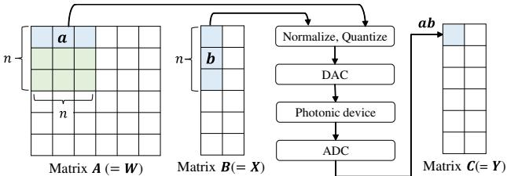
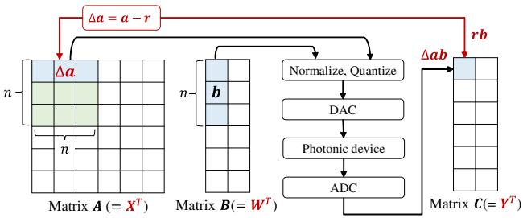
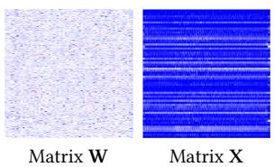
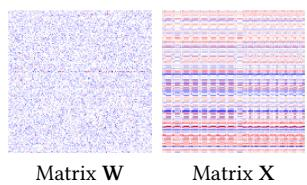
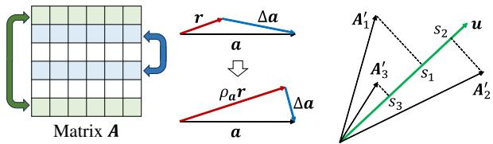
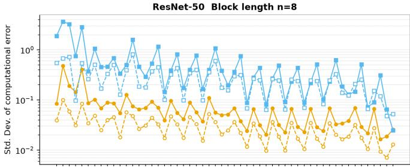
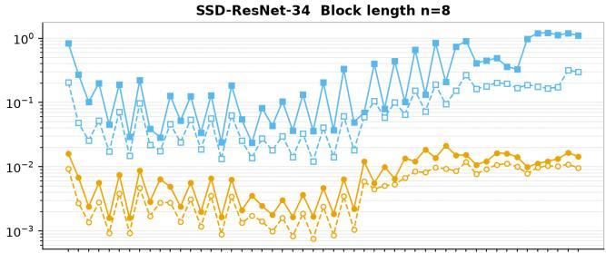
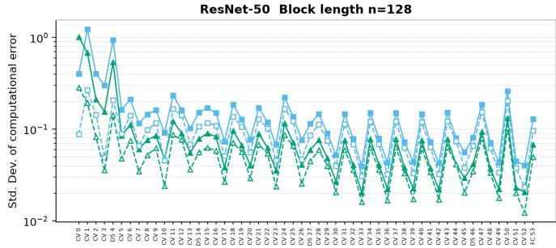
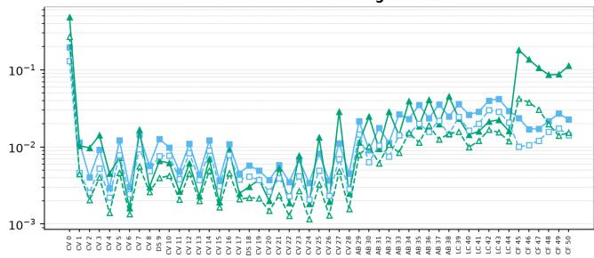

# SPARC: Accurate Photonic Matrix Multiplication via Representative Vectors

Yasuhiro Fujiwara   
NTT, Inc.   
Japan   
yasuhiro.fujiwara@ntt.com   
Tatsuhiro Nakamori   
Keio University   
Japan   
tatsuhironm@keio.jp   
Hideyuki Kawashima   
Keio University   
Japan   
river@sfc.keio.ac.jp

## ABSTRACT

Photonic neural network accelerators have emerged as a promis- ing solution for reducing the power consumption of deep neural network (DNN) inference by executing matrix multiplication on analog photonic hardware. However, their inference accuracy is limited by low-bit quantization required for photonic processing and by analog photonic noise. This paper proposes an approach for improving inference accuracy by exploiting the high similarity among activation vectors in DNNs. Specifically, our approach constructs a representative vector for each group of similar activation vectors, computes its inner product digitally with high precision, and ofloads the residual inner products to the photonic acceler- ator. Since the activation vectors within each group are highly similar, the residual vectors have much smaller norms, thereby re- ducing the efects of quantization errors and analog photonic noise. Furthermore, our approach preserves the photonic inner-product computation pipeline, allowing seamless integration into existing and future photonic accelerators without hardware modification. Experimental results on six representative DNN models demonstrate that the proposed approach can improve inference accuracy across diverse network architectures and application domains.

## 1 INTRODUCTION

Deep neural networks (DNNs) have become a cornerstone of modern AI, achieving remarkable success in applications such as com-puter vision, natural language processing, and data mining [28]. The rapid growth of AI services has substantially increased power consumption, particularly in data centers, where DNN inference accounts for a significant fraction of electricity consumption [11]. Moreover, the growing scale of modern neural networks has sig- nificantly increased the computational cost of DNN inference [32]. DNN inference is dominated by matrix multiplication [28]. Let A, B, and C denote matrices of size � �, � �, and � �, respectively. The matrix multiplication is given by AB = C. Developing energy-eficient matrix multiplication approaches has therefore become a key research direction [6, 20].

Recently, Lightmatter introduced a universal photonic accelerator in Nature, advancing photonic neural network accelerators from laboratory-scale prototypes toward practical deployment for large-scale DNN inference [2]. Rather than performing matrix multiplication entirely on power-hungry digital hardware, the accel-erator ofloads the computation to a low-power photonic analog device, thereby significantly reducing energy consumption [27]. Let W and X denote the weight matrix and activation matrix of a DNN, respectively. As illustrated in Figure 1-1, the accelerator computes WX = Y by mapping W, X, and Y to A, B, and C, respectively. The matrix product AB is decomposed into vector inner products.

  
(1) Original photonic matrix-multiplication approach

  
(2) Proposed photonic matrix-multiplication approach  
Figure 1: Block-wise matrix multiplication.

Specifically, matrix A is partitioned into � × � block matrices, and matrix B is partitioned into corresponding block column vectors of length �. Each output element is computed as the inner product of a row vector a from a block of A and the corresponding column vector b from B. Before photonic computation, the vectors are normalized and quantized using Adaptive Block Floating-Point (ABFP) [2, 4], converted into analog signals by Digital-to-Analog Converter (DAC), processed on photonic analog hardware, and finally digitized by Analog-to-Digital Converter (ADC). By ofloading the computationally intensive inner-product operations to photonic hardware, the accelerator achieves substantially higher energy eficiency than conventional digital accelerators.

However, photonic computation inevitably sufers from numerical errors. Before photonic computation, floating-point values (e.g., 32 bits) must be quantized into low-bit representations (e.g., 6 bits) for DAC, introducing quantization errors, and the limited precision of ADC (e.g., 8 bits) further degrades inference accuracy [4]. More importantly, analog photonic computation is inherently afected by analog photonic noise [2]. Consequently, improving the accuracy of photonic matrix multiplication has become a major challenge.

To address this problem, we exploit the high similarity among activation vectors arising from anisotropy in DNNs, where learned embeddings are concentrated in a small region of the representation space rather than being uniformly distributed [13–15]. As shown in

  
(1) ResNet50

  
(2) BERT-Large  
Figure 2: Heatmaps of the weight and activation matrices. While the weight matrices exhibit irregular patterns, the activation matrices exhibit stripe patterns. After reformulating matrix multiplication as $\mathbf { X } ^ { \top } \mathbf { W } ^ { \top }$ , this anisotropic structure is reflected in the row vectors of the transposed activation matrix, motivating the proposed approach.

Figure 2, activation matrices exhibit clear stripe patterns, whereas weight matrices show no apparent patterns. Based on this observation, we propose SPARC (Similarity-aware Photonic Analog Residual Computation). Our key idea is to reformulate matrix multiplication so that this structural similarity can be directly exploited, thereby reducing the impact of quantization errors and analog photonic noise.

Instead of directly computing $\mathbf { W X } = \mathbf { Y } ,$ our approach computes the equivalent matrix multiplication $\mathbf { X } ^ { \top } \mathbf { W } ^ { \top } = \mathbf { Y } ^ { \top }$ , as illustrated in Figure 1-2. This reformulation treats activation vectors as row vectors, allowing each block matrix to consist of highly similar vectors due to the anisotropy. This observation suggests that the row vectors in each block can be well approximated by a single vector. To this end, we introduce a representative vector r, defined as the mean of the row vectors in each block. Because the row vectors are highly similar, their mean accurately represents every row vector in the block. Let the residual vector be $\Delta \mathbf { a } = \mathbf { a } - \mathbf { r }$ . Then, the inner product can be decomposed as $\mathbf { a b } = \mathbf { r b } + \Delta \mathbf { a b }$ , where rb captures the dominant component of the inner product. Since the representative vector is common within a block, the dominant component rb is computed only once using a high-precision digital processor, while only the residual component Δab is obtained on the photonic accelerator. Since the residual vectors have much smaller norms than the corresponding original vectors, the impact of DAC/ADC quantization errors and analog photonic noise is substantially reduced. Consequently, the proposed approach improves the accuracy of photonic matrix multiplication while preserving its energy eficiency.

The conventional approach to improving the accuracy of photonic computation is to employ higher-precision DAC/ADC [9]. However, increasing the precision of DAC/ADC substantially increases power consumption [8, 10]. In contrast, the proposed ap- proach improves inference accuracy without increasing the precision requirements of DAC/ADC, thereby avoiding additional power consumption. Furthermore, the proposed approach is fully compatible with existing photonic accelerators. As shown in Figure 1-2, in our approach, the photonic device receives the residual vector Δa instead of a, while the representative inner product rb is computed separately on a high-precision digital processor. Since the proposed approach preserves the original photonic inner-product computation pipeline and requires only lightweight preprocessing and post-processing, it can be integrated into existing photonic accelerators without modifying the underlying photonic hardware. Moreover, since the underlying photonic computation remains unchanged, the proposed approach is also applicable to future photonic accel- erators. Our main contributions of this paper are summarized as follows:

• We propose a novel approach for photonic neural network accelerators that exploits anisotropy in activation vectors. By decomposing each inner product into a representative inner product and a residual inner product, our approach can reduce the impact of DAC/ADC quantization errors and analog photonic noise.

• We introduce a new computation paradigm that preserves the existing photonic computation pipeline. It requires neither hardware modifications nor higher-precision DAC/ADC, making it readily applicable to existing and future photonic accelerators.

• We conduct experiments on a diverse set of DNN models and demonstrate that our approach can improve inference accuracy under photonic-computing constraints, validating its efectiveness across diferent network architectures and application domains.

## 2 RELATED WORK

Photonic Neural Network Accelerators. For energy-eficient DNN inference, photonic neural network accelerators, which perform matrix multiplication in the optical domain, have attracted considerable attention [20]. Early studies demonstrated the feasibility of optical matrix multiplication. However, their implementations remained limited to laboratory-scale prototypes [10, 18, 24, 27]. Re-cently, Lightmatter introduced a universal photonic accelerator that combines photonic analog computation with adaptive quantization, bringing photonic neural network accelerators closer to practical deployment for large-scale DNN inference [2]. Despite these ad vances, photonic accelerators still sufer from accuracy degradation caused by low-bit quantization errors and analog photonic noise [29].

Accuracy Enhancement. Existing approaches can be broadly cate-gorized into hardware-based and algorithm-based methods. Hardware based methods improve inference accuracy by employing higher-precision DAC/ADC or hardware calibration techniques [10, 12, 33]. Although efective, they increase hardware complexity and power consumption, thereby diminishing the energy-eficiency benefits of photonic computing. Algorithm-based methods improve inference accuracy through efective low-precision computation. ABFP reduces quantization errors by adaptively selecting a shared exponent for each block vector [2, 4]. Calibration-based quantization determines quantization parameters by minimizing the mean squared error between quantized and floating-point outputs [26, 31], but typ- ically achieves lower inference accuracy than ABFP [23]. Residue number system-based quantization exploits parallel low-bit residue arithmetic [5, 10], but requires additional residue arithmetic and conversion operations, thereby increasing hardware complexity [10]. Unlike existing quantization methods, our approach improves inference accuracy by reformulating the matrix multiplication it-self, rather than modifying the quantization procedure. Therefore, the proposed approach is complementary to existing quantization methods and can be seamlessly integrated with them.

Anisotropy. Recent studies have shown that DNN representations are anisotropic, where embedding vectors are concentrated in a small region of the representation space rather than being uniformly distributed [13–15]. These studies primarily exploit anisotropy for representation analysis and embedding enhancement, whereas we leverage it to improve inference accuracy of photonic neural net-work accelerators. Specifically, we construct a representative vector for each block of similar activation vectors, thereby reducing the impact of quantization errors and analog photonic noise without modifying the underlying hardware.

## 3 PRELIMINARIES

Given a weight matrix W and an activation matrix X, DNN inference computes the matrix product $\mathbf { W X } = \mathbf { Y } .$ To improve computational eficiency, the universal photonic accelerator maps W, X, and Y to matrices A, B, and C, respectively, and decomposes the matrix multiplication into vector inner products [2]. As illustrated in Figure 1-1, matrix A is partitioned into � � block matrices, while matrix B is partitioned into corresponding block column vectors of length �. Let a be a row vector from a block of A, and let b be the corresponding block column vector. The photonic device computes their inner product, ab = �.

Before DAC conversion, the vectors are normalized and quantized using ABFP [4]. The normalized vector aˆ corresponding to a is given by

$$
\hat { \mathbf { a } } = \mathbf { a } / s ^ { \mathbf { a } } ,\tag{1}
$$

where $s ^ { \mathbf { a } } = \operatorname* { m a x } _ { 1 \leq i \leq n } ( | a [ i ] | )$ is the scalin factor stored in bfloat16 format [1]. Each element of aˆ lies in $[ - 1 , 1 ]$ . Similarly, vector b is normalized as $\hat { { \bf b } } = { \bf b } / s ^ { { \bf b } }$ where $s ^ { \mathbf { b } }$ is the scaling factor for b.

The normalized vectors are then uniformly quantized. The quan- tized vector of aˆ, denoted by $\mathbf { a } ^ { q } ,$ , is computed using the quantization function � (·):

$$
\begin{array} { r } { \mathbf { a } ^ { q } = Q ( \widehat { \mathbf { a } } , \delta _ { \mathbf { A } } , \tau _ { \mathbf { A } } ) = \mathrm { c l a m p } ( \lfloor \frac { \widehat { \mathbf { a } } } { \delta _ { \mathbf { A } } } \rceil \delta _ { \mathbf { A } } , \tau _ { \mathbf { A } } ) , } \end{array}\tag{2}
$$

where clamp(·) constrains each element to the range $[ - \tau _ { \mathrm { A } } , \tau _ { \mathrm { A } } ]$ and is defined as

$$
\mathrm { c l a m p } ( \hat { \mathbf { a } } , \tau _ { \mathbf { A } } ) = \mathrm { m a x } ( \mathrm { m i n } ( \hat { \mathbf { a } } , \tau _ { \mathbf { A } } ) , - \tau _ { \mathbf { A } } ) .\tag{3}
$$

Since aˆ lies in $[ - 1 , 1 ] , \tau _ { \mathrm { A } }$ is set to 1. In E uation $( 2 ) , \delta _ { \mathrm { { A } } }$ denotes the quantization step size, defined as $\delta _ { \mathrm { { A } } } = 1 / ( 2 ^ { b _ { \mathrm { { A } } - 1 } } - 1 )$ where $b _ { \mathbf { A } }$ denotes the quantization bit width. The operator $\lfloor \cdot \rceil$ denotes round-half-to- even rounding. Similarly, vector b is quantized as $\mathbf { b } ^ { q } = Q ( \hat { \mathbf { b } } , \delta _ { \mathbf { B } } , \tau _ { \mathbf { B } } )$ by setting $\tau _ { \mathrm { { B } } } = 1$ and $\delta _ { \mathbf { B } } = 1 / ( 2 ^ { b _ { \mathbf { B } } - 1 } - 1 )$ where $b _ { \mathbf { B } }$ is the quantization bit width.

The quantized vectors are converted into analog signals by the DAC, after which the photonic device computes

$$
c = s ^ { \mathbf { a } } s ^ { \mathbf { b } } Q ( \mathbf { a } ^ { q } \mathbf { b } ^ { q } , n \delta \mathbf { c } , \tau _ { \mathbf { C } } ) .\tag{4}
$$

In Equation (4), $\tau _ { \mathrm { { C } } } = n$ and $\delta _ { \mathbf { C } } = 1 / ( 2 ^ { b _ { \mathbf { C } } - 1 } - 1 )$ where �C denotes the ADC quantization bit width. The inner product a�b� is computed in the analog domain, whereas the scaling operation $s ^ { \mathbf { a } } s ^ { \mathbf { b } }$ is performed digitally after ADC conversion. Since $\mathbf { a } ^ { q }$ and b� are normalized, their inner product lies in [−�, �]. Therefore, �C and �C are scaled by �. The output is stored in bfloat16 format after ADC quantization.

Algorithm 1 Original Photonic Matrix Multiplication   
Input: weight matrix W, activation matrix X, block length �, bit width $b _ { \mathbf { A } }$   
bit width $^ { b _ { \mathrm { B } } , }$ , bit width $^ { b } \mathrm { C } ,$ and gain factor �   
Output: matrix Y   
1: $\mathbf { A } = \mathbf { W } , \mathbf { B } = \mathbf { X } , \mathbf { C } = \mathbf { 0 } ;$   
2: $\delta _ { \mathrm { { A } } } = 1 / ( 2 ^ { b _ { \mathrm { { A } } } - 1 } - 1 ) , \delta _ { \mathrm { { B } } } = 1 / ( 2 ^ { b _ { \mathrm { { B } } } - 1 } - 1 ) , \delta _ { \mathrm { { C } } } = 1 / ( 2 ^ { b _ { \mathrm { { C } } } - 1 } - 1 ) ;$   
3: partition A into � × � blocks;   
4: partition B into column blocks of length �;   
5: for each block do   
6: for each row vector a in the block matrix do   
7: compute $\mathbf { a } ^ { q } = \mathbf { A B F P } ( \mathbf { a } , n , \delta _ { \mathrm { A } } )$ using Algorithm 2;   
8: for each corresponding column vector b do   
9: compute $\mathbf { b } ^ { q } = \mathrm { A B F P } ( \mathbf { b } , n , \delta _ { \mathbf { B } } )$ using Algorithm 2;   
10: for each quantized vector a� in the block matrix do   
11: compute $c = s ^ { \mathbf { a } } s ^ { \mathbf { b } } Q ( G \mathbf { a } ^ { q } \mathbf { b } ^ { q } , n \delta _ { \mathrm { C } } , n ) / G ;$   
12: accumulate � into the corresponding element of $\mathrm { \nabla \cdot } _ { \mathbf { C } ; \mathbf { \xi } }$   
13: $\mathbf { Y } = \mathbf { C } ;$   
Algorithm 2 ABFP Quantization   
Input: vector a, block length �, and quantization step size $\delta _ { \mathrm { { A } } }$   
Output: quantized vector $\mathbf { a } ^ { q }$   
1: $s ^ { \mathbf { a } } = \operatorname* { m a x } _ { 1 \leq i \leq n } ( | a [ i ] | ) ;$   
2: $\hat { \mathbf { a } } = \mathbf { a } / s ^ { \mathbf { a } } ;$   
3: ${ \mathbf { a } } ^ { q } = Q ( \hat { \mathbf { a } } , \delta _ { \mathrm { { A } } } , 1 ) ;$

As the block length � increases, the dynamic range of the accu- mulated inner product also increases. With a fixed ADC precision, this wider dynamic range reduces the efective ADC resolution for small-magnitude values. To improve the efective ADC resolution without increasing the ADC precision, the photonic analog out-put is amplified by a gain factor $G \ge 1$ before analog-to-digital conversion:

$$
c = s ^ { \mathbf { a } } s ^ { \mathbf { b } } Q ( G \mathbf { a } ^ { q } \mathbf { b } ^ { q } , n \delta _ { \mathbf { C } } , \tau _ { \mathbf { C } } ) / G .\tag{5}
$$

Although amplification reduces the efective ADC resolution for large values and introduces extra power consumption [21], it im proves the resolution for small values.

However, photonic matrix multiplication sufers from quantization errors and analog photonic noise. The input vectors are quantized before DAC conversion, whereas the analog outputs are quantized by the ADC, introducing numerical errors at both stages. More importantly, the analog photonic computation itselfis afected by analog photonic noise caused by optical signal distortions and hardware imperfections [2]. Such noise cannot be completely eliminated because it inevitably arises within the analog computation itself. Let � denote additive analog photonic noise. The resulting inner product is computed as

$$
c = s ^ { \mathbf { a } } s ^ { \mathbf { b } } Q ( G \mathbf { a } ^ { q } \mathbf { b } ^ { q } + \varepsilon , n \delta _ { \mathrm { C } } , \tau _ { \mathrm { C } } ) / G ,\tag{6}
$$

where � is modeled as additive zero-mean Gaussian noise with variance $\sigma ^ { 2 } \ [ 4 , 2 5 ]$

Algorithm 1 outlines the original photonic matrix-multiplication procedure. To compute the matrix product $\mathbf { W X } = \mathbf { Y } ,$ it initializes A and B from W and X, respectively, and initializes C to the zero matrix (line 1). It then partitions A into � ×� blocks and B into column blocks of length � (lines 3–4). For each block, the row and column vectors are quantized using Algorithm 2 (lines 6–9). The photonic device computes the inner products of the quantized vectors and accumulates the resulting values into C to produce the output matrix (lines 10–12). The computational and memory costs of original photonic matrix-multiplication approach are summarized below.

(2) Scaling  
  
(1) Reordering  
Figure 3: Proposed approach.  
Figure 4: Vector projection.

Lemma 3.1. Let $\mathbf { A } \in \mathbb { R } ^ { N \times D }$ and B $\in \mathbb { R } ^ { D \times M }$ . The original photonic matrix-multiplication approach requires $O ( N D + M D + N M D / n )$ time and $O ( N D + M D + N M )$ space.

Proof. Quantizing matrices A and B requires �(��) and �(��) time, respectively. The photonic device computes all inner products, while the digital processor performs one scaling operation per inner product. Since the number of inner products is $N M D / n$ the total computational cost is $O ( N D + M D + N M D / n )$ . Memory consumption is dominated by storing A, B, and C with sizes $N D ,$ ��, and ��, respectively. The storage required for the scaling factors is negligible compared with that required for the matrices. Therefore, the memory complexity is $O ( N D + M D + N M )$ □

Compared with conventional digital matrix multiplication, which requires �(���) time and $O ( N D + M D + N M )$ space, the univer-sal photonic accelerator reduces the computational complexity to $O ( N D + M D + N M D / n )$ without increasing the memory complexity. This improvement, however, comes at the expense of inference accuracy due to DAC/ADC quantization errors and analog photonic noise. The next section presents our approach to mitigating these degradations.

## 4 PROPOSED APPROACH

The proposed approach improves the inference accuracy of photonic matrix multiplication by exploiting the anisotropic structure of activation vectors in DNNs. After reformulating the matrix multiplication as $\mathbf { X } ^ { \top } \mathbf { W } ^ { \top }$ , the activation vectors correspond to the row vectors of matrix $\mathbf { A } ,$ allowing each block to contain similar activa- tion vectors. For each block, we compute a representative vector $\begin{array} { r } { \mathbf { r } = \frac { 1 } { n } \sum _ { i = 1 } ^ { n } \mathbf { a } _ { i } } \end{array}$ , where ${ \bf a } _ { i }$ denotes the �-th row vector. Given a row vector a in the block, its residual vector is defined as $\Delta \mathbf { a } = \mathbf { a } - \mathbf { r } ,$ and thus the original inner product is rewritten as $\mathbf { a b } = \mathbf { r b } + \Delta \mathbf { a b }$ . The dominant component rb is computed on a high-precision digital processor, whereas the residual component Δab is computed on the photonic hardware. As shown in Figure 3, we further improve the inference accuracy using the following two methods:

• We reorder the row vectors of matrix A so that adjacent vectors become more similar, enabling each representative vector to efectively approximate its block.

• We scale the representative vector before computing the residual vector, thereby reducing the residual norm pro- cessed on the photonic device.

The following subsections describe these two methods.

## 4.1 Row Vector Reordering

Before reordering, we center the columns of matrix A. This step removes the common ofset shared across row vectors, improving the efectiveness of the subsequent reordering. Let the column-wise mean vector be

$$
\begin{array} { r } { \mathbf { m } = \frac { 1 } { N } \sum _ { i = 1 } ^ { N } \mathbf { A } _ { i } , } \end{array}\tag{7}
$$

where $\mathbf { A } _ { i }$ denotes the �-th row vector in matrix A. If ${ \bf A } _ { i } ^ { \prime }$ is the mean- centered row vector of $\mathbf { A } _ { i } ,$ , it is given as $\mathbf { A } _ { i } ^ { \prime } = \mathbf { A } _ { i } - \mathbf { m }$ . Since matrix A has size $N \times D$ , mean-centering all row vectors requires �(��) time. Let $\mathbf { B } _ { j }$ denote the �-th column vector of matrix B. $\mathrm { I f } \mu _ { j } = \mathbf { m B } _ { j }$ � , each inner product in $\mathbf { A } \mathbf { B } = \mathbf { C }$ is rewritten as

$$
\mathbf { A } _ { i } \mathbf { B } _ { j } = \mathbf { A } _ { i } ^ { \prime } \mathbf { B } _ { j } + \mathbf { m } \mathbf { B } _ { j } = \mathbf { A } _ { i } ^ { \prime } \mathbf { B } _ { j } + \mu _ { j } .\tag{8}
$$

Equation (8) decomposes each inner product into a mean-centered component and a shared ofset. Since $\mu _ { j }$ is shared by all row vectors, it is computed once for each column on the digital processor in �(��) time for the matrix multiplication, whereas the computationally intensive term $\mathbf { A } _ { i } ^ { \prime } \mathbf { B } _ { j }$ is obtained on the photonic device. We store $\mu _ { j }$ in bfloat16 format.

After mean-centering, we reorder the row vectors so that ad- jacent row vectors become more similar. In the reordering, we project each mean-centered row vector onto a unit vector u satisfy-ing $\| \mathbf { u } \| ^ { 2 } = 1$ and sort each vector according to its projection score $s _ { i } ,$ which is given as follows:

$$
s _ { i } = \mathbf { A } _ { i } ^ { \prime } \mathbf { u } ^ { \top } .\tag{9}
$$

As illustrated in Figure 4, the vectors are projected onto a single unit vector. If several row vectors have similar projection scores, the projection fails to preserve their relative diferences, resulting in an inefective ordering.

We therefore seek the unit vector that maximizes the variance of the projection scores. Let � (u) denote the variance of the projection scores produced by unit vector u. Since each row vector is mean-centered as $\mathbf { A } _ { i } ^ { \prime } = \mathbf { A } _ { i } - \mathbf { m }$ , we have the following equation:

$$
\begin{array} { r } { \sum _ { i = 1 } ^ { N } A _ { i } ^ { \prime } [ j ] = \sum _ { i = 1 } ^ { N } ( A _ { i } [ j ] - m [ i ] ) = 0 . } \end{array}\tag{10}
$$

Using this property, the variance of the projection scores becomes

$$
\begin{array} { r l } & { V ( \mathbf { u } ) = \frac { 1 } { N } \sum _ { i = 1 } ^ { N } ( \mathbf { A } _ { i } ^ { \prime } \mathbf { u } ^ { \top } ) ^ { 2 } - ( \frac { 1 } { N } \sum _ { i = 1 } ^ { N } \mathbf { A } _ { i } ^ { \prime } \mathbf { u } ^ { \top } ) ^ { 2 } } \\ & { \qquad = \frac { 1 } { N } \mathbf { u } \mathbf { A } ^ { \top } \mathbf { A } \mathbf { u } ^ { \top } - ( \frac { 1 } { N } \sum _ { i = 1 } ^ { N } \sum _ { j = 1 } ^ { D } A _ { i } ^ { \prime } [ j ] u [ j ] ) ^ { 2 } } \\ & { \qquad = \frac { 1 } { N } \mathbf { u } \mathbf { A } ^ { \top } \mathbf { A } \mathbf { u } ^ { \top } . } \end{array}\tag{11}
$$

To maximize the variance under the constraint $\| \mathbf { u } \| ^ { 2 } = 1$ , we consider the following Lagrangian:

$$
\begin{array} { r } { L ( \mathbf { u } , \boldsymbol { \lambda } ) = \frac { 1 } { N } \mathbf { u } \mathbf { A } ^ { \top } \mathbf { A } \mathbf { u } ^ { \top } - \boldsymbol { \lambda } ( \mathbf { u } \mathbf { u } ^ { \top } - 1 ) , } \end{array}\tag{12}
$$

where $\lambda$ denotes Lagrange multiplier. Diferentiating $L ( \mathbf { u } , \lambda )$ with respect to $\mathbf { u } ^ { \top }$ and setting the derivative to zero yields

$$
\begin{array} { r } { \frac { 1 } { N } \mathbf { A } ^ { \top } \mathbf { A } \mathbf { u } ^ { \top } = \lambda \mathbf { u } ^ { \top } . } \end{array}\tag{13}
$$

Equation (13) indicates that $\mathbf { u } ^ { \top }$ is an eigenvector of matrix $\begin{array} { r } { \frac { 1 } { N } \mathbf { A } ^ { \top } \mathbf { A } , } \end{array}$ and that � is the corresponding eigenvalue. Substituting Equation (13) into Equation (11) gives

$$
V ( \mathbf { u } ) = \mathbf { u } \lambda \mathbf { u } ^ { \top } = \lambda \| \mathbf { u } \| ^ { 2 } = \lambda .\tag{14}
$$

Therefore, the variance of the projection scores is equal to the corresponding eigenvalue of $\begin{array} { r } { { \frac { 1 } { N } } \mathbf { A } ^ { \top } \mathbf { A } } \end{array}$ . Since the row vectors of matrix A are mean-centered, $\scriptstyle { \frac { 1 } { N } } \mathbf { A } ^ { \top } \mathbf { A }$ is the covariance matrix of A. Hence, the optimal projection direction is given by the first principal component of matrix A. Our method adopts the CC-IPCA algorithm [30] to eficiently compute the first principal component as follows:

$$
\mathbf { u } = \mathbf { u } _ { N } , ~ \mathrm { w h e r e } ~ \mathbf { u } _ { i } = \mathbf { u } _ { i } ^ { \prime } / \lVert \mathbf { u } _ { i } ^ { \prime } \rVert ,
$$

$$
\mathbf { u } _ { i } ^ { \prime } = \left\{ \begin{array} { l l } { \mathbf { A } _ { i } ^ { \prime } \quad \mathrm { i f } i = 1 } \\ { \frac { i - 1 } { i } \mathbf { u } _ { i - 1 } + \frac { 1 } { i } \mathbf { u } _ { i - 1 } ( \mathbf { A } _ { i } ^ { \prime } ) ^ { \top } \mathbf { A } _ { i } ^ { \prime } \quad \mathrm { i f } i = 2 , . . . , N . } \end{array} \right.\tag{15}
$$

Since matrix A is $N \times D _ { : }$ Equation (15) computes unit vector u in �(��) time. Since $s _ { i } = \mathbf { A } _ { i } ^ { \prime } \mathbf { u } ^ { \intercal }$ , the projection scores can also be computed in �(��) time.

We perform bucket sort to eficiently reorder the row vectors [7]. As shown in Figure 1, each block contains � row vectors, resulting in $N / n$ blocks in each column in matrix A. Therefore, if $m = N / n$ is the number of buckets, we quantize each projection score into a bucket index as

$$
\begin{array} { r } { \boldsymbol s _ { i } ^ { \prime } = \operatorname* { m i n } ( \lfloor m \frac { \boldsymbol s _ { i } - \boldsymbol s _ { \mathrm { m i n } } } { s _ { \mathrm { m a x } } - s _ { \mathrm { m i n } } } \rfloor , m - 1 ) , } \end{array}\tag{16}
$$

where $s _ { \mathrm { m i n } } = \mathrm { m i n } _ { 1 \leq i \leq N } \mathopen { } \mathclose \bgroup \left( s _ { i } \aftergroup \egroup \right)$ and $s _ { \operatorname* { m a x } } = \operatorname* { m a x } _ { 1 \leq i \leq N } \left( s _ { i } \right)$ . The operator ⌊·⌋ denotes floor rounding. Equation (16) quantizes each projection score to an integer in the range [0, � − 1]. The reordered matrix is then obtained by concatenating the row vectors stored in the buckets in ascending bucket order. Both score quantization and bucket assignment require �(�) time, yielding an overall sorting cost of �(�).

Let A∗ denote the reordered matrix, and let R be the $N \times N$ reordering matrix representing the row reordering of A. Each row and each column ofR contains exactly one element equal to 1, while all remaining elements are zero. Since ${ \bf A } ^ { * } = { \bf R } { \bf A }$ and $\mathbf { R } ^ { - 1 } = \mathbf { R } ^ { \top }$ matrix multiplication AB can be rewritten as

$$
\mathbf { A B } = \mathbf { R } ^ { \top } \mathbf { A } ^ { * } \mathbf { B } .\tag{17}
$$

Thus, photonic matrix multiplication is performed on the reordered matrix $\mathbf { A } ^ { * }$ , after which the original row order is restored by applying the inverse reordering.

## 4.2 Scaling Representative Vector

The representative-vector decomposition ab = rb + Δab reduces photonic computation errors, since the dominant component rb is computed on a high-precision digital processor. We scale the representative vector to further reduce the residual norm.

Let $\rho _ { \mathbf { a } }$ denote the scaling parameter associated with vector a. After scaling the representative vector, the residual vector is given as $\Delta \mathbf { a } = \mathbf { a } - \rho _ { \mathbf { a } } \mathbf { r }$ . For simplicity, we assume that the representative vector is normalized, i.e., $\| \mathbf { r } \| ^ { 2 } = 1$ . Then, the squared norm of the residual vector is given as follows:

$$
\begin{array} { r } { \| \Delta \mathbf { a } \| ^ { 2 } = ( \mathbf { a } - \rho _ { \mathbf { a } } \mathbf { r } ) ( \mathbf { a } - \rho _ { \mathbf { a } } \mathbf { r } ) ^ { \top } = \| \mathbf { a } \| ^ { 2 } - 2 \rho _ { \mathbf { a } } \mathbf { a } \mathbf { r } ^ { \top } + \rho _ { \mathbf { a } } ^ { 2 } . } \end{array}\tag{18}
$$

The scaling parameter is obtained by minimizing the norm of Δa. Diferentiating $\| \Delta \mathbf { a } \| ^ { 2 }$ with respect to $\rho _ { \mathbf { a } }$ yields

$$
\begin{array} { r } { \frac { \partial \| \Delta \mathbf { a } \| ^ { 2 } } { \partial \rho _ { \mathbf { a } } } = - 2 \mathbf { a r } ^ { \top } + 2 \rho _ { \mathbf { a } } . } \end{array}\tag{19}
$$

Since the norm of $\Delta \mathbf { a }$ is minimized when this derivative becomes zero, the scaling parameter is given as follows:

$$
\rho _ { \mathbf { a } } = \mathbf { a r } ^ { \top } .\tag{20}
$$

Since the block length is �, computing $\rho _ { \mathbf { a } }$ requires �(�) time. The scaling parameters are stored in bfloat16 format. Using this scaling parameter, vector a can be decomposed as $\mathbf { a } = \rho _ { \mathbf { a } } \mathbf { r } + \Delta \mathbf { a }$ , and the inner product ab becomes as follows:

$$
\mathbf { a b } = \rho _ { \mathbf { a } } \mathbf { r b } + \Delta \mathbf { a b } .\tag{21}
$$

To further improve the computational accuracy of Equation (21), we introduce a scaling parameter for vector b. Let $\rho _ { \mathbf { b } }$ denote the scaling parameter associated with vector $\mathbf { b } ,$ and let Δb denote the corresponding residual vector. Then, the residual vector of b is given as $\Delta \mathbf { b } = \mathbf { b } - \rho _ { \mathbf { b } } \mathbf { r } ^ { \top }$ . Therefore, the squared norm of Δb is

$$
\| \Delta \mathbf { b } \| ^ { 2 } = ( \mathbf { b } - \rho _ { \mathbf { b } } \mathbf { r } ^ { \top } ) ^ { \top } ( \mathbf { b } - \rho _ { \mathbf { b } } \mathbf { r } ^ { \top } ) = \| \mathbf { b } \| ^ { 2 } - 2 \rho _ { \mathbf { b } } \mathbf { r } \mathbf { b } + \rho _ { \mathbf { b } } ^ { 2 } .\tag{22}
$$

Similarly, by diferentiating $| | \Delta \mathbf { b } | | ^ { 2 }$ with respect to $\rho _ { \mathbf { b } }$ and setting the derivative to zero, we can compute the scaling parameter in $O ( n )$ time, which is given as follows:

$$
\rho _ { \mathbf { b } } = \mathbf { r } \mathbf { b } .\tag{23}
$$

Since $ { \mathbf { b } } = \rho _ {  { \mathbf { b } } }  { \mathbf { r } } ^ { \top } + \Delta  { \mathbf { b } }$ , inner product ab becomes

$$
\mathbf { a b } = \rho _ { \mathbf { a } } \rho _ { \mathbf { b } } + \rho _ { \mathbf { a } } \mathbf { r } \Delta \mathbf { b } + \rho _ { \mathbf { b } } \Delta \mathbf { a r } ^ { \top } + \Delta \mathbf { a } \Delta \mathbf { b } .\tag{24}
$$

From the definitions of $\rho _ { \mathbf { a } }$ and $\rho _ { \mathbf { b } }$ , we have

$$
\mathbf { r } \Delta \mathbf { b } = \mathbf { r } ( \mathbf { b } - \rho _ { \mathbf { b } } \mathbf { r } ^ { \top } ) = \mathbf { r } \mathbf { b } - \| \mathbf { r } \| ^ { 2 } \mathbf { r } \mathbf { b } = 0 ,
$$

$$
\Delta \mathbf { a } \mathbf { r } ^ { \top } = ( \mathbf { a } - \rho _ { \mathbf { a } } \mathbf { r } ) \mathbf { r } ^ { \top } = \mathbf { a } \mathbf { r } ^ { \top } - \| \mathbf { r } \| ^ { 2 } \mathbf { a } \mathbf { r } ^ { \top } = 0 .\tag{25}
$$

(26)

Consequently, Equation (24) can be simplified as

$$
\mathbf { a b } = \rho _ { \mathbf { a } } \rho _ { \mathbf { b } } + \Delta \mathbf { a } \Delta \mathbf { b } .\tag{27}
$$

Without representative-vector scaling, since ab = rb + Δab, the digital processor computes rb, whereas the photonic device computes Δab, as shown in Figure 1-2. With representative-vector scaling, from Equation (27), the digital processor computes the scalar product � � $\rho _ { \mathbf { a } } \rho _ { \mathbf { b } }$ in �(1) time, while the photonic device computes ΔaΔb. Since the scaling parameters minimize the norms of the residual vectors, the photonic computation operates on substantially smaller vectors, thereby reducing the impact of DAC/ADC quantization errors and analog photonic noise.

## 4.3 Algorithm

Algorithm 3 summarizes the proposed photonic matrix-multiplication procedure. Unlike the original approach, the proposed approach reformulates the matrix multiplication as $\mathbf { X } ^ { \top } \bar { \mathbf { W } } ^ { \top } = \mathbf { Y } ^ { \top }$ ⊤. It initializes $\mathbf { A } = \mathbf { X } ^ { \top } , \mathbf { B } = \mathbf { W } ^ { \top }$ , and C = 0 (line 1). It then reorders matrix A to obtain the reordered matrix A∗ using Algorithm 4 (line 3). Algorithm 4 computes each mean-centered row vector ${ \bf A } _ { i } ^ { \prime }$ before reordering (lines 1–3). It then computes the projection scores and performs bucket sort on the quantized scores (lines 4–9). It then constructs the reordered matrix A∗ by forming the reordering matrix R from the sorting result (lines 10–16). After reordering, Algorithm 3 partitions matrices A∗ and B as in the original approach (lines 4–5).

Algorithm 3 Proposed Photonic Matrix Multiplication   
Input: weight matrix W, activation matrix X, block length $^ { n , }$ bit width $b _ { \mathbf { A } } .$   
bit width $^ { b _ { \mathrm { B } } , }$ , bit width $^ { b } \mathrm { C } ,$ and gain factor �   
Output: matrix Y   
1: $\begin{array} { r } { \mathbf { A } = \mathbf { X } ^ { \top } , \mathbf { B } = \mathbf { W } ^ { \top } , \mathbf { C } = \mathbf { 0 } ; } \end{array}$   
2: $\delta _ { \mathrm { { A } } } = 1 / ( 2 ^ { b _ { \mathrm { { A } } } - 1 } - 1 ) , \delta _ { \mathrm { { B } } } = 1 / ( 2 ^ { b _ { \mathrm { { B } } } - 1 } - 1 ) , \delta _ { \mathrm { { C } } } = 1 / ( 2 ^ { b _ { \mathrm { { C } } } - 1 } - 1 ) ;$   
3: construct the reordered matrix $\mathbf { A } ^ { * }$ using Algorithm 4;   
4: partition $\mathbf { A } ^ { * }$ into � × � blocks;   
5: partition B into column blocks of length �;   
6: for each block do   
7: compute the representative vector $\begin{array} { r } { \mathbf { r } = \frac { 1 } { n } \sum _ { i = 1 } ^ { n } \mathbf { a } _ { i } ; } \end{array}$   
8: normalize the representative vector $\mathbf { r } = \mathbf { r } / \lVert \mathbf { r } \rVert ;$   
9: for each row vector a in the block matrix do   
10: compute $\rho _ { \mathbf { a } } = \mathbf { a r } ^ { \top } ;$   
11: compute $\Delta { \bf a } = { \bf a } - \rho _ { \bf a } { \bf r } ;$   
12: compute $\mathbf { a } ^ { q } = \mathbf { A B F P } ( \Delta \mathbf { a } , n , \delta _ { \mathrm { A } } )$ using Algorithm 2;   
13: for each corresponding column vector b do   
14: compute $\rho _ { \mathbf { b } } = \mathbf { r } \mathbf { b } ;$   
15: compute $\Delta \mathbf { b } = \mathbf { b } - \rho _ { \mathbf { b } } \mathbf { r } ^ { \top } ;$   
16: compute $\mathbf { b } ^ { q } = \mathbf { A B F P } ( \Delta \mathbf { b } , n , \delta _ { \mathbf { B } } )$ using Algorithm 2;   
17: for each row vector $\mathbf { a } ^ { q }$ in the block matrix do   
18: compute $c = s ^ { \mathbf { a } } s ^ { \mathbf { b } } Q ( G \mathbf { a } ^ { q } \mathbf { b } ^ { q } , n \delta _ { \mathrm { c } } , n ) / G ;$   
19: update � as $c = \rho _ { \mathrm { a } } \rho _ { \mathrm { b } } + c ;$   
20: accumulate � into the corresponding element of $\mathbf { C } ;$   
21: for � = 1 to � do   
22: $\mu _ { j } = \mathbf { m } \mathbf { B } _ { j } ;$   
23: for � = 1 to � do   
24: for � = 1 to � do   
25: $C [ i , j ] = C [ i , j ] + \mu _ { j } ;$   
26: $\mathbf { Y } = ( \mathbf { R } ^ { \top } \mathbf { C } ) ^ { \top } ;$

Algorithm 4 Row vector reordering   
Input: matrix A   
Output: reordered matrix ${ \mathbf A } ^ { * } ,$ column-wise mean vector m   
1: $\begin{array} { r } { \mathbf { m } = \frac { 1 } { N } \sum _ { i = 1 } ^ { N } \mathbf { A } _ { i } ; } \end{array}$   
2: for $i = 1$ to � do   
3: $\mathbf { A } _ { i } ^ { \prime } = \mathbf { A } _ { i } - \mathbf { m } ;$   
4: compute the projection vector u by Equation (15);   
5: for � = 1 to � do   
6: $s _ { i } = \mathbf { A } _ { i } ^ { \prime } \mathbf { u } ^ { \top } ;$   
7: for $i = 1$ to � do   
8: $\begin{array} { r } { \boldsymbol { s } _ { i } ^ { \prime } = \operatorname* { m i n } ( \lfloor m \frac { s _ { i } - { s _ { \operatorname* { m i n } } } } { s _ { \operatorname* { m a x } } - { s _ { \operatorname* { m i n } } } } \rfloor , m - 1 ) ; } \end{array}$   
9: perform bucket sort on the row vectors according to $s _ { i } ^ { \prime } { \mathrm { ; } }$   
10: R = 0;   
11: for $i = 1$ to � do   
12: find the row vector ${ \bf A } _ { j } ^ { \prime }$ from the buckets where � is its index;   
13: $R [ j , i ] = 1 ;$   
14: for � = 1 to � do   
15: $\mathbf { A } _ { i } = \mathbf { A } _ { i } ^ { \prime } ;$   
16: $\mathbf { A } ^ { * } = \mathbf { R } \mathbf { A } ;$

For each block, Algorithm 3 computes and normalizes the repre- sentative vector since the scaling method assumes a unit-norm representative vector (lines 6–8). Each row vector and the corresponding column vector are decomposed into representative and residual components using the scaled representative vectors, af- ter which the residual vectors are quantized by ABFP (lines 9–16).

The photonic device computes the residual inner products, after which the representative component $\rho _ { \mathbf { a } } \rho _ { \mathbf { b } }$ is added back according to Equation (27) (lines 16–20). Since each row vector in matrix $\mathbf { A } ^ { * }$ is mean-centered, each element of the obtained matrix product corre- sponds to $\mathbf { A } _ { i } ^ { \prime } \mathbf { B } _ { j }$ in Equation (8). Therefore, the corresponding mean ofset $\mu _ { j }$ is added to every output element (lines $2 1 - 2 5 )$ . Finally, the original row order is recovered by applying $\pmb { \mathrm { R } } ^ { \top }$ , and the output matrix Y is obtained by transposition (line 26).

The computational and memory costs of the proposed approach are summarized in the following lemma:

Lemma 4.1. Let $\mathbf { A } \in \mathbb { R } ^ { N \times D } a n d \mathbf { B } \in \mathbb { R } ^ { D \times M }$ . The proposed approach requires $O ( N D + M D + N M D / n )$ time and $O ( N D + M D + N M )$ space.

Proof. Mean-centering the matrix A requires �(��) time. The ofset components are computed in �(��) time. During reordering, unit vector u and the projection scores of the row vectors can be computed in �(��) time. The row vectors are reordered by bucket sort in �(�) time. For the scaling step, the representative vector of each block matrix is computed in $O ( n ^ { 2 } )$ time. Since there are $N D / n ^ { 2 }$ block matrices, the total computational cost is �(��) for all representative vectors. Similarly, all scaling parameters for vector a are computed in �(��) time. Each scaling parameter $\rho _ { \mathbf { b } }$ requires $O ( n )$ time for a block vector. Since there are $N / n$ blocks in each column in matrix A and $M D / n$ block vectors in matrix B, all scaling parameters associated with b are computed in $O ( N M D / n )$ time. For each inner product, the proposed approach computes $\rho _ { \mathbf { a } } \rho _ { \mathbf { b } }$ on the digital processor in �(1) time. Since the number of inner products is $N M D / n$ , their total computational cost is $O ( N M D / n )$ . Therefore, the overall computational complexity is $O ( N D + M D + N M D / n )$ For the memory complexity, centering matrix A requires $O ( N D +$ ��) space. During reordering, unit vector u and projection scores require �(�) and �(�) space, respectively. Each representative vector consists of � elements and requires $O ( n )$ space. Similarly, storing the scaling parameters $\rho _ { \mathbf { a } }$ and $\rho _ { \mathbf { b } }$ requires $O ( n )$ and $O ( 1 )$ space, respectively. The memory cost for matrices A, B, and C is $O ( N D + M D + N M )$ . Therefore, the total memory complexity of the proposed approach is $O ( N D + M D + N M )$ □

Compared with the original photonic matrix-multiplication ap- proach summarized in Lemma 3.1, the proposed approach improves inference accuracy without increasing either the computational or memory complexity.

## 5 EXPERIMENTAL EVALUATION

We conducted experiments to evaluate the efectiveness of the proposed approach in photonic matrix multiplication. Through out this section, “Original” refers to the original photonic matrix- multiplication approach, whereas “Proposed” denotes our approach. Following the experimental setup in the previous study [4], we evaluated each approach on the following six representative DNN models covering a broad range of AI applications, including image classification, object detection, image segmentation, speech recognition, question answering, and recommendation:

• ResNet50 is a convolutional neural network for largescale image classification. We evaluated it on the ImageNet dataset, which contains images from 1,000 object categories and is a standard benchmark for image classification.

Table 1: Inference accuracy [%]. Cell colors indicate the absolute diference in inference accuracy from the FP32 baseline: green, ≤ 1 percentage point; yellow, > 1 and ≤ 5 percentage points; orange, > 5 and ≤ 10 percentage points; red, > 10 percentage points.
<table><tr><td rowspan="2">Model</td><td rowspan="2">n</td><td colspan="5">Original</td><td colspan="5">Proposed</td><td rowspan="2">FP32</td></tr><tr><td>G= 1</td><td>G = 2</td><td>G = 4</td><td>G = 8</td><td>G = 16</td><td>G=1</td><td>G = 2</td><td>G= 4</td><td>G=8</td><td>G = 16</td></tr><tr><td rowspan="3">ResNet50</td><td></td><td>75.73±0.46</td><td>75.87±0.31</td><td>72.00±0.69</td><td>1.20±0.00</td><td>0.20±0.00</td><td>77.27±0.46</td><td>77.00±0.35</td><td>76.07±0.12</td><td>8.73±3.95</td><td>0.53±0.46</td><td></td></tr><tr><td>32</td><td>52.73±0.46</td><td>72.13±0.90</td><td>75.00±0.69</td><td>69.13±0.76</td><td>26.73±0.12</td><td>76.67±0.61</td><td>77.13±0.46</td><td>77.13±0.46</td><td>77.53±0.50</td><td>74.80±1.40</td><td>77.20</td></tr><tr><td>128</td><td>0.00±0.00</td><td>0.33±0.31</td><td>55.33±0.50</td><td>72.73±0.12</td><td>73.80±0.20</td><td>0.27±0.46</td><td>75.53±1.42</td><td>77.00±0.00</td><td>77.13±0.31</td><td>77.20±0.00</td><td></td></tr><tr><td rowspan="3">SSD-ResNet34</td><td>8</td><td>19.91±0.07</td><td>17.14±0.02</td><td>5.85±0.01</td><td>0.00±0.00</td><td>0.00±0.00</td><td>19.95±0.01</td><td>19.92±0.02</td><td>17.80±0.02</td><td>0.45±0.01</td><td>0.00±0.00</td><td></td></tr><tr><td>32</td><td>19.31±0.02</td><td>19.70±0.05</td><td>17.12±0.01</td><td>11.40±0.01</td><td>0.38±0.01</td><td>19.81±0.05</td><td>19.88±0.02</td><td>19.77±0.02</td><td>18.00±0.04</td><td>3.95±0.01</td><td>20.05</td></tr><tr><td>128</td><td>4.48±0.02</td><td>16.85±0.01</td><td>19.11±0.06</td><td>19.50±0.02</td><td>16.24±0.04</td><td>14.15±0.08</td><td>18.57±0.07</td><td>19.59±0.04</td><td>19.69±0.03</td><td>18.20±0.05</td><td></td></tr><tr><td rowspan="3">3D U-Net</td><td></td><td>81.35±0.01</td><td>80.58±0.01</td><td>64.56±0.01</td><td>49.28±0.00</td><td>45.63±0.00</td><td>81.28±0.01</td><td>81.28±0.00</td><td>80.90±0.02</td><td>70.66±0.32</td><td>47.17±0.22</td><td></td></tr><tr><td>32</td><td>81.64±0.01</td><td>81.42±0.01</td><td>79.54±0.01</td><td>66.01±0.01</td><td>44.56±0.01</td><td>81.24±0.02</td><td>81.26±0.01</td><td>81.22±0.01</td><td>79.04±0.01</td><td>60.11±0.01</td><td>85.36</td></tr><tr><td>128</td><td>80.73±0.28</td><td>81.43±0.03</td><td>81.51±0.01</td><td>81.06±0.00</td><td>76.38±0.01</td><td>80.08±0.03</td><td>80.97±0.02</td><td>81.18±0.01</td><td>81.18±0.01</td><td>80.27±0.02</td><td></td></tr><tr><td rowspan="3">RNN-T</td><td></td><td>96.33±0.02</td><td>96.33±0.01</td><td>94.98±0.01</td><td>22.10±0.05</td><td>0.00±0.00</td><td>96.28±0.02</td><td>96.27±0.02</td><td>96.20±0.02</td><td>90.74±0.05</td><td>2.09±0.03</td><td></td></tr><tr><td>32</td><td>95.82±0.06</td><td>96.18±0.10</td><td>96.24±0.02</td><td>96.03±0.01</td><td>93.43±0.04</td><td>96.25±0.04</td><td>96.30±0.03</td><td>96.29±0.01</td><td>96.10±0.02</td><td>94.88±0.07</td><td>96.34</td></tr><tr><td>128</td><td>0.00±0.00</td><td>92.82±0.30</td><td>95.88±0.04</td><td>96.19±0.08</td><td>96.23±0.02</td><td>90.65±0.42</td><td>95.82±0.09</td><td>96.22±0.01</td><td>96.29±0.02</td><td>96.28±0.04</td><td></td></tr><tr><td rowspan="3">BERT-Large</td><td>8</td><td>92.85±0.29</td><td>92.88±0.32</td><td>92.65±0.53</td><td>9.25±0.15</td><td>6.66±0.02</td><td>92.86±0.35</td><td>92.88±0.35</td><td>92.79±0.43</td><td>14.19±17.87</td><td>0.40±0.11</td><td></td></tr><tr><td>32</td><td>89.61±0.22</td><td>92.26±0.16</td><td>92.47±0.05</td><td>92.39±0.43</td><td>8.34±5.84</td><td>92.43±0.34</td><td>92.82±0.40</td><td>92.82±0.38</td><td>92.54±0.39</td><td>22.56±29.01</td><td>93.16</td></tr><tr><td>128</td><td>6.55±0.15</td><td>3.84±0.08</td><td>87.03±0.17</td><td>91.82±0.16</td><td>92.49±0.19</td><td>5.96±2.87</td><td>89.27±1.13</td><td>92.26±0.46</td><td>92.59±0.39</td><td>91.74±1.09</td><td></td></tr><tr><td rowspan="3">DLRM</td><td></td><td>80.84±0.02</td><td>80.87±0.01</td><td>80.86±0.01</td><td>78.76±0.01</td><td>72.67±0.00</td><td>80.91±0.01</td><td>80.91±0.00</td><td>80.90±0.00</td><td>80.08±0.03</td><td>76.63±0.07</td><td></td></tr><tr><td>32</td><td>79.93±0.02</td><td>80.59±0.03</td><td>80.78±0.01</td><td>80.83±0.01</td><td>80.46±0.00</td><td>80.82±0.03</td><td>80.89±0.00</td><td>80.91±0.01</td><td>80.91±0.01</td><td>80.84±0.01</td><td>80.93</td></tr><tr><td>128</td><td>71.65±0.12</td><td>77.86±0.07</td><td>79.89±0.06</td><td>80.57±0.01</td><td>80.71±0.01</td><td>79.56±0.04</td><td>80.53±0.01</td><td>80.81±0.01</td><td>80.88±0.01</td><td>80.90±0.01</td><td></td></tr></table>

(1) �A = 6, �B = 6, and �C = 8
<table><tr><td rowspan="2">Model</td><td rowspan="2">n</td><td colspan="5">Original</td><td colspan="5">Proposed</td><td rowspan="2">FP32</td></tr><tr><td>G= 1</td><td>G = 2</td><td>G = 4</td><td>G = 8</td><td>G = 16</td><td>G= 1</td><td>G = 2</td><td>G = 4</td><td>G = 8</td><td>G = 16</td></tr><tr><td rowspan="3">ResNet50</td><td>8</td><td>76.40±0.53</td><td>76.27±0.42</td><td>73.93±0.12</td><td>1.00±0.00</td><td>0.20±0.00</td><td>77.07±0.12</td><td>77.00±0.20</td><td>75.93±0.23</td><td>8.93±3.93</td><td>0.40±0.40</td><td rowspan="3">77.20</td></tr><tr><td>32</td><td>55.40±1.06</td><td>73.40±0.40</td><td>76.20±0.20</td><td>70.47±0.64</td><td>35.60±0.20</td><td>77.13±0.64</td><td>76.73±0.90</td><td>76.47±0.23</td><td>77.13±0.70</td><td>74.33±1.50</td></tr><tr><td>128</td><td>0.00±0.00</td><td>0.27±0.31</td><td>57.07±0.81</td><td>73.20±0.69</td><td>74.13±0.46</td><td>0.40±0.20</td><td>74.73±0.50</td><td>77.47±0.70</td><td>77.67±0.61</td><td>77.27±0.23</td></tr><tr><td rowspan="3">SSD-ResNet34</td><td>8</td><td>19.98±0.03</td><td>17.14±0.01</td><td>5.77±0.01</td><td>0.00±0.00</td><td>0.00±0.00</td><td>19.95±0.04</td><td>19.91±0.03</td><td>17.79±0.03</td><td>0.45±0.02</td><td>0.00±0.00</td><td rowspan="3">20.05</td></tr><tr><td>32</td><td>19.39±0.02</td><td>19.78±0.02</td><td>17.16±0.03</td><td>11.49±0.01</td><td>0.36±0.01</td><td>19.76±0.04</td><td>19.93±0.06</td><td>19.80±0.03</td><td>17.99±0.02</td><td>3.97±0.03</td></tr><tr><td>128</td><td>4.64±0.05</td><td>17.03±0.06 19.33±0.01</td><td></td><td>19.73±0.05</td><td>16.55±0.01</td><td>14.21±0.14</td><td>18.61±0.07</td><td>19.63±0.06</td><td>19.74±0.06</td><td>18.26±0.01</td></tr><tr><td rowspan="3">3D U-Net</td><td></td><td>81.39±0.00</td><td>80.54±0.00</td><td>64.42±0.01</td><td>49.23±0.01</td><td>45.56±0.00</td><td>81.28±0.00</td><td>81.28±0.00</td><td>80.90±0.01</td><td>70.69±0.26</td><td>47.32±0.04</td><td rowspan="3">85.36</td></tr><tr><td>32</td><td>81.57±0.01</td><td>81.44±0.01</td><td>79.45±0.01</td><td>65.67±0.00</td><td>44.68±0.01</td><td>81.23±0.01</td><td>81.27±0.01</td><td>81.22±0.01</td><td>78.86±0.28</td><td>60.14±0.03</td></tr><tr><td>128</td><td>80.42±0.29</td><td>81.35±0.02</td><td>81.46±0.01</td><td>81.08±0.00</td><td>76.44±0.01</td><td>80.15±0.03</td><td>81.03±0.04</td><td>81.24±0.01</td><td>81.23±0.01</td><td>80.29±0.01</td></tr><tr><td rowspan="3">RNN-T</td><td></td><td>96.34±0.01</td><td>96.33±0.01</td><td>94.97±0.01</td><td>21.69±0.10</td><td>0.00±0.00</td><td>96.26±0.02</td><td>96.25±0.01</td><td>96.23±0.01</td><td>90.77±0.06</td><td>2.08±0.02</td><td rowspan="3">96.34</td></tr><tr><td>32</td><td>95.75±0.03</td><td>96.22±0.05</td><td>96.30±0.03</td><td>96.04±0.03</td><td>93.43±0.02</td><td>96.26±0.06</td><td>96.30±0.03</td><td>96.30±0.01</td><td>96.09±0.02</td><td>94.89±0.05</td></tr><tr><td>128</td><td>0.00±0.00</td><td>92.80±0.21</td><td>95.92±0.07</td><td>96.26±0.01</td><td>96.29±0.03</td><td>90.84±0.44</td><td>95.82±0.11</td><td>96.20±0.04</td><td>96.30±0.02</td><td>96.28±0.02</td></tr><tr><td rowspan="3">BERT-Large</td><td>8</td><td>92.76±0.35</td><td>92.84±0.30</td><td>92.59±0.43</td><td>9.20±0.15</td><td>6.74±0.04</td><td>92.81±0.35</td><td>92.84±0.35</td><td>92.80±0.43</td><td>14.10±17.98</td><td>0.37±0.12</td><td rowspan="3">93.16</td></tr><tr><td>32</td><td>89.74±0.10</td><td>92.32±0.09</td><td>92.56±0.04</td><td>92.57±0.32</td><td>7.75±5.91</td><td>92.42±0.30</td><td>92.82±0.34</td><td>92.81±0.32</td><td>92.56±0.45</td><td>22.74±29.54</td></tr><tr><td>128</td><td>6.43±0.36</td><td>4.28±0.11</td><td>87.47±0.20</td><td>92.03±0.16</td><td>92.51±0.12</td><td>4.59±2.07</td><td>89.20±1.24</td><td>92.31±0.36</td><td>92.71±0.37</td><td>91.93±1.00</td></tr><tr><td rowspan="3">DLRM</td><td>8</td><td>80.87±0.02</td><td>80.90±0.01</td><td>80.89±0.00</td><td>78.82±0.00</td><td>72.68±0.00</td><td>80.92±0.01</td><td>80.93±0.00</td><td>80.91±0.00</td><td>80.05±0.02</td><td>76.62±0.04</td><td rowspan="3">80.93</td></tr><tr><td>32</td><td>79.98±0.02</td><td>80.67±0.02</td><td>80.87±0.01</td><td>80.91±0.01</td><td>80.56±0.01</td><td>80.82±0.01</td><td>80.91±0.01</td><td>80.92±0.01</td><td>80.92±0.00</td><td>80.85±0.00</td></tr><tr><td>128</td><td>71.65±0.06</td><td>78.00±0.15</td><td>79.97±0.08</td><td>80.67±0.00</td><td>80.81±0.01</td><td>79.55±0.03</td><td>80.57±0.06</td><td>80.83±0.01</td><td>80.90±0.01</td><td>80.92±0.00</td></tr></table>

(2) �A = 8, �B = 8

• SSD-ResNet34 is a sin le-sta e object detection model that combines the Single Shot Detector framework with a ResNet34 backbone. We evaluated it on the MS COCO dataset, a widely used benchmark for object detection containing diverse scenes with bounding-box annotations.

• 3D U-Net is a volumetric convolutional neural network designed for medical image segmentation. We evaluated it on the BRaTS 2019 dataset, which consists of multimodal brain MRI scans with tumor segmentation annotations.

• RNN-T is an end-to-end automatic speech recognition model. We evaluated it on the LibriSpeech dataset, a stan- dard benchmark containing approximately 1,000 hours of English read speech.

• BERT-Large is a Transformer-based language model widely used for natural language understanding tasks. We eval- uated it on the SQuAD v1.1 dataset, a machine reading comprehension benchmark in which the model predicts answer spans from Wikipedia passages.

• DLRM is designed for large-scale recommendation systems by modeling interactions between dense and sparse features. We evaluated it on the Criteo Terabyte (1TB) Click

Logs dataset, a standard benchmark for click-through rate prediction.

To isolate the efects of each approach, we evaluated all models without fine-tuning, following prior studies [4, 23].

The standard evaluation methodology used in previous studies is to perform hardware-aware simulations [9, 12, 16]. This is be-cause photonic accelerators have not yet been widely deployed commercially, primarily due to physical challenges such as thermal drift and fabrication variations, as well as the hardware overhead of high-precision DACs and ADCs [6, 17, 22]. The hardware-aware simulation models DAC/ADC quantization errors and analog photonic noise. This simulation framework enables a fair comparison of each approach under identical photonic hardware settings. Fol- lowing prior studies [4, 25], we modeled analog photonic noise as an additive, zero-mean Gaussian random variable independent of the matrix values, with variance $\sigma ^ { 2 } ~ = ~ ( n \delta _ { \mathrm { C } } ) ^ { 2 } / 1 2$ . Following prior work [4], we report inference accuracy and computation error in the experiments. This is because accuracy degradation is the critical bottleneck in realizing photonic accelerators [19, 29], and hardware-dependent metrics such as inference latency, through put, and energy consumption cannot be directly measured without physical photonic hardware, which is not yet widely available com- mercially [3]. We implemented the methods in ${ \mathrm { C } } { + } { + }$ and Python and conducted all experiments on a Linux server equipped with a single NVIDIA GH200 GPU and 96 GB of memory. We repeated each experiment five times and report the mean and standard deviation of the results.

## 5.1 Inference Accuracy

This experiment evaluated the inference accuracy of each approach. Table 1 reports the results for gain factors $G = \{ 1 , 2 , 4 , 8 , 1 6 \}$ and block lengths $n = \{ 8 , 3 2 , 1 2 8 \}$ . The quantization bit widths were fixed at $b _ { \mathbf { A } } = 6 , b _ { \mathbf { B } } = 6 ,$ and $b _ { \mathrm { { C } } } = 8$ in Table 1-1 and $b _ { \mathbf { A } } = 8 , b _ { \mathbf { B } } = 8$ and $b _ { \mathbf { C } } = 8$ in Table 1-2 by following the previous paper [4]. In this table, “FP32” denotes the inference accuracy without quantization or analog photonic noise. Results with higher quantization bit widths are provided in the appendix.

Table 1 shows that the proposed approach generally achieves higher inference accuracy than the original approach across the evaluated DNNs and operating configurations. The proposed ap- proach computes the representative-vector component digitally at high precision and processes the residual component using photonic hardware, thereby reducing the efect of quantization errors and analog photonic noise on the residual computation. An im-portant observation is that the proposed approach achieves high inference accuracy even with $G = 1$ , which requires no analog gain amplification. For example, for ResNet50 with $n = 3 2$ in Table 1-1, it improves inference accuracy from 52.73% to 76.67% at $G = 1$ . Given that larger gain factors may increase power consumption [21], this result suggests that the proposed approach can reduce energy con- sumption for analog gain amplification in some configurations. In addition, the proposed approach maintains competitive accuracy across multiple gain factors and block lengths, ofering additional flexibility in selecting operating parameters without modifying the photonic hardware.

The experimental results also suggest that the gain factor yield- ing the highest inference accuracy depends on the block length. For small block lengths, smaller gain factors often achieve higher accuracy, suggesting that large gains are unnecessary to use the ADC dynamic range efectively. For larger block lengths, each inner product sums more element-wise products, whose positive and negative contributions can partially cancel. This cancellation can reduce the magnitude of the resulting inner products. Increasing the gain factor can then improve the efective ADC resolution for these smaller values and reduce quantization errors. Overall, the re- sults suggest that larger block lengths may favor larger gain factors, although the best setting varies across models.

Table 1 shows that the proposed approach also maintains rel- atively high inference accuracy at a large block length $( n = 1 2 8 )$ in several configurations where the original approach performs poorly. Prior work [2] reports that larger block lengths can im-prove photonic matrix-multiplication throughput by increasing hardware utilization. Therefore, these results suggest that the pro- posed approach may enable larger block lengths without severe accuracy degradation, potentially improving hardware utilization and throughput.

## 5.2 Robustness to Analog Photonic Noise

The proposed approach computes the representative-vector compo- nent to each inner product digitally at high precision, leaving the residual component to be evaluated by the photonic hardware. To evaluate its robustness to analog photonic noise, we varied the noise variance in this experiment. Table 2 reports the inference accuracy at five noise-variance levels, $\{ ( \textstyle { \frac { 1 } { 4 } } \sigma ) ^ { 2 } , ( \stackrel { \cdot } { \frac { 1 } { 2 } } \sigma ) ^ { 2 } , \sigma ^ { 2 } , ( 2 \sigma ) ^ { 2 } , ( 4 \sigma ) ^ { 2 } \}$ }, with the gain factor set to $G = 4$ and the block length set to $n = 3 2$

Table 2 shows that the proposed approach achieves higher infer- ence accuracy than the original approach across all evaluated noise levels and models. The diference is particularly pronounced at the highest noise level, $( 4 \sigma ) ^ { 2 }$ . For example, for ResNet50, the original ap- proach reduces inference accuracy to 0.13%, whereas the proposed approach still achieves 68.67%. This robustness is consistent with the proposed decomposition, in which the representative-vector component is computed digitally at high precision and the photonic hardware processes the residual component. Because the residual vectors have smaller norms, errors in their photonic computation have a more limited efect on the final inner products. These results indicate that the proposed approach improves robustness to analog photonic noise under the evaluated configurations.

## 5.3 Ablation Study

The proposed approach combines two techniques: row-vector reordering and representative-vector scaling. Reordering groups similar activation vectors into the same block, improving the representative vectors’ approximation of the original row vectors. Scaling reduces the norms of the residual vectors processed by the photonic hardware. Table 3 presents an ablation study of these techniques, where “w/o reordering” and “w/o scaling” disable reordering and scaling, respectively. We set the gain factor to $G = 4$ and the block length to $n = 3 2$

Table 2: Inference accuracy under diferent analog photonic noise levels [%]. The higher accuracy is shown in bold.
<table><tr><td>Noise variance</td><td>Approach</td><td>ResNet50</td><td>SSD-ResNet34</td><td> $3 \mathrm { D } \mathrm { U } \mathrm { - } \mathrm { N e t }$ </td><td>RNN-T</td><td>BERT-Large</td><td>DLRM</td></tr><tr><td rowspan="2"> $( { \textstyle { \frac { 1 } { 4 } } } \sigma ) ^ { 2 }$ </td><td>Original</td><td> $7 5 . 7 3 { \scriptstyle \pm 0 . 8 1 }$ </td><td> $1 7 . 1 6 { \scriptstyle \pm 0 . 0 2 }$ </td><td> $7 9 . 3 6 { \scriptstyle \pm 0 . 0 1 }$ </td><td> $9 6 . 2 9 { \scriptstyle \pm 0 . 0 4 }$ </td><td> $9 2 . 5 6 { \pm } 0 . 0 9$ </td><td>80.80±0.00</td></tr><tr><td>Proposed</td><td>76.40±0.20</td><td> $\mathbf { 1 9 . 7 7 { \scriptstyle \pm 0 . 0 2 } }$ </td><td>81.21±0.01</td><td> $\mathbf { 9 6 . 3 0 { \scriptstyle \pm 0 . 0 4 } }$ </td><td>92.65±0.09</td><td>80.91±0.00</td></tr><tr><td rowspan="2"> $( { \textstyle { \frac { 1 } { 2 } } } \sigma ) ^ { 2 }$ </td><td>Original</td><td> $7 6 . 0 7 { \scriptstyle \pm 0 . 3 1 }$ </td><td> $1 7 . 1 5 { \scriptstyle \pm 0 . 0 2 }$ </td><td> $7 9 . 4 2 { \scriptstyle \pm 0 . 0 0 }$ </td><td> $9 6 . 2 8 { \scriptstyle \pm 0 . 0 2 }$ </td><td> $9 2 . 4 9 { \scriptstyle \pm 0 . 0 3 }$ </td><td>80.80±0.00</td></tr><tr><td>Proposed</td><td> $7 6 . 2 7 { \scriptstyle \pm 0 . 3 1 }$ </td><td> $\mathbf { 1 9 . 7 6 { \scriptstyle \pm 0 . 0 3 } }$ </td><td> $\mathbf { 8 1 . 2 2 { \scriptstyle \pm 0 . 0 0 } }$ </td><td> $\mathbf { 9 6 . 3 0 { \scriptstyle \pm 0 . 0 1 } }$ </td><td>92.66±0.04</td><td>80.91±0.00</td></tr><tr><td rowspan="2"> $\sigma ^ { 2 }$ </td><td>Original</td><td>75.00±0.69</td><td> $1 7 . 1 2 { \scriptstyle \pm 0 . 0 1 }$ </td><td> $7 9 . 5 4 { \scriptstyle \pm 0 . 0 1 }$ </td><td>96.24±0.02</td><td> $9 2 . 4 7 { \scriptstyle \pm 0 . 0 5 }$ </td><td>80.78±0.01</td></tr><tr><td>Proposed</td><td>77.13±0.46</td><td> $\mathbf { 1 9 . 7 7 { \scriptstyle \pm 0 . 0 2 } }$ </td><td>81.22±0.01</td><td>96.29±0.01</td><td>92.82±0.38</td><td>80.91±0.01</td></tr><tr><td rowspan="2"> $( 2 \sigma ) ^ { 2 }$ </td><td>Original</td><td> $6 5 . 8 7 { \scriptstyle \pm 0 . 8 1 }$ </td><td> $1 6 . 7 6 { \scriptstyle \pm 0 . 0 4 }$ </td><td> $7 9 . 8 5 { \scriptstyle \pm 0 . 0 1 }$ </td><td> $9 5 . 9 3 { \scriptstyle \pm 0 . 0 7 }$ </td><td> $9 1 . 0 8 { \pm } 0 . 1 0 $ </td><td> $8 0 . 3 5 { \scriptstyle \pm 0 . 0 4 }$ </td></tr><tr><td>Proposed</td><td> $7 7 . 1 3 { \scriptstyle \pm 0 . 2 3 }$ </td><td> $\mathbf { 1 9 . 7 0 { \div 0 . 0 3 } }$ </td><td> $\mathbf { 8 1 . 1 8 { \pm 0 . 0 1 } }$ </td><td> $9 6 . 2 5 { \scriptstyle \pm 0 . 0 1 }$ </td><td> $9 2 . 4 9 { \scriptstyle \pm 0 . 1 8 }$ </td><td> $\mathbf { 8 0 . 8 6 { \scriptstyle \pm 0 . 0 1 } }$ </td></tr><tr><td rowspan="2"> $( 4 \sigma ) ^ { 2 }$ </td><td>Original</td><td> $0 . 1 3 { \scriptstyle \pm 0 . 1 2 }$ </td><td> $9 . 3 4 { \scriptstyle \pm 0 . 0 7 }$ </td><td> $8 0 . 5 5 { \scriptstyle \pm 0 . 0 3 }$ </td><td> $2 4 . 1 3 { \scriptstyle \pm 1 3 . 4 6 }$ </td><td> $2 . 4 2 { \scriptstyle \pm 0 . 2 6 }$ </td><td> $7 5 . 3 8 { \scriptstyle \pm 0 . 0 5 }$ </td></tr><tr><td>Proposed</td><td> ${ \bf 6 8 . 6 7 { \scriptstyle \pm 0 . 6 4 } }$ </td><td> $\mathbf { 1 8 . 1 0 { \scriptstyle \pm 0 . 0 6 } }$ </td><td> $\mathbf { 8 0 . 8 7 { \pm 0 . 0 3 } }$ </td><td> $\mathbf { 9 4 . 1 9 { \pm 0 . 1 4 } }$ </td><td> ${ \bf 7 1 . 9 0 { \scriptstyle \pm 1 . 3 3 } }$ </td><td> $\mathbf { 8 0 . 2 4 } { \scriptstyle \pm 0 . 0 2 }$ </td></tr></table>

<table><tr><td>Model</td><td>w/o reordering</td><td>w/o scaling</td><td>Proposed</td></tr><tr><td>ResNet50</td><td> $7 4 . 7 3 { \scriptstyle \pm 0 . 1 2 }$ </td><td> $6 7 . 7 3 { \scriptstyle \pm 1 . 0 1 }$ </td><td>77.13±0.46</td></tr><tr><td>SSD-ResNet34</td><td> $1 7 . 0 4 { \scriptstyle \pm 0 . 0 2 }$ </td><td>17.67±0.01</td><td>19.77±0.02</td></tr><tr><td>3D U-Net</td><td> $\mathbf { 8 1 . 5 4 { \scriptstyle \pm 0 . 0 1 } }$ </td><td>79.76±0.01</td><td>81.22±0.01</td></tr><tr><td>RNN-T</td><td> $9 6 . 3 0 { \scriptstyle \pm 0 . 0 0 }$ </td><td>96.30±0.00</td><td>96.31±0.01</td></tr><tr><td>BERT-Large</td><td> $9 2 . 6 2 { \scriptstyle \pm 0 . 0 4 }$ </td><td>92.68±0.08</td><td>92.82±0.38</td></tr><tr><td>DLRM</td><td> $8 0 . 8 2 { \scriptstyle \pm 0 . 0 1 }$ </td><td>80.76±0.02</td><td>80.91±0.01</td></tr></table>

Table 3: Ablation study [%]. Best results are shown in bold.

## 5.4 Inner-product Computation Error

As shown in Table 3, removing reordering reduces inference accuracy for most models. For 3D U-Net, disabling row-vector reordering slightly improves inference accuracy. One possible explanation is that, in 3D U-Net, the activation vectors exhibit heterogeneous spatial and semantic patterns that are not fully captured by their projections onto the first principal component. Consequently, or-dering the vectors by their projection scores may not suficiently increase within-block similarity or reduce the residual norms. On the other hand, removing scaling reduces inference accuracy for all six models, indicating that representative-vector scaling plays a consistent role to improve inference accuracy in the proposed approach. By reducing residual norms, scaling can limit the efects of quantization errors and analog photonic noise on photonic com-putation. With both techniques enabled, the proposed approach achieves the highest accuracy for five of the six models. Overall, the two techniques ofer complementary benefits: reordering can improve representative-vector quality, whereas scaling reduces the norms of the residual vectors processed by the photonic hardware.

We compared the inner-product computation errors of each ap- proach. Following the experimental protocol of the previous study [4], we show the standard deviation of the inner-product computation error with respect to the FP32 implementation for each layer of ResNet50 and SSD-ResNet34 in Figure 5. We set $b _ { \mathbf { A } } = 8 , b _ { \mathbf { B } } = 8 .$ and $b _ { \mathbf { C } } = 8 ,$ , as in the previous study [4]. For $n = 8 ,$ we compared $G = \left\{ 1 , 8 \right\}$ , whereas for $n = 1 2 8 ,$ , we compared $G = \left\{ 8 , 1 6 \right\}$ , follow- ing the previous study [4].

For the small block length $( n = 8 )$ , both the original and proposed approaches achieve lower computation errors with the smaller gain factor $( G = 1 )$ . Since each vector is normalized before quantization, the inner products computed by the photonic device lie within $[ - n , n ] .$ . Therefore, when the block length is small, the range of possible inner-product values is narrow, so a relatively small gain is suficient to efectively utilize the ADC dynamic range. In contrast, for the large block length $( n = 1 2 8 )$ , using the larger gain factor (� = 16) provides comparable or lower computation errors than the smaller gain factor $( G = 8 )$ for both approaches. As the block length increases, the inner product is computed by summing many positive and negative terms whose contributions tend to cancel each other, resulting in smaller-magnitude inner products. Consequently, for larger block lengths, the larger gain improves the efective ADC resolution for small-magnitude inner products, thereby reducing numerical errors.

The key observation is that the proposed approach can achieve lower computation errors than the original approach. This improvement results from decomposing each inner product into representative and residual components. In our approach, only the residual component is processed by the photonic hardware and is therefore afected by DAC/ADC quantization errors and analog photonic noise, whereas the representative component is computed digitally with high precision. Since the residual vectors have smaller norms than the corresponding original vectors, the error introduced by photonic computation has only a limited efect on the final inner product, leading to lower computation errors.

## 6 CONCLUSION

This paper proposed a matrix-multiplication approach that im-proves the inference accuracy of photonic neural network accelera- tors by exploiting the anisotropy of DNN activation vectors. The proposed approach reduces the impact of DAC/ADC quantization errors and analog photonic noise without modifying the underlying photonic hardware. Experimental results on diverse DNN models demonstrated that the proposed approach can improve infer- ence accuracy across a wide range of hardware parameter settings. These experimental results suggest that exploiting representation anisotropy is a promising direction for improving the reliability of existing and future photonic neural network accelerators without requiring hardware modifications. Future work includes implementing the proposed approach on photonic accelerator hardware and evaluating its efectiveness in practical systems.

## ACKNOWLEDGMENTS

This paper is based on results obtained from JST CREST Grant Number JPMJCR24R4.

SSD-ResNet-34 Block length n=128  

  
Layer types: CV=Convolution, DS=Downsample, FC=Fully connected, AB=Additional Block, LC=Localization, CF=Confidence

Figure 5: Standard deviation of inner-product computation errors relative to FP32.

## REFERENCES

[1] Martín Abadi, Ashish Agarwal, Paul Barham, Eugene Brevdo, Zhifeng Chen, Craig Citro, Gregory S. Corrado, Andy Davis, Jefrey Dean, Matthieu Devin, San jay Ghemawat, Ian J. Goodfellow, Andrew Harp, Geofrey Irving, Michael Isard, Yangqing Jia, Rafal Józefowicz, Lukasz Kaiser, Manjunath Kudlur, Josh Levenberg, Dan Mané, Rajat Monga, Sherry Moore, Derek Gordon Murray, Chris Olah, Mike Schuster, Jonathon Shlens, Benoit Steiner, Il a Sutskever, Kunal Talwar, Paul A. Tucker, Vincent Vanhoucke, Vija Vasudevan, Fernanda B. Vié as, Oriol Vin als, Pete Warden, Martin Wattenberg, Martin Wicke, Yuan Yu, and Xiaoqiang Zheng. 2016. TensorFlow: Large-Scale Machine Learning on Heterogeneous Distributed S stems. CoRR abs/1603.04467 (2016).

[2] Sufi R. Ahmed, Reza Baghdadi, Mikhail Bernadskiy, Nate Bowman, Ryan Braid, Jim Carr, Chen Chen, Pietro Ciccarella, Matthew Cole, John Cooke, Kishor Desai, Carlos Dorta, Jonathan Elmhurst, Bryce Gardiner, Elliot Greenwald, Shashank Gupta, Parry Husbands, Brian Jones, Anthony Kopa, Ho John Lee, Arulselvan Madhavan, Adam Mendrela, Nicholas Moore, Lakshmi Nair, Aditya Om, Subie Pa tel, Rutayan Patro, Rob Pellowski, Esha Radhakrishnani, Sandeep Sane, Nicholas Sarkis, Joe Stadolnik, Mykhailo Tymchenko, Gongyu Wang, Kurt Winikka, Alexandra Wleklinski, Josh Zelman, Richard Ho, Ritesh Jain, Ayon Basumallik, Darius Bunandar, and Nicholas C. Harris. 2025. Universal Photonic Artificial Intelligence Acceleration. Nature 640, 8058 (2025), 368–374.

[3] Tanner Andrulis, Gohar Irfan Chaudhry, Vinith M. Suriyakumar, Joel S. Emer, and Vivienne Sze. 2024. Architecture-Level Modeling of Photonic Deep Neural Network Accelerators. In IEEE International Symposium on Performance Analysis ofSystems and Software, ISPASS 2024, Indianapolis, IN, USA, May 5-7, 2024. IEEE, 307–309.

[4] Ayon Basumallik, Darius Bunandar, Nicholas Dronen, Nicholas C. Harris, Ludmila Levkova Calvin McCarter Lakshmi Nair David Walter and David P. Wide mann. 2022. Adaptive Block Floating-Point for Analog Deep Learning Hardware. CoRR abs/2205.06287 (2022).

[5] Yu-Hsin Chen, Tushar Krishna, Joel S. Emer, and Vivienne Sze. 2017. Eyeriss: An Energy-Eficient Reconfigurable Accelerator for Deep Convolutional Neural Networks. IEEE Journal ofSolid-State Circuits 52, 1 (2017), 127–138.

[6] Guangwei Cong and Shu Namiki. 2026. Photonic Neural Networks: Principles, Progress, and Prospects Toward Streaming Processes. Journal of Lightwave Technology 44, 3 (2026), 821–844.

[7] Thomas H. Cormen, Charles E. Leiserson, Ronald L. Rivest, and Cliford Stein. 2022. Introduction to Algorithms. The MIT Press.

[8] Callum Deakin and Zhixin Liu. 2024. Energy Eficiency Bounds for Photonic Analog to Digital Converters. Journal of Lightwave Technology 42, 6 (2024), 1819–1828.

[9] Cansu Demirkiran, Furkan Eris, Gongyu Wang, Jonathan Elmhurst, Nick Moore, Nicholas C. Harris, Ayon Basumallik, Vijay Janapa Reddi, Ajay Joshi, and Darius Bunandar. 2023. An Electro-Photonic System for Accelerating Deep Neural Networks. ACM J. Emerg. Technol. Comput. Syst. 19, 4 (2023), 30:1–30:31.

[10] Cansu Demirkiran, Lakshmi Nair, Darius Bunandar, and Ajay Joshi. 2024. A Blueprint for Precise and Fault-tolerant Analog Neural Networks. Nature Communications 15 (06 2024). https://doi.org/10.1038/s41467-024-49324-8

[11] Radosvet Desislavov, Fernando Martínez-Plumed, and José Hernández-Orallo. 2023. Trends in AI Inference Energy Consumption: Beyond the Performance-vs- parameter Laws of Deep Learning. Sustain. Comput. Informatics Syst. 38 (2023), 100857.

[12] Onur Düzgöl, Manos Kirtas, Nikolaos Passalis, and André Richter. 2023. Calibration of a Photonic Neural Network Considerin Fabrication Tolerances. In ICTON. 1–4.

[13] Kawin Ethayarajh. 2019. How Contextual are Contextualized Word Representations? Comparing the Geometry of BERT, ELMo, and GPT-2 Embeddings. In EMNLP-IJCNLP. 55–65.

[14] Jun Gao, Di He, Xu Tan, Tao Qin, Liwei Wang, and Tie-Yan Liu. 2019. Representation Degeneration Problem in Training Natural Language Generation Models. In ICLR.

[15] Nathan Godey, Éric Villemonte de la Clergerie, and Benoît Sagot. 2024. Anisotro Is Inherent to Self-Attention in Transformers. In EACL. 35–48.

[16] Jiaqi Gu, Hanqing Zhu, Chenghao Feng, Zixuan Jiang, Ray T. Chen, and David Z. Pan. 2021. L2ight: Enabling On-Chip Learning for Optical Neural Networks via Eficient in-situ Subspace Optimization. In NeurIPS. 8649–8661.

[17] Chaoran Huang, Volker J. Sorger, Mario Miscuglio, Mohammed Al-Qadasi, Avi-lash Mukherjee, Lutz Lampe, Mitchell Nichols, Alexander N. Tait, Thomas Ferreira de Lima, Bicky A. Marquez, Jiahui Wang, Lukas Chrostowski, Mable P. Fok, Daniel Brunner, Shanhui Fan, Sudip Shekhar, Paul R. Prucnal, and Bhavin J. Shas tri. 2022. Prospects and Applications of Photonic Neural Networks. Advances in Physics: X 7, 1 (2022), 1981155.

[18] Tyler W. Hughes, Momchil Minkov, Yu Shi, and Shanhui Fan. 2018. Training of Photonic Neural Networks through in situ Backpropagation and Gradient Measurement. Optica 5, 7 (2018), 864–871.

[19] Junshen Li, Xiangyan Meng, Nuannuan Shi, Kangwei Fei, Yanzhen Li, Wei Li, Ninghua Zhu, José Capmany, and Ming Li. 2025. End-to-end Closed-loop Optoelectronic Computing Breaking Precision-accuracy Coupling. Advanced Photonics 8, 1 (2025), 016005.

[20] Lorenzo De Marinis, Marco Cococcioni, Piero Castoldi, and Nicola Andriolli. 2019. Photonic Neural Networks: A Survey. IEEE Access 7 (2019), 175827–175841.

[21] Bart Moeneclaey, Jochen Verbrugghe, Joris Lambrecht, Elad Mentovich, Paraskevas Bako oulos, Johan Bauwelinck, and Xin Yin. 2018. Desi n and

Experimental Verification of a Transimpedance Amplifier for 64-Gb/s PAM-4 O tical Links. Journal ofLightwave Technology 36, 2 (2018), 195–203

[22] David Moss. 2025. A Review of Photonic Integrated Neural Networks. https: //doi.org/10.31219/osf.io/u7v9k\_v1

[23] Lakshmi Nair, Mikhail Bernadskiy, Arulselvan Madhavan, Craig Chan, Ayon Basumallik, and Darius Bunandar. 2023. INT-FP-QSim: Mixed Precision and For mats For Large Language Models and Vision Transformers. CoRR abs/2307.03712 (2023).

[24] Emilio Paolini, Lorenzo De Marinis, Marco Cococcioni, Luca Valcarenghi, Luca Maggiani, and Nicola Andriolli. 2022. Photonic-aware Neural Networks. Neural Computing and Applications 34, 18 (2022), 15589–201315601.

[25] Angad S. Rekhi, Brian Zimmer, Nikola Nedovic, Ningxi Liu, Rangharajan Venkatesan, Miaorong Wang, Brucek Khailany, William J. Dally, and C. Thomas Gray. 2019. Analog/Mixed-Signal Hardware Error Modeling for Deep Learning Infer ence. In DAC. 81.

[26] Charbel Sakr, Steve Dai, Rangharajan Venkatesan, Brian Zimmer, William J. Dally, and Brucek Khailany. 2022. Optimal Clipping and Magnitude-aware Diferentiation for Improved Quantization-aware Training. In ICML, Vol. 162. 19123–19138.

[27] Yichen Shen, Nicholas C. Harris, Scott Skirlo, Mihika Prabhu, Tom Baehr-Jones, Michael Hochber , Xin Sun, Shijie Zhao, Hu o Larochelle, Dirk En lund, and Marin Soljacic. 2017. Deep Learning with Coherent Nanophotonic Circuits.

Nature Photon. 11, 7 (2017), 441–446.

[28] Vivienne Sze, Yu-Hsin Chen, Tien-Ju Yang, and Joel S. Emer. 2017. Eficient Processing of Deep Neural Networks: A Tutorial and Survey. Proc. IEEE 105, 12 (2017), 2295–2329.

[29] Akhil Varri, Frank Bruckerhof-Pluckelmann, Jelle Dijkstra, Daniel Wendland, Rasmus Bankwitz, Apoorv Agnihotri, and Wolfram H. P. Pernice. 2024. Noise- Resilient Photonic Analog Neural Networks. Journal of Lightwave Technology 42, 22 (2024), 7969–7976.

[30] Juyang Weng, Yilu Zhang, and Wey-Shiuan Hwang. 2003. Candid Covariance-Free Incremental Principal Component Analysis. IEEE Trans. Pattern Anal. Mach. Intell. 25 8 (2003) 1034–1040.

[31] Hao Wu, Patrick Judd, Xiaojie Zhang, Mikhail Isaev, and Paulius Micikevicius. 2020. Integer Quantization for Deep Learning Inference: Principles and Empirical Evaluation. CoRR abs/2004.09602 (2020).

[32] Xiaowei Xu, Yukun Ding, Sharon Hu, Michael Niemier, Jason Cong, Yu Hu, and Yi-Yu Shi. 2018. Scaling for Edge Inference of Deep Neural Networks. Nature Electronics 1 (2018), 216 – 222.

[33] Hailong Zhou, Jianji Dong, Dong Wenchan, Chaoran Huang, Yichen Shen, Qiming Zhang, Min Gu, Chao Qian, Hongsheng Chen, and Zhichao Ruan. 2022. Photonic Matrix Multiplication Lights up Photonic Accelerator and Beyond. Light: Science & Applications 11 (2022), 30.