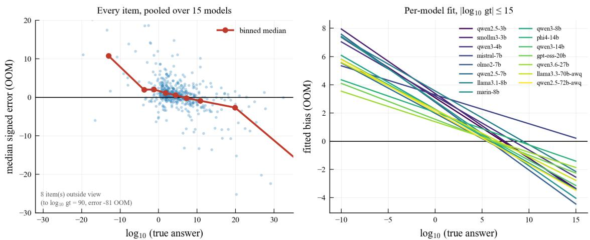
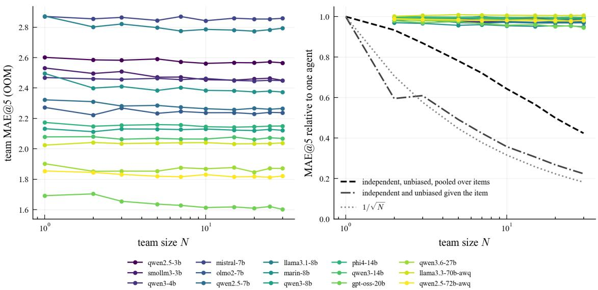

# Shared Item-Level Error Limits the Aggregation of Small Language Models in Fermi Estimation

Carolina Fortuna

Jožef Stefan Institute, Ljubljana, Slovenia

carolina.fortuna@ijs.si

Blaž Bertalanič

Jožef Stefan Institute, Ljubljana, Slovenia

blaz.bertalanic@ijs.si

## Abstract

Multi-agent systems of language models are often motivated by an averaging argument: if the agents’ errors are unbiased and independent, the error of an aggregate of N answers falls as 1/ N. Fermi estimation, whose continuous answers are aggregated on the logarithmic scale, permits a direct test. We decompose the log error of each answer into the mean error of its model on the item, common to all its draws on the item, and a residual, and estimate both from 2.51M answers given before any communication by 15 open-weight models (3B–72B) on realFP, with replication under a single prompt pair on realFP, Science Olympiad Fermi questions and a guesstimation set. Given the item, teammates’ errors are uncorrelated and teams behave as independent draws, but the item-level component accounts for a median 0.906 of the error variance over items. Teams of thirty therefore reduce a single agent’s error by a median 1.7% (at most 5.4%), whereas draws that were also unbiased on each item would reduce it by 74–79%. All models compress their estimates toward about 106; this trend explains a median 17% of the item-level component, and a cross-validated linear recalibration on labelled items removes the overall bias but not that component. Three rounds of debate reduce within-team dispersion by 93% and leave the item-level component unchanged; revision without peers attains the same small gain. Mixing five models of similar accuracy reduces error by 6.6% relative to their own homogeneous teams, but no mixture improves on the most accurate model. Higher sampling temperature changes team error by about 1% at most, and contrastive activation steering not detectably; per-agent scafold prompts (not significant after multiplicity correction) and skipping one layer in a singlemodel screen improve it. The results are conditional on the models, benchmarks, prompts and settings tested.

## 1 Introduction

Systems that combine several language-model agents, by sampling and voting (Wang et al., 2023; Li et al., 2024), by debate (Du et al., 2024) or by committees of diferent models (Chen et al., 2024), are often motivated by an argument inherited from the wisdom of crowds (Galton, 1907): if the agents’ errors are unbiased and independent, the error of their aggregate falls as $1 / \sqrt { N }$ , and a larger team substitutes for a better agent. Given its premises the argument is an identity, so its empirical content lies in whether the premises hold. In forecast combination, positively correlated errors are known to limit the benefit of averaging (Clemen & Winkler, 1986), and recent work reports correlated errors across language models on discrete benchmarks (Kim et al., 2025; Goel et al., 2025).

Fermi estimation permits a quantitative test. Fermi problems ask for quantities that can only be estimated (Kalyan et al., 2021); their answers are continuous, are naturally aggregated by a mean on the logarithmic scale, and their errors can cancel rather than merely outvote one another. The error of an answer can therefore be measured in orders of magnitude (OOM) and decomposed. We write the $\log _ { 1 0 }$ error of each answer as the mean error of its model on the item, which every draw of that model on that item shares, plus a residual, and estimate both components from 2.51M answers that 15 open-weight models (3B–72B parameters, 11 of them below 15B) gave to the 529 items of realFP before any communication, in teams of 2 to 30 agents. A second corpus with a single prompt pair repeats the analyses on realFP, on Science Olympiad Fermi questions (SciOly) and on a guesstimation set (Chuang et al., 2025).

The estimands are defined over the items of a benchmark (Section 3). The item-level component measures on which items, and by how much, all draws of a model err; it is not a dependence between agents on a fixed item, which we find to be absent. We ask four questions; each answer is conditional on the models, benchmarks, prompts and decoding settings tested.

• RQ1: How is single-agent error structured? (Section 4) Given the item and run, the residuals of teammates are uncorrelated, but the item-level component accounts for a median ρ = 0.906 of the error variance over items. All 15 models compress magnitudes; this trend explains a median 17% of the item-level component, and the per-item errors of diferent models remain correlated at 0.60–0.69 after it is removed.

• RQ2: How much does aggregation recover? (Section 5) Real teams have the error of teams resampled independently from each item’s draws, to within a median +0.005 OOM. They reduce single-agent error by a median 1.7%, which is 2.2% of the reduction that draws unbiased and independent given the item would deliver.

• RQ3: Does communication reduce the item-level error? (Section 6) No. Debate reduces within-team dispersion by 93% and changes the item-level component by a median −0.9%; revision without peers obtains at least the same small gain.

• RQ4: Which interventions reduce it? (Section 7) Mixing models of similar accuracy reduces error by 6.6% relative to their own teams, without improving on the best of them; temperature changes team error by about 1% at most and activation steering not detectably; per-agent scafold prompts and skipping one layer improve the team, the first without surviving correction for multiplicity and the second in a 150-item screen of one model. A linear recalibration on labelled items removes the overall bias and leaves the item-level component unchanged.

## 2 Related work

Combining judgements. The benefit of averaging depends on the dependence of the errors averaged: positively correlated forecasts carry less information than their number suggests (Clemen & Winkler, 1986), and the efective number of independent estimators under an intraclass correlation ρ is the design efect of Kish (1965). Averaging repeated estimates of one person, the “crowd within”, helps less than averaging diferent people (Vul & Pashler, 2008), and asking a person to reconsider from a diferent premise increases the gain (Herzog & Hertwig, 2009); homogeneous teams and per-agent prompts are their analogues for language models. Social influence makes estimates converge without making them more accurate (Lorenz et al., 2011), with efects that depend on the network of influence (Becker et al., 2017).

Aggregating language models. Sampling several reasoning paths and voting improves accuracy on discrete reasoning tasks (Wang et al., 2023), with gains that grow with the number of agents (Li et al., 2024). Multi-agent debate was proposed to improve factuality and reasoning (Du et al., 2024), but its gains depend on the protocol (Smit et al., 2024) and are largely attributable to the vote over agents rather than to the exchange (Choi et al., 2025); without external feedback, self-correction does not reliably improve reasoning (Huang et al., 2024). Errors of diferent language models are correlated, more so for more capable models (Kim et al., 2025; Goel et al., 2025), and several studies identify the correlation between agents as the limit of multi-agent systems (Chen et al., 2024; Yang et al., 2026; Patel, 2026). These studies measure agreement on discrete outputs or in representation space; on a continuous task the common component can be measured in the units of the answer.

Fermi estimation and numerical magnitude. Single models score low on realFP (Kalyan et al., 2021; Liu et al., 2025) and are overconfident in their intervals (Epstein et al., 2025). Chuang et al. (2025) aggregate 30 reasoning paths of one model by the median and report large gains for weak models and none for the strongest. Human magnitude judgements regress toward the centre of the stimulus range (Hollingworth, 1910; Petzschner et al., 2015), and language models encode numbers on a compressed scale (AlquBoj et al., 2025; Cacioli, 2026); we measure a behavioural counterpart of that compression and its consequence for aggregation.

## 3 Framework and data

## 3.1 Decomposition and estimands

Fix a model and a benchmark. Let $e _ { j k } = \log _ { 1 0 } \hat { y } _ { j k } - \log _ { 1 0 } y _ { j }$ be the signed error, in OOM, of draw k on item $j$ with true value $y _ { j }$ . We write

$$
e _ { j k } = \mu + c _ { j } + u _ { j k } , \qquad \mathbb { E } _ { j } c _ { j } = 0 , \qquad \mathbb { E } [ u _ { j k } \mid j ] = 0 ,\tag{1}
$$

where $\mu$ is the model’s overall bias, $\mu + c _ { j }$ its mean error on item $j ,$ , which all of its draws on that item share, and $u _ { j k }$ the residual of one draw. Moments are taken over the items of the benchmark and the draws on each item:

$$
A = \mathrm { V a r } _ { j } ( c _ { j } ) , \qquad B = \mathbb { E } _ { j } \mathrm { V a r } ( u _ { j k } \mid j ) , \qquad \rho = \frac { A } { A + B } , \qquad N _ { \mathrm { e f f } } ( N ) = \frac { N } { 1 + ( N - 1 ) \rho } .\tag{2}
$$

$A$ is the between-item variance of the item-mean error, B the average within-item variance, $\rho$ the intraclass correlation of draws over items, and $N _ { \mathrm { e f f } } ( N )$ the number of independent draws that have the same mean squared error over items as a team of N (Kish, 1965).

What aggregation can remove. A team combines its members’ draws on item $j$ by a rule $g .$ For every rule that shifts with its inputs, $g ( x + a ) = g ( x ) + a$ , such as the mean, the median or a trimmed mean, the team error is $\mu + c _ { j } + g ( u _ { j 1 } , \dots , u _ { j N } )$ : the item-level error passes through unchanged and only the residuals are combined. If the draws are independent given the item, the mean of N of them has expected squared error $\mu ^ { 2 } + A + B / N$ over items, and $\mu ^ { 2 } + A$ is a floor for every such rule. It is not a floor for procedures that use information beyond the answers, such as a recalibration learned on labelled items, or for interventions that change the agents themselves; both can change $\mu$ and $c _ { j }$ (Section 7). $\rho$ and A describe a benchmark’s item distribution, not dependence between agents given the item, which we test separately (Section 4.1).

Estimation. A and B are estimated by a one-way decomposition by item of the round-1 draws of a model, with errors winsorized at ±5 OOM and A corrected for the sampling variance of the item means; a fit of the variance of real team means, $\mathrm { V a r } ( \bar { e } _ { N } ) = A + B / N$ , gives a second estimate (Appendix D). For debate we also report the within-team variance W, and the median over items of the within-team interquartile range, which we call the dispersion $D$ . A degraded agent inflates B and thereby lowers $\rho$ without any change in $A ,$ so $\rho$ is never used alone as evidence of diversity; an intervention is credited with reducing the item-level error only if it lowers A and improves the team.

## 3.2 References for aggregation

The rate $1 / \sqrt { N }$ describes the standard error of a mean; for the winsorized absolute error of a geometric mean of heavy-tailed errors it does not hold. We therefore simulate two references per model and team size, scored by the same rule and metric as the real teams. Resampled given the item: each member is drawn independently, with replacement, from the model’s round-1 errors on the same item (about 350 per item). This is the counterfactual of members that are independent given the item; if the real teams match it, their shortfall is not due to dependence between members. Unbiased given the item: the same draws with independent random signs, which removes $\mu + c _ { j }$ while keeping each item’s error magnitudes. This is the reduction that aggregation would deliver if the draws were also unbiased on each item, and it is our reference. A third reference, which draws members across items and therefore also removes item dificulty, is reported in Appendix D.

<table><tr><td>corpus</td><td>models</td><td>items</td><td>N</td><td>rounds</td><td>prompts</td><td>used in</td></tr><tr><td>main sweep</td><td>15</td><td>realFP 529</td><td>2-30</td><td>1–3, genuine peers</td><td>both pairs</td><td>§4-6</td></tr><tr><td>second corpus</td><td>15</td><td>realFP, SciOly 500, Guess. 15</td><td>2-30</td><td>1–3, peers and self-revision</td><td>revised</td><td>§4-6</td></tr><tr><td>heterogeneous pool</td><td>5</td><td>realFP 529</td><td>3,5</td><td>1–3, three peer sources</td><td>revised + arms</td><td>§6, 7</td></tr><tr><td>temperature sweep</td><td>4</td><td>realFP 529</td><td>10</td><td>1 1</td><td>revised</td><td>§7</td></tr><tr><td>activation screen</td><td>1</td><td>realFP 150</td><td>5</td><td></td><td>revised</td><td>§7</td></tr></table>

Table 1: Corpora. All sample at $T = 0 . 4$ (the temperature sweep also at 0.8 and 1.0) with $\mathrm { t o p } { - } p = 0 . 9 5$ , 1024 new tokens (512 in the activation screen) and thinking modes disabled. “Both pairs”: the main sweep mixes two prompt pairs (Section 3.3). Guesstimate has answers from 14 models. Models, serving and coverage: Appendix B.

## 3.3 Data and protocol

Benchmarks. Of the 557 realFP test questions (Kalyan et al., 2021), 529 have a positive finite numeric answer, from $1 0 ^ { - 2 9 }$ to $1 0 ^ { 9 0 }$ , with the middle half within $1 0 ^ { 1 . 8 } – 1 0 ^ { 7 . 6 }$ . The 500 SciOly test questions1 record only the power of ten of each answer, $y = 1 0 ^ { k } ;$ ; an exactly correct estimate $x \cdot 1 0 ^ { k }$ then has $e = \log _ { 1 0 } x \in [ 0 , 1 )$ an upward ofset common to all agents on an item, which enters $\mu$ and $c _ { j }$ but not B. The 15 Guesstimate questions of Chuang et al. (2025) count objects in containers (13 to 382); with so few items, spanning less than two orders of magnitude, we draw no conclusion from them alone.

Models and protocol. 16 instruction-tuned open-weight models from nine lineages ran on the task (Table B.1); r1-distill-qwen-14b reaches the token limit on most generations and is excluded, leaving 15, of which the two largest are AWQ 4-bit checkpoints. In round 1 every member of a team receives the same prompt, without exemplars or peer content, so a homogeneous team is N samples from one predictive distribution; in rounds 2 and 3 agents see their peers’ answers and revise. The prompts (Appendix A) request explicit reasoning. The main sweep mixes an original and a revised prompt pair (41% of its round-1 answers, unevenly across 8 models), which we identify from prompt length (Appendix B); the revised pair lowers MAE@5 by −0.20 OOM [−0.24, −0.15] in the models that ran both. The second corpus, which uses the revised pair throughout, reproduces every structural statistic of Sections 4–5 (Table 2); levels of accuracy and bias of individual models carry this qualification.

## 3.4 Error metric and inference

An answer is correct to the order of magnitude if $| e | \le 0 . 5$ and catastrophic if $| e | > 2$ . Errors are heavy-tailed (pooled median |e| 1.86, mean 3.65, maximum 142 OOM), so the headline metric is the mean absolute error winsorized at 5 OOM, MAE@5 = 1 P min(|e|, 5). The team estimate is the geometric mean of the members’ estimates, so its signed error is the mean of theirs and Equation 1 applies directly; Appendix E repeats every team-level result with the median of the $\log _ { 1 0 }$ estimates. Each model answers each item about 350 times, so the item is the unit of inference, and intervals are 95% item-clustered bootstrap intervals. One family of contrasts is confirmatory: the six prompt-level arms of Section $^ { 7 , }$ whose endpoint (the paired diference in team MAE@5) was fixed in an internal analysis plan before the arms were scored; the plan was not registered publicly. We report Holm-adjusted p-values for this family. All other tests are exploratory, and counts of models with a significant efect are descriptive and unadjusted.

## 4 Structure of single-agent error (RQ1)

Accuracy and magnitude compression. A single agent is correct to the order of magnitude on 12–34% of realFP items and catastrophically wrong on 30–63%, with parse rates of 98.5–100.0% (Table C.1). Every model overestimates small quantities and underestimates large ones (Figure 1). Regressing the per-item median signed error on $\log _ { 1 0 } y ,$ excluding the 43 items with $| \log _ { 1 0 } y | > 1 5 ,$ gives a negative slope for all 15 models, from −0.21 to −0.48, with a median crossing point at $1 0 ^ { 6 . 3 }$ ; the four checkpoints above 15B lie inside this range. On SciOly 15 of 15 slopes are negative, and the Guesstimate quantities, which lie below the crossing point, are overestimated by 14 of 14 models. The compression is common to all models and is therefore part of $c _ { j }$ , but a minor part: the linear trend explains a median 17% (range 6–29%) of A, and 11% on $| \log _ { 1 0 } y | \le 1 5$

  
Figure 1: Round-1 estimates compress toward a central magnitude. Left: per-item median signed error against the true answer, pooled over 15 models, with the binned median. Right: per-model linear fits on $| \log _ { 1 0 } y | \le 1 5$

Bias. 10 of 15 models have a mean signed error whose interval excludes zero, and every point estimate is positive in the main sweep (14 of 15 under the revised pair alone). Because the biases share a sign, the bias of a consensus of M models equals the mean bias of its members and does not shrink with M (shrinkage 1.00×, against 3.87× for independent biases), and in 4 of 5 magnitude bands every model errs in the same direction (Appendix C). On SciOly the answer key ofsets all signed errors upward by an unknown common amount, so its count of biased models (5 of 15) is a lower bound and is not comparable with realFP.

## 4.1 Dependence given the item and correlation over items

The independence premise can fail in two senses. Given the item, two members of a team could share more than the item’s mean error; this is the dependence that averaging requires to be absent. The residuals of two teammates, measured against the mean of their item and run, correlate at between −0.010 and +0.032 across models, as independent sampling implies. Measured against the item mean alone they correlate at up to 0.65 (qwen3-8b), because some models’ runs used diferent prompt versions and the members of a team share their run’s deviation; this run component accounts for up to 11% of the error variance in 6 models.

Over items, two draws correlate because both carry $c _ { j } .$ . Two draws of the same model correlate at 0.906, which equals the one-way estimate of $\rho$ (0.906) and is close to the team-level fit (0.922, which also counts the run component); $N _ { \mathrm { e f f } } ( 3 0 )$ is then 1.10. Draws of diferent models correlate at 0.591 $( N _ { \mathrm { e f f } } ( 3 0 ) = 1 . 6 5 )$ . The per-item mean errors of two models correlate at 0.827 on average over the 105 pairs; this Pearson correlation is inflated by the items of extreme magnitude, and robust variants (Spearman, errors winsorized at 5 OOM, or the 486 items with $| \log _ { 1 0 } y | \le 1 5 )$ give 0.64–0.67, and 0.60–0.69 with the linear magnitude trend removed. Models of the same family are not distinguishably more correlated than others (Appendix C).

These are correlations of errors: the models err on the same items in the same direction beyond the common magnitude trend. They do not identify the cause. Shared knowledge acquired from similar text, properties of the items and their construction, and errors in the answer key would all produce them. An audit of the answer key flags 5.5% of items as candidate label errors, and removing them changes the cross-model mean error per item by 5.3% (Appendix C), so label errors are not the main source.

<table><tr><td></td><td>realFP (main)</td><td>realFP (second)</td><td>SciOly (second)</td><td>Guesstimate (second)</td></tr><tr><td>models</td><td>15</td><td>15</td><td>15</td><td>14</td></tr><tr><td>items</td><td>529</td><td>529</td><td>500</td><td>15</td></tr><tr><td>one agent within an order of magni-</td><td>12-34</td><td>14-34</td><td>15-46</td><td>3-67</td></tr><tr><td>tude (%) one agent off by more than 100× (%</td><td>30-63</td><td>31-57</td><td>17-54</td><td>0-80</td></tr><tr><td>models with mean error ≠ 0</td><td>10/15</td><td>9/15</td><td>5/15</td><td>12/14</td></tr><tr><td>bias shrinkage across models (re- alised /√M)</td><td>1.00 / 3.87</td><td>1.04 / 3.87</td><td>1.65 / 2.83</td><td>1.00 / 3.74</td></tr><tr><td>models with a negative compression slope</td><td>15/15</td><td>15/15</td><td>15/15</td><td>12/14</td></tr><tr><td>crossing point (median, log10)</td><td>6.3</td><td>6.4</td><td>6.6</td><td>2.9</td></tr><tr><td>cross-model r of per-item errors (raw / magnitude removed)</td><td>0.827 / 0.689</td><td>0.827 / 0.690</td><td>0.689 / 0.581</td><td>0.407 / 0.395</td></tr><tr><td>single-draw r (same model / differ- ent models)</td><td>0.906 / 0.591</td><td>0.913 / 0.601</td><td>0.887 / 0.557</td><td>0.733 / 0.368</td></tr><tr><td>ρ, one-way by item (median over models)</td><td>0.906</td><td>0.915</td><td>0.887</td><td>0.763</td></tr><tr><td>ρ, fit to team means (median over models)</td><td>0.922</td><td>0.920</td><td>0.890</td><td>0.758</td></tr><tr><td>Neff(30) (median over models)</td><td>1.08</td><td>1.08</td><td>1.12</td><td>1.31</td></tr><tr><td>team of 30 - independent draws given the item (OOM; median)</td><td>+0.005</td><td>+0.000</td><td>+0.000</td><td>+0.004</td></tr><tr><td>error reduction at N=30, real teams (% of one agent; median / max)</td><td>1.7 / 5.4</td><td>1.7 / 6.0</td><td>1.0 / 5.7</td><td>2.1 / 21.7</td></tr><tr><td>models whose reduction excludes</td><td>12/15</td><td>11/15</td><td>6/15</td><td>9/14</td></tr><tr><td>zero error reduction at N=30, draws un- biased and independent given the</td><td>74-79</td><td>74-79</td><td>57-76</td><td>81-85</td></tr><tr><td>item (%; range) share of that reduction realised (%;</td><td>2.2 / 7.1</td><td>2.2 / 7.8</td><td>1.3 / 8.1</td><td>2.5 / 26.8</td></tr><tr><td>median / max) mixtures significantly better than</td><td>0/4,928</td><td>0/4,928</td><td>0/4,928</td><td>0/3,458</td></tr><tr><td>the best homogeneous team debate: reduction of within-team</td><td>93</td><td>78</td><td>84</td><td></td></tr><tr><td>dispersion D at N=5 (%) debate: total gain over one agent</td><td>2.1</td><td>2.4</td><td>5.5</td><td>61</td></tr><tr><td>(%) round 3: genuine peers - self-</td><td></td><td>+0.008 [−0.002, +0.017] +0.015 [+0.003, +0.026] +0.003 [−0.033, +0.054]</td><td></td><td>8.0</td></tr></table>

Table 2: Principal statistics on the four data sets, computed by the same code with the same error, team rule (geometric mean) and thresholds. “Main”: the main sweep; “second”: the second corpus, which uses the revised prompt pair throughout. Counts of models are descriptive and unadjusted. SciOly errors carry the ofset of its answer key; with 15 items, the slopes, correlations and ρ of Guesstimate are imprecise. Per-model results: Appendices C–H.

## 5 Aggregation (RQ2)

Round 1 of every team is an aggregation experiment: N answers are produced before any communication, for N ∈ {2, 3, 5, 7, 10, 15, 20, 25, 30}, in three runs on all 529 items. We aggregate these real teams by the geometric mean, without resampling, and compare each team with the individual agents of the same cell.

Teams behave as independent draws given the item. The real teams have nearly the error of teams resampled independently from each item’s draws: at N = 30 the median diference is +0.005 OOM, and the largest, +0.076 for mistral-7b, occurs in a model whose runs mixed prompt versions; in the second corpus the median diference is below 0.001 OOM (Table 2). The shortfall of aggregation is therefore not due to dependence between members but to the error that each item imposes on all of them.

The reduction realised. Teams of thirty reduce single-agent error by a median 1.7% and at most 5.4% (Figure 2); the reduction is distinguishable from zero for 12 of 15 models, and for llama3.3-70b-awq the team is not better than one agent. Draws unbiased and independent given the item would reduce the error by 74–79%, so the real teams realise a median 2.2% (at most 7.1%) of that reduction. The conclusion does not depend on the construction of the reference: against members drawn across items the available reduction is 51–63% and the share realised at most 10.7% (Appendix D). In mean squared error over items, a team of thirty is worth $N _ { \mathrm { e f f } } ( 3 0 ) = 1 . 1 0$ independent agents.

  
Figure 2: Left: team MAE@5 against N (realFP, main sweep). Right: the same relative to one agent, with the median over models of three references: draws independent and unbiased given the item (dash-dot; the kink at $N = 2$ arises because identical draws with opposite signs cancel exactly), draws independent and unbiased across items (dashed), and the $1 / \sqrt { N }$ rate (dotted).

Other benchmarks. The second corpus reproduces this on realFP and SciOly (Table 2): on SciOly teams of thirty reduce single-agent error by a median 1.0% (at most 5.7%), 1.3% of the reduction available under the per-item reference. On Guesstimate one model, gpt-oss-20b, reduces its error by 21.7%, the only reduction above one tenth in the study; the median model reduces it by 2.1%. This benchmark has the lowest ρ (0.763), that is, the largest within-item share of the error, which is the condition under which the decomposition predicts a gain; it is also where Chuang et al. (2025) report large gains from aggregating sampled estimates.

## 6 Communication between agents (RQ3)

In rounds 2 and 3 each agent sees its teammates’ answers and revises. Round 1 of the same teams serves as a within-subject control.

Dispersion collapses; the item-level error does not change. At N = 5, from round 1 to round 3, the dispersion D falls from 0.211 to 0.014 OOM (−93%), and by round 3, 12 of 15 models have $D = 0 \colon$ on at least half of the items, three of five agents return the same number. The within-team variance W, which occasional outlying members dominate, falls by a median −20%. The item-level component is unchanged: $\sqrt { A }$ is 2.64 OOM at round 1 and 2.64 OOM at round 3, a median change in A of −0.9% (range −5.1 to +8.0%; Table F.1). Team error falls from 2.281 OOM for one agent to 2.251 for five aggregated agents and 2.233 after debate, a total of 2.1% at fifteen times the generation cost; per model, debate improves the team for 8 and worsens it for 4 of 15. On SciOly and Guesstimate debate reduces D by 84% and 61% and total error by 5.5% and 8.0%.

<table><tr><td rowspan="2">contrast</td><td colspan="2">heterogeneous pool (529 items)</td><td colspan="2">homogeneous teams (529 items)</td></tr><tr><td>∆</td><td>95% CI</td><td>∆</td><td>95% CI</td></tr><tr><td>genuine peers, round 3 – round 1</td><td>+0.088</td><td>[+0.011,+0.164]</td><td>-0.021</td><td>[−0.033, -0.010]</td></tr><tr><td>self-revision, round 3 - round 1</td><td>+0.057</td><td>[-0.003, +0.116]</td><td>-0.029</td><td>[-0.043, -0.015]</td></tr><tr><td>peers from other items, round 3 – round 1</td><td>+0.187</td><td>[+0.111,+0.261]</td><td></td><td></td></tr><tr><td>round 3: genuine peers – other items</td><td>-0.097</td><td>[−0.187, -0.006]</td><td></td><td></td></tr><tr><td>round 3: genuine peers – self-revision</td><td>+0.033</td><td>[−0.045, +0.113]</td><td>+0.008</td><td>[-0.002, +0.017]</td></tr></table>

Table 3: Change in team MAE@5 (OOM), paired by item, with 95% item-clustered intervals; positive values indicate degradation, bold an interval that excludes zero. Left: baseline arm of the heterogeneous pool. Right: second corpus, pooled over 15 models with equal weight and over all team sizes; it ran no placebo arm.

Revision without peers. Round 3 difers from round 1 by exposure to peers and by two further generation passes. The second corpus ran, for every model, a self-revision arm in which the agent revises seeing only its own previous answer (Table 3). On realFP team error changes from round 1 to round 3 by −0.029 [−0.043, −0.015] OOM under self-revision and by −0.021 [−0.033, −0.010] with peers; at round 3 the diference, +0.008 [−0.002, +0.017], favours self-revision without excluding zero (under the median rule it does exclude zero, Appendix E). On SciOly the diference is +0.015 [+0.003, +0.026] and on Guesstimate +0.003 [−0.033, +0.054]. The protocols difer most in their efect on disagreement: with peers D falls from 0.221 to 0.048 OOM, whereas under self-revision it rises to 0.427. In these data, convergence is produced by exposure to peers and the small gain by the revision passes, consistent with reports that the exchange between agents adds little beyond voting (Choi et al., 2025).

Heterogeneous teams and misparsed inputs. Rounds 2 and 3 were generated by a harness whose parser misread some answers written as a mantissa times a power of ten, so in 22.5% of the homogeneous and 32.6% of the heterogeneous teams an agent was shown a peer value that difered from the one written. Recorded answers are re-scored, but what agents were shown cannot be corrected. Excluding those teams leaves the homogeneous results unchanged (total gain 2.2%; genuine peers minus self-revision +0.007 [−0.003, +0.016]) but removes the significance of the SciOly diference (+0.007 [−0.004, +0.018]) and of the degradation of the heterogeneous pool under genuine peers (+0.088 [+0.011, +0.164] on all teams; +0.012 [−0.065, +0.092] after exclusion). We therefore draw no conclusion about debate in heterogeneous teams.

## 7 Interventions (RQ4)

Aggregation and debate leave the item-level component unchanged. We tested four classes of intervention on the agents and one procedure that uses information beyond the answers (Table 4). The primary outcome is the paired change in team MAE@5; the change in A is reported alongside.

Model composition. Across all 4,928 mixtures of 2 to 5 of the 15 models, filling five agent slots and scored on 526 items, a mixture improves on the slot-weighted mean of its members’ homogeneous teams by a median 0.139 OOM (6.3%; positive for 99.8% of mixtures), about four times the gain of a homogeneous team of five over one agent (0.035 OOM). For the five models of most similar accuracy (single-agent MAE@5 2.08–2.32) the gain is 0.142 [0.095, 0.191] OOM (6.6%), but the mixture is not better than the homogeneous team of its best member (+0.035 [−0.046, +0.117]). Across all mixtures, 4.0% improve on their best member by point estimate, and none improves significantly on the homogeneous team of the most accurate model (gpt-oss-20b, 1.628); the closest, gpt-oss-20b+qwen3.6-27b, is worse by +0.056 [+0.010, +0.101]. Across five-model mixtures, team error correlates +0.98 with the members’ mean accuracy and −0.10 with their mean pairwise error correlation. Combining architectures therefore reduces error measurably, as the lower cross-model single-draw correlation predicts, but in this roster the accuracy diferences between models exceed the gain.

<table><tr><td>intervention</td><td>against</td><td></td><td></td><td>N items ∆ team MAE@5 [95% CI]</td><td>∆A (%)</td><td>PHolm</td></tr><tr><td colspan="7">Composition (realFP main corpus, 526 items; five models of similar accuracy, N=5)</td></tr><tr><td>mixture of the five</td><td>their own teams</td><td>5</td><td>526</td><td> $\mathbf { - 0 . 1 4 2 _ { \lambda } } \ [ - 0 . 1 9 1 , - 0 . 0 9 5 ]$ </td><td></td><td></td></tr><tr><td>mixture of the five</td><td>best member&#x27;s team</td><td>5</td><td>526</td><td> $- 0 . 0 3 5 \ [ - 0 . 1 1 7 , + 0 . 0 4 6 ]$ </td><td></td><td></td></tr><tr><td colspan="7">Prompt level (heterogeneous five-model pool, realFP)</td></tr><tr><td>per-agent anchors†</td><td>baseline</td><td>5</td><td>529</td><td> $- 0 . 0 1 3 \ [ - 0 . 0 9 1 , + 0 . 0 6 7 ]$ </td><td>-1</td><td>0.747</td></tr><tr><td>per-agent scaffolds</td><td>baseline</td><td>5</td><td>529</td><td> $\mathbf { - 0 . 1 0 4 } \ [ - 0 . 1 9 6 , - 0 . 0 1 5 ]$ </td><td>-10</td><td>0.089</td></tr><tr><td>calculator offload</td><td>baseline</td><td>3</td><td>526</td><td> $+ 0 . 5 4 0 \ [ + 0 . 3 6 3 , + 0 . 7 2 0 ]$ </td><td>-52</td><td>0.001</td></tr><tr><td> $\mathrm { o f f l o a d + a n c h o r s } ^ { \dagger }$ </td><td>offload</td><td>3</td><td>518</td><td>+0.195 [+0.017, +0.372]</td><td>-14</td><td>0.096</td></tr><tr><td>offload + reference values</td><td>offload</td><td>3</td><td>507</td><td> $+ 0 . 2 7 9 \ [ + 0 . 0 8 2 , + 0 . 4 7 8 ]$ </td><td>+6</td><td>0.037</td></tr><tr><td>offload + unit bases</td><td>offload</td><td>3</td><td>516</td><td> $+ 0 . 1 2 3 \ [ - 0 . 0 6 4 , + 0 . 3 1 2 ]$ </td><td>-19</td><td>0.406</td></tr><tr><td colspan="7">Sampling temperature (four models pooled, realFP, run 0)</td></tr><tr><td> $T = 0 . 8$ </td><td> $T = 0 . 4$ </td><td>10</td><td>524</td><td> $- 0 . 0 1 3 \ [ - 0 . 0 3 0 , + 0 . 0 0 4 ]$ </td><td>-3</td><td></td></tr><tr><td> $T = 1 . 0$ </td><td> $T = 0 . 4$ </td><td>10</td><td></td><td> $5 2 4 - 0 . 0 0 5 \ [ - 0 . 0 2 4 , + 0 . 0 1 3 ]$ </td><td>-4</td><td></td></tr><tr><td colspan="7">Activation (qwen2.5-7b, 150 realFP items, median rule,  $\alpha = 1 ; { \mathrm { m e a n ~ o f ~ t w o ~ j o b s } } )$ </td></tr><tr><td>head masking</td><td>none</td><td>5</td><td></td><td> $1 5 0 - 0 . 0 2 1 \ [ - 0 . 1 4 9 , + 0 . 1 0 4 ]$ </td><td>-4</td><td></td></tr><tr><td>layer skipping</td><td>none</td><td>5</td><td></td><td> $1 5 0 - \mathbf { 0 . 2 7 6 } \left[ - 0 . 4 3 1 , - 0 . 1 2 6 \right]$ </td><td> $- 1 1 ^ { \ddagger }$ </td><td></td></tr><tr><td>residual noise</td><td>none</td><td>5</td><td></td><td> $\begin{array} { r l } { 1 5 0 } & { { } + 0 . 5 3 7 \ [ + 0 . 2 0 4 , + 0 . 8 7 1 ] } \end{array}$ </td><td>+31‡</td><td></td></tr><tr><td>contrastive steering</td><td>none</td><td>5</td><td></td><td> $1 5 0 + 0 . 0 0 8 [ - 0 . 0 3 8 , + 0 . 0 5 3 ]$ </td><td> $+ 1 ^ { \ddagger }$ </td><td></td></tr><tr><td colspan="7">Information beyond the answers (realFP main corpus, 15 models; 10-fold cross-validation)</td></tr><tr><td>linear recalibration</td><td>none</td><td>30</td><td></td><td> $\begin{array} { r l } { 5 2 9 } & { { } - 0 . 0 4 2 \ \mathrm { m e d i a n } ; \ - 0 . 3 4 1 \ \mathrm { t o } \ + 0 . 0 1 8 } \end{array}$ </td><td>+0.5</td><td></td></tr></table>

Table 4: Interventions. ∆ team: paired change in team MAE@5 (OOM; negative is better) with a 95% item-clustered interval, bold if it excludes zero. ∆A: relative change of the item-level component. †Anchor identity is confounded with model identity (Appendix G). ‡Unwinsorized A of the screen, comparable only within the screen. Winsorization lowers A whenever an arm inflates the within-item spread severalfold (calculator ofload, $B + 6 . 4 5 \mathrm { O O M ^ { 2 } } )$ , so $\Delta A$ is not interpretable for those arms. Holm: adjusted over the six prompt-level arms. The recalibration row gives the median and range over models of the change for teams of 30.

Prompt-level arms. In the heterogeneous pool, per-agent scafolds replace the solve prompt with one of five decomposition templates per agent. They improve the team by −0.104 [−0.196, −0.015] OOM (4.6%, $p = 0 . 0 2 2 )$ , which does not survive Holm correction over the six arms $( p = 0 . 0 8 9 )$ and is not significant under the median rule; A falls $\mathrm { \ y - 1 0 \% [ - 0 . 8 9 , - 0 . 1 0 ] { \mathrm { O O M } } ^ { 2 } }$ while B rises. Per-agent anchors are confounded with model identity and are uninformative. Calculator ofload, in which the model lists factors whose product is computed in log space, worsens the team by +0.540 OOM, and adding reference values worsens it further; both remain significant after Holm correction: removing arithmetic does not help when the choice of factors is at fault, and an unconstrained product of several wrong factors is less bounded than one wrong intuition (catastrophic answers 51.5% to 66.9%).

Sampling temperature. Four models (qwen3-4b, qwen3-8b, qwen3-14b, gpt-oss-20b) were re-run at $T \in \{ 0 . 4 , 0 . 8 , 1 . 0 \}$ (run 0, N = 10). Raising T to 1.0 increases the dispersion from 0.100 to 0.438 OOM. Pooled over the models, team error changes by −0.013 [−0.030, +0.004] OOM at $T ~ = ~ 0 . 8$ and −0.005 $[ - 0 . 0 2 4 , + 0 . 0 1 3 ]$ at $T = 1 . 0 ;$ the 90% intervals exclude changes larger than 0.027 and 0.021 OOM (1.4% and 1.1% of team error). Under the median rule the change at $T = 1 . 0 \ { \mathrm { i s } } \ - 0 . 0 2 6 \ \left[ - 0 . 0 4 8 , - 0 . 0 0 3 \right]$ , a gain of about 1%. A falls by 3–4% while B rises by a similar amount (Table 4), which leaves the error of a team of ten nearly unchanged.

Activation interventions. A screen on qwen2.5-7b (150 items, N = 5, round 1) perturbed the residual stream at layer 14 of 28, at strengths $\alpha \in \{ 0 . 5 , 1 , 2 \}$ in units of the layer’s root-mean-square activation: contrastive activation addition along five strategy contrasts (for example top-down against bottom-up decomposition), applied with opposite signs to pairs of agents; Gaussian noise; masking of a random subset of attention heads per agent; and skipping layer 14, the same edit for every agent (Appendix G). Steering changed the team answers by more than the variation between jobs of the unperturbed arm (mean |∆ 0.076–0.112 OOM against 0.015–0.052), but changed neither ρ nor team error. Skipping layer 14 changed team error by −0.287 to −0.241 OOM in all 5 runs $( \mathrm { a b o u t - } 1 1 \% )$ and $A ~ \mathrm { b y } \ : - 1 1 ~ \mathrm { t o } \ : - 9 \%$ : in this screen it meets the criterion of lowering the item-level error and improving the team. It does so by changing the model for every agent, not by diversifying the agents. The screen stored only per-item team errors computed with the earlier parser and the median rule, and covers one model and 150 items, so it identifies a candidate rather than an established efect.

Information beyond the answers. A linear map $\log _ { 1 0 } y \approx a + b \bar { x } _ { j }$ from the item’s mean log estimate to the truth, fitted by least absolute deviations on nine tenths of the items and applied to the held-out tenth, reduces single-agent error by a median 2.7% (at most 11.8%) and the error of teams of thirty by 4.3% of single-agent error (at most 12.9%, for llama3.1-8b), against 1.5% without recalibration. It does so by removing the overall bias $\mu \colon A$ changes by a median +0.5% (range −6.3 to +5.4%). A recalibration that depends only on the estimate cannot separate the item-specific error from the true magnitude, so it does not undo the compression either: the fitted slope b is below one.

Summary. Interventions that make the agents difer, through architecture, prompts, temperature or activation perturbations, increase $B ;$ only combining architectures turned this into a consistent gain, and no mixture improved on the most accurate model. The two arms that improved a team and lowered A were per-agent scafolds, which replace the solve template, and layer skipping, which edits the model; neither is established by the present evidence, the first because it does not survive correction for multiplicity and the second because it rests on a screen of one model.

## 8 Discussion and limitations

What the estimand says. On these benchmarks most of an agent’s error is an error that every draw of the model makes on the item: $\rho$ is 0.906 on realFP, 0.887 on SciOly and 0.763 on Guesstimate. Rules that combine the answers, and debate among agents that answer alike, act on the remainder, and recover a few per cent of single-agent error. This is a statement about the item distribution of these benchmarks under these prompts; it does not imply that teams of language models are equivalent to one agent in general. Where the within-item spread is large relative to the item-level error, as for one model on Guesstimate and for the weak models of Chuang et al. (2025), aggregation helps, as the decomposition predicts.

Implications. The design question that follows is how to change $c _ { j }$ rather than how to increase disagreement. In our data the error changed only where the agents changed or information was added: combining architectures (about 6% over their own teams), a diferent solve template and a model edit (neither established), and a recalibration that removes the overall bias. Two routes remain untested: extended test-time reasoning, which our token budget excludes, and item-specific information, such as retrieval of reference values for each factor; our reference-value arm supplied a fixed list of constants and was combined with calculator ofload.

Limitations. Scope. The models are open-weight, 3B–72B, with thinking modes disabled and 1024 new tokens; frontier, closed and reasoning models were not tested, and the four checkpoints above 15B (two of them quantized) support consistency with the smaller models rather than a statement about scale. Prompts. The main sweep mixes two prompt pairs unevenly across models; the second corpus reproduces its structural statistics, but per-model levels of accuracy and bias, and their rank correlations, are prompt-dependent. Revision rounds. Rounds 2 and 3 were generated with a defective parser (Section 6); a definitive test of heterogeneous debate requires regenerating them. Interventions. The temperature sweep covers four models (three of one family), one run and $T \leq 1 ;$ ; the activation screen covers one model, 150 items and the median rule, and its model is recorded in the job configuration rather than in the stored results; A is sensitive to winsorization when an arm inflates the spread. Benchmarks. SciOly’s answer key ofsets its signed errors, and Guesstimate has 15 items. Inference. Only the six prompt-level arms form a confirmatory family; per-model counts and the remaining contrasts are exploratory.

Reproducibility. The prompts are listed in Appendix A and the models, serving backends and coverage in Appendix B. Every number, table and figure in this paper is computed from the scored answers by a single analysis pipeline with fixed random seeds; a complete rerun reproduces them exactly.

## References

H. V. AlquBoj, Hilal AlQuabeh, Velibor Bojkovic, Tatsuya Hiraoka, Ahmed Oumar El-Shangiti, Munachiso Nwadike, and Kentaro Inui. Number representations in LLMs: A computational parallel to human perception. arXiv preprint arXiv:2502.16147, 2025. URL https://arxiv.org/abs/2502.16147.

Joshua Becker, Devon Brackbill, and Damon Centola. Network dynamics of social influence in the wisdom of crowds. Proceedings of the National Academy of Sciences, 114(26):E5070–E5076, 2017. doi: 10.1073/ pnas.1615978114.

Jon-Paul Cacioli. Weber’s law in transformer magnitude representations: Eficient coding, representational geometry, and psychophysical laws in language models. arXiv preprint arXiv:2603.20642, 2026. URL https://arxiv.org/abs/2603.20642.

Justin Chih-Yao Chen, Swarnadeep Saha, and Mohit Bansal. ReConcile: Round-table conference improves reasoning via consensus among diverse LLMs. In Proceedings ofthe 62nd Annual Meeting ofthe Association for Computational Linguistics (ACL), 2024. arXiv:2309.13007.

Hyeong Kyu Choi, Xiaojin Zhu, and Yixuan Li. Debate or vote: Which yields better decisions in multiagent large language models? In Advances in Neural Information Processing Systems (NeurIPS), 2025. arXiv:2508.17536.

Yun-Shiuan Chuang, Sameer Narendran, Nikunj Harlalka, Alexander Cheung, Sizhe Gao, Siddharth Suresh, Junjie Hu, and Timothy T. Rogers. Probing LLM world models: Enhancing guesstimation with wisdom of crowds decoding. In Proceedings of the 2025 Conference on Empirical Methods in Natural Language Processing, pp. 4699–4713. Association for Computational Linguistics, 2025. URL https://aclanthology.org/2025.emnlp-main.234.

Robert T. Clemen and Robert L. Winkler. Combining economic forecasts. Journal of Business & Economic Statistics, 4(1):39–46, 1986. doi: 10.1080/07350015.1986.10509492.

Yilun Du, Shuang Li, Antonio Torralba, Joshua B. Tenenbaum, and Igor Mordatch. Improving factuality and reasoning in language models through multiagent debate. In Proceedings of the 41st International Conference on Machine Learning (ICML), 2024. URL https://arxiv.org/abs/2305.14325. arXiv:2305.14325.

Elliot L. Epstein, John Winnicki, Thanawat Sornwanee, and Rajat Dwaraknath. LLMs are overconfident: Evaluating confidence interval calibration with FermiEval. arXiv preprint arXiv:2510.26995, 2025. URL https://arxiv.org/abs/2510.26995.

Francis Galton. Vox populi. Nature, 75(1949):450–451, 1907.

Shashwat Goel et al. Great models think alike and this undermines AI oversight. In Proceedings of the 42nd International Conference on Machine Learning (ICML), volume 267 of Proceedings of Machine Learning Research, 2025. arXiv:2502.04313.

Stefan M. Herzog and Ralph Hertwig. The wisdom of many in one mind: Improving individual judgments with dialectical bootstrapping. Psychological Science, 20(2):231–237, 2009.

H. L. Hollingworth. The central tendency of judgment. The Journal of Philosophy, Psychology and Scientific Methods, 7(17):461–469, 1910.

Jie Huang, Xinyun Chen, Swaroop Mishra, Huaixiu Steven Zheng, Adams Wei Yu, Xinying Song, and Denny Zhou. Large language models cannot self-correct reasoning yet. In International Conference on Learning Representations (ICLR), 2024.

Ashwin Kalyan, Abhinav Kumar, Arjun Chandrasekaran, Ashish Sabharwal, and Peter Clark. How much cofee was consumed during EMNLP 2019? Fermi problems: A new reasoning challenge for AI. In Proceedings of the 2021 Conference on Empirical Methods in Natural Language Processing (EMNLP), pp. 7318–7328, 2021. URL https://aclanthology.org/2021.emnlp-main.582/. arXiv:2110.14207.

Elliot Myunghoon Kim, Avi Garg, Kenny Peng, and Nikhil Garg. Correlated errors in large language models. In Proceedings of the 42nd International Conference on Machine Learning (ICML), volume 267 of Proceedings of Machine Learning Research, pp. 30038–30066, 2025.

Leslie Kish. Survey Sampling. John Wiley & Sons, New York, 1965.

Junyou Li, Qin Zhang, Yangbin Yu, Qiang Fu, and Deheng Ye. More agents is all you need. Transactions on Machine Learning Research, 2024. arXiv:2402.05120.

Zishuo Liu, Carlos Rabat Villarreal, Mostafa Rahgouy, Amit Das, Zheng Zhang, Chang Ren, and Dongji Feng. LLM for complex reasoning task: An exploratory study in Fermi problems. arXiv preprint arXiv:2504.02671, 2025. URL https://arxiv.org/abs/2504.02671.

Jan Lorenz, Heiko Rauhut, Frank Schweitzer, and Dirk Helbing. How social influence can undermine the wisdom of crowd efect. Proceedings of the National Academy of Sciences, 108(22):9020–9025, 2011. doi: 10.1073/pnas.1008636108.

Dipkumar Patel. Representational collapse in multi-agent LLM committees: Measurement and diversityaware consensus. arXiv preprint arXiv:2604.03809, 2026. URL https://arxiv.org/abs/2604.03809.

Frederike H. Petzschner, Stefan Glasauer, and Klaas E. Stephan. A Bayesian perspective on magnitude estimation. Trends in Cognitive Sciences, 19(5):285–293, 2015. doi: 10.1016/j.tics.2015.03.002.

Andries Smit, Nathan Grinsztajn, Paul Duckworth, Thomas D. Barrett, and Arnu Pretorius. Should we be going MAD? A look at multi-agent debate strategies for LLMs. In Proceedings of the 41st International Conference on Machine Learning (ICML), volume 235 of Proceedings of Machine Learning Research, pp. 45883–45905, 2024.

Edward Vul and Harold Pashler. Measuring the crowd within: Probabilistic representations within individuals. Psychological Science, 19(7):645–647, 2008. doi: 10.1111/j.1467-9280.2008.02136.x.

Xuezhi Wang, Jason Wei, Dale Schuurmans, Quoc Le, Ed Chi, Sharan Narang, Aakanksha Chowdhery, and Denny Zhou. Self-consistency improves chain of thought reasoning in language models. In International Conference on Learning Representations (ICLR), 2023. arXiv:2203.11171.

Yingxuan Yang, Chengrui Qu, Muning Wen, Laixi Shi, Ying Wen, Weinan Zhang, Adam Wierman, and Shangding Gu. Understanding agent scaling in LLM-based multi-agent systems via diversity. arXiv preprint arXiv:2602.03794, 2026. URL https://arxiv.org/abs/2602.03794.

## A Prompts

Every prompt behind the data, generated from the experimental harness; ⟨·⟩ marks a field filled at run time. A run uses one solve prompt in round 1 and the matching revise prompt in rounds 2 and 3. SciOly and Guesstimate use the same prompts as realFP; the temperature sweep, the heterogeneous pool and the activation screen use the revised pair.

## A.1 Prompts of the main and second homogeneous corpora

## Original solve prompt (round 1).

Give your best order-of-magnitude estimate for this Fermi   
problem. Reason step by step. Be concise.   
Problem: ⟨question ⟩   
Format EXACTLY (answer and confidence FIRST, then   
reasoning):   
FINAL: <single number; scientific notation OK, e.g. 3.2e7>   
CONF: <0-100>   
RATIONALE: <brief reasoning, max 4 lines>

## Original revise prompt (rounds 2–3).

You already solved this problem. Now consider what other   
team members said.   
Carefully evaluate their reasoning – they may be wrong.   
Update or keep your answer.   
Problem: ⟨question ⟩   
Your previous answer:   
⟨own previous answer⟩   
Peer responses:   
⟨peer responses ⟩   
Format EXACTLY (answer and confidence FIRST, then   
reasoning):   
FINAL: <single number; scientific notation OK, e.g. 3.2e7>   
CONF: <0-100>   
RATIONALE: <brief reasoning, note any disagreements>

## Revised solve prompt (round 1).

This is a Fermi estimation problem – the exact value can’t be looked up, so estimate it by decomposition.

Method:   
1. Break the quantity into a short chain of factors you can estimate (e.g. population x rate x fraction).   
2. Give each factor a rough round value WITH its unit. 3. Combine them (multiply/divide) into ONE number. Track units and powers of ten carefully – a   
dropped or extra factor of 10 is the most common   
failure.   
Aim to be within an order of magnitude.   
Format EXACTLY (answer and confidence FIRST, then   
reasoning):   
FINAL: <your single-number estimate; plain or scientific notation>   
CONF: <0-100>   
RATIONALE: <the factors and how you combined them>

## Revised revise prompt (rounds 2–3).

You produced an independent estimate for this Fermi problem. Other team members’ estimates are below. Your goal is NOT consensus – the team combines independent estimates, so diverse estimates are valuable; do not drift toward the group just because others differ.

Use the peers ONLY to catch a concrete mistake in YOUR OWN work: a wrong unit, a dropped or extra power of ten, an arithmetic slip, or a factor you clearly mis-estimated. If you find such an error, fix it. Otherwise KEEP your estimate.

Format EXACTLY (answer and confidence FIRST, then   
reasoning):   
FINAL: <your single-number estimate; plain or scientific   
notation>   
CONF: <0-100>   
RATIONALE: <a concrete error you fixed, or why you kept   
your estimate>

## Peer field, genuine peers.

Agent 1: FINAL: ⟨answer⟩   
CONF: ⟨confidence ⟩   
TEXT: ⟨response, truncated to 120 tokens ⟩   
Agent 2: FINAL: ⟨answer ⟩   
CONF: ⟨confidence ⟩   
TEXT: ⟨response, truncated to 120 tokens ⟩

## Self-revision (revised revise prompt as assembled without peers).

You produced an independent estimate for this Fermi problem. Other team members’ estimates are below. Your goal is NOT consensus – the team combines independent estimates, so diverse estimates are valuable; do not drift toward the group just because others differ.

Use the peers ONLY to catch a concrete mistake in YOUR OWN work: a wrong unit, a dropped or extra power of ten, an arithmetic slip, or a factor you clearly mis-estimated. If you find such an error, fix it. Otherwise KEEP your estimate.

Your previous answer: ⟨own previous answer⟩

Peer responses: (no peer responses available)

Format EXACTLY (answer and confidence FIRST, then   
reasoning):   
FINAL: <your single-number estimate; plain or scientific   
notation>   
CONF: <0-100>   
RATIONALE: <a concrete error you fixed, or why you kept   
your estimate>

## A.2 Prompts of the intervention arms

Anchors. Prefixed to the solve and revise prompts;   
agent slot i receives the (i mod 6)-th, in this order.

topdown Decomposition strategy: work TOP-DOWN. Start from a large known aggregate (a national or global total, a total population, area, or market size) and scale DOWN by fractions and rates to the target.

bottomup Decomposition strategy: work BOTTOM-UP. Start from ONE unit (one person, object, or event) and multiply UP by counts and repetitions to reach the target.

ratetime Decomposition strategy: model the quantity as a RATE x TIME (or flow x duration). Estimate a per-unit-time rate and the span it acts over, then multiply.

geometric Decomposition strategy: use PHYSICAL DIMEN-SIONS. Break the quantity into lengths, areas, volumes, or densities (size x size x size, or area x density) and combine.

analogy Decomposition strategy: ANCHOR TO A REFERENCE. Recall a well-known quantity of the same kind whose size you are confident about, then adjust up or down by explicit ratios to the target.

bounds Decomposition strategy: BRACKET IT. Estimate a defensible LOWER bound and a defensible UPPER bound independently, then take their geometric midpoint (the square root of their product) as your estimate.

Scafolds. Each replaces the whole solve prompt; agent slot i of an item receives the scafold at position i plus an item-dependent ofset in the cycle chain, refclass, bracket, dimensional, weinstein, where chain is the revised solve prompt.

## Scafold refclass.

Estimate this quantity by COMPARISON, not by building it up from parts.

Problem: ⟨question ⟩

Method:   
1. Name a quantity of the SAME KIND whose size you are confident about, and state its value.   
2. Say how the target differs from it – larger or smaller, and by roughly what ratio.   
3. Apply that ratio to your reference value.   
Rest the whole estimate on one anchor and one adjustment. Do not enumerate sub-factors.   
Format EXACTLY (answer and confidence FIRST, then   
reasoning):   
FINAL: <your single-number estimate; plain or scientific   
notation>   
CONF: <0-100>   
ANCHOR: <the reference quantity, its value, and the ratio   
you applied>

## Scafold bracket.

BRACKET this quantity rather than guessing it.

Problem: ⟨question ⟩

Method:   
1. State a value the answer is CERTAINLY ABOVE, and why it cannot be smaller.   
2. State a value the answer is CERTAINLY BELOW, and why it cannot be larger.

3. Tighten whichever bound rests on the weaker argument. 4. Report the geometric middle of your final bracket – the square root of the two multiplied.

Format EXACTLY (answer and confidence FIRST, then reasoning):

FINAL: <your single-number estimate; plain or scientific notation>

CONF: <0-100>

BRACKET: <lower bound, upper bound, and why each one holds>

## Scafold dimensional.

Work BACKWARDS from the units the answer must have.

Problem: ⟨question ⟩

## Method:

1. State the units the answer must be in.   
2. Write an equation whose units reduce to those units – a product or quotient of measurable   
quantities, SYMBOLS ONLY, no numbers yet.   
3. Only then assign a magnitude to each symbol.   
4. Evaluate, and check the units of the result match step 1.   
Format EXACTLY (answer and confidence FIRST, then   
reasoning):   
FINAL: <your single-number estimate; plain or scientific   
notation>   
CONF: <0-100>   
EQUATION: <the symbolic equation, then the magnitudes you   
substituted>

## Scafold weinstein.

Estimate this the way a physicist does a back-of-envelope calculation: never put down a quantity you cannot defend.

Problem: ⟨question ⟩

## Method: Method:

For EVERY quantity you need, do exactly one of these and   
label it: KNOWN - you are confident of its value; state it. BOUNDED - you are not; give a low and a high you can   
defend, and use their geometric middle. DROP - you cannot even bound it; restructure the estimate   
so you do not need it.   
Then combine, and test the result against one independent   
route.   
A factor-of-ten answer beats no answer; an undefended digit   
is worse than an admitted bound.   
Format EXACTLY (answer and confidence FIRST, then   
reasoning):   
FINAL: <your single-number estimate; plain or scientific   
notation>   
CONF: <0-100>   
QUANTITIES: <each quantity tagged KNOWN / BOUNDED / DROP,   
then the combination and your check>

## Calculator-ofload solve prompt.

This is a Fermi estimation problem – estimate it by decomposition, working in ORDERS OF MAGNITUDE.

Problem: ⟨question ⟩

## Method:

1. Break the quantity into a chain of factors you can estimate (e.g. population x rate x fraction). 2. For EACH factor: give a rough round value WITH its unit and note its power of ten. Check the units cancel to the target unit. 3. Do NOT multiply the factors yourself – a dropped or extra factor of ten is the most common

failure. List them on the FACTORS line as numbers joined by \* and / (a calculator computes it). Aim to be within an order of magnitude.

Format EXACTLY:   
FACTORS: <number> \* <number> / <number> ... (positive   
numbers ONLY, joined by \* or /; scientific notation OK; no   
units, no words)   
FINAL: <the resulting product as a single number>   
CONF: <0-100>   
RATIONALE: <each factor with its unit and power of ten, and   
the unit-cancellation check>

## Calculator-ofload revise prompt.

You produced an independent estimate for this Fermi problem. Other team members’ estimates are below. Your goal is NOT consensus – the team combines independent estimates, so do not drift toward the group just because others differ.

Use the peers ONLY to catch a concrete mistake in YOUR OWN factors: a wrong unit, a dropped or   
extra power of ten, or a factor you clearly mis-estimated. Fix it if you find one; otherwise KEEP   
your estimate. Re-list your (possibly corrected) factors – do not multiply them yourself.

Problem: ⟨question ⟩

Your previous answer: ⟨own previous answer⟩

Peer responses: ⟨peer responses ⟩

Format EXACTLY:   
FACTORS: <number> \* <number> / <number> ... (positive   
numbers ONLY, joined by \* or /; scientific notation OK; no   
units, no words)   
FINAL: <the resulting product as a single number>   
CONF: <0-100>   
RATIONALE: <each factor with its unit and power of ten, and   
h i ll i h k

Reference constants (prefixed to the solve prompt in the grounding arm).

REFERENCE CONSTANTS & BASELINES (Use these exact values   
when applicable):   
- World Population: \~8.1 x 10^9 people | US Population:   
\~3.4 x 10^8 people   
- Earth Radius: 6,371 km | Earth Surface Area: 5.1 x 10^8   
km^2 | Land Fraction: \~29%   
- Densities: Water = 1,000 kg/m^3 (1 g/cm^3) | Air = 1.2   
kg/m^3 | Steel = 7,800 kg/m^3   
- Solar Constant (at Earth orbit): 1,361 W/m^2   
- Time Conversion: 1 Year = 3.15 x 10^7 seconds (pi x 10^7   
s) | 1 Day = 86,400 seconds   
- Human Averages: Body Mass = 70 kg | Caloric Intake =   
2,000 kcal/day | Walking Speed = 1.4 m/s   
- Unit Conversions: 1 Mile = 1.609 km | 1 Gallon = 3.785   
Liters | 1 Pound = 0.453 kg

Unit bases. Prefixed to the solve prompt; agent slot i receives the entry at position i plus an itemdependent ofset, in this order.

metric Unit System Constraint: Reason strictly in SI METRIC units (meters, kilograms, seconds, liters, Joules).

cgs\_astro Unit System Constraint: Reason strictly in CGS / AS-TRONOMICAL units (centimeters, grams, astronomical units, solar masses, ergs).

imperial Unit System Constraint: Reason strictly in IMPERIAL / US CUSTOMARY units (feet, miles, pounds, gallons, BTUs).

analogy\_ref Unit System Constraint: Reason strictly by RELA-TIVE RATIOS to common reference objects (e.g. mass of a Boeing 747, volume of an Olympic pool, height of Eifel Tower).

log\_scale Unit System Constraint: Reason strictly in LOGA-RITHMIC ORDERS OF MAGNITUDE (powers of 10, e.g. 10^3 kg, 10^6 meters).

## B Models, coverage and prompt versions

<table><tr><td>short name</td><td>family</td><td>params</td><td>precision</td><td>ctx</td><td>round-1 answers</td></tr><tr><td>qwen2.5-3b</td><td>Qwen2.5</td><td>3.1B</td><td>bf16</td><td>16384</td><td>182,938</td></tr><tr><td>smollm3-3b</td><td>SmolLM3</td><td>3.1B</td><td>bf16</td><td>8192</td><td>185,677</td></tr><tr><td>qwen3-4b</td><td>Qwen3</td><td>4.0B</td><td>bf16</td><td>16384</td><td>184,977</td></tr><tr><td>mistral-7b</td><td>Mistral</td><td>7.2B</td><td>bf16</td><td>16384</td><td>183,330</td></tr><tr><td>olmo2-7b</td><td>OLMo 2</td><td>7.3B</td><td>bf16</td><td>8192</td><td>185,679</td></tr><tr><td>qwen2.5-7b</td><td>Qwen2.5</td><td>7.6B</td><td>bf16</td><td>16384</td><td>185,683</td></tr><tr><td>1lama3.1-8b</td><td>Llama 3.1</td><td>8.0B</td><td>bf16</td><td>8192</td><td>185,605</td></tr><tr><td>marin-8b</td><td>Marin</td><td>8.0B</td><td>bf16</td><td>8192</td><td>185,370</td></tr><tr><td>qwen3-8b</td><td>Qwen3</td><td>8.2B</td><td>bf16</td><td>16384</td><td>184,864</td></tr><tr><td>phi4-14b</td><td>Phi-4</td><td>14.7B</td><td>bf16</td><td>16384</td><td>185,392</td></tr><tr><td>qwen3-14b</td><td>Qwen3</td><td>14.8B</td><td>bf16</td><td>8192</td><td>185,543</td></tr><tr><td>r1-distill-qwen-14b</td><td>R1-Distill</td><td>14.8B</td><td>bf16</td><td>8192</td><td>17,295 †</td></tr><tr><td>gpt-oss-20b</td><td>gpt-oss</td><td>21B (3.6B active)</td><td>bf16</td><td>16384</td><td>184,520</td></tr><tr><td>qwen3.6-27b</td><td>Qwen3.6</td><td>27B</td><td>bf16</td><td>8192</td><td>63,394</td></tr><tr><td>1lama3.3-70b-awq</td><td>Llama 3.3</td><td>70.6B</td><td>AWQ 4-bit</td><td>8192</td><td>96,993</td></tr><tr><td>qwen2.5-72b-awq</td><td>Qwen2.5</td><td>72.7B</td><td>AWQ4-bit</td><td>8192</td><td>131,774</td></tr></table>

Table B.1: Models with Fermi coverage, ordered by parameter count. †Excluded from every statistic. gpt-oss-20b is a mixture of experts (total and active parameters given); the two -awq models are 4-bit AWQ checkpoints, all others are served in bfloat16 through vllm, except the activation screen (HuggingFace transformers). “Round-1 answers” counts parsed answers.

Coverage and checks. A complete sweep has 117 agent slots per run (P N over the ladder) and three runs on 529 items; 12 models are complete, and three completed fewer runs (qwen3.6-27b, llama3.3-70b-awq and qwen2.5-72b-awq), so their intervals are wider; item coverage is complete for all. Round-1 accuracy does not depend on the team size to which an agent was assigned (median |e| varies by at most 0.11 OOM across N), except for r1-distill-qwen-14b, which reaches the token limit on 66–85% of generations and is excluded. Answers are read only from the final answer line; an earlier parser, which also read the last number in the text and misread mantissa notation, was replaced and every answer re-scored.

Prompt version. The run manifests do not record the prompt pair, but the round-1 prompt length is fixed by the template for a given model and item and difers by 78–87 tokens between pairs; every run matches one pair on all items or on none, except one interrupted run of gpt-oss-20b, whose answers are assigned individually. Answers up to 21 July 2026 used the original pair, from 23 July 2026 the revised one. Table B.2 compares the pairs within the models that ran both.
<table><tr><td></td><td colspan="2">runs</td><td colspan="4">round-1 MAE@5</td><td colspan="2">bias</td><td colspan="2">IQR, N=5</td><td colspan="4">debate, round 3 – round 1</td></tr><tr><td>model</td><td>S/D</td><td>S</td><td>D</td><td>D - S</td><td></td><td></td><td>S</td><td>D</td><td>S</td><td>D</td><td>S</td><td>D D- S</td><td></td><td></td></tr><tr><td>1lama3.1-8b</td><td>2/1</td><td>2.99</td><td>2.63</td><td>-0.37</td><td>-0.46, −0.28]</td><td></td><td>+1.31</td><td>+0.88</td><td>0.84</td><td>0.75</td><td>+0.063</td><td>+0.037</td><td>-0.026</td><td>[-0.071,+0.017]</td></tr><tr><td>mistral-7b</td><td>2/1</td><td>2.95</td><td>2.74</td><td>-0.22</td><td>-0.32, −0.12]</td><td></td><td>+1.38</td><td>+1.07</td><td>0.03</td><td>0.14</td><td>-0.030</td><td>+0.025</td><td>+0.055</td><td>[+0.016, +0.097]</td></tr><tr><td>phi4-14b</td><td>2/1</td><td>2.20</td><td>2.13</td><td>-0.06</td><td>-0.13, +0.01]</td><td></td><td>+0.56</td><td>+0.58</td><td>0.30</td><td>0.01</td><td>-0.039</td><td>-0.056</td><td>-0.021</td><td>[−0.063, +0.018]</td></tr><tr><td>qwen3-14b</td><td>2/1</td><td>2.10</td><td>2.04</td><td>-0.06</td><td>-0.13, +0.01]</td><td></td><td>+0.40</td><td>+0.19</td><td>0.00</td><td>0.00</td><td>-0.078</td><td>+0.018</td><td>+0.096</td><td>[+0.047, +0.150]</td></tr><tr><td>qwen3-8b</td><td>2/1</td><td>2.16</td><td>2.08</td><td>-0.08</td><td>-0.16, +0.01]</td><td></td><td>+0.33</td><td>-0.11</td><td>0.00</td><td>0.00</td><td>-0.050</td><td>-0.103</td><td>-0.053</td><td>-0.091,-0.015]</td></tr><tr><td>smollm3-3b</td><td>1/2</td><td>2.79</td><td>2.40</td><td>-0.39</td><td>-0.48, −0.29]</td><td></td><td>+1.28</td><td>+0.69</td><td>0.33</td><td>0.69</td><td>+0.046</td><td>+0.030</td><td>-0.016</td><td>-0.065, +0.032]</td></tr><tr><td>pooled (equal weight)</td><td>11/7</td><td>2.53</td><td>2.34</td><td>-0.20</td><td>[−0.24, −0.15]</td><td></td><td>+0.88</td><td>+0.55</td><td>0.25</td><td>0.26</td><td>-0.014</td><td>-0.008</td><td>+0.006</td><td>[−0.014,+0.026]</td></tr></table>

Table B.2: Original (S) against revised (D) prompt pair within models that ran both, on the same items, with item-clustered intervals for the diference D−S. Bias: mean signed round-1 error, winsorized at ±5 OOM. IQR: the dispersion, i.e. the median within-team interquartile range, at N=5. Debate: change in team MAE@5 from round 1 to round 3.

## C Supplementary results on single-agent error

<table><tr><td></td><td colspan="3">coverage</td><td colspan="3">error (OOM)</td><td colspan="4">accuracy bands (%)</td></tr><tr><td>model</td><td>items</td><td>answers</td><td>parse</td><td>med. e</td><td>med. |e|</td><td>MAE@5</td><td>|e|≤0.5</td><td>|e|≤1</td><td>|e|&gt;2</td><td>|e|&gt;8</td></tr><tr><td>qwen2.5-3b</td><td>529</td><td>182,938</td><td>98.5</td><td>+0.92</td><td>2.40</td><td>2.60 ±0.07</td><td>13.8</td><td>25.6</td><td>55.5</td><td>10.7</td></tr><tr><td>smollm3-3b</td><td>529</td><td>185,677</td><td>100.0</td><td>+0.96</td><td>2.26</td><td>2.53 ±0.06</td><td>15.4</td><td>27.6</td><td>54.0</td><td>10.7</td></tr><tr><td>qwen3-4b</td><td>527</td><td>184,977</td><td>99.6</td><td>+0.92</td><td>2.12</td><td>2.47 ±0.08</td><td>16.8</td><td>28.2</td><td>51.8</td><td>9.6</td></tr><tr><td>mistral-7b</td><td>529</td><td>183,330</td><td>98.7</td><td>+1.50</td><td>2.72</td><td>2.87 ±0.07</td><td>13.6</td><td>23.2</td><td>59.8</td><td>20.1</td></tr><tr><td>olmo2-7b</td><td>529</td><td>185,679</td><td>100.0</td><td>+0.30</td><td>1.79</td><td>2.27 ±0.07</td><td>19.3</td><td>34.2</td><td>45.7</td><td>9.9</td></tr><tr><td>qwen2.5-7b</td><td>529</td><td>185,683</td><td>100.0</td><td>+0.03</td><td>1.92</td><td>2.32 ±0.07</td><td>19.4</td><td>33.4</td><td>48.3</td><td>9.7</td></tr><tr><td>1lama3.1-8b</td><td>529</td><td>185,605</td><td>100.0</td><td>+1.46</td><td>2.88</td><td>2.87 ±0.07</td><td>11.9</td><td>21.9</td><td>62.8</td><td>13.2</td></tr><tr><td>marin-8b</td><td>529</td><td>185,370</td><td>99.8</td><td>+0.39</td><td>2.18</td><td>2.50 ±0.07</td><td>16.5</td><td>29.0</td><td>53.0</td><td>11.1</td></tr><tr><td>qwen3-8b</td><td>527</td><td>184,864</td><td>99.5</td><td>+0.12</td><td>1.58</td><td>2.13 ±0.07</td><td>18.6</td><td>36.2</td><td>42.0</td><td>8.9</td></tr><tr><td>phi4-14b</td><td>529</td><td>185,392</td><td>99.8</td><td>+0.42</td><td>1.65</td><td>2.17 ±0.07</td><td>20.5</td><td>37.1</td><td>42.8</td><td>9.8</td></tr><tr><td>qwen3-14b</td><td>529</td><td>185,543</td><td>99.9</td><td>+0.30</td><td>1.56</td><td>2.08 ±0.07</td><td>22.9</td><td>36.7</td><td>41.8</td><td>9.2</td></tr><tr><td>gpt-oss-20b</td><td>529</td><td>184,520</td><td>99.4</td><td>+0.01</td><td>0.95</td><td>1.69 ±0.07</td><td>34.3</td><td>52.5</td><td>30.5</td><td>8.7</td></tr><tr><td>qwen3.6-27b</td><td>527</td><td>63,394</td><td>99.2</td><td>+0.07</td><td>1.17</td><td>1.90 ±0.07</td><td>26.5</td><td>45.3</td><td>36.2</td><td>9.5</td></tr><tr><td>1lama3.3-70b-awq</td><td>529</td><td>96,993</td><td>100.0</td><td>+0.27</td><td>1.39</td><td>2.02 ±0.08</td><td>24.3</td><td>40.4</td><td>40.1</td><td>8.8</td></tr><tr><td>qwen2.5-72b-awq</td><td>529</td><td>131,774</td><td>99.7</td><td>+0.00</td><td>1.07</td><td>1.85 ±0.07</td><td>28.0</td><td>47.7</td><td>33.8</td><td>9.1</td></tr></table>

Table C.1: Round-1 accuracy on realFP (main sweep). “Answers” is not a sample size; the item is the unit of inference. MAE@5 with item-clustered standard error. $| e | > 8 \colon$ mass outside the binning range.

<table><tr><td>model</td><td>items</td><td>slope β1</td><td>r</td><td>crossing</td></tr><tr><td>qwen2.5-3b</td><td>486</td><td>-0.429</td><td>-0.403</td><td> $1 0 ^ { 7 . 2 }$ </td></tr><tr><td>smollm3-3b</td><td>486</td><td>-0.457</td><td>-0.473</td><td> $1 0 ^ { 7 . 4 }$ </td></tr><tr><td>qwen3-4b</td><td>484</td><td>-0.384</td><td>-0.372</td><td> $1 0 ^ { 8 . 3 }$ </td></tr><tr><td>mistral-7b</td><td>486</td><td>-0.205</td><td>-0.132</td><td> $1 0 ^ { 1 6 . 0 }$ </td></tr><tr><td>olmo2-7b</td><td>486</td><td>-0.481</td><td>-0.519</td><td> $1 0 ^ { 5 . 7 }$ </td></tr><tr><td>qwen2.5-7b</td><td>486</td><td>-0.358</td><td>-0.345</td><td> $1 0 ^ { 5 . 5 }$ </td></tr><tr><td>1lama3.1-8b</td><td>486</td><td>-0.381</td><td>-0.333</td><td> $1 0 ^ { 9 . 3 }$ </td></tr><tr><td>marin-8b</td><td>486</td><td>-0.459</td><td>-0.473</td><td> $1 0 ^ { 6 . 2 }$ </td></tr><tr><td>qwen3-8b</td><td>484</td><td>-0.382</td><td>-0.427</td><td> $1 0 ^ { 5 . 9 }$ </td></tr><tr><td>phi4-14b</td><td>486</td><td>-0.231</td><td>-0.201</td><td> $1 0 ^ { 8 . 8 }$ </td></tr><tr><td>qwen3-14b</td><td>486</td><td>-0.358</td><td>-0.386</td><td> $1 0 ^ { 6 . 2 }$ </td></tr><tr><td>gpt-oss-20b</td><td>486</td><td>-0.254</td><td>-0.290</td><td> $1 0 ^ { 6 . 1 }$ </td></tr><tr><td>qwen3.6-27b</td><td>484</td><td>-0.216</td><td>-0.223</td><td> $1 0 ^ { 6 . 3 }$ </td></tr><tr><td>11ama3.3-70b-awq</td><td>486</td><td>-0.335</td><td>-0.350</td><td> $1 0 ^ { 6 . 7 }$ </td></tr><tr><td> ${ \tt q w e n 2 . 5 - 7 2 b - a w q }$ </td><td>486</td><td>-0.370</td><td>-0.398</td><td> $1 0 ^ { 5 . 6 }$ </td></tr></table>

Table C.2: Per-model fit of the median signed error on $\log _ { 1 0 } y$ for $| \log _ { 1 0 } y | \le 1 5 ;$ “crossing” is the magnitude at which the fitted bias is zero.

Bias by magnitude, lineage and label audit. Below $1 0 ^ { 6 }$ all 15 models overestimate and above $1 0 ^ { 9 }$ all underestimate; the sign is split only in $1 0 ^ { 6 } – 1 0 ^ { 9 }$ , where the models are already closest to unbiased, so no weighted mixture of them can be unbiased on small or large quantities. Same-family pairs correlate at 0.833 against 0.825 for diferent families (Mann–Whitney $p = 0 . 3 6 )$ ; same-generation pairs at 0.871 against 0.824 $( p = 0 . 0 2 )$ . The audit flags an item when the models agree with each other (interquartile range of their estimates ≤ 1.0 OOM) and disagree with the answer key by at least 1.5 OOM: 29 of 529 items. Four flagged items have an independently checkable value, and in each the models are right; most others are ill-posed. Removing all flagged items changes the pooled median |e| from 1.860 to 1.783 and the median absolute cross-model mean error per item from 1.414 to 1.339 OOM.

## D Supplementary results on aggregation

<table><tr><td colspan="6"></td><td colspan="2">given the item</td><td colspan="2">pooled</td></tr><tr><td>model</td><td>N</td><td>one agent</td><td>team</td><td>gain [95% CI]</td><td></td><td>resampled</td><td>unbiased</td><td>unbiased</td><td>% realised</td></tr><tr><td>gpt-oss-20b</td><td>30</td><td>1.693</td><td>1.602</td><td></td><td>+0.091 [+0.061, +0.123]</td><td>1.602</td><td>0.407</td><td>0.837</td><td>7.1</td></tr><tr><td>marin-8b</td><td>30</td><td>2.499</td><td>2.374</td><td>+0.125</td><td>[+0.081, +0.171]</td><td>2.376</td><td>0.570</td><td>0.978</td><td>6.5</td></tr><tr><td>1lama3.1-8b</td><td>30</td><td>2.881</td><td>2.793</td><td>+0.088</td><td>[+0.055,+0.124]</td><td>2.740</td><td>0.652</td><td>1.065</td><td>4.0</td></tr><tr><td>smollm3-3b</td><td>30</td><td>2.527</td><td>2.450</td><td>+0.077</td><td>[+0.049, +0.107]</td><td>2.411</td><td>0.571</td><td>0.983</td><td>3.9</td></tr><tr><td>qwen2.5-7b</td><td>30</td><td>2.323</td><td>2.266</td><td>+0.057</td><td>[+0.030, +0.087]</td><td>2.263</td><td>0.504</td><td>0.973</td><td>3.1</td></tr><tr><td>qwen3.6-27b</td><td>30</td><td>1.907</td><td>1.871</td><td>+0.036</td><td>[+0.016, +0.057]</td><td>1.865</td><td>0.434</td><td>0.904</td><td>2.5</td></tr><tr><td>qwen2.5-72b-awq</td><td>30</td><td>1.856</td><td>1.821</td><td>+0.034</td><td>[+0.008, +0.065]</td><td>1.829</td><td>0.409</td><td>0.914</td><td>2.4</td></tr><tr><td>qwen2.5-3b</td><td>30</td><td>2.610</td><td>2.566</td><td>+0.044</td><td>[+0.008, +0.081]</td><td>2.561</td><td>0.593</td><td>1.070</td><td>2.2</td></tr><tr><td>olmo2-7b</td><td>30</td><td>2.273</td><td>2.238</td><td>+0.035</td><td>[+0.012,+0.058]</td><td>2.235</td><td>0.499</td><td>0.954</td><td>2.0</td></tr><tr><td>phi4-14b</td><td>30</td><td>2.176</td><td>2.150</td><td>+0.025</td><td>[+0.004, +0.046]</td><td>2.133</td><td>0.487</td><td>1.001</td><td>1.5</td></tr><tr><td>qwen3-4b</td><td>30</td><td>2.471</td><td>2.449</td><td>+0.022</td><td>[+0.002, +0.044]</td><td>2.451</td><td>0.509</td><td>0.948</td><td>1.1</td></tr><tr><td>mistral-7b</td><td>30</td><td>2.870</td><td>2.858</td><td>+0.012</td><td>[−0.016, +0.041]</td><td>2.782</td><td>0.755</td><td>1.342</td><td>0.6</td></tr><tr><td>qwen3-8b</td><td>30</td><td>2.131</td><td>2.122</td><td>+0.009</td><td>[+0.000, +0.019]</td><td>2.100</td><td>0.458</td><td>0.912</td><td>0.6</td></tr><tr><td>qwen3-14b</td><td>30</td><td>2.076</td><td>2.068</td><td>+0.008</td><td>[-0.005, +0.021]</td><td>2.053</td><td>0.450</td><td>0.881</td><td>0.5</td></tr><tr><td>1lama3.3-70b-awq</td><td>30</td><td>2.026</td><td>2.039</td><td></td><td>−0.013 [−0.034, +0.002]</td><td>2.033</td><td>0.433</td><td>0.902</td><td>-0.8</td></tr></table>

Table D.1: Teams at the largest N each model ran (geometric mean). “Gain”: one agent minus team, with an item-clustered interval. References (Section 3.2): MAE@5 of teams whose members are resampled from the same item’s draws, with their signs (“resampled”) or random signs (“unbiased”), and of teams whose members are drawn across items with random signs (“pooled”). “% realised”: gain as a share of the gain of the unbiased per-item reference.

<table><tr><td>model</td><td>ρ</td><td> $N _ { \mathrm { e f f } } ( 5 )$ </td><td> $N _ { \mathrm { e f f } } ( 3 0 )$ </td><td> $N _ { \mathrm { e f f } } ( \infty )$ </td><td> $\sqrt { A }$  (OOM)</td><td>ρitem</td><td>run (%)</td></tr><tr><td>qwen2.5-3b</td><td>0.882</td><td>1.10</td><td>1.13</td><td>1.13</td><td>2.87</td><td>0.881</td><td>0.1</td></tr><tr><td>smollm3-3b</td><td>0.867</td><td>1.12</td><td>1.15</td><td>1.15</td><td>2.76</td><td>0.789</td><td>8.1</td></tr><tr><td>qwen3-4b</td><td>0.964</td><td>1.03</td><td>1.04</td><td>1.04</td><td>2.83</td><td>0.962</td><td>0.1</td></tr><tr><td>mistral-7b</td><td>0.931</td><td>1.06</td><td>1.07</td><td>1.07</td><td>3.05</td><td>0.815</td><td>10.6</td></tr><tr><td>olmo2-7b</td><td>0.922</td><td>1.07</td><td>1.08</td><td>1.09</td><td>2.74</td><td>0.916</td><td>0.0</td></tr><tr><td>qwen2.5-7b</td><td>0.911</td><td>1.08</td><td>1.09</td><td>1.10</td><td>2.80</td><td>0.914</td><td>0.1</td></tr><tr><td>11ama3.1-8b</td><td>0.862</td><td>1.12</td><td>1.15</td><td>1.16</td><td>2.94</td><td>0.795</td><td>6.7</td></tr><tr><td>marin-8b</td><td>0.814</td><td>1.18</td><td>1.22</td><td>1.23</td><td>2.73</td><td>0.805</td><td>0.1</td></tr><tr><td>qwen3-8b</td><td>0.974</td><td>1.02</td><td>1.03</td><td>1.03</td><td>2.69</td><td>0.916</td><td>5.5</td></tr><tr><td>phi4-14b</td><td>0.934</td><td>1.06</td><td>1.07</td><td>1.07</td><td>2.65</td><td>0.903</td><td>2.9</td></tr><tr><td>qwen3-14b</td><td>0.964</td><td>1.03</td><td>1.04</td><td>1.04</td><td>2.63</td><td>0.919</td><td>4.2</td></tr><tr><td>gpt-oss-20b</td><td>0.841</td><td>1.15</td><td>1.18</td><td>1.19</td><td>2.24</td><td>0.836</td><td>0.2</td></tr><tr><td>qwen3.6-27b</td><td>0.928</td><td>1.06</td><td>1.07</td><td>1.08</td><td>2.47</td><td>0.906</td><td>0.0</td></tr><tr><td>1lama3.3-70b-awq</td><td>0.984</td><td>1.01</td><td>1.02</td><td>1.02</td><td>2.64</td><td>0.986</td><td>0.0</td></tr><tr><td>qwen2.5-72b-awq</td><td>0.915</td><td>1.07</td><td>1.09</td><td>1.09</td><td>2.46</td><td>0.917</td><td>0.0</td></tr></table>

Table D.2: Variance decomposition per model. $\rho , N _ { \mathrm { e f f } }$ and $\sqrt { A }$ from the fit of $\mathrm { V a r } ( \bar { e } _ { N } ) = A + B / N$ to the real teams, which counts the deviation of a run from the model’s other runs as shared; $\rho _ { \mathrm { i t e m } }$ from the one-way decomposition of all round-1 draws by item; “run”: share of the error variance due to the run deviation.

The pooled reference. Members drawn independently across items with random signs remove both the item-level error and the diference in dificulty between items; at N = 30 they reduce single-agent error by 51–63%, less than the per-item reference; the two references answer diferent questions, and the shortfall of the real teams is large under both. Under this reference the median share realised is 2.9% and the largest 10.7%; on SciOly the reference reduction is small for the most accurate models (8–42%), which makes this share unstable, whereas the per-item reference gives 1.3% (at most 8.1%).

## E Robustness to the team rule

<table><tr><td></td><td colspan="2">realFP (main)</td><td colspan="2">realFP (second)</td><td colspan="2">SciOly (second)</td><td colspan="2">Guesstimate (second)</td></tr><tr><td></td><td>G</td><td>M</td><td>G</td><td>M</td><td>G</td><td>M</td><td>G</td><td>M</td></tr><tr><td>error reduction at N=30, real teams (% of one agent; median / max)</td><td>1.7 / 5.4</td><td>1.0 / 5.6</td><td>1.7 / 6.0</td><td>1.1 / 5.8</td><td>1.0 / 5.7</td><td>1.4 / 10.1</td><td>2.1 / /21.7</td><td>1.1 / 35.5</td></tr><tr><td>mixtures significantly better than the best homogeneous team</td><td>0/4,928</td><td>1/4,928</td><td>0/4,928</td><td>0/4,928</td><td>0/4,928</td><td>0/4,928</td><td>0/3,458</td><td>0/3,458</td></tr><tr><td>debate: total gain over one agent (%)</td><td>2.1</td><td>1.7</td><td>2.4</td><td>2.1</td><td>5.5</td><td>5.3</td><td>8.0</td><td>6.4</td></tr><tr><td>debate: models helped / harmed (signifi- cant)</td><td>8/4</td><td>9/3</td><td>8/2</td><td>9/3</td><td>10/0</td><td>9/0</td><td>5/3</td><td>3/2</td></tr><tr><td>round 3: genuine peers - self-revision (OOM)</td><td></td><td></td><td>+0.008</td><td>+0.010</td><td>+0.015</td><td>+0.027</td><td>+0.003</td><td>+0.012</td></tr><tr><td>heterogeneous pool: genuine peers, round 3 − round 1 (OOM)</td><td>+0.088</td><td>+0.163</td><td></td><td></td><td></td><td></td><td></td><td></td></tr><tr><td>heterogeneous pool, round 3: genuine unrelated-item peers (OOM)</td><td>-0.097</td><td>+0.004</td><td></td><td></td><td></td><td></td><td></td><td></td></tr><tr><td>heterogeneous pool: scaffolds – baseline, primary endpoint (OOM)</td><td>-0.104</td><td>-0.092</td><td></td><td></td><td></td><td></td><td></td><td></td></tr><tr><td>heterogeneous pool: scaffolds, Holm- adjusted p (family of 6)</td><td>0.089</td><td>0.306</td><td></td><td></td><td></td><td></td><td></td><td></td></tr><tr><td>temperature contrasts with a significant gain</td><td>0/8</td><td>2/8</td><td></td><td></td><td></td><td></td><td></td><td></td></tr><tr><td>temperature 1.0–0.4, pooled over 4 models (OOM)</td><td>-0.005</td><td>-0.026</td><td></td><td></td><td></td><td></td><td></td><td></td></tr></table>

Table E.1: Team-level results under the geometric mean (G, the paper’s rule) and the median of the log10 estimates (M). Bold: the 95% interval excludes zero.

The principal conclusions do not depend on the rule: under both, teams of thirty reduce single-agent error by a few per cent, debate reduces total error on realFP by 2.1% and 1.7%, and peers never improve on self-revision in pooled comparisons. Five results difer in significance. Under the median, 1 of the 4,928 mixtures improves significantly on the best homogeneous team in the main sweep (0 in the second corpus); the advantage of self-revision over revision with peers on realFP excludes zero; the pooled temperature gain at $T = 1 . 0$ excludes zero, and two of the eight per-model temperature contrasts are significant; and the scafold arm is not significant. Under the geometric mean, genuine peers are less harmful than peers from unrelated items in the heterogeneous pool, a diference that does not survive the exclusion of misparsed inputs. The per-item reference is weak under the median, because the median of near-identical draws with random signs does not shrink; we therefore report reductions rather than shares under that rule.

## F Supplementary results on debate

<table><tr><td rowspan="2">model</td><td colspan="2">√Ā (00M)</td><td colspan="2">W (OOM2)</td><td colspan="2">D (OOM)</td><td colspan="2">team MAE@5</td></tr><tr><td>r1</td><td>r3</td><td>r1</td><td>r3</td><td>r1</td><td>r3</td><td>r1</td><td>r3</td></tr><tr><td>qwen2.5-3b</td><td>2.87</td><td>2.86</td><td>1.08</td><td>0.48</td><td>0.43</td><td>0.00</td><td>2.59</td><td>2.48</td></tr><tr><td>smollm3-3b</td><td>2.62</td><td>2.64</td><td>1.10</td><td>0.88</td><td>0.51</td><td>0.06</td><td>2.47</td><td>2.49</td></tr><tr><td>qwen3-4b</td><td>2.84</td><td>2.82</td><td>0.31</td><td>0.22</td><td>0.00</td><td>0.00</td><td>2.46</td><td>2.41</td></tr><tr><td>mistral-7b</td><td>2.85</td><td>2.85</td><td>0.83</td><td>0.74</td><td>0.06</td><td>0.00</td><td>2.84</td><td>2.82</td></tr><tr><td>olmo2-7b</td><td>2.74</td><td>2.72</td><td>0.66</td><td>0.59</td><td>0.08</td><td>0.00</td><td>2.23</td><td>2.31</td></tr><tr><td>qwen2.5-7b</td><td>2.80</td><td>2.78</td><td>0.73</td><td>0.17</td><td>0.03</td><td>0.00</td><td>2.29</td><td>2.22</td></tr><tr><td>1lama3.1-8b</td><td>2.83</td><td>2.82</td><td>1.45</td><td>0.68</td><td>0.78</td><td>0.10</td><td>2.80</td><td>2.82</td></tr><tr><td>marin-8b</td><td>2.71</td><td>2.81</td><td>1.84</td><td>1.60</td><td>0.63</td><td>0.05</td><td>2.38</td><td>2.58</td></tr><tr><td>qwen3-8b</td><td>2.61</td><td>2.56</td><td>0.20</td><td>0.26</td><td>0.00</td><td>0.00</td><td>2.13</td><td>2.07</td></tr><tr><td>phi4-14b</td><td>2.61</td><td>2.59</td><td>0.53</td><td>0.21</td><td>0.18</td><td>0.00</td><td>2.16</td><td>2.10</td></tr><tr><td>qwen3-14b</td><td>2.57</td><td>2.50</td><td>0.26</td><td>0.31</td><td>0.00</td><td>0.00</td><td>2.07</td><td>2.01</td></tr><tr><td>gpt-oss-20b</td><td>2.25</td><td>2.33</td><td>0.84</td><td>0.15</td><td>0.30</td><td>0.00</td><td>1.64</td><td>1.65</td></tr><tr><td>qwen3.6-27b</td><td>2.47</td><td>2.49</td><td>0.62</td><td>0.25</td><td>0.18</td><td>0.00</td><td>1.85</td><td>1.75</td></tr><tr><td>1lama3.3-70b-awq</td><td>2.64</td><td>2.61</td><td>0.11</td><td>0.14</td><td>0.00</td><td>0.00</td><td>2.04</td><td>2.01</td></tr><tr><td>qwen2.5-72b-awq</td><td>2.45</td><td>2.45</td><td>0.50</td><td>0.46</td><td>0.00</td><td>0.00</td><td>1.82</td><td>1.81</td></tr></table>

Table F.1: Debate at $N { = } 5 ,$ main sweep. ${ \sqrt { A } } \colon$ item-level component (one-way decomposition over all members of all teams); W: within-team variance; D: median within-team interquartile range; all on errors winsorized at ±5 OOM except D.

## G Supplementary results on the interventions

<table><tr><td>arm</td><td>N</td><td>A</td><td>B</td><td>ρ</td><td>ladder r</td><td>team MAE@5</td><td>|e| &gt; 2 (%)</td><td>parse (%)</td></tr><tr><td>grid</td><td>5</td><td>5.12</td><td>3.98</td><td>0.563</td><td>0.791</td><td>2.26</td><td>51.5</td><td>99.7</td></tr><tr><td>anchor</td><td>5</td><td>5.09</td><td>4.06</td><td>0.556</td><td>0.770</td><td>2.25</td><td>51.7</td><td>99.7</td></tr><tr><td>scaffold</td><td>5</td><td>4.62</td><td>4.53</td><td>0.505</td><td>0.753</td><td>2.16</td><td>49.4</td><td>97.9</td></tr><tr><td>logcalc</td><td>3</td><td>2.55</td><td>10.61</td><td>0.194</td><td>0.154</td><td>2.94</td><td>66.9</td><td>93.2</td></tr><tr><td>anchor_logcalc</td><td>5</td><td>2.47</td><td>10.68</td><td>0.188</td><td>0.178</td><td>2.89</td><td>66.9</td><td>86.7</td></tr><tr><td>grounding_logcalc</td><td>3</td><td>2.78</td><td>11.47</td><td>0.195</td><td>0.265</td><td>3.20</td><td>70.8</td><td>89.7</td></tr><tr><td>units_basis_logcalc</td><td>5</td><td>2.20</td><td>10.67</td><td>0.171</td><td>0.202</td><td>2.79</td><td>64.9</td><td>88.8</td></tr></table>

Table G.1: Prompt-level arms of the heterogeneous pool at round 1. A, B, $\rho \colon$ one-way decomposition by item (OOM2); ladder r: mean correlation over items of the errors of two agent slots.

Arms. Agent slot i of the pool is served by model i mod 5. Scafolds take an item-dependent ofset, so all 25 combinations of model and scafold occur; anchors do not, so each model always receives the same anchor and the anchor arms cannot separate an anchor efect from a model efect. The logcalc arms have the lowest parse rates (86.7–93.2%), because a factor list that the estimator cannot combine yields no answer.

<table><tr><td>model</td><td> $T$ </td><td>A</td><td>B</td><td>ρ</td><td>D</td><td>one agent</td><td>team</td></tr><tr><td>qwen3-4b</td><td>0.4</td><td>7.09</td><td>0.432</td><td>0.943</td><td>0.000</td><td>2.162</td><td>2.128</td></tr><tr><td>qwen3-4b</td><td>0.8</td><td>6.84</td><td>0.672</td><td>0.910</td><td>0.168</td><td>2.164</td><td>2.116</td></tr><tr><td>qwen3-4b</td><td>1.0</td><td>6.83</td><td>0.828</td><td>0.892</td><td>0.378</td><td>2.188</td><td>2.126</td></tr><tr><td>qwen3-8b</td><td>0.4</td><td>7.08</td><td>0.268</td><td>0.964</td><td>0.000</td><td>2.085</td><td>2.083</td></tr><tr><td>qwen3-8b</td><td>0.8</td><td>6.92</td><td>0.460</td><td>0.938</td><td>0.301</td><td>2.090</td><td>2.072</td></tr><tr><td>qwen3-8b</td><td>1.0</td><td>6.82</td><td>0.537</td><td>0.927</td><td>0.358</td><td>2.086</td><td>2.065</td></tr><tr><td>qwen3-14b</td><td>0.4</td><td>6.74</td><td>0.429</td><td>0.940</td><td>0.000</td><td>2.046</td><td>2.021</td></tr><tr><td>qwen3-14b</td><td>0.8</td><td>6.54</td><td>0.633</td><td>0.912</td><td>0.332</td><td>2.053</td><td>2.011</td></tr><tr><td>qwen3-14b</td><td>1.0</td><td>6.45</td><td>0.701</td><td>0.902</td><td>0.477</td><td>2.050</td><td>2.008</td></tr><tr><td>gpt-oss-20b</td><td>0.4</td><td>4.98</td><td>1.039</td><td>0.827</td><td>0.402</td><td>1.704</td><td>1.617</td></tr><tr><td>gpt-oss-20b</td><td>0.8</td><td>4.94</td><td>1.096</td><td>0.819</td><td>0.544</td><td>1.709</td><td>1.604</td></tr><tr><td>gpt-oss-20b</td><td>1.0</td><td>4.93</td><td>1.153</td><td>0.811</td><td>0.540</td><td>1.731</td><td>1.646</td></tr></table>

Table G.2: Temperature sweep, run 0, N = 10, 529 items. A, B, $\rho \colon$ one-way decomposition by item $\mathrm { ( O O M ^ { 2 } ) }$ D: dispersion (OOM).

Activation screen. The screen used qwen2.5-7b at layer 14 of 28 (the middle of the stack), 150 items, $N = 5 .$ , round 1, $T = 0 . 4$ and 512 new tokens. For contrastive activation addition, each direction is the diference between the final-token hidden states of two framings of one question (top-down against bottomup, conservative against generous, reference class against first principles), normalized to unit length; agents 1 and 2 receive the first direction with opposite signs, agents 3 and 4 the second, agent 5 the third, and the direction is added at every position, scaled by α times the layer’s root-mean-square activation. Noise and head masking use a diferent seed per agent; layer skipping returns the layer’s input for every agent, so α has no efect and its 5 runs are replicates. Two jobs ran at $\alpha = 0 . 5$ and 1 and one at $\alpha = 2 ;$ where two ran, their $\rho$ agree to 0.021 and their team errors to 0.065 OOM. The stored aggregates use the median team rule and the earlier parser and are not winsorized.

<table><tr><td>arm</td><td>α</td><td> $\Delta A \ ( \% )$ </td><td> $\Delta \rho$ </td><td> $\Delta$  team</td><td>95% CI</td><td>verdict</td></tr><tr><td>headmask</td><td>0.5</td><td>-8</td><td>-0.082</td><td>-0.109</td><td>[−0.237, +0.012]</td><td>lower  $\rho ,$  team n.s.</td></tr><tr><td>headmask</td><td>1.0</td><td>-4</td><td>-0.007</td><td>-0.021</td><td>[−0.149, +0.104]</td><td>no effect</td></tr><tr><td>headmask</td><td>2.0</td><td>-2</td><td>-0.015</td><td>-0.012</td><td>[−0.140, +0.112]</td><td>no effect</td></tr><tr><td>layerskip</td><td>0.5</td><td>-11</td><td>-0.030</td><td>-0.254</td><td>[−0.411, −0.104]</td><td>team better</td></tr><tr><td>layerskip</td><td>1.0</td><td>-11</td><td>-0.024</td><td>-0.276</td><td>[−0.431, -0.126]</td><td>team better</td></tr><tr><td>layerskip</td><td>2.0</td><td>-9</td><td>-0.010</td><td>-0.268</td><td>[−0.426, −0.115]</td><td>team better</td></tr><tr><td>noise</td><td>0.5</td><td>-21</td><td>-0.202</td><td>-0.048</td><td>[−0.284, +0.198]</td><td>lower  $\rho ,$  team n.s.</td></tr><tr><td>noise</td><td>1.0</td><td>+31</td><td>-0.617</td><td>+0.537</td><td>[+0.204,+0.871]</td><td>team worse</td></tr><tr><td>noise</td><td>2.0</td><td>-100</td><td>-0.967</td><td>+1.176</td><td>[+0.786, +1.566]</td><td>team worse</td></tr><tr><td>steer</td><td>0.5</td><td>+0</td><td>-0.005</td><td>-0.007</td><td>[−0.060, +0.038]</td><td>no effect</td></tr><tr><td>steer</td><td>1.0</td><td>+1</td><td>-0.002</td><td>+0.008</td><td>[−0.038, +0.053]</td><td>no effect</td></tr><tr><td>steer</td><td>2.0</td><td>-1</td><td>-0.002</td><td>+0.030</td><td>[−0.023,+0.080]</td><td>no effect</td></tr></table>

Table G.3: Activation screen, paired against the unperturbed arm of the same job and strength and averaged over jobs. ∆A: relative change of the (unwinsorized) item-level component.

## H Per-model results on SciOly and Guesstimate

<table><tr><td>model</td><td>items</td><td>exact OOM (%)</td><td>MAE@5</td><td>mean bias</td><td></td><td></td><td>slope</td><td>ρ</td><td> $N _ { \mathrm { e f f } } ( 3 0 )$ </td><td>% of ref. gain</td><td>peers self</td><td></td></tr><tr><td>qwen2.5-3b</td><td>499</td><td>15</td><td>2.65</td><td>-0.07</td><td>-0.34, +0.18]</td><td></td><td>-0.44</td><td>0.866</td><td>1.15</td><td>1.7</td><td>+0.044</td><td>-0.007,+0.095]</td></tr><tr><td>smollm3-3b</td><td>500</td><td>18</td><td>2.49</td><td>-0.17</td><td>-0.41, +0.09]</td><td></td><td>-0.38</td><td>0.890</td><td>1.12</td><td>1.3</td><td>+0.012</td><td>-0.012, +0.038]</td></tr><tr><td>qwen3-4b</td><td>499</td><td>20</td><td>2.39</td><td>-0.24</td><td>-0.50, +0.01</td><td></td><td>-0.38</td><td>0.944</td><td>1.06</td><td>0.7</td><td>+0.026</td><td>-0.009, +0.062</td></tr><tr><td>mistral-7b</td><td>498</td><td>19</td><td>2.60</td><td>+0.54</td><td>+0.27, +0.80]</td><td></td><td>-0.12</td><td>0.890</td><td>1.12</td><td>0.5</td><td>-0.011</td><td>-0.062, +0.039]</td></tr><tr><td>olmo2-7b</td><td>500</td><td>17</td><td>2.58</td><td>-0.23</td><td>−0.48, +0.04]</td><td></td><td>-0.49</td><td>0.906</td><td>1.10</td><td>1.9</td><td>+0.016</td><td>-0.050, +0.083]</td></tr><tr><td>qwen2.5-7b</td><td>500</td><td>20</td><td>2.28</td><td>-0.49</td><td>-0.72, -0.26</td><td></td><td>-0.28</td><td>0.906</td><td>1.10</td><td>1.1</td><td>+0.058</td><td>+0.011,+0.105]</td></tr><tr><td>1lama3.1-8b</td><td>500</td><td>19</td><td>2.44</td><td>+0.18</td><td>-0.07, +0.40]</td><td></td><td>-0.32</td><td>0.839</td><td>1.18</td><td>4.8</td><td>+0.011</td><td>-0.021,+0.045]</td></tr><tr><td>marin-8b</td><td>500</td><td>17</td><td>2.57</td><td>+0.16</td><td>-0.09, +0.40]</td><td></td><td>-0.41</td><td>0.815</td><td>1.22</td><td>6.5</td><td>+0.011</td><td>-0.030, +0.050]</td></tr><tr><td>qwen3-8b</td><td>498</td><td>25</td><td>2.11</td><td>-0.50</td><td>-0.74, −0.25]</td><td></td><td>-0.29</td><td>0.945</td><td>1.06</td><td>1.1</td><td>+0.018</td><td>-0.006, +0.043]</td></tr><tr><td>phi4-14b</td><td>499</td><td>25</td><td>2.02</td><td>+0.14</td><td>-0.08, +0.36]</td><td></td><td>-0.14</td><td>0.884</td><td>1.13</td><td>1.3</td><td>+0.092</td><td>+0.049,+0.137]</td></tr><tr><td>qwen3-14b</td><td>500</td><td>27</td><td>2.04</td><td>-0.45</td><td>-0.68, -0.21</td><td></td><td>-0.28</td><td>0.953</td><td>1.05</td><td>0.3</td><td>-0.014</td><td>-0.035, +0.003</td></tr><tr><td>gpt-oss-20b</td><td>500</td><td>46</td><td>1.13</td><td>-0.01</td><td>-0.14, +0.12</td><td></td><td>-0.06</td><td>0.704</td><td>1.40</td><td>8.1</td><td>-0.045</td><td>-0.084, -0.010]</td></tr><tr><td>qwen3.6-27b</td><td>498 500</td><td>34</td><td>1.60</td><td>+0.04</td><td>-0.15, +0.21]</td><td></td><td>-0.00</td><td>0.814</td><td>1.22</td><td>5.7</td><td>+0.005</td><td>-0.034, +0.043]</td></tr><tr><td>1lama3.3-70b-awq</td><td>498</td><td>27</td><td>1.93</td><td>-0.02</td><td>-0.25, +0.21]</td><td></td><td>-0.22</td><td>0.968</td><td>1.03</td><td>0.0</td><td>+0.006</td><td>-0.012, +0.026]</td></tr><tr><td>qwen2.5-72b-awq</td><td></td><td>33</td><td>1.68</td><td>-0.27</td><td>-0.46, −0.06]</td><td></td><td>-0.21</td><td>0.899</td><td>1.11</td><td>3.8</td><td>-0.008</td><td>-0.028, +0.009]</td></tr></table>

Table H.1: SciOly, per model (second corpus). Mean bias includes the ofset of the answer key. Slope: of the per-item median signed error on $\log _ { 1 0 } y .$ % of ref. gain: share of the reduction of the per-item unbiased reference realised at N = 30. Peers − self: round-3 team MAE@5 with genuine peers minus with self-revision.

<table><tr><td>model</td><td>items exact OOM (%)</td><td></td><td>MAE@5</td><td>mean bias</td><td></td><td>slope</td><td>ρ</td><td> $N _ { \mathrm { e f f } } ( 3 0 )$ </td><td>% of ref. gain</td><td>peers – self</td><td></td></tr><tr><td>qwen2.5-3b</td><td>15</td><td>10</td><td>2.20</td><td>+1.12</td><td>[+0.02, +2.05]</td><td>+1.91</td><td>0.883</td><td>1.13</td><td>2.7</td><td>+0.547</td><td>[+0.204,+1.031]</td></tr><tr><td>smollm3-3b</td><td>15</td><td>26</td><td>1.52</td><td>+1.39</td><td>[+0.86, +1.95]</td><td>-1.81</td><td>0.633</td><td>1.55</td><td>5.9</td><td>+0.007</td><td>-0.043, +0.060]</td></tr><tr><td>qwen3-4b</td><td>15</td><td>32</td><td>0.84</td><td>+0.63</td><td>[+0.23, +1.06]</td><td>-1.23</td><td>0.962</td><td>1.04</td><td>2.2</td><td>+0.005</td><td>-0.014, +0.026]</td></tr><tr><td>mistral-7b</td><td>15</td><td>10</td><td>1.54</td><td>+1.53</td><td>[+1.19, +1.85]</td><td>-0.85</td><td>0.707</td><td>1.40</td><td>0.3</td><td>-0.339</td><td>-0.440, -0.249]</td></tr><tr><td>olmo2-7b</td><td>15</td><td>6</td><td>1.93</td><td>+1.92</td><td>[+1.57, +2.30]</td><td>-1.18</td><td>0.626</td><td>1.57</td><td>0.6</td><td>-0.306</td><td>-0.464, -0.147]</td></tr><tr><td>qwen2.5-7b</td><td>15</td><td>25</td><td>1.10</td><td>+1.09</td><td>[+0.78, +1.42]</td><td>-0.86</td><td>0.715</td><td>1.38</td><td>1.5</td><td>-0.030</td><td>-0.095, +0.039]</td></tr><tr><td>11ama3.1-8b</td><td>15</td><td>9</td><td>1.96</td><td>+1.77</td><td>[+1.18, +2.41]</td><td>-0.54</td><td>0.548</td><td>1.78</td><td>8.8</td><td>-0.050</td><td>-0.103,+0.004]</td></tr><tr><td>marin-8b</td><td>15</td><td>3</td><td>3.31</td><td>+3.30</td><td>[+2.88, +3.72]</td><td>-0.59</td><td>0.476</td><td>2.03</td><td>-0.6</td><td>+0.113</td><td>[+0.065, +0.162]</td></tr><tr><td>qwen3-8b</td><td>15</td><td>42</td><td>0.76</td><td>+0.42</td><td>[+0.00, +0.85]</td><td>-1.03</td><td>0.949</td><td>1.05</td><td>5.4</td><td>+0.025</td><td>[+0.002, +0.049]</td></tr><tr><td>phi4-14b</td><td>15</td><td>8</td><td>1.50</td><td>+1.49</td><td>[+1.14, +1.86]</td><td>-0.76</td><td>0.801</td><td>1.24</td><td>1.5</td><td>+0.070</td><td>[+0.029, +0.110]</td></tr><tr><td>qwen3-14b</td><td>15</td><td>11</td><td>1.45</td><td>+1.17</td><td>[+0.60, +1.73]</td><td>-0.86</td><td>0.907</td><td>1.10</td><td>3.0</td><td>+0.000</td><td>-0.008, +0.007]</td></tr><tr><td>gpt-oss-20b</td><td>15</td><td>53</td><td>0.66</td><td>+0.48</td><td>[+0.29, +0.64]</td><td>+0.19</td><td>0.194</td><td>4.54</td><td>26.8</td><td>-0.070</td><td>-0.156, +0.021]</td></tr><tr><td>qwen3.6-27b</td><td>15</td><td>52</td><td>0.62</td><td>+0.14</td><td>[−0.22, +0.48]</td><td>-0.20</td><td>0.895</td><td>1.11</td><td>1.3</td><td>+0.066</td><td>-0.007, +0.143]</td></tr><tr><td>qwen2.5-72b-awq</td><td>15</td><td>67</td><td>0.41</td><td></td><td>+0.01 [−0.22, +0.25]</td><td>-0.34</td><td>0.887</td><td>1.12</td><td>7.9</td><td>+0.002</td><td>[-0.002,+0.005]</td></tr></table>

Table H.2: Guesstimate, per model; columns as in Table H.1. With 15 items spanning 13–382, intervals are wide and slopes are not informative.