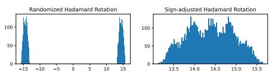
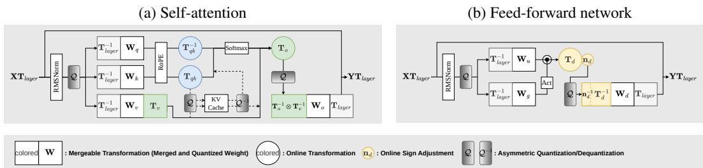
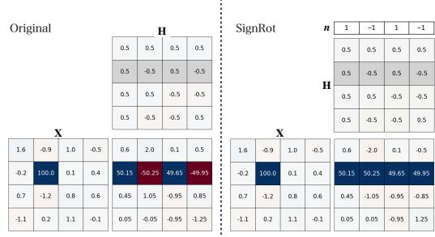
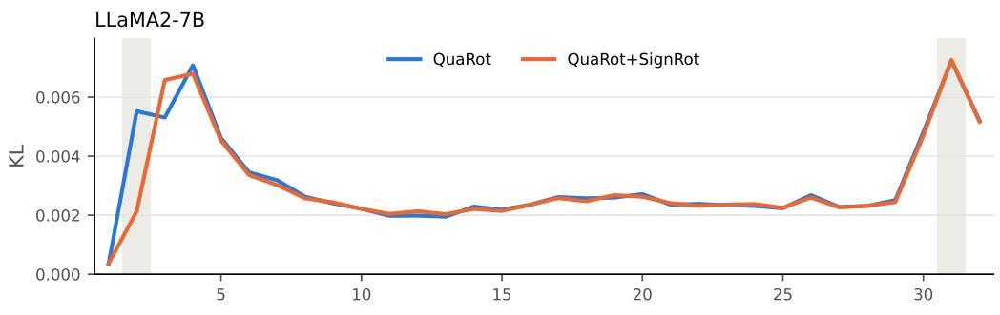
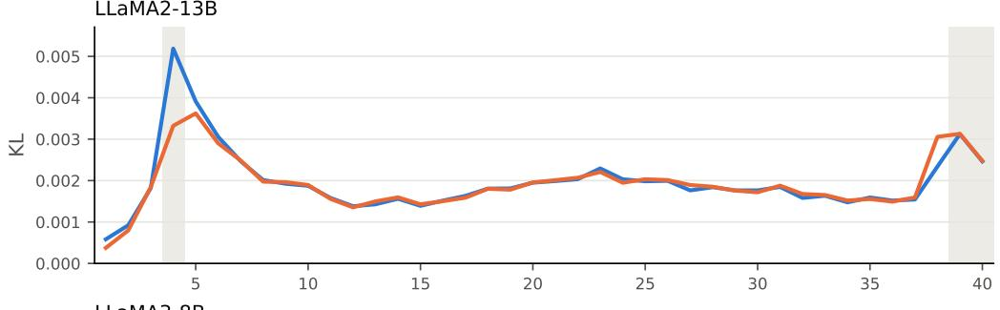
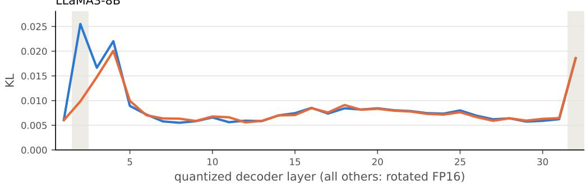

# SignRot: LLM Quantization with Massive Outlier-Aware Sign-Adjusted Rotation

Jaehun Gim Hanyang University wogns3623@hanyang.ac.kr

Gyuwan Kim University of California, Santa Barbara gyuwankim@ucsb.edu

Jaewoo Kim Hanyang University shrimp0426@hanyang.ac.kr

Seo Yeon Park∗ Hanyang University seoyeonpark@hanyang.ac.kr

## Abstract

While quantization compresses LLMs and accelerates inference, outlier activations impede efficient low-bit representation. In particular, massive outliers cause substantial performance degradation. Although rotation-based methods that rely on randomized Hadamard transforms for online inference aim to mitigate this, they can produce fragmented distributions with empty bins when a massive outlier dominates a token’s activation. This fragmentation severely undermines uniform quantization performance. Moreover, massive outliers concentrate in the down-projection input, where the preceding nonlinearity requires the rotation to be applied at inference time. This constraint prevents training-based approaches such as SpinQuant from learning the online rotation at this position, as a learned dense matrix cannot use the Fast Walsh–Hadamard Transform and would require a full matrix multiplication during inference. To address this, we propose SignRot (Sign-adjusted Rotation), which identifies massive outlier channels and constructs a sign adjustment vector that unifies the signs of the corresponding Hadamard row, collapsing the bimodal distribution into a unimodal profile amenable to quantization. Since the aligned outlier shifts the activation mean away from zero, we pair SignRot with asymmetric activation quantization, whose zero-point absorbs this shift. As a lightweight, drop-in improvement compatible with any Hadamard-based quantization method, SignRot requires only a single calibration forward pass and adds only element-wise sign flips at inference, without an additional matrix multiplication. Applying Sign-Rot to QuaRot achieves a WikiText2 perplexity of 5.88 and an average zero-shot reasoning accuracy of 72.73, surpassing SpinQuant on the LLaMA3-70B model. Code is available at https://github.com/HYU-ARK-Lab/SignRot.

## 1 Introduction

While large language models (LLMs) have achieved remarkable performance across diverse domains [32, 6, 25], their escalating scale presents substantial challenges in computational and memory requirements. Quantization has emerged as a promising efficiency technique due to its straightforward implementation and ability to maintain reliable performance under significant compression [17, 1, 19]. In particular, post-training quantization (PTQ) [11] has become a de facto standard, as it requires only a minimal calibration dataset without extensive retraining, making it highly practical for large-scale deployment. PTQ has been applied to quantize weights [11, 4], activations [38, 1], and the KV cache [12].

While PTQ methods are promising, the presence of large-magnitude outliers in activations, called massive outliers, remains a critical bottleneck, as they disproportionately distort the quantization process [38, 31, 1, 17]. To mitigate this issue, rotation-based PTQ methods, which transform the activation space to suppress outliers before quantization, have been explored [1, 19, 17]. These rotation matrices can generally be fused

Figure 1: Distributions of token activations in LLaMA2-7B layer 2 down\_proj containing massive outliers after rotation using randomized Hadamard and sign-adjusted Hadamard.

into adjacent weights offline, incurring no additional inference cost. However, for layers following nonlinear activations, such as FFN down-projection layers, the rotation cannot be fused into adjacent weights and thus typically requires online application during inference. To mitigate the resulting computational overhead, prior work has explored the use of randomized Hadamard matrices, which admit efficient implementation through the Fast Walsh–Hadamard Transform (FWHT) [1].

However, we find that when a massive outlier dominates a token’s input activation, applying randomized Hadamard transforms produces a fragmented distribution with distinct positive and negative clusters, as shown in Figure 1, which directly degrades quantization performance. This is because the empty regions between these clusters inflate the activation quantization range and thus the step size. This is particularly critical at the FFN down-projection, where massive outliers are known to concentrate [30], and where existing rotation-based PTQ methods are constrained to use randomized Hadamard transforms for efficiency.

To address this, we propose a simple yet effective activation-aware sign adjustment to the Hadamard transform, named Sign-adjusted Rotation (SignRot). By applying column-wise sign flips that unify the signs of the Hadamard row corresponding to the identified massive outlier channel, the fragmented distribution is restored to a bell-shaped profile amenable to quantization. Because the aligned outlier shifts the rotated activation’s mean away from zero, SignRot pairs this adjustment with asymmetric activation quantization, whose zero-point absorbs the shift.

SignRot is a lightweight, drop-in improvement compatible with any Hadamard-based quantization method, including QuaRot [1], SpinQuant [19], and DartQuant [29], and is applicable to both dense and MoE architectures. Since massive outlier channels are fixed across inputs [30], the sign adjustment vector needs only to be computed once via a single calibration forward pass; at inference, SignRot adds only an element-wise sign flip to the rotated activation, with no additional matrix multiplication. Furthermore, SignRot quantizes a 7B model in approximately 3 minutes with Round to-Nearest (RTN), and around 15 minutes with GPTQ [11] on a single GPU, requiring no rotation training.

Our contribution is summarized as follows:

• We analytically characterize that randomized Hadamard transforms induce bimodal fragmentation in the presence of massive outliers, demonstrating that this fragmentation leads to quantization degradation at the FFN down-projection.

• We propose SignRot, a simple yet effective activation-aware sign adjustment to the Hadamard transform that directly addresses the fragmentation without requiring learned rotations. SignRot is a lightweight, drop-in improvement compatible with any Hadamard-based quantization method, requiring only a single calibration forward pass.

• SignRot improves quantization performance across diverse settings, including both dense and MoE architectures. On LLaMA3-70B with GPTQ, SignRot reduces the WikiText2 perplexity of QuaRot [1] from 6.16 to 5.88 under the same asymmetric activation quantization, and applied on top of SpinQuant [19], which relies on learned rotations, it further reduces perplexity from 6.38 to 5.45 and improves average zero-shot accuracy from 71.15 to 73.52.

## 2 Preliminaries and Related Work

Quantization formulations. Quantization is a technique that converts full-precision weights or activations (and optionally the KV cache) into low-precision (or discrete) values. This method is widely used to reduce the model size and inference latency. The general b-bit uniform quantization function $\mathcal { Q } _ { b }$ maps an input matrix X into ${ \bf X } _ { q } = \mathcal { Q } _ { b } ( { \bf X } ) = \mathrm { \bar { I } } { \Omega } _ { \Omega ( b ) } \mathrm { \bar { ( } } { \bf X } / \Delta ) + { \bf Z }$ , where the subscript $q$ mean quantized, ∆ is the step-size, Z is the zero point for asymmetric quantization, Π is a projection function onto the set of integers $\Omega ( b ) = \{ 0 , 1 , \dot { \mathrm { ~  ~ \cdot ~ } } , 2 ^ { b } - 1 \} \mathrm { ~  ~ o r ~ } \Omega ( b ) = \dot { \{ - 2 ^ { b - 1 } , \mathrm { ~  ~ \cdot ~ } , 2 ^ { b - 1 } - \mathrm { ~  ~ i \} } }$ . For brevity, we omit b and denote Q(·) as the general quantization function in the rest of this paper. The dequantized matrix $\widehat { \mathcal { Q } } ( \mathbf { X } ) = \mathbf { X } _ { d e q }$ is expressed as $\Delta \cdot ( \mathbf { X } _ { q } - \mathbf { Z } )$ , with scales and zero-points broadcast over their quantization groups. During inference, a linear layer $\mathbf { Y } = \mathbf { X } \mathbf { W }$ is approximated as $\mathbf { Y } \approx \mathbf { X } _ { d e q } \mathbf { W } _ { d e q }$ . In this work, we primarily use per-token asymmetric quantization for activations and per-channel symmetric quantization for weights.

  
Figure 2: The overview of our proposed method SignRot in (a) self-attention and (b) feed-forward blocks, illustrated with a gated MLP (e.g., LLaMA-style) as a representative architecture. Rotation matrices fall into two categories: mergeable transformation $( e . g . , \mathbf { T } _ { l a y e r } , \mathbf { T } _ { o } \otimes \mathbf { T } _ { v } )$ , which are fused into adjacent weights offline and incur no inference cost; and online transformation $( e . g . , \mathbf { T } _ { d } )$ , which must be applied during inference due to preceding nonlinear operations. SignRot introduces a sign adjustment vector $\mathbf { n } _ { d }$ at $\mathbf { T } _ { d } ,$ the down-projection input where massive outliers concentrate, merging diag $( \mathbf { n } _ { d } ) ^ { - 1 }$ into $\mathbf { W } _ { d }$ offline while applying $\mathbf { n } _ { d }$ online to the intermediate activation $\mathbf { X } _ { d }$

Channel outlier and scaling methods Previous studies [8, 38, 28] have focused on handling channel outliers that appear in specific feature channels across entire token sequences. These methods primarily leverage scale invariance, which utilizes the fact that a linear layer $\mathbf { Y } = \mathbf { X } \mathbf { W }$ remains mathematically equivalent when activations are scaled by a diagonal matrix S and weights are inversely scaled: $\begin{array} { r } { \dot { \mathbf { Y } } = ( \mathbf { X } \mathbf { S } ) ( \mathbf { S } ^ { - 1 } \mathbf { W } ) } \end{array}$

While LLM.int8 [8] initially managed these outliers through mixed-precision decomposition, its implementation proved hardware-unfriendly. To address this, SmoothQuant [38] introduced a technique to migrate the quantization difficulty of channel outliers from activations to weights via channel-wise scaling. This direction was further refined by OmniQuant [28], which improved quantization performance by learning optimal channel-wise scaling factors.

However, scaling methods that only adjust the per-channel magnitude cannot effectively handle a newly discovered type of outlier [30, 18] called the massive outlier. These outliers concentrate in specific tokens and channels, particularly in FFN layers, and are known to be significant in quantizing activations to 4 bits or less [17].

Massive outlier and rotation methods To mitigate the effects of massive outliers, recent studies [1, 19, 29] leverage transformation invariance. Unlike scaling, which only performs element-wise adjustment, rotation-based methods use an orthogonal transformation R to redistribute the outlier energy across all available channels: $\mathbf { Y } = ( \mathbf { X } \mathbf { R } ) ( \mathbf { R } ^ { - 1 } \mathbf { W } )$ . The applicability and optimization of these rotations are fundamentally governed by their position within the Transformer [35] block.

When a rotation follows a linear operation, it can be fused directly into adjacent weights during the PTQ phase, incurring no additional inference cost. This offline mergeability allows for intensive optimization through training to maximize accuracy. For instance, SpinQuant [19] optimizes the rotation matrix using CayleySGD [15]. DartQuant [29] further improves the efficiency of rotation matrix optimization by constraining the post-rotation activation distribution, which reduces both computational cost and overfitting risk.

In contrast, rotations that follow nonlinear operations, such as the FFN down-projection input $( i . e . , \mathrm { T } _ { d }$ in Figure 2, where a LLaMA-style architecture is used as a representative example), cannot be fused and must be applied during inference. To maintain inference efficiency at these positions, existing methods are constrained to use the Randomized Hadamard Transform (RHT) to leverage the Fast Walsh–Hadamard Transform (FWHT) [10]. Various methodologies have been employed to implement this framework. QuaRot [1] serves as a foundation for training-free rotation, effectively removing outliers using RHT, while DFRot [37] refines the rotation using a small calibration dataset to minimize quantization errors in a near-closed-form manner.

While these training-free methods offer fast setup using a minimal calibration step, they remain agnostic to the specific polarity of massive outliers. As we will analyze in Section 3, this disregard for outlier polarity induces a systematic bimodal fragmentation when using RHT at the FFN downprojection. This serves as a critical source of quantization degradation that cannot be resolved without considering the signs of the outliers.

## 3 Analysis of Bimodal Fragmentation in RHT under Massive Outliers

The randomized Hadamard transform (RHT) combines independent random signs with the uniform structure of the Hadamard matrix. In the absence of dominant outliers, its output can have a bellshaped distribution favorable for quantization [34]. The Gaussian approximation used here requires the conditions discussed below. The Gaussian approximation under RHT relies on the Central Limit Theorem (CLT). Independent random signs yield zero-mean summands. In this setting, the Lindeberg condition requires that no single summand contribute a non-negligible fraction of the total variance in the limit [2]. This assumption can fail when one channel retains a non-vanishing fraction of the activation energy; that channel then contributes an independent two-valued term, so the limit is not Gaussian.

Formally, let $\mathbf { x } _ { t } \in \mathbb { R } ^ { C _ { i n } }$ be the activation vector for token t, with signed outlier value $M _ { t } = x _ { t , c _ { m a x } }$ at channel $c _ { m a x }$ . When the RHT is applied, the output is computed as $\mathbf { y } _ { t } = \mathbf { x } _ { t }$ · diag(r) · H, where H is an orthonormalized Hadamard matrix and $r _ { i } \in \{ \pm 1 \}$ are independent random signs. The j-th element of the transformed vector decomposes as follows:

$$
y _ { t , j } = M _ { t } \cdot r _ { c _ { m a x } } h _ { c _ { m a x } , j } + \sum _ { i \neq c _ { m a x } } x _ { t , i } r _ { i } h _ { i , j }\tag{1}
$$

where $h _ { i , j }$ is the $( i , j )$ -th entry of the Hadamard matrix H and $x _ { t , i }$ is the i-th element of $\mathbf { x } _ { t } .$ . For a fixed output channel $j ,$ the residual has variance $\begin{array} { r } { \sigma _ { r e s t } ^ { 2 } = C _ { i n } ^ { - 1 } \sum _ { i \neq c _ { m a x } } x _ { t , i } ^ { 2 } } \end{array}$ over the random signs. When the residual satisfies its own Lindeberg condition, we approximate it by $\mathcal { N } ( 0 , \sigma _ { r e s t } ^ { 2 } )$ . The independent outlier term takes values $\pm M _ { t } / \sqrt { C _ { i n } }$ with equal probability, giving the Gaussian-mixture approximation

$$
y _ { t , j } \stackrel { \mathrm { a p p r o x . } } { \sim } \frac { 1 } { 2 } \Lambda \biggl ( + \frac { M _ { t } } { \sqrt { C _ { i n } } } , \sigma _ { r e s t } ^ { 2 } \biggr ) + \frac { 1 } { 2 } \mathcal { N } \biggl ( - \frac { M _ { t } } { \sqrt { C _ { i n } } } , \sigma _ { r e s t } ^ { 2 } \biggr ) .\tag{2}
$$

This mixture describes a distribution over random $\mathrm { s i g n s , }$ not an exact law for the channels of one fixed transform. For a balanced outlier row, half the channels receive each shift; interpreting their histogram as this mixture additionally assumes approximately Gaussian residuals within both groups (Appendix A). For the full sum, the Lindeberg condition reduces to max $x _ { t , i } ^ { 2 } / \textstyle \sum _ { i } x _ { t , i } ^ { 2 } \to 0$ . Its violation is asymptotic; the finite threshold below is exact only within the Gaussian-mixture model. An equally weighted mixture of two Gaussians with a common variance $\sigma ^ { 2 }$ is bimodal if and only if their means are more than 2σ apart [27]. Applying this to Equation 2, i.e. $, | M _ { t } | / \sqrt { C _ { i n } } > \sigma _ { r e s t } ,$ yields

$$
M _ { t } ^ { 2 } > \sum _ { i \neq c _ { m a x } } x _ { t , i } ^ { 2 } ,\tag{3}
$$

that is, the outlier channel must carry more energy than all remaining channels combined. Since this requires $M _ { t } ^ { 2 } > \| \mathbf { x } _ { t } \| _ { 2 } ^ { 2 } / 2$ , at most one channel per token can satisfy Equation 3. We refer to such a channel as the dominant massive outlier channel of the token; it is the channel that SignRot targets. Accordingly, a massive outlier token is defined as a token whose largest channel satisfies Equation 3 and reaches at least half of the peak activation magnitude of the layer, provided that this peak is at least 100. This energy-based criterion differs from the magnitude-based criterion of Sun et al. [30]; Appendix C compares the two criteria.

For the massive outlier token of LLaMA2-7B in Table $7 ~ ( C _ { i n } ~ = ~ 1 1 . 0 0 8 )$ , the threshold is $\sqrt { C _ { i n } } \sigma _ { r e s t } \approx 5 8$ , whereas the observed outlier is $M _ { t } = 1 5 1 0$ , about 26× larger, consistent with the clearly separated clusters in Figure 1. The full derivation is provided in Appendix A. Since the threshold is derived under the two-Gaussian approximation, energy dominance should be read as an indicator of fragmentation rather than an exact test for empirical bimodality; in particular, several large residual channels can invalidate the two-component model. As illustrated in Figure 1, bimodal fragmentation can degrade quantization performance by widening the activation range. For an input activation token $\mathbf { x } _ { t }$ quantized with a shared step size $\Delta _ { t }$ , nearest rounding without clipping gives $| \widehat { \mathcal { Q } } ( x _ { t , j } ) - x _ { t , j } | \leq \Delta _ { t } / 2$ for each channel. The mean squared error (MSE) of the quantized input is therefore

$$
\mathrm { M S E } _ { t } : = \frac { 1 } { C _ { i n } } \left\| \widehat { \mathcal { Q } } ( \mathbf { x } _ { t } ) - \mathbf { x } _ { t } \right\| _ { 2 } ^ { 2 } = \frac { 1 } { C _ { i n } } \sum _ { j = 1 } ^ { C _ { i n } } \left( \widehat { \mathcal { Q } } ( x _ { t , j } ) - x _ { t , j } \right) ^ { 2 } \leq \frac { \Delta _ { t } ^ { 2 } } { 4 } .\tag{4}
$$

Since the two component means are separated by $2 | M _ { t } | / \sqrt { C _ { i n } } .$ , the per-token range grows by at least this amount in addition to the spread of the residual, which increases $\Delta _ { t }$ at a fixed bit width and hence the rounding error in Equation 4. The gap between the clusters additionally leaves the central quantization bins unused, while the realized MSE also depends on grid alignment and clipping. Although massive outlier tokens are rare, the fragmentation they cause substantially increases the quantization error of the layer in which they first appear (Appendix C). The range inflation itself, however, follows directly from the sign pattern of the outlier row, and removing it is the goal of the sign adjustment introduced next. We provide activation distribution statistics for massive outlier tokens and non-outlier tokens in Appendix B.

## 4 Proposed Method: SignRot

The bimodal fragmentation analyzed above arises from the alternating signs of the Hadamard entries $h _ { c _ { m a x } , j } \in \{ \bar { \pm } 1 / \bar { \sqrt { C _ { i n } } } \}$ corresponding to the outlier channel $c _ { m a x }$ . We therefore propose Sign-adjusted Rotation (SignRot), which unifies the signs of the $c _ { m a x } – \mathrm { t h }$ row of H, such that the selected outlier contribution becomes a constant shift $M _ { t } / \sqrt { C _ { i n } }$ across all output channels. If the adjusted residual is approximately Gaussian, the resulting distribution is approximately unimodal.

  
Figure 3: Effect of sign adjustment on the randomized Hadamard matrix under a massive outlier. Without adjustment (left), large outlier activation produces fragmented outputs of mixed sign. With sign alignment via diag(n) (right), the outlier contribution becomes a uniform positive shift, collapsing the bimodal distribution.

## 4.1 Identifying the massive outlier channel

activation matrix $\breve { \mathbf { X } } \in \mathbb { R } ^ { T \times C _ { i r } }$ over a calibration set and locate the channel with the largest absolute activation:

$$
c _ { \operatorname* { m a x } } = \arg \operatorname* { m a x } _ { c } \left( \operatorname* { m a x } _ { t } | x _ { t , c } | \right) .\tag{5}
$$

We identify one channel in a calibration forward pass and reuse it for subsequent inputs. This choice follows the observed stability of massive outlier channels [30]: in the first massive outlier layer of every model we examine, all massive outlier tokens share the same dominant massive outlier channel, which holds 87–99.9% of the token energy (Table 11, Appendix C). When a token carries further massive outlier channels, $i . e .$ , channels that each carry more energy than all smaller channels combined (Equation 3 applied recursively), SignRot still removes the split induced by the selected channel (Appendix D). Aligning this single channel therefore removes most of the fragmentation, although some later layers do not share the same dominant massive outlier channel (Appendix H).

## 4.2 Sign-adjusted Hadamard transformation

Given $c _ { m a x }$ , we define the sign adjustment vector $\mathbf { n } \in \{ + 1 , - 1 \} ^ { C _ { i n } }$ as follows:

$$
n _ { j } : = \mathrm { s i g n } ( h _ { c _ { m a x } , j } ) = \left\{ \begin{array} { l l } { 1 } & { \mathrm { i f } \ h _ { c _ { \operatorname* { m a x } } , j } \geq 0 , } \\ { - 1 } & { \mathrm { o t h e r w i s e } , } \end{array} \right.\tag{6}
$$

We then define the sign-adjusted Hadamard transformation matrix $\mathbf { H } _ { \mathrm { a d j } } \in \mathbb { R } ^ { C _ { i n } \times C _ { i n } }$ as follows:

$$
\mathbf { H } _ { \mathrm { a d j } } = \mathbf { H } \mathrm { \ d i a g } ( \mathbf { n } ) ,\tag{7}
$$

where right-multiplication by diag(n) flips the sign of each column j by $n _ { j } ,$ so that every entry of the $c _ { \mathrm { m a x } } { \mathrm { - t h } }$ row of $\mathbf { H } _ { \mathrm { a d j } }$ becomes $+ 1 / \sqrt { C _ { i n } }$ . We demonstrate this effect in Figure 3. Without sign adjustment, the outlier row (i.e., containing the massive activation ≈ 100.0) produces mixed-sign outputs that directly reflect the alternating signs of the corresponding Hadamard row (Figure 3 left). After applying diag(n), the same row produces uniformly positive outputs (Figure 3 right). Consequently, the selected outlier term $M _ { t } h _ { c _ { m a x } , j } n _ { j } = M _ { t } / \sqrt { C _ { i n } }$ becomes a constant shift for all $j ,$ removing this channel’s sign-induced split. In practice, we apply this adjustment at the down-projection input $( \mathbf { T } _ { d }$ in Figure 2), where massive outliers concentrate [30]. We denote the corresponding vector as $\mathbf { n } _ { d } .$

Quantization with sign-adjusted Hadamard transformation. Since diag(n) is an involutory matrix $( i . e . , \mathrm { d i a g } ( \mathbf { n } ) ^ { - 1 } = \mathrm { d i a g } ( \mathbf { n } ) )$ , the inverse is given by $\mathbf H _ { \mathrm { a d j } } ^ { - 1 } = \mathrm { d i a g } ( \mathbf n ) \mathbf H ^ { - 1 }$ . This allows the adjusted transformation to be inserted into a linear layer without altering the computation since $\mathbf { Y } = \mathbf { X } \mathbf { W } = ( \mathbf { X } \mathbf { H } _ { \mathrm { a d j } } ) ( \mathbf { H } _ { \mathrm { a d i } } ^ { - 1 } \mathbf { W } )$ holds. For clarity, the random-sign factor diag(r) is omitted here. Quantization is applied to each factor independently; $\mathbf { Y } _ { q }$ denotes the resulting integer accumulation:

$$
\begin{array} { r } { \mathbf { Y } _ { q } = \mathcal { Q } ( \mathbf { X } \mathbf { H } _ { \mathrm { a d j } } ) \mathcal { Q } \Big ( \mathbf { H } _ { \mathrm { a d j } } ^ { - 1 } \mathbf { W } \Big ) . } \end{array}\tag{8}
$$

Asymmetric–Symmetric matrix multiplication SignRot pairs sign adjustment with asymmetric activation quantization to represent the resulting shifted distribution. Sign adjustment changes the signs of the Hadamard outputs while preserving their absolute values; it therefore leaves the maxabsolute scale of symmetric quantization unchanged. Asymmetric quantization uses a zero-point to accommodate the shift and can allocate quantization levels to the shifted range. Asymmetric activation quantization is therefore an integral part of SignRot rather than an optional refinement. To maintain the efficiency of activation quantization, we use Asymmetric–Symmetric matrix multiplication (Asym–Symm matmul, where activations are quantized asymmetrically and weights symmetrically) defined as follows:

$$
\mathbf { Y } _ { d e q } = \Delta \mathbf { x } ( \mathbf { X } _ { q } \mathbf { W } _ { q } - \mathbf { Z } _ { \mathbf { X } } \mathbf { W } _ { q } ) \Delta \mathbf { w }\tag{9}
$$

where $\mathbf { Y } _ { d e q }$ denotes the dequantized output, $\Delta \mathbf { x }$ and $\Delta _ { \mathbf { W } }$ are diagonal matrices of per-token activation scales and per-output-channel weight scales, respectively, and $\mathbf { Z _ { X } }$ contains the activation zero-points. The first term in Equation 9 is an integer dot product identical to Symmetric–Symmetric matrix multiplication (Symm–Symm matmul, where both activations and weights are quantized symmetrically). For per-token activation quantization, ${ \bf Z } _ { \bf X } = { \bf z } _ { \bf X } { \bf 1 } ^ { \top }$ , where $\mathbf { z } _ { \mathbf { X } }$ is a column vector of token zero-points and $\mathbf { 1 } \in \mathbb { R } ^ { C _ { i n } }$ is the all-ones vector. The second term therefore factorizes as $\mathbf { z } _ { \mathbf { X } } ( \mathbf { 1 } ^ { \top } \mathbf { W } _ { q } )$ . The weight column sum $\mathbf { 1 } ^ { \top } \mathbf { W } _ { q } ,$ with $\mathbf { W } _ { q } \in \mathbb { Z } ^ { C _ { i n } \times C _ { o u t } }$ , is input-independent and precomputed offline. During inference, Asym–Symm matmul computes the rank-1 outer product with zX and subtracts it from the integer matrix product. This correction costs $O ( T C _ { o u t } )$ , compared with $O ( T C _ { i n } C _ { o u t } )$ for the matrix multiplication. Asymmetric quantization also estimates a per-token zero-point alongside the scale required by symmetric quantization.

## 5 Experiments

## 5.1 Experimental setup

Models and datasets We apply SignRot on the LLaMA2 (7B, 13B, 70B) [33] and LLaMA3 (8B, 70B) [9] model families, and additionally on Mistral-7B-v0.3 [13] and Qwen3-30B-A3B [39]. To assess our method, we evaluate quantized models in language modeling and reasoning tasks. We report perplexity on WikiText2 [20] and C4 [24] datasets to evaluate language modeling. Furthermore, we measure the accuracy on six zero-shot reasoning tasks: ARC (Easy and Challenge) [5], HellaSwag [41], LAMBADA(OpenAI) [23], PIQA [3], and WinoGrande [26].

Baselines We evaluate SignRot by applying it on top of three rotation-based methods that employ online Hadamard transforms: QuaRot [1], SpinQuant [19], and DartQuant [29]. QuaRot applies randomized Hadamard transforms without any training, while SpinQuant and DartQuant further optimize the rotation matrices to minimize quantization error.

Table 1: Comparison of the perplexity score on WikiText2 and C4 (PPL), and averaged accuracy on six zero-shot reasoning tasks (Avg. 0-shot) for LLaMA families. ‘+SignRot’ indicates that our method has been applied. Full results are in the Appendix F. Note that QuaRot uses symmetric activation quantization.
<table><tr><td rowspan="2">Method</td><td rowspan="2">W Quantizer</td><td colspan="3">2-7B</td><td colspan="3">2-13B</td><td colspan="3">2-70B</td><td colspan="3">3-8B</td><td colspan="3">3-70B</td></tr><tr><td>Wiki2 PPL↓</td><td>C4 PPL↓</td><td>Avg. 0-shot↑</td><td>Wiki2 PPL↓</td><td>C4 PPL↓</td><td>Avg. 0-shot↑</td><td>Wiki2 PPL↓</td><td>C4 PPL↓</td><td>Avg. 0-shot↑</td><td>Wiki2 PPL↓</td><td>C4 PPL↓</td><td>Avg. 0-shot↑</td><td>Wiki2 PPL↓</td><td>C4 PPL↓</td><td>Avg. 0-shot↑</td></tr><tr><td>FP16</td><td>-</td><td>5.47</td><td>7.26</td><td>69.79</td><td>4.88</td><td>6.73</td><td>72.55</td><td>3.32</td><td>5.71</td><td>77.05</td><td>6.14</td><td>9.45</td><td>73.23</td><td>2.86</td><td>7.17</td><td>79.95</td></tr><tr><td>QuaRot</td><td>RTN</td><td>8.56</td><td>11.86</td><td>57.73</td><td>6.10</td><td>8.67</td><td>66.25</td><td>4.14</td><td>6.42</td><td>73.47</td><td>10.60</td><td>17.19</td><td>61.34</td><td>55.44</td><td>79.48</td><td>35.36</td></tr><tr><td>QuaRot+SignRot</td><td>RTN</td><td>7.93</td><td>11.21</td><td>60.43</td><td>6.00</td><td>8.48</td><td>67.51</td><td>4.05</td><td>6.32</td><td>73.86</td><td>9.68</td><td>15.72</td><td>64.17</td><td>41.47</td><td>58.26</td><td>38.52</td></tr><tr><td>QuaRot</td><td>GPTQ</td><td>6.10</td><td>8.32</td><td>65.01</td><td>5.40</td><td>7.54</td><td>68.91</td><td>3.79</td><td>6.12</td><td>75.68</td><td>8.16</td><td>13.38</td><td>65.79</td><td>6.60</td><td>12.87</td><td>70.45</td></tr><tr><td>QuaRot+SignRot</td><td>GPTQ</td><td>6.09</td><td>8.31</td><td>67.19</td><td>5.32</td><td>7.43</td><td>70.70</td><td>3.74</td><td>6.04</td><td>75.68</td><td>7.85</td><td>12.74</td><td>67.27</td><td>5.88</td><td>11.24</td><td>72.73</td></tr><tr><td>SpinQuant</td><td>GPTQ</td><td>6.08</td><td>8.25</td><td>66.27</td><td>5.39</td><td>7.46</td><td>69.94</td><td>3.73</td><td>6.04</td><td>75.65</td><td>7.85</td><td>12.71</td><td>67.96</td><td>6.38</td><td>13.98</td><td>71.15</td></tr><tr><td>SpinQuant+SignRot</td><td>GPTQ</td><td>6.09</td><td>8.27</td><td>67.07</td><td>5.37</td><td>7.45</td><td>70.84</td><td>3.72</td><td>6.04</td><td>75.79</td><td>7.87</td><td>12.60</td><td>69.36</td><td>5.45</td><td>10.54</td><td>73.52</td></tr><tr><td>DartQuant</td><td>GPTQ</td><td>5.97</td><td>8.07</td><td>66.98</td><td>5.32</td><td>7.39</td><td>70.41</td><td>3.66</td><td>6.01</td><td>75.61</td><td>7.49</td><td>12.16</td><td>69.27</td><td>4.93</td><td>9.45</td><td>76.39</td></tr><tr><td>DartQuant+SignRot</td><td>GPTQ</td><td>5.94</td><td>8.04</td><td>67.27</td><td>5.31</td><td>7.37</td><td>70.59</td><td>3.66</td><td>6.00</td><td>75.86</td><td>7.40</td><td>12.05</td><td>69.03</td><td>4.86</td><td>9.26</td><td>76.02</td></tr></table>

Implementation details We implemented SignRot using HuggingFace Transformers [36] and PyTorch [22]. On a single A100 GPU, SignRot only adds 5 minutes of quantization time for the LLaMA2-70B model, which is negligible compared to the total quantization time. The peak memory usage during quantize LLaMA2-70B is max 7 GB for the rotation process and max 40 GB for the GPTQ stage. We use CUTLASS [21] for 4-bit matrix multiplication and FlashInfer [40] for KV cache quantization to evaluate the inference performance of our fully quantized model. Total quantization time is measured on a single NVIDIA A100 GPU, while inference speedup and memory usage are measured on an NVIDIA RTX 3090 GPU.

Quantization configurations We report results using both Round-to-Nearest (RTN) and GPTQ [11] for weight quantization; our GPTQ implementation uses 128 calibration samples randomly selected from the WikiText-2 dataset. To address the memory-intensive nature of self-attention, we apply group-wise asymmetric quantization to the KV cache with a group size of the head dimension, following [1]. For each baseline, +SignRot uses the same quantization configuration as the baseline, except that +SignRot applies per-token asymmetric activation quantization and its clipping ratios are selected by hyperparameter tuning. QuaRot uses per-token symmetric activation quantization following its official setting [1], whereas SpinQuant and DartQuant already use asymmetric activation quantization. Appendix E gives the detailed quantization configuration of each baseline and of SignRot. Sign adjustment vectors are computed using the first sample of the GPTQ calibration dataset during the GPTQ calibration phase. For RTN, we compute the sign adjustment vector using a single sample randomly extracted from the WikiText-2 dataset. We confirm that the choice of calibration data has minimal impact on performance in Table 5.

## 5.2 Main results

Results on LLaMA families. We report the main results in Table 1, where SignRot is applied on top of three rotation-based baselines, respectively, on LLaMA2 (7B/13B/70B) and LLaMA3 (8B/70B) under both RTN and GPTQ weight quantization. We evaluate language modeling perplexity on WikiText2 and C4, and zero-shot reasoning task accuracy.

For language modeling tasks, QuaRot+SignRot generally reduces perplexity over the QuaRot baseline. The improvement is especially pronounced for LLaMA3-70B, where Wiki2 perplexity drops from 6.60 to 5.88 under GPTQ (from 6.16 to 5.88 under the same asymmetric activation quantization; Table 4), surpassing SpinQuant [19] (6.38). For LLaMA2-13B with GPTQ, QuaRot+SignRot achieves a Wiki2 PPL of 5.32, matching DartQuant [29] and outperforming SpinQuant (5.39). On LLaMA3-8B, QuaRot+SignRot +GPTQ reduces PPL from 8.16 to 7.85, matching SpinQuant and narrowing the gap to DartQuant (7.49). Applying SignRot on top of SpinQuant and DartQuant also yields perplexity reductions in most settings, demonstrating that sign adjustment is broadly complementary to other rotation-based methods.

For zero-shot reasoning tasks, we make the following observations: under RTN quantization, QuaRot+SignRot generally outperforms QuaRot, i.e., achieving an average accuracy improvement of up to 2.83 points on LLaMA3-8B. On LLaMA2, this gain decreases with model size (2.70, 1.26, and 0.39 points for 7B, 13B, and 70B), consistent with the greater robustness of larger models to quantization [16, 14]: the accuracy drop from FP16 to QuaRot under RTN decreases from 12.06 to 6.30 and

Table 2: Zero-shot reasoning task accuracy (0-shot) and perplexity scores on WikiText2 and C4 (PPL) for 4-bit weight, activation, and KV-cache quantized Mistral and Qwen3. Note that QuaRot uses symmetric activation quantization.
<table><tr><td>Model</td><td>Method</td><td>W Quantizer</td><td>Wiki2 PPL↓</td><td>C4 PPL↓</td><td>ARC-C 0-shot↑</td><td>ARC-E 0-shot↑</td><td>HellaSwag 0-shot↑</td><td>LAMBADA 0-shot↑</td><td>PIQA 0-shot↑</td><td>Winogrande 0-shot↑</td><td>Avg. 0-shot↑</td></tr><tr><td rowspan="3">Mistral-7B-v0.3</td><td>FP16</td><td>1</td><td>5.32</td><td>8.47</td><td>52.30</td><td>78.20</td><td>80.41</td><td>75.32</td><td>82.26</td><td>73.88</td><td>73.73</td></tr><tr><td>QuaRot</td><td>GPTQ</td><td>5.80</td><td>9.19</td><td>48.89</td><td>76.13</td><td>78.09</td><td>73.18</td><td>79.86</td><td>72.37</td><td>71.42</td></tr><tr><td>QuaRot+SignRot</td><td>GPTQ</td><td>5.71</td><td>9.09</td><td>48.72</td><td>76.09</td><td>78.95</td><td>72.64</td><td>80.30</td><td>72.45</td><td>71.53</td></tr><tr><td rowspan="5">Qwen3-30B-A3B</td><td>FP16</td><td></td><td>8.70</td><td>14.05</td><td>56.57</td><td>79.25</td><td>77.63</td><td>64.76</td><td>80.47</td><td>69.38</td><td>71.34</td></tr><tr><td>QuaRot</td><td>RTN</td><td>11.70</td><td>18.21</td><td>47.18</td><td>68.90</td><td>69.00</td><td>52.73</td><td>75.57</td><td>63.38</td><td>62.79</td></tr><tr><td>QuaRot+SignRot</td><td>RTN</td><td>11.21</td><td>17.63</td><td>48.04</td><td>69.70</td><td>70.04</td><td>53.97</td><td>75.30</td><td>62.04</td><td>63.18</td></tr><tr><td>QuaRot</td><td>GPTQ</td><td>10.16</td><td>16.22</td><td>48.89</td><td>73.82</td><td>71.51</td><td>57.25</td><td>75.68</td><td>63.54</td><td>65.11</td></tr><tr><td>QuaRot+SignRot</td><td>GPTQ</td><td>9.79</td><td>15.93</td><td>47.70</td><td>72.10</td><td>72.33</td><td>60.99</td><td>76.99</td><td>64.72</td><td>65.80</td></tr></table>

Table 3: End-to-end inference latency and peak memory of LLaMA2-7B on a single RTX 3090 GPU at batch size 1: prefill of a 2048-token prompt followed by 128 decoding steps. Both quantized models use per-token asymmetric activation quantization.
<table><tr><td rowspan="2">Method</td><td colspan="2">Prefill</td><td colspan="2">Decode</td><td colspan="2">E2E</td><td colspan="2">Peak memory</td></tr><tr><td>ms</td><td>Speedup</td><td>ms/token</td><td>Speedup</td><td>ms</td><td>Speedup</td><td>GB</td><td>Saving</td></tr><tr><td>FP16</td><td>496.7</td><td>1.00×</td><td>24.01</td><td>1.00×</td><td>3626.6</td><td>1.00×</td><td>13.84</td><td>1.00×</td></tr><tr><td>QuaRot</td><td>283.4</td><td>1.75×</td><td>14.92</td><td>1.61×</td><td>2194.0</td><td>1.65×</td><td>4.33</td><td>3.19×</td></tr><tr><td>QuaRot+SignRot</td><td>287.3</td><td>1.73×</td><td>14.97</td><td>1.60×</td><td>2203.5</td><td>1.65×</td><td>4.33</td><td>3.19×</td></tr><tr><td>Overhead of SignRot</td><td>+1.37%</td><td></td><td>+0.34%</td><td></td><td>+0.43%</td><td></td><td>+0.02%</td><td></td></tr></table>

3.58 points, leaving less quantization error for SignRot to recover. Under GPTQ, QuaRot+SignRot surpasses SpinQuant [19] by 0.92 points on LLaMA2-7B (67.19 vs. 66.27) and by 0.76 points on LLaMA2-13B (70.70 vs. 69.94), even though SpinQuant relies on learned rotation matrices. On the larger LLaMA3-70B model, QuaRot+SignRot+GPTQ improves average accuracy from 70.45 to 72.73 (from 72.28 to 72.73 under the same asymmetric activation quantization; Table 4), again exceeding SpinQuant (71.15). Furthermore, applying SignRot to SpinQuant and DartQuant [29] baselines yields additional gains in most settings, demonstrating the broad applicability of our approach.

Results on other models To validate the generalizability of our method, we apply SignRot to two additional models: Mistral-7B-v0.3 [13] and Qwen3-30B-A3B [39], and show results in Table 2. SignRot generally improves aggregate performance over the QuaRot baseline: it lowers perplexity in all settings and raises the average zero-shot accuracy, although some individual tasks decrease (e.g., LAMBADA on Mistral-7B-v0.3 and ARC on Qwen3-30B-A3B with GPTQ). On Mistral-7Bv0.3, SignRot with GPTQ reduces the WikiText2 perplexity from 5.80 to 5.71 while keeping a similar average accuracy (71.53 vs. 71.42). On Qwen3-30B-A3B, SignRot with GPTQ outperforms QuaRot with GPTQ by 0.69 points in average accuracy, suggesting that our method generalizes across model families (Mistral) and scales to larger MoE architectures (Qwen3-30B-A3B).

## 5.3 Efficiency

End-to-end inference We measure the end-to-end inference latency of the full LLaMA2-7B model on a single NVIDIA RTX 3090 GPU with our deployment kernels, prefilling a 2048-token prompt and then decoding 128 tokens at batch size 1 (Table 3). Recent rotation-based methods such as SpinQuant [19] and DartQuant [29] adopt per-token asymmetric activation quantization, and SpinQuant+SignRot and DartQuant+SignRot in Table 1 use the same asymmetric quantizer as their baselines. We therefore measure the cost of SignRot against QuaRot with the same asymmetric quantizer. SignRot adds only 1.37% to the prefill latency, 0.34% to the per-token decoding latency, and 0.43% to the end-to-end latency, and increases the peak memory by only 0.02%. Over FP16, QuaRot+SignRot achieves 1.73×, 1.60×, and 1.65× speedups in prefill, decoding, and end-to-end latency, respectively, with a 3.19× memory saving.

These results confirm that adding SignRot does not introduce significant computational overhead, allowing us to maintain the substantial speedup and memory savings benefits of quantization while achieving improved accuracy on language modeling and reasoning tasks. Results with symmetric activation quantization and the overhead of SignRot on the down-projection layer alone are provided in Appendix G.

Table 4: Ablation study on the impact of asymmetric activation quantization with GPTQ. LLaMA2- 7B and LLaMA3-8B values are averaged over ten seeds; LLaMA3-70B is a single run, and its symmetric QuaRot row is taken from Table 1.
<table><tr><td rowspan="2">Model</td><td rowspan="2">Method</td><td rowspan="2">Act asym</td><td colspan="2">PPL (↓)</td><td colspan="7">Acc (↑)</td></tr><tr><td>Wiki2</td><td>C4</td><td>ARC-C</td><td>ARC-E</td><td>HellaSwag</td><td>LAMBADA</td><td>PIQA</td><td>Winogrande</td><td>Avg.</td></tr><tr><td rowspan="5">2-7B</td><td>QuaRot</td><td>X</td><td>6.12</td><td>8.31</td><td>42.41</td><td>70.26</td><td>72.62</td><td>70.61</td><td>76.99</td><td>66.35</td><td>66.54</td></tr><tr><td>QuaRot+SignRot</td><td>x</td><td>6.12</td><td>8.32</td><td>41.73</td><td>69.48</td><td>72.37</td><td>70.50</td><td>77.15</td><td>66.74</td><td>66.33</td></tr><tr><td>QuaRot</td><td>V</td><td>6.06</td><td>8.23</td><td>42.42</td><td>70.16</td><td>72.70</td><td>70.93</td><td>77.34</td><td>66.13</td><td>66.62</td></tr><tr><td>QuaRot+SignRot</td><td>了</td><td>6.05</td><td>8.23</td><td>42.08</td><td>69.89</td><td>72.70</td><td>71.13</td><td>77.20</td><td>66.91</td><td>66.65</td></tr><tr><td>QuaRot</td><td>x</td><td>8.15</td><td>13.28</td><td>44.71</td><td>70.62</td><td>73.66</td><td>68.18</td><td>75.56</td><td>67.29</td><td>66.67</td></tr><tr><td rowspan="4">3-8B</td><td>QuaRot+SignRot</td><td>x</td><td>8.09</td><td>13.15</td><td>45.12</td><td>70.67</td><td>73.74</td><td>67.47</td><td>75.71</td><td>67.02</td><td>66.62</td></tr><tr><td>QuaRot</td><td></td><td>7.94</td><td>12.92</td><td>44.99</td><td>71.30</td><td>74.00</td><td>69.08</td><td>76.03</td><td>67.55</td><td>67.16</td></tr><tr><td>QuaRot+SignRot</td><td></td><td>7.88</td><td>12.81</td><td>45.73</td><td>72.13</td><td>74.25</td><td>68.62</td><td>76.75</td><td>68.18</td><td>67.61</td></tr><tr><td>QuaRot</td><td>x</td><td>6.60</td><td>12.87</td><td>49.49</td><td>74.37</td><td>77.22</td><td>71.69</td><td>78.89</td><td>71.03</td><td>70.45</td></tr><tr><td rowspan="3">3-70B</td><td>QuaRot</td><td></td><td>6.16</td><td>11.96</td><td>50.94</td><td>76.47</td><td>78.66</td><td>72.04</td><td>81.07</td><td>74.51</td><td>72.28</td></tr><tr><td>QuaRot+SignRot</td><td></td><td>5.88</td><td>11.24</td><td>52.65</td><td>77.36</td><td>79.48</td><td>72.09</td><td>80.96</td><td>73.88</td><td>72.73</td></tr><tr><td></td><td></td><td></td><td></td><td></td><td></td><td></td><td></td><td></td><td></td><td></td></tr></table>

## 5.4 Ablation studies

Symmetric activation quantization To isolate the contribution of asymmetric activation quantization to our method, we compare symmetric and asymmetric per-token quantization for activations on LLaMA2-7B and LLaMA3-8B with GPTQ, averaged over ten seeds, with results shown in Table 4. Under symmetric activation quantization, the effect of SignRot varies across models. Switching to asymmetric per-token activation quantization yields an additional gain for QuaRot+SignRot on both models: average zero-shot accuracy improves by 0.99 points on LLaMA3-8B $( 6 6 . 6 2  6 7 . 6 1 )$ and by 0.32 points on LLaMA2-7B (66.33 → 66.65), while WikiText2 perplexity drops from 8.09 to 7.88 and from 6.12 to 6.05, respectively. On LLaMA3-70B (single run, Table 4), switching QuaRot from symmetric to asymmetric activation quantization changes WikiText2 perplexity, C4 perplexity, and average zero-shot accuracy from 6.60, 12.87, and 70.45 to 6.16, 11.96, and 72.28. Adding SignRot under the same asymmetric quantization gives 5.88, 11.24, and 72.73.

These results confirm that asymmetric activation quantization captures the inherent asymmetry in post-rotation activation distributions and is a key driver of the overall performance improvements reported in our main results.

Insensitivity to calibration data To evaluate the sensitivity of our method to the choice of calibration data, we compare the performance of QuaRot+SignRot when using different datasets to compute the sign adjustment vector n. Specifically, we use WikiText-2 and C4 as calibration datasets, each with three different random seeds to select calibration samples. As shown in Table 5, across the two datasets and three seeds, the WikiText2 and C4 perplexities vary by at most 0.06 and 0.08, and the average accuracy by 0.9 points, indicating that SignRot is insensitive to the choice of calibration data.

Table 5: Performance of QuaRot+SignRot on LLaMA3-8B with GPTQ when the sign adjustment vector is computed from different calibration datasets and seeds.
<table><tr><td>Calibration Dataset</td><td>Wiki2 PPL</td><td>C4 PPL</td><td>Avg. Acc</td></tr><tr><td>Wiki2 (Seed 0)</td><td>7.85</td><td>12.74</td><td>66.66</td></tr><tr><td>Wiki2 (Seed 1)</td><td>7.87</td><td>12.80</td><td>67.04</td></tr><tr><td>Wiki2 (Seed 2)</td><td>7.84</td><td>12.77</td><td>67.41</td></tr><tr><td>C4 (Seed 0)</td><td>7.88</td><td>12.78</td><td>67.26</td></tr><tr><td>C4 (Seed 1)</td><td>7.82</td><td>12.77</td><td>66.52</td></tr><tr><td>C4 (Seed 2)</td><td>7.87</td><td>12.82</td><td>67.25</td></tr></table>

Adjustment on other linear layers We evaluated sign adjustment at different projection inputs of LLaMA3-8B under GPTQ with per-token asymmetric activations, averaged over six seeds (Table 6). We adjusted the inputs of the q/k/v, out, up/gate, and down projections individually. We also tested combinations within the self-attention block $( \tilde { \mathbf { X } } _ { q k v } + \tilde { \mathbf { X } } _ { o } )$ and the MLP block $( \tilde { \mathbf { X } } _ { u g } + \tilde { \mathbf { X } } _ { d } )$ , the inputs to the out and down projections together $( \tilde { \mathbf { X } } _ { o } + \tilde { \mathbf { X } } _ { d } )$ , and all inputs together. Among single positions, adjusting $\tilde { \mathbf { X } } _ { d }$ gave the lowest perplexity (7.898 Wiki2, 12.869 C4) and the highest accuracy (67.74), whereas adjusting only $\tilde { \mathbf { X } } _ { q k v } , \tilde { \mathbf { X } } _ { u g } , \mathrm { o r } \tilde { \mathbf { X } } _ { c }$ gave 7.957–7.974 Wiki2 PPL and 66.94–67.21 accuracy. Every configuration that included $\tilde { \mathbf { X } } _ { d }$ reached a similar perplexity (7.876–7.898), and adjusting all inputs gave the lowest perplexity but no additional accuracy (67.49 vs. 67.74). We therefore apply sign adjustment only at $\ddot { \mathbf { X } } _ { d } .$ , which gave the highest mean accuracy among the evaluated configurations. Some combinations gave lower perplexity, but none gave higher mean accuracy. The down-projection input also requires an online rotation: replacing the Hadamard transform with a learned dense matrix cannot use the FWHT and would add a full matrix multiplication during inference.

Table 6: Sign adjustment applied at different projection inputs of LLaMA3-8B with GPTQ weight quantization and per-token asymmetric activation quantization. $\tilde { \mathbf { X } } _ { q k v } , \tilde { \mathbf { X } } _ { o } , \tilde { \mathbf { X } } _ { u g }$ , and $\tilde { \mathbf { X } } _ { d }$ denote the rotated inputs of the q/k/v, out, up/gate, and down projections. Values are mean ± std over six seeds.
<table><tr><td rowspan="2">Adjusted input</td><td colspan="2">PPL (↓)</td><td>Avg. Acc (↑)</td></tr><tr><td>Wiki2</td><td>C4</td><td>0-shot</td></tr><tr><td> $\tilde { \mathbf { X } } _ { q k v }$ </td><td> $7 . 9 5 7 \pm 0 . 0 3 9$ </td><td> $1 2 . 9 5 5 \pm 0 . 0 6 0$ </td><td> $6 7 . 2 1 \pm 0 . 3 9$ </td></tr><tr><td> $\tilde { \mathbf { X } } _ { u g }$ </td><td> $7 . 9 7 2 \pm 0 . 0 5 0$ </td><td> $1 2 . 9 6 4 \pm 0 . 0 7 3$ </td><td> $6 7 . 1 0 \pm 0 . 5 9$ </td></tr><tr><td> $\tilde { \mathbf { X } } _ { o }$ </td><td> $7 . 9 7 4 \pm 0 . 0 3 5$ </td><td> $1 2 . 9 8 8 \pm 0 . 0 5 2$ </td><td> $6 6 . 9 4 \pm 0 . 6 9$ </td></tr><tr><td> $\tilde { \mathbf { X } } _ { d }$ </td><td> $7 . 8 9 8 \pm 0 . 0 1 9$  –</td><td> $1 2 . 8 6 9 \pm 0 . 0 2 9$ </td><td>一  ${ \bf 6 7 . 7 4 \pm 0 . 6 3 }$ </td></tr><tr><td> $\tilde { \mathbf { X } } _ { q k v } + \tilde { \mathbf { X } } _ { o }$ </td><td> $7 . 9 4 1 \pm 0 . 0 3 4$ </td><td> $1 2 . 9 3 3 \pm 0 . 0 3 5$ </td><td> $6 7 . 4 6 \pm 0 . 3 8$ </td></tr><tr><td> $\tilde { \mathbf { X } } _ { u g } + \tilde { \mathbf { X } } _ { d }$ </td><td> $7 . 8 8 5 \pm 0 . 0 2 6$ </td><td> $1 2 . 8 3 0 \pm 0 . 0 4 2$ </td><td> $6 7 . 2 8 \pm 0 . 4 3$ </td></tr><tr><td> $\tilde { \mathbf { X } } _ { o } + \tilde { \mathbf { X } } _ { d }$ </td><td> $7 . 8 9 4 \pm 0 . 0 3 2$ </td><td> $1 2 . 8 6 7 \pm 0 . 0 4 2$ </td><td> $6 7 . 6 1 \pm 0 . 4 6$ </td></tr><tr><td> $\mathbf { A l l } \tilde { \mathbf { X } }$ </td><td> $7 . 8 7 6 \pm 0 . 0 2 1$ </td><td> ${ \pm 0 . 8 0 9 \pm 0 . 0 4 9 }$ </td><td> $6 7 . 4 9 \pm 0 . 2 1$ </td></tr></table>

## 6 Conclusions

We demonstrate that the Hadamard transform, widely used in existing studies to manage activation outliers through linear transformations, can create fragmented distributions when a massive outlier dominates a token’s activation. Although such tokens are rare, the fragmentation they cause substantially increases the quantization error of the layer in which they first appear. To address this fragmentation, we propose a massive outlier-aware sign-adjusted rotation method, named SignRot, a computationally efficient method optimized for online transformation. SignRot identifies massive outlier channels and calculates sign adjustment vectors using a single forward pass. Our approach quantizes the LLaMA2-7B model in 3 minutes with RTN and $1 \bar { 5 }$ minutes with GPTQ. During inference, SignRot adds only element-wise sign flips per token per decoder layer. On LLaMA3-70B, QuaRot+SignRot achieves a WikiText2 perplexity of 5.88 and an average zero-shot reasoning accuracy of 72.73, surpassing SpinQuant. Our findings suggest that a simple, massive outlier-aware sign adjustment can mitigate this fragmentation of online Hadamard rotation without iterative optimization. Extending SignRot to tokens with several massive outlier channels and to layers whose dominant massive outlier channel varies across tokens (e.g., the last layers in Appendix C), for instance by assigning each channel group its own Hadamard transform and sign adjustment vector, is left for future work.

## Acknowledgments and Disclosure of Funding

This work was supported by the National Research Foundation of Korea (NRF) grant funded by the Korea government (MSIT) (RS-2026-25498006). This work was supported by Institute of Information & communications Technology Planning & Evaluation (IITP) under the Leading Generative AI Human Resources Development (IITP-2026-RS-2026-25544527) grant funded by the Korea government(MSIT). This work was supported by Institute of Information & communications Technology Planning & Evaluation (IITP) under the Artificial Intelligence Innovation Human Resources Development (IITP-2026-RS-2026-25547714) grant funded by the Korea government(MSIT). The authors declare no competing interests.

## References

[1] Saleh Ashkboos, Amirkeivan Mohtashami, Maximilian L Croci, Bo Li, Pashmina Cameron, Martin Jaggi, Dan Alistarh, Torsten Hoefler, and James Hensman. Quarot: Outlier-free 4-bit

inference in rotated llms. Advances in Neural Information Processing Systems, 37:100213– 100240, 2024.

[2] Ben Berckmoes and Geert Molenberghs. Approximate central limit theorems. Journal of Theoretical Probability, 31(3):1590–1605, 2018.

[3] Yonatan Bisk, Rowan Zellers, Ronan Le Bras, Jianfeng Gao, and Yejin Choi. Piqa: Reasoning about physical commonsense in natural language. In Thirty-Fourth AAAI Conference on Artificial Intelligence, 2020.

[4] Jerry Chee, Yaohui Cai, Volodymyr Kuleshov, and Christopher M De Sa. Quip: 2-bit quantization of large language models with guarantees. Advances in Neural Information Processing Systems, 36:4396–4429, 2023.

[5] Peter Clark, Isaac Cowhey, Oren Etzioni, Tushar Khot, Ashish Sabharwal, Carissa Schoenick, and Oyvind Tafjord. Think you have solved question answering? try arc, the ai2 reasoning challenge. arXiv preprint arXiv:1803.05457, 2018.

[6] Samuel Rhys Cox and Wei Tsang Ooi. Conversational interactions with npcs in llm-driven gaming: Guidelines from a content analysis of player feedback. In International Workshop on Chatbot Research and Design, pages 167–184. Springer, 2023.

[7] Harald Cramér. Über eine Eigenschaft der normalen Verteilungsfunktion. Mathematische Zeitschrift, 41(1):405–414, 1936.

[8] Tim Dettmers, Mike Lewis, Younes Belkada, and Luke Zettlemoyer. Gpt3. int8 (): 8-bit matrix multiplication for transformers at scale. Advances in neural information processing systems, 35:30318–30332, 2022.

[9] Abhimanyu Dubey, Abhinav Jauhri, Abhinav Pandey, Abhishek Kadian, Ahmad Al-Dahle, Aiesha Letman, Akhil Mathur, Alan Schelten, Amy Yang, Angela Fan, et al. The llama 3 herd of models. arXiv preprint arXiv:2407.21783, 2024.

[10] Fino and Algazi. Unified matrix treatment of the fast walsh-hadamard transform. IEEE Transactions on Computers, 100(11):1142–1146, 1976.

[11] Elias Frantar, Saleh Ashkboos, Torsten Hoefler, and Dan Alistarh. OPTQ: Accurate quantization for generative pre-trained transformers. In The Eleventh International Conference on Learning Representations, 2023.

[12] Coleman Hooper, Sehoon Kim, Hiva Mohammadzadeh, Michael W Mahoney, Yakun S Shao, Kurt Keutzer, and Amir Gholami. Kvquant: Towards 10 million context length llm inference with kv cache quantization. Advances in Neural Information Processing Systems, 37:1270–1303, 2024.

[13] Albert Q. Jiang, Alexandre Sablayrolles, Arthur Mensch, Chris Bamford, Devendra Singh Chaplot, Diego de las Casas, Florian Bressand, Gianna Lengyel, Guillaume Lample, Lucile Saulnier, Lélio Renard Lavaud, Marie-Anne Lachaux, Pierre Stock, Teven Le Scao, Thibaut Lavril, Thomas Wang, Timothée Lacroix, and William El Sayed. Mistral 7b, 2023.

[14] Jemin Lee, Sihyeong Park, Jinse Kwon, Jihun Oh, and Yongin Kwon. Exploring the trade-offs: Quantization methods, task difficulty, and model size in large language models from edge to giant. In Proceedings of the Thirty-Fourth International Joint Conference on Artificial Intelligence, 2025.

[15] Jun Li, Fuxin Li, and Sinisa Todorovic. Efficient riemannian optimization on the stiefel manifold via the cayley transform. In International Conference on Learning Representations, 2020.

[16] Zhuohan Li, Eric Wallace, Sheng Shen, Kevin Lin, Kurt Keutzer, Dan Klein, and Joseph E. Gonzalez. Train large, then compress: Rethinking model size for efficient training and inference of transformers. In Proceedings of the 37th International Conference on Machine Learning, 2020.

[17] Haokun Lin, Haobo Xu, Yichen Wu, Jingzhi Cui, Yingtao Zhang, Linzhan Mou, Linqi Song, Zhenan Sun, and Ying Wei. Duquant: Distributing outliers via dual transformation makes stronger quantized llms. Advances in Neural Information Processing Systems, 37:87766–87800, 2024.

[18] Ruikang Liu, Haoli Bai, Haokun Lin, Yuening Li, Han Gao, Zhengzhuo Xu, Lu Hou, Jun Yao, and Chun Yuan. Intactkv: Improving large language model quantization by keeping pivot tokens intact. In Findings of the Association for Computational Linguistics: ACL 2024, 2024.

[19] Zechun Liu, Changsheng Zhao, Igor Fedorov, Bilge Soran, Dhruv Choudhary, Raghuraman Krishnamoorthi, Vikas Chandra, Yuandong Tian, and Tijmen Blankevoort. Spinquant: LLM quantization with learned rotations. In The Thirteenth International Conference on Learning Representations, 2025.

[20] Stephen Merity, Caiming Xiong, James Bradbury, and Richard Socher. Pointer sentinel mixture models. In International Conference on Learning Representations, 2016.

[21] NVIDIA. Nvidia cutlass library, 2023.

[22] Adam Paszke, Sam Gross, Francisco Massa, Adam Lerer, James Bradbury, Gregory Chanan, Trevor Killeen, Zeming Lin, Natalia Gimelshein, Luca Antiga, et al. Pytorch: An imperative style, high-performance deep learning library. Advances in neural information processing systems, 32, 2019.

[23] Alec Radford, Jeffrey Wu, Rewon Child, David Luan, Dario Amodei, Ilya Sutskever, et al. Language models are unsupervised multitask learners. OpenAI blog, 1(8):9, 2019.

[24] Colin Raffel, Noam Shazeer, Adam Roberts, Katherine Lee, Sharan Narang, Michael Matena, Yanqi Zhou, Wei Li, and Peter J Liu. Exploring the limits of transfer learning with a unified text-to-text transformer. The Journal ofMachine Learning Research, 21(1):5485–5551, 2020.

[25] Baptiste Roziere, Jonas Gehring, Fabian Gloeckle, Sten Sootla, Itai Gat, Xiaoqing Ellen Tan, Yossi Adi, Jingyu Liu, Romain Sauvestre, Tal Remez, et al. Code llama: Open foundation models for code. arXiv preprint arXiv:2308.12950, 2023.

[26] Keisuke Sakaguchi, Ronan Le Bras, Chandra Bhagavatula, and Yejin Choi. Winogrande: An adversarial winograd schema challenge at scale. Communications of the ACM, 64(9):99–106, 2021.

[27] Mark F. Schilling, Ann E. Watkins, and William Watkins. Is human height bimodal? The American Statistician, 56(3):223–229, 2002.

[28] Wenqi Shao, Mengzhao Chen, Zhaoyang Zhang, Peng Xu, Lirui Zhao, Zhiqian Li, Kaipeng Zhang, Peng Gao, Yu Qiao, and Ping Luo. Omniquant: Omnidirectionally calibrated quantization for large language models. arXiv preprint arXiv:2308.13137, 2023.

[29] Yuantian Shao, Yuanteng Chen, Peisong Wang, Jianlin Yu, Jing Lin, Yiwu Yao, Zhihui Wei, and Jian Cheng. Dartquant: Efficient rotational distribution calibration for LLM quantization. In The Thirty-ninth Annual Conference on Neural Information Processing Systems, 2025.

[30] Mingjie Sun, Xinlei Chen, J. Zico Kolter, and Zhuang Liu. Massive activations in large language models. arXiv preprint arXiv:2402.17762, 2024.

[31] Yuxuan Sun, Ruikang Liu, Haoli Bai, Han Bao, Kang Zhao, Yuening Li, Jiaxin Hu, Xianzhi Yu, Lu Hou, Chun Yuan, et al. Flatquant: Flatness matters for llm quantization. arXiv preprint arXiv:2410.09426, 2024.

[32] Arun James Thirunavukarasu, Darren Shu Jeng Ting, Kabilan Elangovan, Laura Gutierrez, Ting Fang Tan, and Daniel Shu Wei Ting. Large language models in medicine. Nature medicine, 29(8):1930–1940, 2023.

[33] Hugo Touvron, Louis Martin, Kevin Stone, Peter Albert, Amjad Almahairi, Yasmine Babaei, Nikolay Bashlykov, Soumya Batra, Prajjwal Bhargava, Shruti Bhosale, et al. Llama 2: Open foundation and fine-tuned chat models. arXiv preprint arXiv:2307.09288, 2023.

[34] Albert Tseng, Jerry Chee, Qingyao Sun, Volodymyr Kuleshov, and Christopher De Sa. Quip#: Even better llm quantization with hadamard incoherence and lattice codebooks. arXiv preprint arXiv:2402.04396, 2024.

[35] Ashish Vaswani, Noam Shazeer, Niki Parmar, Jakob Uszkoreit, Llion Jones, Aidan N Gomez, Łukasz Kaiser, and Illia Polosukhin. Attention is all you need. Advances in Neural Information Processing Systems, 30, 2017.

[36] T Wolf. Huggingface’s transformers: State-of-the-art natural language processing. arXiv preprint arXiv:1910.03771, 2019.

[37] Jingyang Xiang and Saiqian Zhang. Dfrot: Achieving outlier-free and massive activation-free for rotated llms with refined rotation. arXiv preprint arXiv:2412.00648, 2024.

[38] Guangxuan Xiao, Ji Lin, Mickael Seznec, Hao Wu, Julien Demouth, and Song Han. SmoothQuant: Accurate and efficient post-training quantization for large language models. In Andreas Krause, Emma Brunskill, Kyunghyun Cho, Barbara Engelhardt, Sivan Sabato, and Jonathan Scarlett, editors, Proceedings ofthe 40th International Conference on Machine Learning, volume 202 of Proceedings of Machine Learning Research, pages 38087–38099. PMLR, 23–29 Jul 2023.

[39] An Yang, Anfeng Li, Baosong Yang, Beichen Zhang, Binyuan Hui, Bo Zheng, Bowen Yu, Chang Gao, Chengen Huang, Chenxu Lv, Chujie Zheng, Dayiheng Liu, Fan Zhou, Fei Huang, Feng Hu, Hao Ge, Haoran Wei, Huan Lin, Jialong Tang, Jian Yang, Jianhong Tu, Jianwei Zhang, Jianxin Yang, Jiaxi Yang, Jing Zhou, Jingren Zhou, Junyang Lin, Kai Dang, Keqin Bao, Kexin Yang, Le Yu, Lianghao Deng, Mei Li, Mingfeng Xue, Mingze Li, Pei Zhang, Peng Wang, Qin Zhu, Rui Men, Ruize Gao, Shixuan Liu, Shuang Luo, Tianhao Li, Tianyi Tang, Wenbiao Yin, Xingzhang Ren, Xinyu Wang, Xinyu Zhang, Xuancheng Ren, Yang Fan, Yang Su, Yichang Zhang, Yinger Zhang, Yu Wan, Yuqiong Liu, Zekun Wang, Zeyu Cui, Zhenru Zhang, Zhipeng Zhou, and Zihan Qiu. Qwen3 technical report, 2025.

[40] Zihao Ye. FlashInfer: Kernel Library for LLM Serving. https://github.com/ flashinfer-ai/flashinfer, 2023.

[41] Rowan Zellers, Ari Holtzman, Yonatan Bisk, Ali Farhadi, and Yejin Choi. Hellaswag: Can a machine really finish your sentence? In Proceedings of the 57th Annual Meeting of the Association for Computational Linguistics, pages 4791–4800, 2019.

## A Derivation of the bimodality threshold

This section details the derivation of the bimodality threshold in Equation 3.

Lindeberg condition under RHT. Fix a token t and an output channel $j .$ . With independent random signs $r _ { i } \in \{ \pm 1 \}$ , Equation 1 is a sum of independent zero-mean terms $X _ { i } = x _ { t , i } r _ { i } h _ { i , j } ,$ where $| X _ { i } | = | x _ { t , i } | / \sqrt { C _ { i n } }$ is deterministic and the total variance is $s _ { t } ^ { 2 } = \| \mathbf { x } _ { t } \| _ { 2 } ^ { 2 } / C _ { i n }$ . Regarding the sum as a row of a triangular array indexed by $C _ { i n }$ , the Lindeberg condition [2] requires, for every $\epsilon > 0$

$$
\frac { 1 } { s _ { t } ^ { 2 } } \sum _ { i } \mathbb { E } \big [ X _ { i } ^ { 2 } \mathbb { I } \{ | X _ { i } | > \epsilon s _ { t } \} \big ] = \sum _ { \substack { i : x _ { t , i } ^ { 2 } > \epsilon ^ { 2 } \| \mathbf { x } _ { t } \| _ { 2 } ^ { 2 } } } \frac { x _ { t , i } ^ { 2 } } { \| \mathbf { x } _ { t } \| _ { 2 } ^ { 2 } } \  \ 0 .\tag{10}
$$

Because the indicator is deterministic, the Lindeberg condition holds if and only if maxi $\cdot x _ { t , i } ^ { 2 } / \| \mathbf { x } _ { t } \| _ { 2 } ^ { 2 } \to 0$ . If the maximum ratio vanishes, the index set becomes empty for any fixed ϵ. Otherwise, choosing $\epsilon ^ { 2 }$ below the limit superior of the maximum ratio keeps the largest term in the sum. If $M _ { t } ^ { 2 } / \| \mathbf { x } _ { t } \| _ { 2 } ^ { 2 }$ remains bounded away from zero along the array, the Lindeberg condition fails for the full sum. Since each summand has variance $x _ { t , i } ^ { 2 } / \bar { C } _ { i n } .$ , Feller’s negligibility condition fails together with $\mathrm { i t , }$ so the Lindeberg–Feller converse does not apply and this failure alone does not rule out a Gaussian limit. Non-Gaussianity follows instead from the decomposition: along any subsequence with $M _ { t } ^ { 2 } / \| \mathbf { x } _ { t } \| _ { 2 } ^ { 2 } \to \delta > 0$ , the normalized outlier term is an independent symmetric two-point variable with variance δ, and by Cramér’s decomposition theorem [7] a sum of independent variables with a non-Gaussian component cannot be Gaussian. A finite magnitude-based massive outlier label alone does not establish this asymptotic property.

Excluding the outlier channel, the residual sum has variance $\begin{array} { r } { \sigma _ { r e s t } ^ { 2 } ~ = ~ \frac { 1 } { C _ { i n } } \sum _ { i \neq c _ { m a x } } x _ { t , i } ^ { 2 } } \end{array}$ and admits a Gaussian approximation when max $_ { \ i \neq c _ { m a x } } x _ { t , i } ^ { 2 } / \sum _ { i \neq c _ { m a x } } x _ { t , i } ^ { 2 } \ \right. \ \stackrel { \left. } { 0 } .$ . The outlier term $M _ { t } r _ { c _ { m a x } } h _ { c _ { m a x } , j }$ takes the values $\pm M _ { t } / \sqrt { C _ { i n } }$ with probability $1 / 2$ each, independently of the residual sum, which gives the approximate equally weighted mixture in Equation 2.

For a fixed draw of $\mathbf { r } ,$ a balanced $c _ { m a x }$ -th row of H assigns the outlier contribution $+ M _ { t } / \sqrt { C _ { i n } }$ to half of the output channels and $- M _ { t } / \sqrt { C _ { i n } }$ to the other half. Approximating the residuals within each group as Gaussian gives the two-component description of the channel histogram. SignRot aligns the signs of this row, converting these two shifts into a single constant contribution $M _ { t } \bar { r } _ { c _ { m a x } } / \sqrt { C _ { i n } }$ across all output channels. This is how sign adjustment removes the selected outlier’s sign-induced split.

Bimodality of the mixture. Under the two-Gaussian approximation, let $\mu = | M _ { t } | / \sqrt { C _ { i n } } , \sigma =$ $\sigma _ { r e s t } > 0$ , and let $\varphi _ { \sigma }$ denote the density of ${ \mathcal { N } } ( 0 , \sigma ^ { 2 } )$ . The density $\begin{array} { r } { f ( y ) = \frac 1 2 \dot { \varphi _ { \sigma } } ( y - \mu ) + \frac 1 2 \varphi _ { \sigma } ( y + \mu ) } \end{array}$ is symmetric about zero, so $f ^ { \prime } ( 0 ) = 0$ . Using $\varphi _ { \sigma } ^ { \prime \prime } ( y ) = ( y ^ { 2 } / \sigma ^ { 4 } - 1 / \sigma ^ { 2 } ) \bar { \varphi _ { \sigma } } ( y )$

$$
f ^ { \prime \prime } ( 0 ) = \frac { 1 } { \sigma ^ { 2 } } \left( \frac { \mu ^ { 2 } } { \sigma ^ { 2 } } - 1 \right) \varphi _ { \sigma } ( \mu ) .\tag{11}
$$

Hence $y = 0$ is a local minimum between two modes if and only if $\mu > \sigma$ , and the mixture is unimodal for $\mu \leq \sigma \left[ 2 7 \right]$ . Substituting $\mu$ and σ gives

$$
\frac { | M _ { t } | } { \sqrt { C _ { i n } } } > \sigma _ { r e s t } \Longleftrightarrow M _ { t } ^ { 2 } > \sum _ { i \neq c _ { m a x } } x _ { t , i } ^ { 2 } \Longleftrightarrow \rho _ { t } : = \frac { M _ { t } ^ { 2 } } { \sum _ { i \neq c _ { m a x } } x _ { t , i } ^ { 2 } } > 1 ,\tag{12}
$$

where $\rho _ { t }$ denotes the dominance ratio of the outlier channel. Since $\begin{array} { r } { \| \mathbf { x } _ { t } \| _ { 2 } ^ { 2 } = M _ { t } ^ { 2 } + \sum _ { i \neq c _ { m a x } } x _ { t , i } ^ { 2 } } \end{array}$ , the condition $\rho _ { t } > 1$ is equivalent to $M _ { t } ^ { 2 } > \| \mathbf { x } _ { t } \| _ { 2 } ^ { 2 } / 2$ , which at most one channel per token can satisfy. Below the threshold, the approximating mixture is unimodal. This threshold is not a necessary or sufficient test for bimodality of an arbitrary empirical activation histogram. In particular, uniqueness of an energy-dominant channel does not exclude multiple sources of fragmentation.

Numerical example. We relate the threshold to the massive outlier token in Table 7, taken from the down-projection input of the 2nd decoder layer of LLaMA2-7B $( C _ { i n } = 1 1 , 0 0 8 )$ , where $M _ { t } = 1 5 1 0$ After SignRot, the selected Hadamard row is constant and all other rows are orthogonal to it. Thus, in exact arithmetic, the mean across output channels is ${ M } _ { t } / \sqrt { C _ { i n } }$ and the population variance across channels is $\begin{array} { r } { C _ { i n } ^ { - 1 } \sum _ { i \neq c _ { m a x } } x _ { t , i } ^ { 2 } = \bar { \sigma } _ { r e s t } ^ { 2 } } \end{array}$ , using the sign convention of the illustrated token. These identities follow from orthogonality and hold for any input, so the agreement of the reported mean of 14.3906 with $1 5 1 0 / \sqrt { 1 1 , 0 0 8 } \approx 1 4 . 3 9$ is a consistency check rather than a test of the mixture model. Using the reported variance of 0.3059 gives $\sigma _ { r e s t } \approx 0 . 5 5 3$ and a formal threshold of $\sqrt { C _ { i n } } \sigma _ { r e s t } \approx 5 8$ . The observed outlier is about 26× larger $( \rho _ { t } \approx 6 7 7 )$ , accounting for approximately 99.85% of the token’s energy. These numerical estimates use the rounded table entries.

This token does not satisfy the residual condition of the two-Gaussian model. The original minimum of −46.16 implies that a single residual channel carries at least $4 6 . 1 6 ^ { 2 } / ( C _ { i n } \cdot 0 . 3 0 5 9 ) \approx 6 3 \%$ of the residual energy, and the output after SignRot spans only about $\pm 2 . 3 \sigma _ { r e s t }$ around its mean, much narrower than expected for $\bar { C } _ { i n }$ Gaussian samples. The separation in Figure 1 does not rely on this approximation. Since the right factor diag(n) in Equation $\dot { 7 }$ only flips the signs of output channels of the same transform, each RHT output $| y _ { t , j } |$ equals the corresponding output after SignRot, which lies in [13.1328, 15.6328] for every $j .$ Hence no channel falls in $( - 1 3 . 1 3 , \bar { 1 } 3 . 1 3 )$ , and the two clusters are separated by a gap of about 26 without any distributional assumption.

## B Effect of sign adjustment on activation distribution

To empirically validate our theoretical analysis of how sign adjustment affects the activation distribution, we analyze the statistics of activations before and after applying SignRot on both a token without massive outliers and a token with a massive outlier from the 2nd decoder layer down projection layer on LLaMA2-7b. As shown in Table 7, for the massive outlier token, the standard Randomized Hadamard Transformation (RHT) reduces the min/max range to [-15.6328, 15.6250], but the variance remains extremely high at 207.3750, indicating that the distribution is still highly dispersed. In contrast, applying SignRot effectively collapses the distribution into a tight cluster with a mean of 14.3906 and a significantly reduced variance of 0.3059, demonstrating that the sign adjustment successfully mitigates the impact of the massive outlier. For the non-outlier token, applying SignRot does not significantly alter the mean, variance, or min/max values compared to RHT, confirming that our method preserves the well-distributed nature of activations when no massive outliers are present.

Table 7: Comparison of activation distribution statistics for a token with a massive outlier and a token without an outlier.
<table><tr><td rowspan="2"></td><td colspan="4">Massive Outlier Token</td><td colspan="4">Non-outlier Token</td></tr><tr><td>Mean</td><td>Variance</td><td>Min</td><td>Max</td><td>Mean</td><td>Variance</td><td>Min</td><td>Max</td></tr><tr><td>Original</td><td>0.1377</td><td>207.3750</td><td>-46.1562</td><td>1510.0000</td><td>-0.0000</td><td>0.0001</td><td>-0.2783</td><td>0.5435</td></tr><tr><td>After RHT</td><td>0.0001</td><td>207.3750</td><td>-15.6328</td><td>15.6250</td><td>0.0000</td><td>0.0001</td><td>-0.0419</td><td>0.0378</td></tr><tr><td>With SignRot</td><td>14.3906</td><td>0.3059</td><td>13.1328</td><td>15.6328</td><td>0.0000</td><td>0.0001</td><td>-0.0419</td><td>0.0370</td></tr></table>

Table 8: Massive outlier tokens at the down projection input. Tokens/seq is the number of massive outlier tokens per 2048-token sequence; Channels/token is the mean number of massive outlier channels per massive outlier token (for ours, the recursive depth). $M _ { 2 } / M _ { 1 }$ (median) and the energy share of $\dot { M } _ { 1 } , M _ { 1 } ^ { 2 } / \lVert \mathbf { x } _ { t } \rVert _ { 2 } ^ { 2 }$ (median), are over the tokens selected by our criterion. Layers not listed contain no massive outlier token under either criterion.
<table><tr><td colspan="2"></td><td colspan="2">Tokens/seq</td><td colspan="2">Channels/token</td><td colspan="2"></td></tr><tr><td>Model</td><td>Layer</td><td>Sun et al. [30]</td><td>Ours</td><td>Sun et al. [30]</td><td>Ours</td><td> $M _ { 2 } / M _ { 1 }$ </td><td> $M _ { 1 }$  energy (%)</td></tr><tr><td rowspan="3">LLaMA2-7B</td><td>2</td><td>2.09</td><td>0.97</td><td>1.52</td><td>2.44</td><td>0.03</td><td>99.8</td></tr><tr><td>31</td><td>2.09</td><td>0.98</td><td>2.00</td><td>4.98</td><td>0.53</td><td>78.1</td></tr><tr><td>4</td><td>1.09</td><td>1.09</td><td>1.00</td><td>3.00</td><td>0.08</td><td>99.0</td></tr><tr><td rowspan="3">LLaMA2-13B</td><td>39</td><td>1.09</td><td>1.09</td><td>1.00</td><td>1.00</td><td>0.05</td><td>99.3</td></tr><tr><td>40</td><td>0.23</td><td>0.05</td><td>1.20</td><td>1.00</td><td>0.34</td><td>61.2</td></tr><tr><td>2</td><td>1.00</td><td>1.00</td><td>1.00</td><td>3.17</td><td>0.12</td><td>98.5</td></tr><tr><td rowspan="2">LLaMA3-8B</td><td>32</td><td>3.19</td><td>0.12</td><td>2.07</td><td>2.00</td><td>0.62</td><td>60.7</td></tr><tr><td>4</td><td>1.04</td><td>1.04</td><td>1.00</td><td>4.02</td><td>0.34</td><td>86.9</td></tr><tr><td rowspan="3">LLaMA3-70B</td><td>79</td><td>1.04</td><td>0.51</td><td>2.67</td><td>4.14</td><td>0.65</td><td>63.1</td></tr><tr><td>80</td><td>2.13</td><td>0.09</td><td>1.32</td><td>1.00</td><td>0.32</td><td>70.0</td></tr><tr><td>2</td><td>2.15</td><td>2.13</td><td>1.76</td><td>2.40</td><td>0.10</td><td>98.9</td></tr><tr><td rowspan="5">Mistral-7B-v0.3</td><td>27</td><td>0.01</td><td>0.18</td><td>1.00</td><td>1.00</td><td>0.12</td><td>87.8</td></tr><tr><td>28</td><td>0.01</td><td>0.30</td><td>1.00</td><td>1.00</td><td>0.16</td><td>78.5</td></tr><tr><td>30</td><td>0.00</td><td>2.85</td><td></td><td>1.01</td><td>0.24</td><td>62.0</td></tr><tr><td>31</td><td>2.13</td><td>2.10</td><td>2.00</td><td>2.00</td><td>0.68</td><td>62.3</td></tr><tr><td>32</td><td>0.00</td><td>0.41</td><td></td><td>1.00</td><td>0.16</td><td>54.9</td></tr></table>

## C Statistics of massive outliers and their impact on quantization

We run the FP16 model on 128 WikiText-2 sequences of 2048 tokens and record the input of each down projection layer before rotation. Let $M _ { 1 } \geq M _ { 2 } \geq . . .$ denote the magnitudes of the largest channels of a token $\mathbf { x } _ { t } \in \mathbb { R } ^ { C _ { i r } }$ n , so that $M _ { 1 } = M _ { t }$ in section 3.

Two criteria for a massive outlier token. Sun et al. [30] mark a channel as massive when $\left| x _ { t , c } \right| > 1 0 0$ and $| x _ { t , c } | > 1 0 0 0 \times \mathrm { m e d i a n } _ { c } | x _ { t , c } |$ . This criterion identifies large activations, but it is not tied to the condition that causes the bimodal fragmentation in Equation 2. After rotation, a token becomes bimodal only when its largest channel outweighs all other channels combined,

$$
\rho _ { 1 } = \frac { M _ { 1 } ^ { 2 } } { \sum _ { i \ne c _ { m a x } } x _ { t , i } ^ { 2 } } > 1 ,\tag{13}
$$

Table 9: Massive outlier tokens at the down projection input of LLaMA2-70B and Qwen3-30B-A3B, with the same columns as Table 8. For Qwen3-30B-A3B, counts are token-expert pairs: each token is routed to 8 of the 128 experts of a layer, and the experts of a layer are pooled.
<table><tr><td colspan="2"></td><td colspan="2">Tokens/seq</td><td colspan="2">Channels/token</td><td colspan="2"></td></tr><tr><td>Model</td><td>Layer</td><td>Sun et al. [30]</td><td>Ours</td><td>Sun et al. [30]</td><td>Ours</td><td> $M _ { 2 } / M _ { 1 }$ </td><td> $M _ { 1 }$  energy (%)</td></tr><tr><td rowspan="20">LLaMA2-70B</td><td>3</td><td>2.05</td><td>1.09</td><td></td><td>1.00 2.04</td><td></td><td>0.13</td></tr><tr><td>9</td><td>1.95</td><td>0.86</td><td>3.05</td><td>3.98</td><td>0.49</td><td>79.1</td></tr><tr><td>13</td><td>0.95</td><td>0.99</td><td>1.00</td><td>1.00</td><td>0.01</td><td>99.9</td></tr><tr><td>60</td><td>0.01</td><td>0.05</td><td>1.00</td><td>1.43</td><td>0.29</td><td>87.5</td></tr><tr><td>62</td><td>0.01</td><td>0.12</td><td>1.00</td><td>1.00</td><td>0.07</td><td>86.6</td></tr><tr><td>64</td><td>0.01</td><td>0.04</td><td>1.00</td><td>1.00</td><td>0.05</td><td>88.7</td></tr><tr><td>65</td><td>0.01</td><td>0.05</td><td>1.00</td><td>1.14</td><td>0.15</td><td>86.3</td></tr><tr><td>66</td><td>0.02</td><td>0.16</td><td>1.00</td><td>1.00</td><td>0.07</td><td>87.0</td></tr><tr><td>72</td><td>0.02</td><td>1.30</td><td>1.00</td><td>1.01</td><td>0.08</td><td>87.3</td></tr><tr><td>73</td><td>2.13</td><td>1.48</td><td>1.00</td><td>1.00</td><td>0.03</td><td>98.6</td></tr><tr><td>74</td><td>1.87</td><td>2.38</td><td>1.00</td><td>1.73</td><td>0.44</td><td>73.4</td></tr><tr><td>76</td><td>2.51</td><td>2.05</td><td>1.00</td><td>1.00</td><td>0.23</td><td>86.3</td></tr><tr><td>77</td><td>1.12</td><td>1.09</td><td>1.97</td><td>3.00</td><td>0.21</td><td>94.2</td></tr><tr><td>78 79</td><td>5.06</td><td>3.04</td><td>1.60 1.35</td><td>1.00</td><td>0.47</td><td>65.3</td></tr><tr><td></td><td>1.32 9.59</td><td>0.39 0.26</td><td></td><td>1.34</td><td>0.26 0.67</td><td>62.6</td></tr><tr><td rowspan="11"></td><td>80</td><td></td><td></td><td>2.58</td><td>2.00</td><td></td><td>54.2</td></tr><tr><td>2 3</td><td>0.94</td><td>0.88</td><td>1.00</td><td>1.04</td><td>0.01 0.02</td><td>99.9</td></tr><tr><td>4</td><td>1.02</td><td>1.02 1.02</td><td>1.00</td><td>2.08</td><td>0.00</td><td>100.0</td></tr><tr><td>42</td><td>1.02 0.02</td><td>0.04</td><td>1.00</td><td>1.84</td><td>0.12</td><td>100.0</td></tr><tr><td>43</td><td>0.00</td><td>2.38</td><td>1.00</td><td>1.00</td><td></td><td>96.0</td></tr><tr><td>Qwen3-30B-A3B</td><td></td><td></td><td>一</td><td>1.06</td><td>0.26</td><td>77.1</td></tr><tr><td>44</td><td>0.00</td><td>9.72</td><td></td><td>1 1.05</td><td>0.25</td><td>73.2</td></tr><tr><td>45</td><td>0.00</td><td>11.83</td><td>一</td><td>1.02</td><td>0.26</td><td>69.7</td></tr><tr><td>46</td><td>0.01</td><td>36.17</td><td>1.00</td><td>1.01</td><td>0.35</td><td>55.6</td></tr><tr><td>47</td><td>0.12</td><td>8.87</td><td>1.00</td><td>1.11</td><td>0.30</td><td>63.5</td></tr><tr><td>48</td><td>2.83</td><td>726.31</td><td>1.06</td><td>1.43</td><td>0.44</td><td>71.3</td></tr></table>

Table 10: Single-layer quantization KL at the massive outlier layers (GPTQ W4A4). Rank is among all layers of the model with QuaRot; for the 70B models, only 27 layers are measured, and only the first massive outlier layer is listed. $\Delta$ is the change from QuaRot to QuaRot+SignRot, over all tokens and over tokens without massive outliers.
<table><tr><td>Model</td><td>Layer</td><td>Rank</td><td>QuaRot</td><td>QuaRot+SignRot</td><td>∆ all (%)</td><td>∆ others (%)</td></tr><tr><td rowspan="2">LLaMA2-7B</td><td>2</td><td>3</td><td>0.0055</td><td>0.0021</td><td>-61.4</td><td>-63.5</td></tr><tr><td>31</td><td>1</td><td>0.0072</td><td>0.0073</td><td>+0.4</td><td>+4.2</td></tr><tr><td rowspan="3">LLaMA2-13B</td><td>4</td><td>1</td><td>0.0052</td><td>0.0033</td><td>-36.0</td><td>-31.1</td></tr><tr><td>39</td><td>3</td><td>0.0031</td><td>0.0031</td><td>+0.1</td><td>+0.3</td></tr><tr><td>40</td><td>6</td><td>0.0025</td><td>0.0025</td><td>+0.5</td><td>+0.6</td></tr><tr><td rowspan="2">LLaMA3-8B</td><td>2</td><td>1</td><td>0.0255</td><td>0.0098</td><td>-61.4</td><td>-62.4</td></tr><tr><td>32</td><td>3</td><td>0.0186</td><td>0.0186</td><td>0.0</td><td>+1.5</td></tr><tr><td>LLaMA2-70B</td><td>3</td><td>17</td><td>0.0017</td><td>0.0007</td><td>-56.4</td><td>-58.9</td></tr><tr><td>LLaMA3-70B</td><td>4</td><td>15</td><td>0.0178</td><td>0.0069</td><td>-61.1</td><td>-61.8</td></tr></table>

because the other channels are spread over all $C _ { i n }$ coordinates and must be compared with $M _ { 1 }$ as a whole, not with the per-channel median. We therefore count a token as a massive outlier token when Equation 13 holds and $M _ { 1 }$ is at least half of the largest magnitude observed in that layer (layer peak $\geq 1 0 0 )$ , which excludes low-amplitude sparse tokens. We apply the same test recursively: a token has depth k when $\rho _ { j } = M _ { j } ^ { 2 } / \sum _ { i > j } ^ { \cdot } x _ { t , i } ^ { 2 } > 1$ for $j = 1 , \ldots , k , i . e .$ ., the j-th channel still dominates after the first $j - 1$ are removed, and each additional level splits the rotated distribution once more. We refer to these k channels as the massive outlier channels of the token, ordered as the dominant, second, third, . . . massive outlier channel.

The magnitude threshold does not track the split. As shown in Table 8 and Table 9, massive outliers are concentrated in the first few and the last few layers: two to six layers with at most about three tokens per sequence in the models up to 13B and in LLaMA3-70B, and more layers in LLaMA2-

  
Figure 4: Final KL divergence when only one decoder layer is quantized (GPTQ W4A4, all other layers in rotated FP16). Gray bands mark the layers with massive outlier tokens under our criterion.

70B (16) and Qwen3-30B-A3B (10). In the last layer of Qwen3-30B-A3B, 726 token-expert pairs per sequence pass our criterion.

In the first massive outlier layers, the tokens selected by the two criteria share the same largest channel. Elsewhere, the fixed magnitude threshold does not follow the split condition in either direction. It selects tokens that do not split: in the last layer of LLaMA3-8B it selects 3.19 tokens per sequence, of which only 5.1% are bimodal after rotation. It also misses tokens that split but stay below the threshold: in layer 30 of Mistral-7B-v0.3 it selects no token, while 2.85 tokens per sequence pass our criterion. The miss is more pronounced when $C _ { i n }$ is small: in the expert down projection of Qwen3-30B-A3B $( C _ { i n } = 7 6 8 )$ , 2.4–36 token-expert pairs per sequence pass our criterion in layers 43–47, of which the magnitude criterion selects at most 0.12.

The first massive outlier layer. Table 11 lists the massive outlier layers within the first sixth of each network, including LLaMA2-70B and Qwen3-30B-A3B. In every model, the first such layer holds about one massive outlier token per sequence (two in Mistral-7B-v0.3), and all of these tokens share the same largest channel. For all of them, the aligned outlier shift exceeds the largest residua output $( \mu _ { t } > \epsilon _ { t } ,$ Appendix D), and SignRot narrows their per-token range by 2.6–11.3× (median).

The largest channel dominates. Under our criterion, a massive outlier token in the first massive outlier layer of the LLaMA models carries 2.0–4.0 massive outlier channels on average, but the second massive outlier channel is small. In the first massive outlier layer of every model except LLaMA3-70B, $M _ { 2 } / M _ { 1 }$ is 0.01–0.13 and $M _ { 1 }$ holds 98.4–99.9% of the token energy, so aligning the sign of $M _ { 1 }$ alone, as SignRot does, removes almost all of the bimodality. In LLaMA3-70B, $M _ { 2 } / M _ { 1 }$ is 0.34 and $M _ { 1 }$ holds 87%; Appendix D shows that SignRot still removes the split of $M _ { 1 }$ in this case. The exceptions are the last layers of LLaMA2-7B, LLaMA2-70B, LLaMA3-8B, LLaMA3-70B, and Mistral-7B-v0.3 $( M _ { 2 } / M _ { 1 } = \mathrm { \stackrel { . } { 0 } } . 5 3 \ – 0 . 6 8 ,$ , M holds 54–78%), where a single sign vector cannot fold both channels.

Table 11: Massive outlier layers within the first sixth of each network (down projection input; the first layer of each model in bold). Tokens/seq is per 2048-token sequence; Top channels is the number of distinct largest channels $c _ { m a x }$ over these tokens (per expert for Qwen3-30B-A3B). $\mu _ { t } > \epsilon _ { t }$ and the range ratio (median of the per-token range before over after SignRot) follow Appendix D, measured on 127 WikiText-2 sequences with the sign adjustment vector calibrated on a separate sequence.
<table><tr><td>Model</td><td>Layer</td><td>Tokens/seq</td><td>Top channels</td><td> $\mu _ { t } > \epsilon _ { t } ( \% )$ </td><td>Range ratio</td></tr><tr><td>LLaMA2-7B</td><td>2/32</td><td>0.97</td><td>1</td><td>100.0</td><td>11.34×</td></tr><tr><td>LLaMA2-13B</td><td>4/40</td><td>1.09</td><td>1</td><td>100.0</td><td>7.00×</td></tr><tr><td rowspan="3">LLaMA2-70B</td><td>3/ 80</td><td>1.09</td><td>1</td><td>100.0</td><td>6.05×</td></tr><tr><td>9/ 80</td><td>0.87</td><td>1</td><td>99.1</td><td>2.26×</td></tr><tr><td>13 / 80</td><td>0.99</td><td>1</td><td>100.0</td><td>9.40×</td></tr><tr><td>LLaMA3-8B</td><td>2/32</td><td>1.00</td><td>1</td><td>100.0</td><td>7.47×</td></tr><tr><td>LLaMA3-70B</td><td>4/80</td><td>1.04</td><td>1</td><td>100.0</td><td>2.63×</td></tr><tr><td>Mistral-7B-v0.3</td><td>2/32</td><td>2.13</td><td>1</td><td>100.0</td><td>5.53×</td></tr><tr><td rowspan="3">Qwen3-30B-A3B</td><td>2/48</td><td>0.87</td><td>1</td><td>100.0</td><td>9.51×</td></tr><tr><td>3/48</td><td>1.02</td><td>1</td><td>100.0</td><td>43.60×</td></tr><tr><td>4/48</td><td>1.02</td><td>1</td><td>100.0</td><td>885.36׆</td></tr></table>

†Nearly one-hot tokens: after SignRot their range is close to zero.

Massive outlier layers dominate the quantization error. To measure how much each layer contributes, we quantize a single decoder layer while keeping all other layers in rotated FP16, and measure the KL divergence of the final output from the FP16 model on WikiText-2 (8 sequences of 2048 tokens, GPTQ W4A4). The KL of quantizing all layers is close to the sum of these singlelayer KLs (ratio 0.96, 1.07, and 0.93 for LLaMA2-7B, LLaMA2-13B, and LLaMA3-8B), so the single-layer KL indicates how much each layer contributes. Figure 4 and Table 10 show that the first massive outlier layer is among the three most expensive layers with QuaRot in LLaMA2-7B, LLaMA2-13B, and LLaMA3-8B, at 2.3–3.6× the median of the layers without massive outliers.

SignRot removes the error of the first massive outlier layer. As shown in Table 10, SignRot reduces the single-layer KL of the first massive outlier layer by 36–61%, while the curves of the two methods nearly coincide at layers without massive outliers. The reduction is not limited to the massive outlier tokens themselves: the KL of all other tokens drops by 31–64%. Since SignRot barely changes the KL of layers without massive outliers, this suggests that the error on the massive outlier token, which serves as an attention sink, propagates to every other token through attention in the subsequent layers. At the last layers, SignRot leaves the final KL unchanged, as there is no later layer through which the error of the massive outlier token can reach other tokens. The gain carries over to quantizing all layers. Averaged over random seeds (11 for LLaMA2-7B and LLaMA3-8B, 5 for LLaMA2-13B and Mistral-7B-v0.3), SignRot reduces the KL of the fully quantized model by 2.0–4.5% with GPTQ W4A4 and by 2.9–6.5% with W16A4 in every model, and enabling SignRot only at the first massive outlier layer already yields 1.1–4.8% and 2.3–6.4%, respectively.

## D Sign adjustment with multiple massive outlier channels

A massive outlier token can carry more than one massive outlier channel (recursive depth larger than one in Appendix C). We show that SignRot still removes the split induced by the selected channel without any assumption on the other channels. Fix a token t and write Equation 1 as

$$
y _ { t , j } = s _ { j } \mu _ { t } + e _ { t , j } , \qquad s _ { j } = \mathrm { s i g n } ( M _ { t } r _ { c _ { m a x } } h _ { c _ { m a x } , j } ) \in \{ \pm 1 \} , \qquad \mu _ { t } = \frac { | M _ { t } | } { \sqrt { C _ { i n } } } ,\tag{14}
$$

where the residual $e _ { t , j }$ collects every other channel, including the other massive outlier channels, and let $\epsilon _ { t } = \operatorname* { m a x } _ { j } | e _ { t , j } |$

The split of the selected channel is removed for any residual. SignRot multiplies output j by $n _ { j } = \mathrm { s i g n } ( h _ { c _ { m a x } , j } )$ (Equation 6), so $n _ { j } s _ { j } = \mathrm { s i g n } ( M _ { t } r _ { c _ { m a x } } )$ is the same for all j and the adjusted outputs are sign $\left( M _ { t } r _ { c _ { m a x } } \right) \mu _ { t } + n _ { j } e _ { t , j } .$ . All of them lie in an interval of length $2 \epsilon _ { t }$ around a common shift. This uses only $| n _ { j } e _ { t , j } | \leq \epsilon _ { t } \colon$ the residual may have any shape, and the other massive outlier channels may still split it, but only within this interval. Before the adjustment, if $\mu _ { t } > \epsilon _ { t }$ , no output falls in $( - ( \mu _ { t } - \epsilon _ { t } ) , \mu _ { t } - \epsilon _ { t } )$ , and the range is at least $2 ( \mu _ { t } - \epsilon _ { t } )$ whenever the $c _ { m a x } – \mathrm { t h }$ row contains both signs. Hence the per-token range shrinks by a factor of at least $\mu _ { t } / \epsilon _ { t } - 1$ . The energy-dominance condition in Equation 3 therefore keeps its role when a token carries several massive outlier channels: SignRot removes the split of the dominant massive outlier channel, and the remaining channels only enter through $\epsilon _ { t }$ . Folding the remaining channels as well, $e . g .$ , by assigning each channel group its own Hadamard transform and sign adjustment vector, is left for future work. For example, every massive outlier token in the first massive outlier layer of LLaMA3-70B has more than one massive outlier channel, with $M _ { 2 } / M _ { 1 } \approx 0 . 3 4$ (Table 8). Yet SignRot still reduces their per-token range by 2.6× (median over 127 WikiText-2 sequences, with the sign adjustment vector calibrated on a separate sequence).

## E Quantization configurations

Table 12: Quantization configurations of the methods in Table 1. Within each pair, the baseline and +SignRot use the same rotation matrices. The clipping ratios of +SignRot are listed in Table 13.
<table><tr><td>Method</td><td>Rotation</td><td>Act. quantization</td><td>Weight granularity</td><td>GPTQ damping</td></tr><tr><td rowspan="2">QuaRot QuaRot+SignRot</td><td>Randomized Hadamard</td><td>Per-token symmetric</td><td>Per-channel</td><td>0.01</td></tr><tr><td>Randomized Hadamard</td><td>Per-token asymmetric</td><td>Per-channel</td><td>0.01</td></tr><tr><td rowspan="2">SpinQuant SpinQuant+SignRot</td><td>Released learned rotation</td><td>Per-token asymmetric</td><td>Per-channel</td><td>0.01</td></tr><tr><td>Released learned rotation</td><td>Per-token asymmetric</td><td>Per-channel</td><td>0.01</td></tr><tr><td rowspan="2">DartQuant DartQuant+SignRot</td><td>Trained rotation</td><td>Per-token asymmetric</td><td>Group 128</td><td>0.1</td></tr><tr><td>Trained rotation</td><td>Per-token asymmetric</td><td>Group 128</td><td>0.1</td></tr></table>

Table 13: Clipping ratios of +SignRot in Table 1 for the activations, keys, and values.
<table><tr><td>Method</td><td>Act. clip</td><td>K clip</td><td>V clip</td></tr><tr><td>QuaRot+SignRot</td><td>0.9ª</td><td>0.9</td><td>0.9</td></tr><tr><td>SpinQuant+SignRot</td><td>0.9</td><td>0.9</td><td>0.9</td></tr><tr><td>DartQuant+SignRot</td><td>0.9</td><td>1.0</td><td>1.0</td></tr></table>

a1.0 on LLaMA3-70B with GPTQ.

Table 12 lists the quantization configuration of each method in Table 1, and Table 13 lists the clipping ratios of +SignRot. All methods use 4-bit symmetric weight quantization and group-wise asymmetric 4-bit KV cache quantization with a group size of the head dimension. QuaRot follows its official setting [1], and SpinQuant uses the rotation matrices released by its authors [19]. Within each pair, +SignRot uses the same rotation matrices, weight quantization, and GPTQ settings as the baseline; it changes only the activation quantizer to per-token asymmetric quantization and the clipping ratios. QuaRot and QuaRot+SignRot on Mistral-7B-v0.3 and Qwen3-30B-A3B (Table 2) use the same configurations as on the LLaMA models, with an activation clipping ratio of 0.9 for QuaRot+SignRot.

On LLaMA3-70B with GPTQ, QuaRot+SignRot uses an activation clipping ratio of 1.0. This exception comes from QuaRot itself rather than from SignRot: with asymmetric activation quantization and an activation clipping ratio of 0.9, the official QuaRot implementation already degrades severely on this model (WikiText2 perplexity 10.05, compared with 6.60 with symmetric activations). We therefore use 1.0 for activations in the asymmetric QuaRot configurations on LLaMA3-70B with GPTQ, including the asymmetric QuaRot baseline in Table 4.

## F Full results of main result table

In Tables 14, 15 and 16, we present the full results of the main result table in the paper, including all evaluated results of LLaMA models. These tables provide a comprehensive comparison of

our proposed SignRot method against various baselines such as QuaRot [1], SpinQuant [19], and DartQuant [29], demonstrating the consistent performance improvements achieved by SignRot in managing activation outliers and enhancing quantization efficiency.

Table 14: Performance comparison when applying SignRot to QuaRot. ‘+SignRot’ indicates that our method has been applied.
<table><tr><td>Model</td><td>Method</td><td>W Quantizer</td><td>Wiki2</td><td>C4</td><td>ARC-C</td><td>ARC-E</td><td>HellaSwag</td><td>LAMBADA</td><td>PIQA</td><td>Winogrande</td><td>Avg</td></tr><tr><td rowspan="5">2-7B</td><td>FP16</td><td>-</td><td>5.47</td><td>7.26</td><td>46.16</td><td>74.54</td><td>75.98</td><td>73.92</td><td>79.05</td><td>69.06</td><td>69.79</td></tr><tr><td>QuaRot</td><td>RTN</td><td>8.56</td><td>11.86</td><td>36.60</td><td>61.41</td><td>65.07</td><td>48.06</td><td>72.20</td><td>63.06</td><td>57.73</td></tr><tr><td>QuaRot+SignRot</td><td>RTN</td><td>7.93</td><td>11.21</td><td>38.31</td><td>62.84</td><td>66.60</td><td>58.63</td><td>73.61</td><td>62.59</td><td>60.43</td></tr><tr><td>QuaRot</td><td>GPTQ</td><td>6.10</td><td>8.32</td><td>42.32</td><td>68.35</td><td>72.53</td><td>65.40</td><td>76.33</td><td>65.11</td><td>65.01</td></tr><tr><td>QuaRot+SignRot</td><td>GPTQ</td><td>6.09</td><td>8.31</td><td>42.83</td><td>70.08</td><td>73.26</td><td>71.73</td><td>78.07</td><td>67.17</td><td>67.19</td></tr><tr><td rowspan="5">2-13B</td><td>FP16</td><td>-</td><td>4.88</td><td>6.73</td><td>49.15</td><td>77.44</td><td>79.39</td><td>76.73</td><td>80.47</td><td>72.14</td><td>72.55</td></tr><tr><td>QuaRot</td><td>RTN</td><td>6.10</td><td>8.67</td><td>42.83</td><td>69.95</td><td>73.54</td><td>65.62</td><td>77.69</td><td>67.88</td><td>66.25</td></tr><tr><td>QuaRot+SignRot</td><td>RTN</td><td>6.00</td><td>8.48</td><td>45.05</td><td>71.68</td><td>73.66</td><td>69.96</td><td>78.18</td><td>66.54</td><td>67.51</td></tr><tr><td>QuaRot</td><td>GPTQ</td><td>5.40</td><td>7.54</td><td>45.48</td><td>73.27</td><td>76.03</td><td>69.01</td><td>79.05</td><td>70.64</td><td>68.91</td></tr><tr><td>QuaRot+SignRot</td><td>GPTQ</td><td>5.32</td><td>7.43</td><td>48.29</td><td>74.49</td><td>77.20</td><td>74.40</td><td>78.78</td><td>71.03</td><td>70.70</td></tr><tr><td rowspan="5">2-70B</td><td>FP16</td><td>-</td><td>3.32</td><td>5.71</td><td>57.17</td><td>81.02</td><td>83.81</td><td>79.60</td><td>82.70</td><td>77.98</td><td>77.05</td></tr><tr><td>QuaRot</td><td>RTN</td><td>4.14</td><td>6.42</td><td>52.22</td><td>76.60</td><td>79.96</td><td>74.61</td><td>81.12</td><td>76.32</td><td>73.47</td></tr><tr><td>QuaRot+SignRot</td><td>RTN</td><td>4.05</td><td>6.32</td><td>52.56</td><td>77.36</td><td>80.74</td><td>76.65</td><td>80.58</td><td>75.30</td><td>73.86</td></tr><tr><td>QuaRot</td><td>GPTQ</td><td>3.79</td><td>6.12</td><td>55.46</td><td>79.76</td><td>81.58</td><td>79.35</td><td>81.83</td><td>76.09</td><td>75.68</td></tr><tr><td>QuaRot+SignRot</td><td>GPTQ</td><td>3.74</td><td>6.04</td><td>55.20</td><td>78.28</td><td>82.59</td><td>78.88</td><td>81.23</td><td>77.90</td><td>75.68</td></tr><tr><td rowspan="5">3-8B</td><td>FP16</td><td>=</td><td>6.14</td><td>9.45</td><td>53.50</td><td>77.57</td><td>79.12</td><td>75.51</td><td>80.74</td><td>72.93</td><td>73.23</td></tr><tr><td>QuaRot</td><td>RTN</td><td>10.60</td><td>17.19</td><td>38.65</td><td>66.54</td><td>68.82</td><td>57.20</td><td>71.82</td><td>65.04</td><td>61.34</td></tr><tr><td>QuaRot+SignRot</td><td>RTN</td><td>9.68</td><td>15.72</td><td>42.66</td><td>67.80</td><td>71.35</td><td>64.47</td><td>74.27</td><td>64.48</td><td>64.17</td></tr><tr><td>QuaRot</td><td>GPTQ</td><td>8.16</td><td>13.38</td><td>45.73</td><td>70.83</td><td>72.97</td><td>62.70</td><td>75.35</td><td>67.17</td><td>65.79</td></tr><tr><td>QuaRot+SignRot</td><td>GPTQ</td><td>7.85</td><td>12.74</td><td>44.88</td><td>71.72</td><td>74.16</td><td>68.83</td><td>76.06</td><td>67.96</td><td>67.27</td></tr><tr><td rowspan="5">3-70B</td><td>FP16</td><td></td><td>2.86</td><td>7.17</td><td>64.25</td><td>85.94</td><td>84.93</td><td>79.37</td><td>84.44</td><td>80.74</td><td>79.95</td></tr><tr><td>QuaRot</td><td>RTN</td><td>55.44</td><td>79.48</td><td>22.18</td><td>34.30</td><td>32.15</td><td>13.35</td><td>57.67</td><td>52.49</td><td>35.36</td></tr><tr><td>QuaRot+SignRot</td><td>RTN</td><td>41.47</td><td>58.26</td><td>22.78</td><td>40.74</td><td>34.52</td><td>20.70</td><td>60.77</td><td>51.61</td><td>38.52</td></tr><tr><td>QuaRot</td><td>GPTQ</td><td>6.60</td><td>12.87</td><td>49.49</td><td>74.37</td><td>77.22</td><td>71.69</td><td>78.89</td><td>71.03</td><td>70.45</td></tr><tr><td>QuaRot+SignRot</td><td>GPTQ</td><td>5.88</td><td>11.24</td><td>52.65</td><td>77.36</td><td>79.48</td><td>72.09</td><td>80.96</td><td>73.88</td><td>72.73</td></tr></table>

Table 15: Performance comparison when applying SignRot to SpinQuant. All results are reproduced using SpinQuant author-provided rotation matrices. ‘+SignRot’ indicates that our method has been applied.
<table><tr><td>Model</td><td>Method</td><td>W Quantizer</td><td>Wiki2</td><td>C4</td><td>ARC-C</td><td>ARC-E</td><td>HellaSwag</td><td>LAMBADA</td><td>PIQA</td><td>Winogrande</td><td>Avg</td></tr><tr><td rowspan="5">2-7B</td><td>FP16</td><td>-</td><td>5.47</td><td>7.26</td><td>46.16</td><td>74.54</td><td>75.98</td><td>73.92</td><td>79.05</td><td>69.06</td><td>69.79</td></tr><tr><td>SpinQuant</td><td>RTN</td><td>7.71</td><td>11.14</td><td>36.77</td><td>64.27</td><td>66.53</td><td>60.31</td><td>74.43</td><td>61.72</td><td>60.67</td></tr><tr><td>SpinQuant+SignRot</td><td>RTN</td><td>7.69</td><td>10.94</td><td>37.97</td><td>64.48</td><td>65.88</td><td>60.88</td><td>74.76</td><td>62.04</td><td>61.00</td></tr><tr><td>SpinQuant</td><td>GPTQ</td><td>6.08</td><td>8.25</td><td>41.21</td><td>68.94</td><td>72.95</td><td>71.63</td><td>77.64</td><td>65.27</td><td>66.27</td></tr><tr><td>SpinQuant+SignRot</td><td>GPTQ</td><td>6.09</td><td>8.27</td><td>42.66</td><td>70.24</td><td>72.18</td><td>72.39</td><td>77.31</td><td>67.64</td><td>67.07</td></tr><tr><td rowspan="5">2-13B</td><td>FP16</td><td>-</td><td>4.88</td><td>6.73</td><td>49.15</td><td>77.44</td><td>79.39</td><td>76.73</td><td>80.47</td><td>72.14</td><td>72.55</td></tr><tr><td>SpinQuant</td><td>RTN</td><td>6.03</td><td>8.42</td><td>47.18</td><td>74.66</td><td>73.32</td><td>71.78</td><td>77.80</td><td>70.88</td><td>69.27</td></tr><tr><td>SpinQuant+SignRot</td><td>RTN</td><td>5.99</td><td>8.41</td><td>47.53</td><td>74.87</td><td>73.51</td><td>71.05</td><td>78.02</td><td>69.93</td><td>69.15</td></tr><tr><td>SpinQuant</td><td>GPTQ</td><td>5.39</td><td>7.46</td><td>46.33</td><td>74.58</td><td>76.09</td><td>74.40</td><td>78.45</td><td>69.77</td><td>69.94</td></tr><tr><td>SpinQuant+SignRot</td><td>GPTQ</td><td>5.37</td><td>7.45</td><td>47.53</td><td>75.38</td><td>76.42</td><td>74.69</td><td>79.43</td><td>71.59</td><td>70.84</td></tr><tr><td rowspan="5">2-70B</td><td>FP16</td><td>-</td><td>3.32</td><td>5.71</td><td>57.17</td><td>81.02</td><td>83.81</td><td>79.60</td><td>82.70</td><td>77.98</td><td>77.05</td></tr><tr><td>SpinQuant</td><td>RTN</td><td>4.02</td><td>6.29</td><td>55.72</td><td>78.79</td><td>81.03</td><td>77.68</td><td>82.05</td><td>75.53</td><td>75.13</td></tr><tr><td>SpinQuant+SignRot</td><td>RTN</td><td>4.00</td><td>6.29</td><td>56.06</td><td>79.92</td><td>80.36</td><td>77.86</td><td>81.39</td><td>76.16</td><td>75.29</td></tr><tr><td>SpinQuant</td><td>GPTQ</td><td>3.73</td><td>6.04</td><td>56.66</td><td>79.71</td><td>81.81</td><td>78.73</td><td>82.15</td><td>74.82</td><td>75.65</td></tr><tr><td>SpinQuant+SignRot</td><td>GPTQ</td><td>3.72</td><td>6.04</td><td>56.14</td><td>79.76</td><td>81.45</td><td>78.92</td><td>81.45</td><td>77.03</td><td>75.79</td></tr><tr><td rowspan="5">3-8B</td><td>FP16</td><td>-</td><td>6.14</td><td>9.45</td><td>53.50</td><td>77.57</td><td>79.12</td><td>75.51</td><td>80.74</td><td>72.93</td><td>73.23</td></tr><tr><td>SpinQuant</td><td>RTN</td><td>9.57</td><td>15.42</td><td>41.38</td><td>68.48</td><td>71.07</td><td>62.74</td><td>75.14</td><td>66.77</td><td>64.26</td></tr><tr><td>SpinQuant+SignRot</td><td>RTN</td><td>9.41</td><td>15.42</td><td>41.81</td><td>67.76</td><td>71.14</td><td>63.07</td><td>73.99</td><td>66.14</td><td>63.99</td></tr><tr><td>SpinQuant</td><td>GPTQ</td><td>7.85</td><td>12.71</td><td>47.18</td><td>71.38</td><td>74.71</td><td>69.45</td><td>76.77</td><td>68.27</td><td>67.96</td></tr><tr><td>SpinQuant+SignRot</td><td>GPTQ</td><td>7.87</td><td>12.60</td><td>47.27</td><td>73.23</td><td>74.79</td><td>72.19</td><td>77.75</td><td>70.96</td><td>69.36</td></tr><tr><td rowspan="5">3-70B</td><td>FP16</td><td>=</td><td>2.86</td><td>7.17</td><td>64.25</td><td>85.94</td><td>84.93</td><td>79.37</td><td>84.44</td><td>80.74</td><td>79.95</td></tr><tr><td>SpinQuant</td><td>RTN</td><td>24.33</td><td>40.84</td><td>23.29</td><td>39.23</td><td>39.12</td><td>16.51</td><td>57.62</td><td>51.54</td><td>37.88</td></tr><tr><td>SpinQuant+SignRot</td><td>RTN</td><td>23.14</td><td>37.88</td><td>25.17</td><td>47.85</td><td>45.09</td><td>21.73</td><td>62.57</td><td>53.51</td><td>42.65</td></tr><tr><td>SpinQuant</td><td>GPTQ</td><td>6.38</td><td>13.98</td><td>53.24</td><td>77.86</td><td>74.16</td><td>70.48</td><td>79.11</td><td>72.06</td><td>71.15</td></tr><tr><td>SpinQuant+SignRot</td><td>GPTQ</td><td>5.45</td><td>10.54</td><td>53.75</td><td>77.53</td><td>79.56</td><td>74.64</td><td>79.82</td><td>75.85</td><td>73.52</td></tr></table>

## F.1 Total quantization time

We report the total quantization time comparison in Table 17. RTN+QuaRot+SignRot quantizes the LLaMA2-7B and LLaMA2-70B models in only 3 and 13 minutes, respectively, orders of magnitude

Table 16: Performance comparison when applying SignRot to DartQuant. All results are reproduced using rotation matrices trained with the DartQuant method. ’+SignRot’ indicates that our method has been applied.
<table><tr><td>Model</td><td>Method</td><td>Wiki2</td><td>C4</td><td>ARC-C</td><td>ARC-E</td><td>HellaSwag</td><td>LAMBADA</td><td>PIQA</td><td>Winogrande</td><td>Avg</td></tr><tr><td rowspan="2">2-7B</td><td>DartQuant</td><td>5.97</td><td>8.07</td><td>42.58</td><td>69.74</td><td>73.49</td><td>71.36</td><td>77.69</td><td>67.01</td><td>66.98</td></tr><tr><td>DartQuant+SignRot</td><td>5.94</td><td>8.04</td><td>42.58</td><td>70.58</td><td>73.83</td><td>71.92</td><td>77.48</td><td>67.25</td><td>67.27</td></tr><tr><td rowspan="2">2-13B</td><td>DartQuant</td><td>5.32</td><td>7.39</td><td>46.59</td><td>75.63</td><td>77.26</td><td>75.02</td><td>78.51</td><td>69.46</td><td>70.41</td></tr><tr><td>DartQuant+SignRot</td><td>5.31</td><td>7.37</td><td>47.35</td><td>75.34</td><td>76.87</td><td>74.64</td><td>79.33</td><td>70.01</td><td>70.59</td></tr><tr><td rowspan="2">2-70B</td><td>DartQuant</td><td>3.66</td><td>6.01</td><td>54.27</td><td>78.20</td><td>83.06</td><td>79.16</td><td>82.21</td><td>76.80</td><td>75.61</td></tr><tr><td>DartQuant+SignRot</td><td>3.66</td><td>6.00</td><td>54.86</td><td>79.00</td><td>82.90</td><td>78.92</td><td>82.10</td><td>77.35</td><td>75.86</td></tr><tr><td rowspan="2">3-8B</td><td>DartQuant</td><td>7.49</td><td>12.16</td><td>48.21</td><td>73.82</td><td>75.40</td><td>69.55</td><td>76.88</td><td>71.74</td><td>69.27</td></tr><tr><td>DartQuant+SignRot</td><td>7.40</td><td>12.05</td><td>48.04</td><td>71.76</td><td>76.07</td><td>71.16</td><td>76.93</td><td>70.24</td><td>69.03</td></tr><tr><td rowspan="2">3-70B</td><td>DartQuant</td><td>4.93</td><td>9.45</td><td>57.94</td><td>80.68</td><td>82.95</td><td>76.17</td><td>82.10</td><td>78.53</td><td>76.39</td></tr><tr><td>DartQuant+SignRot</td><td>4.86</td><td>9.26</td><td>57.76</td><td>80.26</td><td>83.02</td><td>76.17</td><td>81.56</td><td>77.35</td><td>76.02</td></tr></table>

Table 17: Total quantization time comparison on a single A100 GPU. SpinQuant requires 8×A100 GPUs for its rotation training phase.
<table><tr><td>Methods</td><td>LLaMA2-7B</td><td>LLaMA2-13B</td><td>LLaMA2-70B</td></tr><tr><td>RTN, QuaRot+SignRot</td><td>1+2min</td><td>2+3min</td><td>5+8min</td></tr><tr><td>GPTQ</td><td>14min</td><td>26min</td><td>1.8h</td></tr><tr><td>GPTQ, QuaRot</td><td>1+14min</td><td>2+26min</td><td>0.1h+1.8h</td></tr><tr><td>GPTQ, QuaRot+SignRot</td><td>1+14min</td><td>2+27min</td><td>0.1h+1.8h</td></tr><tr><td>GPTQ, SpinQuant</td><td>1.3h+0.2h</td><td>2.4h+0.4h</td><td>12h+1.8h</td></tr></table>

faster than SpinQuant [19], which requires hours of multi-GPU training. Even when incorporating GPTQ, SignRot matches the quantization time of QuaRot [1], since the sign adjustment vector n is computed within the GPTQ calibration pass at negligible additional cost.

## G Performance analysis of SignRot

Table 18: End-to-end inference latency and peak memory on a single RTX 3090 GPU at batch size 1 (2048-token prefill, 128 decoding steps) for symmetric and asymmetric per-token activation quantization.
<table><tr><td>Model</td><td>Method</td><td>Act asym</td><td>Prefill (ms)</td><td>Decode (ms/token)</td><td>E2E (ms)</td><td>Peak memory (GB)</td></tr><tr><td rowspan="5">2-7B</td><td>FP16</td><td></td><td>496.7</td><td>24.01</td><td>3626.6</td><td>13.84</td></tr><tr><td>QuaRot</td><td>X</td><td>228.3</td><td>14.13</td><td>2037.6</td><td>4.24</td></tr><tr><td>QuaRot+SignRot</td><td>X</td><td>232.9</td><td>14.17</td><td>2047.3</td><td>4.24</td></tr><tr><td>QuaRot</td><td></td><td>283.4</td><td>14.92</td><td>2194.0</td><td>4.33</td></tr><tr><td>QuaRot+SignRot</td><td></td><td>287.3</td><td>14.97</td><td>2203.5</td><td>4.33</td></tr><tr><td rowspan="5">2-13B</td><td>FP16</td><td></td><td></td><td>OOM</td><td></td><td></td></tr><tr><td>QuaRot</td><td>X</td><td>635.9</td><td>21.41</td><td>3376.5</td><td>7.72</td></tr><tr><td>QuaRot+SignRot</td><td>X</td><td>643.2</td><td>21.56</td><td>3405.3</td><td>7.72</td></tr><tr><td>QuaRot</td><td></td><td>722.5</td><td>22.46</td><td>3600.1</td><td>7.72</td></tr><tr><td>QuaRot+SignRot</td><td></td><td>728.3</td><td>22.50</td><td>3610.4</td><td>7.73</td></tr></table>

## G.1 End-to-end inference latency

Table 18 reports the end-to-end measurements behind Table 3 for both symmetric and asymmetric per-token activation quantization. We run the full model with our deployment kernels: 4-bit matrix multiplications, online Hadamard transforms (with the sign adjustment for SignRot), and a 4-bit paged KV cache decoded with FlashInfer. Weights are quantized with RTN in every run, since latency does not depend on weight values, and each decoding step is replayed from a captured CUDA graph (over a static KV cache for FP16). Each configuration is measured in two interleaved rounds after a 90-second thermal soak, with five timed repeats per round, and we report the mean. With symmetric activation quantization, SignRot adds 2.02% to the prefill latency and 0.48% to the end-to-end latency over QuaRot on LLaMA2-7B, similar to the asymmetric case. On LLaMA2-13B, SignRot adds 0.80% to the prefill latency and 0.29% to the end-to-end latency with asymmetric activation quantization (1.15% and 0.85% with symmetric); the FP16 model does not fit in the 24 GB memory of the RTX 3090.

Table 19: Inference speed of a single linear layer for a 2048 sequence length. The matrix sizes correspond to the down-projection layers of LLaMA2-7B, LLaMA2-13B, and LLaMA2-70B. We averaged over 100 runs and report the numbers in milliseconds. Each ‘+’ indicates the addition of the corresponding method on top of the previous column (i.e., +QuaRot refers to Int4+QuaRot, +SignRot refers to Int4+QuaRot+SignRot)
<table><tr><td>Layer Size</td><td>Batch</td><td>FP16</td><td>Int4</td><td>+QuaRot</td><td>+SignRot</td><td>Speedup</td></tr><tr><td rowspan="5">108096</td><td>1</td><td>2.59</td><td>0.73</td><td>0.77</td><td>0.85</td><td>3.05×</td></tr><tr><td>2</td><td>5.06</td><td>1.45</td><td>1.52</td><td>1.65</td><td>3.07×</td></tr><tr><td>4</td><td>9.85</td><td>2.92</td><td>3.04</td><td>3.29</td><td>2.99×</td></tr><tr><td>8</td><td>19.78</td><td>5.73</td><td>5.97</td><td>6.44</td><td>3.07×</td></tr><tr><td>16 32</td><td>39.71 79.58</td><td>11.27 22.53</td><td>11.79 23.51</td><td>12.76 25.39</td><td>3.11× 3.13×</td></tr><tr><td rowspan="5">1384120</td><td>1</td><td>4.00</td><td>1.02</td><td>1.14</td><td>1.24</td><td>3.23×</td></tr><tr><td>2</td><td>7.94</td><td>2.08</td><td>2.31</td><td>2.48</td><td>3.20×</td></tr><tr><td>4</td><td>15.62</td><td>4.17</td><td>4.55</td><td>4.85</td><td>3.22×</td></tr><tr><td>8</td><td>31.01</td><td>8.26</td><td>8.94</td><td>9.54</td><td>3.25×</td></tr><tr><td>16 32</td><td>61.88 123.98</td><td>16.37 32.61</td><td>17.62 34.93</td><td>18.81</td><td>3.29× 3.33×</td></tr><tr><td rowspan="6">28688192</td><td></td><td></td><td></td><td></td><td>37.19</td><td></td></tr><tr><td>1</td><td>12.61</td><td>2.74</td><td>2.77</td><td>2.91</td><td>4.33×</td></tr><tr><td>2</td><td>25.84</td><td>5.63</td><td>5.63</td><td>5.89</td><td>4.39×</td></tr><tr><td>4</td><td>51.03</td><td>11.53</td><td>11.42</td><td>11.89</td><td>4.29×</td></tr><tr><td>8</td><td>102.30</td><td>23.10</td><td>22.96</td><td>23.91</td><td>4.28×</td></tr><tr><td>16 32</td><td>206.30 417.19</td><td>46.19 92.16</td><td>45.53 91.50</td><td>47.46 95.45</td><td>4.35× 4.37×</td></tr></table>

## G.2 Single linear layer latency

To isolate the cost of SignRot, we benchmark the down-projection layer alone, where all of its additional operations are concentrated. Table 19 reports the latency (ms) of Int4+QuaRot with and without SignRot. We benchmark the down-projection layer sizes of LLaMA2-7B (11008×4096), LLaMA2-13B (13824×5120), and LLaMA2-70B (28672×8192) at a sequence length of 2048, averaged over 100 runs. The overhead decreases with larger models, from a maximum of 10.39% on LLaMA2-7B (batch size 1) to a minimum of 4.12% on LLaMA2-70B (batch size 4), since the sign adjustment cost becomes negligible compared to the dominant matrix multiplication. The overhead also diminishes with larger batch sizes as computation becomes the primary bottleneck, and SignRot still achieves a 2.99×–4.39× speedup over FP16 on this layer.

## H Limitations

Despite the significant performance improvements of SignRot, there are still some limitations. First, it is unknown how to efficiently adjust the online transformation when there are no massive outliers. Second, further research is needed to determine whether SignRot is effective when using transformation matrices other than the Hadamard matrix. Third, SignRot folds only the channel selected during calibration in each layer. The split induced by a second massive outlier channel remains (Appendix D), and in some later layers massive outliers do not occur at a fixed channel: the largest channel differs from token to token (e.g., in the last layers of Mistral-7B-v0.3 and Qwen3-30B-A3B), so tokens whose largest channel is not the selected one are not folded. Lastly, the efficiency of the Hadamard transformation decreases when the intermediate dimension is small, such as in MoE architectures.

## I Broader impact

This paper presents SignRot, a computationally efficient method optimized for online transformation. SignRot can adjust online transformations to manage massive outliers, which cannot be optimized by learning-based methods. By enabling efficient quantization of large language models, SignRot can reduce the computational resources required for training and inference, making advanced AI technologies more accessible and environmentally sustainable. However, if misused for harmful purposes, it could have a negative social impact.