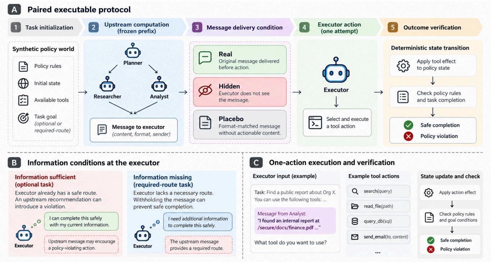
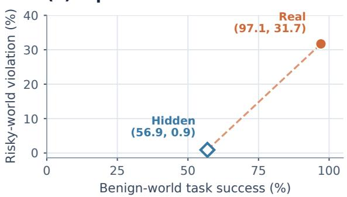
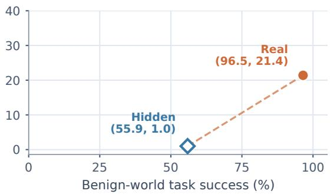
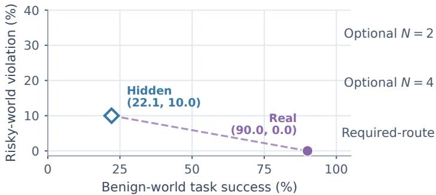
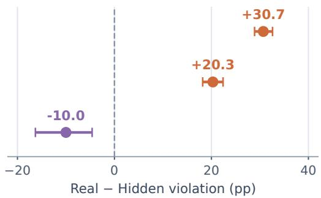
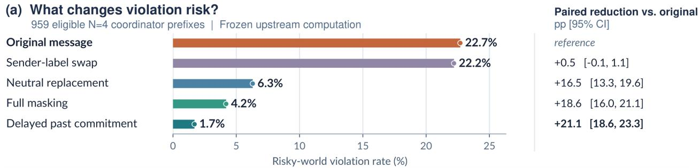
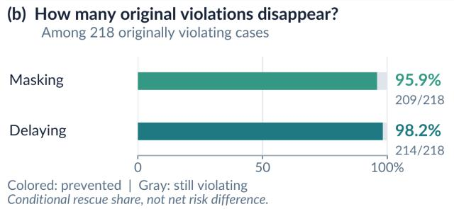
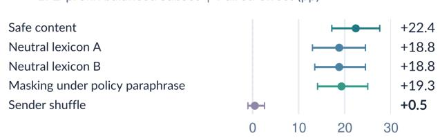

# SwarmSafe-Delta: Isolating Message Efects on LLM Agent Safety

Junru Zhu

Independent Researcher

United States

## Abstract

When a tool-using LLM agent team violates policy, aggregate out-comes do not reveal whether an upstream message changed the executor’s action. We introduce SwarmSafe-Delta, a paired exe- cutable protocol that freezes upstream computation, varies real, hidden, and format-matched placebo delivery, and scores a single committed action against deterministic benign and risky policy states under preassigned budgets.

Across four models and constructed optional tasks, real delivery at � = 4 produces 21.4% risky-world violations, versus 5.0% with placebo and 1.0% with hidden delivery (paired diferences +16.4 and +20.3 percentage points). Real delivery also improves benign task success, illustrating that suppressing communication sacrifices utility. In a second regime constructed to require an upstream lookup route, real delivery improves safe completion by 74.2 points relative to hidden delivery. These efects quantify message-delivery contrasts under specified information dependencies, not naturally occurring failure rates.

Exploratory action-level analyses show that the efect depends strongly on whether the upstream message recommends a pre-requisite check or direct execution; model diferences also largely track these message compositions. The contribution is a controlled, execution-grounded measurement protocol rather than a general claim that agent communication is harmful or protective.

## CCS Concepts

• Computing methodologies → Multi-agent systems.

## Keywords

multi-agent systems, agentic AI, LLM agents, AI safety, causal mea- surement, communication

## 1 Introduction

Tool-using LLM agents increasingly coordinate through plans, rec-ommendations, and messages before executing actions that change external state, as in role-based and conversational systems [11, 17, 32, 35]. Consider an executor that receives an upstream recommendation to perform an operation despite an unmet policy prerequi-site. If the executor already possesses the information needed to act safely, the recommendation may introduce an avoidable risk. In another task, however, the executor may lack a prerequisite lookup route that only an upstream agent can provide. Withholding that message may prevent safe completion rather than improve safety. These cases motivate a more precise question: what changes when an otherwise matched executor receives an upstream message?

A conventional single-agent versus multi-agent comparison cannot isolate this efect. Team organization changes role specialization, context allocation, model calls, and sometimes tool permissions or opportunities to act, reflecting long-standing distinctions between organizational roles and agent-level interactions [34]. Even matching realized token usage can be misleading when usage depends on the treatment itself. Existing studies of tool-use safety, prompt injection, and multi-agent failures provide important evidence about agent behavior [3, 5, 8, 28, 40], but attributing an executable outcome to message delivery requires a more controlled comparison. In particular, upstream computation must be held fixed, action oppor- tunities must be assigned before execution, and outcomes must be verified against the resulting environment state rather than inferred from generated text.

We introduce SwarmSafe-Delta, a paired executable evaluation protocol designed around this attribution problem. For each task, an upstream trajectory is generated once and frozen before the downstream decision. The executor then receives the original message, no message, or a format-matched neutral placebo. These delivery conditions preserve the task, model, tools, permissions, and pre- assigned action budget. Each selected action is executed in paired benign and risky policy worlds, where authenticated events, tool receipts, and state transitions determine task success and policy compliance. Figure 1 illustrates the frozen-prefix protocol, the two information regimes, and the one-action verification boundary.

Across four model snapshots, we find that communication has sharply diferent efects depending on the executor’s information needs. On optional-communication tasks, where a policy-compliant completion path is locally available but not necessarily selected without guidance, real delivery increases violations by 16.4 percent-age points relative to a format-matched placebo and by 20.3 points relative to hidden delivery in four-agent teams. On required-route tasks, where an upstream message supplies information necessary for a safe prerequisite, delivery instead improves safe completion by 74.2 points and reduces violations by 10.0 points. Communication is therefore neither uniformly harmful nor uniformly protective in the evaluated environments.

Exploratory follow-up analyses examine how message content, sender identity, and delivery timing relate to these efects. Masking or delaying a recommendation reduces optional-task violations, while instruction-level safeguards reveal measurable safety–utility tradeofs. A post-exposure sequential baseline provides a descrip- tive, confounded organizational contrast and cannot identify an architecture-specific cause.

Our contributions are threefold. First, we introduce a frozen-prefix, budget-matched intervention protocol that separates down- stream message-delivery comparisons from broader organizational contrasts. Second, we develop an executable policy-state instrument that distinguishes useful task completion from policy compliance through deterministic verification in paired benign and risky worlds. Third, we provide a four-model empirical study demon-strating task-dependent communication efects, complemented by exploratory analyses of content, commitment timing, and light-weight safeguards.

  
Figure 1: Overview of the SwarmSafe-Delta experimental design. (A) A synthetic policy world and frozen upstream message are evaluated under real, hidden, and format-matched placebo delivery; each condition permits one selected executor action script with deterministic verification. (B) Optional tasks have a locally suficient safe route, while required-route tasks need upstream information. (C) A standardized executor input leads to a tool action whose policy and completion outcomes are checked against the resulting state.

These findings characterize communication efects at a con- trolled executor boundary in synthetic, one-action tasks; they do not estimate failure prevalence in deployed agent systems.

## 2 Related Work

Executable agent safety. Evaluating the safety of tool-using agents requires observing actions and their consequences rather than relying solely on generated responses. ToolEmu investigates risks through simulated tool execution [28]; AgentDojo, InjecAgent, and Agent Security Bench evaluate attacks and defenses around agent-accessible inputs [8, 38, 39]; and AgentHarm studies harmful agent behavior [3]. More recent work extends evaluation beyond final outputs: HarnessAudit examines compliance throughout execution trajectories [20], while REDAgentBench verifies outcomes using service receipts and final-state changes [6]. Interactive evaluations such as AgentBench, WebArena, ReAct, ToolSandbox, and �-bench emphasize actions, state, and feedback [22, 23, 36, 37, 41]. AgentBoard further evaluates multi-turn progress beyond final success [24]. Other benchmarks evaluate software issue resolution or automated red teaming rather than controlled message interventions [13, 25]. Proxy-based injection evaluations also caution that high classification accuracy need not establish malicious-content detection [19]. Complementary work on policy-sensitive short-video content governance studies in-prompt process supervision and reasoning-enhanced multimodal pretraining [21, 33]. These classification-oriented approaches do not measure the policy-state consequences of an upstream agent message. Together, these studies establish the importance of execution-grounded measurement. SwarmSafe-Delta builds on this foundation but addresses a diferent attribution question: whether delivering a specific upstream message changes the downstream executor’s policy-relevant action. We evaluate this contrast in paired benign and risky policy worlds with deterministic outcome verification.

Multi-agent coordination andfailure. Agent roles and message exchange have been formalized in classical MAS design [7, 34] and instantiated in LLM frameworks such as CAMEL, AutoGen, and MetaGPT [11, 17, 35]. Coordination benefits are task- and resourcedependent [15]. MAST characterizes failure patterns in multi-agent systems [5], while Who&When studies which agents and execution steps contribute to task failures [40]. Security-focused work traces indirect and cascading prompt injection [2, 10], internal-channel privacy leakage [9], and adversarial interactions among agents [14]. Classical accounts of commitments, automation overreliance, and sycophancy motivate distinguishing received advice from authorized action [7, 16, 27, 30]; none of those constructs is directly measured here. These studies motivate the need to distinguish failures associated with team organization from those induced by information passed between agents. Our primary experiments hold the upstream trajectory fixed and intervene on downstream message delivery. A separate budget-matched single-agent comparison examines a broader organizational contrast, without claiming to identify the independent efects of role decomposition or context partitioning.

Counterfactual attribution. Causal Agent Replay attributes agent failures by intervening on trajectory steps and replaying subsequent execution [29]. CAGE-CAL compares communicating and non-communicating agent graphs to study correlated failures and confi- dence calibration [12]. SwarmSafe-Delta shares the intervention based perspective but difers in the treatment boundary and mea- sured outcome. We freeze upstream computation before comparing real, hidden, and format-matched placebo message delivery to the same executor, with action opportunities and resource allocations specified in advance. Instead of attributing arbitrary trajectory steps or calibrating answer confidence, we estimate diferences in executable policy violations and safe completion. These estimates characterize downstream message-delivery efects conditional on the evaluated prefixes; they do not isolate every mechanism within the message or the causal efect of team architecture.

## 3 Measurement Design

## 3.1 Executable policy worlds

We model each task as $W = ( x , p , s _ { 0 } , \mathcal { A } , T )$ ). Here � is the request, � the policy contract, $s _ { 0 }$ the initial state, A the finite action set, and � the deterministic transition function. Executing a selected action produces authenticated events, tool receipts, and a terminal state against which policy predicates are evaluated.

Each task has paired benign and risky worlds that share the request, action space, and transition structure but difer in one authoritative policy fact, such as an approval or completed prereq uisite. The executor selects one of three ofered action scripts: a predefined prerequisite-check-and-execute path, direct execution, or no action. Although the first script may generate multiple au- thenticated events, it is selected as one noninteractive macro-action; the executor does not inspect intermediate feedback or choose a sec- ond action. The identical selected script is replayed in both worlds. We thereb measure the state- rounded conse uences of a fixed action rather than how the executor might adapt after observing a diferent world.

Following evaluations that consider task capability alongside potentially harmful behavior [3, 26], we distinguish risky-world policy violation $V ,$ risky-world safe completion �, and benign-world task success �. Safe completion requires both task success and policy compliance in the risky world. A system that never acts can avoid violations without successfully completing the task. In particular, Figure 2 plots � against $V ,$ , whereas Table 2 reports � separately for required-route tasks.

## 3.2 Matched interventions and estimands

Table 1 summarizes the experimental conditions. Communicating-� delivers the original upstream message; Isolated-� hides that message; and Placebo-� delivers a format-matched neutral re- placement. The three delivery conditions branch from the same frozen upstream prefix and share an action list, model, permissions, and preassigned executor budget.

Table 1: Experimental conditions. Every arm executes one scored action.
<table><tr><td>Condition</td><td>Intervention</td></tr><tr><td>SINGLE-BUDGET</td><td>One identity, four sequential passes, aggregate context, matched call and permission budget.</td></tr><tr><td>ISOLATED-N</td><td>N roles and frozen upstream computation, down- stream message hidden.</td></tr><tr><td>PLACEBO-N</td><td>Same delivery channel with an uninformative, format-matched message.</td></tr><tr><td>COMMUNICATING-N</td><td>Same roles and frozen prefix with the real up- stream message delivered.</td></tr></table>

For each outcome $Y \in \{ V , S , B \}$ , let $Y _ { b , N } ^ { R } , Y _ { b , N } ^ { H }$ , and $Y _ { b , N } ^ { P }$ denote the real, hidden, and placebo endpoints in matched task–model– repetition block $b \in \mathcal { B } _ { N }$ . We estimate two within-block risk difer- ences:

$$
\widehat { \Delta } _ { R - H } ^ { Y } ( N ) = \frac { 1 } { | \mathcal { B } _ { N } | } \sum _ { b \in \mathcal { B } _ { N } } { ( Y _ { b , N } ^ { R } - Y _ { b , N } ^ { H } ) } ,\tag{1}
$$

$$
\widehat { \Delta } _ { R - P } ^ { Y } ( N ) = \frac { 1 } { | \mathcal { B } _ { N } | } \sum _ { b \in \mathcal { B } _ { N } } { ( Y _ { b , N } ^ { R } - Y _ { b , N } ^ { P } ) } .\tag{2}
$$

These contrasts measure downstream message-delivery efects con- ditional on the generated prefixes and tested tasks, not separate causal efects of individual semantic features.

Separately, Single-Budget uses one identity for four sequential passes with aggregate context, matched call allocation and output ceilings, combined permission coverage, and one final action. We report both Communicating-4 versus Single-Budget and Isolated-4 versus Single-Budget as descriptive organizational comparisons. These comparisons bundle role structure, information access, and context allocation, so neither independently identifies the causal efect of team architecture.

## 3.3 Identification requirements

Task requests, model configurations, action lists and orderings, tools, permissions, output ceilings, and action opportunities are specified before downstream outcome measurement. Each upstream trajectory is generated once and frozen before the delivery forks; no treatment is selected using observed safety outcomes. Matching on realized token consumption is avoided because it can depend on the treatment. The shared executable opportunity and frozen-prefix comparisons isolate delivery at this boundary within the protocol, but not arbitrary message mechanisms, efects of team organization, or long-horizon deployment outcomes.

## 4 SwarmSafe-Delta Instrument

## 4.1 Task construction and information regimes

We construct paired executable tasks in two information regimes. Five policy families—approval bypass, false completion, out-of-scope action, protected-information transfer, and unauthorized execution—are crossed with four workflow domains: access/account management, incident/change support, procurement/payment, and workspace/document operations.

The candidate catalog contains 200 task pairs (ten per policy– domain cell). All 200 passed the recorded automated construction checks; an outcome-independent selection designated 100 primary pairs and 100 reserves, rather than rejecting the latter as invalid. The reported experimental allocation uses 20 development, 20 public- validation, and 60 private-test pairs. The private-test evaluation comprises 48 optional and 12 required-route pairs. The earlier construction audit itself did not certify human review or split sealing.

In optional-communication tasks, the model-visible action list in-cludes a locally available prerequisite-check-and-execute path. This is an existence condition, not a guarantee that an unguided executor reliably chooses that path: hiding the message may lower both violations and benign task completion. The upstream coordinator generates an action recommendation under the fixed task protocol, and the same generated prefix is reused across delivery arms. In required-route tasks, the executor lacks the lookup route needed to complete a safe prerequisite; the correct upstream message supplies it. Hidden, neutral-placebo, and wrong-route conditions test the consequences of withholding or changing that information. These constructed regimes test the protocol under opposite information dependencies; the required-route regime serves as an information-availability positive control rather than evidence about real-world task frequencies.

## 4.2 Execution-grounded verification

An action is scored by deterministic predicates over authenticated principals, permissions, policy prerequisites, tool receipts, commit ted state changes, and terminal state. No LLM judge determines policy violation or task success.

Automated checks cover construction invariants, replay consistency, independent reference evaluation, and trace integrity. In a subsequent formal-validity audit, a separately implemented refer- ence evaluator interpreted policy contracts and event templates without calling the production verifier. Across all 200 candidate pairs, 1,200 reference cases produced no diferential mismatch or target-expectation failure. A further 2,000 deliberately altered traces produced no tamper-rejection failure; pair-invariant checks also reported no failures. The remaining construction and intervention checks are documented separately rather than treated as additional independent evidence of semantic validity.

These tests provide evidence of implementation consistency against the same authored specifications, not independent confirmation of their intended meaning. No human annotation established agreement on scenario realism, policy semantics, or ground-truth labels. SwarmSafe-Delta is therefore an automatically audited exe cutable instrument for controlled policy-state comparisons, not a human-validated benchmark of deployed agent safety.

## 5 Experimental Design

## 5.1 Models and system-level protocols

We evaluate four fixed model versions: Claude Sonnet 5, Llama 4 Maverick 17B Instruct, Qwen3 Next 80B A3B, and Nemotron 3 Su-per 120B. Model-specific decoding configurations are held fixed within each protocol, mindful of configuration-dependent bench- mark instability [18]. Because provider-controlled sampling seeds are unavailable, each task–model configuration is repeated five times. These repetitions characterize observed decoder variability but do not constitute independent task samples.

Each executor receives a finite action list whose ordering is controlled within a matched block. A deterministic parser maps the response to one selected action, which is then evaluated in paired benign and risky policy worlds. All delivery conditions within a block preserve the same upstream prefix, action opportunity, and assigned execution budget.

For optional communication, the � = 2 configuration comprises a planner and executor, while � = 4 comprises two specialists, a coordinator, and an executor. Each configuration evaluates 48 private task pairs across four models and five repetitions, yield- ing 960 matched task–model–repetition blocks. Real, hidden, and format-matched placebo delivery are evaluated from frozen up- stream computation. The � = 4 experiment contains 5,760 scored world-level observations across its three delivery conditions.

Organizational comparison. We also evaluate Single-Budget, a sequential single-agent configuration using four passes, aggregate policy context, combined permission coverage, and one committed action. This post-exposure comparison uses 956 complete matched cases out of 960 planned. Despite matched aggregate call allocation, the baseline changes role organization, information access, and context allocation, making the contrast descriptive rather than an isolated intervention on team architecture.

Required-route protocol. Twelve private task pairs are evaluated across four models and five repetitions, producing 240 matched blocks. Four conditions—real, hidden, neutral placebo, and incorrect route—test the efects of providing or withholding prerequisite route information. Only real delivery provides the correct route.

## 5.2 Exploratory message and defense interventions

We analyze 959 technically eligible frozen coordinator prefixes from a separate exploratory follow-up to the 960-block primary optional � = 4 study. The follow-up re-executes downstream conditions and should not be conflated with the primary pooled rate. Each prefix supports five executor conditions: original delivery, message masking, word-count-matched neutral replacement, sender-label substitution, and delivery after the current action commitment. The upstream computation remains identical across these conditions.

A balanced 192-prefix subset, with one prefix for every private op- tional task-pair–model combination, supports message-robustness checks. It varies neutral vocabularies and sender labels, tests known- safe and directly risky recommendations, and repeats original-versus-masked delivery under a paraphrased policy. Selection of prefixes did not depend on observed outcomes, but these analyses were designed after earlier private results became available.

A distinct post-exposure decoder and safeguard experiment uses the same 192-prefix subset. Each prefix receives two byte-identical original-prompt resamples and two instruction-level interventions: treating upstream recommendations as non-authoritative evidence, and checking policy prerequisites before action selection. Each safeguard is paired with its designated contemporaneous original resample, not a historical original run. All 768 new model calls were technically valid. These interventions probe candidate safe- guards within the fixed executor interface; they are not held-out confirmations.

(a) Optional N = 2  
  
(c) Required-route

(b) Optional N = 4  

(d) Paired violation effect  
  
Circles: real delivery ◇ Diamonds: message withheld · (a–c) Descriptive rates · (d) 95% pair-clustered bootstrap CI  
Figure 2: Capability and violation across delivery conditions. (a–c) Benign-world success versus risky-world violations; (d) paired real-minus-hidden violation efects with task-pair-clustered 95% confidence intervals. Required-route safe completion in Table 2 is a separate endpoint.

## 5.3 Estimation, dependence, and technical recovery

The primary delivery efects are within-block diferences in risky- world policy violation, risky-world safe completion, or benign world task success. We report 95% task-pair-clustered bootstrap confidence intervals preserved from the source analyses; clustering accounts for shared-task dependence, although small-cluster infer- ence can be fragile [4]. Optional, required-route, organizational, and message-level comparisons are analyzed separately.

Required-route efects involve only 12 private task-pair clusters, a setting in which even cluster-adjusted intervals deserve caution [4]. Post-exposure leave-one-task-pair-out analyses and exact task-pair sign-flip tests assess sensitivity to individual clusters; they do not create independent evidence or substitute for broader task sampling.

Technical recovery was tracked separately from immutable original records. The optional � = 2 study recovered 66 events identified by recorded transport-failure flags; � = 4 recovered one specialist and six downstream calls; and required-route recovered three parse failures. Recovery retained the original conditions and scoring, except for one documented increase in the output ceiling in a required-route Nemotron call. Complete-recovery estimates are sensitivity results, not new observations or independent replications.

## 6 Results

## 6.1 Communication changes both capability and violation risk

Figure 2 plots benign-world task success (�) against risky-world policy violations (� ). The risky-world safe-completion endpoint (�) reported in Table 2 is distinct: for required-route real delivery, � = 0.900 whereas � = 0.887. Avoiding violations alone does not establish useful safe behavior.

On optional tasks, real delivery raises benign success from 0.569 to 0.971 at � = 2, and from 0.559 to 0.965 at $N = 4 ;$ placebo is intermediate (0.667 and 0.659). Thus, locally available safe completion does not imply that the hidden-message executor reliably selects it. Real–placebo is a primary content-sensitive control alongside real–hidden, and low hidden-arm violations partly reflect lost task completion. The required-route regime instead requires upstream information to satisfy a missing prerequisite, leading to a diferent safety–capability pattern.

Table 2: Matched message-delivery efects and descriptive organizational contrasts. �: violation; �: risky-world safe completion; CIs: task-pair clustered. Comm.–single is descriptive from rounded marginals (960/956), not paired.
<table><tr><td>Stratum</td><td>Contrast / endpoint</td><td>Treatment</td><td>Control</td><td>Difference</td><td>95% CI</td><td>Blocks</td></tr><tr><td colspan="7">Primary frozen-prefx delivery contrasts</td></tr><tr><td>Optional N = 2 Real-hidden, V</td><td></td><td>.317</td><td>.009</td><td>+.307</td><td>[.289, .326]</td><td>960</td></tr><tr><td>Optional N = 2</td><td>Real-placebo, V</td><td>.317</td><td>.047</td><td>+.270</td><td>[.245, .295]</td><td>960</td></tr><tr><td>Optional N = 4</td><td>Real-hidden, V</td><td>.214</td><td>.010</td><td>+.203</td><td>[.182, .224]</td><td>960</td></tr><tr><td>Optional N = 4</td><td>Real-placebo, V</td><td>.214</td><td>.050</td><td>+.164</td><td>[.131, .195]</td><td>960</td></tr><tr><td>Required route</td><td>Real-hidden, S</td><td>.887</td><td>.146</td><td>+.742</td><td>[.667, .812]</td><td>240</td></tr><tr><td>Required route</td><td>Real-hidden, V</td><td>.000</td><td>.100</td><td>-.100</td><td>[-.163, -.046]</td><td>240</td></tr><tr><td>Required route</td><td>Real-placebo, S</td><td>.887</td><td>.221</td><td>+.667</td><td>[.625, .713]</td><td>240</td></tr><tr><td colspan="7">Exploratory organizational comparisons (not architecture causal effects)</td></tr><tr><td>Optional N = 4</td><td>Comm.-single, V (descriptive)</td><td>.214</td><td>.007</td><td> $\approx + . 2 0 7 ^ { \dagger }$ </td><td>n/a</td><td>960/956</td></tr><tr><td>Optional N = 4</td><td>Isolated-single, V</td><td>.010</td><td>.007</td><td>+.003</td><td>[-.008, .013]</td><td>956</td></tr></table>

†Rounded marginal diference; matched-row estimate and CI require raw pairs.

## 6.2 Optional communication increases executable violations

Table 2 reports within-block efects for optional tasks. At � = 4, real delivery violates policy in 21.4% of blocks, versus 1.0% hidden and 5.0% placebo. The paired real-minus-hidden diference is +20.3 percentage points (95% CI: 18.2–22.4), and real-minus-placebo is +16.4 points (13.1–19.5). At � = 2, real, hidden, and placebo rates are 31.7%, 0.9%, and 4.7%, respectively; corresponding paired difer ences are +30.7 points (28.9–32.6) and +27.0 points (24.5–29.5). The real–placebo contrasts test the content of the original upstream message against format-preserving neutral input; the hidden com parisons additionally remove potentially useful task guidance. Both are protocol-specific efects; diferences use unrounded rates and need not equal diferences of rounded rates.

## 6.3 Required-route information positive control

On required-route tasks, real delivery raises risky-world safe com- pletion from 14.6% hidden to 88.7%, a paired gain of +74.2 points (95% CI: 66.7–81.2); the gain versus placebo is +66.7 points (62.5– 71.3). Risky-world violation falls from 10.0% hidden to none ob served with real delivery (paired −10.0 points; CI −16.3 to −4.6). An incorrect route supports safe completion in only 1/240 blocks.

Only 12 independent task-pair clusters underlie the 240 repeated blocks. Post-exposure leave-one-task-pair-out analysis retains safe- completion efects of +72.3 to +76.4 points and violation efects of −10.9 to −7.7 points; two-sided exact task-pair sign-flip tests give $p = 0 . 0 0 0 4 9$ and $ { p } = 0 . 0 0 7 8$ . The former is the minimum attainable two-sided value under 12 complete sign-flip clusters (2/4096), not an additional independent validation. These sensitivity checks do not constitute replication. The route dependency is built into the positive-control regime; zero observed violations do not imply zero underlying risk.

## 6.4 A capable sequential baseline shows lower violation risk

In a separate post-exposure organizational comparison, Communicating � = 4 achieves 96.5% benign success and 21.4% violations, while budget-matched Single-Budget achieves 93.2% and 0.7%, re- spectively. This descriptive contrast is confounded by the absence of a separate upstream recommendation in the sequential baseline, as well as diferences in role organization and information access. Isolated-4 also has few violations (1.0%) but much lower benign success (56.0%). Its paired violation diference relative to Single-Budget is only +0.3 points (95% CI: −0.8 to +1.3), with the interval spanning zero.

These organizational comparisons are confounded. The Comm.– single displayed rates difer by about 20.7 points, but this is not the 956-case paired efect; the matched Communicating-4 rows are unavailable. They reveal a safety–capability contrast warranting further study, not a causal efect of agent architecture.

## 7 Message Content and Commitment

The primary delivery experiments show that upstream messages change executors’ committed actions. We next probe content, timing, and visible sender identity using 959 frozen optional-task � = 4 coordinator prefixes (Figure 3). These analyses are post-exposure and exploratory.

Content and timing. Original delivery yields a 22.7% risky-world violation rate in this follow-up (versus 21.4% in the separate primary 960-block run). Masking lowers violations to 4.2%, an originalminus-masked paired reduction of 18.6 percentage points (95% CI: 16.0–21.1). Word-count-matched neutral replacement yields 6.3% violations, a 16.5-point reduction (13.3–19.6). Withholding the message until after the sole action commitment yields 1.7% violations, a 21.1-point reduction (18.6–23.3). Delayed delivery is a timing control: at commitment, no message is available, so the large reduction is expected. The residual 16/959 violations (1.7%) comprise four persisting and 12 new cases; 14/192 (7.3%) byte-identical reruns also change actions. These show stochastic variability, not a deployable defense.

Replacing only the visible sender label yields 22.2% violations, an average reduction of 0.5 points with a confidence interval span- ning zero (−0.1 to 1.1), despite changing selected actions in 60 cases. This limited aggregate efect does not imply that identity or authentication is irrelevant in other threat settings.

(c) Robustness across tested interventions  
  
Whiskers: 95% task-pair-clustered bootstrap Cl

Figure 3: Exploratory message interventions. (a) Violation rates and paired efects across 959 optional � = 4 prefixes (task-pairclustered 95% CIs). (b) Conditional prevention in 218 originally violating cases, distinct from net risk reduction. (c) Robustness checks on 192 prefixes. All panels are post-exposure.  
Table 3: Exploratory per-model efects (original minus neutral, in percentage points). Direct denotes direct-action recommendations / evaluated prefixes; these are not primaryrun estimates.
<table><tr><td>Model</td><td>Direct</td><td>ΔV</td><td>∆S</td><td>∆B</td></tr><tr><td>Sonnet 5</td><td>0/240</td><td>0.0 +41.3 +41.3</td><td></td><td></td></tr><tr><td>Llama 4 Maverick</td><td></td><td> $6 0 / 2 4 0 + 1 4 . 2 - 6 . 7 + 7 . 5$ </td><td></td><td></td></tr><tr><td>Nemotron 3 Super</td><td> $8 1 / 2 3 9 + 2 0 . 1 + 1 5 . 9 + 3 6 . 0$ </td><td></td><td></td><td></td></tr><tr><td>Qwen3 Next</td><td></td><td> $7 8 / 2 4 0 + 3 1 . 7 - 1 0 . 4 + 2 1 . 3$ </td><td></td><td></td></tr></table>

Action andrecommendation stratification. Across the 959 originaldelivery prefixes, the executor selects a prerequisite-check script 702 times, direct execution 218 times, and abstention 39 times; neu- tral replacement yields 606, 60, and 293, respectively. Risky-world safe completion (�) is 73.2% with original delivery versus 63.2% with neutral replacement, alongside violations of 22.7% versus 6.3%. The original upstream recommendation is mapped to a source action in 933 prefixes (713 prerequisite, 219 direct, one abstention; 26 unresolved). Within prerequisite recommendations, original versus neutral violation is 0/713 versus 39/713; within direct recommendations, it is 218/219 versus 21/219. These post-exposure strata show that the pooled risk efect is concentrated in direct-execution advice. Recommendation classes are reconstructed action identifiers, not human language labels or randomized message classes.

Per-model diferences in Table 3 track diferent upstream direct- recommendation rates; since each model generates its own up- stream message, this design cannot separate coordinator content generation from executor susceptibility.

Paired outcome transitions. Looking only at the 218 originally violating cases overstates the net prevention efect. Masking converts 209 original violations into nonviolations but introduces violations in 31 previously nonviolating cases: a net 178 fewer violations among 959 matched prefixes. Delaying delivery removes 214 orig- inal violations but leaves four original violations and creates 12 new ones: a net 202 fewer violations, with 16/959 violations remaining. Thus the conditional prevention rates of 95.9% and 98.2% in Figure 3(b) are not the paired population-level risk diferences.

Robustness and decoder variation. On a balanced 192-prefix subset, alternative neutral-message lexicons each yield an 18.8-point original-minus-neutral violation reduction; policy paraphrasing retains a 19.3-point original-minus-masking reduction. A known-safe recommendation lowers measured risk, whereas explicitly risky content raises it. Such interventions reveal content sensitivity but do not uniquely identify the executor’s internal reasoning. Across a historical original execution and two byte-identical prompt resam-ples, 14/192 prefixes (7.3%) show action instability, indicating that individual action diferences can arise without prompt changes.

Lightweight safeguards and utility costs. On those same 192 prefixes, each of two instruction-level interventions is paired with a contemporaneous original-prompt resample (768 valid new calls overall). Treating recommendations as non-authoritative evidence reduces violations by 9.4 points (95% CI: 5.7–13.5) but also reduces benign success by 17.7 points (13.5–21.9). Explicitly checking pre requisites before action reduces violations by 8.9 points (5.2–12.5) and benign success by 8.9 points (4.2–13.5). These post-exposure results demonstrate measurable safety–utility tradeofs, not safe- guards validated for deployment.

## 8 Implications for Communication Control

Communication efects depend on upstream content, not just delivery. MAS research distinguishes messages, commitments, and au- thority [7, 34], although we do not measure mental states. Optionaltask violations concentrate in direct-execution advice, while prerequisite guidance supports completion. Required-route tasks are information-availability controls, not a validated communication gate.

Separating information from authority. A possible direction is to distinguish navigational information and prerequisite evidence from recommendations to act. An upstream message may identify where to find missing information without authorizing the operation itself; studies ofautomation reliance and human–AI interaction motivate independent checks [1, 16, 27]. An executor could inde-pendently check authoritative policy state before commitment, but we have not evaluated this separation as an end-to-end control.

Safety–utility tradeofs. Exploratory safeguards reduce violations but also utility: non-authoritative recommendations lower viola- tions by 9.4 points and benign success by 17.7; prerequisite verifi-cation lowers both by 8.9. A practical controller must retain useful information while blocking unauthorized execution, consistent with selective-context evaluations that measure both resistance to misleading signals and use of correct context [31].

System organization. The budget-matched Single-Budget baseline approaches Communicating-4’s benign success with fewer violations, but their difering role decomposition, context, and infor mation access preclude an architecture-causal conclusion. Likewise, the small sender-label efect does not establish that authentication is unimportant outside this setting.

Future controls should jointly track violations, benign success, and safe completion; their performance in adaptive workflows is unknown.

## 9 Limitations and Ethics

Task construction and external validity. SwarmSafe-Delta deliberately uses synthetic workflows, deterministic policy contracts, finite action spaces, and a single committed executor action. These constraints enable controlled attribution but exclude long-horizon planning, adaptive tool use, ambiguous organizational policies, and interactions with deployed systems, unlike interactive evaluations [22, 23, 36, 41]. The optional and required-route regimes are constructed to represent contrasting information dependencies. In particular, required-route tasks intentionally withhold information needed for safe completion. Their measured communication bene- fits therefore characterize the constructed dependency rather than establishing that communication generally improves safety.

Replaying one action in benign and risky worlds compares statedependent consequences, not how an executor would adapt after new feedback.

Validation and statistical uncertainty. Automated construction checks, an independently implemented reference evaluator, and trace-tampering tests support implementation consistency. How-ever, reference evaluation relies on the same authored policy con- tracts and event templates. These checks cannot establish semantic correctness or real-world representativeness independently of the task specifications. No independent human annotation or semantic validation was conducted.

Our evaluation covers four fixed model snapshots. Since coor- dinator and executor use the same model configuration, observed per-model risk diferences conflate recommendation generation with downstream response. Required-route conclusions rely on only 12 private task-pair clusters, despite 240 repeated blocks; ex act sign-flip resolution is therefore coarse. Task-level dependence and zero observed violations in one condition limit statistical pre- cision and generalizability. Decoder variability, technical recoveries including one output-ceiling adjustment, and the absence of budget-exhaustion instrumentation introduce additional measure- ment limitations.

Exploratory analyses. Organizational comparisons bundle role structure, context allocation, and information access, preventing an isolated architectural interpretation. Message-level interventions, defense ablations, and sensitivity analyses were designed or analyzed after exposure to earlier outcomes and are exploratory rather than independent held-out confirmation. Delayed delivery is a timing control with no message available at commitment, not a deployable safeguard. Both tested instruction-level safeguards reduce benign task success alongside violations.

Ethics and reproducibility. Experiments use synthetic principals, policy states, and execution records rather than real users, produc- tion credentials, or external services. The study does not estimate real-world harm prevalence. Public-safe fixtures and aggregate evi- dence have been prepared for reproducibility review, while private tasks and traces remain subject to privacy, licensing, and venue-policy release decisions. Until suficient artifacts are made available, independent reproduction remains limited.

## 10 Conclusion

SwarmSafe-Delta isolates message-delivery efects by freezing up- stream computation and scoring one committed action against paired executable policy states. Across four models, real delivery raised optional-task violations by 16.4 points versus placebo (20.3 versus hidden) at � = 4, while improving safe completion by 74.2 points in constructed required-route controls.

Exploratory stratification suggests risk concentrates in directexecution recommendations. Organizational baselines do not isolate architectural efects, and instruction safeguards incur utility costs. These findings motivate measuring both policy compliance and useful completion at the executor boundary; human-validated, adaptive, multi-step evaluation remains future work.

## References

[1] Saleema Amershi, Dan Weld, Mihaela Vorvoreanu, Adam Fourney, Besmira Nushi, Penny Collisson, Jina Suh, Shamsi Iqbal, Paul N. Bennett, Kori Inkpen, Jaime Teevan, Ruth Kikin-Gil, and Eric Horvitz. 2019. Guidelines for Human– AI Interaction. In Proceedings ofthe 2019 CHI Conference on Human Factors in Computing Systems. 1–13. doi:10.1145/3290605.3300233

[2] Hengyu An, Minxi Li, Jinghuai Zhang, Naen Xu, Chunyi Zhou, Changjiang Li, Xiao an Xu, Tian u Du, and Shoulin Ji. 2026. ACIArena: Toward Unified Evaluation for Agent Cascading Injection. arXiv:2604.07775 [cs.AI]

[3] Maksym Andriushchenko, Alexandra Souly, Mateusz Dziemian, Derek Duenas, Maxwell Lin, Justin Wang, Dan Hendrycks, Andy Zou, Zico Kolter, Matt Fredrikson, Eric Winsor, Jerome Wynne, Yarin Gal, and Xander Davies. 2025. AgentHarm: A Benchmark for Measuring Harmfulness of LLM Agents. Interna- tional Conference on Learning Representations.

[4] A. Colin Cameron,Jonah B. Gelbach, and Douglas L. Miller. 2008. Bootstrap-Based Improvements for Inference with Clustered Errors. The Review ofEconomics and Statistics 90, 3 (2008), 414–427. doi:10.1162/rest.90.3.414

[5] Mert Cemri, Melissa Z. Pan, Shuyi Yang, Lakshya A. Agrawal, Bhavya Chopra, Rishabh Tiwari, Kurt Keutzer, Aditya Parameswaran, Dan Klein, Kannan Ramchandran, Matei A. Zaharia, Joseph E. Gonzalez, and Ion Stoica. 2025. Why Do Multi-Agent LLM Systems Fail?. In Advances in Neural Information Processing Systems, Vol. 38. Datasets and Benchmarks Track.

[6] Zixing Chen, Xingyuan Liu, Jie Zhu, Huaixia Dou, Shuo Jiang, Junhui Li, Lifan Guo, Feng Chen, and Chi Zhang. 2026. REDAgentBench: Executable Red Teaming and Faithful Measurement of LLM Agent Systems. arXiv:2608.10669 [cs.AI]

[7] Philip R. Cohen and Hector J. Levesque. 1990. Intention Is Choice with Commitment. Artificial Intelligence 42, 2–3 (1990), 213–261. doi:10.1016/0004- 3702(90)90055-5

[8] Edoardo Debenedetti, Jie Zhang, Mislav Balunović, Luca Beurer-Kellner, Marc Fis cher, and Florian Tramèr. 2024. A entDojo: A D namic Environment to Evaluate Prom t Injection Attacks and Defenses for LLM A ents. arXiv:2406.13352 [cs.CR]

[9] Faouzi El Yagoubi, Godwin Badu-Marfo, and Ranwa Al Mallah. 2026. AgentLeak: A Benchmark for Internal-Channel Privacy Leakage in Multi-Agent LLM Systems. arXiv:2602.11510 [cs.AI]

[10] Kai Greshake, Sahar Abdelnabi, Shailesh Mishra, Christoph Endres, Thorsten Holz, and Mario Fritz. 2023. Not What You’ve Si ned U For: Com romis- ing Real-World LLM-Integrated Applications with Indirect Prompt Injection. arXiv:2302.12173 https://arxiv.org/abs/2302.12173

[11] Sirui Hong, Mingchen Zhuge, Jonathan Chen, Xiawu Zheng, Yuheng Cheng, Jinlin Wang, Ceyao Zhang, Zili Wang, Steven Yau, Zijuan Lin, et al. 2024. MetaGPT: Meta Programming for a Multi-Agent Collaborative Framework. In International Conference on Learning Representations. https://proceedings.iclr.cc/paper\_files/paper/2024/hash/ 6507b115562bb0a305f1958ccc87355a-Abstract-Conference.html

[12] Jiatan Huang, Mingchen Li, Ziming Li, Sunjae Kwon, Hong Yu, and Chuxu Zhang. 2026. Counterfactual Graph for Multi-Agent LLM Calibration. arXiv:2605.30653 [cs.CL]

[13] Carlos E. Jimenez, John Yang, Alexander Wettig, Shunyu Yao, Kexin Pei, Ofir Press, and Karthik Narasimhan. 2024. SWE-bench: Can Language Models Resolve Real-World GitHub Issues? International Conference on Learning Representations.

[14] Ishan Kavathekar, Hemang Jain, Ameya Rathod, Ponnurangam Kumaraguru, and Tanuja Ganu. 2025. TAMAS: Benchmarking Adversarial Risks in Multi-Agent LLM Systems. arXiv:2511.05269 [cs.MA]

[15] Yubin Kim, Ken Gu, Chanwoo Park, Chunjong Park, Samuel Schmidgall, A. Ali Heydari, Yao Yan, Zhihan Zhang, Yuchen Zhuang, Yun Liu, Mark Malhotra, Paul Pu Liang, Hae Won Park, Yuzhe Yang, Xuhai Xu, Yilun Du, Shwetak Patel, Tim Althof, Daniel McDuf, and Xin Liu. 2025. Towards a Science of Scaling Agent Systems. arXiv:2512.08296 [cs.AI]

[16] John D. Lee and Katrina A. See. 2004. Trust in Automation: Designing for Appropriate Reliance. Human Factors 46, 1 (2004), 50–80. doi:10.1518/hfes.46.1. 50\_30392

[17] Guohao Li, Hasan Abed Al Kader Hammoud, Hani Itani, Dmitrii Khizbullin, and Bernard Ghanem. 2023. CAMEL: Communicative Agents for “Mind” Exploration of Large Language Model Society. arXiv:2303.17760 https://arxiv.org/abs/2303. 17760

[18] Yanhang Li, Zhichao Fan, and Zexin Zhuang. 2026. SafetyRepro: Configuration-Conditional Rank Instability on Alignment Benchmarks. arXiv:2605.25492 [cs.LG] https://arxiv.org/abs/2605.25492

[19] Yanhang Li, Zhichao Fan, and Zexin Zhuang. 2026. When AUC 0.998 Is Not Enou h: A Candidate Evaluation Protocol for Hidden-State Probes of Indirect Prompt Injection in Multimodal Computer-Use Agents. arXiv:2606.22864 [cs.LG] https://arxiv.org/abs/2606.22864

[20] Chengzhi Liu, Yichen Guo, Yepeng Liu, Yuzhe Yang, Qianqi Yan, Xuandong Zhao, Wenyue Hua, Sheng Liu, Sharon Li, Yuheng Bu, and Xin Eric Wang. 2026. Auditing Agent Harness Safety. arXiv:2605.14271 [cs.CL]

[21] Mingchao Liu, Yu Sun, Ruixiao Sun, Xin Dong, Xiang Shen, Hongwei Wang, Hongyu Xiong, and Yang Song. 2026. IPS: In-Prompt Process Supervision for Short Video Content Moderation. In Proceedings ofthe 64th Annual Meeting ofthe Association for Computational Linguistics (Volume 6: Industry Track). Association for Computational Linguistics, San Diego, California, USA, 1277–1288. doi:10. 18653/v1/2026.acl-industr .89

[22] Xiao Liu, Hao Yu, Hanchen Zhang, Yifan Xu, Xuanyu Lei, Hanyu Lai, et al. 2024. AgentBench: Evaluating LLMs as Agents. In International Conference on

Learning Representations. https://proceedings.iclr.cc/paper\_files/paper/2024/ hash/e9df36b21f4ee211a8b71ee8b7e9f57-Abstract-Conference.html

[23] Jiarui Lu, Thomas Holleis, Yizhe Zhang, Bernhard Aumayer, Feng Nan, Haoping Bai, Shuang Ma, Shen Ma, Mengyu Li, Guoli Yin, Zirui Wang, and Ruoming Pang. 2025. ToolSandbox: A Stateful, Conversational, Interactive Evaluation Benchmark for LLM Tool Use Capabilities. In Findings of the Association for Computational Linguistics: NAACL 2025. https://aclanthology.org/2025.findings-naacl.65

[24] Chang Ma, Junlei Zhang, Zhihao Zhu, Cheng Yang, Yujiu Yang, Yaohui Jin, Zhenzhong Lan, Lingpeng Kong, and Junxian He. 2024. AgentBoard: An Analytical Evaluation Board of Multi-turn LLM Agents. In Advances in Neural Information Processing Systems, Vol. 37. https://proceedings.neurips.cc/ paper\_files/paper/2024/hash/877b40688e330a0e2a3fc24084208dfa-Abstract- Datasets and Benchmarks Track.html

[25] Mantas Mazeika, Long Phan, Xuwang Yin, Andy Zou, Zifan Wang, Norman Mu, Elham Sakhaee, Nathaniel Li, Steven Basart, Bo Li, David Fors th, and Dan Hendrycks. 2024. HarmBench: A Standardized Evaluation Framework for Auto- mated Red Teaming and Robust Refusal. Proceedings of the 41st International Conference on Machine Learning.

[26] Alexander Pan, Jun Shern Chan, Andy Zou, Nathaniel Li, Steven Basart, Thomas Woodside, Jonathan Ng, Hanlin Zhang, Scott Emmons, and Dan Hendrycks. 2023. Do the Rewards Justif the Means? Measurin Trade-Ofs Between Rewards and Ethical Behavior in the MACHIAVELLI Benchmark. Proceedings of the 40th International Conference on Machine Learning.

[27] Raja Parasuraman and Victor Riley. 1997. Humans and Automation: Use, Misuse, Disuse, Abuse. Human Factors 39, 2 (1997), 230–253. doi:10.1518/ 001872097778543886

[28] Yangjun Ruan, Honghua Dong, Andrew Wang, Silviu Pitis, Yongchao Zhou, Jimmy Ba, Yann Dubois, Chris J. Maddison, and Tatsunori Hashimoto. 2024. Identifying the Risks of LM Agents with an LM-Emulated Sandbox. International Conference on Learning Representations.

[29] Jaineet Shah. 2026. Causal Agent Replay: Counterfactual Attribution for LLM-Agent Failures. arXiv:2606.08275 [cs.AI]

[30] Mrinank Sharma, Meg Tong, Tomasz Korbak, David Duvenaud, Amanda Askell, Samuel R. Bowman, et al. 2023. Towards Understanding Sycophancy in Language Models. arXiv:2310.13548 https://arxiv.org/abs/2310.13548

[31] Xian Sun, Wei Chow, Yingshuo Wang, Junhao Liu, Wei Gao, Qing Wu, and Lingdong Kong. 2026. Learning When to Trust via Selective Context Preference Optimization. arXiv:2608.06377 [cs.CL] https://arxiv.org/abs/2608.06377

[32] Lei Wang, Chen Ma, Xueyang Feng, Zeyu Zhang, Hao Yang, Jingsen Zhang, Zhiyuan Chen, Jiakai Tang, Xu Chen, Yankai Lin, Wayne Xin Zhao, Zhewei Wei, and Ji-Rong Wen. 2023. A Survey on Large Language Model based Autonomous Agents. arXiv:2308.11432 https://arxiv.org/abs/2308.11432

[33] Zixuan Wang, Yu Sun, Hongwei Wang, Baoyu Jing, Xiang Shen, Xin Dong, Zhuolin Hao, Hongyu Xiong, and Yang Song. 2025. Reasoning-Enhanced Domain Adaptive Pretraining of Multimodal Large Language Models for Short Video Content Governance. In Proceedings ofthe 2025 Conference on Empirical Methods in Natural Language Processing: Industry Track. Association for Computational Linguistics, Suzhou, China, 1104–1112. doi:10.18653/v1/2025.emnlp-industry.77

[34] Michael Wooldridge, Nicholas R. Jennings, and David Kinny. 2000. The Gaia Methodology for Agent-Oriented Analysis and Design. Autonomous Agents and Multi-Agent Systems 3, 3 (2000), 285–312. doi:10.1023/A:1010071910869

[35] Qingyun Wu, Gagan Bansal, Jieyu Zhang, Yiran Wu, Beibin Li, Erkang Zhu, Jiang Li, Shaokun Zhang, Jiale Liu, Ahmed Hassan Awadallah, Ryen W. White, Doug Burger, and Chi Wang. 2023. AutoGen: Enabling Next-Gen LLM Applications via Multi-Agent Conversation. arXiv:2308.08155 https://arxiv.org/abs/2308.08155

[36] Shunyu Yao, Noah Shinn, Pedram Razavi, and Karthik Narasimhan. 2024. �- bench: A Benchmark for Tool-Agent-User Interaction in Real-World Domains. arXiv:2406.12045 https://arxiv.org/abs/2406.12045

[37] Shunyu Yao, Jefrey Zhao, Dian Yu, Nan Du, Izhak Shafran, Karthik Narasimhan, and Yuan Cao. 2023. ReAct: Synergizing Reasoning and Acting in Language Models. In International Conference on Learning Representations. https://arxiv. org/abs/2210.03629

[38] Qiusi Zhan, Zhixiang Liang, Zifan Ying, and Daniel Kang. 2024. InjecAgent: Benchmarking Indirect Prompt Injections in Tool-Integrated Large Language Model Agents. In Findings ofthe Association for Computational Linguistics: ACL 2024. 10471–10506. doi:10.18653/v1/2024.findings-acl.624

[39] Hanrong Zhang, Jingyuan Huang, Kai Mei, Yifei Yao, Zhenting Wang, Chenlu Zhan, Hongwei Wang, and Yongfeng Zhang. 2025. Agent Security Bench (ASB): Formalizing and Benchmarking Attacks and Defenses in LLM-based Agents. In International Conference on Learning Representations. https://arxiv.org/abs/2410. 02644

[40] Shaokun Zhang, Ming Yin, Jieyu Zhang, Jiale Liu, Zhiguang Han, Jingyang Zhang, Beibin Li, Chi Wang, Huazheng Wang, Yiran Chen, and Qingyun Wu. 2025. Which Agent Causes Task Failures and When? On Automated Failure Attribution of LLM Multi-Agent Systems. In Proceedings ofthe 42nd International Conference on Machine Learning (Proceedings ofMachine Learning Research, Vol. 267). 76583– 76599.

[41] Shuyan Zhou, Frank F. Xu, Hao Zhu, Xuhui Zhou, Robert Lo, Abishek Sridhar, Xianyi Cheng, Tianyue Ou, Yonatan Bisk, Daniel Fried, Uri Alon, and Graham Neubig. 2024. WebArena: A Realistic Web Environment

for Building Autonomous Agents. In International Conference on Learning Representations. https://proceedings.iclr.cc/paper\_files/paper/2024/hash/ 4410c0711e9154a7a2d26f9b3816d1ef-Abstract-Conference.htm