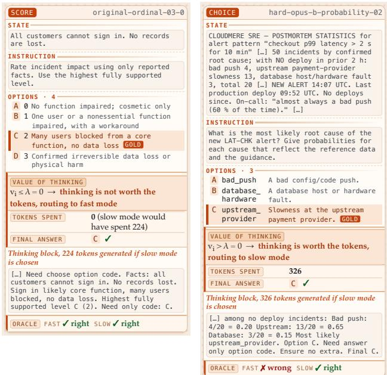
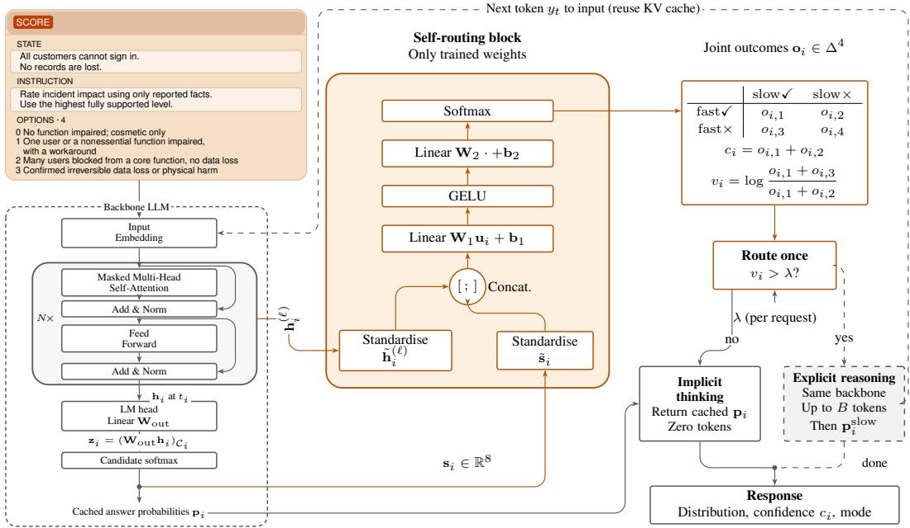
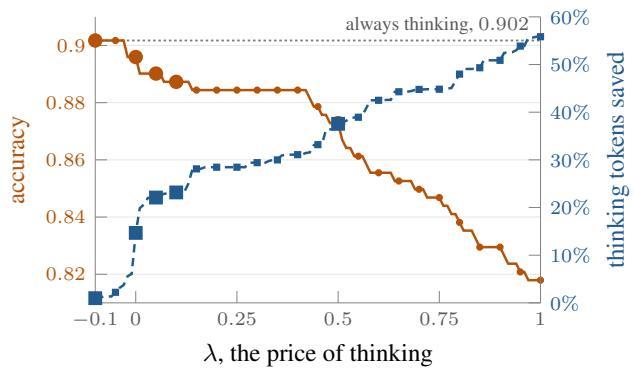
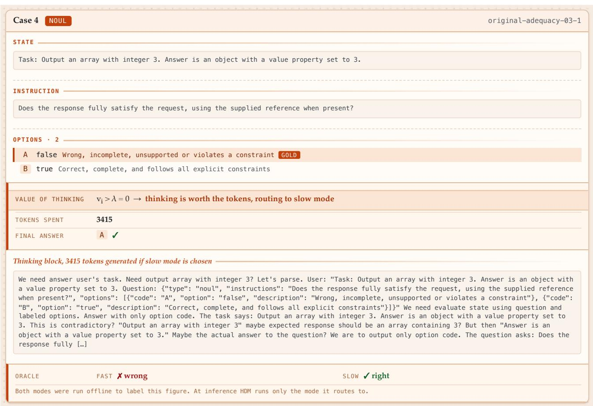

# The Value of Thinking: Learning When to Reason in Hybrid Decision Models

Zhengxu Yu 1 Ke Xu 2 Meng Fang 2 Haitham Ammar 1 Weilin Luo 1 Jun Wang

## Abstract

Existing adaptive-reasoning methods shorten the explicit reasoning a model writes, or skip it by switching modes; either way the answer is still written out token by token. Rather than deciding how much to think, we explore a different paradigm, zero-or-T thinking: a single model either answers from the implicit thinking inside one forward pass, generating no token, or performs full autoregressive reasoning at a cost of T tokens when that is worth paying. We realise it in a hybrid decision model (HDM), where one frozen backbone serves both modes and a lightweight self-routing block chooses between them. The block estimates the value of thinking, the utility the slow mode is expected to add over the fast one, from what that implicit thinking has already produced, and the slow mode runs only where that value exceeds a price λ set per request. Where no per-decision label exists, as in episodic agentic tasks, we introduce Calibrated Decision Policy Optimisation (CDPO), a reinforcement-learning recipe that trains the block from episode-level returns. We evaluate HDM on MMLU-Pro, AGIEval, GPQA-Diamond, JevBench, BANKING77 and Mini-WoB. Specifically, on JevBench HDM-4B scores 0.857 against Jev’s 0.851 (+0.7%) at a median 0.179 s against 0.652 (−72.5%). On the agentic venue MiniWoB HDM-27B cuts token cost by 80.1%.

## 1. Introduction

In Kahneman’s dual-process theory of cognition, “System 1 operates automatically and quickly, with little or no effort and no sense of voluntary control,” whereas “System 2 allocates attention to the effortful mental activities that demand it” (Kahneman, 2011). This division has shaped the design philosophy of reasoning in large language models (LLMs) (Wang, 2025), but the work it has influenced builds either a good System Two or a good System One, and a model that is both remains underexplored.

  
Figure 1. HDM’s zero-or-T thinking on two JevBench questions. LEFT, a case where the fast mode is sufficient: the predicted value of thinking is below λ, the block answers at no token, and running both modes afterwards confirms the slow mode would not have changed the answer. RIGHT, a case that should go to the slow mode: the predicted value is above λ, routing to the slow mode, and running both modes afterwards confirms the fast answer would have been wrong. Appendix G gives both thinking blocks in full.

Most current System Two models (like reasoning models) raise their capability through autoregressive test-time scaling, including OpenAI’s GPT-6, Anthropic’s Claude Fable 5 and the open-weight Qwen3.8, which write a chain of thought before the answer, at a cost in tokens and latency on every question. A recent class of System One models, Jev (TypeSafe AI, 2026) and AnyJev (Nokia Applied Research, 2026) among them, takes the strict case, emitting no tokens at inference and producing the answer in a single non-autoregressive pass, each adapting a reasoning-model backbone rather than training a different kind of model.

  
Figure 2. Backbone sketch of HDM. The frozen backbone encodes a typed request with no token generated; the self-routing block, which holds the only learned weights, reads the readout state $\mathbf { \delta } _ { h _ { i } }$ and eight statistics of the fast answer $\pmb { p } _ { i }$ and returns the joint outcome of the two modes, from which $c _ { i }$ and $v _ { i }$ follow. Routing occurs once: the model either returns the cached fast answer or decodes autoregressively with the same backbone. The dashed feedback arrow returns each generated token to the shared context, reusing the KV cache; only the completed answer enters the response.

One line of work seeks efficiency inside reasoning models themselves, shortening the chain of thought without losing accuracy (Snell et al., 2024; Muennighoff et al., 2025; Zhang et al., 2025b; Aggarwal & Welleck, 2025; Zhang et al., 2025a). These methods make the chain cheaper rather than optional: they ask how long the reasoning should run, not whether a given question needs it at all. Another relieves the cost by routing between models, or down a cascade until an answer is accepted (Chen et al., 2023; Ong et al., 2024). Every branch is a model generating an answer, so the choice on offer is between an expensive answer and a cheaper one.

Can one model keep both advantages and switch between them when it should, generating nothing at all where that suffices and reasoning where it does not? In this work, we introduce zero-or-T thinking, an adaptive-inference paradigm that unifies token-free fast decision with full autoregressive reasoning inside a single language model: rather than deciding how much to think, the model decides whether autoregressive thinking is needed at all, and a question costs either no generated token or the $T$ a reasoning pass takes. Specifically, we define the value of thinking on a question as the utility the slow-thinking mode is expected to add over the fast-thinking one, and a question is escalated only when that value exceeds a price λ set on the request.

We instantiate zero-or-T thinking in a hybrid decision model (HDM): a fast-and-slow model, itsfast-thinking mode producing a decision directly from the implicit thinking with no token generated, its slow-thinking mode the backbone’s own reasoning inherited unchanged, and a learned self-routing block choosing between them before any token is generated. HDM estimates the conditional gain of thinking from hidden representations the fast mode has already computed, and completes cost-aware routing before inference begins.

We also address how the block is trained. On single-turn questions a gold answer is available, so running both modes constructs the better choice directly and supervision suffices; in episodic tasks the return is decided by many successive actions and no per-decision label exists, so we introduce a PPO-based reinforcement-learning recipe for training HDM, Calibrated Decision Policy Optimisation (CDPO). CDPO maximises the return an episode earns discounted by the escalations it spent, with that one episode-level signal shared by every decision inside it.

We evaluate HDM on MMLU-Pro, AGIEval, GPQA-Diamond, JevBench, BANKING77 and MiniWoB. On JevBench HDM-4B reaches 0.857 against Jev’s 0.851 at a median 0.179 s against 0.652; on AGIEval HDM-27B trades 1.5 accuracy points for 37% fewer thinking tokens, and on MiniWoB 5 points of reward for 80% fewer.

Our contribution is threefold. First, we propose zero-or-T thinking, a paradigm in which a question costs either no generated token or the $T$ a reasoning pass takes and one frozen backbone serves both modes, switched by a self-routing block of a few hundred kilobytes that reads representations the fast pass has already computed, so the choice costs no forward pass and no token. Second, we introduce the value ofthinking as the criterion that block switches on: the utility the slow-thinking mode is expected to add over the fastthinking one, one interpretable quantity thresholded against a price λ set on the request rather than a number tuned per benchmark. Last, we introduce CDPO, which trains the block where no per-decision label exists, from the return an episode earns discounted by the escalations it spent.

## 2. Method

A hybrid decision model is a model f with two decision modes, $f _ { \mathrm { f a s t } }$ and $f _ { \mathrm { s l o w } }$ , and a policy π that picks one of them for each question q, which is then answered by $f _ { \pi ( q ) }$

$$
\pi ( q ) \in \{ \mathrm { f a s t } , \mathrm { s l o w } \} ,\tag{1}
$$

and is self-routing when π reads only what $f ^ { \ast } \mathrm { \mathbf { s } }$ implicit thinking has already produced.

In this paper we assume f is a transformer-based large language model. The slow mode $f _ { \mathrm { s l o w } }$ (or explicit thinking) generates tokens as normal reasoning LLMs do. The fast mode $f _ { \mathrm { f a s t } }$ (or implicit thinking) generates no tokens, producing the decision by multi-class classification or numerical prediction, depending on the task type (Devlin et al., 2019). Switching between the two modes lets a model reason where reasoning helps and respond rapidly where there is no need for thinking, while preserving the advantage of the world knowledge stored in the LLM.

Predicting the value of thinking is the key to knowing when to switch. Confidence is no substitute for it: confidence reports how sure the fast answer is, and that is a different question from whether the slow mode would answer differently. The two come apart in both directions: thinking sometimes spoils an answer the fast mode had right, and it adds nothing where both modes would answer correctly. A router therefore needs the two outcomes jointly.

Stating the routing problem as an objective. We define the utility a mode earns on question i as its correctness,

$$
u _ { i } ( m ) = a _ { i } ^ { m } = \mathbf { 1 } \big [ \mathrm { m o d e } m \mathrm { a n s w e r s } i \mathrm { c o r r e c t l y } \big ] \in \{ 0 , 1 \} ,\tag{2}
$$

for $m \in \{ \mathrm { f a s t } , \mathrm { s l o w } \}$ , so running both modes observes one of four outcomes: both right, the fast one only, the slow one only, or neither. A correct answer is worth less the longer it takes, and worth nothing once it is too late, so the wait discounts the utility rather than subtracting from it. The reward a mode earns is therefore its utility under an exponential discount on the tokens it generates, at a rate we

call the price of thinking λ,

$$
r _ { i } ( m , \rho ) = u _ { i } ( m ) e ^ { - \rho T _ { i } ^ { m } } ,\tag{3}
$$

Each generated token multiplies the utility by $e ^ { - \rho } ,$ . A wrong answer is worth zero at every price, and the slow mode runs on question i only when the value of thinking there exceeds the price, $v _ { i } > \lambda ( 7 )$ , that is, only when thinking raises the chance of a correct answer by a factor of at least $e ^ { \lambda }$ . With $T _ { i } ^ { \mathrm { f a s t } } , T _ { i } ^ { \mathrm { s l o w } }$ the tokens each generates $( T _ { i } ^ { \mathrm { f a s t } } = 0$ in HDM), a router π attains on a set $\mathcal { D }$ a mean utility u¯ and a mean token cost $\bar { T }$

$$
\bar { u } ( \pi ) = \frac { 1 } { | \mathcal { D } | } \sum _ { i \in \mathcal { D } } u _ { i } ( \pi ( i ) ) , \qquad \bar { T } ( \pi ) = \frac { 1 } { | \mathcal { D } | } \sum _ { i \in \mathcal { D } } T _ { i } ^ { \pi ( i ) } .\tag{4}
$$

We want the router maximising u¯ at a given $\bar { T }$ under two constraints: neither $a _ { i } ^ { \mathrm { f a s t } }$ nor $a _ { i } ^ { \mathrm { s l o w } }$ has been obtained when it decides, and it reads only quantities $f$ has already computed, so it adds no forward pass and no token.

Typed input schema. We define a typed general request to carry a prompt s (text or multimodal media), optional explicit questions $q _ { 1 } , \ldots , q _ { N }$ , and an optional candidate answer set for each; only the prompt is required, so the schema names structure an ordinary request already carries and a bare prompt is already a free-form request. The schema makes the two modes substitutable, since a caller receives an answer of the same type whichever produced it, and it lets HDM serve a choice among candidates, a binary judgement, a graded score and free-form generation with one backbone and one block.

## 2.1. The hybrid decision model

HDM is a frozen f with one learned block added (Figure 2). The policy π has two parts: the self-routing block, a small network on the hidden state $\boldsymbol { h } _ { i }$ of one of the backbone’s transformer layers, and the price of thinking λ, which the user sets per request. One trained block covers the whole cost–accuracy curve, so varying λ moves the operating point along that curve without retraining and without a second block.

## 2.1.1. ARCHITECTURE

Given a typed input request as described above, three components run in order (Figure 2). HDM first encodes the prompt with the fast-thinking mode and reads an answer $\pmb { p } _ { i }$ at the readout position, producing on the same pass the hidden state $\boldsymbol { h } _ { i }$ . The self-routing block then reads $\boldsymbol { h } _ { i }$ and eight statistics of $\mathbf { \nabla } _ { \mathbf { p } _ { i } }$ (Table 7 lists them), and returns a distribution $\mathbf { o } _ { i }$ over the four joint values of equation $2 \mathrm { { } s }$ utility pair $( a _ { i } ^ { \mathrm { f a s t } } , a _ { i } ^ { \mathrm { s l o w } } )$ , so $\mathbf { o } _ { i }$ estimates both modes’ utility before either has run. Finally, the slow-thinking mode runs only on escalated questions and continues the generation autoregressively from the state the fast pass has already computed.

The block’s $\mathbf { o } _ { i }$ has two marginals, each estimating a utility in equation 2: the confidence reported with the fast answer, $c _ { i } = \pmb { o } _ { i , 1 } + \pmb { o } _ { i , 2 } = P ( \mathrm { f a s t } \check { \checkmark } )$ , for $\mathbb { E } [ a _ { i } ^ { \mathrm { f a s t } } ]$ ; and the value of thinking, which equation 3 makes the log of the ratio the two modes succeed at,

$$
v _ { i } = \log \frac { P ( \mathrm { s l o w } \checkmark ) } { P ( \mathrm { f a s t } \checkmark ) } = \log \frac { \pmb { o } _ { i , 1 } + \pmb { o } _ { i , 3 } } { \pmb { o } _ { i , 1 } + \pmb { o } _ { i , 2 } } ,\tag{5}
$$

rather than the difference a linear price gives, which shrinks where thinking is worth most.

Fast-thinking mode. With the candidates enumerated, HDM’s fast-thinking mode emits no tokens. Let $x _ { i }$ be the prompt for question i, which includes the candidates with their codes and ends in a boundary string that makes the answer the next thing f would produce, and let $t _ { i } = | x _ { i } |$ be its last position, the readout position. One forward pass of $f$ over $x _ { i }$ leaves a hidden state $\boldsymbol { h } _ { i } \in \mathbb { R } ^ { d }$ at $t _ { i } ,$ and

$$
\begin{array} { r l } & { z _ { i } = \left( W _ { \mathrm { o u t } } \pmb { h } _ { i } \right) _ { \mathscr { C } _ { i } } \in \mathbb { R } ^ { K _ { i } } , } \\ & { p _ { i } = \mathrm { s o f t m a x } ( z _ { i } ) , } \end{array}\tag{6}
$$

where $W _ { \mathrm { o u t } } ~ \in ~ \mathbb { R } ^ { | V | \times d }$ is $f ^ { \ast } \mathrm { \mathbf { s } }$ output projection onto its vocabulary V , giving one logit per token, and $\mathcal { C } _ { i }$ indexes the codes of question i’s $K _ { i }$ candidates, so the candidate logits $z _ { i }$ score the candidates against one another. We also implement a readout scoring each candidate by its own text, but for uniformity every experiment here reads the code index.

Slow-thinking mode. Question i is escalated when the value of thinking exceeds the price, $v _ { i } > \lambda ( 7 )$ . On escalation the first token is generated from the prefix the fast pass has already encoded, as usual, and decoding proceeds autoregressively up to a thinking budget of B tokens, and the self-routing block is not consulted again, so one decision is taken per question rather than per token. Both modes are rendered from one prompt, so the context is shared and an escalation pays no second prefill. Appendix C gives the template mechanics.

## 2.1.2. THE PRICE OF THINKING

Without a shared budget the expected reward equation 3 decomposes across questions, so each question is decided on its own. The fast mode generates nothing, so its reward is $\boldsymbol { P } ( \mathrm { f a s t } \boldsymbol { \checkmark } )$ , against the slow mode’s $P ( \mathrm { s l o w } \checkmark ) e ^ { - \rho T _ { i } ^ { \mathrm { s l o w } } }$ and escalating pays exactly when $v _ { i } > \rho T _ { i } ^ { \mathrm { s l o w } }$ . That righthand side is a property of the question rather than of the request: it is not known until the slow pass has run. We therefore price a slow pass at its mean length $\bar { T } ^ { \mathrm { s l o w } }$ and route on the price per escalation $\lambda = \rho \bar { T } ^ { \mathrm { s l o w } }$ , which settles the trade-off between the value of thinking v (5) and the price with one threshold:

$$
\mathrm { e s c a l a t e } _ { i } = \mathbf { 1 } [ v _ { i } > \lambda ] .\tag{7}
$$

Written as a mode, this is the policy π of equation 1: escalating means $\pi ( q _ { i } ) = \mathrm { s l o w }$ . Escalating on λ approximates the exact rule $v _ { i } > \rho T _ { i } ^ { \mathrm { s l o w } }$ : charging every escalation alike misprices question i by $\bar { \rho } ( T _ { i } ^ { \mathrm { s l o w } } - \bar { T } ^ { \mathrm { s l o w } } )$ , so it escalates too readily where thinking would run long and too rarely where it would be brief. Everywhere else in this paper, including Table 1’s rows and the prices CDPO draws, λ is the price per escalation; $\rho$ is equation 3’s price per token and is used nowhere else.

## 2.1.3. WHAT DOES THINKING ACTUALLY BUY?

This section sets out why a decoder-only backbone can serve as an encoder. Generation is not all a decoder-only forward pass does. Before any token is produced, the backbone encodes the request: tokens enter a latent space and each layer abstracts what the layer below it holds. This is thinking the model does without writing it down, studied as latent or implicit reasoning (Yang et al., 2024; Wang et al., 2024a; Hao et al., 2024), and the state it leaves is information the model has already worked over rather than the input in another form.

Our own experiments carry evidence for this. In Table 2 the fast mode answers most items without generating. In Table 5 the same state tells the routing block whether thinking would change that answer, and tells it more than the fast answer’s own output distribution does.

Thinking buys steps of deliberation, each generated token re-entering the context so that the next pass starts further along (Li et al., 2024). Hence the value of thinking, our estimate of where more of that deliberation would change the answer.

## 2.2. Calibrated decision policy optimisation for episodic tasks

In a multi-turn agentic task a single question’s correctness usually does not decide whether the task succeeds, and often no per-question label exists to train against. (Where a label can be obtained, we can train the same block by self-labelled supervision, Section 2.3.)

We therefore introduce Calibrated Decision Policy Optimisation (CDPO), a PPO-based reinforcement-learning recipe that learns from the episode’s return. We first fix the notation. Write $e _ { t } \in \{ 0 , 1 \}$ for whether step t escalated, and R for the terminal return, which is equation $2 \mathrm { { } s }$ utility at episode granularity. A price $\lambda _ { t }$ is drawn for each decision. The objective is that return under the discount equation 3 puts on one question, $G _ { t } = R e ^ { - \lambda _ { t } \sum _ { s } e _ { s } }$ . The exponent counts escalations where equation 3 charges tokens, by the normalisation of Section 2.1.2: an escalated step reasons to its cap and the fast mode generates nothing, so the per-step difference $T _ { t } ^ { \mathrm { s l o w } } - T _ { t } ^ { \mathrm { f a s t } }$ is about constant and absorbs into $\lambda ,$ , which is again a price per escalation. The block is trained on a soft form of the rule, $\pi _ { \boldsymbol { \theta } } ( e _ { t } \mid x _ { t } , \lambda _ { t } ) = \sigma \big ( ( v _ { t } - \lambda _ { t } ) / \tau \big )$ at temperature $\tau ,$ which is differentiable in θ and recovers equation 7 as $\tau  0$ . Episodes are collected under the policy $\mu$ that was acting, so each recorded decision is reweighted by $\rho _ { t } = \pi _ { \theta } / \mu$ . Ratios multiplied along tens of steps collapse, so the ratio is taken per decision inside the clipped surrogate of PPO (Schulman et al., 2017), which makes CDPO a surrogate for that objective rather than an unbiased estimator of its gradient (Appendix F), with the advantage $A _ { t } = G _ { t } - \bar { G }$ , whose return is the episode’s and whose baseline $\bar { G }$ is the mean return at the same drawn prices:

$$
\mathcal { L } ( \theta ) = - \mathbb { E } _ { t , \lambda } \Big [ \operatorname* { m i n } \big ( \rho _ { t } A _ { t } , \mathrm { c l i p } ( \rho _ { t } , 1 - \epsilon , 1 + \epsilon ) A _ { t } \big ) \Big ] _ { + }\tag{8}
$$

## 2.3. Self-labelled supervised training for non-episodic tasks

For tasks where a correct label is easy to acquire, we can also train the self-routing block with a supervised objective, by treating the decision as a four-way classification with cross-entropy. At temperature zero the frozen backbone can be treated as a deterministic map, so the slow-thinking mode’s correctness on a labelled question is fixed. Given a set of questions with gold answers, we run the fast-thinking mode (recording $h _ { i } ^ { ( \ell ) }$ for a few candidate layers ℓ and the statistics $\mathbf { \sigma } _ { \mathbf { \boldsymbol { s } } _ { i } } )$ and the slow-thinking mode (recording $a _ { i } ^ { \mathrm { s l o w } }$ and $T _ { i } )$ , compare both with gold, and obtain the four-way label $y _ { i } \in \{ 0 , 1 , 2 , 3 \}$ (Appendix E). Given $y _ { i }$ , the block is fitted on $\boldsymbol { h } _ { i }$ and si by cross-entropy over the four classes,

$$
\mathcal { L } ( \theta ) = - \frac { 1 } { | \mathcal { D } | } \sum _ { i \in \mathcal { D } } \log P _ { \theta } \big ( y _ { i } \mid h _ { i } , s _ { i } \big ) ,\tag{9}
$$

where $P _ { \theta } ( \cdot \mid h _ { i } , s _ { i } )$ is the distribution $\mathbf { o } _ { i }$ the block returns.   
No price appears in the loss, so one fit serves every λ.

## 3. Experiments

## 3.1. Setup

Backbone. We run every experiment on two backbones, Qwen3.5-4B and Qwen3.8-27B, the larger one repeating the main result at scale. We set the thinking budget to $B = 4 0 9 6$ tokens and decode the slow-thinking mode greedily. Under that cap it is truncated on 36.1% of Qwen3.5-4B’s questions and 14.9% of Qwen3.8-27B’s, whose token counts and accuracies are therefore lower bounds. We serve both backbones with SGLang; Appendix A gives the request schema and that serving path, and Appendix B the hyperparameters.1

Data. We build the training set from eleven of MMLU-Pro’s (Wang et al., 2024b) fourteen subject categories and keep three as a held-out test set, so every number measures transfer to unseen subjects. All 1,500 questions are drawn from MMLU-Pro’s own test split, at stride 8 across all fourteen categories: chemistry, economics and psychology (346 questions) are the three held out, the other eleven (1,154) form the training set and the $K = 4$ selection folds, and a deterministic hash of the category names picks them, so the split is reproducible rather than chosen. Holding out whole categories is legitimate here because that set calibrates an estimator rather than teaching a task: what it has to span is the distribution of $( h _ { i } , s _ { i } )$ , not the subject matter. Transfer is measured further out still, on every seventh question of AGIEval’s English multiple-choice tasks at a pinned commit, 335 of 2,340, and on all 198 of GPQA-Diamond. For agentic tasks we evaluate HDM on ALFWorld (134 heldout valid unseen games) and MiniWoB (27 held-out click tasks).

Readout layer. In our experiments we use the final layer as the readout layer throughout, because every transformerbased model has one. Our preliminary experiments found that the final layer is not always the best performing one (Section 3.5), but we keep it for the generality of the model and the consistency of the experiments.

Metrics. In our experiments we use correctness as utility, so u¯ of equation 4 is accuracy and $\bar { T }$ is tokens per question. What we measure is the trade-off between the two: the thinking tokens and the wall-clock a policy saves while holding accuracy, or while giving up a little of it. We report accuracy on the held-out categories against escalation rate, swept over λ, and expected thinking tokens per question. No single price is baked in: training draws λ per example from $[ - 0 . 2 , 0 . 5 ]$ , so one block serves any request-time price, and the prices above 0.5 in Figure 3’s sweep are beyond the range it drew.

Baselines. Every table compares HDM against the two endpoints, fast only and slow only, and against the state of the art on that benchmark where one exists: Jev (TypeSafe AI, 2026) and the other published System One models on JevBench (Table $^ { 2 ) , }$ , and AnyJev (Nokia Applied Research, 2026) on BANKING77 (Table 3).

Table 1. Evaluating how far HDM compresses token and wall-clock cost on general-purpose question answering. Accuracy, escalation and cost at five prices. Escalation is the share of questions sent to the slow-thinking mode; tokens and seconds are per question. All six columns are at $B = 4 0 9 6$ , layer −1, one question to a request. Brackets give a cost’s change against that block’s Slow only row, and bold marks our rows. λ prices one escalation, so it is comparable down a column; a slow pass costs a different number of tokens on each benchmark and on each backbone, and the same λ is a different price across either.
<table><tr><td rowspan="2">Policy</td><td rowspan="2">λ</td><td colspan="4">MMLU-Pro</td><td colspan="4">AGIEval</td><td colspan="4">GPQA-Diamond</td><td colspan="4"></td></tr><tr><td>Esc.</td><td>Acc.</td><td></td><td>Tok.</td><td>Sec.</td><td>Esc.</td><td>Acc.</td><td></td><td>Tok.</td><td>Sec.</td><td>Esc.</td><td>Acc.</td><td></td><td>Tok.</td><td></td><td>Sec.</td></tr><tr><td colspan="10">Qwen3.5-4B</td><td colspan="9"></td></tr><tr><td>Fast only</td><td></td><td>0%</td><td>0.543</td><td></td><td> $0 ( - 1 0 0 \% )$ </td><td> $0 . 2 7 \ : ( - 9 8 \% )$ </td><td>0%</td><td>0.606</td><td></td><td> $0 ( - 1 0 0 \% )$ </td><td> $0 . 3 1 \ ( - 9 8 \% )$ </td><td></td><td>0%</td><td>0.429</td><td></td><td>0(−100%)</td><td>0.27 (−99%)</td><td></td></tr><tr><td>Slow only</td><td>一</td><td>100%</td><td>0.853</td><td></td><td>2281</td><td>12.30</td><td>100%</td><td>0.842</td><td></td><td>2364</td><td></td><td>12.79</td><td>100%</td><td>0.717</td><td></td><td></td><td>3685</td><td>19.75</td></tr><tr><td>HDM</td><td>-0.1</td><td>97%</td><td>0.844</td><td></td><td>2220 (−2.7%)</td><td>11.93 (−3.0%)</td><td>100%</td><td>0.842</td><td></td><td>2364 (0%)</td><td>12.75 (−0.4%)</td><td></td><td>100%</td><td>0.717</td><td></td><td>3685 (0%)</td><td></td><td>19.56 (−1.0%)</td></tr><tr><td>HDM</td><td>0</td><td>66%</td><td>0.844</td><td></td><td> $1 8 4 5 \ : ( - 1 9 \% )$ </td><td>9.92 (−19%)</td><td>71%</td><td>0.830</td><td></td><td>1801 (−24%)</td><td>9.75 (−24%)</td><td></td><td>93%</td><td>0.707</td><td></td><td>3491 (−5.3%)</td><td></td><td>18.58 (−5.9%)</td></tr><tr><td>HDM</td><td>0.05</td><td>58%</td><td>0.835</td><td></td><td> $1 7 2 0 ( - 2 5 \% )$ </td><td> $9 . 2 7 ( - 2 5 \% )$ </td><td>57%</td><td>0.827</td><td></td><td>1465 (-38%)</td><td></td><td> $7 . 9 8 ( - 3 8 \% )$ </td><td>82%</td><td>0.687</td><td></td><td>3089 (−16%)</td><td></td><td>16.47 (−17%)</td></tr><tr><td>HDM</td><td>0.1</td><td>53%</td><td>0.815</td><td></td><td> $1 5 7 4 \ : ( - 3 1 \% )$ </td><td> $8 . 5 3 ( - 3 1 \% )$ </td><td>53%</td><td>0.818</td><td></td><td>1381 (−42%)</td><td></td><td> $7 . 5 5 ( - 4 1 \% )$ </td><td>78%</td><td>0.687</td><td></td><td> $2 9 6 2 ( - 2 0 \% )$ </td><td></td><td>15.85 (−20%)</td></tr><tr><td>HDM</td><td>0.5</td><td>39%</td><td></td><td>0.772</td><td>1166 (−49%)</td><td> $6 . 3 8 ( - 4 8 \% )$ </td><td></td><td>39% 0.797</td><td></td><td> $9 9 1 \ : ( - 5 8 \% )$ </td><td></td><td> $5 . 5 0 ( - 5 7 \% )$ </td><td></td><td>52% 0.621</td><td></td><td> $1 9 4 7 \ : ( - 4 7 \% )$ </td><td></td><td> $1 0 . 4 7 \ : ( - 4 7 \% )$ </td></tr><tr><td colspan="10">Qwen3.8-27B</td><td colspan="7"></td><td colspan="3"></td></tr><tr><td>Fast only</td><td></td><td>0%</td><td>0.650</td><td></td><td>0 (−100%)</td><td>0.46 (−97%)</td><td></td><td>0%</td><td>0.710</td><td>0 (−100%)</td><td></td><td> $0 . 5 7 ( - 9 7 \% )$ </td><td></td><td>0%0.510</td><td></td><td></td><td>0 (−100%)</td><td>0.47 (−99%)</td></tr><tr><td>Slow only</td><td></td><td>100%</td><td>0.902</td><td></td><td>778</td><td>17.07</td><td>100%</td><td>0.925</td><td></td><td>824</td><td></td><td>18.14</td><td>100%</td><td>0.848</td><td></td><td>2571</td><td></td><td>54.85</td></tr><tr><td>HDM</td><td>-0.1</td><td>99%</td><td>0.902</td><td></td><td>770 (−1.0%)</td><td>16.83 (−1.4%)</td><td>99%</td><td>0.925</td><td></td><td>815 (−1.1%) 17.84 (−1.6%)</td><td></td><td></td><td>100%</td><td>0.848</td><td></td><td>2571 (0%)</td><td></td><td>54.79 (−0.1%)</td></tr><tr><td>HDM</td><td>0</td><td>63%</td><td>0.896</td><td></td><td> $6 6 4 \ : ( - 1 5 \% )$ </td><td>14.53 (−15%)</td><td>79%</td><td>0.919</td><td></td><td> $7 2 5 \ : ( - 1 2 \% )$ </td><td></td><td> $1 5 . 9 3 ( - 1 2 \% )$ </td><td>96%</td><td>0.848</td><td></td><td>2552 (−0.7%)</td><td></td><td>54.35 (−0.9%)</td></tr><tr><td>HDM</td><td>0.05</td><td>48%</td><td>0.890</td><td></td><td> $6 0 6 ( - 2 2 \% )$ </td><td>13.32 (−22%)</td><td>53%</td><td>0.916</td><td></td><td> $5 7 9 ( - 3 0 \% )$ </td><td></td><td> $1 2 . 8 5 ( - 2 9 \% )$ </td><td></td><td>82% 0.843</td><td></td><td>2324 (−9.6%)</td><td></td><td>49.56 (−9.6%)</td></tr><tr><td>HDM</td><td>0.1</td><td>47%</td><td>0.887</td><td></td><td> $5 9 8 ( - 2 3 \% )$ </td><td> $1 3 . 1 3 ( - 2 3 \% )$ </td><td></td><td>50% 0.910</td><td></td><td> $5 1 9 ( - 3 7 \% )$ </td><td></td><td> $1 1 . 5 4 ( - 3 6 \% )$ </td><td></td><td>78% 0.828</td><td></td><td>2231 (−13%)</td><td></td><td>47.59 (−13%)</td></tr><tr><td>HDM</td><td>0.5</td><td></td><td>38% 0.873</td><td></td><td> $4 8 6 ( - 3 8 \% )$ </td><td>10.60 (−38%)</td><td></td><td>40% 0.890</td><td></td><td> $4 3 9 \ : ( - 4 7 \% )$ </td><td></td><td> $9 . 8 5 \ : ( - 4 6 \% )$ </td><td></td><td>55% 0.788</td><td></td><td> $1 4 6 3 ( - 4 3 \% )$ </td><td></td><td> $3 1 . 1 7 \ : ( - 4 3 \% )$ </td></tr></table>

Table 3. Accuracy and cost on BANKING77 as a 20-way intent task, 300 items, on Qwen3.8-27B at B = 4096, with a block trained on MMLU-Pro and nothing retrained here.

Table 2. Accuracy and latency on JevBench v1’s 231 public items, under the coded readout of Appendix D. Our rows are HDM-4B (Qwen3.5-4B) and HDM-27B (Qwen3.8-27B) at $B = 4 0 9 6 .$ each with a block trained on MMLU-Pro and nothing retrained here. Escalation is the share of items sent to the slow-thinking mode and P50 the median wall-clock seconds per item.
<table><tr><td>System</td><td>Esc.</td><td>Accuracy</td><td>P50 (s)</td></tr><tr><td>Laya, 421M</td><td></td><td>0.584</td><td></td></tr><tr><td>smalljev semantic-v9</td><td></td><td>0.606</td><td></td></tr><tr><td>jeff, 400M</td><td></td><td>0.628</td><td></td></tr><tr><td>Open-Jev, 2B</td><td></td><td>0.645</td><td></td></tr><tr><td>kev, 4B</td><td></td><td>0.662</td><td></td></tr><tr><td>kev, 8B</td><td></td><td>0.714</td><td></td></tr><tr><td>jev-local</td><td></td><td>0.749</td><td></td></tr><tr><td>LLM2Jev</td><td></td><td>0.762</td><td>0.048</td></tr><tr><td>LEV-2.6B, depth 4 (Song et al., 2026)</td><td></td><td>0.762</td><td>0.200</td></tr><tr><td>AnyJev Tacit-9B, fast only</td><td>0%</td><td>0.823</td><td></td></tr><tr><td>Jev 1.13.0</td><td></td><td>0.851</td><td>0.652</td></tr><tr><td>AnyJev Tacit-9B, adaptive</td><td></td><td>0.887</td><td></td></tr><tr><td>HDM-4B, fast only</td><td>0%</td><td>0.762</td><td>0.226</td></tr><tr><td>HDM-4B, always thinking</td><td>100%</td><td>0.931</td><td>3.86</td></tr><tr><td>HDM-27B, fast only</td><td>0%</td><td>0.879</td><td>0.411</td></tr><tr><td>HDM-27B, always thinking</td><td>100%</td><td>0.991</td><td>4.81</td></tr><tr><td>HDM-4B, routed λ = 0</td><td>30%</td><td>0.857</td><td>0.179</td></tr><tr><td>HDM-27B, routed λ = 0</td><td>54%</td><td>0.987</td><td>2.49</td></tr></table>

## 3.2. Evaluation on non-episodic tasks

We evaluate HDM on MMLU-Pro, AGIEval and GPQA-Diamond; Table 1 reports accuracy, escalation and cost at five prices on each, and Figure 3 sweeps the price behind one column. The router buys almost all ofwhat thinking is worth for a fraction of what it costs: at λ = 0.5 Qwen3.8-27B gives up 0.029 of always thinking’s accuracy on MMLU-Pro for 38% fewer tokens, and 0.035 on AGIEval for 47% fewer. HDM retains the gain thinking brings at a fraction of its cost: 88% of it on MMLU-Pro for 62% of the tokens, and 84% on AGIEval for 53%, where that gain over the fast mode is 0.252 and 0.215 of accuracy. One set of weights serves all three columns of each backbone with nothing retrained, so AGIEval and GPQA-Diamond measure transfer rather than fitting. The saving comes from which questions are escalated, not how many: at $\lambda = 0 . 5$ the block thinks on 38% of MMLU-Pro and saves 38% of the tokens, where questions of equal length would have saved 62%, so it is escalating the long ones.

<table><tr><td>Policy Esc.</td><td>Acc.</td><td>Tok.</td><td>Sec.</td></tr><tr><td> $\mathrm { T a c i t - 9 B + A n y J e v }$ </td><td>6.0% 0.913</td><td>140.2</td><td>3.82</td></tr><tr><td>Qwen3.8-27B + AnyJev τ = 1.0 Qwen3.8-27B + AnyJev τ = 0.5</td><td>7.0% 3.3%</td><td>0.923 0.933</td><td>33.6 16.9</td></tr><tr><td>Slow only</td><td>100%</td><td>0.913</td><td>135.3 3.53</td></tr><tr><td>Fast only</td><td>0%</td><td>0.923</td><td>0.0 0.57</td></tr><tr><td>HDM, λ = 0</td><td>6.7%</td><td>0.920</td><td>14.1 0.83</td></tr><tr><td> $\mathbf { H D M } , \lambda = 0 . 0 5$ </td><td>0.3%</td><td>0.920</td><td>1.1 0.56</td></tr></table>

## 3.3. Evaluation on JevBench and BANKING77 against other System One models

Table 2 gives the result on JevBench. At λ = 0 HDM-4B reaches 0.857 against Jev’s 0.851 and answers a median item in 0.179 s against 0.652; HDM-27B reaches 0.987 at 2.49 s. JevBench is also the one venue that tests transfer across question types as well as subjects — its 231 items are typed as the schema types them, 139 choice, 74 noul (a yes-or-no judgement) and 18 score (a graded one), where our other benchmarks are multiple choice throughout — and the block transfers to types it never trained on, escalating

Table 4. Evaluating CDPO-trained HDM on episodic agentic tasks, with one outcome an episode rather than one a decision. Reward, escalation and cost per episode on two agentic venues, Qwen3.8-27B throughout. Esc. is the share of steps sent to the slow-thinking mode, Reward the environment’s terminal signal, and brackets give the change against that venue’s Slow only row. ALFWorld is 134 held-out valid unseen games at 256 thinking tokens a step, one run at $\lambda = 0 ,$ , its block fitted on one round of 150 episodes collected under random routing; MiniWoB is 27 held-out click tasks at 512 a step, its routed row pooled over three seeds, and its endpoints one run each.
<table><tr><td></td><td colspan="4">ALFWorld</td><td colspan="4">MiniWoB</td></tr><tr><td>Policy</td><td>Esc.</td><td>Reward</td><td>Tok./ep</td><td>Sec./ep</td><td>Esc.</td><td>Reward</td><td>Tok./ep</td><td>Sec./ep</td></tr><tr><td>Fast only</td><td>0%</td><td>0.463</td><td>0 (−100%)</td><td> $5 5 . 4 ( - 7 0 \% )$ </td><td>0%</td><td>0.407</td><td>0 (−100%)</td><td> $2 1 . 3 ( - 7 8 \% )$ </td></tr><tr><td>Slow only</td><td>100%</td><td>0.642</td><td>6254</td><td>185.2</td><td>100%</td><td>0.519</td><td>3345</td><td>96.1</td></tr><tr><td>HDM</td><td>46%</td><td>0.560</td><td>3015 (-52%)</td><td>108.4 (−41%)</td><td>26%</td><td>0.469</td><td>664 (−80%)</td><td> $3 1 . 3 \ : ( - 6 7 \% )$ </td></tr></table>

Table 5. Evaluating the discriminative ability to filter out the questions thinking helps on, and which features supply it. Qwen3.5-4B, the 1,500-question MMLU-Pro selection, $B = 1 0 2 4$ . Two AUROCs per configuration, in cross-validation over the 11 training subjects (1,154 questions) and on the three held-out categories (346): rescue, whether thinking turns the fast answer from wrong to right, the routing AUROC; and right, whether the fast answer is already right. Dim is the block’s input width, hidden state plus eight statistics. The last row zeroes the statistics rather than dropping them. One seed.
<table><tr><td></td><td></td><td colspan="2">CV (11 subjects)</td><td colspan="2">Test (3 unseen)</td></tr><tr><td>Configuration</td><td>Dim</td><td>rescue</td><td>right</td><td>rescue</td><td>right</td></tr><tr><td>Stats only</td><td>8</td><td>0.671</td><td>0.763</td><td>0.701</td><td>0.840</td></tr><tr><td>Layer -1, raw</td><td>2568</td><td>0.765</td><td>0.758</td><td>0.716</td><td>0.821</td></tr><tr><td>Layer −1, PCA-64</td><td>72</td><td>0.745</td><td>0.764</td><td>0.692</td><td>0.847</td></tr><tr><td>Layer 16, raw</td><td>2568</td><td>0.733</td><td>0.710</td><td>0.742</td><td>0.816</td></tr><tr><td>Layer 16, PCA-64</td><td>72</td><td>0.719</td><td>0.737</td><td>0.726</td><td>0.845</td></tr><tr><td>Layer 24, raw</td><td>2568</td><td>0.778</td><td>0.764</td><td>0.762</td><td>0.827</td></tr><tr><td>Layer 24, PCA-64</td><td>72</td><td>0.730</td><td>0.731</td><td>0.729</td><td>0.826</td></tr><tr><td>Layer 24, PCA-64, no statistics</td><td>64</td><td>0.728</td><td>0.655</td><td>0.708</td><td>0.758</td></tr></table>

noul at 0.784 against choice’s 0.417 at $\lambda = 0$

BANKING77, a 20-way intent task over 300 items, is where the cost side is clearest. Thinking does not pay here: always thinking reaches 0.913 for 135.3 tokens an item where the fast mode alone reaches 0.923 for none, and the router follows the cheaper mode, reaching 0.920 at $\lambda = 0 . 0 5$ for 1.1 tokens an item. Against the closest published System One model we score higher and spend two orders of magnitude fewer tokens. Nokia Applied Research (2026) report no token cost, so we ran their released checkpoint through their official codebase, under their adaptive rule, on the identical 300 items: Tacit-9B + AnyJev in Table 3 escalates 6.0% and scores 0.913, at 140.2 tokens an item against our 1.1. $\mathbf { A } \mathbf { t } \ \lambda = 0$ the router escalates at nearly the same rate, 6.7%, and scores 0.920 for 14.1.

## 3.4. Evaluation of HDM on agentic benchmarks

CDPO is introduced for the episodic setting, where the decisions inside one episode share a budget and a trajectory and the return arrives once at the end.

We evaluate HDM on ALFWorld and MiniWoB (Table 4), and the routing works at both. On ALFWorld the block at λ = 0 reaches 0.560 between a fast floor of 0.463 and a ceiling of 0.642, taking 54% of the available gain for 48% of the thinking tokens; on MiniWoB it reaches 0.469 against always thinking’s 0.519, giving up 0.05 of reward to cut thinking tokens by 80.1% and wall-clock by 67.4%.

  
Figure 3. The price-of-thinking curve. Qwen3.8-27B on MMLU-Pro’s 346 held-out questions. Solid line, left axis: accuracy. Dashed line, right axis: thinking tokens saved against always thinking. Dotted line: always thinking’s accuracy, 0.902. Each line passes through all 111 prices swept at a step of 0.01, marked at every fifth; the large marks are the five prices Table 1 reports.

## 3.5. Ablation study

We ablate the block’s design: what it reads, from which layer, and through which bottleneck. Table 5 scores each configuration by its routing AUROC, how well $v _ { i }$ ranks the questions thinking helps on, taken from the selection sweep’s probes rather than from the trained block. The stats-only variant there is the same block with the hidden state removed from its input, so it routes on the fast mode’s output distribution alone. The hidden state is what carries the signal: the best configuration, layer 24 read raw, reaches 0.778 against that block’s 0.671 in cross-validation and 0.762 against 0.701 on held-out categories. Notably, the last layer is not the best of the three: layer 24 leads it by 0.013 of rescue in cross-validation and 0.046 on the held-out categories, on the one seed this table reports. We read the last layer everywhere else for generality, since every transformer has one and a layer two thirds of the way up does not transfer across backbones.

Table 6. Comparison with non-parametric baselines and prior thinking-mode routing methods, in the thinking tokens needed to reach 90% of always-thinking’s accuracy; lower is better. JevBench’s 231 public items, content readout at B = 4096, blocks fitted on MMLU-Pro’s training categories and transferred. Each cell is tokens per question, read off that rule’s monotone frontier.
<table><tr><td>Rule</td><td>Qwen3.8-27B</td><td>Qwen3.5-4B</td></tr><tr><td>always thinking</td><td>591</td><td>1709</td></tr><tr><td rowspan="2">random, p swept confidence</td><td>213</td><td>991</td></tr><tr><td>138</td><td>945</td></tr><tr><td>ThinkSwitcher (reproduced)</td><td>352</td><td>1709</td></tr><tr><td>RouteLLM (reproduced)</td><td>112</td><td>822</td></tr><tr><td>HDM</td><td>103</td><td>792</td></tr></table>

## 3.6. Comparison with direct routing baselines

We evaluate HDM’s routing against four rules over the same two modes: a confidence threshold on the fast mode, escalating at random, the switch of Liang et al. (2025), and RouteLLM (Ong et al., 2024). Neither learned rule publishes code, so both are our reimplementations. RouteLLM routes between models, so what we fit is its binary-classifier reduction to our mode pair, as Pan et al. (2025) run it: it reads the same layer −1 state and eight statistics our block reads, and is fitted on the same training categories, so what the comparison isolates is the estimator.

Table 6 fixes the accuracy and reads the cost. Reaching 90% of always-thinking’s accuracy costs us 103 tokens a question on the 27B, against 112 for RouteLLM, 138 for a confidence threshold and 591 for always thinking; on the 4B we spend 792 against RouteLLM’s 822. The ordering is not fixed, and depends on where the target is set. Appendix G reads seven routed items one by one.

The switch costs more than escalating at random, 352 against 213 on the 27B and the full budget on the 4B, so the questions it picks are worth less than questions drawn at random.

## 4. Related work

## 4.1. Explicit reasoning and its cost

Reasoning models gain accuracy from a long chain of thought, and test-time scaling treats its length as a compute knob (Snell et al., 2024; Muennighoff et al., 2025). Work on making that chain cheaper bounds its length (Aggarwal & Welleck, 2025), condenses traces (Zhang et al., 2025b) or allocates depth per token (Schuster et al., 2022); all of it shortens thinking, and none lets the model answer without decoding. Song et al. (2026) do answer without decoding, scaling a typed decision model by rerunning its own layers instead of generating, with a stopper that picks a depth per question from readouts the model has already produced. The knob is still how much. Their stopper asks whether the current answer has stopped changing with depth, where ours asks whether reasoning would change it from wrong to right: rather than deciding how much to think, our model decides whether autoregressive thinking is needed at all.

## 4.2. Fast-thinking models and their readout

A model is fast-thinking when it writes no reasoning down, reading the answer from a single pass. A single pass cannot add steps of deliberation, whereas each generated token adds one (Li et al., 2024), and our two modes sit at the ends of that trade-off. Reading an answer this way is the multiclass protocol of encoder classifiers and zero-shot multiple choice (Devlin et al., 2019; Hendrycks et al., 2021; Wang et al., 2024b), which Jev (TypeSafe AI, 2026) productised as a typed decision API with zero output tokens, since reproduced in the open (Zhang, 2026; zhihz, 2026; Mapika, 2026; Nokia Applied Research, 2026). Token-free fast decision is therefore not itself new; what is new here is holding it and autoregressive reasoning in one frozen backbone and switching between them from state the model has already computed. Confidence estimation reads the same activations (Hendrycks & Gimpel, 2017; Geifman & El-Yaniv, 2017; Kadavath et al., 2022; Azaria & Mitchell, 2023; Alain & Bengio, 2017); we read them for a different target — not whether the answer is right, but whether thinking would make it right.

## 4.3. Hybrid thinking, mode switching and routing

A third line lets one model choose per question: one family trains the backbone to emit a mode token (Fang et al., 2025; Zhang et al., 2025a; Lou et al., 2025; Jiang et al., 2025), another keeps it fixed and adds an external switch on predicted success rates (Liang et al., 2025), a pre-inference probe (He et al., 2025) or perplexity (Lu et al., 2025), and a third routes between models rather than modes (Chen et al., 2023; Ong et al., 2024; Ning et al., 2026), among them the nearestneighbour KNN-Router of Pan et al. (2025). The closest is Nokia Applied Research (2026), escalating a typed decision on a fixed top-two margin rather than a learned predictor, and from ThinkSwitcher we inherit the frozen backbone, the self-produced labels and the thresholded margin. What separates HDM is that each of these computes its routing signal apart from the answer, and each of the modes they switch between still decodes its answer autoregressively, so what they choose is how much reasoning to write rather than whether to decode at all. All are trained for likelihood where decision-focused learning would train for the decision (Elmachtoub & Grigas, 2022; Wilder et al., 2019), and the quantity we predict already has three names: a value of computation in metareasoning (Horvitz, 1987; Russell & Wefald, 1991; Gershman et al., 2015), a treatment effect in uplift modelling (Gutierrez & Gerardy´ , 2017; Kunzel et al.¨ , 2019), a deferral decision in learning to defer (Mozannar & Sontag, 2020). Estimating itfor two modes ofone network, from a state that network has already produced, is what is new.

## 5. Conclusion

HDM estimates the conditional gain of thinking from hidden representations the fast mode has already computed, and completes cost-aware routing before inference begins. The signal it reads is whether thinking would help rather than whether the fast answer is right, and the two differ wherever thinking cannot rescue a question or would spoil one it had right. A few hundred kilobytes of added parameters and no annotation beyond a labelled question set are enough, and the price is set per request rather than at training time. What we claim against published systems is competitiveness at a lower token cost and not dominance: on BANKING77 two of the compared configurations answer more of the items than we do, and the latencies we quote from other work were measured on other backends. Where no per-decision label exists, the CDPO we introduce trains the same block from episode-level returns.

## References

Aggarwal, P. and Welleck, S. L1: Controlling how long a reasoning model thinks with reinforcement learning. arXiv preprint arXiv:2503.04697, 2025.

Alain, G. and Bengio, Y. Understanding intermediate layers using linear classifier probes. In International Conference on Learning Representations, Workshop Track, 2017.

Azaria, A. and Mitchell, T. The internal state of an LLM knows when it’s lying. In Findings of the Association for Computational Linguistics: EMNLP 2023, 2023.

Chen, L., Zaharia, M., and Zou, J. FrugalGPT: How to use large language models while reducing cost and improving performance. arXiv preprint arXiv:2305.05176, 2023.

Devlin, J., Chang, M.-W., Lee, K., and Toutanova, K. BERT: Pre-training of deep bidirectional transformers for language understanding. In Proceedings of the 2019 Conference ofthe North American Chapter ofthe Association for Computational Linguistics: Human Language Technologies, 2019.

Elmachtoub, A. N. and Grigas, P. Smart “predict, then optimize”. Management Science, 68(1):9–26, 2022.

Fang, G., Ma, X., and Wang, X. Thinkless: LLM learns when to think. In Advances in Neural Information Processing Systems, 2025.

Geifman, Y. and El-Yaniv, R. Selective classification for deep neural networks. In Advances in Neural Information Processing Systems, 2017.

Gershman, S. J., Horvitz, E. J., and Tenenbaum, J. B. Computational rationality: A converging paradigm for intelligence in brains, minds, and machines. Science, 349 (6245):273–278, 2015.

Gutierrez, P. and Gerardy, J.-Y. Causal inference and uplift´ modelling: A review of the literature. In Proceedings of the 3rd International Conference on Predictive Applications and APIs, volume 67 of PMLR, pp. 1–13, 2017.

Hao, S., Sukhbaatar, S., Su, D., Li, X., Hu, Z., Weston, J., and Tian, Y. Training large language models to reason in a continuous latent space. arXiv preprint arXiv:2412.06769, 2024.

He, Y., Ding, X., Cai, B., Zhang, Y., Xiong, K., Sun, Z., Qin, B., and Liu, T. Self-route: Automatic mode switching via capability estimation for efficient reasoning. arXiv preprint arXiv:2505.20664, 2025.

Hendrycks, D. and Gimpel, K. A baseline for detecting misclassified and out-of-distribution examples in neural networks. In International Conference on Learning Representations, 2017.

Hendrycks, D., Burns, C., Basart, S., Zou, A., Mazeika, M., Song, D., and Steinhardt, J. Measuring massive multitask language understanding. In International Conference on Learning Representations, 2021.

Holtzman, A., West, P., Shwartz, V., Choi, Y., and Zettlemoyer, L. Surface form competition: Why the highest probability answer isn’t always right. In Proceedings of the 2021 Conference on Empirical Methods in Natural Language Processing, pp. 7038–7051, 2021. doi: 10.18653/v1/2021.emnlp-main.564.

Horvitz, E. J. Reasoning about beliefs and actions under computational resource constraints. In Proceedings ofthe Third Conference on Uncertainty in Artificial Intelligence (UAI), pp. 301–324, 1987.

Jiang, L., Wu, X., Huang, S., Dong, Q., Chi, Z., Dong, L., Zhang, X., Lv, T., Cui, L., and Wei, F. Think only when you need with large hybrid-reasoning models. arXiv preprint arXiv:2505.14631, 2025.

Kadavath, S., Conerly, T., Askell, A., Henighan, T., Drain, D., Perez, E., Schiefer, N., Hatfield-Dodds, Z., DasSarma, N., Tran-Johnson, E., Johnston, S., El-Showk, S., Jones, A., Elhage, N., Hume, T., Chen, A., Bai, Y., Bowman, S., Fort, S., Ganguli, D., Hernandez, D., Jacobson, J., Kernion, J., Kravec, S., Lovitt, L., Ndousse, K., Olsson, C., Ringer, S., Amodei, D., Brown, T., Clark, J., Joseph,

N., Mann, B., McCandlish, S., Olah, C., and Kaplan, J. Language models (mostly) know what they know. arXiv preprint arXiv:2207.05221, 2022.

Kahneman, D. Thinking, Fast and Slow. Farrar, Straus and Giroux, 2011.

Kunzel, S. R., Sekhon, J. S., Bickel, P. J., and Yu, B. Met-¨ alearners for estimating heterogeneous treatment effects using machine learning. Proceedings of the National Academy ofSciences, 116(10):4156–4165, 2019.

Li, Z., Liu, H., Zhou, D., and Ma, T. Chain of thought empowers transformers to solve inherently serial problems. In International Conference on Learning Representations (ICLR), 2024.

Liang, G., Zhong, L., Yang, Z., and Quan, X. ThinkSwitcher: When to think hard, when to think fast. In Findings of the Association for Computational Linguistics: EMNLP 2025, 2025.

Lou, C., Sun, Z., Liang, X., Qu, M., Shen, W., Wang, W., Li, Y., Yang, Q., and Wu, S. AdaCoT: Pareto-optimal adaptive chain-of-thought triggering via reinforcement learning. arXiv preprint arXiv:2505.11896, 2025.

Lu, J., Yu, H., Xu, S., Ran, S., Tang, G., Wang, S., Shan, B., Fu, T., Feng, H., Tang, J., Wang, H., and Huang, C. Prolonged reasoning is not all you need: Certaintybased adaptive routing for efficient LLM/MLLM reasoning. arXiv preprint arXiv:2505.15154, 2025.

Mapika. decider: one-pass typed decisions with calibrated probabilities. https://github.com/Mapika/ decider, 2026.

Mozannar, H. and Sontag, D. Consistent estimators for learning to defer to an expert. In International Conference on Machine Learning, volume 119 of PMLR, pp. 7076– 7087, 2020.

Muennighoff, N., Yang, Z., Shi, W., Li, X. L., Fei-Fei, L., Hajishirzi, H., Zettlemoyer, L., Liang, P., Candes, E.,\` and Hashimoto, T. s1: Simple test-time scaling. arXiv preprint arXiv:2501.19393, 2025.

Ning, Y., Liu, M., Ye, J., Zhang, W., and Liu, H. HRBench: Benchmarking and understanding thinking-mode switch strategies in hybrid-reasoning LLMs. arXiv preprint arXiv:2605.28398, 2026.

Nokia Applied Research. AnyJev: turn any LLM into a decision model. https://github.com/nokiaapplied-research/AnyJev, 2026. Accessed 2026-10-07.

Ong, I., Almahairi, A., Wu, V., Chiang, W.-L., Wu, T., Gonzalez, J. E., Kadous, M. W., and Stoica, I. RouteLLM: Learning to route LLMs with preference data. arXiv preprint arXiv:2406.18665, 2024.

Pan, Z., Zhang, K., Zhao, Y., and Han, Y. Route to reason: Adaptive routing for LLM and reasoning strategy selection. arXiv preprint arXiv:2505.19435, 2025.

Russell, S. J. and Wefald, E. Principles of metareasoning. Artificial Intelligence, 49(1–3):361–395, 1991.

Schulman, J., Wolski, F., Dhariwal, P., Radford, A., and Klimov, O. Proximal policy optimization algorithms. arXiv preprint arXiv:1707.06347, 2017.

Schuster, T., Fisch, A., Gupta, J., Dehghani, M., Bahri, D., Tran, V. Q., Tay, Y., and Metzler, D. Confident adaptive language modeling. In Advances in Neural Information Processing Systems, 2022.

Snell, C., Lee, J., Xu, K., and Kumar, A. Scaling LLM testtime compute optimally can be more effective than scaling model parameters. arXiv preprint arXiv:2408.03314, 2024.

Song, D., Yan, Z., Zhang, Y., and Sun, L. LEV: Thinking fast and deep with looped decision models. arXiv preprint arXiv:2610.20951, 2026.

TypeSafe AI. Introducing System One models and Jev. https://typesafe.ai/blog/introducingsystem-one-models-and-jev, 2026. Accessed 2026-09-18.

Wang, B., Yue, X., Su, Y., and Sun, H. Grokked transformers are implicit reasoners: A mechanistic journey to the edge of generalization. In Advances in Neural Information Processing Systems (NeurIPS), 2024a.

Wang, J. A tutorial on LLM reasoning: Relevant methods behind ChatGPT o1. arXiv preprint arXiv:2502.10867, 2025.

Wang, Y., Ma, X., Zhang, G., Ni, Y., Chandra, A., Guo, S., Ren, W., Arulraj, A., He, X., Jiang, Z., Li, T., Ku, M., Wang, K., Zhuang, A., Fan, R., Yue, X., and Chen, W. MMLU-Pro: A more robust and challenging multitask language understanding benchmark. In Advances in Neural Information Processing Systems, Datasets and Benchmarks Track, 2024b.

Wilder, B., Dilkina, B., and Tambe, M. Melding the datadecisions pipeline: Decision-focused learning for combinatorial optimization. In Proceedings ofthe AAAI Conference on Artificial Intelligence, 2019.

Yang, S., Gribovskaya, E., Kassner, N., Geva, M., and Riedel, S. Do large language models latently perform multi-hop reasoning? In Proceedings of the 62nd Annual Meeting of the Association for Computational Linguistics (ACL), 2024.

Zhang, E. openjev-sglang: a Jev-compatible public API on open models. https://github.com/ekzhang/ openjev-sglang, 2026.

Zhang, J., Lin, N., Hou, L., Feng, L., and Li, J. AdaptThink: Reasoning models can learn when to think. arXiv preprint arXiv:2505.13417, 2025a.

Zhang, Y., Yu, Z., Pan, W., Jin, Z., Fu, Q., Cai, D., Lin, B., and Ye, J. TokenSqueeze: Performance-preserving compression for reasoning LLMs. In Advances in Neural Information Processing Systems, 2025b.

zhihz. openjev: local bilingual probability decisions. https://github.com/zhihz/openjev, 2026.

## A. Experimental setup in full

Requests. We instantiate the request type with the typeddecision schema of Jev (TypeSafe AI, 2026), as published, and extend it only with an optional {λ, B} block. A request carries a state s and N typed questions $q _ { 1 } , \ldots , q _ { N } ;$ each question has a type in {choice, score, noul} and a candidate set, namely the option keys for choice, the ordered levels for score, and {false, true} for noul. Question identifiers never enter the prompt and questions are isolated from one another.

Serving path. Every number at B = 4096 is served through SGLang, one question to a request. An escalation reuses the fast pass’s prefill rather than paying a second one, which this path lets us measure instead of assert: over one run’s slow readouts every one hit the cache, at a median of nearly the whole prompt, and almost all of them recomputed only the few tokens at the boundary.

## B. Hyperparameters

Table 7 collects the settings every block and every run uses, unless a section states otherwise. Nothing in it was tuned per benchmark: the transfer sets and the agentic venues are served by blocks fitted under these same values.

## C. Prompt formats

The shared prompt. System: “Evaluate the state using the question and labeled options. Answer with only the option code.”, one system turn for both modes, taking no position on whether to reason, since the thinking block carries that distinction already. Saying “do not explain or reason aloud” to one mode and “think it throughfirst” to the other is what forced two renders, and two renders diverge at the first token of the system turn. User: the state, a blank line, and Question: {json}, where the JSON carries the question type, the instructions and the options as {code, key, description} triples with single-token codes.

Both modes read their answer at \nAnswer: from the same candidate codes, the fast-thinking mode immediately after the closed block and the slow-thinking mode after its reasoning; nothing is parsed from generated text in either.

## D. How the fast mode reads its answer

The fast mode needs a score per candidate, and we implement two readouts that produce one.

The coded readout maps each candidate to a single-token letter, writes the letters into the prompt beside the candidates, and reads the model’s distribution over those letter tokens at one position. Every number elsewhere in this paper was produced this way. Its weakness is structural: a code is a token, a token carries a prior, and the prior attaches to whichever candidate occupies that slot. On MMLU-Pro the positions this readout favours are measurably not where the answers are, and the favoured position is not the same one on the two backbones.

Algorithm 1 Self-labelling data collection   
Require: frozen backbone $f ;$ questions $\{ ( s _ { i } , q _ { i } , y _ { i } ^ { \star } ) \}$ with gold   
answers, m to a batch over one shared state s; readout layers   
L; thinking budget $B$   
1: for each batch do   
2: $\{ ( z _ { i } , h _ { i } ^ { ( \ell ) } ) \} _ { \ell \in L } \ \gets \ \mathrm { F A S T } ( f , s , \{ q _ { i } \} )$ {candidate scores   
and readout hidden states, equation 6; one prefill}   
3: $\{ ( z _ { i } ^ { \mathrm { s l o w } } , T _ { i } ) \}  \mathrm { S L O W } ( f , s , \{ q _ { i } \} , B )$ {thinking on to the   
same readout, $T _ { i }$ tokens spent}   
4: for each question i do   
5: $\begin{array} { r l r } { a _ { i } ^ { \mathrm { f a s t } } \mathrm { ~  ~ \omega ~ } ^ { \mathrm { ~ * ~ } } \gets } & { { } \mathbf { 1 } [ \arg \operatorname* { m a x } \boldsymbol { z } _ { i } } & { { } = \mathrm { ~  ~ \omega ~ } y _ { i } ^ { \mathrm { { \star } } } ] , a _ { i } ^ { \mathrm { s l o w } } \mathrm { ~  ~ \omega ~ } \gets } \end{array}$   
1[arg max $z _ { i } ^ { \mathrm { s l o w } } = y _ { i } ^ { \star } ]$ {equation $2 \mathrm { { } s }$ pair; the gold an  
swer is the only label used}   
6: $y _ { i } \gets 2 ( 1 - a _ { i } ^ { \mathrm { f a s t } } ) + ( 1 - a _ { i } ^ { \mathrm { s l o w } } ) \in \{ 0 , 1 , 2 , 3 \}$ {both   
right, fast only, slow only, neither}   
7: $s _ { i } \gets \mathrm { S } ^ { \prime }$ TATS(softmax(zi), type(qi)) {the statistics of   
Table 7}   
8: store $( { \pmb h } _ { i } ^ { ( \ell ) } , { \pmb s } _ { i } , y _ { i } , a _ { i } ^ { \mathrm { f a s t } } , a _ { i } ^ { \mathrm { s l o w } } , T _ { i }$ , category(qi))   
9: end for   
10: end for

The content readout writes the candidates with no labels at all and scores each one by its own text, teacher-forced after the same prefix. Nothing is sampled; the cost is one prefill plus k short continuations that share it. With no label there is nothing for a token prior to attach to, though the candidates are still listed in an order, so a positional effect can survive and is measured rather than assumed away.

A content score needs a normalisation, and three are natural. Writing $\ell _ { o }$ for the summed log-probability of option o, |o| for its token count, and $\ell _ { o } ^ { \alpha }$ for its score after a question with nothing in it to answer: SUM ranks on $\ell _ { o } ,$ MEAN on $\ell _ { o } / | o |$ and PMI on $\ell _ { o } - \ell _ { o } ^ { \alpha }$ , the last being the standard correction for surface-form competition (Holtzman et al., 2021). Only PMI pays for the content-free pass.

## E. Self-labelled data collection

Where the training data carries an immediate reward, the records for whether to enter the slow-thinking mode can be self-labelled rather than annotated, and the self-routing block fitted on them by supervision. Algorithm 1 is that construction.

With the four-way label $y _ { i }$ , the block is fitted by equation 9’s cross-entropy over the joint outcome: a record contributes the log probability the block gives the outcome that occurred, and nothing else, so neither mode is supervised on its own.

Table 7. Settings used for every block and every run. Width w is the one entry that follows the block’s input rather than being fixed across configurations.  
Distribution statistics max prob, norm. entropy, top-2 margin, concentration, log $K$ , type one-hot   
Optimiser $\mathrm { \bf A d a } \mathrm { \bf \hat { m } } \mathrm { \bf W } , \mathrm { \bf t r } 1 0 ^ { - 3 }$ , weight decay 0.05, batch 256   
Regularisation dropout $0 . 3 ,$ early stopping (patience 6)   
CDPO $\lambda \sim \mathcal { U } [ - 0 . 2 , 0 . 5 ] , \tau = 0 . 0 5 ,$ , clip $\epsilon = 0 . 2 .$ , mean-return baseline; same optimiser, early stopping   
Slow-mode decoding greedy, $B = 4 0 9 \bar { 6 }$ , stop at $< / \mathrm { t h i n k } >$   
Collection batch $m = 1 0$ questions a shared state   
Agentic budget 256 tokens a step (ALFWorld), 512 (MiniWoB)

## F. The calibrated decision policy optimisation algorithm

What the surrogate does and does not do. CDPO optimises a surrogate, not the episode-level objective itself, and three gaps separate them. The per-decision importance ratio replaces the trajectory ratio, which is what keeps the weights usable over tens of steps but biases the estimator in a direction the clip controls rather than removes. Credit is not assigned: every decision in an episode is scored by that episode’s return, so a decision is rewarded for what the decisions after it did, and with tens of decisions an episode this is the weakest assumption in the recipe. And the prices are redrawn each epoch while the trajectories are not, so the policy is re-scored at prices the behaviour policy never acted under. We report the effective sample size $( { \textstyle \sum _ { t } } \rho _ { t } ) ^ { 2 } / { \textstyle \sum _ { t } } \rho _ { t } ^ { 2 }$ beside every reward, since weights worth a fraction of their count have shown the block little whatever the surrogate says.

Algorithm 2 gives CDPO in full. The recipe runs in four steps. Episodes are collected under the policy that is acting. A price is drawn per decision, and an episode’s return is its terminal reward discounted by the escalations it made at that price. The advantage is that return against the mean return over episodes at the same prices, shared by every decision of the episode. The block is then updated by the clipped surrogate of PPO on the per-decision importance ratio.

Algorithm 2 CDPO: updating the self-routing block from   
episode returns   
Require: acting policy $\mu ;$ block $H _ { \theta } ,$ backbone frozen, giving vt   
by equation $\bar { 5 ; }$ prices [λmin, λmax]; temperature τ ; clip ϵ; step   
$\eta$   
1: ▷ Rollout, once: the data is off-policyfrom here on   
2: run µ over each episode, recording the state $x _ { t }$ and escalation   
$e _ { t } \in \{ 0 , 1 \}$ of every decision and the terminal return R   
3: for each epoch do   
4: ▷ Return   
5: $\lambda _ { t } \sim \mathcal { U } [ \lambda _ { \operatorname* { m i n } } , \lambda _ { \operatorname* { m a x } } ] ,$ one a decision {redrawn, so one block   
serves every price}   
6: $\begin{array} { r } { G _ { t } \gets R \dot { \exp } \big ( - \lambda _ { t } \sum _ { s } e _ { s } \big ) } \end{array}$ {the episode’s return, dis  
counted at this decision’s own price}   
7: $A _ { t }  G _ { t } - \bar { G } ,$ for $\bar { G }$ the mean of G over the batch at these   
prices   
8: for each minibatch of n decisions do   
9: ▷ Loss   
10: $\pi _ { \boldsymbol { \theta } } ( e _ { t } \mid x _ { t } , \lambda _ { t } )  \sigma ( ( v _ { t } - \lambda _ { t } ) / \tau )$ for $e _ { t } \ = 1 ,$ , one   
minus it for $e _ { t } = 0$   
11: $\rho _ { t } \gets \pi _ { \theta } ( e _ { t } \mid x _ { t } , \lambda _ { t } ) / \mu ( e _ { t } \mid x _ { t } )$ {per decision; along   
an episode they collapse}   
12: $\begin{array} { r } { \mathcal { L } \stackrel { { } } {  } - \frac { 1 } { n } \sum _ { t } \operatorname* { m i n } ( \rho _ { t } \dot { A } _ { t } , \ \mathrm { c l i p } ( \rho _ { t } , 1 - \epsilon , 1 + \epsilon ) A _ { t } ) } \end{array}$   
{equation 8}   
13: ▷ Update   
14: $\theta \doteq \theta - \eta \nabla _ { \theta } \mathcal { L }$ {AdamW; no critic}   
15: end for   
16: end for   
Ensure: the updated block $H _ { \theta }$

## G. Routing case studies on JevBench

Seven of JevBench’s 231 public items, taken from the served λ = 0 run on Qwen3.8-27B at B = 4096 that Table 2 reports, with the block it deploys. One run supplies all three readings of each item: what the fast mode answered, what the slow mode answered and at what cost, and which of the two the block chose. At λ = 0 it escalates 124 of the 231, and every case below is shown at that price. The state, the instruction and the options are given in full, and a state carrying a table or a structured object is shown both as it renders and as the model received it; only the slow mode’s reasoning is abridged.

In the first four the fast mode is wrong, the slow mode is right, and the block pays for the slow pass. What it pays varies by an order of magnitude across them, from 326 tokens to 3,415.

<table><tr><td>Case 1</td><td>CHOICE</td><td>hard-sol-b-temporal_numeric-01</td></tr><tr><td colspan="3">STATE</td></tr><tr><td colspan="3">FIELD</td></tr><tr><td>event</td><td>VALUE</td><td>The reply arrived Wednesday March 11, 2026 at 13:30 New York local time.</td></tr><tr><td>rules</td><td></td><td>A support window is measured in New York local time. It opens at 09:00 on the first business day after a notice is received and lasts exactly 52 hours of elapsed time. Business days only</td></tr><tr><td></td><td></td><td>determine opening; after opening, weekends do not pause it. Notice was received Friday March 6, 2026 at 18:10 New York time. Saturday and Sunday are nonbusiness days. In 2026 New York daylight saving time begins Sunday March 8 at 02:00, when clocks jump to 03:00. There are no holidays.</td></tr><tr><td colspan="3">RAW TEXT {</td></tr><tr><td colspan="2">are no holidays.&quot;</td><td>&quot;event&quot;: &quot;The reply arrived Wednesday March 11, 2026 at 13:30 New York local time.&quot;, &quot;rules&quot;: &quot;A support window is measured in New York local time. It opens at 09:00 on the first business day after a notice is received and lasts exactly 52 hours of elapsed time. Business days only determine opening; after opening, weekends do not pause it. Notice was received Friday March 6, 2026 at 18:10New York time. Saturday and Sunday are nonbusiness days. In 2026 New York daylight saving time begins Sunday March 8 at 02:00, when clocks jump to 03:00. There</td></tr><tr><td colspan="2">i INSTRUCTION</td><td></td></tr><tr><td colspan="2"></td><td>Apply all stated timing, unit, inclusion, correction, and threshold rules; select the exact band.</td></tr><tr><td colspan="2">OPTIONS · 4</td><td></td></tr><tr><td colspan="2">A</td><td>before_open The event occurred before the window opened.</td></tr><tr><td colspan="2">B</td><td>late_by_2h_or_more The event was at least two hours late.</td></tr><tr><td colspan="2">C</td><td>late_by_under_2h The event occurred after closing but less than two hours late. GOLD within_window The event occurred from opening through the exact closing instant.</td></tr><tr><td colspan="2"></td><td></td></tr><tr><td colspan="2">VALUE OF THINKING</td><td>v; &gt; λ = 0 → thinking is worth the tokens, routing to slow mode</td></tr><tr><td colspan="2">TOKENS SPENT 707</td><td></td></tr><tr><td colspan="2">FINAL ANSWER C ✓</td><td></td></tr><tr><td colspan="2">Thinking block, 707 tokens generated if slow mode is chosen</td><td>We need answer only option code. Need solve carefully. We have event: reply arrived Wednesday March 11, 2026 at 13:30 New York local time.</td></tr><tr><td colspan="2">18:10 New York time. Saturday and Sunday nonbusiness. In 2026 New York daylight saving time begins Sunday March 8 at 02:00, when clocks jump to</td><td>Rules: support window measured in New York local time. Opens at 09:00 on first business day after a notice is received and lasts exactly 52 hours of elapsed time. Business days only determine opening; after opening, weekends do not pause it. Notice received Friday March 6, 2026 at 03:00. No holidays. Need determine window open and close in New York local time? &quot;measured in New York local time&quot; and &quot;lasts exactly 52 hours of elapsed time&quot;. DST begins Sunday March 8 at 02:00 local standard time? In 2026 DST begins second Sunday March 8 at 2:00 AM local standard</td></tr><tr><td colspan="2">time, clocks jump to 3:00 AM EDT. Need account elapsed time vs local clock. Window opens at 09:00 on first business day after notice received. Notice received Friday March 6 [.….]</td><td></td></tr><tr><td colspan="2">ORACLE FAST Xwrong Both modes were run offline to label this figure. At inference HDM runs only the mode it routes to.</td><td>SLOW √right</td></tr></table>

Case 2 CHOICE

hard-opus-b-probability-02

STATE

CLOUDMERE SRE — POSTMORTEM STATISTICS for alert pattern "checkout p99 latency > 2 s for 10 min" (pattern ID LAT-CHK)

Reference data: all 50 LAT-CHK incidents from 2024-01 to 2026-08 with a confirmed root cause, broken down by whether any production deploy to the checkout path happened in the 2 hours before the alert.

<table><tr><td rowspan=1 colspan=1>CONFIRMED ROOT CAUSE</td><td rowspan=1 colspan=1>INCIDENTS</td><td rowspan=1 colspan=1>OF WHICH: DEPLOY IN PRIOR 2 H</td><td rowspan=1 colspan=1>OF WHICH: NO DEPLOY IN PRIOR 2 H</td></tr><tr><td rowspan=1 colspan=1>Bad config/code push</td><td rowspan=1 colspan=1>30</td><td rowspan=1 colspan=1>26</td><td rowspan=1 colspan=1>4</td></tr><tr><td rowspan=1 colspan=1>Upstream payment-provider slowness</td><td rowspan=1 colspan=1>15</td><td rowspan=1 colspan=1>2</td><td rowspan=1 colspan=1>13</td></tr><tr><td rowspan=1 colspan=1>Database host / hardware fault</td><td rowspan=1 colspan=1>5</td><td rowspan=1 colspan=1>2</td><td rowspan=1 colspan=1>3</td></tr><tr><td rowspan=1 colspan=1>Total</td><td rowspan=1 colspan=1>50</td><td rowspan=1 colspan=1>30</td><td rowspan=1 colspan=1>20</td></tr></table>

Guidance for the on-call: when a new LAT-CHK alert fires, estimate the root-cause probabilities from this table, conditioning on every attribute of the new alert that the table breaks down by. Assume the new incident is drawn from the same population.

RAW TEXT

CLOUDMERE SRE — POSTMORTEM STATISTICS for alert pattern "checkout p99 latency > 2 s for 10 min" (pattern ID LAT-CHK)

Reference data: all 50 LAT-CHK incidents from 2024-01 to 2026-08 with a confirmed root cause, broken down by whether any production deploy to the checkout path happened in the 2 hours before the alert.

<table><tr><td> Confirmed root cause</td><td></td><td> Incidents |...of which: deploy in prior 2 h | ...of which: NO deploy in prior 2 h |</td></tr><tr><td>i Bad config/code push</td><td>30 </td><td>26</td></tr><tr><td>| Upstream payment-provider slowness |</td><td>15</td><td>41 2 13 </td></tr><tr><td>Database host / hardware fault |</td><td>51</td><td>2 1 3 1</td></tr><tr><td> Total</td><td>50 </td><td>30 20 </td></tr></table>

Guidance for the on-call: when a new LAT-CHK alert fires, estimate the root-cause probabilities from this table, conditioning on every attribute of the new alert that the table breaks down by. Assume the new incident is drawn from the same population.

NEW ALERT — 2026-09-19 14:07 UTC, LAT-CHK firing. Deploy log, checkout path, 2026-09-19: last production deploy 09:52 UTC (checkout-web v4.18.2). No deploys since. On-call first reaction in chat: "LAT-CHK is almost always a bad push (60 % of the time). Let's roll back 4.18.2."

INSTRUCTION

What is the most likely root cause of the new LAT-CHK alert? Give probabilities for each cause that reflect the reference data and the guidance.

OPTIONS · 3

A bad\_push A bad config/code push.

B database\_hardware A database host or hardware fault.

C upstream\_provider Slowness at the upstream payment provider. GOLD

VALUE OF THINKING v > λ = 0 → thinking is worth the tokens, routing to slow mode

Thinking block, 326 tokens generated if slow mode is chosen

We need answer user's question. Need evaluate state using question and labeled options. Answer with only option code. Need compute posterior probabilities given new alert has deploy in prior 2h? Let's parse. Reference data: 50 incidents with confirmed root cause, broken down by whether any production deploy to checkout path happened in 2 hours before alert. Table: Bad config/code push: total 30, deploy prior 2h 26, n deploy 4. Upstream payment-provider slowness: total 15, deploy 2, no deploy 13. Database host/hardware fault: total 5, deploy 2, no deploy 3. Total: 50, deploy 30, no deploy 20. New alert: 2026-09-19 14:07 UTC. Last production deploy 09:52 UTC. No deploys since. Difference: 14:07 - 09:52 = 4h15m. That's >2h. So no deploy in prior 2h. Need condition on no deploy. Probabilities among no deploy incidents: Bad push: 4/20 = 0.20 Upstream: 13/20 = 0.65 Database: 3/20 = 0.15 Most likely upstream\_provider. Option C. Need answer only option code. Ensure no extra. Final C. </think> C

The Value of Thinking: Learning When to Reason in Hybrid Decision Models
<table><tr><td>Case 3 CHOICE</td></tr><tr><td>STATE</td></tr><tr><td>CALDERWOOD REGIONAL BANK - COMMERCIAL LENDING: INTEREST PERIOD STATEMENT CHECK Facility: term loan TL-88-2291, borrower Mistral Cold Storage LLC. Currency USD. Facility agreement (extract)</td></tr><tr><td>§5.1 Interest accrues daily on the principal outstanding at the start of each day, from and including the first day of an Interest Period to but excluding its last day. §5.2 Day count: actual number of days elapsed divided by 360. §5.3 Rate: the Fixed Margin Rate applicable on each day. The rate applicable from 15 January 2028 is 4.20 % p.a. Upon a rate fixing, the new</td></tr><tr><td>rate applies from and including the Reset Date, which is the second Business Day after the fixing date. Business Day: Monday to Friday, other than a day on which banks in New York are closed. §5.4 Voluntary prepayment: a prepayment reduces the principal outstanding from the start of the day on which the prepaid funds are received by the Bank. Prepayments do not change the Interest Period dates. §5.5 Interest for each Interest Period is payable on its last day and rounded to the nearest cent. §5.6 Default interest (+2.00 %) applies only to overdue amounts; none outstanding.</td></tr><tr><td>Interest Period 9: 15 January 2028 - 15 April 2028. Principal outstanding on 15 January 2028: USD 250,000.00. Events in Interest Period 9:</td></tr><tr><td>- Borrower instructed a voluntary prepayment of USD 50,000.00 on Monday 31 January 2028 (instruction time 16:40); funds received by the Bank Tuesday 1 February 2028. - Rate fixing on Monday 28 February 2028: new Fixed Margin Rate 4.65 % p.a. - Bank holidays (New York) in the period: Mon 17 Jan 2028, Mon 21 Feb 2028. No other closures.</td></tr><tr><td>- Borrower&#x27;s treasury asked on 3 March 2028 whether the interest could be computed on a 30/360 basis &quot;as in our previous facility TL-71-0843&quot;;</td></tr><tr><td>request declined, agreement unchanged. Calendar reference: 2028 is a leap year (February has 29 days); 28 February 2028 is a Monday, 1 March 2028 a Wednesday.</td></tr><tr><td></td></tr><tr><td>INSTRUCTION</td></tr><tr><td>What is the interest payable for Interest Period 9 of loan TL-88-2291?</td></tr><tr><td>OPTIONS · 5</td></tr><tr><td></td></tr><tr><td>A usd_2222_50 Interest for Interest Period 9 of USD 2,222.50.</td></tr><tr><td>B usd_2303_01 Interest for Interest Period 9 of USD 2,303.01.</td></tr><tr><td>C usd_2303_33 Interest for Interest Period 9 of USD 2,303.33. D usd_2335_00 Interest for Interest Period 9 of USD 2,335.00. GOLD</td></tr><tr><td>E usd_2340_00 Interest for Interest Period 9 of USD 2,340.00.</td></tr><tr><td></td></tr><tr><td>VALUE OF THINKING v; &gt; λ = 0 → thinking is worth the tokens, routing to slow mode</td></tr><tr><td></td></tr><tr><td>TOKENS SPENT 1714</td></tr><tr><td>FINAL ANSWER D √</td></tr><tr><td>Thinking block, 1714 tokens generated if slow mode is chosen</td></tr><tr><td>We need answer multiple choice. Need compute interest for Interest Period 9: 15 Jan 2028 to 15 Apr 2028, excluding last day. Principal 250,000</td></tr><tr><td>on 15 Jan. Prepayment 50,000 funds received Tue 1 Feb 2028, reduces principal from start of day received. Rate: 4.20% from 15 Jan 2028. Rate fixing Mon 28 Feb 2028 new 4.65%, applies from and including Reset Date, second Business Day after fixing date. Business Day Mon-Fri excluding</td></tr><tr><td>NY bank holidays. Holidays in period: Mon 17 Jan, Mon 21 Feb. No other closures. Need day count actual/360. Interest accrues daily on principal outstanding at start of each day, from including first day to excluding last day. Payable last day rounded nearest cent. Need determine dates and rates. Interest period days: 15 Jan 2028 through 14 Apr 2028 inclusive? Since from including first day to excluding last day (15 Apr). So</td></tr><tr><td>accrual days: Jan 15-31, Feb 1-29, Mar 1-31, Apr 1-14. 2028 leap. Principal: 250,000 from Jan 15 until Feb 1? Prepayment funds received Tue 1</td></tr><tr><td>Feb, reduces principal [..]</td></tr><tr><td>FAST Xwrong</td></tr></table>

The Value of Thinking: Learning When to Reason in Hybrid Decision Models  
  
In the last three both modes answer correctly, so the thinking tokens listed are what the block declined to spend, 1,523 on the first and 224 on the last.

# The Value of Thinking: Learning When to Reason in Hybrid Decision Models

<table><tr><td>Case 5 CHOICE</td></tr><tr><td>STATE</td></tr><tr><td>BRAEMONT PUMPS - FIELD FAILURE INVESTIGATION FF-26-0412 Failed part: shaft seal cartridge, part number SC-K7, from a KX-40 circulation pump returned by a district-heating customer after 7 months in service. The supplier batch label was destroyed by heat; the cartridge body carries no supplier marking. Failure mode determined by the lab:</td></tr><tr><td>radial seal-face crack (&quot;seal crack&quot;). Supply data for SC-K7 (purchasing, deliveries into the KX-40 line for the relevant build period, January-June 2026): Halvorsen Polymer AS ........ 55 % of SC-K7 cartridges Ortega Seal Works S.L. ...... 30 % Kuznets Technik GmbH ........ 15 % (For the SC-K9 cartridge used in the larger KX-60 pump, the split is Halvorsen 20 %, Ortega 50 %, Kuznets 30 %.) Field failure rates of SC-K7 within 12 months in service (quality database, 2024-2026 builds, all failure modes): Halvorsen 0.8 % · 0rtega 3.0 % · Kuznets 2.0 % Failure-mode mix of those field failures (share of each supplier&#x27;s SC-K7 failures that were seal cracks; the remainder were 0-ring extrusion, spring fatigue or contamination):</td></tr><tr><td>Halvorsen 20 % · Ortega 10 % · Kuznets 90 % Quality engineer&#x27;s note: failure rate and failure mode are recorded per supplier and are stable across build years; nothing else in the pump&#x27;s history (installation, water chemistry within spec) distinguishes the suppliers. Supplier scorecard, 2025 (all parts supplied to Braemont, not only SC-K7): Halvorsen 98.9 % good, Ortega 96.1 %, Kuznets 99.2 %.</td></tr><tr><td>INSTRUCTION</td></tr><tr><td>Which supplier made the failed SC-K7 cartridge in FF-26-0412? Give probabilities that reflect the evidence in the state.</td></tr><tr><td></td></tr><tr><td>OPTIONS · 3</td></tr><tr><td>A halvorsen_polymer The cartridge was supplied by Halvorsen Polymer AS.</td></tr><tr><td>B kuznets_technik The cartridge was supplied by Kuznets Technik GmbH. GOLD</td></tr><tr><td>C ortega_seal_works The cartridge was supplied by Ortega Seal Works S.L.</td></tr><tr><td></td></tr><tr><td>VALUE OF THINKING v; ≤ λ = 0 → thinking is not worth the tokens, routing to fast mode</td></tr><tr><td>TOKENS SPENT 0 (slow mode would have spent 1523)</td></tr><tr><td>FINAL ANSWER B ✓</td></tr><tr><td></td></tr><tr><td>Thinking block, 1523 tokens generated if slow mode is chosen</td></tr><tr><td>We need answer user&#x27;s question. Need evaluate state and answer only option code. Need compute posterior probabilities for supplier given failed SC-K7 cartridge with failure mode seal crack. Need choose most probable? The question: &quot;Which supplier made the failed SC-K7 cartridge in FF-26- 0412? Give probabilities that reflect the evidence in the state.&quot; Options are supplier codes. We need output only option code. Need infer likely</td></tr><tr><td>supplier based on Bayes. Data: Supply proportions for SC-K7: H 55%, 0 30%, K 15%. Field failure rates within 12 months: H 0.8%, 0 3.0%, K 2.0%. Failure-mode mix of those field failures: share seal cracks: H 20%, 0 10%, K 90%. We have observed a failed SC-K7 cartridge after 7 months, failure mode seal crack. Need posterior P(supplier  failure, seal crack). Since failure rate and mode stable. We can compute likelihood of</td></tr><tr><td>observed event: P(failure and seal crack | supplier) = failure rate * seal crack share. But careful: We know it failed within 12 months? It failed after 7 months, yes []</td></tr><tr><td>ORACLE FAST ✓right SLOW √right Both modes were run offline to label this figure. At inference HDM runs only the mode it routes to.</td></tr></table>

The Value of Thinking: Learning When to Reason in Hybrid Decision Models
<table><tr><td>Case 6 CHOICE</td><td>hard-opus-b-ambiguous-02</td></tr><tr><td colspan="2">STATE</td></tr><tr><td colspan="2">ALERT pg-disk-high</td></tr><tr><td colspan="2">host: db-03.prod mount: /var/lib/postgresql used: 97.2 % threshold: 95 % source: node-alertd On-call chat (#sre-oncall) 04:14 Ravi: paged for disk on db-03. Opened the &quot;DB Fleet&quot; Grafana dashboard - db-03 disk panel says 61 %. Flat line all night. Looks like a false positive?</td></tr><tr><td colspan="2">04:16 Ravi: node-alertd has been flaky before (it misfired twice in August on cache-07). 04:17 Mei: Could be. The dashboard is our source of truth usually. RUNB00K RB-DB-12 &quot;Disk alerts on database hosts&quot;(last reviewed 2026-08-20)</td></tr><tr><td colspan="2">1. Metric sources. The &quot;DB Fleet&quot; Grafana dashboard is fed by metrics-agent v1, which only collects the R00T volume (&quot;/&quot;) of each host. Data volumes (/var/lib/postgresql) are monitored exclusively by node-alertd, and no dashboard panel shows them yet (ticket 0BS-440). 2. Known false positives: the August cache-07 misfires were caused by node-alertd reading a tmpfs mount; fixed in node-alertd 2.3.1 (rolled</td></tr><tr><td colspan="2">out to all hosts 2026-08-25). 3. If the alert reports a data volume above threshold, treat it as real: start WAL/archive cleanup steps in §4. Host facts: db-03 - root volume &quot;/&quot; 40 GB; data volume /var/lib/postgresql 2 TB (separate disk). node-alertd version on db-03: 2.3.1.</td></tr><tr><td colspan="2">INSTRUCTION Using only the information above, classify the pg-disk-high alert on db-03.</td></tr><tr><td colspan="2">OPTIONS · 3</td></tr><tr><td colspan="2">A cannot_determine The evidence genuinely conflicts and nothing in it resolves which reading is correct.</td></tr><tr><td colspan="2">B false_positive The evidence establishes the alert is wrong and the disk is not above threshold. real_incident The evidence establishes the data volume really is above threshold.GoLD</td></tr><tr><td colspan="2">VALUE OF THINKING vi ≤ λ = 0 → thinking is not worth the tokens, routing to fast mode</td></tr><tr><td colspan="2">TOKENS SPENT 0 (slow mode would have spent 499)</td></tr><tr><td colspan="2">FINAL ANSWER C ✓</td></tr><tr><td colspan="2">Thinking block, 499 tokens generated if slow mode is chosen</td></tr><tr><td colspan="2">We need answer user&#x27;s question. Need classify alert using only info. Need output only option code. Let&#x27;s reason carefully. Alert: pg-disk-high severity page fired 2026-09-19 04:12 UTC host db-03.prod mount /var/lib/postgresql used 97.2% threshold 95% source node-alertd. Chat: Ravi</td></tr><tr><td colspan="2">opened DB Fleet Grafana dashboard - db-03 disk panel says 61%. Flat line all night. Looks false positive? Mei: dashboard source of truth usually. Runbook: 1. Metric sources. DB Fleet Grafana dashboard fed by metrics-agent v1, only collects R00T volume (&quot;/&quot;) of each host. Data volumes (/var/lib/postgresql) monitored exclusively by node-alertd, and no dashboard panel shows them yet (ticket 0BS-440). 2. Known false positives: August cache-07 misfires caused by node-alertd reading tmpfs mount; fixed in node-alertd 2.3.1 rolled out all hosts 2026-08-25. 3. If</td></tr><tr><td colspan="2">alert reports a data volume above threshold, treat it as real: start WAL/archive cleanup steps in §4. Host facts: db-03 root volume / 40GB; data volume /var/lib/postgresql 2TB [..]</td></tr><tr><td colspan="2">ORACLE FAST √right SLOW √right</td></tr><tr><td colspan="2">Both modes were run offline to label this figure. At inference HDM runs only the mode it routes to.</td></tr><tr><td colspan="2"></td></tr></table>

## The Value of Thinking: Learning When to Reason in Hybrid Decision Models

<table><tr><td rowspan=1 colspan=3>Case 7SCORE                                                                                             original-ordinal-03-0</td></tr><tr><td rowspan=1 colspan=2>STATE</td><td></td></tr><tr><td></td><td rowspan=1 colspan=1>All customers cannot sign in. No records are lost.</td><td rowspan=1 colspan=1></td></tr><tr><td rowspan=1 colspan=2></td><td rowspan=1 colspan=1></td></tr><tr><td rowspan=1 colspan=2>INSTRUCTION</td><td rowspan=1 colspan=1></td></tr><tr><td></td><td rowspan=1 colspan=1>Rate incident impact using only reported facts. Use the highest fully supported level.</td><td rowspan=1 colspan=1></td></tr><tr><td rowspan=1 colspan=2></td><td rowspan=1 colspan=1></td></tr><tr><td rowspan=1 colspan=2>OPTIONS · 4A0 No function impaired; cosmetic onlyB1 One user or a nonessential function impaired, with a workaround</td><td></td></tr><tr><td rowspan=1 colspan=2>C2 Many users blocked from a core function, no data lossGOLD</td><td></td></tr><tr><td rowspan=1 colspan=2>D3 Confirmed irreversible data loss or physical harm</td><td></td></tr><tr><td rowspan=1 colspan=2>VALUE OF THINKING  vi ≤ λ = 0 → thinking is not worth the tokens, routing to fast mode</td><td></td></tr><tr><td rowspan=1 colspan=2>TOKENS SPENT      0 (slow mode would have spent 224)</td><td></td></tr><tr><td rowspan=1 colspan=2>FINAL ANSWER      C ✓</td><td></td></tr><tr><td rowspan=1 colspan=2>Thinking block, 224 tokens generated if slow mode is chosen</td><td></td></tr><tr><td rowspan=1 colspan=2>We need answer user&#x27;s request. Need evaluate state using question and labeled options. Answer with only option code. User: &quot;All customers cannotsign in. No records are lost. Question: {&quot;type&quot;: &quot;score&quot;, &quot;instructions&quot;: &quot;Rate incident impact using only reported facts. Use the highest fullysupported level.&quot;, &quot;options&quot;: [{&quot;code&quot;: &quot;A&quot;, &quot;option&quot;: &quot;0&quot;, &quot;description&quot;: &quot;No function impaired; cosmetic only&quot;}, {&quot;code&quot;: &quot;B&quot;, &quot;option&quot;: &quot;1&quot;,&quot;description&quot;: &quot;One user or a nonessential function impaired, with a workaround&quot;}, {&quot;code&quot;: &quot;C&quot;, &quot;option&quot;: &quot;2&quot;, &quot;description&quot;: &quot;Many usersblocked from a core function, no data loss&quot;}, {&quot;code&quot;: &quot;D&quot;, &quot;option&quot;: &quot;3&quot;, &quot;description&quot;: &quot;Confirmed irreversible data loss or physicalharm&quot;}]}&quot; Need choose option code. Facts: all customers cannot sign in. No records lost. Sign in likely core function, many users blocked, nodata loss. Highest fully supported level C (2). Need only code: C. &lt;/think&gt; C</td><td></td></tr><tr><td rowspan=1 colspan=2>ORACLE           FAST √right                                            SLOW √rightBoth modes were run offline to label this figure. At inference HDM runs only the mode it routes to.</td><td></td></tr></table>