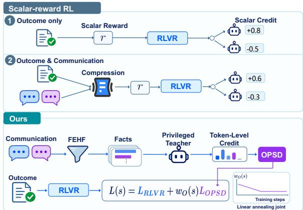
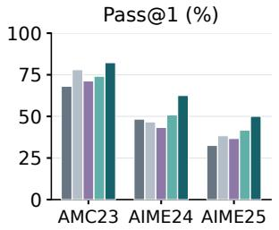
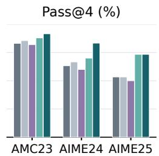
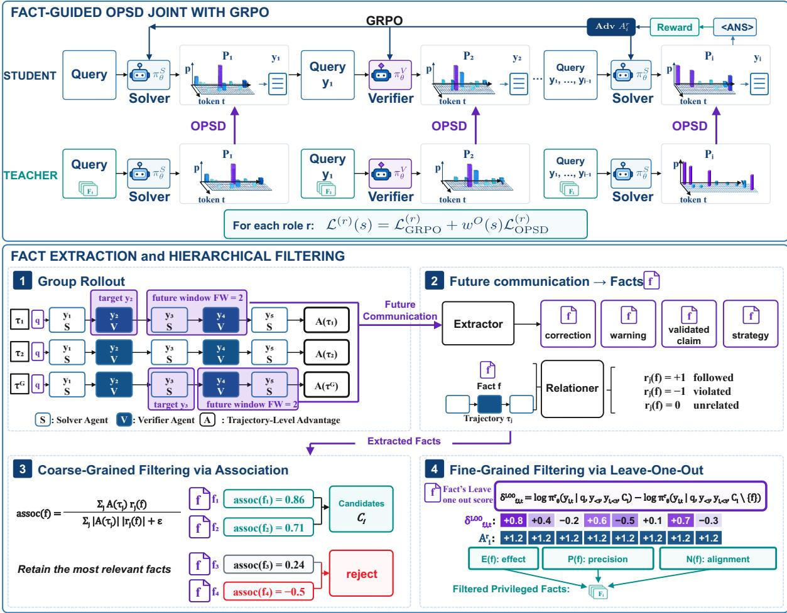
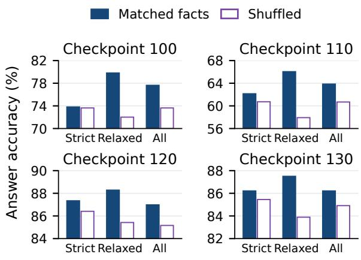
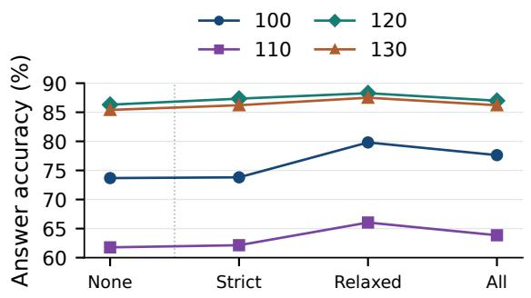
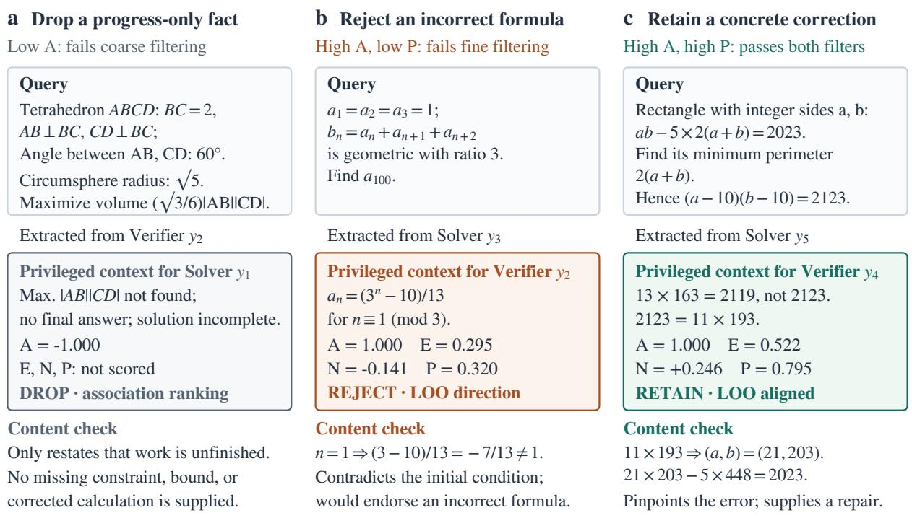

(b) Test performance GRPO DAPO CoMAS FW2 FW4

# Turning Multi-Agent Communication into Token-Level Credit with On Policy Self Distillation

Zixu Wang1,∗ Yu Zhao1,∗ Xing Zheng3 Bingbing Xu1 Tian Xueyun1 JiaTang Luo2 Weiqiang Wang3 Bowen Song3,† Huawei Shen1 Xueqi Cheng1,†

1Institute of Computing Technology, Chinese Academy of Sciences

2University of Chinese Academy of Sciences 3Ant Group

∗Equal contribution. †Corresponding authors.

wangzixu22s@ict.ac.cn

bowen.sbw@antgroup.com cxq@ict.ac.cn

## Abstract

Reinforcement learning improves problem solving in large language model multi-agent systems. Existing approaches overlook communication knowledge or compress it into scalar rewards, leaving coarse credit with little guidance on which decisions each agent should reinforce or revise. OPSD4MAS converts future communication into fine-grained token-level credit through On Policy Self Distillation (OPSD). An external model extracts facts and assesses their trajectory relations for coarse-grained filtering, followed by fine-grained leave-one-out filtering of target-token influence against agent-wise outcome advantages. The fact-conditioned policy supplies token-level credit, combined with GRPO through a linearly annealed joint objective. Our method improves mathematical pass@4 over GRPO by up to 20.00 percentage points. Ablations support complete filtering, while frozen-history injection diagnostics support fact utility. Together, these results support combining agent-level outcome guidance with communication-derived token-level credit. Code is available at https://github.com/ Camel-Prince/OPSD4MAS.

## 1 Introduction

Reinforcement learning (RL) improves large language model (LLM) reasoning by updating policies from feedback on the quality of their generated answers (Shao et al., 2024; Yu et al., 2025). Extending RL to LLM-based multi-agent systems (MAS) trains interacting agents to reason and communicate for joint success (Liu et al., 2025; Feng et al., 2026). Most approaches derive scalar rewards from task outcomes or agent communication, assign credit to participating agents, and update their policies to improve multi-turn reasoning and coordination within each task.

(a) From scalar to token-level credit  

  
Figure 1: (a) Two scalar-reward RL routes versus our RLVR–OPSD combination. (b) Test pass@1/pass@4 for CoMAS, DrMAS (GRPO/DAPO), and OPSD4MAS. FW2/FW4 denote OPSD4MAS with future windows of two/four responses, both trained with OPSD and GRPO.

Many recent MAS training methods follow scalar-reward RL. Methods such as MAGRPO, M-GRPO, and MARTI turn task outcomes, intermediate evaluations, or judgments of agent interactions into scalar rewards for policy updates (Liu et al., 2025; Hong et al., 2025; Zhang et al., 2026a). Figure 1(a) contrasts two common routes. Outcome-derived rewards assign task-success signals to responses, as in the agent-wise advantage normalization of DrMAS (Feng et al., 2026). Communication-informed rewards additionally use signals from discussions, as in MAPoRL and Co-MAS, while retaining scalar feedback (Park et al., 2025; Xue et al., 2026). These scalar-reward approaches either leave communication-derived knowledge unused in reward construction or compress it into scores, losing a valuable source of learning signal. For an intermediate response in a MAS, future communication can explain an error, validate a claim, or suggest a repair. Scalar rewards also yield coarse credit assignment: a responselevel advantage indicates whether to reinforce a response, but cannot itself distinguish which tokens a correction supports or challenges, even when token gradients differ.

To address this limitation, we propose OPSD4MAS, which converts future communication into token-level credit using On Policy Self Distillation (OPSD), in which the current policy conditioned on selected future information acts as a privileged teacher for the same policy under its ordinary context. Comparing their probabilities on student-generated tokens supplies token-level credit, as shown in Figure 1(a), incorporating communication-derived knowledge into agent parameters without future information at inference time.

The key to OPSD4MAS is constructing useful privileged context. Unfiltered communication mixes useful corrections with errors and irrelevant remarks. We therefore introduce Fact Extraction and Hierarchical Filtering (FEHF). For each target response, an external model extracts facts from its future communication window and labels their relations to same-query trajectories. Association filtering ranks candidate facts by their relevance to solving the current query, assessed from whether following or violating each fact aligns with the outcome advantages of trajectories for that query. Facts followed in higher-advantage trajectories or violated in lower-advantage trajectories receive higher scores. Leave-one-out (LOO) filtering then checks whether each candidate fact changes the target response’s token probabilities in the direction favored by that response’s GRPO outcome advantage. Retained facts provide privileged context without external teacher logits. We combine OPSD with reinforcement learning with verifiable rewards (RLVR), using GRPO and linearly decreasing the OPSD loss weight.

Across six benchmarks in Table 1, OPSD4MAS with a future window of four responses (FW4) improves mean pass@1 by 8.87 and 6.14 percentage points over GRPO and DAPO, respectively. Mean pass@4 gains are 9.54 and 8.48 percentage points. Figure 1(b) shows three representative datasets. We also inject selected facts into frozen histories and regenerate the final Solver answer. With Relaxed filtering, accuracy exceeds no injection by 1.98–6.13 percentage points across four checkpoints in Figure 4. The training ablations in Table 2 compare raw communication, extracted facts, and the two filtering stages. Extraction, Association, and LOO improve mean pass@1 over their preceding ablated settings by 9.33, 0.42, and 21.92 percentage points, respectively, with the largest gain from target-specific LOO.

Overall, our contributions are threefold:

• We turn communication into token-level credit. We identify knowledge lost or compressed by scalar-reward MAS training and use future communication as privileged context for token-level credit.

• We develop fact-guided joint OPSD–RLVR training. FEHF combines fact extraction with coarse- and fine-grained filtering. The fact-guided teacher supplies OPSD credit alongside RLVR, instantiated with GRPO, under a linearly annealed joint objective.

• We show performance gains and downstream fact utility. OPSD4MAS (FW4) improves both metrics across six benchmarks over all three trained baselines, with gains up to 20.00 percentage points. Ablations and frozen-history injection diagnostics support the filtering design and the downstream utility of selected facts.

## 2 Related Work

Multi-agent systems. LLM-based MAS coordinate specialized agents through role-based communication, debate, and shared task execution (Li et al., 2023; Wu et al., 2023; Du et al., 2023). Beyond manually specified interactions, AFlow and ADAS search for effective agent organizations (Zhang et al., 2025; Hu et al., 2025). These approaches address how agents collaborate. A complementary question is how post-training can improve the policies participating in that collaboration.

Reinforcement learning for multi-agent systems. RL post-training improves LLM policies using feedback on generated answers. GRPO, RLOO, and DAPO offer policy-gradient approaches with different advantage estimators and optimization de signs (Shao et al., 2024; Ahmadian et al., 2024; Yu et al., 2025). Extending reward-based learning to interacting agents introduces the problem of assigning credit across roles and turns. MAGRPO optimizes cooperative policies using shared rewards, while DrMAS normalizes outcome rewards with agent-specific statistics (Liu et al., 2025; Feng et al., 2026). To account for collaboration, MA-PoRL shapes verifier rewards using changes in answer correctness and influence across discussions, while CoMAS derives scalar action rewards from interaction-based judgments (Park et al., 2025; Xue et al., 2026). However, these methods reduce task feedback to scalar rewards rather than use communication content directly for task-specific tokenlevel credit. OPSD4MAS addresses this gap by conditioning a privileged teacher on selected communication while retaining outcome credit.

On Policy Self Distillation. On Policy Distillation (OPD) is an emerging LLM post-training paradigm that queries a teacher on studentgenerated trajectories, providing token-level learning signals on states visited by the student (Song and Zheng, 2026). In On Policy Self Distillation (OPSD), the student model or a copy acts as teacher with additional information unavailable to the ordinary-context student. Related methods differ in their teachers and privileged information. OPCD studies frozen and shared-weight context teachers (Ye et al., 2026). MOPD uses successful and failed same-question rollouts with self or external teachers (Yu et al., 2026). GEAR uses a groundtruth-conditioned self-model to reweight outcome advantages, not a direct distillation loss (Li et al., 2026). TurnOPD uses a frozen external teacher on student-visited multi-turn histories (Zhou et al., 2026). EDGE-OPD masks updates by privilegedcontext evidence, whereas AR-OPD controls fullview residual guidance around a partial-privilege anchor (Lazaridis et al., 2026; Zhang, 2026). Our focus is selecting reliable, target-specific facts from mixed-quality future communication, rather than directly adopting complete answers or alternative rollouts as privileged context.

OPD for MAS. Recent work applies OPD to multi-agent learning. MAS-OPD supplies a frozen external teacher with verifier-produced attributions of past-turn conflicts (Zhong et al., 2026). $\pi \cdot$ Play conditions an EMA self-teacher on an examiner’s question-construction paths (Zhang et al., 2026b). OPSD4MAS instead extracts facts from future inter-agent communication during task solving. Cross-trajectory association and target-specific LOO filtering select these facts as privileged context for each role’s privileged teacher.

## 3 Problem Formulation

A language-model multi-agent system (MAS) coordinates communicating agents through a predefined workflow, graph, or autonomous decisions. In the role-specific setting, each role $r \in \mathcal { R }$ has parameters $\theta _ { r }$ , and $\Theta = \{ \theta _ { r } : r \in \mathscr { R } \}$ collects all trainable parameters. We write $\pi _ { \theta } ^ { r } = \pi _ { \theta _ { \eta } }$ for its policy. For query $q ,$ index sampled trajectories by $j .$ Stochastic execution gives

$$
\tau _ { j } = \mathrm { M A S } _ { \Theta } ( q ) , \qquad \tau _ { j } = ( y _ { j , 1 } , \ldots , y _ { j , T _ { j } } ) .\tag{1}
$$

Response $y _ { j , i }$ is generated by role $r ( i )$ , which can act repeatedly. Token t has context $( q , y _ { j , < i } , y _ { j , i , < t } )$ under shared history. Restricted communication exposes only the permitted prefix. MAS RL updates all participating agents’ parameters, not only the final answering agent. With outcome reward $R ( \tau )$ the objective is

$$
\operatorname* { m a x } _ { \Theta } \mathbb { E } _ { q , \tau \sim \mathrm { M A S } _ { \Theta } ( q ) } [ R ( \tau ) ] .\tag{2}
$$

DrMAS (Feng et al., 2026) normalizes outcome rewards by agent within each query group to obtain

$$
A _ { j , i } ^ { r ( i ) } = \frac { s _ { j , i } - \mu _ { q , r ( i ) } } { \sigma _ { q , r ( i ) } + \epsilon } .\tag{3}
$$

Here $s _ { j , i }$ is the outcome reward assigned to response $y _ { j , i }$ in GRPO training. Mean $\mu$ and standard deviation $\sigma$ pool all same-agent responses across trajectories for query $q ,$ counting repeated turns separately. This agent-wise advantage weights every valid response token in GRPO’s clipped surrogate. Communication-informed CoMAS instead optimizes interaction-derived action rewards with REINFORCE++ and a clipped surrogate (Xue et al., 2026). Its parameters index agents that can perform different interaction roles. Appendix A details their normalization and KL terms.

## 4 Method

## 4.1 Motivation

Scalar-reward MAS training discards or compresses communication knowledge useful for collaboration. We use future communication as privileged context for token-level OPSD credit. Mixing corrections with errors and irrelevant remarks motivates fact extraction and two filtering stages. Communication also lacks verified outcome feedback, motivating annealed joint OPSD–GRPO training. Following Figure 2, we describe privileged-context construction, then joint training.

## 4.2 Fact Extraction and Hierarchical Filtering

Fact extraction. Given trajectory $\tau _ { j }$ , consider its i-th response $y _ { i }$ , omitting j below and writing $r = r ( i )$ . An external model examines communication in $y _ { i + 1 } , \dots , y _ { \operatorname* { m i n } ( i + W , T ) }$ and extracts atomic corrections, warnings, validated claims, and strategies (Figure 2, panels 1–2). Facts retain their source and target identities. The terminal response can supply facts to earlier steps but has no future source itself. Appendix C gives the Extractor and Relationer prompts. Extraction converts communication into individual facts, and two filters then select the target’s privileged information.

Association filtering. Association filtering (Figure 2, panel 3) uses fact–trajectory relations for the same query, labeled by the external model: $r _ { j } ( f ) \in \{ + 1 , - 1 , 0 \}$ for followed, violated, and unrelated. For fact ranking, we separately compute $A ( \tau _ { j } ) = ( R ( \tau _ { j } ) - \mu _ { q } ) / ( \sigma _ { q } + \epsilon )$ , counting each trajectory once in the query group’s reward statistics. Unlike the response-occurrence normalization in Equation 3, this does not weight repeated agent turns. We compute

$$
\operatorname { a s s o c } ( f ) = { \frac { \sum _ { j } A ( \tau _ { j } ) r _ { j } ( f ) } { \sum _ { j } | A ( \tau _ { j } ) | \left| r _ { j } ( f ) \right| + \epsilon } } .\tag{4}
$$

Following a fact at positive advantage or violating it at negative advantage contributes positively, whereas the reverse contributes negatively. Unrelated labels contribute neither term. The score ranks facts by outcome association on the query rather than weighting the actor loss. Retaining a limited number forms $C _ { i }$ , without a positive-score threshold. Appendix A details normalization, exclusions, and tie-breaking.

Target-specific LOO filtering. From the Association-ranked candidates, LOO retains facts with sufficient influence on the target’s tokens, predominantly aligned with its outcome advantage (Figure 2, panel 4). It compares the full candidate set with one fact removed, using cached pre-update policy scores. Write

$$
g _ { i , t } ( S ) = \log \pi _ { \theta } ^ { r } ( y _ { i , t } \mid q , y _ { < i } , y _ { i , < t } , S ) .
$$

We define the removal effect and its outcomedirected value as

$$
\begin{array} { r l } & { \delta _ { f , i , t } ^ { \mathrm { L O O } } = g _ { i , t } ( C _ { i } ) - g _ { i , t } ( C _ { i } \setminus \{ f \} ) , } \\ & { z _ { f , i , t } = A _ { i } ^ { r } \delta _ { f , i , t } ^ { \mathrm { L O O } } . } \end{array}\tag{5}
$$

Here $A _ { i } ^ { r }$ is the target’s DrMAS agent-wise advantage used by GRPO (Equation 3, j omitted), not Association’s $A ( \tau _ { j } )$ Let $m _ { + }$ $\mathbb { E } _ { t } [ \operatorname* { m a x } ( z _ { f , i , t } , 0 ) ]$ and $m _ { - } = \mathbb { E } _ { t } [ \operatorname* { m a x } ( - z _ { f , i , t } , 0 ) ]$ where expectations include only active response tokens. We measure effect, directional precision, and net alignment:

$$
E ( f ) = \sqrt { \mathbb { E } _ { t } [ ( \delta _ { f , i , t } ^ { \mathrm { L O O } } ) ^ { 2 } ] } ,\tag{6}
$$

$$
P ( f ) = \frac { m _ { + } } { m _ { + } + m _ { - } + \epsilon } ,\tag{7}
$$

$$
{ \cal N } ( f ) = m _ { + } - \lambda _ { c } m _ { - } .\tag{8}
$$

$E$ measures influence on token log probabilities, while $m _ { + }$ and m− measure its advantage-aligned and opposing mass. P is the positive influence share, not a token fraction, and N penalizes opposing mass. Useful facts should have sufficient influence, a high positive share, and a large net effect. For this target, a fact passes when $E \geq E _ { \operatorname* { m i n } } ,$ $P \ge P _ { \operatorname* { m i n } }$ , and $N > N _ { \operatorname* { m i n } }$ . Top-K ranking gives the final set $F _ { i } \subseteq C _ { i }$ . We use $\lambda _ { c } = 1$ by default and rescore $F _ { i }$ for OPSD. Context-matching and budget details appear in Appendix A.

## 4.3 Fact-Conditioned OPSD and Annealed Joint Training

Fact-conditioned token-level credit. The privileged teacher and ordinary-context student are two views of the same role policy. Using the selected set $F _ { i }$ , we compute

$$
\begin{array} { r } { \delta _ { i , t } = \log \pi _ { \theta } ^ { r } ( y _ { i , t } \mid q , y _ { < i } , y _ { i , < t } , F _ { i } ) } \\ { - \log \pi _ { \theta } ^ { r } ( y _ { i , t } \mid q , y _ { < i } , y _ { i , < t } ) . } \end{array}\tag{9}
$$

Scores are cached before actor updates. The token-dependent coefficient is $A _ { i , t } ^ { \mathrm { { O P S D } } } = \mathrm { { s g } } ( \lambda _ { O } \delta _ { i , t } )$

  
Figure 2: OPSD4MAS combines agent-wise GRPO credit with token-level OPSD credit. Future communication is converted into facts, ranked by association with query-normalized trajectory advantage $A ( \tau _ { j } )$ , and filtered by LOO against DrMAS agent-wise advantage $A _ { i } ^ { r }$ , also used by GRPO. The selected set $F _ { i }$ conditions each role’s privileged teacher. Probability displays and numerical examples are illustrative.

where sg stops gradients and $\lambda _ { O } = 1$ by default. It is zero when no facts are selected. Unlike either outcome advantage, this coefficient comes from token log-probability differences.

Role-wise OPSD objective. Within one rolehomogeneous loss-reduction batch, let $I _ { r }$ contain role $r { } _ { \mathrm { { s } } }$ responses, $m _ { i , t }$ be the active-token mask, and $\begin{array} { r } { Z _ { r } = \sum _ { i \in I _ { r } } \sum _ { t } m _ { i , t } } \end{array}$ . For $Z _ { r } > 0$

$$
\mathcal { L } _ { \mathrm { O P S D } } ^ { ( r ) } = - \frac { 1 } { Z _ { r } } \sum _ { i \in I _ { r } } \sum _ { t } m _ { i , t } A _ { i , t } ^ { \mathrm { o p S D } }\tag{10}
$$

Only ordinary-context probabilities carry gradients to $\theta _ { r }$ . OPSD uses neither ratios nor clipping. $\mathbf { A p } \mathbf { \cdot }$ pendix A gives the caching and reduction details.

Joint training and linear annealing. Our experiments combine GRPO’s clipped policygradient loss with OPSD, as illustrated in

Figure 2’s upper panel:

$$
\begin{array} { r } { \begin{array} { r l } & { \mathcal { L } ^ { ( r ) } ( s ) = \mathcal { L } _ { \mathrm { G R P O } } ^ { ( r ) } + w ^ { O } ( s ) \mathcal { L } _ { \mathrm { O P S D } } ^ { ( r ) } , } \\ & { w ^ { O } ( s ) = \operatorname* { m a x } ( w _ { 0 } - s \rho , w _ { \mathrm { m i n } } ) . } \end{array} } \end{array}\tag{11}
$$

Here s is the training step, while w0, $\rho ,$ and $w _ { \mathrm { m i n } }$ set the initial weight, decay, and floor. Both terms update $\theta _ { r }$ : GRPO and LOO share DrMAS agentwise advantage $A _ { i } ^ { r }$ , whereas OPSD supplies factconditioned token-varying credit. Annealing reduces the OPSD contribution while keeping verified outcome feedback active. Appendix A gives implementation details and loss aggregations. Inference uses ordinary contexts, without future communication or the external model.

<table><tr><td>Method</td><td colspan="2">AMC23</td><td colspan="2">AIME24</td><td colspan="2">AIME25</td><td colspan="2">MATH-500</td><td colspan="2">Olympiad</td><td colspan="2">Minerva</td></tr><tr><td></td><td>p1</td><td>p4</td><td>p1</td><td> $p _ { 4 }$ </td><td>p1</td><td>p4</td><td>p1</td><td>p4</td><td>p1</td><td>p4</td><td>p1</td><td>p4</td></tr><tr><td>Base Model</td><td>60.24</td><td>74.70</td><td>25.83</td><td>43.33</td><td>19.17</td><td>23.33</td><td>82.40</td><td>90.40</td><td>41.04</td><td>53.04</td><td>24.72</td><td>31.99</td></tr><tr><td>Frozen-weight MAS: no LLM </td><td></td><td> parameter updates</td><td></td><td></td><td></td><td></td><td></td><td></td><td></td><td></td><td></td><td></td></tr><tr><td>Solver–Verifier MAS</td><td>56.63</td><td>71.08</td><td>22.50</td><td>36.67</td><td>16.67</td><td>26.67</td><td>83.50</td><td>91.80</td><td>46.81</td><td>59.26</td><td>33.27</td><td>41.18</td></tr><tr><td>AFlow</td><td>61.44</td><td>77.11</td><td>27.50</td><td>46.67</td><td>22.50</td><td>26.67</td><td>79.15</td><td>88.60</td><td>45.44</td><td>58.07</td><td>30.61</td><td>39.34</td></tr><tr><td>GPTSwarm</td><td>61.44</td><td>74.70</td><td>20.83</td><td>36.67</td><td>20.83</td><td>30.00</td><td>80.75</td><td>89.60</td><td>44.33</td><td>54.22</td><td>24.72</td><td>34.19</td></tr><tr><td colspan="9">Scalar-reward RL: sparse credit assignment</td><td></td><td></td><td></td><td></td></tr><tr><td>DrMAS-GRPO</td><td>68.07</td><td>83.13</td><td>48.33</td><td>63.33</td><td>32.50</td><td>53.33</td><td>90.95</td><td>94.60</td><td>56.11</td><td>68.30</td><td>36.76</td><td>42.65</td></tr><tr><td>DrMAS-DAPO</td><td>78.01</td><td>85.54</td><td>46.67</td><td>66.67</td><td>38.33</td><td>53.33</td><td>90.35</td><td>94.40</td><td>58.93</td><td>68.00</td><td>36.86</td><td>43.75</td></tr><tr><td>CoMAS</td><td>71.29</td><td>81.93</td><td>43.33</td><td>60.00</td><td>36.67</td><td>50.00</td><td>90.90</td><td>94.20</td><td>56.59</td><td>68.44</td><td>36.40</td><td>41.18</td></tr><tr><td colspan="9">Ours: token-level credit assignment</td><td></td><td></td><td></td><td></td></tr><tr><td>OPSD4MAS (FW2)</td><td>74.10</td><td>87.95</td><td>50.83</td><td>70.00</td><td>41.67</td><td>73.33</td><td>89.00</td><td>95.20</td><td>55.59</td><td>67.11</td><td>38.42</td><td>47.06</td></tr><tr><td>OPSD4MAS (FW4)</td><td>82.23</td><td>91.57</td><td>62.50</td><td>83.33</td><td>50.00</td><td>73.33</td><td>91.50</td><td>96.60</td><td>60.30</td><td>69.93</td><td>39.43</td><td>47.79</td></tr></table>

Table 1: Test performance (%): $p _ { 1 } / p _ { 4 }$ denote pass@1/pass@4. Bold underlined and italic underlined values rank first and second in each column. All nine methods are evaluated on six datasets. Olympiad denotes English text-only OlympiadBench mathematics. Evaluation protocols and scoring qualifications appear in Section 5.1 and Appendix B.1.

## 5 Experiments

## 5.1 Setup

Models and data. We initialize trained agents from Qwen3-4B (Yang et al., 2025), and all settings use non-thinking mode. AFlow (Zhang et al., 2025) and GPTSwarm (Zhuge et al., 2024) also use Qwen3-4B executors. AFlow’s search optimizer is Qwen3-235B-A22B-Instruct-2507-Pro (Qwen Team, 2025). For policy training, we use DAPO-MATH-17k (Yu et al., 2025). We test on six other datasets: AMC23, AIME24, AIME25 (Mathematical Association of America, n.d.), MATH-500 (Lightman et al., 2023), the English text-only mathematics subset of OlympiadBench (He et al., 2024), and Minerva (Lewkowycz et al., 2022).

Compared methods. (1) Base Model: Qwen3- 4B answers directly without multi-agent interaction. (2) Frozen-weight MAS: Solver–Verifier MAS uses the autonomous interaction loop shared by DrMAS and OPSD4MAS, with model-decided termination and no LLM parameter updates. AFlow and GPTSwarm optimize collaboration structures or prompts while retaining fixed LLM weights. (3) Scalar-reward RL: DrMAS (Feng et al., 2026) with GRPO (Shao et al., 2024) or DAPO (Yu et al., 2025) uses outcome rewards. CoMAS (Xue et al., 2026) derives scalar rewards from interactions. (4) OPSD4MAS: FW2 and FW4 combine OPSD with GRPO, using future windows of two and four responses. Table 1 reports pass@1 and pass@4 as percentages. Appendix B.1 gives protocols for evaluation and selection.

## 5.2 Main Results

Gains over scalar-reward RL. FW4 leads all six datasets in Table 1. With equal dataset weights, mean pass@1 exceeds GRPO, DAPO, and CoMAS by 8.87, 6.14, and 8.46 percentage points. Mean pass@4 gains are 9.54, 8.48, and 11.13 percentage points, respectively. The gains over CoMAS extend this comparison to communication-informed rewards. Across both scalar-reward routes, these results support combining outcome credit with communication-derived token-level credit.

Gains over frozen-weight MAS. FW4 also exceeds every reported frozen-weight result, including both the shared Solver–Verifier loop and optimized collaboration structures. On MATH-500, it reaches 91.50% pass@1 and 96.60% pass@4, improving on Solver–Verifier MAS by 8.00 and 4.80 percentage points. On Olympiad, the respective gains are 13.49 and 10.67 percentage points. With Qwen3-4B executors throughout, these results favor learning agent policies over relying solely on fixed-weight collaboration.

Benefits of a larger future window. FW2 is already competitive with scalar-reward RL. Across six datasets, its mean pass@1 is close to DAPO’s, while its mean pass@4 is 4.83 percentage points higher. Expanding the window to four responses raises mean pass@1 and pass@4 by 6.06 and 3.65 percentage points. The observed gains support a broader span of future communication as a valuable source of information for fact selection.

## 5.3 Ablating Future Communication Processing

Table 2 compares five FEHF training variants. No OPSD uses GRPO alone. Rawfuture communication supplies unprocessed text as privileged context. Unfiltered Facts extracts facts without filtering. Coarse-filtered Facts adds Association but omits LOO, while Full applies both filters.

Only Full exceeds No OPSD in both equaldataset means, by 15.28 and 16.15 percentage points. Every tested incomplete variant falls below scalar-reward RL alone: access to future communication can therefore hurt training when the privileged context is inadequately processed. Extraction improves mean pass@1/pass@4 over raw communication by 9.33/13.52 percentage points, and Association adds 0.42/1.21 percentage points. Adding LOO produces the largest further gains, 21.92/17.56 percentage points. These results support the complete pipeline: extraction makes knowledge individually assessable, Association prioritizes outcome-related facts, and LOO selects facts with favorable target-specific influence.

## 5.4 Fact Injection: Utility and Task Matching

We vary LOO filtering strength and inject the resulting facts as privileged context to assess their downstream utility. At four FW4 checkpoints, we freeze saved histories and regenerate only the final active Solver on training questions. Facts enter historical and final-input slots. None supplies no facts, while Strict and Relaxed apply different LOO thresholds. All bypasses LOO on the post-association candidate pool.

Task matching under quantity controls. For each filtering profile, Shuffled replaces the original facts with facts from other questions. The paired design keeps injection slots and visible fact counts the same, with approximate length matching, to test whether appropriate content helps beyond adding more text. As shown in Figure 3, Relaxed yields the largest matched–shuffled advantage at every checkpoint, 2.86–8.12 percentage points. This contrast supports task-appropriate selection, rather than extra text alone, as a source of benefit.

An intermediate filtering strength works best. Figure 4 compares the ordered settings None, Strict, Relaxed, and All. Relative to the noinjection baseline, Relaxed improves accuracy by 6.13/4.27/1.98/2.10 percentage points at checkpoints 100/110/120/130. Accuracy rises from Strict to Relaxed and falls from Relaxed to All at every checkpoint. Neither very restrictive selection nor removing the LOO gate gives the best result: useful privileged context requires an appropriate filtering strength, not simply a larger fact pool.

<table><tr><td>Condition</td><td>E</td><td>A</td><td>L</td><td>p1</td><td>p4</td></tr><tr><td>No OPSD</td><td>一</td><td>一</td><td>一</td><td>49.63</td><td>66.60</td></tr><tr><td>Raw Commun.</td><td>一</td><td>一</td><td>一</td><td>33.24</td><td>50.46</td></tr><tr><td>Unfiltered Facts</td><td>√</td><td>一</td><td>一</td><td>42.57</td><td>63.97</td></tr><tr><td>Coarse-filtered Facts</td><td>√</td><td>√</td><td>一</td><td>42.99</td><td>65.18</td></tr><tr><td>Full</td><td>√</td><td>√</td><td>√</td><td>64.91</td><td>82.74</td></tr></table>

Table 2: Training ablations: mean pass@1/pass@4 $( p _ { 1 } / p _ { 4 } , \% )$ on AMC23, AIME24, and AIME25, with equal dataset weights. Raw Commun. abbreviates Raw future communication. $E / A / L \colon$ extraction/Association/LOO. No OPSD and Full reuse GRPO and FW4 from Table 1.

  
Figure 3: Quantity-matched control design: Relaxed has the largest matched–shuffled gains. Nonzero y-axis ranges differ across panels, so compare numerical values across checkpoints. Protocol: Appendix B.3.

  
Figure 4: Filtering-strength trend (60–90% axis): Relaxed is best at all checkpoints. None is the no-injection reference, and Strict through All relax LOO. Category spacing does not encode fact quantity.

  
Figure 5: Selected cases connect filtering decisions to fact content: (a) no actionable repair, (b) a falsifiable error, (c) a concrete correction. Queries and facts are abridged. Boxed facts are proposed privileged contexts for the named responses. DROP/REJECT denotes non-retention, not injection. A/E/N/P denote association, RMS effect, net alignment, and directional precision. Content checks are independent of logged selection, with sources and scores in Appendix D.

## 5.5 Case Study: Understanding Fact Selection

We examine representative facts to explain what our filters remove and retain. Figure 5 connects each decision to the fact’s content, source response, and proposed target.

Low association: no actionable repair. Panel (a) asks for a tetrahedron’s maximum volume. The fact extracted from Verifier y2 tells Solver y1 only that the optimization is unfinished. It supplies no missing constraint, bound, or corrected calculation. With A = −1, this progress description is dropped before LOO scoring.

High association, unfavorable local direction. Panel (b) specifies $a _ { 1 } = a _ { 2 } = a _ { 3 } = 1$ and geometric consecutive triple sums with ratio 3. Solver y3 supplies Verifier y2 with the claim $a _ { n } = ( 3 ^ { n } -$ 10)/13 for n ≡ 1 (mod 3). At n = 1, it gives −7/13, contradicting the initial condition. Despite A = 1 and substantial effect E = 0.295, negative alignment N = −0.141 and low directional precision P = 0.320 lead to rejection. Strong teacher influence alone is insufficient, so the local screen also tests its direction relative to outcome credit.

High association, favorable local direction. Panel (c) factors (a − 10)(b − 10) = 2123 to minimize a rectangle’s perimeter. The fact from Solver y5 for Verifier y4 corrects 13 × 163 = 2119 and supplies 2123 = 11 × 193, yielding sides 21 and 203 and perimeter 448. The repair is retained with A = 1, E = 0.522, N = 0.246, and P = 0.795.

These cases illustrate how FEHF turns future communication into privileged context. In particular, LOO selects facts by their token-level influence relative to the target’s agent-wise GRPO advantage. The annealed OPSD–RLVR objective then combines agent-wise outcome credit with factconditioned token-level credit.

## 6 Conclusion

We observe that scalar-reward MAS training compresses or ignores communication and assigns coarse credit. To address this limitation, we propose OPSD4MAS, using Fact Extraction and Hierarchical Filtering (FEHF) to turn future communication into privileged context. Its linearly annealed joint objective combines OPSD token-level credit with GRPO outcome guidance. Supporting this design, OPSD4MAS with a future window of four responses (FW4) leads all baselines across six mathematical benchmarks. Ablations support complete FEHF, while injection diagnostics highlight task matching and filtering strength. Together, FEHF converts future communication into privileged context, enabling annealed OPSD–RLVR joint training to combine agent-wise outcome credit with factconditioned token-level credit.

## Limitations

Our evaluation focuses on mathematical reasoning with Qwen3-4B agents. Extending the approach to other tasks, model scales, and interaction structures remains future work. Fact extraction and relation labeling rely on an external model, so the quality of privileged context can depend on that model and on filtering thresholds, context budgets, and annealing.

The injection diagnostic evaluates selected facts at fixed weights and frozen histories. Its four checkpoints belong to one training run rather than independent training seeds, so the observed checkpoint differences do not measure variation across training runs.

## Ethical Considerations

This work studies reinforcement learning on competition-mathematics data and does not use personal or sensitive information. External model calls receive problem-solving traces, so deployments should ensure that traces contain no confidential data and comply with the provider’s data policy. More broadly, multi-agent self-improvement can amplify incorrect feedback shared between agents. The proposed filters are intended to mitigate this risk, but a reduction has not been demonstrated. Selected facts should not be interpreted as verified truth outside the evaluated domain.

OpenAI Codex was used to assist with code development and debugging, language revision, figure prototyping, and consistency checking. All AI-assisted material included in this submission was reviewed by the authors, who remain fully responsible for the content, claims, citations, code, and reported results.

## References

Arash Ahmadian, Chris Cremer, Matthias Galle,´ Marzieh Fadaee, Julia Kreutzer, Olivier Pietquin, Ahmet Ust¨ un, and Sara Hooker. 2024. Back to basics:¨ Revisiting REINFORCE style optimization for learn-

ing from human feedback in LLMs. arXiv preprint arXiv:2402.14740.

Yilun Du, Shuang Li, Antonio Torralba, Joshua B. Tenenbaum, and Igor Mordatch. 2023. Improving factuality and reasoning in language models through multiagent debate. arXiv preprint arXiv:2305.14325.

Lang Feng, Longtao Zheng, Shuo He, Fuxiang Zhang, and Bo An. 2026. Dr. MAS: Stable reinforcement learning for multi-agent LLM systems. arXiv preprint arXiv:2602.08847.

Chaoqun He, Renjie Luo, Yuzhuo Bai, Shengding Hu, Zhen Thai, Junhao Shen, Jinyi Hu, Xu Han, Yujie Huang, Yuxiang Zhang, Jie Liu, Lei Qi, Zhiyuan Liu, and Maosong Sun. 2024. OlympiadBench: A challenging benchmark for promoting AGI with olympiad-level bilingual multimodal scientific problems. In Proceedings ofthe 62nd Annual Meeting of the Associationfor Computational Linguistics (Volume 1: Long Papers), pages 3828–3850.

Dan Hendrycks, Collin Burns, Saurav Kadavath, Akul Arora, Steven Basart, Eric Tang, Dawn Song, and Jacob Steinhardt. 2021. Measuring mathematical problem solving with the MATH dataset. arXiv preprint arXiv:2103.03874.

Haoyang Hong, Jiajun Yin, Yuan Wang, Jingnan Liu, Zhe Chen, Ailing Yu, Ji Li, Zhiling Ye, Hansong Xiao, Yefei Chen, Hualei Zhou, Yun Yue, Minghui Yang, Chunxiao Guo, Junwei Liu, Peng Wei, and Jinjie Gu. 2025. Multi-agent deep research: Training multi-agent systems with M-GRPO. Preprint, arXiv:2511.13288.

Shengran Hu, Cong Lu, and Jeff Clune. 2025. Automated design of agentic systems. In International Conference on Learning Representations.

Aristotelis Lazaridis, Dylan Bates, Aman Sharma, Brian King, Vincent Lu, and Jack FitzGerald. 2026. EDGE-OPD: Internalizing privileged context with evidence guided on-policy distillation. arXiv preprint arXiv:2605.23493.

Aitor Lewkowycz, Anders Andreassen, David Dohan, Ethan Dyer, Henryk Michalewski, Vinay Ramasesh, Ambrose Slone, Cem Anil, Imanol Schlag, Theo Gutman-Solo, Yuhuai Wu, Behnam Neyshabur, Guy Gur-Ari, and Vedant Misra. 2022. Solving quantitative reasoning problems with language models. In Advances in Neural Information Processing Systems, volume 35.

Guohao Li, Hasan Abed Al Kader Hammoud, Hani Itani, Dmitrii Khizbullin, and Bernard Ghanem. 2023. CAMEL: Communicative agents for “mind” exploration of large language model society. In Advances in Neural Information Processing Systems.

Sijia Li, Yuchen Huang, Zifan Liu, Yanping Li, Jingjing Fu, Li Zhao, Jiang Bian, Ling Zhang, Jun Zhang, and Rui Wang. 2026. GEAR: Granularity-adaptive advantage reweighting for LLM agents via self-distillation. arXiv preprint arXiv:2605.11853.

Hunter Lightman, Vineet Kosaraju, Yura Burda, Harri Edwards, Bowen Baker, Teddy Lee, Jan Leike, John Schulman, Ilya Sutskever, and Karl Cobbe. 2023. Let’s verify step by step. arXiv preprint arXiv:2305.20050.

Shuo Liu, Tianle Chen, Zeyu Liang, Xueguang Lyu, and Christopher Amato. 2025. LLM collaboration with multi-agent reinforcement learning. arXiv preprint arXiv:2508.04652.

Mathematical Association of America. n.d. American mathematics competitions. Accessed October 10, 2026.

Chanwoo Park, Seungju Han, Xingzhi Guo, Asuman E. Ozdaglar, Kaiqing Zhang, and Joo-Kyung Kim. 2025. MAPoRL: Multi-agent post-co-training for collaborative large language models with reinforcement learning. In Proceedings of the 63rd Annual Meeting of the Association for Computational Linguistics, pages 30215–30248.

Qwen Team. 2025. Qwen3-235B-A22B-Instruct-2507 model card. Hugging Face. Accessed October 13, 2026.

Zhihong Shao, Peiyi Wang, Qihao Zhu, Runxin Xu, Junxiao Song, Xiao Bi, Haowei Zhang, Mingchuan Zhang, Y. K. Li, Y. Wu, and Daya Guo. 2024. DeepSeekMath: Pushing the limits of mathematical reasoning in open language models. arXiv preprint arXiv:2402.03300.

Mingyang Song and Mao Zheng. 2026. A survey of onpolicy distillation for large language models. arXiv preprint arXiv:2604.00626.

Qingyun Wu, Gagan Bansal, Jieyu Zhang, Yiran Wu, Beibin Li, Erkang Zhu, Li Jiang, Xiaoyun Zhang, Shaokun Zhang, Jiale Liu, et al. 2023. AutoGen: Enabling next-gen LLM applications via multi-agent conversation. arXiv preprint arXiv:2308.08155.

Xiangyuan Xue, Yifan Zhou, Guibin Zhang, Zaibin Zhang, Yijiang Li, Chen Zhang, Zhenfei Yin, Philip Torr, Wanli Ouyang, and Lei Bai. 2026. CoMAS: Coevolving multi-agent systems via interaction rewards. In International Conference on Learning Representations.

An Yang, Anfeng Li, Baosong Yang, Beichen Zhang, Binyuan Hui, Bo Zheng, Bowen Yu, Chang Gao, Chengen Huang, Chenxu Lv, et al. 2025. Qwen3 technical report. arXiv preprint arXiv:2505.09388.

Tianzhu Ye, Li Dong, Xun Wu, Shaohan Huang, and Furu Wei. 2026. On-policy context distillation for language models. arXiv preprint arXiv:2602.12275.

Qiying Yu, Zheng Zhang, Ruofei Zhu, Yufeng Yuan, Xiaochen Zuo, Yu Yue, Weinan Dai, Tiantian Fan, Gaohong Liu, Lingjun Liu, Xin Liu, et al. 2025. DAPO: An open-source LLM reinforcement learning system at scale. arXiv preprint arXiv:2503.14476.

Weichen Yu, Xiaomin Li, Yizhou Zhao, Xiaoze Liu, Ruowang Zhang, Haixin Wang, Yinyi Luo, Chen Henry Wu, Gaurav Mittal, Matt Fredrikson, and Yu Hu. 2026. Multi-rollout on-policy distillation via peer successes and failures. arXiv preprint arXiv:2605.12652.

Jiayi Zhang, Jinyu Xiang, Zhaoyang Yu, Fengwei Teng, Xionghui Chen, Jiaqi Chen, Mingchen Zhuge, Xin Cheng, Sirui Hong, Jinlin Wang, Bingnan Zheng, Bang Liu, Yuyu Luo, and Chenglin Wu. 2025. AFlow: Automating agentic workflow generation. In International Conference on Learning Representations.

Kaiyan Zhang, Kai Tian, Runze Liu, Sihang Zeng, Xuekai Zhu, Guoli Jia, Yuchen Fan, Xingtai Lv, Yuxin Zuo, Che Jiang, Yuru Wang, Jianyu Wang, Ermo Hua, Xinwei Long, Junqi Gao, Youbang Sun, Zhiyuan Ma, Ganqu Cui, Ning Ding, and 2 others. 2026a. MARTI: A framework for multi-agent LLM systems reinforced training and inference. In The Fourteenth International Conference on Learning Representations.

Wenhao Zhang. 2026. Beyond absolute imitation: Anchored residual guidance for privileged on-policy distillation. arXiv preprint arXiv:2606.10385.

Yaocheng Zhang, Yuanheng Zhu, Wenyue Chong, Songjun Tu, Qichao Zhang, Jiajun Chai, Xiaohan Wang, Wei Lin, Guojun Yin, and Dongbin Zhao. 2026b. π-play: Multi-agent self-play via privileged self-distillation without external data. arXiv preprint arXiv:2604.14054.

Qiyong Zhong, Mao Zheng, Mingyang Song, Houcheng Jiang, Jiajie Su, Huwei Ji, Li Zhang, and Junfeng Fang. 2026. MAS-OPD: On-policy distillation for multi-agent systems. arXiv preprint arXiv:2609.34234.

Yuhang Zhou, Kai Zheng, Haoling Li, Dengyun Peng, Can Xu, and Jingjing Chen. 2026. TurnOPD: Making on-policy distillation turn-aware for efficient long-horizon agent training. arXiv preprint arXiv:2607.05804.

Mingchen Zhuge, Wenyi Wang, Louis Kirsch, Francesco Faccio, Dmitrii Khizbullin, and Jurgen¨ Schmidhuber. 2024. GPTSwarm: Language agents as optimizable graphs. In Proceedings of the 41st International Conference on Machine Learning, volume 235 of Proceedings of Machine Learning Research, pages 62743–62767. PMLR.

## A Implementation and Reproducibility

Computing environment. The project used a computing environment with 24 NVIDIA A100 GPUs, each with 80 GB of memory. This describes the available project resources, not the allocation of every individual run.

Baseline objectives and parameter indexing. DrMAS uses a clipped importance-ratio objective for each agent, with outcome credit normalized by agent action statistics (Feng et al., 2026). We follow its query-and-agent response grouping in Equation 3. CoMAS instead collects agent outputs and interaction-derived rewards into a buffer and optimizes a REINFORCE++ clipped surrogate (Xue et al., 2026). For output o and input $p ,$ its pre-normalization advantage includes a cumulative KL term,

$$
A _ { t } = r ( o ) - \beta \sum _ { u = t } ^ { | o | } \log \frac { \pi _ { \theta _ { k } } ( o _ { u } \mid p , o _ { < u } ) } { \pi _ { \mathrm { r e f } } ( o _ { u } \mid p , o _ { < u } ) } .\tag{12}
$$

After batch normalization, the objective sums min $( \rho _ { t } \widehat { A } _ { t } , \mathrm { c l i p } ( \rho _ { t } , 1 - \epsilon , 1 + \epsilon ) \widehat { A } _ { t } )$ over tokens, with current/old-policy ratio $\rho _ { t }$ . The reported zero-KL-weight configuration has a token-constant reward component. CoMAS agents can take different interaction roles, whereas $\theta _ { r }$ in our formulation indexes a fixed role policy.

Cached scores and loss reduction. Teacher and ordinary-context token scores are cached before actor updates, and their difference is computed without gradient tracking. The OPSD coefficient is detached, so gradients flow only through ordinarycontext token log probabilities in the actor loss. Extraction and filtering do not receive gradients. The default OPSD loss averages over active response tokens in each role-homogeneous worker microbatch before gradient accumulation. Prompt and inactive tokens are excluded. GRPO instead averages each response’s masked token mean over nonempty responses of that role and uses the clipped ordinarypolicy likelihood ratio. OPSD uses neither ratios nor clipping. These distinct reductions are retained in the joint objective.

Two outcome advantages. Association computes $A ( \tau _ { j } )$ from one episode reward per trajectory within query $q .$ Its statistics use trajectories identified by the query’s relation maps, with population standard deviation and $\epsilon = 1 0 ^ { - 6 }$ . Zero-variance groups, including singletons, receive zero. These values weight fact–trajectory relations rather than the actor loss.

GRPO computes the DrMAS agent-wise advantage from response rewards $\begin{array} { r } { s _ { j , i } = \sum _ { t } r _ { j , i , t } , \mathrm { g r o u p - } } \end{array}$ ing responses by query and agent ID. Repeated turns count separately. For at least two responses, normalization uses the sample standard deviation with denominator n − 1. A singleton uses mean zero and standard deviation one. Equal-reward groups of at least two responses receive zero. Association uses episode rewards, while GRPO uses the trainer’s response reward tensor, including any configured reward processing. LOO reads the same cached advantages grpo as the actor loss rather than recomputing an Association advantage.

Candidate selection and ranking. A source fact can reach earlier active non-judger responses in the same trajectory within W positions. Validated claims from entirely unsuccessful groups are excluded, and duplicate normalized lesson text is collapsed. Candidate ranking uses descending Association, relation coverage, and type priority (correction, warning, validated claim, strategy), followed by shorter future distance and ascending fact ID. Duplicate ties retain the larger ID. Facts passing LOO are ranked by descending net alignment, precision, and RMS effect, then shorter distance and ascending ID before top-K truncation. All LOO token averages use active response masks. The final selected set receives a fresh teacher-forced scoring pass for OPSD.

Teacher-context construction. The serializer appends [Privileged Future Lessons] and numbered facts to the last user message, then applies the chat template with a generation marker. To meet the context budget, it first removes lessons from the end of their supplied order. If necessary, it removes older unprotected history messages while retaining the first message, first user message, and latest message, then removes further lessons. Fullcandidate and leave-one-out prompts are serialized separately. Their difference isolates a single fact when the retained history and all other facts match. Under truncation, it reflects the resulting serialized contexts. For a single candidate, an unavailable removal score is replaced by the cached ordinary score. A missing full score or a missing removal score for multiple candidates causes rejection. An unavailable selected teacher score leaves the OPSD coefficient zero.

## B Supplementary Results and Evaluation Protocols

## B.1 Benchmark and Baseline Protocols

Agents initialize from Qwen3-4B and train on DAPO-MATH-17k. All settings use non-thinking mode. FW2 and FW4 denote future windows of two and four responses. Trained checkpoints are selected by validation and then evaluated on the test sets.

Dataset coverage and aggregation. Table 1 reports all nine methods on AMC23, AIME24, AIME25, MATH-500, Olympiad, and Minerva. Main-result means weight the six datasets equally, whereas ablation means use the three named competition datasets. MATH-500 is the held-out subset used by Lightman et al. (2023), not the complete MATH test set (Hendrycks et al., 2021). Olympiad denotes OlympiadBench’s English text-only mathematics subset (He et al., 2024). Minerva follows the mathematical evaluation setting of Lewkowycz et al. (2022). The reported Base evaluation covers 83, 30, 30, 500, 675, and 272 questions, respectively. Accuracy is reported in percent, and differences are percentage points. A pass@4 sample is a complete trajectory producing a final answer, not an individual agent response within a shared interaction.

Fixed-weight comparisons. Base Model answers directly. Solver–Verifier MAS retains the initial weights in the model-terminated interaction loop shared by DrMAS and OPSD4MAS. AFlow and GPTSwarm use Qwen3-4B executors and optimize collaboration structures or prompts without LLM parameter updates. AFlow’s search optimizer uses the service identifier Qwen3-235B-A22B-Instruct-2507-Pro, with the underlying published model documented by the Qwen team (Qwen Team, 2025). The service suffix is retained for reproducibility. All baseline scores are evaluations in this study rather than numbers copied from the original method papers.

## B.2 Dataset-Level Ablation Results

Table 3 gives the dataset-level results underlying Table 2. Each metric averages AMC23, AIME24, and AIME25 equally, using full supplied precision before rounding. No OPSD and Full reuse the DrMAS-GRPO and OPSD4MAS (FW4) results from Table 1, respectively. The intermediate settings compare raw future communication, extraction alone, and extraction with Association.

## B.3 Four-Checkpoint Injection Diagnostic

Evaluation setting. Figures 3 and 4 use FW4 checkpoints 100, 110, 120, and 130 with their saved trajectories and facts. The evaluator freezes the MAS history, inserts facts at targeted historical positions and the final Solver input, and regenerates only the final active Solver on training questions. Model weights remain fixed during this diagnostic.

Filtering profiles. Strict requires RMS effect $E \ge 0 . 1 0$ , directional precision $P \ge 0 . 6 5$ , and net alignment $N > 0 . 0 0 1$ . Relaxed uses $E \ge 0 . 0 0 5 .$ $P \ge 0 . 5 0$ , and $N > - 0 . 0 0 1$ , with configuration name loose. All uses the post-association candidate pool without a LOO gate, including candidates with missing LOO scores. It does not restore Association-rejected facts. None is the no-injection reference.

Matched controls and statistical unit. For each profile, Shuffled uses facts from other questions at corresponding injection slots, matching visible fact counts with approximate type and length matching. It does not sample random facts from the current question. Queries are the independent units for statistical inference, with trajectories and repeated answers nested within them. The four checkpoints are from one training run. Comparisons are descriptive, without significance tests.

Figure scales. Figure 3 uses checkpoint-specific nonzero ranges of 70–82%, 56–68%, 84–90%, and 82–88%. Numerical values, rather than bar heights across panels, should be compared. Figure 4 uses 60–90%. Its category spacing does not represent equal fact-count increments.

## C Extractor and Relationer Prompts

These literal templates are exported from the implementation. Braced uppercase slots denote runtime substitutions, not example data. The accompanying source bundle records the builder path and SHA256 hash.

Extractor input. RECORDS JSON is an array of records containing record id, problem, evaluated response, and comment. MAX FACTS and EXTRACTION VERSION come from configuration.

You are a mathematical Fact Card extractor. Analyze every record independently and output only the most decision-relevant mathematical lessons. The comment is fallible evidence, not an authority: verify the evaluated response against the problem yourself, even when the comment approves it or fails to mention an error. When comment is

<table><tr><td rowspan="2">Condition</td><td colspan="2">AMC23</td><td colspan="2">AIME24</td><td colspan="2">AIME25</td></tr><tr><td>p1</td><td>p4</td><td>p1</td><td>p4</td><td>p1</td><td>p4</td></tr><tr><td>No OPSD</td><td>68.07</td><td>83.13</td><td>48.33</td><td>63.33</td><td>32.50</td><td>53.33</td></tr><tr><td>Raw future communication</td><td>57.22</td><td>74.70</td><td>25.00</td><td>46.67</td><td>17.50</td><td>30.00</td></tr><tr><td>Unfiltered Facts</td><td>63.55</td><td>81.92</td><td>40.83</td><td>66.67</td><td>23.33</td><td>43.33</td></tr><tr><td>Coarse-filtered Facts</td><td>65.63</td><td>85.54</td><td>34.17</td><td>63.33</td><td>29.17</td><td>46.67</td></tr><tr><td>Full</td><td>82.23</td><td>91.57</td><td>62.50</td><td>83.33</td><td>50.00</td><td>73.33</td></tr></table>

Table 3: Per-dataset ablation results (%). Displayed values are rounded, whereas Table 2 averages the original supplied precision, not these rounded cells.
<table><tr><td>Panel / ID</td><td>Step</td><td>Fact ID</td><td>Fact / traj. line</td><td>Source / target</td><td>Decision</td></tr><tr><td>(a)/B3</td><td>130</td><td>3a722f49767d87d137954ec5</td><td>500 /230</td><td>2/1</td><td>Association rejected</td></tr><tr><td>(b) / C1</td><td>130</td><td>4c0f1ebe82fad73ec9e52a59</td><td>652 / 248</td><td>3/2</td><td>LOO rejected</td></tr><tr><td>(c) / A1</td><td>130</td><td>3fa5b26b4d135ef12d49acb0</td><td>558 / 15</td><td>5/4</td><td>LOO aligned</td></tr></table>

Table 4: Sources of the cases in Figure 5. Line numbers index the fact-card and trajectory exports from one. Source/target gives the response positions within each trajectory.

empty, analyze evaluated response directly. Identify the decisive mathematical pivot, in both directions: the earliest invalid step that can make the final answer wrong, and the key successful step or result that materially makes the correct answer possible. A decisive success factor may be the right modeling reduction, theorem, invariant, formula, substitution, construction, bound, or feasibility constraint; prefer the smallest concrete step without which the conclusion would not follow, rather than routine algebra or a summary of the whole solution. Check formulas, theorem hypotheses, algebraic substitutions, signs, coefficients, arithmetic, domains, quantifiers, integrality or positivity constraints, and whether the conclusion is necessary and sufficient. Preserve exact equations and explicitly contrast an incorrect formula or substitution with its correct replacement. Do not merely restate the final answer. Order facts by priority: (1) decisive correction of the earliest root-cause error and decisive validated success factor or key step; (2) supporting verified formula, theorem, or derivation; (3) specific warning or validation check; (4) general strategy only when no more concrete mathematical lesson is available. Use fact type=correction for a specific mathematical error and its fix;

validated claim only for a claim independently verified as correct, especially a decisive success-producing step; warning for a concrete failure mode; strategy for a specific reusable method. Each lesson must be atomic, actionable, self-contained, concise, and usable without the original response. Reject bare correctness verdicts, vague advice such as ’be rigorous’, duplicated lessons, and unsupported claims. If no reliable mathematical lesson exists, return an empty facts list. Return at most {MAX FACTS} facts per record in priority order. Return strict JSON only with schema {”records”:[{ ”record id”:”...”,”facts”:[{”lesson text”: ”...”,”fact type”:”correction—warning— validated claim—strategy”}]}]}. Version: {EXTRACTION VERSION}

Records:

{RECORDS JSON}

Relationer input. FACTS JSON contains fact id and lesson text. TRAJECTO-RIES JSON contains trajectory identifiers and ordered responses. RELATION VERSION comes from configuration.

For each lesson, classify each trajectory’s observable behavior. followed means clear consistent behavior without a clear opposite; violated means clear opposite behavior not clearly corrected; unrelated means

absent, insufficient, or mixed behavior.   
Do not make causal claims. Return strict   
JSON only with schema {”facts”:[{   
”fact id”:”...”,”relations”:{   
”trajectory uid”:”followed—violated—   
unrelated”}}]}. Version: {   
RELATION VERSION}   
Facts:   
{FACTS JSON}   
Trajectories:   
{TRAJECTORIES JSON}

## D Fact-Selection Case Sources

The three cases in Figure 5 come from the FW4 checkpoint-130 export. Table 4 identifies the source records and decisions. Question text comes from saved student prompts. The accompanying records preserve full fact text, response identifiers, target scores, and input hashes.

Content checks and recorded scores. In (a), the fact describes unfinished optimization without giving a missing constraint or calculation. Its Association is approximately −1, and the target is rejected before LOO scoring. In (b), the proposed recurrence yields $a _ { 1 } = - 7 / 1 3$ rather than the required $a _ { 1 } = 1$ . Its recorded scores are $( A , E , N , P )$ ≈ $( 1 , 0 . 2 9 4 6 2 6 , - 0 . 1 4 0 8 9 5 , 0 . 3 2 0 2 4 6 )$ . In (c), 11 × 193 = 2123 gives sides 21 and 203 with perimeter 448, and direct substitution verifies 21 × $2 0 3 - 5 \times 4 4 8 = 2 0 2 3$ . The recorded scores for its fourth-response target are $( A , E , N , P )$ ≈ $( 1 , 0 . 5 2 1 6 1 6 , 0 . 2 4 5 8 4 0 , 0 . 7 9 4 6 2 4 )$ . These mathematical checks accompany the logged filtering decisions, not additional regenerated answers.