# Wanda-Guided Sparse Perturbations for Efficient Zeroth-Order Optimization

Ziqing Wen1,\*, Xiaohui Song2, Jiahuan Wang1, Ping Luo1, Junlin Zeng1, Dongsheng Li¹, Tao Sun1,†

## Abstract

Zeroth-order (ZO) optimization enables memory-efficient fine-tuning of large language models through forward-only evaluations, but high-dimensional random perturbations can limit optimization efficiency. Sparse perturbations reduce the search dimension, making the selection of informative coordinates critical We propose Wanda-Importance Sparsity-MeZO (WIS-MeZO), which uses Wanda weight-activation saliency to construct task-conditioned sparse perturbation masks while keeping the pretrained model dense. We analyze support quality through gradient energy capture and relate it to gradient estimation and convergence. Across 16 benchmarks with LLaMA and Qwen models ranging from 3B to 32B parameters, WIS-MeZO achieves higher aggregate scores than MeZO and reaches comparable validation losses in fewer optimization steps. Comparisons with random and magnitude-based sparse perturbations further highlight the importance of informative support selection.

## 1 Introduction

Fine-tuning large language models (LLMs) requires substantial memory for the activations, gradients, and optimizer states used in backpropagation. Parameter-efficient fine-tuning [Hu et al., 2022, Liu et al., 2024], quantization [Dettmers et al., 2022], and memory-efficient optimizers [Zhao et al., 2024, Zhu et al., 2025] reduce different parts of this cost. Zeroth-order (ZO) optimization offers another approach by estimating update directions through forward evaluations, as demonstrated by MeZO [Malladi et al., 2023]. Its reduced training-memory requirements are particularly appealing for on-device adaptation, where models must be personalized under limited device resources [Guo et al., 2025].

Despite this memory advantage, ZO optimization remains challenging in the high-dimensional parameter spaces of LLMs. The variance of random-direction gradient estimates grows with the number of perturbed coordinates, making it difficult to obtain informative updates. Sparse ZO methods address this issue by restricting perturbations to a subset of parameters. However, reducing the number of coordinates is only part of the problem: the selected support must also retain useful information for downstream optimization. Existing methods select small-magnitude weights [Liu et al., 2025] or transfer sensitivity information from pre-training [Guo et al., 2025]. This motivates selecting sparse supports using information available from the downstream task itself.

We propose Wanda-Importance Sparsity-MeZO (WIS-MeZO), which uses Wanda weight-activation saliency Sun et al., 2024 to select task-conditioned perturbation coordinates. A lightweight forward calibration produces a row-wise sparse mask that is reused during MeZO updates, while the pretrained model remains dense. In this way, downstream activation information guides the allocation of a fixed perturbation budget.

To understand the effect of coordinate selection, we study gradient energy capture, which measures the proportion of gradient energy contained in the selected support. This perspective connects support quality to the alignment of ZO estimates and to convergence. We complement the analysis with comparisons against alternative sparse supports and evaluations across downstream tasks and model scales.

Our main contributions are as follows.

• Task-Conditioned Sparse Perturbations. We introduce WIS-MeZO, which selects sparse perturbation coordinates with downstream Wanda saliency while retaining the dense pretrained model and requiring only forward calibration.

• Gradient-Energy Analysis. We analyze the relationship between saliency-based support selection and captured gradient energy, and establish theoretical results connecting support quality to ZO estimation and convergence.

• Empirical Evaluation. Experiments across 16 benchmarks and LLaMA and Qwen models up to 32B parameters show improved aggregate performance over MeZO. Comparisons with random and magnitude-based sparse perturbations, together with validation-loss curves, further demonstrate the benefit of informed support selection.

## 2 Related Work

Zeroth-order optimization estimates update directions from function evaluations instead of backpropagation [Spall, 2002, Ilyas et al., 2018]. Classical approaches include ZO-SGD [Ghadimi and Lan, 2013] and ZO-Adam [Chen et al., 2019], while MeZO [Malladi et al., 2023] enables memory-efficient LLM fine-tuning through seed-replayed perturbations. Subsequent work improves ZO estimation through variance reduction [Gautam et al., 2024], preconditioning [Zhao et al., 2025], additional queries [Dang et al., 2026], and low-rank or structured perturbations [Zhang et al., 2025, Yu et al., 2025, Chen et al., 2025]. AGZO [Lin et al., 2026] also uses downstream activations, constructing low-rank perturbation subspaces from current mini-batches. A complementary approach is to reduce the search dimension by selecting a sparse set of weight coordinates.

Sparse coordinate selection has been studied in ZO optimization [Ohta et al., 2020, Gu et al., 2021, Cai et al., 2022, Zhang et al., 2024]. DeepZero [Chen et al., 2023] exploits finite-difference information, Sparse-MeZO [Liu et al., 2025] selects small-magnitude weights, and SensZOQ [Guo et al., 2025] uses sensitivity information from pre-training. Separately, Wanda [Sun et al., 2024] and SparseGPT [Frantar and Alistarh, 2023] study weight importance for pruning, while dynamic sparse training [Evci et al., 2020, Joo et al., 2026] adapts sparse networks during optimization. Building on Wanda's weight-activation score, WIS-MeZO uses downstream data to select perturbation coordinates while keeping the model dense. We analyze the quality of this support through gradient energy capture.

## 3 Preliminaries

We first review the MeZO estimator and the Wanda score, which together form the basis of WIS-MeZO.

## 3.1 Zeroth-Order Optimization

For a linear layer, let $\mathbf { W } \in \mathbb { R } ^ { m \times n }$ denote the weight matrix and let $\mathbf { G } = \nabla f ( \mathbf { W } , B )$ be its gradient on a training mini-batch B. MeZO [Malladi et al., 2023] estimates this gradient using a random direction Z and a perturbation radius $\epsilon > 0$

$$
\hat { \mathbf { G } } = \frac { f ( \mathbf { W } + \epsilon \mathbf { Z } , \mathcal { B } ) - f ( \mathbf { W } - \epsilon \mathbf { Z } , \mathcal { B } ) } { 2 \epsilon } \mathbf { Z } .
$$

The entries of Z are independent standard Gaussian variables. Each estimate uses one direction and two loss evaluations on the same mini-batch. As $\epsilon  0$ , its expectation over Z approaches G. The update is $\mathbf { W } ^ { t + 1 } = \mathbf { W } ^ { t } - \eta _ { t } \hat { \mathbf { G } } ^ { t }$

The matrix notation describes a single layer with mn coordinates. For full-model updates, W and the corresponding masks denote the collections of parameter blocks being optimized. Their inner products and squared Frobenius norms sum over these blocks. We use

$$
d = \sum _ { \ell } m _ { \ell } n _ { \ell } , \qquad d _ { \mathrm { { e f f } } } = \sum _ { \ell } m _ { \ell } k _ { \ell }
$$

for the total candidate dimension and the number of selected coordinates, respectively. A common row-wise density $r = k _ { \ell } / n _ { \ell }$ gives $d _ { \mathrm { e f f } } = r d$

## 3.2 Wanda Importance Score

Wanda [Sun et al., 2024] scores each weight by its magnitude and the activation norm of its input feature. For a weight matrix W and calibration activations X, the score is

$$
\mathbf { S } _ { i , j } = | \mathbf { W } _ { i , j } | \ : \| \mathbf { X } _ { j , : } \| _ { 2 } .
$$

WIS-MeZO uses this score to select the perturbation mask

## 4 Methodology

Building on these two ingredients, WIS-MeZO uses Wanda scores to choose perturbation coordinates before applying MeZO updates on the selected support. We describe the support construction and optimization procedure below.

## 4.1 WIS-Guided Sparse Perturbation

For each layer $\mathbf { W } \in \mathbb { R } ^ { m \times n }$ , let $\mathbf { M } \in \{ 0 , 1 \} ^ { m \times n }$ be a binary mask. Given a density $r = k / n$ , WIS-MeZO selects the k largest scores in each row of S. The mask records which coordinates receive perturbations and updates; the underlying weight matrix remains dense. Row-wise selection allocates the same perturbation budget to every output unit.

The perturbation direction is $\mathbf { U } = ( \mathbf { Z } \odot \mathbf { M } ) / \sqrt { r }$ , with independent standard Gaussian entries in Z. For one layer, this gives $\mathbb { E } \| \mathbf { U } \| _ { F } ^ { 2 } = m n$ while restricting the support to mk coordinates. Across the model, the corresponding support dimension is $d _ { \mathrm { e f f } }$

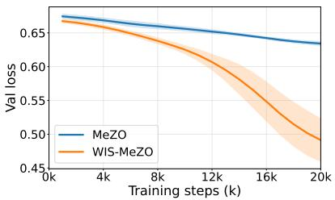  
(a) RTE

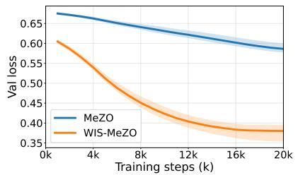  
(b) BoolQ

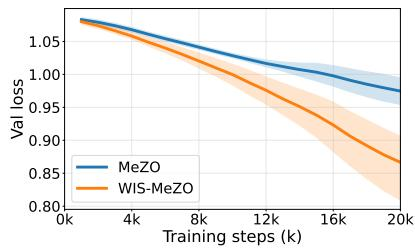  
(c) MNLI  
Figure 1: Validation loss versus training steps for fine-tuning LLaMA3.2-3B, averaged over five random seeds. WIS-MeZO reaches comparable validation-loss levels in fewer optimization steps.

## 4.2 Calibration from Downstream Data

WIS-MeZO constructs the mask from 128 examples of the downstream training data using Wanda scores. This calibration is performed once before optimization; WISD-MeZO periodically refreshes the mask every τ steps. Appendix 7.3 examines the effect and cost of calibration size.

## 4.3 The WIS-MeZO Algorithm

In each iteration t, we sample a single random seed to generate the perturbation $\mathbf { Z } ^ { t }$ . The gradient estimator uses one sampled direction and two loss evaluations on the same training mini-batch,

$$
\hat { \mathbf { G } } ^ { t } = \frac { f \left( \mathbf { W } ^ { t } + \epsilon \frac { \mathbf { Z } ^ { t } \odot \mathbf { M } } { \sqrt { r } } , \mathcal { B } \right) - f \left( \mathbf { W } ^ { t } - \epsilon \frac { \mathbf { Z } ^ { t } \odot \mathbf { M } } { \sqrt { r } } , \mathcal { B } \right) } { 2 \epsilon } \cdot \frac { \mathbf { Z } ^ { t } \odot \mathbf { M } } { \sqrt { r } } .
$$

Algorithm 1 WIS-MeZO   
1: Input: Initial weights $\mathbf { W } ^ { 0 }$ , step sizes $\{ \eta _ { t } \}$ , perturbation scale €, mask update frequency τ, density ratio   
r, calibration dataset $\mathcal { D } _ { \mathrm { c a l } }$   
2: for step $t = 0 , 1 , 2 , \ldots , T - 1$ do   
3: if t mod $\tau = 0$ then   
4: Fetch activations $\mathbf { X } \sim \mathcal { D } _ { \mathrm { c a l } }$ {Collect calibration activations}   
5: M ← ComputeMask $( \mathbf { W } ^ { t } , \mathbf { X } , r )$ {Update mask using Wanda scores}   
6: end if   
7: Sample training batch $\boldsymbol { B }$ and random seed $s _ { \mathrm { r n g } }$   
8: $\mathbf { W } ^ { t } $ PerturbParameters $( \mathbf { W } ^ { t } , r , \epsilon , \mathbf { M } , s _ { \mathrm { r n g } } )$   
9: $L _ { + } \gets f ( \mathbf { W } ^ { t } , B )$   
10: Wt ← PerturbParameters $( \mathbf { W } ^ { t } , r , - 2 \epsilon , \mathbf { M } , s _ { \mathrm { r n g } } )$ {Move to the negative perturbation}   
11: $L _ { - } \gets f ( \mathbf { W } ^ { t } , B )$   
12: Wt ← PerturbParameters $( \mathbf { W } ^ { t } , r , \epsilon , \mathbf { M } , s _ { \mathrm { r n g } } )$ {Recover parameters}   
13: Reset the random number generator with seed $s _ { \mathrm { r n g } }$ and regenerate Z   
14: $\begin{array} { r } { \hat { \mathbf { G } } ^ { t } \gets \frac { L _ { + } - L _ { - } } { 2 \epsilon \sqrt { r } } \mathbf { Z } \odot \mathbf { M } } \end{array}$ {ZO gradient estimate}   
15: $\mathbf { W } ^ { t + 1 } \xleftarrow { } \mathbf { W } ^ { t } - \eta _ { t } \hat { \mathbf { G } } ^ { t }$ {Update the parameters}   
16: end for

Here,  denotes element-wise multiplication, and the update is $\mathbf { W } ^ { t + 1 } = \mathbf { W } ^ { t } - \eta _ { t } \hat { \mathbf { G } } ^ { t }$ . Seed replay regenerates perturbations for in-place updates without storing full-model gradients. Algorithm 1 summarizes WIS-MeZO, with supplementary pseudocode in Appendix D.

With in-place perturbations and seed replay, the main additional storage is the binary mask. A bit-packed representation reduces its cost from 1 byte to 1 bit per candidate parameter, requiring less than 4GB for the 32B model. Together with one-time calibration, this compact storage makes WIS-MeZO a promising approach for memory-constrained on-device adaptation. Section 7.1 reports peak GPU memory and throughput.

## 5 Theoretical Analysis

Sparse perturbations reduce the search dimension, but different supports retain different amounts of gradient information. We analyze this trade-off through gradient energy capture, first relating Wanda scores to gradient energy and then studying estimator alignment and convergence.

## 5.1 Energy Analysis

For the analysis, let $\mathbf { G } _ { i , j } = \delta _ { i } x _ { j }$ be the per-example gradient, with $\delta _ { i }$ denoting the backpropagated signal and $x _ { j }$ an input activation. Write $\dot { v } _ { j } = \mathbb { E } [ x _ { j } ^ { 2 } ]$ and $\hat { v } _ { j }$ for the population and empirical activation second moments.

Assumption 5.1 (Bounded Input-Error Dependence). There exist constants $0 < \gamma \leq \nu <$ ∞ such that

$$
\gamma \mathbb { E } [ \delta _ { i } ^ { 2 } ] v _ { j } \leq \mathbb { E } [ \mathbf { G } _ { i , j } ^ { 2 } ] \leq \nu \mathbb { E } [ \delta _ { i } ^ { 2 } ] v _ { j } .
$$

The constants $\gamma$ and ν describe the dependence between squared inputs and squared error signals. Independence gives $\gamma = \nu = 1$

Assumption 5.2 (Calibration Concentration). At the parameter value used for calibration, the B activation observations are independent draws from the downstream distribution. For every input feature,

$$
\| x _ { j } \| _ { \psi _ { 2 } } ^ { 2 } \leq K v _ { j } , \qquad K \geq 1 ,
$$

where $\| \cdot \| _ { \psi _ { 2 } }$ is the sub-Gaussian norm.

Under this assumption, $B = \Omega ( K ^ { 2 } \log n / \xi ^ { 2 } )$ gives simultaneous relative accuracy $| \hat { v } _ { j } - v _ { j } | \leq \xi v _ { j }$ over the n input features with probability at least $1 - \mathcal { O } ( n ^ { - 1 } )$ , for $\xi \in ( 0 , 1 )$

Let $\mathcal { T } _ { \mathrm { W I S } , i }$ be the WIS-selected support in row $i ,$ and let $\boldsymbol { \mathcal { T } } _ { i } ^ { * }$ contain the k largest expected gradient energies among all n coordinates in that row. Set $\mathcal { A } _ { i } = \mathcal { I } _ { \mathrm { W I S } , i } \cup \mathcal { T } _ { i } ^ { * }$ . For rows with nonzero gradient energy, suppose

$$
w _ { \mathrm { m i n } , i } = \operatorname* { m i n } _ { j \in { \cal A } _ { i } } { \bf W } _ { i , j } ^ { 2 } > 0 , \qquad w _ { \mathrm { m a x } , i } = \operatorname* { m a x } _ { j \in { \cal A } _ { i } } { \bf W } _ { i , j } ^ { 2 } .
$$

Define

$$
\kappa _ { i } = \frac { \gamma w _ { \mathrm { m i n } , i } } { \nu w _ { \mathrm { m a x } , i } } , \qquad \kappa _ { i , \xi } = \kappa _ { i } \frac { 1 - \xi } { 1 + \xi } , \qquad \kappa _ { \xi } = \operatorname* { m i n } _ { i : \omega _ { i } > 0 } \kappa _ { i , \xi } .
$$

These factors account for input-error dependence, weight variation within the compared supports, and calibration error.

Lemma 5.3 (Gradient-Saliency Proxy Bound). Under Assumptions 5.1 and 5.2, if $B = \Omega ( K ^ { 2 } \log n / \xi ^ { 2 } )$ then with probability at least $1 - \mathcal { O } ( n ^ { - 1 } )$

$$
C _ { i , \mathrm { l o w } } \mathbf { S } _ { i , j } ^ { 2 } \leq \mathbb { E } [ \mathbf { G } _ { i , j } ^ { 2 } ] \leq C _ { i , \mathrm { h i g h } } \mathbf { S } _ { i , j } ^ { 2 }
$$

simultaneously for $j \in { \mathcal { A } } _ { i }$ , where $C _ { i , \mathrm { l o w } } / C _ { i , \mathrm { h i g h } } = \kappa _ { i , \xi }$

The lemma relates the Wanda ranking to expected gradient energy.

For a fixed support and nonzero expected gradient energy, define its energy capture ratio by

$$
\rho \triangleq \frac { \mathbb { E } [ \| \mathbf { M } \odot \mathbf { G } \| _ { F } ^ { 2 } ] } { \mathbb { E } [ \| \mathbf { G } \| _ { F } ^ { 2 } ] } = \sum _ { i = 1 } ^ { m } \omega _ { i } \rho _ { i } ,\tag{1}
$$

where

$$
\omega _ { i } = \frac { \mathbb { E } [ \| \mathbf { G } _ { i , : } \| _ { 2 } ^ { 2 } ] } { \mathbb { E } [ \| \mathbf { G } \| _ { F } ^ { 2 } ] } , \qquad \rho _ { i } = \frac { \mathbb { E } [ \| \mathbf { M } _ { i , : } \odot \mathbf { G } _ { i , : } \| _ { 2 } ^ { 2 } ] } { \mathbb { E } [ \| \mathbf { G } _ { i , : } \| _ { 2 } ^ { 2 } ] } .
$$

Rows with zero gradient energy contribute zero to the sum. Let $\rho ^ { * } = \textstyle \sum _ { i } \omega _ { i } \rho _ { i } ^ { * }$ be the capture ratio of the row-wise oracle supports $\mathcal { T } _ { i } ^ { * }$

Theorem 5.4 (Energy Capture Relative to the Oracle). Under the conditions of Lemma 5.3, with probability at least $1 - \mathcal { O } ( n ^ { - 1 } )$

$$
\rho _ { \mathrm { W I S } } \geq \sum _ { i } \omega _ { i } \kappa _ { i , \xi } \rho _ { i } ^ { * } \geq \kappa _ { \xi } \rho ^ { * } .
$$

A uniform row-wise random mask of density r has expected capture ratio r at the same parameter value. Thus, $\kappa _ { \xi } \rho ^ { * } > r$ is a suficient condition for WIS to exceed this random-mask reference

The result separates gradient-energy concentration, measured by $\rho ^ { * }$ , from the accuracy of the saliency ranking, measured by $\kappa _ { \xi }$ . Calibration affects the latter through $\xi .$

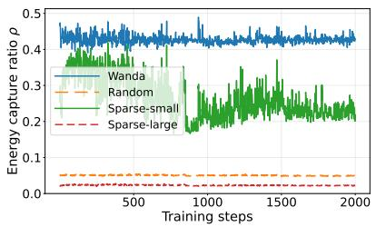  
(a) RTE

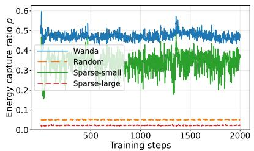  
(b) QQP

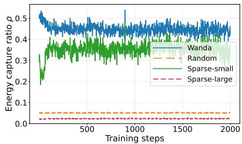  
(c) MNLI  
Figure 2: Gradient energy capture ratio $\rho$ on LLaMA-3.2-3B at a density ratio of $r = 0 . 0 5$ . We compare uniform random masking, the small-magnitude mask used to represent the selection principle of Sparse-MeZO (W-small), the corresponding large-magnitude mask (W-large), and the Wanda-based WIS mask.

Figure 2 compares support rules on common mini-batch gradient snapshots from an auxiliary AdamW run. All masks are constructed at step 0 and remain fixed. At $r = 0 . 0 5$ , the plotted WIS supports retain over 40% of the gradient energy, compared with the $5 \%$ random-mask expectation. WIS also captures more energy than W-small and W-large in these diagnostics. W-small exceeds random masking, while W-large falls below it, so the observed energy ordering is not determined by increasing weight magnitude. These measurements evaluate how the initial supports align with gradients encountered during the diagnostic run. Results at additional densities appear in Appendix C.

We next consider estimator alignment at a fixed parameter value. For the mini-batch gradient $\mathbf { G } ,$ define ρ by Eq. equation 1 using the mini-batch distribution. Let $s = d _ { \mathrm { e f f } }$ be the total number of selected coordinates and $\mathbf { U } = ( \mathbf { Z } \odot \mathbf { M } ) / \sqrt { r }$ , with standard Gaussian entries in Z.

Lemma 5.5 (Moment-Normalized Alignment). For the directional-derivative estimator $\hat { \mathbf { G } } _ { 0 } = \langle \mathbf { G } , \mathbf { U } \rangle \mathbf { U }$ with $\rho > 0$

$$
\mathrm { A l i g n } ( \hat { \mathbf { G } } _ { 0 } , \mathbf { G } ) \triangleq \frac { \mathbb { E } [ \langle \hat { \mathbf { G } } _ { 0 } , \mathbf { G } \rangle ] } { \sqrt { \mathbb { E } [ \| \hat { \mathbf { G } } _ { 0 } \| _ { F } ^ { 2 } ] \mathbb { E } [ \| \mathbf { G } \| _ { F } ^ { 2 } ] } } = \sqrt { \frac { \rho } { s + 2 } } .
$$

At the same gradient distribution, averaging over uniform row-wise masks replaces $\rho$ by $r _ { \cdot }$

The estimator $\hat { \mathbf { G } } _ { 0 }$ is the $\epsilon  0$ limit of the central-difference estimator. The lemma isolates the contribution of support quality at a fixed dimension. The next result includes the finite perturbation radius used by the algorithm.

## 5.2 Convergence Analysis

We analyze the fixed support produced at calibration. In this subsection, W, M, and G denote the full collections of parameter blocks, and squared norms sum over all blocks.

Assumption 5.6 (L-Smooth Mini-Batch Losses). Each mini-batch loss $f ( \cdot , B )$ is differentiable and L-smooth. The population objective $f = \mathbb { E } _ { B } [ f ( \cdot , B ) ]$ is bounded below by $f ^ { * }$

Assumption 5.7 (Unbiased Gradients with Bounded Variance). Conditioned on the optimization history, $\mathbf { G } ^ { t } = \nabla f ( \mathbf { W } ^ { t } , B ^ { t } )$ satisfies

$$
\mathbb { E } _ { t } [ \mathbf { G } ^ { t } ] = \nabla f ( \mathbf { W } ^ { t } ) , \qquad \mathbb { E } _ { t } [ \| \mathbf { G } ^ { t } - \nabla f ( \mathbf { W } ^ { t } ) \| _ { F } ^ { 2 } ] \le \sigma ^ { 2 } .
$$

The perturbation is independent of the current mini-batch.

Theorem 5.8 (Finite-Difference Convergence). Suppose Assumptions 5.6 and 5.7 hold. For a fixed mask, let $s = d _ { \mathrm { e f f } } , a = s + 2 , \Delta f = f ( \mathbf { W } ^ { 0 } ) - f ^ { * }$ , and

$$
\sigma _ { \epsilon } ^ { 2 } \triangleq \sigma ^ { 2 } + \frac { L ^ { 2 } \epsilon ^ { 2 } s ( s + 4 ) } { 4 r } .
$$

Assume a deterministic constant $\rho _ { \mathrm { m i n } } \in ( 0 , 1 ]$ satisfies

$$
\| \mathbf { M } \odot \nabla f ( \mathbf { W } ^ { t } ) \| _ { F } ^ { 2 } \geq \rho _ { \operatorname* { m i n } } \| \nabla f ( \mathbf { W } ^ { t } ) \| _ { F } ^ { 2 }
$$

almost surely for $0 \leq t < T$ . With Gaussian perturbations, radius $\epsilon > 0$ , and $\eta _ { t } = r / ( 4 L a \sqrt { t + 1 } )$ , the central-difference iterates satisfy

$$
\begin{array} { r } { \displaystyle \frac { 1 } { T } \sum _ { t = 0 } ^ { T - 1 } \mathbb { E } [ \| \nabla f ( \mathbf { W } ^ { t } ) \| _ { F } ^ { 2 } ] \leq \frac { 8 L a \Delta f + \frac { 1 } { 2 } \sigma _ { \epsilon } ^ { 2 } ( 1 + \log T ) } { \rho _ { \operatorname* { m i n } } \sqrt { T } } } \\ { + \frac { 4 L ^ { 2 } \epsilon ^ { 2 } s } { r \rho _ { \operatorname* { m i n } } } . } \end{array}
$$

The convergence bound depends on the selected dimension, the gradient energy retained during training, and the finite-difference radius. The result also highlights the role of support quality in sparse ZO optimization.

Table 1: Results on five GLUE tasks and SQuAD (five random seeds). We report F1 scores for QQP, MRPC, and $\mathrm { S Q u A D }$ , and accuracy (%) for all other tasks (↑). FT and LoRA denote full parameter fine-tuning and Low-Rank Adaptation, respectively, both utilizing the AdamW optimizer.
<table><tr><td>Models</td><td>Methods</td><td>MNLI</td><td>RTE</td><td>QQP</td><td>MRPC</td><td>SST-2</td><td>SQuAD</td><td> $\mathbf { A v } \mathbf { g } .$ </td></tr><tr><td rowspan="6">LLaMA3.2-3B</td><td>Zero-shot</td><td>1 38.3</td><td>49.4</td><td>53.7</td><td>78.3</td><td>58.8</td><td>55.0</td><td>55.6</td></tr><tr><td>FT LoRA</td><td> $8 2 . 6 _ { \pm 0 . 6 }$   $8 3 . 4 _ { \pm 0 . 7 }$ </td><td> $8 7 . 3 { \scriptstyle \pm 0 . 8 }$   $8 8 . 8 { \scriptstyle \pm 0 . 7 }$ </td><td> $7 9 . 2 _ { \pm 1 . 0 }$   $7 9 . 2 _ { \pm 1 . 0 }$ </td><td> $8 6 . 9 _ { \pm 1 . 0 }$   $8 5 . 8 _ { \pm 1 . 3 }$ </td><td> $9 5 . 1 _ { \pm 0 . 5 }$   $9 4 . 8 _ { \pm 0 . 1 }$ </td><td> $8 8 . 2 _ { \pm 0 . 4 }$   $8 8 . 0 { \scriptstyle \pm 0 . 0 }$ </td><td>86.5 86.6</td></tr><tr><td>MeZO</td><td> $4 9 . 4 _ { \pm 3 . 0 }$ </td><td> $7 0 . 3 { \scriptstyle \pm 2 . 1 }$ </td><td> $6 5 . 0 { \scriptstyle \pm 2 . 1 }$ </td><td> $8 1 . 4 _ { \pm 0 . 6 }$ </td><td> $9 3 . 9 _ { \pm 0 . 8 }$ </td><td> $8 6 . 7 _ { \pm 0 . 6 }$ </td><td>74.4</td></tr><tr><td>Sparse-MeZO Random-MeZO</td><td> $5 6 . 7 _ { \pm 2 . 6 }$ </td><td> $7 7 . 6 { \scriptstyle \pm 3 . 8 }$ </td><td> $7 0 . 6 { \scriptstyle \pm 0 . 6 }$ </td><td> $8 1 . 8 { \scriptstyle \pm 0 . 9 }$ </td><td> $9 3 . 6 { \scriptstyle \pm 0 . 3 }$ </td><td> $8 6 . 4 { \scriptstyle \pm 0 . 7 }$ </td><td>77.7</td></tr><tr><td>WIS-MeZO</td><td> $5 2 . 1 _ { \pm 1 . 8 }$ </td><td> $7 4 . 3 _ { \pm 0 . 7 }$ </td><td> $6 7 . 4 { \scriptstyle \pm 1 . 3 }$ </td><td> $8 2 . 6 _ { \pm 1 . 1 }$ </td><td> $9 3 . 9 _ { \pm 0 . 4 }$ </td><td> $8 8 . 1 _ { \pm 0 . 6 }$ </td><td>76.4</td></tr><tr><td>WISD-MeZO</td><td> $6 1 . 2 _ { \pm 1 . 1 }$   ${ \bf 6 1 . 4 } _ { \pm 1 . 3 }$ </td><td> $7 8 . 3 _ { \pm 1 . 3 }$   $\mathbf { 8 0 . 1 _ { \pm 2 . 2 } }$ </td><td> $6 8 . 7 _ { \pm 1 . 0 }$   ${ \bf 7 1 . 2 _ { \pm 0 . 9 } }$ </td><td> ${ \mathbf { 8 3 . 1 _ { \pm 1 . 1 } } }$   $8 2 . 9 { \scriptstyle \pm 1 . 0 }$ </td><td> ${ \bf 9 4 . 0 _ { \pm 0 . 2 } }$ </td><td> $8 9 . 2 _ { \pm 0 . 8 }$ </td><td>79.1 79.8</td></tr><tr><td rowspan="6">Qwen2.5-3B</td><td>Zero-shot</td><td>74.8</td><td>80.5</td><td>34.1</td><td>51.1</td><td> $\mathbf { 9 4 . 0 _ { \pm 0 . 5 } }$  56.0</td><td> $\mathbf { 8 9 . 4 _ { \pm 1 . 6 } }$  83.6</td><td>63.4</td></tr><tr><td>FT</td><td> $8 6 . 9 _ { \pm 0 . 5 }$ </td><td> $8 7 . 8 _ { \pm 0 . 6 }$ </td><td> $8 1 . 2 _ { \pm 0 . 1 }$ </td><td> $8 9 . 1 _ { \pm 0 . 8 }$ </td><td> $9 4 . 1 _ { \pm 0 . 4 }$ </td><td> $8 5 . 6 _ { \pm 0 . 2 }$ </td><td>87.5</td></tr><tr><td>LoRA</td><td> $8 6 . 6 { \scriptstyle \pm 0 . 4 }$ </td><td> $8 7 . 9 { \scriptstyle \pm 0 . 4 }$ </td><td> $7 9 . 5 { \scriptstyle \pm 0 . 2 }$ </td><td> $8 9 . 6 _ { \pm 1 . 0 }$ </td><td> $9 3 . 6 { \scriptstyle \pm 0 . 4 }$ </td><td> $8 7 . 2 { \scriptstyle \pm 1 . 0 }$ </td><td>87.4</td></tr><tr><td>MeZO Sparse-MeZO</td><td> $8 4 . 8 { \scriptstyle \pm 0 . 7 }$ </td><td> $8 4 . 8 { \scriptstyle \pm 0 . 9 }$ </td><td> $7 8 . 7 { \scriptstyle \pm 1 . 1 }$ </td><td> $8 4 . 9 { \scriptstyle \pm 1 . 8 }$ </td><td> $9 2 . 6 { \scriptstyle \pm 0 . 2 }$ </td><td> $8 6 . 6 { \scriptstyle \pm 0 . 9 }$ </td><td>85.4</td></tr><tr><td>Random-MeZO</td><td> $8 6 . 1 _ { \pm 1 . 0 }$ </td><td> $8 6 . 6 _ { \pm 1 . 5 }$ </td><td> $8 1 . 3 { \scriptstyle \pm 0 . 8 }$ </td><td> $8 5 . 9 _ { \pm 1 . 0 }$ </td><td> $9 3 . 6 _ { \pm 0 . 6 }$ </td><td> $8 6 . 3 _ { \pm 0 . 7 }$ </td><td>86.6</td></tr><tr><td></td><td> $8 5 . 1 _ { \pm 1 . 3 }$ </td><td> $8 5 . 2 _ { \pm 1 . 6 }$ </td><td> $8 1 . 3 { \scriptstyle \pm 0 . 6 }$ </td><td> $8 4 . 9 _ { \pm 1 . 1 }$ </td><td> $9 3 . 1 _ { \pm 0 . 2 }$ </td><td> $8 6 . 6 _ { \pm 0 . 6 }$ </td><td>86.0</td></tr><tr><td></td><td></td><td></td><td></td><td></td><td></td><td></td><td></td><td></td></tr><tr><td></td><td>WIS-MeZO</td><td> ${ \bf 8 6 . 7 _ { \pm 0 . 4 } }$ </td><td> ${ \bf 8 7 . 0 _ { \pm 0 . 7 } }$ </td><td> $8 1 . 5 { \scriptstyle \pm 0 . 6 }$ </td><td> $8 5 . 6 _ { \pm 1 . 1 }$ </td><td> $9 3 . 6 _ { \pm 0 . 2 }$ </td><td> ${ \bf 8 7 . 1 _ { \pm 0 . 8 } }$ </td><td>86.9</td></tr><tr><td></td><td></td><td></td><td></td><td></td><td></td><td></td><td></td><td></td></tr><tr><td></td><td>WISD-MeZO</td><td> $8 6 . 3 { \scriptstyle \pm 0 . 9 }$ </td><td> ${ \bf 8 7 . 0 _ { \pm 1 . 0 } }$ </td><td> ${ \bf 8 1 . 6 _ { \pm 0 . 7 } }$ </td><td> $\mathbf { 8 6 . 4 _ { \pm 1 . 2 } }$ </td><td> $\mathbf { 9 3 . 7 \bot } 0 . 1 $ </td><td> $8 6 . 8 { \scriptstyle \pm 1 . 1 }$ </td><td>87.0</td></tr></table>

## 6 Experiments

We now examine how task-conditioned support selection affects downstream fine-tuning. We evaluate five GLUE tasks [Wang et al., 2018], SQuAD, and five SuperGLUE tasks [Wang et al., 2019], followed by commonsense and question-answering benchmarks across larger model scales. Additional efficiency and sensitivity results appear in the appendix.

## 6.1 Fine-Tuning on GLUE, SQuAD, and SuperGLUE

We evaluate WIS-MeZO and its dynamic variant WISD-MeZO on LLaMA-3.2-3B [Grattafiori et al., 2024] and Qwen2.5-3B [Yang et al., 2024]. All ZO methods use a batch size of 16 and train for 20,000 steps Hyperparameters are reported in Appendix B.

The first-order baselines are full-parameter fine-tuning (FT) with AdamW [Kingma and Ba, 2015, Loshchilov and Hutter, 2019] and LoRA [Hu et al., 2022]. The ZO baselines are MeZO [Malladi et al., 2023], Sparse-MeZO [Liu et al., 2025], which selects small-magnitude weights, and Random-MeZO, which uses random sparse supports. These comparisons evaluate the effect of coordinate selection within sparse ZO fine-tuning.

Tables 1 and 2 report the task results. Figure 1 compares validation loss against optimization steps over five random seeds.

WIS-MeZO improves the average score over MeZO, Random-MeZO, and Sparse-MeZO in all four modelbenchmark combinations. On LLaMA-3.2-3B, its average scores are 79.1 on the GLUE/SQuAD tasks and 77.3 on SuperGLUE, compared with 77.7 and 74.5 for Sparse-MeZO. The corresponding Qwen2.5-3B scores are 86.9 and 81.7, compared with 86.6 and 80.3. The size of the gain varies across backbones and tasks, with the larger improvements occurring on LLaMA-3.2-3B.

Beyond final task scores, the validation-loss curves in Figure 1 show that WIS-MeZO reaches comparable loss levels in fewer optimization steps than MeZO on RTE, MNLI, and BoolQ. This improvement is consistent with the gradient-energy results in Section 5. Runtime and memory measurements are reported in Section 7.1.

Periodic recalibration in WISD-MeZO increases the average score in all four model-benchmark combinations. Fixed-mask WIS-MeZO is the primary method, and WISD-MeZO characterizes the effect of refreshing the support during training.

Table 2: Experimental results on SuperGLUE. WIS-based methods achieve the strongest aggregate ZO performance on both model families
<table><tr><td>Models</td><td>Methods</td><td>CB</td><td>MultiRC</td><td>WSC</td><td>ReCoRD</td><td>BoolQ</td><td>Avg.</td></tr><tr><td rowspan="5">LLaMA3.2-3B</td><td>Zero-shot</td><td>44.6</td><td>47.0</td><td>36.5</td><td>79.7</td><td>61.6</td><td>53.9</td></tr><tr><td>FT</td><td>91.0</td><td>83.6</td><td>57.6</td><td>81.6</td><td>83.1</td><td>79.4</td></tr><tr><td>LoRA</td><td>92.8</td><td>85.2</td><td>62.5</td><td>81.4</td><td>84.3</td><td>81.2</td></tr><tr><td>MeZO Sparse-MeZO</td><td>71.4</td><td>72.4</td><td>61.5</td><td>81.2</td><td>77.6</td><td>72.8</td></tr><tr><td>Random-MeZO</td><td>67.8 75.0</td><td>79.7 74.2</td><td>62.5 61.5</td><td>81.4 81.0</td><td>81.3 78.9</td><td>74.5 74.1</td></tr><tr><td rowspan="5"></td><td>WIS-MeZO</td><td>82.1</td><td>76.3</td><td>63.4</td><td>82.0</td><td>82.6</td><td>77.3</td></tr><tr><td>WISD-MeZO</td><td>82.1</td><td>76.3</td><td>64.4</td><td>81.9</td><td>83.0</td><td>77.6</td></tr><tr><td>Zero-shot FT</td><td>30.3</td><td>65.8</td><td>63.4</td><td>72.1</td><td>70.3</td><td>60.3</td></tr><tr><td>LoRA</td><td>96.4 94.6</td><td>88.0 86.9</td><td>68.4 67.4</td><td>74.4 76.0</td><td>80.9 85.1</td><td>81.6 82.0</td></tr><tr><td>MeZO</td><td>96.4</td><td>83.2</td><td>66.3</td><td>73.7</td><td>80.9</td><td>80.1</td></tr><tr><td rowspan="4"></td><td>Sparse-MeZO Random-MeZO</td><td>92.8</td><td>86.1</td><td>67.3</td><td>75.6</td><td>80.1</td><td>80.3</td></tr><tr><td>WIS-MeZO</td><td>96.4</td><td>85.6</td><td>65.3</td><td>74.5</td><td>81.6</td><td>80.9</td></tr><tr><td>WISD-MeZO</td><td>96.4</td><td>86.4</td><td>68.2</td><td>74.9</td><td>82.6</td><td>81.7</td></tr><tr><td></td><td>98.2</td><td>86.9</td><td>71.1</td><td>75.6</td><td>82.8</td><td>82.9</td></tr></table>

## 6.2 Scaling to Large-Scale LLMs

Having compared support-selection strategies on 3B models, we next examine whether the improvement over MeZO extends to larger models. We evaluate fixed-mask WIS-MeZO on Qwen2.5 models from 3B to 32B parameters using ARC-E, ARC-C [Clark et al., 2018], HellaSwag [Zellers et al., 2019], WinoGrande [Sakaguchi et al., 2021], and OpenBookQA [Mihaylov et al., 2018]. Table 3 shows higher average scores at every scale and performance matching or exceeding MeZO on every task. On WinoGrande, WIS-MeZO also improves over the zero-shot model at all four scales.

Table 3: Experimental results for Qwen2.5-3B to 32B. WIS-MeZO consistently improves average performance over MeZO across all model scales.
<table><tr><td>Models</td><td>Methods</td><td>ARC-E</td><td>ARC-C</td><td>HellaSwag</td><td>WinoGrande</td><td>OpenBookQA</td><td>Avg.</td></tr><tr><td rowspan="3">Qwen2.5-3B</td><td>Zero-shot</td><td>70.0</td><td>48.4</td><td>68.0</td><td>66.3</td><td>40.8</td><td>58.7</td></tr><tr><td>MeZO</td><td>82.9</td><td>57.8</td><td>69.9</td><td>66.3</td><td>49.0</td><td>65.1</td></tr><tr><td>WIS-MeZO</td><td>85.4</td><td>60.8</td><td>74.4</td><td>69.7</td><td>54.0</td><td>68.8</td></tr><tr><td rowspan="3">Qwen2.5-7B</td><td>Zero-shot</td><td>74.9</td><td>52.5</td><td>73.8</td><td>68.9</td><td>43.8</td><td>62.7</td></tr><tr><td>MeZO</td><td>83.0</td><td>59.2</td><td>74.9</td><td>66.5</td><td>51.2</td><td>66.9</td></tr><tr><td>WIS-MeZO</td><td>85.0</td><td>61.2</td><td>79.4</td><td>70.7</td><td>53.8</td><td>70.0</td></tr><tr><td rowspan="3">Qwen2.5-14B</td><td>Zero-shot</td><td>75.4</td><td>53.8</td><td>75.8</td><td>70.6</td><td>43.2</td><td>63.7</td></tr><tr><td>MeZO</td><td>84.0</td><td>67.2</td><td>77.2</td><td>73.8</td><td>57.2</td><td>71.8</td></tr><tr><td>WIS-MeZO</td><td>87.8</td><td>70.9</td><td>81.5</td><td>76.6</td><td>58.8</td><td>75.1</td></tr><tr><td rowspan="3">Qwen2.5-32B</td><td>Zero-shot</td><td>74.5</td><td>54.5</td><td>79.0</td><td>74.3</td><td>43.6</td><td>65.1</td></tr><tr><td>MeZO</td><td>85.9</td><td>69.8</td><td>78.7</td><td>74.9</td><td>52.4</td><td>72.3</td></tr><tr><td>WIS-MeZO</td><td>88.7</td><td>69.8</td><td>84.5</td><td>77.9</td><td>56.2</td><td>75.4</td></tr></table>

Table 4: Peak GPU memory (GB, batch size=16) and iteration speed (iteration/s) for fine-tuning Qwen2.5-3B.
<table><tr><td rowspan="2">Methods</td><td colspan="2">SST-2</td><td colspan="2">ReCoRD</td><td colspan="2">CB</td></tr><tr><td>Mem.</td><td>Iter/s</td><td>Mem.</td><td>Iter/s</td><td>Mem.</td><td>Iter/s</td></tr><tr><td>FT</td><td>35.5</td><td>3.37</td><td>87.4</td><td>0.92</td><td>94.5</td><td>0.75</td></tr><tr><td>LoRA</td><td>22.1</td><td>4.73</td><td>73.5</td><td>1.33</td><td>85.0</td><td>0.94</td></tr><tr><td>MeZO</td><td>9.70</td><td>3.50</td><td>21.5</td><td>1.39</td><td>45.1</td><td>0.99</td></tr><tr><td>Sparse-MeZO</td><td>16.2</td><td>2.98</td><td>27.3</td><td>1.30</td><td>51.0</td><td>0.95</td></tr><tr><td>WIS-MeZO</td><td>11.6</td><td>3.16</td><td>25.1</td><td>1.33</td><td>47.0</td><td>0.97</td></tr></table>

Table 5: End-to-end wall-clock time (hours) for Qwen2.5-3B under the common ZO training budget.
<table><tr><td>Methods</td><td>SST-2</td><td>ReCoRD</td><td>CB</td></tr><tr><td>MeZO</td><td>1.59</td><td>4.00</td><td>5.61</td></tr><tr><td>Sparse-MeZO</td><td>1.86</td><td>4.27</td><td>5.85</td></tr><tr><td>WIS-MeZO</td><td>1.76</td><td>4.18</td><td>5.73</td></tr></table>

## 7 Additional Experimental Results

## 7.1 Memory and Speed Comparison

We report peak GPU memory, iteration throughput, and total training time in Tables 4 and 5. Table 6 compares standard and bit-packed masks on Qwen2.5-32B.

On the 3B model, WIS-MeZO uses less peak memory and has higher throughput than the evaluated Sparse-MeZO implementation. Its wall-clock times on SST-2, ReCoRD, and CB are 1.76, 4.18, and 5.73 hours These are 2.0%–5.4% lower than Sparse-MeZO and 2.1%–10.7% higher than MeZO. The comparison quantifies the computational cost of masked updates alongside the validation-loss curves indexed by optimization step.

At 32B, a 1-bit mask reduces WIS-MeZO's memory overhead relative to MeZO to below 3GB on both tasks while keeping similar throughput. This compact representation supports larger-scale sparse ZO fine-tuning.

Table 6: Peak GPU memory (GB, batch size=16) and iteration speed (iteration/s) for fine-tuning Qwen2.5- 32B.
<table><tr><td rowspan="2">Methods</td><td colspan="2">ARC-C</td><td colspan="2">HellaSwag</td></tr><tr><td>Mem.</td><td>Iter/s</td><td>Mem.</td><td>Iter/s</td></tr><tr><td>FT</td><td>600.5</td><td>0.126</td><td>664.8</td><td>0.074</td></tr><tr><td>LoRA</td><td>256.0</td><td>0.161</td><td>282.2</td><td>0.105</td></tr><tr><td>MeZO</td><td>97.29</td><td>0.174</td><td>104.8</td><td>0.104</td></tr><tr><td>WIS-MeZO</td><td>122.0</td><td>0.169</td><td>132.3</td><td>0.102</td></tr><tr><td>WIS-MeZO (1-bit)</td><td>98.84</td><td>0.160</td><td>107.7</td><td>0.099</td></tr></table>

## 7.2 Study on Density Ratio-r

The density ratio r sets the number of coordinates available for perturbation. Table 7 compares the evaluated densities on Qwen2.5-3B.

WIS-MeZO matches or improves on MeZO at every reported task-density combination. A density of r = 0.1 gives the highest score on four of the five tasks in this table, while OpenBookQA performs best at r = 0.05.

Table 7: The effects of density ratio-r for Fine-tuning Qwen2.5-3B with WIS-MeZO.
<table><tr><td>Ratio-r</td><td>ARC-E</td><td>ARC-C</td><td>HellaSwag</td><td>WinoGrande</td><td>OpenBookQA</td></tr><tr><td>0.05</td><td>85.0</td><td>57.8</td><td>71.8</td><td>68.6</td><td>54.0</td></tr><tr><td>0.1</td><td>85.4</td><td>60.8</td><td>74.4</td><td>69.7</td><td>52.8</td></tr><tr><td>0.2</td><td>83.8</td><td>59.5</td><td>72.0</td><td>69.5</td><td>53.6</td></tr><tr><td>0.4</td><td>84.2</td><td>59.8</td><td>71.4</td><td>67.1</td><td>52.8</td></tr><tr><td>MeZO</td><td>82.9</td><td>57.8</td><td>69.9</td><td>66.3</td><td>49.0</td></tr></table>

## 7.3 Effects of Calibration Size and Computation Cost

Table 8 studies calibration-set size on Qwen2.5-3B. Performance improves with larger calibration sets and stabilizes around 128 examples, which we use by default. Table 9 reports the total calibration time. With 128 examples, mask construction takes 0.53–1.26 seconds and is performed once for fixed-mask WIS-MeZO

Table 8: Effects of the calibration size on WIS-MeZO fine-tuning of Qwen2.5-3B.
<table><tr><td>Calibration size</td><td>ARC-E</td><td>ARC-C</td><td>HellaSwag</td><td>WinoGrande</td><td>OpenBookQA</td></tr><tr><td>32</td><td>85.0</td><td>60.5</td><td>74.0</td><td>67.4</td><td>54.0</td></tr><tr><td>64</td><td>85.2</td><td>60.5</td><td>74.3</td><td>67.8</td><td>53.0</td></tr><tr><td>128 (default)</td><td>85.4</td><td>60.8</td><td>74.4</td><td>69.7</td><td>54.0</td></tr><tr><td>256</td><td>85.4</td><td>60.5</td><td>74.6</td><td>69.7</td><td>54.0</td></tr><tr><td>512</td><td>85.9</td><td>60.8</td><td>74.5</td><td>69.7</td><td>53.9</td></tr></table>

Table 9: Total calibration time (seconds) for Qwen2.5-3B.
<table><tr><td>Calibration size</td><td>ARC-E</td><td>ARC-C</td><td>HellaSwag</td><td>WinoGrande</td><td>OpenBookQA</td></tr><tr><td>32</td><td>0.32</td><td>0.33</td><td>0.43</td><td>0.26</td><td>0.27</td></tr><tr><td>64</td><td>0.49</td><td>0.49</td><td>0.72</td><td>0.34</td><td>0.38</td></tr><tr><td>128 (default)</td><td>0.80</td><td>0.89</td><td>1.26</td><td>0.53</td><td>0.60</td></tr><tr><td>256</td><td>1.49</td><td>1.55</td><td>2.36</td><td>0.91</td><td>1.00</td></tr><tr><td>512</td><td>2.70</td><td>2.98</td><td>4.59</td><td>1.66</td><td>1.84</td></tr></table>

## 8 Conclusion

We present WIS-MeZO, which uses downstream Wanda scores to select sparse perturbation coordinates for memory-efficient LLM fine-tuning. Our gradient-energy analysis explains the importance of support selection, while experiments across 16 benchmarks and models from 3B to 32B show improved aggregate performance over MeZO. By combining forward-only updates with one-time calibration and compact mask storage, WIS-MeZO also offers a promising direction for resource-constrained on-device adaptation.

## References

HanQin Cai, Daniel McKenzie, Wotao Yin, and Zhenliang Zhang. Zeroth-order regularized optimization (zoro): Approximately sparse gradients and adaptive sampling. SIAM Journal on Optimization, 32(2): 687–714, 2022.

Aochuan Chen, Yimeng Zhang, Jinghan Jia, James Diffenderfer, Jiancheng Liu, Konstantinos Parasyris, Yihua Zhang, Zheng Zhang, Bhavya Kailkhura, and Sijia Liu. Deepzero: Scaling up zeroth-order optimization for deep model training. arXiv preprint arXiv:2310.02025, 2023.

Xiangyi Chen, Sijia Liu, Kaidi Xu, Xingguo Li, Xue Lin, Mingyi Hong, and David Cox. Zo-adamm: Zerothorder adaptive momentum method for black-box optimization. Advances in neural information processing systems, 32, 2019.

Yiming Chen, Yuan Zhang, Liyuan Cao, Kun Yuan, and Zaiwen Wen. Enhancing zeroth-order fine-tuning for language models with low-rank structures. In The Thirteenth International Conference on Learning Representations, 2025.

Peter Clark, Isaac Cowhey, Oren Etzioni, Tushar Khot, Ashish Sabharwal, Carissa Schoenick, and Oyvind Tafjord. Think you have solved question answering? try arc, the ai2 reasoning challenge. arXiv preprint arXiv:1803.05457, 2018.

Sizhe Dang, yangyangGuo, Yanjun Zhao, Haishan Ye, xiaodong zheng, Guang Dai, and Ivor Tsang. FZOO: Fast zeroth-order optimizer for fine-tuning large language models towards adam-scale speed. In The Fourteenth International Conference on Learning Representations, 2026.

Tim Dettmers, Mike Lewis, Younes Belkada, and Luke Zettlemoyer. Gpt3. int8 (): 8-bit matrix multiplication for transformers at scale. Advances in neural information processing systems, 35:30318–30332, 2022.

Utku Evci, Trevor Gale, Jacob Menick, Pablo Samuel Castro, and Erich Elsen. Rigging the lottery: Making all tickets winners. In International conference on machine learning, pages 2943–2952. PMLR, 2020.

Elias Frantar and Dan Alistarh. Sparsegpt: Massive language models can be accurately pruned in one-shot. In International conference on machine learning, pages 10323–10337. PMLR, 2023.

Tanmay Gautam, Youngsuk Park, Hao Zhou, Parameswaran Raman, and Wooseok Ha. Variance-reduced zeroth-order methods for fine-tuning language models. arXiv preprint arXiv:2404.08080, 2024.

Saeed Ghadimi and Guanghui Lan. Stochastic first-and zeroth-order methods for nonconvex stochastic programming. SIAM journal on optimization, 23(4):2341–2368, 2013.

Aaron Grattafiori, Abhimanyu Dubey, Abhinav Jauhri, Abhinav Pandey, Abhishek Kadian, Ahmad Al-Dahle, Aiesha Letman, Akhil Mathur, Alan Schelten, Alex Vaughan, et al. The llama 3 herd of models. arXiv preprint arXiv:2407.21783, 2024.

Jiaqi Gu, Chenghao Feng, Zheng Zhao, Zhoufeng Ying, Ray T Chen, and David Z Pan. Efficient on-chip learning for optical neural networks through power-aware sparse zeroth-order optimization. In Proceedings of the AAAI conference on artificial intelligence, volume 35, pages 7583–7591, 2021.

Wentao Guo, Jikai Long, Yimeng Zeng, Zirui Liu, Xinyu Yang, Yide Ran, Jacob R. Gardner, Osbert Bastani, Christopher De Sa, Xiaodong Yu, Beidi Chen, and Zhaozhuo Xu. Zeroth-order fine-tuning of LLMs with transferable static sparsity. In The Thirteenth International Conference on Learning Representations, 2025.

Edward J Hu, yelong shen, Phillip Wallis, Zeyuan Allen-Zhu, Yuanzhi Li, Shean Wang, Lu Wang, and Weizhu Chen. LoRA: Low-rank adaptation of large language models. In International Conference on Learning Representations, 2022.

Andrew Ilyas, Logan Engstrom, Anish Athalye, and Jessy Lin. Black-box adversarial attacks with limited queries and information. In International conference on machine learning, pages 2137–2146. PMLR, 2018.

Taejong Joo, Wenhan Xia, Cheolmin Kim, Ming Zhang, and Eugene Ie. On surprising effectiveness of masking updates in adaptive optimizers. arXiv preprint arXiv:2602.15322, 2026.

Diederik P. Kingma and Jimmy Ba. Adam: A method for stochastic optimization. In International Conference on Learning Representations, 2015.

Wei Lin, Yining Jiang, Qingyu Song, Qiao Xiang, and Hong Xu. Agzo: Activation-guided zeroth-order optimization for llm fine-tuning. arXiv preprint arXiv:2601.17261, 2026.

Shih-Yang Liu, Chien-Yi Wang, Hongxu Yin, Pavlo Molchanov, Yu-Chiang Frank Wang, Kwang-Ting Cheng, and Min-Hung Chen. Dora: Weight-decomposed low-rank adaptation. In Forty-first International Conference on Machine Learning, 2024.

Yong Liu, Zirui Zhu, Chaoyu Gong, Minhao Cheng, Cho-Jui Hsieh, and Yang You. Sparse meZO: Less parameters for better performance in zeroth-order LLM fine-tuning. In The Thirty-ninth Annual Conference on Neural Information Processing Systems, 2025.

Ilya Loshchilov and Frank Hutter. Decoupled weight decay regularization. In International Conference on Learning Representations, 2019.

Sadhika Malladi, Tianyu Gao, Eshaan Nichani, Alex Damian, Jason D Lee, Danqi Chen, and Sanjeev Arora. Fine-tuning language models with just forward passes. Advances in Neural Information Processing Systems, 36:53038–53075, 2023.

Todor Mihaylov, Peter Clark, Tushar Khot, and Ashish Sabharwal. Can a suit of armor conduct electricity? a new dataset for open book question answering. In Proceedings of the 2018 conference on empirical methods in natural language processing, pages 2381–2391, 2018.

Mayumi Ohta, Nathaniel Berger, Artem Sokolov, and Stefan Riezler. Sparse perturbations for improved convergence in stochastic zeroth-order optimization. In International Conference on Machine Learning, Optimization, and Data Science, pages 39–64. Springer, 2020.

Adam Paszke, Sam Gross, Francisco Massa, Adam Lerer, James Bradbury, Gregory Chanan, Trevor Killeen, Zeming Lin, Natalia Gimelshein, Luca Antiga, et al. Pytorch: An imperative style, high-performance deep learning library. Advances in neural information processing systems, 32, 2019.

Keisuke Sakaguchi, Ronan Le Bras, Chandra Bhagavatula, and Yejin Choi. Winogrande: An adversarial winograd schema challenge at scale. Communications of the ACM, 64(9):99–106, 2021.

James C Spall. Multivariate stochastic approximation using a simultaneous perturbation gradient approximation. IEEE transactions on automatic control, 37(3):332–341, 2002.

Mingjie Sun, Zhuang Liu, Anna Bair, and J Zico Kolter. A simple and effective pruning approach for large language models. In The Twelfth International Conference on Learning Representations, 2024.

Alex Wang, Amanpreet Singh, Julian Michael, Felix Hill, Omer Levy, and Samuel Bowman. Glue: A multi-task benchmark and analysis platform for natural language understanding. In Proceedings of the 2018 EMNLP workshop BlackboxNLP: Analyzing and interpreting neural networks for NLP, pages 353–355, 2018.

Alex Wang, Yada Pruksachatkun, Nikita Nangia, Amanpreet Singh, Julian Michael, Felix Hill, Omer Levy, and Samuel Bowman. Superglue: A stickier benchmark for general-purpose language understanding systems. Advances in neural information processing systems, 32, 2019.

An Yang, Baosong Yang, Beichen Zhang, Binyuan Hui, Bo Zheng, Bowen Yu, Chengyuan Li, Dayiheng Liu, Fei Huang, Haoran Wei, Huan Lin, Jian Yang, Jianhong Tu, Jianwei Zhang, Jianxin Yang, Jiaxi Yang, Jingren Zhou, Junyang Lin, Kai Dang, Keming Lu, Keqin Bao, Kexin Yang, Le Yu, Mei Li, Mingfeng Xue, Pei Zhang, Qin Zhu, Rui Men, Runji Lin, Tianhao Li, Tingyu Xia, Xingzhang Ren, Xuancheng Ren, Yang Fan, Yang Su, Yichang Zhang, Yu Wan, Yuqiong Liu, Zeyu Cui, Zhenru Zhang, and Zihan Qiu. Qwen2.5 technical report. arXiv preprint arXiv:2412.15115, 2024.

Ziming Yu, Pan Zhou, Sike Wang, Jia Li, Mi Tian, and Hua Huang. Zeroth-order fine-tuning of llms in random subspaces. In Proceedings of the IEEE/CVF International Conference on Computer Vision, pages 4475–4485, 2025.

Rowan Zellers, Ari Holtzman, Yonatan Bisk, Ali Farhadi, and Yejin Choi. Hellaswag: Can a machine really finish your sentence? In Proceedings of the 57th annual meeting of the association for computational linguistics, pages 4791–4800, 2019.

Yihua Zhang, Pingzhi Li, Junyuan Hong, Jiaxiang Li, Yimeng Zhang, Wenqing Zheng, Pin-Yu Chen, Jason D. Lee, Wotao Yin, Mingyi Hong, Zhangyang Wang, Sijia Liu, and Tianlong Chen. Revisiting zeroth-order optimization for memory-efficient llm fine-tuning: a benchmark. In Proceedings of the 41st International Conference on Machine Learning, ICML'24. JMLR.org, 2024.

Zhen Zhang, Yifan Yang, Kai Zhen, Nathan Susanj, Athanasios Mouchtaris, Siegfried Kunzmann, and Zheng Zhang. Mazo: Masked zeroth-order optimization for multi-task fine-tuning of large language models. In Proceedings of the 2025 Conference on Empirical Methods in Natural Language Processing, pages 18537–18554, 2025.

Hanzhen Zhao, Shihong Ding, Cong Fang, and Zhouchen Lin. Pazo: Preconditioned accelerated zeroth-order optimization for fine-tuning llms. In The Thirty-ninth Annual Conference on Neural Information Processing Systems, 2025.

Jiawei Zhao, Zhenyu Zhang, Beidi Chen, Zhangyang Wang, Anima Anandkumar, and Yuandong Tian. Galore: Memory-efficient llm training by gradient low-rank projection, 2024.

Hanqing Zhu, Zhenyu Zhang, Wenyan Cong, Xi Liu, Sem Park, Vikas Chandra, Bo Long, David Z. Pan, Zhangyang Wang, and Jinwon Lee. APOLLO: SGD-like memory, adamw-level performance. In Eighth Conference on Machine Learning and Systems, 2025.

## A Proofs

## A.1 Notation and Gradient Energy

Table 10 summarizes the notation. The support-selection analysis considers one linear layer. The alignment and convergence results use the total selected dimension across the optimized parameter blocks.

Table 10: Summary of notation.
<table><tr><td>Symbol</td><td>Description</td></tr><tr><td> $\mathbf { W } , \mathbf { M } , \mathbf { Z }$ </td><td>Weights, binary support mask, and Gaussian perturbation.</td></tr><tr><td> $\mathbf { G } , \hat { \mathbf { G } } _ { \epsilon } , \hat { \mathbf { G } } _ { 0 }$ </td><td>Stochastic gradient, finite-difference estimate, and its directional limit.</td></tr><tr><td> $\mathbf { x } , \delta$ </td><td>Per-observation input and backpropagated signal.</td></tr><tr><td> $\mathbf { X } \in \mathbb { R } ^ { n \times B }$ </td><td>Matrix of calibration activation observations for one layer.</td></tr><tr><td> $v _ { j } , \hat { v } _ { j }$ </td><td>Population and empirical second moments of feature  $j .$ </td></tr><tr><td> $\mathbf { S } _ { i , j }$ </td><td>Wanda score of weight  $\mathbf { W } _ { i , j }$ </td></tr><tr><td> $\mathcal { T } _ { \mathrm { W I S } , i } , \mathcal { T } _ { i } ^ { * } , \mathcal { A } _ { i }$ </td><td>WIS support, oracle support, and their union in row  $i .$ </td></tr><tr><td> $r , k = r n$ </td><td>Perturbation density and selected coordinates per row of a layer.</td></tr><tr><td> $\begin{array} { r } { d = \sum _ { \ell } m _ { \ell } n _ { \ell } } \end{array}$ </td><td>Total number of parameters in the optimized blocks.</td></tr><tr><td> $\begin{array} { r } { s = d _ { \mathrm { e f f } } = \sum _ { \ell } m _ { \ell } k _ { \ell } } \end{array}$ </td><td>Total number of selected perturbation coordinates.</td></tr><tr><td> $\gamma , \nu$ </td><td>Bounds on input-error dependence.</td></tr><tr><td> $K , \xi$ </td><td>Normalized sub-Gaussian constant and calibration error tolerance.</td></tr><tr><td> $\kappa _ { i } , \kappa _ { i , \xi } , \kappa _ { \xi }$ </td><td>Row-wise comparison factors and their minimum.</td></tr><tr><td> $\rho , \rho ^ { * } , \rho _ { \mathrm { m i n } }$ </td><td>Captured energy, oracle capture, and a trajectory-wise lower bound.</td></tr><tr><td> $C _ { i , \mathrm { l o w } } , C _ { i , \mathrm { h i g h } }$ </td><td>Gradient-saliency comparison constants.</td></tr><tr><td> $\epsilon , \eta , \tau$ </td><td>Perturbation radius, learning rate, and mask refresh interval.</td></tr><tr><td> $L , \mu , \sigma ^ { 2 }$ </td><td>Smoothness, PL, and stochastic-variance constants.</td></tr><tr><td> $a = s + 2 , \sigma _ { \epsilon } ^ { 2 }$ </td><td>Gaussian moment factor and variance bound including finite differences.</td></tr><tr><td> $\| \cdot \| _ { 2 } , \| \cdot \| _ { F }$ </td><td>Euclidean and Frobenius norms.</td></tr><tr><td> $\langle \cdot , \cdot \rangle , \odot$ </td><td>Frobenius inner product and element-wise multiplication.</td></tr></table>

For a linear layer $\mathbf { y } = \mathbf { W } \mathbf { x } .$ , the per-example gradient satisfies

$$
\mathbf { G } _ { i , j } = \frac { \partial f } { \partial \mathbf { W } _ { i , j } } = \delta _ { i } x _ { j } , \qquad \delta _ { i } = \frac { \partial f } { \partial y _ { i } } .
$$

The calibration analysis concerns $\mathbb { E } [ \mathbf { G } _ { i , j } ^ { 2 } ]$ over the downstream distribution at a fixed parameter value. For B calibration observations,

$$
\hat { v } _ { j } = \frac { 1 } { B } \sum _ { b = 1 } ^ { B } ( x _ { j } ^ { ( b ) } ) ^ { 2 } , \qquad v _ { j } = \mathbb { E } [ x _ { j } ^ { 2 } ] , \qquad { \bf S } _ { i , j } ^ { 2 } = B { \bf W } _ { i , j } ^ { 2 } \hat { v } _ { j } .
$$

The following proofs establish the energy-capture and convergence results in the main text.

## A.2 Proof of Lemma 5.3

Proof. Assumption 5.1 gives

$$
\begin{array} { r } { \gamma \mathbb { E } [ \delta _ { i } ^ { 2 } ] v _ { j } \le \mathbb { E } [ \mathbf { G } _ { i , j } ^ { 2 } ] \le \nu \mathbb { E } [ \delta _ { i } ^ { 2 } ] v _ { j } . } \end{array}\tag{2}
$$

Under Assumption 5.2, the squared activation is sub-exponential with scale bounded by a constant multiple of $K v _ { j }$ . For features with $v _ { j } > 0$ , concentration of the empirical mean gives, for a universal constant $c > 0$ and $\xi \in ( 0 , 1 )$

$$
\operatorname* { P r } ( | \hat { v } _ { j } - v _ { j } | \geq \xi v _ { j } ) \leq 2 \exp \biggl ( - \frac { c B \xi ^ { 2 } } { K ^ { 2 } } \biggr ) .
$$

Features with $v _ { j } = 0$ satisfy $\hat { v } _ { j } = 0$ almost surely. A union bound over the n features yields

$$
( 1 - \xi ) v _ { j } \leq \hat { v } _ { j } \leq ( 1 + \xi ) v _ { j } , \qquad j = 1 , \ldots , n ,
$$

with probability at least $1 - \mathcal { O } ( n ^ { - 1 } )$ when $B = \Omega ( K ^ { 2 } \log n / \xi ^ { 2 } )$ . On this event,

$$
\frac { \mathbf { S } _ { i , j } ^ { 2 } } { B ( 1 + \xi ) \mathbf { W } _ { i , j } ^ { 2 } } \leq v _ { j } \leq \frac { \mathbf { S } _ { i , j } ^ { 2 } } { B ( 1 - \xi ) \mathbf { W } _ { i , j } ^ { 2 } } .\tag{3}
$$

For every nonzero-energy row and $j \in \mathcal A _ { i }$ , combining Eqs. equation 2 and equation 3 gives

$$
\frac { \gamma \mathbb { E } [ \delta _ { i } ^ { 2 } ] } { B ( 1 + \xi ) w _ { \operatorname* { m a x } , i } } \mathbf { S } _ { i , j } ^ { 2 } \le \mathbb { E } [ \mathbf { G } _ { i , j } ^ { 2 } ] \le \frac { \nu \mathbb { E } [ \delta _ { i } ^ { 2 } ] } { B ( 1 - \xi ) w _ { \operatorname* { m i n } , i } } \mathbf { S } _ { i , j } ^ { 2 } .
$$

The two coefficients define $C _ { i , \mathrm { l o w } }$ and $C _ { i , \mathrm { h i g h } }$ , and

$$
\frac { C _ { i , \mathrm { l o w } } } { C _ { i , \mathrm { h i g h } } } = \frac { \gamma w _ { \mathrm { m i n } , i } } { \nu w _ { \mathrm { m a x } , i } } \frac { 1 - \xi } { 1 + \xi } = \kappa _ { i , \xi } .
$$

Rows with zero gradient energy contribute zero to the global ratio.

## A.3 Proof of Theorem 5.4

Proof. Define the row-wise oracle over the full row by

$$
\mathcal { T } _ { i } ^ { * } \in \underset { \mathbb { Z } \subseteq \{ 1 , \dots , n \} , | \mathbb { Z } | = k } { \arg \operatorname* { m a x } } \sum _ { j \in \mathcal { T } } \mathbb { E } [ \mathbf { G } _ { i , j } ^ { 2 } ] .
$$

The WIS support maximizes the sum of squared saliency scores among all sets of size k. On the concentration event in Lemma 5.3, both supports belong to $A _ { i } ,$ SO

$$
\begin{array} { r l r } {  { \sum _ { j \in \mathcal { T } _ { \mathrm { W I S } , i } } \mathbb { E } [ \mathbf { G } _ { i , j } ^ { 2 } ] \geq C _ { i , \mathrm { l o w } } \sum _ { j \in \mathcal { T } _ { \mathrm { W I S } , i } } \mathbf { S } _ { i , j } ^ { 2 } } } \\ & { } & { \geq C _ { i , \mathrm { l o w } } \sum _ { j \in \mathcal { T } _ { i } ^ { * } } \mathbf { S } _ { i , j } ^ { 2 } } \\ & { } & { \geq \kappa _ { i , \xi } \sum _ { j \in \mathcal { T } _ { i } ^ { * } } \mathbb { E } [ \mathbf { G } _ { i , j } ^ { 2 } ] . } \end{array}
$$

Dividing by the total expected energy in the row and summing with weights $\omega _ { i }$ gives

$$
\rho _ { \mathrm { W I S } } = \sum _ { i } \omega _ { i } \rho _ { \mathrm { W I S } , i } \geq \sum _ { i } \omega _ { i } \kappa _ { i , \xi } \rho _ { i } ^ { * } \geq \kappa _ { \xi } \rho ^ { * } .
$$

For a uniform row-wise mask independent of the gradient, each coordinate is included with probability r. Therefore,

$$
\mathbb { E } _ { \mathbf { M } _ { \mathrm { r a n d } } } [ \rho ( \mathbf { M } _ { \mathrm { r a n d } } ) ] = \frac { \sum _ { i , j } r \mathbb { E } [ \mathbf { G } _ { i , j } ^ { 2 } ] } { \mathbb { E } [ \| \mathbf { G } \| _ { F } ^ { 2 } ] } = r .
$$

The sufficient condition $\kappa _ { \xi } \rho ^ { * } > r$ then gives the stated comparison.

## A.4 Proof of Lemma 5.5

Proof. Fix the parameter value and mask. Write $\mathbf { U } = ( \mathbf { Z } \odot \mathbf { M } ) / \sqrt { r }$ where the entries of Z are independent standard Gaussians, and $\hat { \mathbf { G } } _ { 0 } = \langle \mathbf { G } , \mathbf { U } \rangle \mathbf { U }$ . Taking the perturbation expectation first gives

$$
\begin{array} { r l } & { \mathbb { E } [ \langle \hat { \mathbf { G } } _ { 0 } , \mathbf { G } \rangle ] = \mathbb { E } _ { \boldsymbol { \mathcal { B } } } [ \langle \mathbb { E } _ { \mathbf { Z } } [ \hat { \mathbf { G } } _ { 0 } \mid \mathbf { G } ] , \mathbf { G } \rangle ] } \\ & { \quad \quad \quad \quad = \cfrac { 1 } { r } \mathbb { E } _ { \boldsymbol { \mathcal { B } } } [ \| \mathbf { M } \odot \mathbf { G } \| _ { F } ^ { 2 } ] } \\ & { \quad \quad \quad = \cfrac { \rho } { r } \mathbb { E } _ { \boldsymbol { \mathcal { B } } } [ \| \mathbf { G } \| _ { F } ^ { 2 } ] . } \end{array}\tag{4}
$$

The Gaussian fourth-moment identity in the s selected coordinates yields

$$
\mathbb { E } _ { \mathbf { Z } } [ \| \hat { \mathbf { G } } _ { 0 } \| _ { F } ^ { 2 } \mid \mathbf { G } ] = \frac { s + 2 } { r ^ { 2 } } \| \mathbf { M } \odot \mathbf { G } \| _ { F } ^ { 2 } .
$$

Hence,

$$
\mathbb { E } [ \| \hat { \mathbf { G } } _ { 0 } \| _ { F } ^ { 2 } ] = \frac { s + 2 } { r ^ { 2 } } \rho \mathbb { E } [ \| \mathbf { G } \| _ { F } ^ { 2 } ] .\tag{5}
$$

Substituting Eqs. equation 4 and equation 5 into the moment-normalized alignment gives

$$
\mathrm { A l i g n } ( \hat { \mathbf { G } } _ { 0 } , \mathbf { G } ) = \sqrt { \frac { \rho } { s + 2 } } .
$$

For a uniform random mask independent of this gradient distribution, taking an additional expectation over masks replaces $\rho$ by r. The corresponding ratio of moment-normalized alignment values is $\sqrt { \rho / r }$ □

## A.5 Proof of Theorem 5.8

Proof. Condition on the fixed calibration mask and the optimization history before iteration t. Write $\mathbb { E } _ { t }$ for expectation over the current mini-batch and perturbation, and define

$$
{ \bf { H } } _ { t } = { \bf { M } } \odot \nabla f ( { \bf { W } } ^ { t } ) , \qquad { \bf { U } } = \frac { { \bf { Z } } \odot { \bf { M } } } { \sqrt { r } } , \qquad a = s + 2 .
$$

The actual central-difference estimator and its directional limit are

$$
\hat { \mathbf { G } } _ { \epsilon } ^ { t } = \frac { f ( \mathbf { W } ^ { t } + \epsilon \mathbf { U } , \mathcal { B } ^ { t } ) - f ( \mathbf { W } ^ { t } - \epsilon \mathbf { U } , \mathcal { B } ^ { t } ) } { 2 \epsilon } \mathbf { U } , \qquad \hat { \mathbf { G } } _ { 0 } ^ { t } = \langle \mathbf { G } ^ { t } , \mathbf { U } \rangle \mathbf { U } .
$$

Gaussian symmetry and integration by parts give

$$
\mathbb { E } _ { t } [ \hat { \mathbf { G } } _ { \epsilon } ^ { t } ] = \frac { 1 } { r } \mathbf { M } \odot \mathbb { E } _ { \mathbf { Z } } [ \nabla f ( \mathbf { W } ^ { t } + \epsilon \mathbf { U } ) ] .
$$

For $\mathbf { b } _ { t } = \mathbb { E } _ { t } [ \hat { \mathbf { G } } _ { \epsilon } ^ { t } ] - \mathbf { H } _ { t } / r$ , smoothness and $\mathbb { E } \| \mathbf { U } \| _ { F } ^ { 2 } = s / r$ imply

$$
\begin{array} { l } { \displaystyle \| \mathbf { b } _ { t } \| _ { F } ^ { 2 } \leq \frac { 1 } { r ^ { 2 } } \mathbb { E } _ { \mathbf { Z } } [ \| \mathbf { M } \odot ( \nabla f ( \mathbf { W } ^ { t } + \epsilon \mathbf { U } ) - \nabla f ( \mathbf { W } ^ { t } ) ) \| _ { F } ^ { 2 } ] } \\ { \displaystyle \leq \frac { L ^ { 2 } \epsilon ^ { 2 } } { r ^ { 2 } } \mathbb { E } _ { \mathbf { Z } } [ \| \mathbf { U } \| _ { F } ^ { 2 } ] } \\ { \displaystyle = \frac { L ^ { 2 } \epsilon ^ { 2 } s } { r ^ { 3 } } . } \end{array}\tag{6}
$$

For each mini-batch, the fundamental theorem of calculus and Assumption 5.6 give

$$
\begin{array} { l } { \| \hat { \mathbf { G } } _ { \epsilon } ^ { t } - \hat { \mathbf { G } } _ { 0 } ^ { t } \| _ { F } \leq \displaystyle \frac { \| \mathbf { U } \| _ { F } } { 2 \epsilon } \int _ { - \epsilon } ^ { \epsilon } \left| \left. \nabla f ( \mathbf { W } ^ { t } + v \mathbf { U } , \mathcal { B } ^ { t } ) - \mathbf { G } ^ { t } , \mathbf { U } \right. \right| d v } \\ { \leq \displaystyle \frac { L \| \mathbf { U } \| _ { F } ^ { 3 } } { 2 \epsilon } \int _ { - \epsilon } ^ { \epsilon } | v | d v } \\ { = \displaystyle \frac { L \epsilon } { 2 } \| \mathbf { U } \| _ { F } ^ { 3 } . } \end{array}
$$

Since $r \| \mathbf { U } \| _ { F } ^ { 2 }$ has a chi-squared distribution with s degrees of freedom,

$$
\mathbb { E } _ { t } [ \| \hat { \mathbf { G } } _ { \epsilon } ^ { t } - \hat { \mathbf { G } } _ { 0 } ^ { t } \| _ { F } ^ { 2 } ] \le \frac { L ^ { 2 } \epsilon ^ { 2 } } { 4 } \mathbb { E } [ \| \mathbf { U } \| _ { F } ^ { 6 } ] = \frac { L ^ { 2 } \epsilon ^ { 2 } s ( s + 2 ) ( s + 4 ) } { 4 r ^ { 3 } } .\tag{7}
$$

By Lemma 5.5 and the conditional variance bound

$$
\begin{array} { r l } & { \displaystyle \mathbb { E } _ { t } [ \| \hat { \mathbf { G } } _ { 0 } ^ { t } \| _ { F } ^ { 2 } ] = \frac { a } { r ^ { 2 } } \mathbb { E } _ { t } [ \| \mathbf { M } \odot \mathbf { G } ^ { t } \| _ { F } ^ { 2 } ] } \\ & { \qquad \leq \frac { a } { r ^ { 2 } } ( \| \mathbf { H } _ { t } \| _ { F } ^ { 2 } + \sigma ^ { 2 } ) . } \end{array}
$$

Combining this inequality with $\operatorname { E q . }$ equation 7 and $\| \mathbf { A } + \mathbf { B } \| _ { F } ^ { 2 } \leq 2 \| \mathbf { A } \| _ { F } ^ { 2 } + 2 \| \mathbf { B } \| _ { F } ^ { 2 }$ yields

$$
\mathbb { E } _ { t } [ \| \hat { \mathbf { G } } _ { \epsilon } ^ { t } \| _ { F } ^ { 2 } ] \le \frac { 2 a } { r ^ { 2 } } ( \| \mathbf { H } _ { t } \| _ { F } ^ { 2 } + \sigma _ { \epsilon } ^ { 2 } ) , \qquad \sigma _ { \epsilon } ^ { 2 } = \sigma ^ { 2 } + \frac { L ^ { 2 } \epsilon ^ { 2 } s ( s + 4 ) } { 4 r } .\tag{8}
$$

Both the estimator and its bias are supported on M. Applying Young's inequality gives

$$
\begin{array} { r l } {  { \mathbb { E } _ { t } [ \langle \nabla f ( \mathbf { W } ^ { t } ) , \hat { \mathbf { G } } _ { \epsilon } ^ { t } \rangle ] = \frac { 1 } { r } \| \mathbf { H } _ { t } \| _ { F } ^ { 2 } + \langle \mathbf { H } _ { t } , \mathbf { b } _ { t } \rangle } } & { { } } \\ { \geq \frac { 3 } { 4 r } \| \mathbf { H } _ { t } \| _ { F } ^ { 2 } - r \| \mathbf { b } _ { t } \| _ { F } ^ { 2 } . } \end{array}\tag{9}
$$

Using $\mathbf { W } ^ { t + 1 } = \mathbf { W } ^ { t } - \eta _ { t } \hat { \mathbf { G } } _ { \epsilon } ^ { t }$ and population smoothness,

$$
\mathbb { E } _ { t } [ f ( \mathbf { W } ^ { t + 1 } ) ] \leq f ( \mathbf { W } ^ { t } ) - \eta _ { t } \mathbb { E } _ { t } [ \langle \nabla f ( \mathbf { W } ^ { t } ) , \hat { \mathbf { G } } _ { \epsilon } ^ { t } \rangle ] + \frac { L \eta _ { t } ^ { 2 } } { 2 } \mathbb { E } _ { t } [ \| \hat { \mathbf { G } } _ { \epsilon } ^ { t } \| _ { F } ^ { 2 } ] .
$$

For $\eta _ { t } \leq r / ( 4 L a )$ , substituting Eqs. equation 6, equation 8, and equation 9 gives

$$
\mathbb { E } _ { t } [ f ( \mathbf { W } ^ { t + 1 } ) ] \le f ( \mathbf { W } ^ { t } ) - \frac { \eta _ { t } } { 2 r } \| \mathbf { H } _ { t } \| _ { F } ^ { 2 } + \frac { L a \eta _ { t } ^ { 2 } } { r ^ { 2 } } \sigma _ { \epsilon } ^ { 2 } + \frac { L ^ { 2 } \epsilon ^ { 2 } s \eta _ { t } } { r ^ { 2 } } .\tag{10}
$$

Now set $\eta _ { t } = r / ( 4 L a \sqrt { t + 1 } )$ . Taking full expectations, summing, and using $f \geq f ^ { * }$ and the deterministic lower bound on captured energy yield

$$
\begin{array} { l } { \displaystyle \rho _ { \operatorname* { m i n } } \sum _ { t = 0 } ^ { T - 1 } \frac { \mathbb { E } [ \| \nabla f ( \mathbf { W } ^ { t } ) \| _ { F } ^ { 2 } ] } { \sqrt { t + 1 } } \leq 8 L a \Delta f + \frac { \sigma _ { \epsilon } ^ { 2 } } { 2 } \displaystyle \sum _ { t = 0 } ^ { T - 1 } \frac { 1 } { t + 1 } + \frac { 2 L ^ { 2 } \epsilon ^ { 2 } s } { r } \displaystyle \sum _ { t = 0 } ^ { T - 1 } \frac { 1 } { \sqrt { t + 1 } } } \\ { \leq 8 L a \Delta f + \frac { \sigma _ { \epsilon } ^ { 2 } } { 2 } ( 1 + \log T ) + \frac { 4 L ^ { 2 } \epsilon ^ { 2 } s \sqrt { T } } { r } . } \end{array}
$$

Finally, $1 / \sqrt { t + 1 } \geq 1 / \sqrt { T }$ for $t < T$ SO

$$
\frac { 1 } { T } \sum _ { t = 0 } ^ { T - 1 } \mathbb { E } [ \| \nabla f ( \mathbf { W } ^ { t } ) \| _ { F } ^ { 2 } ] \leq \frac { 8 L a \Delta f + \frac { 1 } { 2 } \sigma _ { \epsilon } ^ { 2 } ( 1 + \log T ) } { \rho _ { \operatorname* { m i n } } \sqrt { T } } + \frac { 4 L ^ { 2 } \epsilon ^ { 2 } s } { r \rho _ { \operatorname* { m i n } } } .
$$

## A.6 Convergence under the PL Condition

The same descent inequality gives geometric convergence to a noise and finite-difference neighborhood under a PL condition.

Assumption A.1 $( \mu { \mathrm { - } } \mathrm { P I }$ Condition). For $0 < \mu \leq L _ { : }$

$$
\| \nabla f ( \mathbf { W } ) \| _ { F } ^ { 2 } \geq 2 \mu ( f ( \mathbf { W } ) - f ^ { * } ) .
$$

Theorem A.2 (Convergence under the PL Condition). Suppose Assumptions $5 . 6 , \ 5 . 7 ,$ and A.1 hold, together with the fixed-support energy condition in Theorem 5.8. Let $a = s + 2$ , retain $\sigma _ { \epsilon } ^ { 2 }$ from that theorem, and take $\eta = \alpha r / ( 4 L a )$ with $\alpha \in ( 0 , 1 ]$ . Then

$$
\mathbb { E } [ f ( \mathbf { W } ^ { T } ) - f ^ { * } ] \leq \left( 1 - \frac { \alpha \mu \rho _ { \mathrm { m i n } } } { 4 L a } \right) ^ { T } \Delta f + \frac { \alpha \sigma _ { \epsilon } ^ { 2 } } { 4 \mu \rho _ { \mathrm { m i n } } } + \frac { L ^ { 2 } \epsilon ^ { 2 } s } { r \mu \rho _ { \mathrm { m i n } } } .
$$

Proof. Write $\Delta _ { t } = \mathbb { E } [ f ( \mathbf { W } ^ { t } ) - f ^ { * } ]$ . Substituting the constant step size into $\operatorname { E q . }$ equation 10 and applying the support-energy and PL conditions gives

$$
\Delta _ { t + 1 } \leq \left( 1 - \frac { \alpha \mu \rho _ { \mathrm { m i n } } } { 4 L a } \right) \Delta _ { t } + \frac { \alpha ^ { 2 } \sigma _ { \epsilon } ^ { 2 } } { 1 6 L a } + \frac { \alpha L \epsilon ^ { 2 } s } { 4 a r } .
$$

Set $q = 1 - \alpha \mu \rho _ { \mathrm { m i n } } / ( 4 L a ) \in [ 0 , 1 )$ . Iterating this inequality yields

$$
\begin{array} { c l } { \displaystyle \Delta _ { T } \leq q ^ { T } \Delta _ { 0 } + \left( \frac { \alpha ^ { 2 } \sigma _ { \epsilon } ^ { 2 } } { 1 6 L a } + \frac { \alpha L \epsilon ^ { 2 } s } { 4 a r } \right) \sum _ { t = 0 } ^ { T - 1 } q ^ { t } } \\ { \displaystyle \leq q ^ { T } \Delta _ { 0 } + \frac { \alpha \sigma _ { \epsilon } ^ { 2 } } { 4 \mu \rho _ { \mathrm { m i n } } } + \frac { L ^ { 2 } \epsilon ^ { 2 } s } { r \mu \rho _ { \mathrm { m i n } } } . } \end{array}
$$

## B Experimental Details

For the GLUE, SQuAD, and SuperGLUE experiments, all ZO methods train for 20,000 steps with a batch size of 16; FT and LoRA use a batch size of 8. Checkpoints are selected by validation performance. We use a sequence length of 2048, constant learning rates, and zero weight decay for ZO methods, following the settings in MeZO and Sparse-MeZO [Malladi et al., 2023, Liu et al., 2025].

Tables 11-13 report the hyperparameter search and selected configurations. Results on GLUE and $\mathrm { S Q u A D }$ are averaged over five seeds, while SuperGLUE results are from one run. WIS-MeZO uses 128 calibration examples from downstream training data and a fixed mask.

Regarding the computing environment, we use Python 3.10.14 and $\mathrm { P y }$ Torch 2.8.0 [Paszke et al., 2019]. All experiments were conducted on NVIDIA H20 GPUs.

## C Additional Gradient Energy Capture Results

We compare Random, W-small, W-large, and WIS supports at matched density. The supports are selected uniformly at random, by small weight magnitude, by large weight magnitude, and by the Wanda score, respectively. For each task, we evaluate their gradient energy capture on 2,000 gradient snapshots from an auxiliary AdamW training run on LLaMA-3.2-3B. The supports are fixed at initialization, and all strategies are evaluated on the same gradients.

For a support mask M and a mini-batch gradient $\mathbf { G } ^ { t }$ , energy capture is measured by

$$
\rho _ { t } ( \mathbf { M } ) = \frac { \| \mathbf { M } \odot \mathbf { G } ^ { t } \| _ { F } ^ { 2 } } { \| \mathbf { G } ^ { t } \| _ { F } ^ { 2 } } .\tag{11}
$$

We report the average over optimization steps. Random masking captures an expected fraction $r$ of gradient energy. $\mathrm { A t } \ r = 0 . 0 5$ , WIS preserves over 40% of the energy and exceeds the other selection rules. W-small also outperforms W-large and random masking.

Figures 3–5 report the additional results at density ratios of 0.1, 0.2, and 0.4, respectively.

WIS captures the most gradient energy in nearly all reported task-density settings. Its advantage is largest at low densities. At r = 0.4 on MNLI, WIS and W-small have comparable capture ratios. W-small consistently captures more energy than W-large and generally exceeds random masking. These comparisons describe how the selected coordinates align with the shared AdamW gradient snapshots and show the contribution of downstream activation information to support selection.

Table 11: The hyperparameter grids used for the experiments in the main text.
<table><tr><td>Methods</td><td>Hyperparameters</td><td>Values</td></tr><tr><td>FT</td><td>Batch size Learning rate  $( \beta _ { 1 } , \beta _ { 2 } )$ </td><td>8  $\{ 1 . 0 e - 6 , 5 . 0 e - 6 , 1 . 0 e - 5 , 5 . 0 e - 5 \}$  (0.9, 0.999)</td></tr><tr><td>LoRA</td><td>Batch size Learning rate Rank Alpha-α  $( \beta _ { 1 } , \beta _ { 2 } )$ </td><td>8  $\{ 1 . 0 e - 5 , 5 . 0 e - 5 , 1 . 0 e - 4 , 5 . 0 e - 4 \}$  8 16 (0.9, 0.999)</td></tr><tr><td>MeZO</td><td>Batch size Learning rate €</td><td>16  $\begin{array} { c } { { \{ 5 . 0 e - 8 , 1 . 0 e - 7 , 2 . 5 e - 7 , 5 . 0 e - 7 \} } } \\ { { \{ 1 . 0 e - 3 , 1 . 0 e - 4 \} } } \end{array}$ </td></tr><tr><td>LOZO</td><td>Batch size Learning rate € Rank Interval</td><td>16 {5.0e − 8, 1.0e − 7, 2.5e − 7, 5.0e − 7} {1.0e − 3, 1.0e − 4} {1, 2} 50</td></tr><tr><td>Sparse-MeZO</td><td>Batch size Learning rate € Density ratio-r</td><td>16 {5.0e − 7, 1.0e − 6, 2.5e − 6, 5.0e − 6} {1.0e − 3, 1.0e − 4} {0.05, 0.1, 0.2, 0.4}</td></tr><tr><td>Random-MeZO</td><td>Batch size Learning rate € Density ratio-r</td><td>16 {5.0e − 8, 1.0e − 7, 2.5e − 7, 5.0e − 7} {1.0e − 3, 1.0e − 4} {0.05, 0.1, 0.2, 0.4}</td></tr><tr><td>WIS-MeZO</td><td>Batch size Learning rate € Density ratio-r</td><td>16 {5.0e − 8, 1.0e − 7, 2.5e − 7, 5.0e − 7} {1.0e − 3, 1.0e − 4} {0.05, 0.1, 0.2, 0.4}</td></tr><tr><td>WISD-MeZO</td><td>Batch size Learning rate € Density ratio-r Frequency-τ</td><td>16 {5.0e − 8, 1.0e − 7, 2.5e − 7, 5.0e − 7} {1.0e − 3, 1.0e − 4} {0.05, 0.1, 0.2, 0.4} {2000, 5000, 10000}</td></tr></table>

## D Detailed Pseudocode

This section provides the detailed implementations of the parameter perturbation and WIS mask construction routines used in Algorithm 1. For each linear layer, $\mathbf { W } \in \mathbb { R } ^ { m \times n }$ denotes its weight matrix, $\mathbf { Z } \in \mathbb { R } ^ { m \times n }$ denotes the random perturbation, and $\mathbf { M } \in \{ 0 , 1 \} ^ { m \times n }$ denotes the corresponding binary mask.

Seed replay regenerates the perturbation for the two loss evaluations and the update, retaining the memory advantages of MeZO.

Algorithm 3 applies the Wanda score and selects the top-k coordinates in each row. WIS-MeZO constructs the mask once, while WISD-MeZO refreshes it every τ steps.

Table 12: Selected hyperparameters for the GLUE and SQuAD experiments.
<table><tr><td>Models</td><td>Methods</td><td>MNLI</td><td>RTE</td><td>QQP</td><td>MRPC</td><td>SST-2</td><td>SQuAD</td></tr><tr><td rowspan="9">LLaMA3.2-3B</td><td>FT</td><td>1.0e-5</td><td>1.0e-5</td><td>1.0e-5</td><td>1.0e-5</td><td>1.0e-5</td><td>1.0e-5</td></tr><tr><td>LoRA</td><td>5.0e-4</td><td>5.0e-4</td><td>5.0e-4</td><td>5.0e-4</td><td>1.0e-4</td><td>5.0e-5</td></tr><tr><td>MeZO</td><td>5.0e-7</td><td>2.5e-7</td><td>5.0e-7</td><td>2.5e-7</td><td>5.0e-7</td><td>2.5e-7</td></tr><tr><td>LOZO</td><td>1.0e-7</td><td>2.5e-7</td><td>1.0e-7</td><td>2.5e-7</td><td>2.5e-7</td><td>2.5e-7</td></tr><tr><td>Sparse-MeZO</td><td>2.5e-6, 0.2</td><td>1.0e-6, 0.2</td><td>1.0e-6, 0.4</td><td>1.0e-6, 0.4</td><td>1.0e-6, 0.4</td><td>1.0e-6, 0.2</td></tr><tr><td>Random-MeZO</td><td>5.0e-7, 0.2</td><td>5.0e-7, 0.2</td><td>5.0e-7, 0.4</td><td>5.0e-7, 0.2</td><td>5.0e-7, 0.2</td><td>5.0e-7, 0.2</td></tr><tr><td>WIS-MeZO</td><td>2.5e-7, 0.2</td><td>2.5e-7, 0.2</td><td>5.0e-7, 0.4</td><td>2.5e-7, 0.1</td><td>1.0e-7, 0.1</td><td>1.0e-7, 0.1</td></tr><tr><td>WISD-MeZO</td><td>2.5e-7, 0.2, 5000</td><td>2.5e-7, 0.1, 2000</td><td>2.5e-7, 0.2, 10000</td><td>2.5e-7, 0.1, 2000</td><td>1.0e-7, 0.1, 5000</td><td>1.0e-7, 0.1, 5000</td></tr><tr><td>FT LoRA</td><td>1.0e-5</td><td>1.0e-5</td><td>1.0e-5</td><td>1.0e-5</td><td>1.0e-5</td><td>1.0e-5</td></tr><tr><td rowspan="8">Qwen2.5-3B</td><td></td><td></td><td>1.0e-4</td><td>5.0e-5</td><td>1.0e-4</td><td>1.0e-5</td><td>5.0e-4</td></tr><tr><td>MeZO</td><td>1.0e-4 1.0e-7</td><td></td><td>2.5e-7</td><td>5.0e-7</td><td>5.0e-7</td><td>5.0e-7</td></tr><tr><td>LOZO</td><td>5.0e-8</td><td>1.0e-7 1.0e-7</td><td>1.0e-7</td><td>1.0e-7</td><td>2.5e-7</td><td>2.5e-7</td></tr><tr><td>Sparse-MeZO</td><td>2.5e-6, 0.1</td><td></td><td></td><td></td><td>5.0e-6, 0.4</td><td>5.0e-6, 0.1</td></tr><tr><td>Random-MeZO</td><td>1.0e-7, 0.1</td><td>2.5e-6, 0.4 5.0e-7, 0.4</td><td>5.0e-6, 0.1 1.0e-7, 0.1</td><td>5.0e-6, 0.2 2.5e-7, 0.2</td><td>5.0e-7, 0.4</td><td>5.0e-7, 0.4</td></tr><tr><td>WIS-MeZO</td><td>1.0e-7, 0.2</td><td>1.0e-7, 0.1</td><td>5.0e-8, 0.4</td><td>5.0e-8, 0.2</td><td>2.5e-7, 0.4</td><td>5.0e-8, 0.05</td></tr><tr><td>WISD-MeZO</td><td>5.0e-8, 0.2, 5000</td><td>5.0e-8, 0.05, 10000</td><td>5.0e-8, 0.4, 2000</td><td>5.0e-8, 0.2, 5000</td><td>2.5e-7, 0.2, 2000</td><td></td></tr><tr><td></td><td></td><td></td><td></td><td></td><td></td><td>5.0e-8, 0.05, 5000</td></tr></table>

Table 13: Selected hyperparameters for the SuperGLUE experiments.
<table><tr><td>Models</td><td>Methods</td><td>CB</td><td>MultiRC</td><td>WSC</td><td>ReCoRD</td><td>BoolQ</td></tr><tr><td rowspan="8">LLaMA3.2-3B</td><td>FT</td><td>1.0e-5</td><td>1.0e-5</td><td>1.0e-5</td><td>1.0e-6</td><td>1.0e-5</td></tr><tr><td>LoRA</td><td>5.0e-4</td><td>1.0e-4</td><td>5.0e-4</td><td>1.0e-5</td><td>5.0e-4</td></tr><tr><td>MeZO</td><td>2.5e-7</td><td>5.0e-7</td><td>2.5e-7</td><td>2.5e-7</td><td>1.0e-7</td></tr><tr><td>LOZO</td><td>1.0e-7</td><td>2.5e-7</td><td>1.0e-7</td><td>2.5e-7</td><td>1.0e-7</td></tr><tr><td>Sparse-MeZO</td><td>1.0e-6, 0.4</td><td>1.0e-6, 0.2</td><td>5.0e-6, 0.4</td><td>1.0e-6, 0.2</td><td>2.5e-6, 0.2</td></tr><tr><td>Random-MeZO</td><td>5.0e-7, 0.2</td><td>5.0e-7, 0.2</td><td>2.5e-7, 0.1</td><td>5.0e-7, 0.4</td><td>5.0e-7, 0.2</td></tr><tr><td>WIS-MeZO</td><td>2.5e-7, 0.1</td><td>2.5e-7, 0.1</td><td>5.0e-7, 0.05</td><td>1.0e-7, 0.2</td><td>1.0e-7, 0.05</td></tr><tr><td>WISD-MeZO</td><td>2.5e-7, 0.1, 2000</td><td>2.5e-7, 0.1,5000</td><td>1.0e-7, 0.05,2000</td><td>1.0e-7, 0.2, 10000</td><td>1.0e-7, 0.1, 10000</td></tr><tr><td rowspan="8">Qwen2.5-3B</td><td>FT</td><td>5.0e-5</td><td></td><td></td><td></td><td></td></tr><tr><td>LoRA</td><td>5.0e-5</td><td>1.0e-5</td><td>1.0e-5</td><td>1.0e-6</td><td>1.0e-5</td></tr><tr><td>MeZO</td><td>5.0e-7</td><td>5.0e-5 2.5e-7</td><td>1.0e-5</td><td>1.0e-5</td><td>1.0e-4</td></tr><tr><td>LOZO</td><td>1.0e-7</td><td>1.0e-7</td><td>2.5e-7 1.0e-7</td><td>5.0e-7 2.5e-7</td><td>2.5e-7 1.0e-7</td></tr><tr><td>Sparse-MeZO</td><td>2.5e-6, 0.2</td><td>1.0e-6, 0.4</td><td>2.5e-6, 0.2</td><td>5.0e-6, 0.2</td><td>2.5e-6, 0.2</td></tr><tr><td>Random-MeZO</td><td>1.0e-7, 0.1</td><td>5.0e-7, 0.4</td><td>2.5e-7, 0.2</td><td>5.0e-7, 0.2</td><td>1.0e-7, 0.1</td></tr><tr><td>WIS-MeZO</td><td>1.0e-7, 0.1</td><td>5.0e-8, 0.05</td><td>1.0e-7, 0.2</td><td>1.0e-7, 0.1</td><td></td></tr><tr><td>WISD-MeZO</td><td>2.5e-7, 0.2, 2000</td><td>2.5e-7, 0.4, 5000</td><td>1.0e-7, 0.2, 10000</td><td>1.0e-7, 0.1, 2000</td><td>1.0e-7, 0.2 1.0e-7, 0.2,10000</td></tr></table>

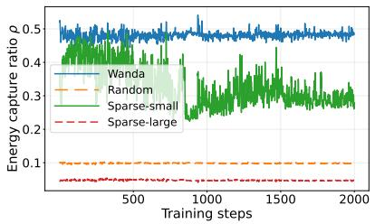  
(a) RTE

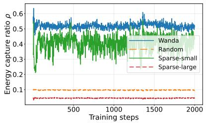  
(b) QQP

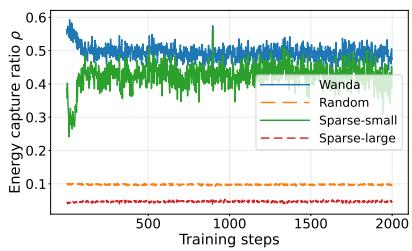  
(c) MNLI  
Figure 3: Gradient energy capture ratio ρ on LLaMA-3.2-3B at a density ratio of r = 0.1. Random denotes uniform random masking. W-small and W-large select coordinates with the smallest and largest weight magnitudes, respectively, while WIS selects coordinates using Wanda weight-activation scores.

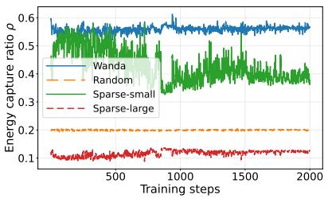  
(a) RTE

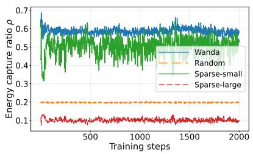  
(b) QQP

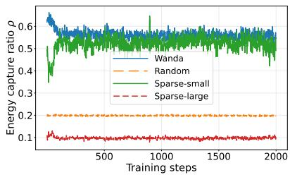  
(c) MNLI

Figure 4: Gradient energy capture ratio $\rho$ on LLaMA-3.2-3B at a density ratio of $r = 0 . 2 .$ All mask construction strategies use the same row-wise perturbation density, model parameters, gradient snapshots, and evaluation data.  
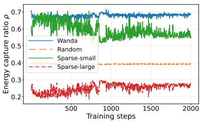  
(a) RTE

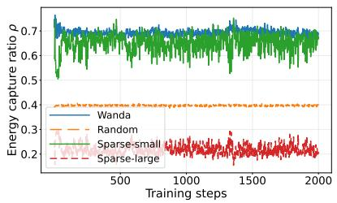  
(b) QQP

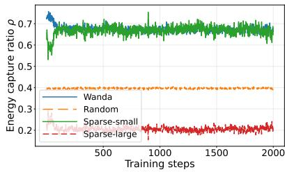  
(c) MNLI

Figure 5: Gradient energy capture ratio $\rho$ on LLaMA-3.2-3B at a density ratio of $r = 0 . 4 \AA$ Random denotes uniform random masking. W-small and W-large select coordinates with the smallest and largest weight magnitudes, respectively, while WIS uses Wanda weight-activation scores.  
Algorithm 2 Perturb Parameters   
1: Function PerturbParameters $( \mathbf { W } , r , \epsilon , \mathbf { M } , s _ { \mathrm { r n g } } )$   
2: Input: Weights $\mathbf { W } \in \mathbb { R } ^ { m \times n }$ , density ratio $r ,$ perturbation scale $\epsilon ,$ mask $\mathbf { M } \in \{ 0 , 1 \} ^ { m \times n }$ , and random   
seed $s _ { \mathrm { r n g } }$   
3: Reset the random number generator with seed $s _ { \mathrm { r n g } }$   
4: Sample $\mathbf { Z } \in \mathbb { R } ^ { m \times n }$ with i.i.d. standard Gaussian entries   
5: W $\begin{array} { r } {  \mathbf { W } + \frac { \epsilon } { \sqrt { r } } \mathbf { Z } \odot } \end{array}$ M {In-place perturbation}   
6: return W

Algorithm 3 Compute Mask   
1: Function ComputeMask $( \mathbf { W } , \mathbf { X } , r ) ;$   
2: Input: Weights $\mathbf { W } \in \mathbb { R } ^ { m \times n }$ , calibration activations $\mathbf { X } \in \mathbb { R } ^ { n \times B }$ , and density ratio $r$   
3: $q _ { j }  \| \mathbf { X } _ { j , : } \| _ { 2 } ,$ for $j = 1 , \dotsc , n$   
4: $\mathbf { S } _ { i , j }  \vert \mathbf { W } _ { i , j } \vert q _ { j }$   
5: $k \gets \lfloor n r \rfloor$ {Selected parameters per row}   
6: for each row i in S do   
7: $\mathcal { T } _ { i } \gets \mathrm { T o p K } ( \mathbf { S } _ { i , : } , k )$   
8: $\mathbf { M } _ { i , j }  \mathbb { I } [ j \in \mathcal { T } _ { i } ]$ , for $j = 1 , \dotsc , n$   
9: end for   
10: return M