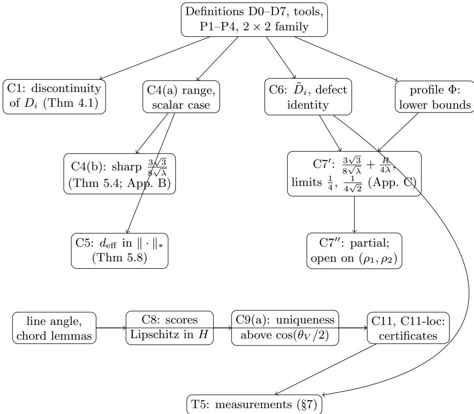

# When can an interpretability claim be trusted? Stability and certification of feature dimensionality, ridge leverage and the feature recovery rate

Ali Tajfar Behnam Tajfar

Independent researchers

31 October 2026

Revised 11 November 2026: DOI corrected

Preprint v1.1 Licence: CC BY 4.0 DOI (all versions): 10.5281/zenodo.23842568

## Abstract

Interpretability tools increasingly support safety claims: that a model contains a feature for a given concept, or that a sparse dictionary has recovered most of a model’s features. Such claims rest on measurements with arbitrary thresholds. Small changes to the model weights, a diferent training seed, or a diferent threshold can reverse them. In earlier work in this program, a norm threshold alone produced a 24.8% apparent failure of a well-known regularity. We ask when such measurements can be trusted.

We study two widely used measurements in toy models and synthetic dictionaries whose true features are known: the feature dimensionality of Elhage et al. [5] and the feature recovery rate (FRR) with a cosine threshold. We characterize exactly where feature dimensionality is discontinuous: where a feature’s weight vector vanishes while some direction is orthogonal to all the other feature vectors. In the earlier work, the apparent failure came from a threshold applied to small feature vectors. We replace feature dimensionality with a regularized (ridge) version and prove sharp stability bounds. The ridge leverage score changes by at most $3 { \sqrt { 3 } } / ( 8 { \sqrt { \lambda } } )$ times the operator-norm change of the weights, and this constant cannot be improved. For the regularized dimensionality, the stability constant grows like $\rho / 4$ in the scale $\rho = R / \sqrt { \lambda }$ , with explicit upper and lower bounds. We also prove certificates that state when a claim “feature i is recovered” must survive a given change of the dictionary. Every proof was checked by an independent blind reviewer, with a few minor points still open. A novelty audit found no earlier statement of the stability bounds or the certificates; parts of the discontinuity result appear in earlier work.

Limitations. Our experiments use toy models, synthetic dictionaries and small dictionaries trained with three seeds; we have not tested real language models. The certificates held in every test and are informative for small perturbations, but they certify no feature non-trivially across independently trained dictionaries, or even between two checkpoints of one training run. At the standard threshold, whether a feature counts as recovered changed with the seed for 55% of the

features. Making such certificates useful for trained models, and closing one remaining gap in the sharp constant for the regularized dimensionality, are left open.

Keywords: mechanistic interpretability; superposition; sparse autoencoders; feature recovery; ridge leverage scores; stability bounds; Lipschitz constants; certificates; AI safety.

AI use statement. This work was carried out with substantial help from AI systems. The literature search, the statement of research targets, the novelty audits, the proofs, the experiment code and the text were drafted by a pipeline of AI agents built on Anthropic’s Claude models (the Opus- and Sonnet-tier models available in Claude Code in October 2026, including Claude Opus 5.5), run in Claude Code and directed by the authors. The agents had separate roles: a literature scout, a gap analyst, a novelty auditor that saw only the claims, a mathematician, an experimenter, a blind reviewer that saw only each statement and its proof, and an editor that changed presentation only. Claude (Anthropic), in a chat interface, was also used for planning, review and the design of the accompanying website. Every proof was checked by the blind reviewer and by numerical tests. No human mathematician other than the authors has verified the proofs. AI systems are not authors of this work: the authors chose the research questions, made the decisions recorded in the audit trail, and take full responsibility for the content, including any errors.

Data and code availability: the scripts that produced every measured number and figure will be released in a public repository linked from the record at doi:10.5281/zenodo.23842568.

Competing interests: the authors declare no competing interests.

## Executive summary

Question. Interpretability claims about superposition rest on numbers computed from weights: Elhage’s feature dimensionality $D _ { i }$ and its total (the “sum rule”), and, for sparse dictionaries, the feature recovery rate $\mathrm { F R R } _ { t }$ at a cosine threshold t. We ask when such a number can support a claim. Where is the metric discontinuous? Which threshold-free variants are Lipschitz, and with which constants? Under which checkable condition does the verdict “feature i is recovered” survive a change of dictionary? All settings are toy models and synthetic dictionaries with known ground truth.

Sources. The metrics come from Elhage et al. [5] $( D _ { i } )$ and Chen et al. [1] $( \mathrm { F R R } , \tau _ { \mathrm { a l i g n } } )$ . Ridge leverage is that of [2, 3]. We credit Ivanov et al. [8] (Theorem 8) for the defect identity, Mirsky [9] for the singular-value inequality, Tsuzuku et al. [15] for the margin mechanism and Pali and Schnass [10] for the one-sided dictionary distance. Linear-algebra pointers are to Strang [13, 14].

Main results. All proofs are ours. An independent reviewer confirmed each of them (marker “ours $\checkmark " )$ , except for eight statements that keep the marker “ours $\circ ^ { \mathfrak { N } }$ because a point the reviewer raised on them is not yet resolved (Section 8 and Appendix $\mathrm { A } )$

1. Diagnosis (Theorem 4.1). $D _ { i }$ is discontinuous exactly on the set $Z _ { i }$ where $W _ { i } = 0$ and some unit vector is orthogonal to all other columns; the jump of $D _ { i }$ and of $D _ { \mathrm { t o t } }$ is 1. Away from $Z _ { i }$ we give a Lipschitz modulus of order $R / \| W _ { i } \| ^ { 2 }$ , and the order is necessary.

2. Ridge leverage (Theorem 5.4). For every shape, $\begin{array} { r } { | \ell _ { i } ( W ; \lambda ) - \ell _ { i } ( W ^ { \prime } ; \lambda ) | \le \frac { 3 \sqrt { 3 } } { 8 \sqrt { \lambda } } \| W - W ^ { \prime } \| _ { \mathrm { o p } } } \end{array}$ , and the constant is sharp. A second, independent proof is in Appendix B. The efective dimension has the same sharp constant in the nuclear norm (Theorem 5.8).

3. Regularised dimensionality ${ \tilde { D } } _ { i }$ (Theorems 5.21 and 5.23). $\begin{array} { r } { | \tilde { D } _ { i } ( W ; \lambda ) - \tilde { D } _ { i } ( W ^ { \prime } ; \lambda ) | \ \le \ \big ( \frac { 3 \sqrt { 3 } } { 8 \sqrt { \lambda } } + } \end{array}$ $\begin{array} { r l } {  { \frac { R } { 4 \lambda } \big ) \| W - W ^ { \prime } \| _ { \mathrm { o p } } } } \end{array}$ . The coeficient $1 / 4$ of $R / \lambda$ is optimal, and the asymptotic additive constant is $1 / ( 4 \sqrt { 2 } )$ ; the dependence on R cannot be removed. A second, independent proof of the coeficient $1 / 4$ is in Appendix C. The optimal additive constant equals its scalar value on part of the range and is open on $( \rho _ { 1 } , \rho _ { 2 } )$ , with $\rho _ { 1 } \approx 0 . 5 5 6$ and $\rho _ { 2 } \approx 3 . 3 2 6$ (§5.8).

4. Certification (§6). Feature scores are Lipschitz in a line-Hausdorf distance; above the sharp threshold cos $\left( \theta _ { V } / 2 \right)$ each atom is aligned with at most one feature; a global certificate (C11) and feature-local certificates (C11-loc) bound the change of $\mathrm { F R R } _ { t }$ between two dictionaries. We also show that the uniqueness sentence of Chen et al. can fail when signed and absolute cosines are mixed (Remark 6.10).

5. Measurements (§7). On 12 trained toy models, the regularised sum rule gave the same verdict at all 21 tested values of its smoothing parameter in the range fixed in advance, while the version that ignores short feature vectors gave the opposite verdict for two of the models. In all searches no pair exceeded the proved constants. The certificates were never wrong, but across training seeds, and between two checkpoints of one run, they certify no feature non-trivially. At $t = \tau _ { \mathrm { a l i g n } } ,$ 55.47% of the features change status across three seeds while the area ¯c under the FRR curve moves by at most 0.0054.

What was verified. The proofs are complete as written, with every step justified. An independent reviewer confirmed every proof (marker $\checkmark )$ , except on eight statements (marker ${ \circ } ; { \mathrm { ~ A p - } }$ pendix A). All numerical checks passed.

What failed or is open. The scalar value of the additive constant for ${ \tilde { D } } _ { i }$ is not proved on $( \rho _ { 1 } , \rho _ { 2 } )$ for $d , n \geq 2 ;$ ; the remaining two-variable inequality is a candidate for a computer-assisted check. The certificates are uninformative on trained dictionaries. The optimal coeficient in the local modulus of $D _ { i }$ lies in $[ 1 / 2 , 4 ]$ and is not determined.

## Roadmap

Section 1 fixes one notation. Section 2 gives the definitions and Section 3 the tools, elementary facts and $\mathrm { ~ a ~ } 2 \times 2$ family used three times. Section 4 diagnoses $D _ { i } .$ . Section 5 proves the stability results for $\ell _ { i } , d _ { \mathrm { e f f } }$ and ${ \tilde { D } } _ { i } .$ . Section 6 proves the certificates for $\mathrm { F R R } _ { t }$ . Section 7 reports our measurements, and Section 8 lists our contributions with their status and novelty verdicts, followed by the open problems. Appendix A explains the markers; Appendices B and C give independent second proofs; Appendix D is the glossary.

  
The certification part (bottom row) depends only on the definitions D0 and D7 and on the line-angle lemmas of §6.1; it does not use the stability results for ${ \tilde { D } } _ { i }$

## 1 Notation and conventions

This section fixes the notation for the whole document. Every symbol is defined once; the glossary (Appendix D) lists them all.

Definition 1.1 (D0: conventions). definition (ours)

$d , n , M , M ^ { \prime }$ are positive integers, and $[ n ] = \{ 1 , \dots , n \}$

• On $\mathbb { R } ^ { p } , \langle x , y \rangle = x ^ { \top } y$ and $\lVert x \rVert = \langle x , x \rangle ^ { 1 / 2 }$ . For $x \neq 0 , { \hat { x } } = x / \| x \|$ . For $x , y \neq 0$ , cos $( x , y ) =$ $\langle x , y \rangle / ( \| x \| \| y \| )$

• For a real matrix $B \colon \| B \| _ { \mathrm { o p } }$ is its largest singular value, $\begin{array} { r } { \| B \| _ { F } = \big ( \sum _ { i , k } B _ { j k } ^ { 2 } \big ) ^ { 1 / 2 } } \end{array}$ its Frobenius norm and $\| B \| ,$ ∗ its nuclear norm (the sum of its singular values); $\begin{array} { r } { \sigma _ { 1 } \dot { ( B ) } \ge \sigma _ { 2 } ( B ) \ge . . } \end{array}$ . are its singular values.

• For a symmetric $B \in \mathbb { R } ^ { p \times p } \colon \nu _ { \operatorname* { m i n } } ( B )$ and $\nu _ { \mathrm { m a x } } ( B )$ are its smallest and largest eigenvalues, and $\nu _ { 1 } ( B ) \geq \cdot \cdot \cdot \geq \nu _ { p } ( B )$ all its eigenvalues.

• $I _ { p }$ is the $p \times p$ identity, $O ( d )$ the group of orthogonal $d \times d$ matrices, $\# \mathcal { U }$ the number of elements of a finite set U, and $\mathbf { 1 } [ \cdot ]$ the indicator of a condition. $\mathsf { e } _ { 1 } , \ldots , \mathsf { e } _ { p }$ are the standard basis vectors of $\mathbb { R } ^ { p } \ ( p$ is clear from the context).

Dummy letters. The letters $u , x , y , z$ (with primes, stars or subscripts), $B , B ^ { \prime }$ (matrices), f (functions) and $\vartheta$ (with subscripts or primes; angles) are bound variables: each is introduced, with its range, inside the statement or proof that uses it, and has no meaning outside it. Sans-serif letters other than $\mathbf { e } _ { j } , \mathsf { a } , \mathsf { a } ^ { \prime } , \mathsf { b } , \mathsf { b } ^ { \prime } , \mathsf { q } _ { i } , \mathsf { h }$ (Definition 2.1) are local abbreviations: each is defined at the start of the one proof that uses it. Every other symbol has one meaning throughout.

Notation of the sources. The table maps the notation of the main sources to ours.
<table><tr><td>Source</td><td>Their object (in words)</td><td>Ours</td></tr><tr><td>Elhage et al. [5]</td><td>feature dimensionality</td><td> $D _ { i }$  (Definition 2.2)</td></tr><tr><td>Scherlis et al. [12]</td><td>capacity of a feature</td><td> $D _ { i }$ </td></tr><tr><td>Ivanov et al. [8]</td><td>frame operator; leverage with the pseudo-inverse</td><td> $S ; \ell _ { j } ^ { 0 }$  (Proposition 5.9)</td></tr><tr><td>Cohen et al. [2]</td><td>ridge leverage score of a column</td><td> $\ell _ { i } ( W ; \lambda )$  (Definition 2.4)</td></tr><tr><td>Chen et al. [1]</td><td>alignment threshold, feature recov- ery rate</td><td> $\tau _ { \mathrm { a l i g n } } ( V )$   $\mathrm { F R R } _ { t }$  (Defini- tion 2.7)</td></tr><tr><td>Pali and Schnass [10]</td><td>one-sided distance between dictio- naries of unit atoms</td><td> $\operatorname* { m a x } _ { m } e _ { m } ( A \ \to \ A ^ { \prime } )$  on nor- malised atoms</td></tr></table>

## 2 Definitions

These are the objects the theorems are about: the weight matrix and its frame operator, the four dimensionality-type metrics, the range of the ridge parameter, and the dictionary setting for feature recovery.

Definition 2.1 (D1: weights and frame operator). definition (ours)

$W \in \mathbb { R } ^ { d \times n }$ has columns $W _ { 1 } , \ldots , W _ { n } \in \mathbb { R } ^ { d }$ . Column $W _ { i }$ is the direction of feature i. $W _ { - i } \in$ $\mathbb { R } ^ { d \times ( n - 1 ) }$ is the matrix of the columns $W _ { j } , j \neq i$ , in increasing order of $j ;$ for $n = 1$ it has no columns, and we set $W _ { - i } ^ { \top } y = 0$ for every y, all norms of these being 0 (empty sums are 0).

$\begin{array} { r } { \boldsymbol { S } = \boldsymbol { S } ( \boldsymbol { W } ) = \boldsymbol { W } \boldsymbol { W } ^ { \intercal } = \sum _ { j = 1 } ^ { n } W _ { j } W _ { j } ^ { \intercal } , \boldsymbol { S } _ { - i } = \boldsymbol { S } _ { - i } ( \boldsymbol { W } ) = \sum _ { j \neq i } W _ { j } W _ { j } ^ { \intercal } = W _ { - i } W _ { - i } ^ { \intercal } ; } \end{array}$ and $r =$ rank S.

$\sigma _ { 1 } \geq \cdot \cdot \cdot \geq \sigma _ { \operatorname* { m i n } ( d , n ) } \geq 0$ are the singular values of $W ,$ so the nonzero eigenvalues of S are $\sigma _ { 1 } ^ { 2 } , \ldots , \sigma _ { r } ^ { 2 }$ (Lemma 3.20). $\omega ( W ) = \mathrm { t r } ( S ) / d$ is the mean eigenvalue of S.

• For $\lambda > 0 \colon S _ { \lambda } = S + \lambda I _ { d } , S _ { - i , \lambda } = S _ { - i } + \lambda I _ { d } \mathrm { ~ a n d ~ } K _ { \lambda } = W ^ { \top } W + \lambda I _ { n } .$

• For a second matrix $W ^ { \prime } \in \mathbb { R } ^ { d \times n }$ (with $S ^ { \prime } = S ( W ^ { \prime } ) ) \colon E \ = W ^ { \prime } - W , \mathtt { h } \ = \ \| W ^ { \prime } - W \| _ { \mathrm { o p } }$ $R = \mathrm { m a x } ( \| W \| _ { \mathrm { o p } } , \| W ^ { \prime } \| _ { \mathrm { o p } } ) , R _ { \mathrm { m i n } } = \mathrm { m i n } ( \| W \| _ { \mathrm { o p } } , \| W ^ { \prime } \| _ { \mathrm { o p } } )$ , and R¯ denotes any number with $\bar { R } \geq R$ and $\bar { R } > 0 .$ . For $\eta \in \mathbb { R } , W ( \eta ) = W + \eta E$ , with columns $W _ { j } ( \eta ) ; S ( \eta ) , S _ { - i } ( \eta ) , S _ { \lambda } ( \eta )$ $K _ { \lambda } ( \eta )$ are formed from $W ( \eta )$

• For fixed i: $\mathsf { a } = \| \boldsymbol { W } _ { i } \|$ and $\mathsf { q } _ { i } = { W } _ { i } ^ { \top } S W _ { i } .$ , and, if $\boldsymbol { W } _ { i } \neq \boldsymbol { 0 } , \boldsymbol { \mathsf { b } } = \| \boldsymbol { W } ^ { \top } \hat { \boldsymbol { W } } _ { i } \| ; \boldsymbol { \mathsf { a } } ^ { \prime } , \boldsymbol { \mathsf { q } } _ { i } ^ { \prime } , \boldsymbol { \mathsf { b } } ^ { \prime }$ are the same quantities for $W ^ { \prime }$

Definition 2.2 (D2: feature dimensionality). definition (source [5]; case Wi = 0 ours) For $W _ { i } \neq 0$

$$
D _ { i } ( W ) = \frac { \| W _ { i } \| ^ { 2 } } { \sum _ { j = 1 } ^ { n } \langle \hat { W } _ { i } , W _ { j } \rangle ^ { 2 } } = \frac { \| W _ { i } \| ^ { 4 } } { W _ { i } ^ { \top } S W _ { i } } \qquad ( \mathrm { t h e ~ s u m ~ i n c l u d e s ~ } j = i ) ,\tag{1}
$$

and $D _ { i } ( W ) = 0 { \mathrm { ~ i f ~ } } W _ { i } = 0$ . The total is $\begin{array} { r } { D _ { \mathrm { t o t } } ( W ) = \sum _ { i = 1 } ^ { n } D _ { i } ( W ) } \end{array}$

Definition 2.3 (D3: norm-thresholded dimensionality). definition (ours) For $\tau \geq 0 , D _ { i } ^ { ( \tau ) } ( W ) =$ $D _ { i } ( W )$ if $\| W _ { i } \| > \tau$ and $D _ { i } ^ { ( \tau ) } ( W ) = 0$ otherwise; $\begin{array} { r } { D _ { \mathrm { t o t } } ^ { ( \tau ) } ( W ) \overline { { = \sum _ { i } D _ { i } ^ { ( \tau ) } ( W ) } } } \end{array}$ . So $D _ { i } ^ { ( 0 ) } = D _ { i }$ . In the runs of $\ S 7 , \tau = 0 . 2$ is the thresholded version and $\tau = 0$ the unthresholded one; the test is computed as $\| W _ { i } \| ^ { 2 } > \tau ^ { 2 }$ , which is equivalent.

Definition 2.4 (D4: ridge leverage and efective dimension). definition (source [2, 3]) For $\lambda > 0$

$$
\ell _ { i } ( W ; \lambda ) = W _ { i } ^ { \top } S _ { \lambda } ^ { - 1 } W _ { i } , \qquad d _ { \mathrm { { e f f } } } ( W ; \lambda ) = \sum _ { i = 1 } ^ { n } \ell _ { i } ( W ; \lambda ) .\tag{2}
$$

$( S _ { \lambda }$ is invertible by Lemma 3.20; the closed forms of $d _ { \mathrm { e f f } }$ are Lemma 3.21.)

Definition 2.5 (D5: regularised dimensionality). definition (ours) For $\lambda > 0$ and $W _ { i } \neq 0$

$$
\tilde { D } _ { i } ( W ; \lambda ) = \frac { \| W _ { i } \| ^ { 4 } } { W _ { i } ^ { \top } S W _ { i } + \lambda \| W _ { i } \| ^ { 2 } } = \frac { \| W _ { i } \| ^ { 2 } } { \sum _ { j = 1 } ^ { n } \langle \hat { W } _ { i } , W _ { j } \rangle ^ { 2 } + \lambda } ,\tag{3}
$$

and ${ \tilde { D } } _ { i } ( W ; \lambda ) = 0 { \mathrm { ~ i f ~ } } W _ { i } = 0$ . The total is $\begin{array} { r } { \tilde { D } _ { \mathrm { t o t } } ( W ; \lambda ) = \sum _ { i } \tilde { D } _ { i } ( W ; \lambda ) } \end{array}$

Definition 2.6 (D6: range of the ridge parameter). definition (ours) For $W \neq 0 ,$

$$
\Lambda ( W ) = \left[ 1 0 ^ { - 3 } \omega ( W ) , \ 1 0 ^ { - 1 } \omega ( W ) \right] .\tag{4}
$$

Then $\omega ( W ) > 0$ , so $\Lambda ( W ) \subset ( 0 , \infty ) ; \Lambda ( W )$ is not defined for $W = 0$ . A statement “for $\lambda \in \Lambda ( W ) ^ { \mathfrak { N } }$ fixes the number λ from the unperturbed $W ;$ when W is perturbed, λ stays fixed. All results of §5 hold for every $\lambda > 0$ , so in particular for every $\lambda \in \Lambda ( W )$

Definition 2.7 (D7: dictionary setting). definition (ours, except where a source is named)

$V \in \mathbb { R } ^ { d \times n }$ , with $n \geq 2$ , has nonzero columns $v _ { 1 } , \ldots , v _ { n }$ (the ground-truth features), and $| \cos ( v _ { i } , v _ { j } ) | < 1$ for $i \neq j$ . We write $\mu _ { i j } = \cos ( v _ { i } , v _ { j } )$

$A _ { M }$ is the set of dictionaries $A \in \mathbb { R } ^ { d \times M }$ whose columns (atoms) $a _ { 1 } , \dots , a _ { M }$ are all nonzero; $A ^ { \prime } \in \mathcal { A } _ { M ^ { \prime } }$ has atoms $a _ { 1 } ^ { \prime } , \ldots , a _ { M ^ { \prime } } ^ { \prime }$ . Indices m run over [M] and $m ^ { \prime }$ over $[ M ^ { \prime } ]$

• Line separation: $\theta _ { V } = \operatorname* { m i n } _ { i \neq j }$ arccos $| \cos ( v _ { i } , v _ { j } ) | \in ( 0 , \pi / 2 ]$

• Signed coherence and alignment threshold (source: Chen et al. [1]): $\mu ( V ) = \mathrm { m a x } _ { i \neq j } \mu _ { i j }$ and $\begin{array} { r } { \tau _ { \mathrm { a l i g n } } ( V ) = \cos \left( \frac { 1 } { 3 } \operatorname { a r c c o s } \mu ( V ) \right) } \end{array}$

• Per-feature score: $\begin{array} { r l r } { c _ { i } ( A ) } & { { } = } & { \operatorname* { m a x } _ { m \in [ M ] } | \cos ( a _ { m } , v _ { i } ) | \quad \in \quad [ 0 , 1 ] . } \end{array}$ Per-atom score: $g _ { m } ( A ) = \operatorname* { m a x } _ { i \in [ n ] } | \cos ( a _ { m } , v _ { i } ) | ; c _ { i } ( A ^ { \prime } )$ and $g _ { m ^ { \prime } } ( A ^ { \prime } ) = \operatorname* { m a x } _ { i \in [ n ] } | \cos ( a _ { m ^ { \prime } } ^ { \prime } , v _ { i } ) |$ are defined in the same way.

• Feature recovery rate at threshold $t \in ( 0 , 1 ]$ (source: Chen et al. [1], with the absolute cosine):

$$
\operatorname { F R R } _ { t } ( A ) = { \frac { 1 } { n } } \# \{ i \in [ n ] : c _ { i } ( A ) \geq t \} .\tag{5}
$$

Feature i is recovered by A at threshold t if $c _ { i } ( A ) \geq t$

• Area under the FRR curve: $\begin{array} { r } { \bar { c } ( A ) = \frac { 1 } { n } \sum _ { i } { c _ { i } ( A ) } } \end{array}$

• Smoothed FRR: for $\begin{array} { r } { \beta \in ( 0 , 1 ) , \mathrm { \ F R R } _ { t , \beta } ( A ) = \frac 1 n \sum _ { i } \psi _ { t , \beta } ( c _ { i } ( A ) ) } \end{array}$ , where $\psi _ { t , \beta } ( u ) = 0$ for $u \ \leq$ $t - \beta / 2 , \psi _ { t , \beta } ( u ) = 1$ for $u \ge t + \beta / 2$ , and $\psi _ { t , \beta } ( u ) = ( u - t + \beta / 2 ) / \beta$ for $t - \beta / 2 < u < t + \beta / 2$ (the afine interpolation between the values 0 and 1).

• Line distances: $\begin{array} { r } { e _ { m } ( A { \ }  \ A ^ { \prime } ) = \operatorname* { m i n } _ { m ^ { \prime } \in [ M ^ { \prime } ] } \operatorname* { m i n } _ { s \in \{ \pm 1 \} } \| \hat { a } _ { m } - s \hat { a } _ { m ^ { \prime } } ^ { \prime } \| } \end{array}$ , and $e _ { m ^ { \prime } } ( A ^ { \prime } \ \to \ A )$ in the same way. The line-Hausdorf distance is $\begin{array} { r l } { \mathrm { \ i } \hat { H } ( A , A ^ { \prime } ) } & { { } = } \end{array}$ max $\begin{array} { r l } { \big ( \operatorname* { m a x } _ { m } e _ { m } ( A } & { { }  } \end{array}$ $A ^ { \prime } )$ , ma $\mathrm { x } _ { m ^ { \prime } } e _ { m ^ { \prime } } ( A ^ { \prime }  A ) \big )$

• Margin count: for $\gamma > 0 , N _ { \gamma } ( A ; t ) = \# \{ i : | c _ { i } ( A ) - t | < \gamma \}$

## 3 Tools and preliminary facts

We first list the standard facts we use without proof, then prove a few elementary facts (P1–P4) and compute the slopes of one $2 \times 2$ family that serves three later results.

## 3.1 Tools

Each tool is a standard fact that we use and do not prove. Where a pointer is given, “not verified” means that we have not checked the section number in the book.

Tool 3.1 (spectral theorem). tool Every real symmetric $\begin{array} { r l r } { B } & { { } \in } & { \mathbb { R } ^ { p \times p } } \end{array}$ can be written $\boldsymbol { B } = U \mathrm { d i a g } ( \nu _ { 1 } , . . . , \nu _ { p } ) U ^ { \top }$ with $U \in O ( p )$ and real $\nu _ { 1 } \geq \cdots \geq \nu _ { p }$ , the eigenvalues of $B ;$ the columns of U are orthonormal eigenvectors. Consequently, for every $x \in \mathbb { R } ^ { p }$ :

$$
\begin{array} { r } { \nu _ { \operatorname* { m i n } } ( B ) \| x \| ^ { 2 } \leq x ^ { \top } B x \leq \nu _ { \operatorname* { m a x } } ( B ) \| x \| ^ { 2 } ; } \end{array}\tag{6}
$$

if $\nu _ { \mathrm { m i n } } ( B ) > 0$ , then $B ^ { - 1 }$ is symmetric and its eigenvalues are the reciprocals of those of $B ;$ and if B is positive semidefinite, then

$$
\begin{array} { r } { \| B x \| ^ { 2 } = x ^ { \top } B ^ { 2 } x \leq \nu _ { \operatorname* { m a x } } ( B ) x ^ { \top } B x . } \end{array}\tag{7}
$$

(Each consequence follows by expanding x in the eigenbasis.) Pointer: Strang [13], Ch. 6 (symmetric matrices); section number not verified.

Tool 3.2 (Rayleigh characterisation). tool For real symmetric B, $\begin{array} { r } { \nu _ { \operatorname* { m i n } } ( B ) = \operatorname* { m i n } _ { \| \boldsymbol { z } \| = 1 } \boldsymbol { z } ^ { \top } B \boldsymbol { z } } \end{array}$ , and the minimum is attained at a unit eigenvector for $\nu _ { \mathrm { m i n } } ( B )$ . (It follows from Tool 3.1: with $z = U z ^ { \prime }$ $\begin{array} { r } { z ^ { \top } B z = \sum _ { k } \nu _ { k } z _ { k } ^ { \prime 2 } } \end{array}$ and $\| z ^ { \prime } \| = \| z \| . \big )$ Pointer: Strang [13], Ch. 6; not verified.

Tool 3.3 (singular values). tool For $B \in \mathbb { R } ^ { d \times n }$ with singular values $\sigma _ { 1 } ( B ) \geq \cdots \geq \sigma _ { \operatorname* { m i n } ( d , n ) } ( B ) \geq 0 \mathrm { . }$ ${ \mathrm { ( i ) ~ } } \| B \| _ { \mathrm { o p } } = \sigma _ { 1 } ( B ) = \operatorname* { m a x } _ { \| z \| = 1 } \| B z \| ; { \mathrm { ~ ( i i ) } }$ the eigenvalues of $B B ^ { \top }$ are $\sigma _ { 1 } ( B ) ^ { 2 } , \dots , \sigma _ { \operatorname* { m i n } ( d , n ) } ( B ) ^ { 2 }$ together with $d - \operatorname* { m i n } ( d , n )$ zeros; (iii) the number of nonzero singular values is rank B = rank B $B ^ { \top } \leq$ min $\begin{array} { r } { ( d , n ) ; \mathrm { ~ ( i v ) ~ } \| B \| _ { F } ^ { 2 } = \operatorname { t r } ( B ^ { \top } B ) = \sum _ { k } \sigma _ { k } ( B ) ^ { 2 } } \end{array}$ . Pointers: Strang [13], Ch. 7 (singular value decomposition), not verified; rank $A A ^ { \top } = \operatorname { r a n k } A$ is boxed fact 3 of Appendix A1 of the 6th edition, p. 400 [14] (verified).

Tool 3.4 (norm facts). tool For real matrices B and vectors x: $\| B x \| \leq \| B \| _ { \mathrm { o p } } \| x \| ; \ \| B ^ { \top } \| _ { \mathrm { o p } } =$ $\| B \| _ { \mathrm { o p } } ; \ \| B \| _ { \mathrm { o p } } ^ { 2 } = \nu _ { \mathrm { m a x } } ( B \overline { { B ^ { \top } ) } } ; \| \cdot \| _ { \mathrm { o p } }$ satisfies the triangle inequality and $\| c B \| _ { \mathrm { o p } } = | c | \| B \| _ { \mathrm { o p } }$ . The Euclidean norm satisfies the triangle inequality and the reverse triangle inequality $| | | y | | - | | y ^ { \prime } | | | \leq$ $\| y - y ^ { \prime } \|$ ; for real numbers, $\left| | y | - | y ^ { \prime } | \right| \leq | y - y ^ { \prime } |$

Tool 3.5 (Cauchy–Schwarz). tool For an inner product $\langle \cdot , \cdot \rangle$ ∗ on $\mathbb { R } ^ { p } , \langle z , z ^ { \prime } \rangle _ { * } ^ { 2 } \le \langle z , z \rangle _ { * } \langle z ^ { \prime } , z ^ { \prime } \rangle _ { * }$ , with equality if and only if $z , z ^ { \prime }$ are linearly dependent. In particular $| \langle x , y \rangle | \leq \| x \| \| y \|$ . Pointer: Strang [13], Ch. 1 (dot products, lengths and angles), for the standard inner product; section number not verified.

Tool 3.6 (Minkowski in $\mathbb { R } ^ { 2 } )$ . tool For real y1, y2, y3: $\sqrt { y _ { 1 } ^ { 2 } + ( y _ { 2 } + y _ { 3 } ) ^ { 2 } } \leq \sqrt { y _ { 1 } ^ { 2 } + y _ { 2 } ^ { 2 } } + | y _ { 3 } | .$

Tool 3.7 (positive definite matrices). tool If B is a real symmetric positive semidefinite matrix and $\lambda > 0$ , then $B + \lambda I$ is symmetric positive definite. A symmetric positive definite matrix K is invertible $( K z = 0$ gives $z ^ { \top } K z = 0$ , hence $z = 0 ;$ Tool 3.9). Its inverse is symmetric positive definite, so its diagonal entries are $> 0$ . For such $K , \langle y , y ^ { \prime } \rangle _ { K } = y ^ { \top } K y ^ { \prime }$ is an inner product.

Tool 3.8 (trace). $\boxed { \mathrm { t o o l } \big | \mathrm { t r } ( B B ^ { \prime } ) = \mathrm { t r } ( B ^ { \prime } B ) }$ whenever both products are defined; the trace of a symmetric matrix is the sum of its eigenvalues. Pointer: Strang [13], Ch. 6; not verified.

Tool 3.9 (dimension count). tool The nullspace of a $p \times d$ matrix of rank $r ^ { \prime }$ has dimension $d - r ^ { \prime }$ and a square matrix with trivial nullspace is invertible. Pointer: Strang [13], 5th ed., §3.5, p. 181 box and the Counting Theorem, p. 185 (verified for the dimension of the nullspace; the invertibility clause is not on these pages).

Tool 3.10 (Cramer’s rule). tool An invertible square matrix B satisfies $B ^ { - 1 } = \operatorname { a d j } ( B ) /$ det B, where the entries of $\operatorname { a d j } ( B )$ are polynomials in the entries of B.

Tool 3.11 (one-variable calculus). $\boxed { \ t o o l } \left( \mathrm { a } \right)$ The product rule (also for products of matrix-valued functions, entrywise) and the quotient rule. (b) Mean value theorem: if h is continuous on $[ u _ { 1 } , u _ { 2 } ]$ and diferentiable on $( u _ { 1 } , u _ { 2 } )$ , then $h ( u _ { 2 } ) - h ( u _ { 1 } ) = h ^ { \prime } ( u ) ( u _ { 2 } - u _ { 1 } )$ for some $u \in ( u _ { 1 } , u _ { 2 } ) ;$ ; in particular, if $| h ^ { \prime } | \leq L$ on $( u _ { 1 } , u _ { 2 } )$ , then $| h ( u _ { 2 } ) - h ( u _ { 1 } ) | \leq L ( u _ { 2 } - u _ { 1 } )$ . (c) Fundamental theorem of calculus: if h is continuously diferentiable on $[ u _ { 1 } , u _ { 2 } ]$ , then $\begin{array} { r } { h ( u _ { 2 } ) - h ( u _ { 1 } ) = \int _ { u _ { 1 } } ^ { u _ { 2 } } h ^ { \prime } ( u ) } \end{array}$ du; hence if $h ^ { \prime } \leq L$ there, $h ( u _ { 2 } ) - h ( u _ { 1 } ) \leq L ( u _ { 2 } - u _ { 1 } )$ . (d) A function with positive (negative) derivative on an open interval is strictly increasing (decreasing) on its closure. (e) Rational functions are continuous, and diferentiable, where the denominator does not vanish. (f) A continuous function $\mathsf { f } \geq 0$ on $[ u _ { 1 } , u _ { 2 } ]$ $u _ { 1 } < u _ { 2 }$ , with $\mathsf { f } > 0$ at some point has $\int _ { u _ { 1 } } ^ { u _ { 2 } } \mathsf { f } > 0$ . (g) For continuous $\mathrm { f _ { 1 } , f _ { 2 } }$ on $[ u _ { 1 } , u _ { 2 } ] , u _ { 1 } < u _ { 2 } \colon$ : the integral is linear; $\mathsf { f } _ { 1 } \leq \mathsf { f } _ { 2 }$ implies $\begin{array} { r } { \int _ { u _ { 1 } } ^ { u _ { 2 } } \mathsf { f } _ { 1 } \le \int _ { u _ { 1 } } ^ { u _ { 2 } } \mathsf { f } _ { 2 } ; } \end{array}$ ; hence $\begin{array} { r } { \left| \int _ { u _ { 1 } } ^ { u _ { 2 } } \ d \mathbf { f } _ { 1 } \right| \leq \int _ { u _ { 1 } } ^ { u _ { 2 } } | \mathbf { f } _ { 1 } | } \end{array}$ ; and $\begin{array} { r } { \int _ { u _ { 1 } } ^ { u _ { 2 } } L \mathrm { d } u = L ( u _ { 2 } - u _ { 1 } ) } \end{array}$ for a constant $L . \quad ( \mathrm { h } )$ Intermediate value theorem: a continuous function on $[ u _ { 1 } , u _ { 2 } ]$ takes every value between its values at $u _ { 1 }$ and $u _ { 2 }$ . No source in our background is cited for these.

Tool 3.12 (pseudo-inverse). tool The pseudo-inverse of an invertible matrix is its inverse.

Tool 3.13 (Mirsky’s inequality, nuclear-norm case). $\boxed { \mathrm { t o o l } }$ For all $B , B ^ { \prime } \in \mathbb { R } ^ { d \times n }$ , with singular values in non-increasing order,

$$
\sum _ { k = 1 } ^ { \operatorname* { m i n } ( d , n ) } \left| \sigma _ { k } ( B ) - \sigma _ { k } ( B ^ { \prime } ) \right| \leq \| B - B ^ { \prime } \| _ { * } .\tag{8}
$$

Source: Mirsky [9], full text not seen. Secondary sources seen only as abstracts or search snippets attribute to Mirsky the general inequality $\| \mathrm { d i a g } ( \sigma ( B ) - \sigma ( B ^ { \prime } ) ) \| \le \| B - B ^ { \prime } \|$ for every unitarily invariant norm $\| \cdot \|$ . Inequality (8) is its case for the Schatten-1 (nuclear) norm, whose symmetric gauge function is the $\ell ^ { 1 }$ norm; we have not seen that specialisation stated in any source we read. We credit (8) to Mirsky and claim no novelty for its use.

Tool 3.14 (trigonometry). tool cos is continuous and strictly decreasing on $[ 0 , \pi ] ;$ arccos $: [ - 1 , 1 ] $ $[ 0 , \pi ]$ is its inverse and is strictly decreasing; arccos $( - u ) = \pi -$ arccos u for $u \in [ - 1 , 1 ] ;$ ; sin $\geq 0$ on $[ 0 , \pi ]$ , sin is strictly increasing on $[ 0 , \pi / 2 ]$ , sin $\leq 1$ , and s $\ln ^ { 2 } + \cos ^ { 2 } \ b = 1$ . Values: cos $0 = 1$ cos $( \pi / 4 ) = 1 / \sqrt { 2 } , \cos ( \pi / 2 ) = 0 ;$ ; hence arccos $1 = 0$ and arccos $0 = \pi / 2$ . For real $\vartheta _ { 1 } , \vartheta _ { 2 } , \vartheta \colon$ cos $( \vartheta _ { 1 } +$ $\vartheta _ { 2 } ) = \cos \vartheta _ { 1 }$ cos $\vartheta _ { 2 } - \sin \vartheta _ { 1 }$ sin $\vartheta _ { 2 } ;$ cos $\begin{array} { r } { \vartheta _ { 1 } - \cos \vartheta _ { 2 } = 2 \sin \frac { \vartheta _ { 1 } + \vartheta _ { 2 } } { 2 } \sin \frac { \vartheta _ { 2 } - \vartheta _ { 1 } } { 2 } ; 1 - \cos \vartheta = 2 \sin ^ { 2 } ( \vartheta / 2 ) } \end{array}$ and $1 + \cos \vartheta = 2 \cos ^ { 2 } ( \vartheta / 2 )$

Tool 3.15 (monotone maps and extrema). $\boldsymbol { \left\lceil \mathsf { t o o l } \right\rceil } \mathrm { I f } \textsf { f }$ is non-decreasing on a set containing the finite nonempty set $\{ u _ { 1 } , \ldots , u _ { k } \}$ , then $\begin{array} { r } { \mathsf { f } ( \operatorname* { m i n } _ { j } u _ { j } ) = \operatorname* { m i n } _ { j } \mathsf { f } ( u _ { j } ) } \end{array}$ and ${ \mathsf { f } } ( \operatorname* { m a x } _ { j } u _ { j } ) = \operatorname* { m a x } _ { j } { \mathsf { f } } ( u _ { j } )$ ; if f is nonincreasing, the same holds with min and max exchanged on one side. The square root is strictly increasing on $[ 0 , \infty )$

Tool 3.16 (continuity). tool Equip $\mathbb { R } ^ { d \times n }$ with the distance $\| B - B ^ { \prime } \| _ { \mathrm { o p } }$ (a metric by Tool 3.4). A function $\textsf { f } : \mathbb { R } ^ { d \times n }  \mathbb { R }$ with $| \mathsf { f } ( B ) - \mathsf { f } ( B ^ { \prime } ) | \leq \| B - B ^ { \prime } \| _ { \mathrm { o p } }$ for all $B , B ^ { \prime }$ is continuous. Constants are continuous; sums and products of continuous functions are continuous; a quotient of continuous functions is continuous on the set where its denominator does not vanish; and if f is continuous, the set $\{ B : { \mathsf { f } } ( B ) \neq { \mathsf { 0 } } \}$ is open.

Tool 3.17 (Lipschitz compositions). $\boxed { \mathrm { t o o l } } \mathrm { I f } \mathsf { f } _ { 1 } , \mathsf { f } _ { 2 } : \mathbb { R }  \mathbb { R }$ are Lipschitz with constants $L _ { 1 } , L _ { 2 }$ , then $\mathsf { f } _ { 1 } \circ \mathsf { f } _ { 2 }$ is Lipschitz with constant $L _ { 1 } L _ { 2 } ;$ the maps $u \mapsto \operatorname* { m a x } ( 0 , u )$ and $u \mapsto \operatorname* { m i n } ( 1 , u )$ are 1-Lipschitz. Tool 3.18 (Riemann integral). tool The Riemann integral is linear, and $\begin{array} { r } { \int _ { 0 } ^ { 1 } \mathbf { 1 } [ u \le y ] \mathrm { d } u = y } \end{array}$ for $y \in [ 0 , 1 ]$ (the integrand is the indicator of the interval $[ 0 , y ]$ , of length $y )$ ; changing an integrand at one point does not change its integral.

## 3.2 Preliminary facts P1–P4

These four facts are classical; we prove them for completeness.

Lemma 3.19 (P1: norm facts). $\begin{array} { r }  \boxed { \mathrm { o u r s ~ } \sqrt { \mathrm { \vert L e t ~ } B , B ^ { \prime } \in \mathbb { R } ^ { d \times n } } } \end{array}$

P1.1 $\begin{array} { r } { \| B \mathsf { e } _ { i } \| \le \| B \| _ { \mathrm { o p } } , \mathrm { s o } \| B _ { i } - B _ { i } ^ { \prime } \| \le \| B - B ^ { \prime } \| _ { \mathrm { o p } } } \end{array}$ for every column i. (By Tool 3.3(i), since $\| \mathsf { e } _ { i } \| = 1$ and $B \mathsf { e } _ { i } = B _ { i } . )$

P1.2 $| B _ { j k } | = | \mathsf { e } _ { i } ^ { \top } B \mathsf { e } _ { k } | \leq \| \mathsf { e } _ { j } \| \| B \mathsf { e } _ { k } \| \leq \| B \| _ { \mathrm { o p } }$ (Tool 3.5 and P1.1). Applied to $B - B ^ { \prime }$ , this gives $| B _ { j k } - B _ { j k } ^ { \prime } | \leq \| B - B ^ { \prime } \| _ { \mathrm { o p } }$ , so each entry map $B \mapsto B _ { j k }$ is continuous (Tool 3.16). Hence, by Tool 3.16, every polynomial in the entries of B is continuous, and every quotient of two such polynomials is continuous on the set where its denominator does not vanish. All continuity statements below refer to $\| \cdot \| _ { \mathrm { o p } }$

P1.3 $\begin{array} { r l r l r l r l r l r l } { \| B \| _ { \infty } } & { \leq } & { \| B \| _ { F } \mathrm { . ~ } } & { \mathrm { f o r ~ } } & { \| z \| } & { { } = { } } & { 1 , } & { \| B z \| } & { { } = { } } & { \| \sum _ { k } z _ { k } B _ { k } \| } & { { } \leq { } } & { \sum _ { k } | z _ { k } | \| B _ { k } \| } & { { } \leq { } } & { \| B \| _ { H } \| B _ { k } \| \| } \end{array}$ $\begin{array} { r l r } { \big ( \sum _ { k } z _ { k } ^ { 2 } \big ) ^ { 1 / 2 } \big ( \sum _ { k } \| B _ { k } \| ^ { 2 } \big ) ^ { 1 / 2 } } & { { } = } & { \| B \| _ { F } } \end{array}$ (triangle inequality, then Tool 3.5 in Rn; the last equality is $\begin{array} { r } { \dot { \sum _ { k } \| B _ { k } \| ^ { 2 } } = \sum _ { j , k } B _ { j k } ^ { 2 } } \end{array}$ and D0); take the maximum over z (Tool 3.3(i)).

P1.4 $\| B ^ { \top } z \| \leq \| B \| _ { \infty } \| z \| { \mathrm { ~ f o r ~ } } z \in \mathbb { R } ^ { d } ; \ \| B ^ { \top } z \| ^ { 2 } = \langle B B ^ { \top } z , z \rangle \leq \| B ( B ^ { \top } z ) \| \| z \| \leq \| B \| _ { \infty } \| B ^ { \top } z \| \| z \|$ (Tools 3.5 and 3.3(i)); divide by $\| B ^ { \top } z \|$ if it is nonzero.

P1.5 For $B \in \mathbb { R } ^ { d \times d }$ and $\| z \| = 1$ (symmetry of B is not needed; below it is used only for symmetric $B ) \colon | z ^ { \top } B z | \leq \| z \| \| B z \| \leq \| B \| _ { \mathrm { o p } }$ (Tools 3.5 and 3.3(i)).

Lemma 3.20 (P2: positivity). ours ✓ For $\begin{array} { r } { z \in \mathbb R ^ { d } , z ^ { \top } S z = \sum _ { i = 1 } ^ { n } \langle W _ { j } , z \rangle ^ { 2 } \geq 0 } \end{array}$ and $z ^ { \top } S _ { - i } z =$ $\begin{array} { r } { \sum _ { j \neq i } \langle W _ { j } , z \rangle ^ { 2 } \ge 0 } \end{array}$ . For $\lambda > 0 , z ^ { \top } S _ { \lambda } z \geq \lambda \| z \| ^ { 2 }$ and $z ^ { \top } S _ { - i , \lambda } z \geq \lambda \Vert z \Vert ^ { 2 } ; S _ { \lambda }$ is invertible and $S _ { \lambda } ^ { - 1 }$ is symmetric. The eigenvalues of $S$ are $\nu _ { k } ( S ) = \sigma _ { k } ^ { 2 }$ for $k \leq \operatorname* { m i n } ( d , n )$ and $\nu _ { k } ( S ) = 0$ for $k > \operatorname* { m i n } ( d , n )$ R and exactly r of them are nonzero, namely $\sigma _ { 1 } ^ { 2 } , \ldots , \sigma _ { r } ^ { 2 }$

Proof. Step 1. By D1, $\begin{array} { r } { z ^ { \top } S z = \sum _ { j } z ^ { \top } W _ { j } W _ { j } ^ { \top } z = \sum _ { j } \langle W _ { j } , z \rangle ^ { 2 } \geq 0 } \end{array}$ , and the same with $j \neq i$ for $S _ { - i }$ Step 2. By $\mathrm { D } 1 , z ^ { \top } S _ { \lambda } z = z ^ { \top } S z + \lambda \| z \| ^ { 2 } \geq \lambda \| z \| ^ { 2 }$ and $z ^ { \top } S _ { - i , \lambda } z = z ^ { \top } S _ { - i } z + \lambda \| z \| ^ { 2 } \geq \lambda \| z \| ^ { 2 }$ (Step 1). Step 3. If $S _ { \lambda } z = 0$ , then $0 = z ^ { \top } S _ { \lambda } z \geq \lambda \Vert z \Vert ^ { 2 } \ \mathrm { ( S t e p \ 2 ) }$ , so $z = 0 ;$ hence $S _ { \lambda }$ is invertible (Tool 3.9). From $S _ { \lambda } ^ { \top } = S _ { \lambda } , ( S _ { \lambda } ^ { - 1 } ) ^ { \top } = ( S _ { \lambda } ^ { \top } ) ^ { - \ddot { 1 } } = S _ { \lambda } ^ { - 1 }$

Step 4. $S = W W ^ { \top }$ is symmetric; by Tool 3.3(ii) its eigenvalues are $\sigma _ { 1 } ^ { 2 } , \ldots , \sigma _ { \operatorname* { m i n } ( d , n ) } ^ { 2 }$ and $d { \mathrm { - m i n } } ( d , n )$ zeros, which in non-increasing order (Tool 3.1) gives $\nu _ { k } ( S )$ as stated.

Step 5. By Tool 3.3(iii), exactly $r = \operatorname { r a n k } W W ^ { \top }$ singular values are nonzero; with the ordering, these are $\sigma _ { 1 } , \ldots , \sigma _ { r }$ , so the nonzero eigenvalues are $\sigma _ { 1 } ^ { 2 } , \ldots , \sigma _ { r } ^ { 2 }$

Lemma 3.21 (P3: formula for $d _ { \mathrm { e f f } } ) . \boxed { \mathrm { o u r s ~ } \surd }$ For $\lambda > 0$

$$
d _ { \mathrm { e f f } } ( W ; \lambda ) = \operatorname { t r } \left( S S _ { \lambda } ^ { - 1 } \right) = \ \sum _ { k = 1 } ^ { \operatorname* { m i n } ( d , n ) } \frac { \sigma _ { k } ^ { 2 } } { \sigma _ { k } ^ { 2 } + \lambda } = \sum _ { k = 1 } ^ { r } \frac { \sigma _ { k } ^ { 2 } } { \sigma _ { k } ^ { 2 } + \lambda } ,\tag{9}
$$

$$
d - d _ { \mathrm { { e f f } } } ( W ; \lambda ) = \lambda \mathrm { { t r } } \left( S _ { \lambda } ^ { - 1 } \right) = \sum _ { k = 1 } ^ { d } \frac { \lambda } { \nu _ { k } ( S ) + \lambda } .
$$

Proof. Step 1. $\begin{array} { r } { \sum _ { i } \ell _ { i } = \sum _ { i } W _ { i } ^ { \top } S _ { \lambda } ^ { - 1 } W _ { i } = \operatorname { t r } ( W ^ { \top } S _ { \lambda } ^ { - 1 } W ) = \operatorname { t r } ( S _ { \lambda } ^ { - 1 } W W ^ { \top } ) = \operatorname { t r } ( S _ { \lambda } ^ { - 1 } S ) } \end{array}$ (D4; the diagonal of $W ^ { \top } S _ { \lambda } ^ { - 1 } W ;$ ; Tool 3.8).

Step 2. With $\begin{array} { r l r } { S } & { { } = } & { U \mathrm { d i a g } ( \nu _ { k } ( S ) ) U ^ { \top } } \end{array}$ (Tool 3.1), $\begin{array} { r l r } { S _ { \lambda } } & { { } = } & { U \mathrm { d i a g } ( \nu _ { k } ( S ) \ + \ \lambda ) U ^ { \top } } \end{array}$ and $\begin{array} { r c l } { S _ { \lambda } ^ { - 1 } } & { = } & { U \mathrm { d i a g } ( ( \nu _ { k } ( S ) + \lambda ) ^ { - 1 } ) U ^ { \top } } \end{array}$ (multiply out, $\begin{array} { r l r } { U ^ { \top } U } & { { } = } & { I _ { d } ) } \end{array}$ So $\begin{array} { r l } { S _ { \lambda } ^ { - 1 } S } & { { } = } \end{array}$ $U \mathrm { d i a g } ( \nu _ { k } ( S ) / ( \nu _ { k } ( S ) + \lambda ) ) U ^ { \top }$ , whose trace is $\textstyle \sum _ { k } \nu _ { k } ( S ) / ( \nu _ { k } ( S ) + \lambda )$ (Tool 3.8). By Lemma 3.20 this is the middle and right expressions in (9) (zero eigenvalues contribute 0).

Step 3. $\begin{array} { r } { d - \sum _ { k } \frac { \nu _ { k } } { \nu _ { k } + \lambda } = \sum _ { k = 1 } ^ { d } \frac { \lambda } { \nu _ { k } + \lambda } = \lambda \operatorname { t r } ( S _ { \lambda } ^ { - 1 } ) } \end{array}$ (Step 2 and Tool 3.8).

Lemma 3.22 (P4: the Rayleigh form of $\begin{array} { r } { D _ { i } ) . ~ \big [ \mathrm { o u r s \ : \ : / \ : l F o r ~ } W _ { i } \ne 0 ; ~ W _ { i } ^ { \top } S W _ { i } = \sum _ { j } \langle W _ { i } , W _ { j } \rangle ^ { 2 } = } \end{array}$ $\| W _ { i } \| ^ { 4 } + W _ { i } ^ { \top } S _ { - i } W _ { i } \geq \| W _ { i } \| ^ { 4 } > 0 , W _ { i } ^ { \top } S W _ { i } = \| W _ { i } \| ^ { 2 } \| W ^ { \top } \hat { W } _ { i } \| ^ { 2 }$ , and

$$
D _ { i } ( W ) = \frac { \| W _ { i } \| ^ { 2 } } { \| W ^ { \top } \hat { W } _ { i } \| ^ { 2 } } , \qquad \| W ^ { \top } \hat { W } _ { i } \| \ge \| W _ { i } \| , \qquad 0 < D _ { i } ( W ) \le 1 .\tag{10}
$$

Proof. Step 1. By Lemma 3.20, Step 1, with $\begin{array} { r } { z = W _ { i } \colon W _ { i } ^ { \top } S W _ { i } = \sum _ { i } \langle W _ { j } , W _ { i } \rangle ^ { 2 } } \end{array}$ . The term $j = i$ is $\| W _ { i } \| ^ { 4 }$ , and the others sum to $W _ { i } ^ { \top } S _ { - i } W _ { i } \geq 0$ (Lemma 3.20). So $W _ { i } ^ { \top } S W _ { i } \geq \| W _ { i } \| ^ { 4 } > 0$

Step 2. $( W ^ { \top } \hat { W } _ { i } ) _ { j } = \langle W _ { j } , \hat { W } _ { i } \rangle = \langle W _ { j } , W _ { i } \rangle / \lVert W _ { i } \rVert$ , so $\| \boldsymbol { W } ^ { \top } \hat { \boldsymbol { W } } _ { i } \| ^ { 2 } = { W } _ { i } ^ { \top } S W _ { i } / \| \boldsymbol { W } _ { i } \| ^ { 2 } ~ ( \mathrm { S t e p } ~ 1 )$

Step 3. By D2 and Step 2, $D _ { i } ( W ) = \| W _ { i } \| ^ { 4 } / ( \| W _ { i } \| ^ { 2 } \| W ^ { \top } \hat { W } _ { i } \| ^ { 2 } ) = \| W _ { i } \| ^ { 2 } / \| W ^ { \top } \hat { W } _ { i } \| ^ { 2 }$

Step 4. By Steps $1 { - } 2 , \| W ^ { \top } \hat { W } _ { i } \| ^ { 2 } \geq \| W _ { i } \| ^ { 4 } / \| W _ { i } \| ^ { 2 } = \| W _ { i } \| ^ { 2 }$ , so $\lVert W ^ { \top } \hat { W } _ { i } \rVert \geq \lVert W _ { i } \rVert > 0$ and, by Step 3, $0 < D _ { i } ( W ) \leq 1$

## 3.3 A $2 \times 2$ family and its slopes

One explicit family of $2 \times 2$ matrices shows that the local modulus of $D _ { i }$ (Theorem $4 . 1 ( \mathrm { d } ) )$ and the Lipschitz constant of ${ \tilde { D } } _ { i }$ (Proposition 5.14, Proposition 5.13) must grow with R. It also gives the lower bounds that match the coeficients of $\ S 5 . 7$

Definition 3.23 (the family; F1 and F2). definition (ours) Let $d = n = 2 , 0 < \alpha _ { 0 } < R _ { 0 } , \phi =$ arccos $( \alpha _ { 0 } / R _ { 0 } ) \in ( 0 , \pi / 2 ) , \mathbf { n } _ { \phi } = ( \cos \phi , \sin \phi ) ^ { \top } , \mathbf { n } _ { \phi } ^ { \bot } = ( - \sin \phi , \cos \phi ) ^ { \top }$ , and

$$
\begin{array} { r } { W ^ { \star } = [ \alpha _ { 0 } \mathbf { n } _ { \phi } , \ R _ { 0 } \mathbf { e } _ { 1 } ] , \qquad E ^ { ( \iota ) } = [ \mathbf { n } _ { \phi } ^ { \perp } , \ - \iota \mathbf { n } _ { \phi } ] , \quad \iota \in \{ 0 , 1 \} . } \end{array}
$$

For $\lambda > 0$ , the direction $E ^ { ( 0 ) }$ is called F1 and $E ^ { ( 1 ) }$ is called F2 when $\alpha _ { 0 } = \sqrt { \lambda / 2 }$ (so $R _ { 0 } ^ { 2 } > \lambda / 2 )$ . For $\lambda \geq 0$ and $\eta \in \mathbb { R }$ let $W ^ { \star } ( \eta ) = W ^ { \star } + \eta E ^ { ( \iota ) }$ (columns $W _ { 1 } ^ { \star } ( \eta ) , W _ { 2 } ^ { \star } ( \eta )$ ; this curve is not the segment $W ( \eta )$ of D1),

$$
\pi _ { 1 2 } ( \eta ) = \langle W _ { 1 } ^ { \star } ( \eta ) , W _ { 2 } ^ { \star } ( \eta ) \rangle , \qquad \mathcal { C } _ { \lambda } ( \eta ) = \frac { \| W _ { 1 } ^ { \star } ( \eta ) \| ^ { 4 } } { \| W _ { 1 } ^ { \star } ( \eta ) \| ^ { 4 } + \pi _ { 1 2 } ( \eta ) ^ { 2 } + \lambda \| W _ { 1 } ^ { \star } ( \eta ) \| ^ { 2 } } .
$$

(The dependence on $\alpha _ { 0 } , R _ { 0 } , \iota$ is not shown.) The parameters of the later statements are: Theorem $4 . 1 ( \mathrm { d } )$ is $\lambda = 0 , \iota = 0$ ; Proposition 5.14 is $\lambda > 0 , \alpha _ { 0 } = \sqrt { \lambda } , \iota = 0 ;$ F1 and F2 are $\lambda > 0$ $\alpha _ { 0 } = \sqrt { \lambda / 2 } , \iota = 0 , 1$

Lemma 3.24 (slopes of the family). ours ✓

(i) $\mathcal { C } _ { 0 } ( \eta ) = D _ { 1 } ( W ^ { \star } ( \eta ) )$ and, for $\lambda > 0 , \mathcal { C } _ { \lambda } ( \eta ) = \tilde { D } _ { 1 } ( W ^ { \star } ( \eta ) ; \lambda )$ , for all η.

(ii) $\| E ^ { ( \iota ) } \| _ { \mathrm { o p } } = 1$ and $R _ { 0 } \leq \| W ^ { \star } \| _ { \mathrm { o p } } \leq ( R _ { 0 } ^ { 2 } + \alpha _ { 0 } ^ { 2 } ) ^ { 1 / 2 }$

(iii) $\mathcal { C } _ { \lambda }$ is diferentiable and

$$
{ \mathcal C } _ { \lambda } ^ { \prime } ( 0 ) = \frac { 2 \alpha _ { 0 } ^ { 2 } \bigl ( R _ { 0 } \sin \phi + \iota \alpha _ { 0 } \bigr ) } { ( 2 \alpha _ { 0 } ^ { 2 } + \lambda ) ^ { 2 } } , \qquad R _ { 0 } \sin \phi = \sqrt { R _ { 0 } ^ { 2 } - \alpha _ { 0 } ^ { 2 } } > 0 .\tag{11}
$$

Proof. Tools used: Tools 3.3(i), 3.11, 3.14; Lemmas 3.19 and 3.22.

Step 1. $\langle \mathbf { n } _ { \phi } , \mathbf { n } _ { \phi } ^ { \perp } \rangle ~ = ~ 0 , ~ \| \mathbf { n } _ { \phi } \| ~ = ~ \| \mathbf { n } _ { \phi } ^ { \perp } \| ~ = ~ 1 , ~ \langle \mathbf { n } _ { \phi } , \mathbf { e } _ { 1 } \rangle ~ = ~ \cos \phi ~ = ~ \alpha _ { 0 } / R _ { 0 } , ~ \langle \mathbf { n } _ { \phi } ^ { \perp } , \mathbf { e } _ { 1 } \rangle ~ = ~ - \sin \phi .$ , and sin $\phi = \sqrt { 1 - \alpha _ { 0 } ^ { 2 } / R _ { 0 } ^ { 2 } } > 0$ since $\phi \in ( 0 , \pi / 2 )$ (Tool 3.14).

Step 2. $W _ { 1 } ^ { \star } ( \eta ) = \alpha _ { 0 } \mathbf { n } _ { \phi } + \eta \mathbf { n } _ { \phi } ^ { \bot } , \mathrm { s o } \ \| W _ { 1 } ^ { \star } ( \eta ) \| ^ { 2 } = \alpha _ { 0 } ^ { 2 } + \eta ^ { 2 } > 0 \mathrm { ( S t e p \ 1 ) } .$

Step 3. $W _ { 2 } ^ { \star } ( \eta ) = R _ { 0 } { \sf e } _ { 1 } - \imath \eta { \bf n } _ { \phi }$ . Expanding with Step 1, $\pi _ { 1 2 } ( \eta ) = \alpha _ { 0 } R _ { 0 } \cos \phi - \iota \alpha _ { 0 } \eta - \eta R _ { 0 }$ sin $\phi - 0 =$ $\alpha _ { 0 } ^ { 2 ^ { - } } - \eta \big ( R _ { 0 } \sin \phi + \iota \alpha _ { 0 } \big )$

Step 4. (i): for $n = 2$ and a matrix B with columns $B _ { 1 } \neq 0 , B _ { 2 } , B _ { 1 } ^ { \top } S ( B ) B _ { 1 } = \| B _ { 1 } \| ^ { 4 } + \langle B _ { 1 } , B _ { 2 } \rangle ^ { 2 }$ (Lemma 3.22, Step 1). With $B = W ^ { \star } ( \eta )$ , whose first column is nonzero (Step 2), $\mathcal { C } _ { 0 } ( \eta )$ is D2 and $\mathcal { C } _ { \lambda } ( \eta )$ is D5.

Step 5. (ii): for $z \in \mathbb { R } ^ { 2 } , \| E ^ { ( 0 ) } z \| = | z _ { 1 } | \leq \| z \|$ with equality at $z = { \bf e } _ { 1 } ; \| E ^ { ( 1 ) } z \| ^ { 2 } = \| z _ { 1 } { \bf n } _ { \phi } ^ { \bot } - z _ { 2 } { \bf n } _ { \phi } \| ^ { 2 } =$ $z _ { 1 } ^ { 2 } + z _ { 2 } ^ { 2 }$ (Step 1). By Tool 3.3(i), both norms are 1. $\lVert W ^ { \star } \boldsymbol { \Theta } _ { 2 } \rVert = R _ { 0 }$ gives the lower bound, and P1.3 gives $\begin{array} { r } { \| W ^ { \star } \| _ { \mathrm { o p } } \leq \| W ^ { \star } \| _ { F } = ( \alpha _ { 0 } ^ { 2 } + R _ { 0 } ^ { 2 } ) ^ { 1 / 2 } } \end{array}$

Step 6. (iii): write $\mathcal { C } _ { \lambda } = \mathrm { { N u m } _ { f a m } / \mathrm { { D e n } _ { f a m } } }$ with $\mathrm { N u m } _ { \mathrm { f a m } } ( \eta ) = ( \alpha _ { 0 } ^ { 2 } + \eta ^ { 2 } ) ^ { 2 }$ and $\mathrm { D e n } _ { \mathrm { f a m } } ( \eta ) = ( \alpha _ { 0 } ^ { 2 } +$ $\eta ^ { 2 } ) ^ { 2 } + \pi _ { 1 2 } ( \eta ) ^ { 2 } + \lambda ( \alpha _ { 0 } ^ { 2 } + \eta ^ { 2 } )$ . Both are polynomials, and Den $\iota _ { \mathrm { f a m } } ( \eta ) \geq ( \alpha _ { 0 } ^ { 2 } + \eta ^ { 2 } ) ^ { 2 } > 0 \qquad $ , so $\mathcal { C } _ { \lambda }$ is diferentiable (Tool 3.11(e)).

Step 7. $\mathrm { A t } \ \eta = 0 \colon \mathrm { N u m } _ { \mathrm { f a m } } ( 0 ) = \alpha _ { 0 } ^ { 4 } , \ \mathrm { N u m } _ { \mathrm { f a m } } ^ { \prime } ( 0 ) = 4 \eta ( \alpha _ { 0 } ^ { 2 } + \eta ^ { 2 } ) | _ { \eta = 0 } = 0 , \ \mathrm { D e n } _ { \mathrm { f a m } } ( 0 ) = 2 \alpha _ { 0 } ^ { 4 } + \lambda \alpha _ { 0 } ^ { 2 } = 4$ $\alpha _ { 0 } ^ { 2 } ( 2 \alpha _ { 0 } ^ { 2 } + \lambda ) , \mathrm { a n d \ D e n } _ { \mathrm { f a m } } ^ { \prime } ( 0 ) = 0 + \overline { { { 2 \pi } } } _ { 1 2 } ( 0 ) \pi _ { 1 2 } ^ { \prime } ( 0 ) + 0 = - 2 \alpha _ { 0 } ^ { 2 } ( R _ { 0 } \sin \phi + \iota \alpha _ { 0 } )$

Step 8. Quotient rule: $\begin{array} { r } { \mathcal { C } _ { \lambda } ^ { \prime } ( 0 ) = \frac { \mathrm { N u m } _ { \mathrm { f a m } } ^ { \prime } ( 0 ) \mathrm { D e n } _ { \mathrm { f a m } } ( 0 ) - \mathrm { N u m } _ { \mathrm { f a m } } ( 0 ) \mathrm { D e n } _ { \mathrm { f a m } } ^ { \prime } ( 0 ) } { \mathrm { D e n } _ { \mathrm { f a m } } ( 0 ) ^ { 2 } } = \frac { 2 \alpha _ { 0 } ^ { 6 } ( R _ { 0 } \sin \phi + \iota \alpha _ { 0 } ) } { \alpha _ { 0 } ^ { 4 } ( 2 \alpha _ { 0 } ^ { 2 } + \lambda ) ^ { 2 } } } \end{array}$ , which is (11). Finally $R _ { 0 }$ sin $\phi = \sqrt { R _ { 0 } ^ { 2 } - \alpha _ { 0 } ^ { 2 } }$ by Step 1.

Corollary 3.25 (specialisations). $\boxed { \mathrm { o u r s ~ } \checkmark }$ In the family of Definition 3.23 (so $0 < \alpha _ { 0 } < R _ { 0 } )$ :

$$
( 1 ) ( \lambda = 0 , \iota = 0 ) \colon { \mathcal { C } } _ { 0 } ^ { \prime } ( 0 ) = \frac { R _ { 0 } \sin \phi } { 2 \alpha _ { 0 } ^ { 2 } } = \frac { R _ { 0 } \sqrt { 1 - \alpha _ { 0 } ^ { 2 } / R _ { 0 } ^ { 2 } } } { 2 \alpha _ { 0 } ^ { 2 } } .
$$

(2) (λ > 0, α0 = √λ, ι = 0, R0 > √λ): C′λ(0) = 2λR0 sin ϕ 2R0 p1 − λ/R20; and $\| W ^ { \star } \| _ { \mathrm { o p } } \leq$ 9λ2 9λ (R20 + λ)1/2.

$$
{ \mathrm { ( 3 ) } } \ : \ : \left( \mathsf { F 1 } \colon \lambda > 0 , \alpha _ { 0 } ^ { 2 } = \lambda / 2 , \iota = 0 , R _ { 0 } ^ { 2 } > \lambda / 2 \right) \colon { \mathcal { C } } _ { \lambda } ^ { \prime } ( 0 ) = \frac { \lambda R _ { 0 } \sin \phi } { 4 \lambda ^ { 2 } } = \frac { R _ { 0 } } { 4 \lambda } \sqrt { 1 - \frac { \lambda } { 2 R _ { 0 } ^ { 2 } } } .
$$

$$
\begin{array} { c l l } { { ( 4 ) } } & { { ( \mathrm { F 2 : ~ } \lambda > 0 , \alpha _ { 0 } ^ { 2 } = \lambda / 2 , \iota = 1 , R _ { 0 } ^ { 2 } > \lambda / 2 ) : \mathrm { ~ } \displaystyle { \mathcal { C } _ { \lambda } ^ { \prime } ( 0 ) } = \frac { R _ { 0 } } { 4 \lambda } \sqrt { 1 - \frac { \lambda } { 2 R _ { 0 } ^ { 2 } } } + \frac { \lambda \sqrt { \lambda / 2 } } { 4 \lambda ^ { 2 } } = \frac { R _ { 0 } } { 4 \lambda } \sqrt { 1 - \frac { \lambda } { 2 R _ { 0 } ^ { 2 } } } + \frac { \lambda } { 4 \lambda } \ln ( \mathrm { F r } ) , } } & { { ( \mathrm { ~ } \lambda \mathrm { ~ } \lambda \mathrm { ~ } \lambda \mathrm { ~ } \lambda ) \mathrm { ~ } \displaystyle { \mathcal { C } _ { \lambda } ^ { \prime } ( 0 ) } = \frac { R _ { 0 } } { 4 \lambda } \sqrt { 1 - \frac { \lambda } { 2 R _ { 0 } ^ { 2 } } } + \frac { \lambda } { 4 \lambda } \ln ( \mathrm { F r } ) , } } & { { ( \mathrm { ~ } \lambda \mathrm { ~ } \lambda \mathrm { ~ } \lambda ) \mathrm { ~ } \displaystyle { \mathcal { C } _ { \lambda } ^ { \prime } ( 0 ) } = \frac { R _ { 0 } } { 4 \lambda } \sqrt { 1 - \frac { \lambda } { 2 R _ { 0 } ^ { 2 } } } + \frac { \lambda } { 4 \lambda } \ln ( \mathrm { F r } ) . } } & { { ( \mathrm { ~ } \lambda \mathrm { ~ } \lambda \mathrm { ~ } \lambda ) \mathrm { ~ } \displaystyle { \mathcal { C } _ { \lambda } ^ { \prime } ( 0 ) } = \frac { R _ { 0 } } { 4 \lambda } \sqrt { 1 - \frac { \lambda } { 2 R _ { 0 } ^ { 2 } } } + \frac { \lambda } { 4 \lambda } \ln ( \mathrm { F r } ) . } } &   ( \mathrm { ~ } \lambda \mathrm { ~ } \lambda \mathrm { ~ } \lambda ) \mathrm { ~ } \displaystyle { \mathcal { C } _ { \lambda } ^ { \prime } ( 0 ) } = \frac { R _ { 0 } }  \end{array}
$$

Proof. Step 1. In each case the hypotheses give $0 < \alpha _ { 0 } < R _ { 0 }$ , so Lemma 3.24 applies, and $R _ { 0 } \sin \phi =$ $R _ { 0 } \sqrt { 1 - \alpha _ { 0 } ^ { 2 } / R _ { 0 } ^ { 2 } }$ by (11).

Step 2. (1): put $\lambda = 0 , \iota = 0$ in (11): $2 \alpha _ { 0 } ^ { 2 } R _ { 0 }$ sin $\phi / ( 2 \alpha _ { 0 } ^ { 2 } ) ^ { 2 } = R _ { 0 } \sin \phi / ( 2 \alpha _ { 0 } ^ { 2 } )$

Step 3. (2): put $\alpha _ { 0 } ^ { 2 } = \lambda , \iota = 0 \colon 2 \lambda R _ { 0 } \sin \phi / ( 3 \lambda ) ^ { 2 }$ , and $\sqrt { 1 - \alpha _ { 0 } ^ { 2 } / R _ { 0 } ^ { 2 } } = \sqrt { 1 - \lambda / R _ { 0 } ^ { 2 } }$ . The norm bound is Lemma 3.24(ii) with $\alpha _ { 0 } ^ { 2 } = \lambda$

Step 4. (3), (4): put $\alpha _ { 0 } ^ { 2 } = \lambda / 2 , \mathrm { s o } \left( 2 \alpha _ { 0 } ^ { 2 } + \lambda \right) ^ { 2 } = 4 \lambda ^ { 2 }$ and $2 \alpha _ { 0 } ^ { 2 } = \lambda \colon { \mathcal { C } } _ { \lambda } ^ { \prime } ( 0 ) = \lambda ( R _ { 0 } \sin { \phi } + \iota \sqrt { \lambda / 2 } ) / ( 4 \lambda ^ { 2 } )$ with $\sqrt { 1 - \alpha _ { 0 } ^ { 2 } / R _ { 0 } ^ { 2 } } ~ = ~ \sqrt { 1 - \lambda / ( 2 R _ { 0 } ^ { 2 } ) }$ . For $\iota \ = \ 1$ the extra term is $\lambda \sqrt { \lambda / 2 } / ( 4 \lambda ^ { 2 } ) =$ $1 / ( 4 \sqrt { 2 } \sqrt { \lambda } )$

## 4 T1: where feature dimensionality is discontinuous

Elhage’s $D _ { i }$ sets an unlearned feature $( W _ { i } = 0 )$ to 0. The theorem below says that this convention makes $D _ { i }$ and the sum rule $D _ { \mathrm { t o t } }$ jump by exactly 1 at every zero column that has a direction orthogonal to all other columns, and nowhere else. Away from such points $D _ { i }$ is locally Lipschitz, but its modulus blows up like $R / \| W _ { i } \| ^ { 2 }$ as the column shrinks, and this order cannot be improved. So a small feature column can carry a measurement error of order one.

Theorem 4.1 (C1: continuity and discontinuity of $D _ { i } ) . \ { \sqrt { \mathsf { o u r s } \ { \sqrt { \mathsf { \alpha } } } \ { \mathrm { I c t } } \ d \geq 1 , n \geq 2 , i \in [ n ] } }$ , and

$$
Z _ { i } = \{ W \in \mathbb { R } ^ { d \times n } : \ W _ { i } = 0 \mathrm { ~ a n d ~ } \nu _ { \operatorname* { m i n } } ( S _ { - i } ( W ) ) = 0 \} .
$$

(a) $D _ { i }$ is continuous at every $W \notin Z _ { i }$

(b) For every $W \ \in \ Z _ { i }$ there are $W ^ { ( \eta ) } \to W ( \eta \downarrow 0 )$ with $D _ { i } ( W ^ { ( \eta ) } ) ~ = ~ 1$ and $D _ { \mathrm { t o t } } ( W ^ { ( \eta ) } ) =$ $D _ { \mathrm { t o t } } ( W ) + 1$ , while $D _ { i } ( W ) = 0$ . So $D _ { i }$ and $D _ { \mathrm { t o t } }$ are discontinuous at every point of $Z _ { i }$ . If $n - 1 < d .$ , then $Z _ { i } = \{ W : W _ { i } = 0 \}$

(c) Let $W _ { i } \neq 0$ , let $W ^ { \prime }$ be arbitrary and $R = \operatorname* { m a x } ( \| W \| _ { \mathrm { o p } } , \| W ^ { \prime } \| _ { \mathrm { o p } } )$ . Then

$$
| D _ { i } ( W ^ { \prime } ) - D _ { i } ( W ) | \leq \Big ( \frac { 4 } { \| W _ { i } \| } + \frac { 4 R } { \| W _ { i } \| ^ { 2 } } \Big ) \| W ^ { \prime } - W \| _ { \mathrm { o p } } .\tag{12}
$$

(d) In the family of Definition 3.23 with $\lambda = 0$ and $\iota = 0 ~ ( \mathrm { s o } ~ W _ { 1 } ^ { \star } = \alpha _ { 0 } ( \cos \phi , \sin \phi ) ^ { \top } , ~ W _ { 2 } ^ { \star } =$ $\begin{array} { r } { ( R _ { 0 } , 0 ) ^ { \top } , E _ { 1 } ^ { ( 0 ) } = ( - \sin \phi , \cos \phi ) ^ { \top } , E _ { 2 } ^ { ( 0 ) } = 0 , \| E ^ { ( 0 ) } \| _ { \mathrm { o p } } = 1 ) , \| W ^ { \star } \| _ { \mathrm { o p } } \leq ( R _ { 0 } ^ { 2 } + \alpha _ { 0 } ^ { 2 } ) ^ { 1 / 2 } } \end{array}$ and

$$
\left| \frac { \mathrm { d } } { \mathrm { d } \eta } D _ { 1 } ( W ^ { \star } + \eta E ^ { ( 0 ) } ) \right| _ { \eta = 0 } \Bigr | = \frac { R _ { 0 } \sqrt { 1 - \alpha _ { 0 } ^ { 2 } / R _ { 0 } ^ { 2 } } } { 2 \alpha _ { 0 } ^ { 2 } } .
$$

Moreover, let $L _ { a } , L _ { c } \in \mathbb { R }$ , and suppose that

$$
| D _ { 1 } ( W ^ { \prime } ) - D _ { 1 } ( W ) | \leq \Big ( \frac { L _ { a } } { \| W _ { 1 } \| } + \frac { L _ { c } R } { \| W _ { 1 } \| ^ { 2 } } \Big ) \| W ^ { \prime } - W \| _ { \mathrm { o p } }\tag{13}
$$

for all W, $W ^ { \prime } \in \mathbb { R } ^ { 2 \times 2 }$ with $W _ { 1 } \neq 0$ and $\| W ^ { \prime } - W \| _ { \mathrm { o p } } \leq \| W _ { 1 } \| / 2 \left( L _ { a } \right.$ and $L _ { c }$ do not depend on $W , W ^ { \prime } )$ . Then $L _ { c } \ge 1 / 2$ . In particular, every bound of the form (13) for column i that is required to hold, with constants independent of $W , W ^ { \prime }$ , on a class of $( d , n , i , W , W ^ { \prime } )$ containing these $2 \times 2$ pairs with $i = 1$ , has $L _ { c } \ge 1 / 2$

Proof of (a). Tool used: Tool 3.2; Lemmas 3.19, 3.20, 3.22.

Step 1. Case $W _ { i } \neq 0$ . On the open set $\{ W ^ { \prime } : W _ { i } ^ { \prime } \neq 0 \} \ ( \mathrm { P } 1 . 1 ) , D _ { i } = \| W _ { i } ^ { \prime } \| ^ { 4 } / ( W _ { i } ^ { \prime \top } S ^ { \prime } W _ { i } ^ { \prime } )$ is a quotient of polynomials in the entries, with denominator $\geq \| \boldsymbol { W } _ { i } ^ { \prime } \| ^ { 4 } > 0$ (Lemma 3.22); it is continuous there (P1.2).

Step 2. Case $W _ { i } = 0 , \nu _ { 0 } : = \nu _ { \operatorname* { m i n } } ( S _ { - i } ( W ) ) \not = 0$ . Then $\nu _ { 0 } > 0$ (Lemma 3.20 and Tool 3.2), and $D _ { i } ( W ) = 0$

Step 3. For symmetric $B , B ^ { \prime } \colon \nu _ { \operatorname* { m i n } } ( B ^ { \prime } ) \geq \nu _ { \operatorname* { m i n } } ( B ) - \| B ^ { \prime } - B \| _ { \mathrm { o p } }$ . Indeed for $\| z \| = 1 , z ^ { \top } B ^ { \prime } z =$ $z ^ { \top } B z + z ^ { \top } ( B ^ { \prime } - B ) z \geq \nu _ { \operatorname* { m i n } } ( B ) - \| B ^ { \prime } - B \| _ { \mathrm { o p } } ~ ( \mathrm { T o o l ~ 3 . 2 , ~ P 1 . 5 } )$ ; minimise over z (Tool 3.2).

Step 4. The entries of $S _ { - i } ( W ^ { \prime } )$ are polynomials in the entries of $W ^ { \prime }$ , so $\| S _ { - i } ( W ^ { \prime } ) - S _ { - i } ( W ) \| _ { \mathrm { o p } } \leq$ $\| S _ { - i } ( W ^ { \prime } ) - S _ { - i } ( W ) \| _ { F } ~ \to ~ 0$ as $W ^ { \prime } \  \ W ( \mathrm { P 1 . 2 } , \ \mathrm { P 1 . 3 } )$ Hence there is $\varepsilon _ { 0 } ~ > ~ 0$ with $\nu _ { \operatorname* { m i n } } ( S _ { - i } ( W ^ { \prime } ) ) \geq \nu _ { 0 } / 2$ whenever $\| W ^ { \prime } - W \| _ { \mathrm { o p } } < \varepsilon _ { 0 } ~ ( \mathrm { S t e p } ~ 3 )$

Step 5. For such $W ^ { \prime }$ with $\begin{array} { r } { W _ { i } ^ { \prime } ~ \neq ~ 0 \colon ~ D _ { i } ( W ^ { \prime } ) ~ = ~ \frac { \| W _ { i } ^ { \prime } \| ^ { 4 } } { \| W _ { i } ^ { \prime } \| ^ { 4 } + W _ { i } ^ { \prime \top } S _ { - i } ( W ^ { \prime } ) W _ { i } ^ { \prime } } ~ \leq ~ \frac { \| W _ { i } ^ { \prime } \| ^ { 4 } } { ( \nu _ { 0 } / 2 ) \| W _ { i } ^ { \prime } \| ^ { 2 } } ~ = ~ \frac { 2 \| W _ { i } ^ { \prime } \| ^ { 2 } } { \nu _ { 0 } } } \end{array}$ (Lemma 3.22; Tool 3.2 applied to the unit vector $W _ { i } ^ { \prime } / | | W _ { i } ^ { \prime } | |$ and multiplied by $\| W _ { i } ^ { \prime } \| ^ { 2 }$ Step 4). For $W _ { i } ^ { \prime } = 0 , D _ { i } ( W ^ { \prime } ) = 0$

Step 6. By P1.1, $\begin{array} { r } { \| W _ { i } ^ { \prime } \| = \| W _ { i } ^ { \prime } - W _ { i } \| \le \| W ^ { \prime } - W \| _ { \mathrm { o p } } , \mathrm { s o } | D _ { i } ( W ^ { \prime } ) - D _ { i } ( W ) | \le 2 \| W ^ { \prime } - W \| _ { \mathrm { o p } } ^ { 2 } / \nu _ { 0 } \to 0 . } \end{array}$ □

Proof of (b). Step 1. Let $W \in Z _ { i }$ . By Tool 3.2 there is a unit z with $z ^ { \top } S _ { - i } ( W ) z = \nu _ { \operatorname* { m i n } } = 0 .$ , i.e. $\begin{array} { r } { \sum _ { j \neq i } \langle W _ { j } , z \rangle ^ { 2 } = 0 } \end{array}$ (Lemma 3.20), so $\langle W _ { j } , z \rangle = 0$ for all $j \neq i$

Step 2. For $\eta > 0$ let $W ^ { ( \eta ) }$ be W with column i replaced by $\eta z$ . Then $\| W ^ { ( \eta ) } - W \| _ { \mathrm { o p } } \leq \| W ^ { ( \eta ) } -$ $W \vert \vert _ { F } = \eta  0 \ ( \mathrm { P 1 . 3 } )$

Step 3. $D _ { i } ( W ^ { ( \eta ) } )$ : the column ηz $\neq 0$ has $\langle \widehat { \eta } \ 2 , W _ { j } ^ { ( \eta ) } \rangle = \langle z , W _ { j } \rangle = 0$ for $j \neq i$ and $\langle \widehat { \eta z } , \eta z \rangle ^ { 2 } = \eta ^ { 2 }$ , so by D2 $D _ { i } ( W ^ { ( \eta ) } ) = \eta ^ { 2 } / \eta ^ { 2 } = 1$ . And $D _ { i } ( W ) = 0 \ ( \mathrm { D 2 } , W _ { i } = 0 )$

Step 4. For $j \neq i$ with $W _ { j } \neq 0 { : }$ in the denominator of D2 for $D _ { j } ( W ^ { ( \eta ) } )$ , the term with index i is $\langle \hat { W } _ { j } , \eta z \rangle ^ { 2 } = 0 = \langle \hat { W } _ { j } , W _ { i } \rangle ^ { 2 }$ , and all other terms are those of $D _ { j } ( W )$ . So $D _ { j } ( W ^ { ( \eta ) } ) = D _ { j } ( W )$ ; for $W _ { j } = 0$ both are 0.

Step 5. Hence $\begin{array} { r } { D _ { \mathrm { t o t } } ( W ^ { ( \eta ) } ) = 1 + \sum _ { i \neq i } D _ { j } ( W ) = D _ { \mathrm { t o t } } ( W ) + 1 } \end{array}$ (using $D _ { i } ( W ) = 0 )$ . Since $D _ { i } ( W ^ { ( \eta ) } ) =$ 1 $\not  0 = D _ { i } ( W ) , D _ { i }$ and $D _ { \mathrm { t o t } }$ are discontinuous at W.

Step 6. If $n - 1 < d { \mathrm { : } }$ the $( n - 1 ) \times d$ matrix with rows $W _ { j } ^ { \top } , j \neq i ,$ has rank $\leq n - 1$ , so its nullspace has dimension $\geq d - ( n - 1 ) \geq 1$ (Tool 3.9); take a unit z in it. Then $z ^ { \top } S _ { - i } z = 0$ , so $\nu _ { \mathrm { m i n } } ( S _ { - i } ) \leq 0$ (Tool 3.2), and $\geq 0$ (Lemma 3.20, Tool 3.2). Hence every W with $W _ { i } = 0$ lies in $Z _ { i } ;$ the reverse inclusion is the definition.

Proof of (c). Here $\mathsf { h } = \| W ^ { \prime } - W \| _ { \mathrm { o p } }$ and $\mathsf { a } = \| W _ { i } \| > 0$ (Definition 2.1).

Step 1. Large perturbations. If ${ \textsf { h } } \geq { \mathsf { a } }$ , the right side of (12) is $\geq 4 .$ while $D _ { i } ( W ) , D _ { i } ( W ^ { \prime } ) \in [ 0 , 1 ]$ (D2, (10)); done. Assume $\mathsf { h } < \mathsf { a }$

Step 2. Then $\lVert W _ { i } ^ { \prime } \rVert \ge \mathsf { a } - \lVert W _ { i } ^ { \prime } - W _ { i } \rVert \ge \mathsf { a } - \mathsf { h } > 0 \mathrm { ~ ( P 1 . 1 ) }$ . With $\boldsymbol { \mathsf { b } } = \| \boldsymbol { W } ^ { \top } \hat { W } _ { i } \| , ~ \boldsymbol { \mathsf { a } } ^ { \prime } = ~ \| \boldsymbol { W } _ { i } ^ { \prime } \|$ $\begin{array} { r } { \mathsf { b } ^ { \prime } = \| W ^ { \prime \top } \hat { W } _ { i } ^ { \prime } \| , ~ ( 1 0 ) ~ \mathrm { g i v e s } ~ D _ { i } ( W ) = ( \mathsf { a } / \mathsf { b } ) ^ { 2 } , ~ D _ { i } ( W ^ { \prime } ) = ( \mathsf { a } ^ { \prime } / \mathsf { b } ^ { \prime } ) ^ { 2 } , \mathsf { b } \geq \mathsf { a } , ~ \mathsf { b } ^ { \prime } \geq \mathsf { a } ^ { \prime } . } \end{array}$

Step 3. $\begin{array} { r } { | D _ { i } ( W ) - D _ { i } ( W ^ { \prime } ) | = \big | \frac { \mathtt { a } } { \mathtt { b } } - \frac { \mathtt { a } ^ { \prime } } { \mathtt { b } ^ { \prime } } \big | \left( \frac { \mathtt { a } } { \mathtt { b } } + \frac { \mathtt { a } ^ { \prime } } { \mathtt { b } ^ { \prime } } \right) \le 2 \big | \frac { \mathtt { a } } { \mathtt { b } } - \frac { \mathtt { a } ^ { \prime } } { \mathtt { b } ^ { \prime } } \big | } \end{array}$ (both ratios in $( 0 , 1 ] )$

Step 4. $\textstyle { \frac { 9 } { 6 } } - { \frac { 8 ^ { \prime } } { 6 ^ { \prime } } } = { \frac { { \mathsf { a } } - { \mathsf { a } } ^ { \prime } } { \mathsf { b } } } + { \frac { { \mathsf { a } } ^ { \prime } } { { \mathsf { b } } ^ { \prime } } } \cdot { \frac { { \mathsf { b } } ^ { \prime } - { \mathsf { b } } } { \mathsf { b } } }$ (algebra), so its absolute value $\mathrm { i s } \ \leq \ ( | { \mathsf a } - { \mathsf a } ^ { \prime } | + | { \mathsf b } - { \mathsf b } ^ { \prime } | ) / { \mathsf b } \ \leq$ $\bar { ( } \vert \mathsf { a } - \mathsf { a } ^ { \prime } \vert + \vert \bar { \mathsf { b } _ { - } } - \mathsf { b } ^ { \prime } \vert ) \bar { / } \mathsf { a } \ ( \mathsf { a } ^ { \prime } / \mathsf { b } ^ { \prime } \leq 1 , \mathsf { b } \geq \mathsf { a } )$

Step 5. $\left| \mathsf { a } - \mathsf { a } ^ { \prime } \right| \leq \left\| W _ { i } - W _ { i } ^ { \prime } \right\| \leq \mathsf { h }$ (triangle inequality, P1.1).

Step 6. $\lVert \hat { W } _ { i } - \hat { W } _ { i } ^ { \prime } \rVert \leq 2 \mathsf { h } / \mathsf { a } \colon$ indeed $\begin{array} { r } { \hat { W } _ { i } - \hat { W } _ { i } ^ { \prime } = \frac { W _ { i } - W _ { i } ^ { \prime } } { \mathsf { a } } + W _ { i } ^ { \prime } \big ( \frac { 1 } { \mathsf { a } } - \frac { 1 } { \mathsf { a } ^ { \prime } } \big ) } \end{array}$ , and the second term has norm $| \mathsf { a } ^ { \prime } - \mathsf { a } | / \mathsf { a } \leq \mathsf { h } / \mathsf { a } \ ( \mathrm { S t e p \ 5 } )$

Step 7. $\vert \mathbf { b } - \mathbf { b } ^ { \prime } \vert \leq \Vert W ^ { \top } \hat { W } _ { i } - W ^ { \prime \top } \hat { W } _ { i } ^ { \prime } \Vert \leq \Vert ( W - W ^ { \prime } ) ^ { \top } \hat { W } _ { i } \Vert + \Vert W ^ { \prime \top } ( \hat { W } _ { i } - \hat { W } _ { i } ^ { \prime } ) \Vert \leq \mathfrak { h } + R \cdot 2 \mathfrak { h } / \mathfrak { a }$ (triangle inequality, P1.4 twice, Step 6).

Step 8. Steps 3 $\begin{array} { r } { - 7 \colon | D _ { i } ( W ) - D _ { i } ( W ^ { \prime } ) | \leq \frac 2 4 \big ( 2 \mathsf { h } + \frac { 2 R \mathsf { h } } { \mathsf { a } } \big ) = \big ( \frac 4 \mathsf { + } \frac { 4 R } { \mathsf { a } ^ { \mathrm { 2 } } } \big ) \mathsf { h } . } \end{array}$

Proof of (d). Step 1. The example is the family of Definition 3.23 with $\lambda ~ = ~ 0 , ~ \iota ~ = ~ 0$ . By Lemma 3.24(i) and Corollary 3.25(1), $\begin{array} { r } { \frac { \mathrm { d } } { \mathrm { d } \eta } D _ { 1 } ( W ^ { \star } + \eta E ^ { ( 0 ) } ) | _ { \eta = 0 } = R _ { 0 } \sqrt { 1 - \alpha _ { 0 } ^ { 2 } / R _ { 0 } ^ { 2 } } / ( 2 \alpha _ { 0 } ^ { 2 } ) } \end{array}$ , and $\| E ^ { ( 0 ) } \| _ { \mathrm { o p } } = 1 , \| W ^ { \star } \| _ { \mathrm { o p } } \leq ( R _ { 0 } ^ { 2 } + \alpha _ { 0 } ^ { 2 } ) ^ { 1 / 2 }$ by Lemma 3.24(ii).

Step 2. Suppose (13) holds on the stated class. Put $L _ { c } ^ { + } : = \operatorname* { m a x } ( L _ { c } , 0 ) \geq L _ { c }$ . Since $R \geq 0$ and $\| W _ { 1 } \| > 0$ , the right side of (13) does not decrease when $L _ { c }$ is replaced by $L _ { c } ^ { + }$ , so (13) also holds with $( L _ { a } , L _ { c } ^ { + } )$ on the same class.

Step 3. Fix $0 < \alpha _ { 0 } < R _ { 0 }$ . For $0 < | \eta | \leq \alpha _ { 0 } / 2$ , the pair $W = W ^ { \star } , W ^ { \prime } = W ^ { \star } + \eta E ^ { ( 0 ) }$ is in the class: $\lVert W _ { 1 } ^ { \star } \rVert = \alpha _ { 0 } > 0$ and $\| W ^ { \prime } - W \| _ { \mathrm { o p } } = | \eta | \| E ^ { ( 0 ) } \| _ { \mathrm { o p } } = | \eta | \le \alpha _ { 0 } / 2 \mathrm { ~ ( S t e p ~ 1 ) }$ . Its R satisfies $R \bar { \leq } \| W ^ { \star } \| _ { \mathrm { o p } } + | \eta | \leq ( R _ { 0 } ^ { 2 } + \alpha _ { 0 } ^ { 2 } ) ^ { 1 / 2 } \bar { + } | \eta |$ (Tool 3.4, Step 1). Since $L _ { c } ^ { + } \geq 0$ , Step 2 gives

$$
\frac { | D _ { 1 } ( W ^ { \star } + \eta E ^ { ( 0 ) } ) - D _ { 1 } ( W ^ { \star } ) | } { | \eta | } \leq \frac { L _ { a } } { \alpha _ { 0 } } + \frac { L _ { c } ^ { + } \big ( ( R _ { 0 } ^ { 2 } + \alpha _ { 0 } ^ { 2 } ) ^ { 1 / 2 } + | \eta | \big ) } { \alpha _ { 0 } ^ { 2 } } .
$$

Step 4. Let $\eta  0$ . The left side tends to $| \mathcal { C } _ { 0 } ^ { \prime } ( 0 ) | = \sqrt { R _ { 0 } ^ { 2 } - \alpha _ { 0 } ^ { 2 } } / ( 2 \alpha _ { 0 } ^ { 2 } )$ (Step 1; $\mathcal { C } _ { 0 }$ is diferentiable by Lemma 3.24(iii)), and the right side tends to $L _ { a } / \alpha _ { 0 } + L _ { c } ^ { + } ( R _ { 0 } ^ { 2 } + \alpha _ { 0 } ^ { 2 } ) ^ { 1 / 2 } / \alpha _ { 0 } ^ { 2 }$ . So $\begin{array} { r } { \frac { \sqrt { R _ { 0 } ^ { 2 } - \alpha _ { 0 } ^ { 2 } } } { 2 \alpha _ { 0 } ^ { 2 } } \le \qquad } \end{array}$ $\begin{array} { r } { \frac { L _ { a } } { \alpha _ { 0 } } + \frac { L _ { c } ^ { + } ( R _ { 0 } ^ { 2 } + \alpha _ { 0 } ^ { 2 } ) ^ { 1 / 2 } } { \alpha _ { 0 } ^ { 2 } } . } \end{array}$

Step 5. Multiply by $\begin{array} { r } { \alpha _ { 0 } ^ { 2 } / R _ { 0 } > 0 \colon \frac { 1 } { 2 } \sqrt { 1 - \alpha _ { 0 } ^ { 2 } / R _ { 0 } ^ { 2 } } \leq \frac { L _ { a } \alpha _ { 0 } } { R _ { 0 } } + L _ { c } ^ { + } \sqrt { 1 + \alpha _ { 0 } ^ { 2 } / R _ { 0 } ^ { 2 } } } \end{array}$ . The constants $L _ { a } , L _ { c } ^ { + }$ do not depend on $R _ { 0 }$ , so we may let $R _ { 0 }  \infty$ with α fixed: $\frac { 1 } { 2 } \leq L _ { c } ^ { + }$

Step 6. Since $L _ { c } ^ { + } \geq 1 / 2 > 0 , L _ { c } ^ { + } = \operatorname* { m a x } ( L _ { c } , 0 )$ equals $L _ { c } .$ . Hence $L _ { c } \ge 1 / 2$ . The last sentence of (d) follows, because such a bound holds in particular on the $2 \times 2$ class with $i = 1$

Remark 4.2 (a weaker form of (c), and the bracket for the coeficient). ours $\bigtriangledown$ Let N be the class of all $( d , n , i , W , W ^ { \prime } )$ with $d \geq 1$ , n ≥ 2, i ∈ [n], W, W′ ∈ Rd×n, W ̸= 0 and $\overline { { \| W ^ { \prime } } - W \| _ { \mathrm { o p } } \leq \| W _ { i } \| / 2 }$ and let

$L _ { c } ^ { \mathrm { b e s t } } : = \operatorname* { i n f } \left\{ L _ { c } \in \mathbb { R } : \exists L _ { a } \in \mathbb { R } \right.$ such that

$$
| D _ { i } ( W ^ { \prime } ) - D _ { i } ( W ) | \leq \Big ( \frac { L _ { a } } { \| W _ { i } \| } + \frac { L _ { c } R } { \| W _ { i } \| ^ { 2 } } \Big ) \| W ^ { \prime } - W \| _ { \mathrm { o p } } \mathrm { o n ~ a l l ~ o f } \mathcal { N } \Big \} .\tag{14}
$$

Then (1) on $\begin{array} { r } { \begin{array} { r } { \mathcal { N } , | D _ { i } ( W ^ { \prime } ) - D _ { i } ( W ) | \leq \big ( \frac { 6 } { \| W _ { i } \| } + \frac { 4 R } { \| W _ { i } \| ^ { 2 } } \big ) \| W ^ { \prime } - W \| _ { \mathrm { o p } } ; } \end{array} } \end{array}$ ; and (2) $1 / 2 \leq L _ { c } ^ { \mathrm { b e s t } } \leq 4$ . Whether the infimum is attained, and its value, are not determined here.

Proof. Step 1. (1): every element of N satisfies the hypotheses of (c), which hold for all $W ^ { \prime }$ , in particular when $\| W ^ { \prime } - W \| _ { \mathrm { o p } } \leq \| W _ { i } \| / 2$ . So (12) holds on N, and $4 / \| W _ { i } \| \le 6 / \| W _ { i } \|$

Step 2. Upper end: by Step 1, (12) holds on N with $( L _ { a } , L _ { c } ) = ( 4 , 4 )$ , so 4 belongs to the set in the definition; hence the set is nonempty and $L _ { c } ^ { \mathrm { b e s t } } \leq 4$

Step 3. Lower end: N contains all $( 2 , 2 , 1 , W , W ^ { \prime } )$ with $W _ { 1 } \neq 0$ and $\| W ^ { \prime } - W \| _ { \mathrm { o p } } \leq \| W _ { 1 } \| / 2$ . So every $L _ { c }$ in the set, with its $L _ { a }$ , satisfies the hypothesis of (d), and (d) gives $L _ { c } \ge 1 / 2$ Hence $L _ { c } ^ { \mathrm { b e s t } } \geq 1 / 2$

Remark 4.3 (a remark in the literature). ours ◦ Scherlis et al. [12] (Sec. 2.1) remark that $W _ { i } \approx 0$ gives $D _ { i } \approx 0 \mathrm { ~ } ^ { 6 4 } \mathrm $ n practice” (only these two words are quoted). Their remark is informal; the precise statement that fails is the implication ${ } ^ { \mathfrak { s } } W ^ { ( \eta ) } \to W$ in $\| \cdot \| _ { \mathrm { o p } }$ with $W _ { i } = 0$ implies $D _ { i } ( W ^ { ( \eta ) } )  0 ^ { , }$ It fails at every point of $Z _ { i }$

Proof. Step 1. Let $W \in Z _ { i }$ . By (b) there are $W ^ { ( \eta ) }  W$ in $\| \cdot \| _ { \mathrm { o p } } ( \eta \downarrow 0 )$ with $D _ { i } ( W ^ { ( \eta ) } ) = 1$ for every $\eta > 0$ , while $W _ { i } = 0$

Step 2. By Step 2 of the proof of (b), the column i of $W ^ { ( \eta ) }$ is $\eta z$ with z a unit vector orthogonal to all other columns; its norm η tends to 0. So arbitrarily small columns, orthogonal to the others, have $D _ { i } = 1 \not  0$

## 5 T2: stable metrics

This section replaces the discontinuous $D _ { i }$ by quantities that are Lipschitz in W for every fixed ridge parameter $\lambda > 0$ . Ridge leverage $\ell _ { i }$ and the efective dimension $d _ { \mathrm { e f f } }$ are Lipschitz with the sharp,

scale-free constant $3 { \sqrt { 3 } } / ( 8 { \sqrt { \lambda } } )$ . The regularised dimensionality ${ \tilde { D } } _ { i } ,$ which is the closest analogue of $D _ { i } ,$ is also Lipschitz, but its constant must grow like $R / ( 4 \lambda )$ , and we determine the coeficient $1 / 4$ exactly. By D6, every result holds for each fixed λ in the range $\Lambda ( W )$ used in $\ S 7$

## 5.1 Ridge leverage: range

Proposition 5.1 (C4(a), range). $\lceil \tt o u r s \ v \rceil$ For all $d , n \geq 1 , \lambda > 0 , i \in [ n ]$ and $W \in \mathbb { R } ^ { d \times n }$

$$
0 \leq \ell _ { i } ( W ; \lambda ) < 1 , \qquad \mathrm { a n d ~ } \ell _ { i } ( W ; \lambda ) = 0 \iff W _ { i } = 0 .\tag{15}
$$

Proof. Used: Lemma 3.20; D1, D4.

Step 1. If $W _ { i } = 0$ then $\ell _ { i } = 0 \ ( \mathrm { D } 4 )$ , so (15) holds. Assume $W _ { i } \neq 0$ from now on.

Step 2. Put $z : = S _ { \lambda } ^ { - 1 } W _ { i }$ (exists by Lemma 3.20). Then $z \neq 0 ,$ , since $S _ { \lambda } z = W _ { i } \neq 0$

Step 3. $\ell _ { i } = W _ { i } ^ { \top } z = ( S _ { \lambda } z ) ^ { \top } z = z ^ { \top } S _ { \lambda } z \geq \lambda \| z \| ^ { 2 } > 0$ (D4, symmetry of $S _ { \lambda }$ , Lemma 3.20, Step 2). This gives $\ell _ { i } > 0$ , hence the $^ { 6 6 } \Longleftrightarrow ^ { 5 }$

Step 4. By $\mathrm { D } 1 , S _ { \lambda } = S _ { - i , \lambda } + W _ { i } W _ { i } ^ { \top }$ , and $z ^ { \top } S _ { - i , \lambda } z = z ^ { \top } S _ { - i } z + \lambda \Vert z \Vert ^ { 2 } \geq \lambda \Vert z \Vert ^ { 2 } > 0 \ ( z ^ { \top } S _ { - i } z \geq 0$ by Lemma $3 . 2 0 ; z \neq 0$ by Step 2).

Step 5. From $S _ { \lambda } z = W _ { i }$ and Step 4: $S _ { - i , \lambda } z + W _ { i } ( W _ { i } ^ { \top } z ) = W _ { i }$ , that is $S _ { - i , \lambda } z = ( 1 - \ell _ { i } ) W _ { i }$ (Step 3: $W _ { i } ^ { \top } z = \ell _ { i } )$

Step 6. Multiply Step 5 on the left by $z ^ { \top } \colon z ^ { \top } S _ { - i , \lambda } z = ( 1 - \ell _ { i } ) z ^ { \top } W _ { i } = ( 1 - \ell _ { i } ) \ell _ { i }$

Step 7. By Steps 4 and $6 , ( 1 - \ell _ { i } ) \ell _ { i } > 0$ . Since $\ell _ { i } > 0 ( \mathrm { S t e p } 3 ) , 1 - \ell _ { i } > 0 .$

## 5.2 The scalar case

For $d = n = 1$ everything reduces to one function of one variable. Its maximal slope, $3 { \sqrt { 3 } } / ( 8 { \sqrt { \lambda } } )$ at $w ^ { 2 } = \lambda / 3$ , turns out to be the sharp constant in every dimension.

Definition 5.2 (scalar leverage). definition (ours) For $\lambda > 0$ let $\ell _ { \lambda } ^ { \mathrm { s c } } ( w ) = w ^ { 2 } / ( w ^ { 2 } + \lambda )$ for $w \in \mathbb { R }$ $w _ { 0 } = \sqrt { \lambda / 3 }$ and $L _ { \mathrm { s c } } ( \lambda ) = 3 \sqrt { 3 } / ( 8 \sqrt { \lambda } )$ . For $u \geq 0$ let $F _ { \mathrm { s c } } ( u ) = 2 u / ( 1 + u ^ { 2 } ) ^ { 2 }$ . If $d = n = 1$ and $W = ( w )$ , then $S = w ^ { 2 } , \ell _ { 1 } ( W ; \lambda ) = w ( w ^ { 2 } + \lambda ) ^ { - 1 } w = \ell _ { \lambda } ^ { \mathrm { s c } } ( w ) , d _ { \mathrm { e f f } } ( W ; \lambda ) = \ell _ { \lambda } ^ { \mathrm { s c } } ( w ) ( \mathrm { D } 4 , n = 1 )$ , and $\| W - W ^ { \prime } \| _ { \mathrm { o p } } = \| W - W ^ { \prime } \| _ { * } = \| W - W ^ { \prime } \| _ { F } = | w - w ^ { \prime } |$ (the single singular value of a $1 \times 1$ matrix (y) is |y|, and $\| ( y ) \| _ { F } = | y |$ by D0).

Proposition 5.3 (C4(b) and C5 for $d = n = 1$ , and sharpness). ours ◦ Let $\lambda > 0$

(i) For all $w , w ^ { \prime } \in \mathbb { R } : ~ | \ell _ { \lambda } ^ { \mathrm { s c } } ( w ) - \ell _ { \lambda } ^ { \mathrm { s c } } ( w ^ { \prime } ) | \leq L _ { \mathrm { s c } } ( \lambda ) | w - w ^ { \prime } | .$

(ii) For $w \ne w ^ { \prime }$ the inequality in (i) is strict.

(iii) lim $\eta \to 0 \vert \ell _ { \lambda } ^ { \mathrm { s c } } ( w _ { 0 } + \eta ) - \ell _ { \lambda } ^ { \mathrm { s c } } ( w _ { 0 } ) \vert / \vert \eta \vert = L _ { \mathrm { s c } } ( \lambda )$ , where the point $W = ( w _ { 0 } )$ has $\| W \| _ { \mathrm { o p } } / \sqrt { \lambda } = 1 / \sqrt { 3 }$

Consequently: the inequality of C4(b) holds for $d = n = 1$ with least constant $L _ { \mathrm { s c } } ( \lambda )$ , and the ratio $| \ell _ { \lambda } ^ { \mathrm { s c } } ( w ) - \ell _ { \lambda } ^ { \mathrm { s c } } ( w ^ { \prime } ) | / | w - w ^ { \prime } |$ has supremum $L _ { \mathrm { s c } } ( \lambda )$ , attained by no pair; the number $L ^ { \star } ( \lambda )$ of Theorem 5.4 satisfies $L ^ { \star } ( \lambda ) \geq L _ { \sec } ( \lambda )$ ; and the same statements hold for $d _ { \mathrm { e f f } }$ with $\| \cdot \| _ { * }$ and with $\| \cdot \| _ { F }$ . This proposition proves only the sharpness clause of Theorem 5.8, not its inequalities.

Proof. Tools used: Tool 3.11; D4.

Step 1. First derivative (quotient rule): $( \ell _ { \lambda } ^ { \mathrm { s c } } ) ^ { \prime } ( w ) = \frac { 2 w ( w ^ { 2 } + \lambda ) - w ^ { 2 } \cdot 2 w } { ( w ^ { 2 } + \lambda ) ^ { 2 } } = \frac { 2 \lambda w } { ( w ^ { 2 } + \lambda ) ^ { 2 } } .$

Step 2. Second derivative (quotient rule on Step 1): $( \ell _ { \lambda } ^ { \mathrm { s c } } ) ^ { \prime \prime } ( w ) = 2 \lambda \frac { ( w ^ { 2 } + \lambda ) ^ { 2 } - w \cdot 2 ( w ^ { 2 } + \lambda ) \cdot 2 w } { ( w ^ { 2 } + \lambda ) ^ { 4 } } =$ $\frac { 2 \lambda ( \lambda - 3 w ^ { 2 } ) } { ( w ^ { 2 } + \lambda ) ^ { 3 } }$

Step 3. Shape. By Step 1, $( \ell _ { \lambda } ^ { \mathrm { s c } } ) ^ { \prime }$ is odd, so $| ( \ell _ { \lambda } ^ { \mathrm { s c } } ) ^ { \prime } |$ is even, and $( \ell _ { \lambda } ^ { \mathrm { s c } } ) ^ { \prime } \geq 0$ on $[ 0 , \infty )$ with value 0 at 0. By Step 2, $( \ell _ { \lambda } ^ { \mathrm { s c } } ) ^ { \prime \prime } > 0$ on $( 0 , w _ { 0 } )$ and $< 0$ on $( w _ { 0 } , \infty ) ;$ ; so $( \ell _ { \lambda } ^ { \mathrm { s c } } ) ^ { \prime }$ is strictly increasing on $[ 0 , w _ { 0 } ]$ and strictly decreasing on $[ w _ { 0 } , \infty )$ (Tool 3.11(d)).

Step 4. Maximum. By Step 3, $| ( \ell _ { \lambda } ^ { \mathrm { s c } } ) ^ { \prime } ( w ) | \leq ( \ell _ { \lambda } ^ { \mathrm { s c } } ) ^ { \prime } ( w _ { 0 } )$ for all $w ,$ with equality only at $w = \pm w _ { 0 }$

Step 5. Value. $w _ { 0 } ^ { 2 } + \lambda = 4 \lambda / 3 ,$ so $( w _ { 0 } ^ { 2 } + \lambda ) ^ { 2 } = 1 6 \lambda ^ { 2 } / 9$ and $\begin{array} { r } { ( \ell _ { \lambda } ^ { \mathrm { s c } } ) ^ { \prime } ( w _ { 0 } ) = 2 \lambda w _ { 0 } \cdot \frac { 9 } { 1 6 \lambda ^ { 2 } } = \frac { 9 w _ { 0 } } { 8 \lambda } = \frac { 9 } { 8 \sqrt { 3 } \sqrt { \lambda } } = } \end{array}$ $\begin{array} { r } { \frac { 3 \sqrt { 3 } } { 8 \sqrt { \lambda } } = L _ { \mathrm { s c } } ( \lambda ) } \end{array}$ (using $w _ { 0 } = \sqrt { \lambda } / \sqrt { 3 }$ and $9 / \sqrt { 3 } = 3 \sqrt { 3 } )$

Step 6. (i). For $w \ne w ^ { \prime }$ , the mean value theorem (Tool 3.11(b)) gives ¯w between them with $\ell _ { \lambda } ^ { \mathrm { s c } } ( w ) - \ell _ { \lambda } ^ { \mathrm { s c } } ( w ^ { \prime } ) = ( \ell _ { \lambda } ^ { \mathrm { s c } } ) ^ { \prime } ( \bar { w } ) ( w - w ^ { \prime } )$ ; by Steps 4–5, $| ( \ell _ { \lambda } ^ { \mathrm { s c } } ) ^ { \prime } ( \bar { w } ) | \leq L _ { \mathrm { s c } } ( \lambda )$ . For $w = w ^ { \prime }$ there is nothing to prove.

Step 7. (ii). Let $w < w ^ { \prime }$ (the other order is symmetric). By the fundamental theorem of calculus (Tool 3.11(c); $( \ell _ { \lambda } ^ { \mathrm { s c } } ) ^ { \prime }$ is continuous) and Tool 3.11(g), $\begin{array} { r } { | \ell _ { \lambda } ^ { \mathrm { s c } } ( w ^ { \prime } ) - \ell _ { \lambda } ^ { \mathrm { s c } } ( w ) | = \big | \int _ { w } ^ { w ^ { \prime } } ( \ell _ { \lambda } ^ { \mathrm { s c } } ) ^ { \prime } ( u ) \mathrm { d } u \big | \le } \end{array}$ $\int _ { w } ^ { w ^ { \prime } } | ( \ell _ { \lambda } ^ { \mathrm { s c } } ) ^ { \prime } ( u ) |$ du. The function $\mathsf { f } ( u ) : = L _ { \mathrm { s c } } ( \lambda ) - | ( \ell _ { \lambda } ^ { \mathrm { s c } } ) ^ { \prime } ( u ) |$ is continuous, $\geq 0 \ ( \mathrm { S t e p \ 4 } )$ , and $> 0$ except at $u = \pm w _ { 0 } ; [ w , w ^ { \prime } ]$ contains a point other than $\pm w _ { 0 }$ , so $\begin{array} { r } { \int _ { w } ^ { w ^ { \prime } } \mathbf { f } > 0 } \end{array}$ (Tool 3.11(f)). By linearity and $\begin{array} { r } { \int _ { w } ^ { w ^ { \prime } } L _ { \mathrm { s c } } ( \lambda ) \mathrm { d } u = L _ { \mathrm { s c } } ( \lambda ) ( w ^ { \prime } - w ) } \end{array}$ (Tool 3.11(g)), $\begin{array} { r } { \int _ { w } ^ { w ^ { \prime } } | ( \ell _ { \lambda } ^ { \mathrm { s c } } ) ^ { \prime } | < L _ { \mathrm { s c } } ( \lambda ) ( w ^ { \prime } - w ) } \end{array}$

Step 8. (iii). By the definition of the derivative and Step 5, the diference quotient at $w _ { 0 }$ tends to $( \ell _ { \lambda } ^ { \mathrm { s c } } ) ^ { \prime } ( w _ { 0 } ) = L _ { \mathrm { s c } } ( \lambda ) > 0 .$ , so its absolute value tends to $L _ { \mathrm { s c } } ( \lambda )$

Step 9. Least constant for $d = n = 1$ . By (i), $L _ { \mathrm { s c } } ( \lambda )$ works. If $L < L _ { \mathrm { s c } } ( \lambda )$ , then by (iii) some $\eta \neq 0$ gives a quotient $> L ,$ with $W = ( w _ { 0 } ) , W ^ { \prime } = ( w _ { 0 } + \eta )$ ; so L fails. By (ii) no pair attains $L _ { \mathrm { s c } } ( \lambda )$

Step 10. $L ^ { \star } ( \lambda ) \geq L _ { \mathrm { s c } } ( \lambda ) . ~ L ^ { \star } ( \lambda )$ is the infimum of the constants valid for all $d , n \geq 1$ (Theorem 5.4). Each such constant is valid for $d = n = 1$ , hence $\ge L _ { \mathrm { s c } } ( \lambda )$ by Step 9; so the infimum is $\ge L _ { \mathrm { s c } } ( \lambda )$ (also if the set of valid constants is empty, when the infimum is +∞).

Step 11. C5. For $d = n = 1 , d _ { \mathrm { e f f } } = \ell _ { \lambda } ^ { \mathrm { s c } } ( w )$ and $\lVert W - W ^ { \prime } \rVert _ { * } = \lVert W - W ^ { \prime } \rVert _ { F } = | w - w ^ { \prime } |$ (Definition 5.2), so Steps 1–9 apply verbatim to $d _ { \mathrm { e f f } }$ with the nuclear or the Frobenius norm. Since $\sqrt { \operatorname* { m i n } ( d , n ) } = 1$ for $d = n = 1$ , the number $3 { \sqrt { 3 } } / 8$ cannot be replaced by a smaller one in either inequality of (19).

## 5.3 The sharp Lipschitz constant of ridge leverage

The next theorem says that the scalar slope is the worst case in every dimension: no matrix shape, no size of W and no interaction between columns makes ridge leverage more sensitive than in the $1 \times 1$ case. The proof bounds the derivative along the segment from W to $W ^ { \prime }$ and reduces it to a maximisation over two numbers. Appendix B gives an independent proof by a variational argument.

Theorem 5.4 $\mathrm { ( C 4 ( b ) }$ : sharp Lipschitz constant of ridge leverage). ours ✓ For $\lambda > 0$ let $L ^ { \star } ( \lambda ) \in$ $[ 0 , \infty ]$ be the infimum of the set of constants $L \geq 0$ such that $| \ell _ { i } ( W ; \lambda ) - \ell _ { i } ( W ^ { \prime } ; \lambda ) | \leq L \| W - W ^ { \prime } \| _ { \mathrm { o p } }$ for all $d , n \geq 1 , i \in [ n ]$ and $W , W ^ { \prime } \in \mathbb { R } ^ { d \times n }$ (the infimum of the empty set being $+ \infty )$ . For all $d , n \geq 1 , \lambda > 0 , i \in [ n ]$ and $W , W ^ { \prime } \in \mathbb { R } ^ { d \times n }$

$$
| \ell _ { i } ( W ; \lambda ) - \ell _ { i } ( W ^ { \prime } ; \lambda ) | \leq \frac { 3 \sqrt { 3 } } { 8 \sqrt { \lambda } } \| W - W ^ { \prime } \| _ { \mathrm { o p } } .\tag{16}
$$

Together with the case $d = n = 1$ (Proposition 5.3), $L ^ { \star } ( \lambda ) = 3 \sqrt { 3 } / ( 8 \sqrt { \lambda } )$ , and this infimum is itself a valid constant, i.e. the least one. No hypothesis on $W _ { i }$ (for instance $W _ { i } \neq 0 )$ and no bound on $\| W \| _ { \mathrm { o p } }$ is needed.

Proof. Fix $W , W ^ { \prime } ,$ , and use $E , W ( \eta ) , S ( \eta ) , S _ { \lambda } ( \eta ) , K _ { \lambda } ( \eta )$ of D1. Put $\Theta ( \eta ) : = \lambda K _ { \lambda } ( \eta ) ^ { - 1 }$ (the inverse exists by Step $3 ) , z ( \eta ) : = S _ { \lambda } ( \eta ) ^ { - 1 } W _ { i } ( \eta ) \in \mathbb { R } ^ { d }$

$$
\Gamma _ { 1 } ( \eta ) : = \boldsymbol { \mathsf { e } } _ { i } ^ { \top } \Theta ( \eta ) \boldsymbol { \mathsf { e } } _ { i } , \qquad \Gamma _ { 2 } ( \eta ) : = \| \Theta ( \eta ) \boldsymbol { \mathsf { e } } _ { i } \| ^ { 2 } ,
$$

with $\mathsf { e } _ { i } \in \mathbb { R } ^ { n }$ , so that $W _ { i } = W { \sf e } _ { i }$ . Where no confusion arises we drop the argument η. Tools used: Tools 3.1, 3.4, 3.10, 3.11, 3.5.

Step 1. $S _ { \lambda } ( \eta ) ^ { - 1 }$ exists and is smooth in η. For $x \in \mathbb { R } ^ { d } , x ^ { \top } S _ { \lambda } ( \eta ) x = \| W ( \eta ) ^ { \top } x \| ^ { 2 } + \lambda \| x \| ^ { 2 } \geq \lambda \| x \| ^ { 2 }$ The matrix $S _ { \lambda } ( \eta )$ is symmetric, so by Tool 3.1 (with x a unit eigenvector) all its eigenvalues are $\geq \lambda > 0 ;$ it is invertible and $S _ { \lambda } ( \eta ) ^ { - 1 }$ is symmetric. Its entries are polynomials in η (of degree at most 2), and its determinant is a polynomial in η with no zero on R. By Tool 3.10 every entry of $S _ { \lambda } ( \eta ) ^ { - 1 }$ is a quotient of polynomials in η with a nowhere-vanishing denominator, hence infinitely diferentiable in $\eta .$

Step 2. Derivative of $S _ { \lambda } ^ { - 1 }$ . Diferentiate the identity $S _ { \lambda } ( \eta ) S _ { \lambda } ( \eta ) ^ { - 1 } = I _ { d }$ with the product rule (Tool 3.11(a); legitimate by Step 1): $S ^ { \prime } ( \eta ) S _ { \lambda } ^ { - 1 } + S _ { \lambda } ( S _ { \lambda } ^ { - 1 } ) ^ { \prime } = 0$ , so $( S _ { \lambda } ^ { - 1 } ) ^ { \prime } = \bar { - S } _ { \lambda } ^ { - 1 } S ^ { \prime } S _ { \lambda } ^ { - 1 }$ Here $\begin{array} { r } { \boldsymbol { S ^ { \prime } } ( \eta ) = \frac { \mathrm { d } } { \mathrm { d } \eta } \big ( \boldsymbol { W } ( \eta ) \boldsymbol { W } ( \eta ) ^ { \top } \big ) = E \boldsymbol { W } ( \eta ) ^ { \top } + \mathbf { \dot { W } } ( \eta ) E ^ { \top } } \end{array}$

Step 3. Push-through identity. For $x \in \mathbb { R } ^ { n } , x ^ { \top } K _ { \lambda } ( \eta ) x = \| W ( \eta ) x \| ^ { 2 } + \lambda \| x \| ^ { 2 } \geq \lambda \| x \| ^ { 2 }$ , so as in Step 1, $K _ { \lambda } ( \eta )$ is symmetric with all eigenvalues $\geq \lambda$ , and invertible. Next, $\begin{array} { r } { S _ { \lambda } W = W W ^ { \top } W + \lambda W = } \end{array}$ $W ( W ^ { \top } W + \lambda I _ { n } ) = W K _ { \lambda }$ . Multiplying on the left by $S _ { \lambda } ^ { - 1 }$ and on the right by $K _ { \lambda } ^ { - 1 }$ gives $S _ { \lambda } ^ { - 1 } W = W K _ { \lambda } ^ { - 1 }$

Step 4. Derivative of $\ell _ { i }$ . Write $\ell _ { i } ( \eta )$ for $\ell _ { i } ( W ( \eta ) ; \lambda ) = W _ { i } ( \eta ) ^ { \top } S _ { \lambda } ( \eta ) ^ { - 1 } W _ { i } ( \eta )$ . By Step 1 it is continuously diferentiable. By the product rule, Step 2, $W _ { i } ^ { \prime } ( \eta ) = E _ { i }$ and the symmetry of $S _ { \lambda } ^ { - 1 }$ ,

$$
\begin{array} { r l } & { \ell _ { i } ^ { \prime } ( \eta ) = 2 E _ { i } ^ { \top } S _ { \lambda } ^ { - 1 } W _ { i } - W _ { i } ^ { \top } S _ { \lambda } ^ { - 1 } S ^ { \prime } S _ { \lambda } ^ { - 1 } W _ { i } } \\ & { \qquad = 2 \langle E _ { i } , z \rangle - z ^ { \top } \big ( E W ^ { \top } + W E ^ { \top } \big ) z = 2 \langle E _ { i } , z \rangle - 2 \langle E ^ { \top } z , W ^ { \top } z \rangle . } \end{array}
$$

Since $E _ { i } = E \mathbf { e } _ { i } , \langle E _ { i } , z \rangle = \langle \mathbf { e } _ { i } , E ^ { \top } z \rangle$ . Hence

$$
\boldsymbol { \ell } _ { i } ^ { \prime } ( \boldsymbol { \eta } ) = 2 \langle \boldsymbol { E } ^ { \top } \boldsymbol { z } , ~ \mathbf { e } _ { i } - \boldsymbol { W } ^ { \top } \boldsymbol { z } \rangle .\tag{17}
$$

Step 5. The second factor. By Step $3 , \ z \ = \ S _ { \lambda } ^ { - 1 } W { \mathsf e } _ { i } \ = \ W K _ { \lambda } ^ { - 1 } { \mathsf e } _ { i } ,$ , so $W ^ { \top } z ~ = ~ W ^ { \top } W K _ { \lambda } ^ { - 1 } \mathsf { e } _ { i } ~ =$ $( \boldsymbol { K } _ { \lambda } - \lambda \boldsymbol { I } _ { n } ) \boldsymbol { K } _ { \lambda } ^ { - 1 } \boldsymbol { \mathbf { e } } _ { i } = \boldsymbol { \mathbf { e } } _ { i } - \lambda \boldsymbol { K } _ { \lambda } ^ { - 1 } \boldsymbol { \mathbf { e } } _ { i }$ . Hence $\boldsymbol { \mathsf { e } } _ { i } - \boldsymbol { W } ^ { \top } \boldsymbol { z } = \boldsymbol { \Theta } \boldsymbol { \mathsf { e } } _ { i }$

Step 6. First bound. By Tools 3.5 and 3.4 applied to (17) and Step 5,

$$
\begin{array} { r } { | \ell _ { i } ^ { \prime } ( \eta ) | \leq 2 \| E ^ { \top } z \| \ \| \Theta \mathsf { e } _ { i } \| \leq 2 \| E \| _ { \mathrm { o p } } \| z \| \ \| \Theta \mathsf { e } _ { i } \| . } \end{array}
$$

Step 7. The two norms in terms of ${ \Gamma _ { 1 } , \Gamma _ { 2 } , \Theta }$ is symmetric $\mathrm { ( S t e p ~ 3 }$ and Tool 3.1), so $\lVert \Theta \mathsf { e } _ { i } \rVert ^ { 2 } = \Gamma _ { 2 }$ For ∥z∥: by Step $\mathfrak { H } , z = W K _ { \lambda } ^ { - 1 } \mathbf { e } _ { i } , \mathrm { ~ s o ~ } \| z \| ^ { 2 } = \mathfrak { e } _ { i } ^ { \top } K _ { \lambda } ^ { - 1 } W ^ { \top } W K _ { \lambda } ^ { - 1 } \mathbf { e } _ { i }$ . Substitute $K _ { \lambda } ^ { - 1 } = \Theta / \lambda$ and $W ^ { \top } W = K _ { \lambda } - \lambda I _ { n } = \lambda \Theta ^ { \top } - \lambda I _ { n } \colon$

$$
K _ { \lambda } ^ { - 1 } W ^ { \top } W K _ { \lambda } ^ { - 1 } = \lambda ^ { - 2 } \Theta \big ( \lambda \Theta ^ { - 1 } - \lambda I _ { n } \big ) \Theta = \lambda ^ { - 1 } \big ( \Theta - \Theta ^ { 2 } \big ) ,
$$

so $\| z \| ^ { 2 } = ( \Gamma _ { 1 } - \Gamma _ { 2 } ) / \lambda ~ ( \mathrm { u s i n g ~ } \mathsf { e } _ { i } ^ { \top } \mathsf {Theta } ^ { 2 } \mathsf { e } _ { i } = \| \mathsf { \Theta } \mathsf { e } _ { i } \| ^ { 2 } = \Gamma _ { 2 } )$ . With Step 6,

$$
| \ell _ { i } ^ { \prime } ( \eta ) | \leq \frac { 2 \| E \| _ { \mathrm { o p } } } { \sqrt { \lambda } } \sqrt { \left( \Gamma _ { 1 } - \Gamma _ { 2 } \right) \Gamma _ { 2 } } .\tag{18}
$$

Step 8. Constraints on $( \Gamma _ { 1 } , \Gamma _ { 2 } )$ . By Step 3 the eigenvalues of $K _ { \lambda }$ are $\geq \lambda .$ , so by Tool 3.1 those of $K _ { \lambda } ^ { - 1 }$ lie in $( 0 , 1 / \lambda ]$ and those of $\Theta = \lambda K _ { \lambda } ^ { - 1 }$ lie in $( 0 , 1 ] ; \Theta$ is positive semidefinite with $\nu _ { \mathrm { m a x } } ( \Theta ) \leq 1$ . Then, with $\lVert \boldsymbol { \mathsf { e } } _ { i } \rVert = 1$

• 0 ≤ Γ1 ≤ νmax(Θ) ≤ 1 (Tool 3.1);

$\Gamma _ { 2 } = \lVert \Theta \mathbf { e } _ { i } \rVert ^ { 2 } \leq \nu _ { \operatorname* { m a x } } ( \Theta ) \ : \mathrm { e } _ { i } ^ { \top } \Theta \mathbf { e } _ { i } \leq \Gamma _ { 1 }$ (Tool 3.1, positive semidefinite case);

$\Gamma _ { 1 } = \langle \mathsf { e } _ { i } , \Theta \mathsf { e } _ { i } \rangle \leq \| \Theta \mathsf { e } _ { i } \| = \Gamma _ { 2 } ^ { 1 / 2 }$ by Tool 3.5, and $\Gamma _ { 1 } \geq 0$ , so $\Gamma _ { 1 } ^ { 2 } \leq \Gamma _ { 2 }$

So $( \Gamma _ { 1 } , \Gamma _ { 2 } )$ lies in $\mathcal T : = \{ ( y _ { 1 } , y _ { 2 } ) \in \mathbb { R } ^ { 2 } : \ y _ { 1 } ^ { 2 } \leq y _ { 2 } \leq y _ { 1 } \leq 1 \}$

Step 9. Maximisation $o f \left( y _ { 1 } - y _ { 2 } \right) y _ { 2 }$ over T. Every $( y _ { 1 } , y _ { 2 } ) \in \mathcal { T }$ has $y _ { 1 } ^ { 2 } \le y _ { 2 } \le y _ { 1 }$ , so $y _ { 1 } - y _ { 1 } ^ { 2 } \geq 0$ , i.e. $y _ { 1 } \in [ 0 , 1 ]$ . Fix $y _ { 1 } \in [ 0 , 1 ]$ and put $\mathcal { P } ( y _ { 2 } ) : = ( y _ { 1 } - y _ { 2 } ) y _ { 2 }$ on $[ y _ { 1 } ^ { 2 } , y _ { 1 } ] . ~ \mathcal { P }$ is a concave quadratic with $\mathcal { P } ^ { \prime } ( y _ { 2 } ) = y _ { 1 } - 2 y _ { 2 }$ , which vanishes only at $y _ { 2 } = y _ { 1 } / 2$

• If $y _ { 1 } \leq 1 / 2 \colon$ then $y _ { 1 } ^ { 2 } \leq y _ { 1 } / 2 ,$ , so $y _ { 1 } / 2 \in [ y _ { 1 } ^ { 2 } , y _ { 1 } ]$ and max $\mathcal { P } = \mathcal { P } ( y _ { 1 } / 2 ) = y _ { 1 } ^ { 2 } / 4 \leq 1 / 1 6$

• If $y _ { 1 } > 1 / 2 $ : then $y _ { 1 } ^ { 2 } > y _ { 1 } / 2$ , so $\mathcal { P } ^ { \prime } < 0 \mathrm { ~ o n ~ } [ y _ { 1 } ^ { 2 } , y _ { 1 } ]$ , and max $\mathcal { P } = \mathcal { P } ( y _ { 1 } ^ { 2 } ) = y _ { 1 } ^ { 3 } - y _ { 1 } ^ { 4 }$ . On $[ 1 / 2 , 1 ] , \ \frac { \mathrm { d } } { \mathrm { d } u _ { 1 } } ( y _ { 1 } ^ { 3 } - y _ { 1 } ^ { \bar { 4 } } ) = y _ { 1 } ^ { 2 } ( 3 - 4 y _ { 1 } )$ is positive for $y _ { 1 } < 3 / 4$ and negative for $y _ { 1 } > 3 / 4$ so the maximum is at $y _ { 1 } = 3 / 4$ , with value $2 7 / 6 4 - 8 1 / 2 5 6 = 2 7 / 2 5 6$

Since $1 / 1 6 = 1 6 / 2 5 6 < 2 7 / 2 5 6$ , max $\tau ( y _ { 1 } - y _ { 2 } ) y _ { 2 } = 2 7 / 2 5 6$ , attained only at $( y _ { 1 } , y _ { 2 } ) =$ $( 3 / 4 , 9 / 1 6 )$

Step 10. Pointwise bound. By (18) and Steps 8–9, for every $\eta \in \mathbb { R }$

$$
| \ell _ { i } ^ { \prime } ( \eta ) | \leq \frac { 2 \| E \| _ { \mathrm { o p } } } { \sqrt { \lambda } } \sqrt { \frac { 2 7 } { 2 5 6 } } = \frac { 2 \cdot 3 \sqrt { 3 } } { 1 6 \sqrt { \lambda } } \| E \| _ { \mathrm { o p } } = \frac { 3 \sqrt { 3 } } { 8 \sqrt { \lambda } } \| E \| _ { \mathrm { o p } } .
$$

Step 11. Integration along the segment. By Step 4, $\eta \mapsto \ell _ { i } ( \eta )$ is continuously diferentiable on [0, 1], with $\ell _ { i } ( 0 ) = \ell _ { i } ( W ; \lambda )$ and $\ell _ { i } ( 1 ) = \ell _ { i } ( W ^ { \prime } ; \lambda )$ . By Tool 3.11(c), Tool $3 . 1 1 ( \mathrm { g } )$ and Step 10 (with $\| E \| _ { \mathrm { o p } } = \| W ^ { \prime } - W \| _ { \mathrm { o p } } \big )$

$$
| \ell _ { i } ( W ^ { \prime } ; \lambda ) - \ell _ { i } ( W ; \lambda ) | = \Big | \int _ { 0 } ^ { 1 } \ell _ { i } ^ { \prime } ( \eta ) \mathrm { d } \eta \Big | \le \int _ { 0 } ^ { 1 } | \ell _ { i } ^ { \prime } ( \eta ) | \mathrm { d } \eta \le \frac { 3 \sqrt { 3 } } { 8 \sqrt { \lambda } } \| W ^ { \prime } - W \| _ { \mathrm { o p } } .
$$

This is (16).

Step 12. Sharpness. (16) shows that $3 { \sqrt { 3 } } / ( 8 { \sqrt { \lambda } } )$ belongs to the set defining $L ^ { \star } ( \lambda ) .$ , so $L ^ { \star } ( \lambda ) \ \leq$ $3 { \sqrt { 3 } } / ( 8 { \sqrt { \lambda } } )$ . Proposition 5.3 shows $L ^ { \star } ( \lambda ) \ge 3 \sqrt { 3 } / ( 8 \sqrt { \lambda } )$ . Hence $L ^ { \star } ( \lambda ) = 3 \sqrt { 3 } / ( 8 \sqrt { \lambda } )$ , and it is the least valid constant.

Remark 5.5 (where the bound of Step 9 is attained). $\lceil \tt o u r s \ v \rceil$ Fix $\lambda > 0$ and a matrix $W \in \mathbb { R } ^ { d \times r }$ n (in the proof, $W = W ( \eta ) )$ , and let $\Theta , \Gamma _ { 1 } , \Gamma _ { 2 }$ be formed from W as in the proof of Theorem 5.4. Then $( \Gamma _ { 1 } - \Gamma _ { 2 } ) \Gamma _ { 2 } = 2 7 / 2 5 6$ (equality in Step 9) if and only if $W ^ { \top } W \mathsf { e } _ { i } = ( \lambda / 3 ) \mathsf { e } _ { i }$ , that is, if and only if $\langle W _ { j } , W _ { i } \rangle = 0$ for every $j \neq i$ and $\| W _ { i } \| ^ { 2 } = \lambda / 3$ . In particular, if $E \neq 0$ and $\begin{array} { r } { | \ell _ { i } ^ { \prime } ( \eta ) | = \frac { 3 \sqrt { 3 } } { 8 \sqrt { \lambda } } \| E \| _ { \mathrm { o p } } } \end{array}$ at some η, then $W ( \eta )$ has this form. This is the scalar extremum embedded in a larger matrix. (We do not characterise equality in Step 6.)

Proof. Step 1. Forward. Assume $( \Gamma _ { 1 } - \Gamma _ { 2 } ) \Gamma _ { 2 } = 2 7 / 2 5 6$ . By Step 8 of the proof of Theorem 5.4, $( \Gamma _ { 1 } , \Gamma _ { 2 } ) \in \mathcal { T }$ , and by Step 9 the maximum $2 7 / 2 5 6$ over T is attained only at $( 3 / 4 , 9 / 1 6 )$ So $\Gamma _ { 1 } = 3 / 4$ and $\Gamma _ { 2 } = 9 / 1 6 ;$ in particular $\Gamma _ { 1 } = \Gamma _ { 2 } ^ { 1 / 2 }$ , as $\Gamma _ { 1 } \geq 0$

Step 2. The third bullet of Step 8 is $\Gamma _ { 1 } = \langle \mathsf { e } _ { i } , \Theta \mathsf { e } _ { i } \rangle \leq \| \mathsf { e } _ { i } \| \| \Theta \mathsf { e } _ { i } \| = \Gamma _ { 2 } ^ { 1 / 2 }$ . By Step 1 it holds with equality, so by the equality case of Tool 3.5 the vectors ei and $\Theta \mathsf { e } _ { i }$ are linearly dependent. As $\mathsf { e } _ { i } \neq 0 , \mathsf { \Theta } \mathsf { e } _ { i } = c \mathsf { e } _ { i }$ for some real $^ { c , }$ and $c = \mathsf { e } _ { i } ^ { \top } \Theta \mathsf { e } _ { i } = \Gamma _ { 1 } = 3 / 4$

Step 3. $\Theta = \lambda K _ { \lambda } ^ { - 1 }$ , so $K _ { \lambda } \Theta = \lambda I _ { n }$ . Applying $K _ { \lambda }$ to Step 2: $\begin{array} { r } { \lambda \mathtt { e } _ { i } = K _ { \lambda } \Theta \mathtt { e } _ { i } = \frac { 3 } { 4 } K _ { \lambda } \mathtt { e } _ { i } } \end{array}$ , so $\begin{array} { r } { K _ { \lambda } \mathtt { e } _ { i } = \frac { 4 \lambda } { 3 } \mathtt { e } _ { i } } \end{array}$ and $\begin{array} { r } { W ^ { \top } W \mathsf { e } _ { i } = ( K _ { \lambda } - \lambda I _ { n } ) \mathsf { e } _ { i } = \frac { \lambda } { 3 } \mathsf { e } _ { i } \ ( \mathrm { D } 1 ) } \end{array}$

Step 4. The j-th entry of $W ^ { \top } W { \mathsf e } _ { i }$ is $\langle W _ { j } , W _ { i } \rangle$ . So Step 3 says $\langle W _ { j } , W _ { i } \rangle = 0$ for $j \neq i$ and $\| \boldsymbol { W } _ { i } \| ^ { 2 } =$ $\lambda / 3 ,$ , and conversely these conditions give $W ^ { \top } W \mathbf { e } _ { i } = ( \lambda / 3 ) \mathbf { e } _ { i }$

Step 5. Converse. If $W ^ { \top } W \mathbf { e } _ { i } = ( \lambda / 3 ) \mathbf { e } _ { i }$ , then $\begin{array} { r } { K _ { \lambda } \mathtt { e } _ { i } = \frac { 4 \lambda } { 3 } \mathtt { e } _ { i } . } \end{array}$ , so $\begin{array} { r } { K _ { \lambda } ^ { - 1 } \mathbf { e } _ { i } = \frac { 3 } { 4 \lambda } \mathbf { e } _ { i } } \end{array}$ and $\Theta \mathsf { e } _ { i } = \frac { 3 } { 4 } \mathsf { e } _ { i }$ . Hence $\Gamma _ { 1 } = 3 / 4 , \Gamma _ { 2 } = \| \Theta \mathbf { e } _ { i } \| ^ { 2 } = 9 / 1 6$ and $\begin{array} { r } { ( \Gamma _ { 1 } - \Gamma _ { 2 } ) \Gamma _ { 2 } = \frac { 3 } { 1 6 } \cdot \frac { 9 } { 1 6 } = \frac { 2 7 } { 2 5 6 } } \end{array}$

Step 6. The derivative. By (18) and Steps 8–10 of the proof of Theorem 5.4,

$$
| \ell _ { i } ^ { \prime } ( \eta ) | \leq \frac { 2 \| E \| _ { \mathrm { o p } } } { \sqrt { \lambda } } \sqrt { ( \Gamma _ { 1 } - \Gamma _ { 2 } ) \Gamma _ { 2 } } \leq \frac { 2 \| E \| _ { \mathrm { o p } } } { \sqrt { \lambda } } \sqrt { 2 7 / 2 5 6 } .
$$

If $E \neq 0$ and the outer terms are equal, then, dividing by $2 \| E \| _ { \mathrm { o p } } / \sqrt { \lambda } > 0$ and squaring (Tool 3.15), $( \Gamma _ { 1 } - \Gamma _ { 2 } ) \Gamma _ { 2 } = 2 7 / 2 5 6$ at $\eta ,$ and Steps 1–4 apply to $W ( \eta )$

Corollary 5.6 (C4(a), Lipschitz part). $\boxed { \mathrm { o u r s ~ } \checkmark }$ For all $d , n , \lambda , i , W , W ^ { \prime } \colon | \ell _ { i } ( W ; \lambda ) - \ell _ { i } ( W ^ { \prime } ; \lambda ) | ~ \leq$ $\| W - W ^ { \prime } \| _ { \mathrm { o p } } / \sqrt { \lambda } .$

Proof. Step 1. $3 { \sqrt { 3 } } / 8 < 1$ : both sides are positive and $( 3 { \sqrt { 3 } } ) ^ { 2 } = 2 7 < 6 4 = 8 ^ { 2 }$ (Tool 3.15, square root).

Step 2. By Theorem 5.4 and Step 1, $\begin{array} { r } { | \ell _ { i } ( W ; \lambda ) - \ell _ { i } ( W ^ { \prime } ; \lambda ) | \leq \frac { 3 \sqrt { 3 } } { 8 \sqrt { \lambda } } \| W - W ^ { \prime } \| _ { \mathrm { o p } } \leq \frac { 1 } { \sqrt { \lambda } } \| W - W ^ { \prime } \| _ { \mathrm { o p } } . } \end{array}$

Remark 5.7 (a related bound in the literature). source (unreviewed) For ridge leverage of the rows of a design matrix, Fadnavis [6] (Preprint (arXiv:2602.12693), Prop. D.15(ii), p. 33) states a bound of order $\varepsilon / ( \sigma _ { p } ^ { 2 } + \lambda )$ on the change of every leverage score under a perturbation of Frobenius norm at most ε, with $\sigma _ { p }$ the smallest singular value there, an unspecified constant and a sketched proof. Theorem 5.4 and Corollary 5.6 give explicit, scale-free constants in the operator norm, with no condition on the singular values.

## 5.4 Efective dimension in the nuclear norm

The efective dimension is a sum of scalar leverages of the singular values, so the scalar constant transfers once singular values are known to move by at most the nuclear-norm distance (Mirsky’s inequality).

Theorem 5.8 (C5: efective dimension). $\boxed { \mathsf { o u r s } \forall }$ For all $d , n \geq 1 , \lambda > 0$ and W, $W ^ { \prime } \in \mathbb { R } ^ { d \times n }$ :

$$
\lvert d _ { \mathrm { e f f } } ( W ; \lambda ) - d _ { \mathrm { e f f } } ( W ^ { \prime } ; \lambda ) \rvert \leq \frac { 3 \sqrt { 3 } } { 8 \sqrt { \lambda } } \lVert W - W ^ { \prime } \rVert _ { * } \leq \frac { 3 \sqrt { 3 } } { 8 \sqrt { \lambda } } \sqrt { \mathrm { m i n } ( d , n ) } \lVert W - W ^ { \prime } \rVert _ { F } ;\tag{19}
$$

the constant $3 { \sqrt { 3 } } / 8$ cannot be lowered in either inequality of (19) (for the class of all $d , n \geq 1$ ; the witness has $d = n = 1 )$ ; and

$$
0 \leq r - d _ { \mathrm { e f f } } ( W ; \lambda ) = \sum _ { k = 1 } ^ { r } { \frac { \lambda } { \sigma _ { k } ^ { 2 } + \lambda } } \leq { \frac { r \lambda } { \sigma _ { r } ^ { 2 } + \lambda } } \quad ( r \geq 1 ) , \qquad d _ { \mathrm { e f f } } ( W ; \lambda ) = 0 { \mathrm { ~ i f ~ } } r = 0 .\tag{20}
$$

The proof rests on the tool (8) (Mirsky, full text not seen).

Proof. Tools used: Tools 3.3, 3.5, 3.13; Lemmas 3.20, 3.21; Proposition 5.3(i).

Step 1. By Lemma 3.21, $\begin{array} { r } { d _ { \mathrm { e f f } } ( W ; \lambda ) = \sum _ { k = 1 } ^ { \operatorname* { m i n } ( d , n ) } \ell _ { \lambda } ^ { \mathrm { s c } } ( \sigma _ { k } ( W ) ) } \end{array}$ , and the same for $W ^ { \prime }$

Step 2. Triangle inequality: $\begin{array} { r } { | d _ { \mathrm { e f f } } ( W ) - d _ { \mathrm { e f f } } ( W ^ { \prime } ) | \le \sum _ { k } | \ell _ { \lambda } ^ { \mathrm { s c } } ( \sigma _ { k } ( W ) ) - \ell _ { \lambda } ^ { \mathrm { s c } } ( \sigma _ { k } ( W ^ { \prime } ) ) | } \end{array}$

Step 3. Each term is $\leq L _ { \mathrm { s c } } ( \lambda ) | \sigma _ { k } ( W ) - \sigma _ { k } ( W ^ { \prime } ) |$ | by Proposition 5.3(i).

Step 4. Summing and applying (8): the sum is $\leq L _ { \mathrm { s c } } ( \lambda ) \Vert W - W ^ { \prime } \Vert _ { * }$ . This is the first inequality of (19).

Step 5. For $\begin{array} { r l r l r l r l } { B } & { = } & { W \mathrm { ~ - ~ } W ^ { \prime } \colon } & { \| B \| _ { * } } & { = } & { \sum _ { k = 1 } ^ { \operatorname* { m i n } ( d , n ) } \sigma _ { k } ( B ) } & { \le } & { \sqrt { \operatorname* { m i n } ( d , n ) } \big ( \sum _ { k } \sigma _ { k } ( B ) ^ { 2 } \big ) ^ { 1 / 2 } } & { = } & & { } \end{array}$ ${ \sqrt { \operatorname* { m i n } ( d , n ) } } \parallel B \parallel _ { F }$ (Tool 3.5 in $\mathbb { R } ^ { \operatorname* { m i n } ( d , n ) }$ against the all-ones vector; Tool $3 . 3 ( \mathrm { i v } ) )$ . This is the second inequality.

Step 6. Sharpness, in both inequalities: Proposition 5.3, Step 11 (for $d = n = 1 , \ { \sqrt { \operatorname* { m i n } ( d , n ) } } = 1$ and $\| \cdot \| _ { * } = \| \cdot \| _ { F } = \| \cdot \| _ { \mathrm { o p } }$ on $1 \times 1$ matrices).

Step 7. By Lemma 3.21, $\begin{array} { r } { r - d _ { \mathrm { e f f } } = \sum _ { k = 1 } ^ { r } \left( 1 - \frac { \sigma _ { k } ^ { 2 } } { \sigma _ { k } ^ { 2 } + \lambda } \right) = \sum _ { k = 1 } ^ { r } \frac { \lambda } { \sigma _ { k } ^ { 2 } + \lambda } \geq 0 . } \end{array}$

Step 8. For $k \le r , \sigma _ { k } \ge \sigma _ { \tau }$ (ordering), so $\begin{array} { r } { \frac { \lambda } { \sigma _ { k } ^ { 2 } + \lambda } \le \frac { \lambda } { \sigma _ { r } ^ { 2 } + \lambda } ; } \end{array}$ ; summing r terms gives the upper bound in (20).

Step 9. If $r = 0$ , the sum in Lemma 3.21 over $k \leq r$ is empty, so $d _ { \mathrm { e f f } } = 0$

If the tool (8) is to be avoided, a proof by diferentiating $\lambda \mathrm { t r } ( S _ { \lambda } ^ { - 1 } )$ along the segment would be needed; we do not give it here.

## 5.5 The regularised dimensionality and its defect identity

${ \tilde { D } } _ { i }$ is $D _ { i }$ with $\lambda \| W _ { i } \| ^ { 2 }$ added to the denominator. It is continuous everywhere, lies below $D _ { i } .$ and its total satisfies an exact defect identity in which a continuous ridge term replaces the rank deficit. The identity (parts (b)–(d) below) is a corollary of Theorem 8 of Ivanov et al. [8], applied to the augmented matrix $[ W , \sqrt { \lambda } I _ { d } ]$ ; because a proof of ours may not depend on a preprint, we also prove it directly, and we claim no novelty for (b)–(d).

Proposition 5.9 (Ivanov et al., Theorem 8, in our notation). $\boxed { \mathsf { s o u r c e \ ( u n r e v i e w e d ) } } ( [ 8 ]$ , Preprint (arXiv:2602.02224), App. D, p. 29.) Let $B \in \mathbb { R } ^ { d \times p }$ have columns $\overline { { B _ { 1 } , . . . , B _ { p } , \ r _ { B } } } = \mathrm { r a n k } ( B B ^ { \top } )$ 2 unregularised leverage $\ell _ { j } ^ { 0 } ( B ) = B _ { i } ^ { \top } ( B B ^ { \top } ) ^ { + } B _ { j }$ , and $D _ { j } ( B ) \ = \ \| B _ { j } \| ^ { 4 } / ( B _ { j } ^ { \top } \dot { B } B ^ { \top } B _ { j } )$ for $B _ { j } ~ \neq ~ 0$ Then: $\begin{array} { r } { ( 1 ) ~ \sum _ { j } \ell _ { j } ^ { 0 } ( B ) = { \bf { \bar { \Psi } } } { \bf { \Psi } } { \bf { \Psi } } ( 2 ) ~ D _ { j } ^ { - } ( B ) \le ~ \ell _ { j } ^ { 0 } ( B ) } \end{array}$ for all j, with equality if and only if $B _ { j }$ is an eigenvector of $\begin{array} { r } { B B ^ { \top } ; ~ ( 3 ) ~ r _ { B } - \sum _ { j } D _ { j } ( B ) = \sum _ { j } ( \ell _ { j } ^ { 0 } ( B ) - D _ { j } ( B ) ) } \end{array}$ .

Theorem 5.10 $( \mathrm { C 6 ( a ) } ) . \sqrt { \mathsf { o u r s } \textsf { d } }$ For all $d , n \geq 1 , \lambda > 0 , i \in [ n ]$ and $W \in \mathbb { R } ^ { d \times n } \colon 0 \leq \tilde { D } _ { i } ( W ; \lambda ) \leq$ $D _ { i } ( W ) \le \tilde { D } _ { i } ( W ; \lambda ) + \lambda / ( \| W _ { i } \| ^ { 2 } + \lambda ) ; \lambda \mapsto \tilde { D } _ { i } ( W ; \lambda )$ is non-increasing with lim $\iota _ { \lambda \downarrow 0 } \tilde { D } _ { i } ( W ; \lambda ) = D _ { i } ( W )$ ; $\tilde { D } _ { i } ( \cdot ; \lambda )$ is continuous on $\mathbb { R } ^ { d \times n } ;$ and ${ \tilde { D } } _ { i } ( Q W ; \lambda ) = { \tilde { D } } _ { i } ( W ; \lambda )$ for $Q \in O ( d )$

Proof. Here $\mathsf { q } _ { i } = { W _ { i } ^ { \top } S W _ { i } }$ and $\mathsf { a } = \| W _ { i } \| \ ( \mathrm { D 1 } )$ . Tools used: Tools 3.11, 3.16; Lemmas 3.19, 3.20, 3.22.

Step 1. If $W _ { i } = 0 \colon \tilde { D } _ { i } = D _ { i } = 0 \ ( \mathrm { D } 2 , \mathrm { D } 5 )$ , and $\lambda / ( 0 + \lambda ) = 1 \geq 0$ , so the chain holds; monotonicity and the limit are trivial (constant 0). Assume $W _ { i } \neq 0$ in Steps 2–5.

Step 2. By Lemma 3.22, $\mathsf { q } _ { i } \geq \mathsf { a } ^ { 4 } > 0$ . Then $\tilde { D } _ { i } = { \mathsf { a } } ^ { 4 } / ( { \mathsf { q } } _ { i } + \lambda { \mathsf { a } } ^ { 2 } ) > 0$ and, since ${ \mathsf q } _ { i } + \lambda { \mathsf a } ^ { 2 } > { \mathsf q } _ { i }$ $\tilde { D } _ { i } < { \mathsf { a } } ^ { 4 } / { \mathsf { q } } _ { i } = D _ { i } \ ( \mathrm { D 2 } , \mathrm { D 5 } ) .$

Step 3. $\begin{array} { r } { D _ { i } - \tilde { D } _ { i } = { \sf a } ^ { 4 } \Big ( \frac { 1 } { { \sf q } _ { i } } - \frac { 1 } { { \sf q } _ { i } + \lambda { \sf a } ^ { 2 } } \Big ) = \frac { \lambda { \sf a } ^ { 6 } } { { \sf q } _ { i } ( { \sf q } _ { i } + \lambda { \sf a } ^ { 2 } ) } } \end{array}$ . This is non-increasing in ${ \sf q } _ { i }$ , so with $\mathsf { q } _ { i } \geq \mathsf { a } ^ { 4 } \left( \mathrm { S t e p } \ 2 \right)$ it is $\begin{array} { r } { \le \frac { \lambda \mathsf { a } ^ { 6 } } { \mathsf { a } ^ { 4 } ( \mathsf { a } ^ { 4 } + \lambda \mathsf { a } ^ { 2 } ) } = \frac { \lambda } { \mathsf { a } ^ { 2 } + \lambda } } \end{array}$

Step 4. The denominator $\mathsf { q } _ { i } + \lambda \mathsf { a } ^ { 2 }$ is increasing in λ, so ${ \tilde { D } } _ { i }$ is (strictly) decreasing in $\lambda ;$ as a rational function of λ with denominator $\mathsf q _ { i } > 0$ at $\lambda = 0$ , it tends to $\mathsf { a } ^ { 4 } / \mathsf { q } _ { i } = D _ { i }$ as $\lambda \downarrow 0$ (Tool 3.11(e)).

Step 5. Continuity at W with $W _ { i } \neq 0$ . On the open set $\{ W ^ { \prime } : W _ { i } ^ { \prime } \ne 0 \}$ (open by $\mathrm { P 1 . 1 } ) \ \tilde { D } _ { i }$ is a quotient of polynomials in the entries with denominator $\geq \lambda \| W _ { i } ^ { \prime } \| ^ { 2 } > 0$ , hence continuous (P1.2).

Step 6. Continuity at W with $W _ { i } = 0$ . Here ${ \tilde { D } } _ { i } ( W ) = 0$ . For any $W ^ { \prime }$ with $W _ { i } ^ { \prime } \neq 0 , \tilde { D } _ { i } ( W ^ { \prime } ) \leq$ $\| W _ { i } ^ { \prime } \| ^ { 4 } / ( \lambda \| W _ { i } ^ { \prime } \| ^ { 2 } ) = \| W _ { i } ^ { \prime } \| ^ { 2 } / \lambda$ (drop $\mathsf { q } _ { i } ^ { \prime } \geq 0 )$ , and for $W _ { i } ^ { \prime } = 0$ it is 0. By P1.1, $\| W _ { i } ^ { \prime } \| \leq$ $\| \dot { W ^ { \prime } } - W \| _ { \mathrm { o p } } , \mathrm { s o } | \tilde { D } _ { i } ( W ^ { \prime } ) - \tilde { D } _ { i } ( W ) | \le \| W ^ { \prime } - W \| _ { \mathrm { o p } } ^ { 2 } / \lambda \to 0 .$

Step 7. Invariance. For $Q \in O ( d ) \colon ( Q W ) _ { i } \ = \ Q W _ { i } , \ \| Q W _ { i } \| \ = \ \| W _ { i } \| , \ S ( Q W ) \ = \ Q S Q ^ { \top }$ , so $( Q W _ { i } ) ^ { \top } Q S Q ^ { \top } ( Q W _ { i } ) = W _ { i } ^ { \top } S W _ { i } \left( Q ^ { \top } Q = I _ { d } \right)$ . Both numerator and denominator of D5 are unchanged, and $Q W _ { i } = 0 { \mathrm { i f f } } W _ { i } = 0 .$

Theorem 5.11 (C6(b)–(d): regularised defect identity). source (unreviewed) ✓ For all $d , n \geq 1 , \lambda > 0$ $i \in [ n ]$ and $W \in \mathbb { R } ^ { d \times n }$ :

(b) $\tilde { D } _ { i } ( W ; \lambda ) \leq \ell _ { i } ( W ; \lambda )$ , with equality if $W _ { i } = 0 ~ \mathrm { o r } ~ S W _ { i } = \nu W _ { i }$ for some $\nu \in \mathbb { R }$

(c)

$$
d - \tilde { D } _ { \mathrm { t o t } } ( W ; \lambda ) = \underbrace { ( d - r ) } _ { \mathrm { r a n k \ t e r m } } + \underbrace { \sum _ { k = 1 } ^ { r } \frac { \lambda } { \sigma _ { k } ^ { 2 } + \lambda } } _ { \mathrm { r i d g e \ t e r m } } + \underbrace { \sum _ { i = 1 } ^ { n } \big ( \ell _ { i } ( W ; \lambda ) - \tilde { D } _ { i } ( W ; \lambda ) \big ) } _ { \mathrm { e i g e n v e c t o r \ t e r m } } ,\tag{21}
$$

each term is $\geq 0$ , and $\tilde { D } _ { \mathrm { t o t } } \leq d _ { \mathrm { e f f } } \leq r \leq \operatorname* { m i n } ( d , n )$

(d) $\tilde { D } _ { \mathrm { t o t } } ( W ; \lambda ) = d _ { \mathrm { e f f } } ( W ; \lambda )$ if every nonzero column of W is an eigenvector of S.

The statement is a corollary of Proposition 5.9 (reduction below); the direct proof is ours.

Direct proof of (b). Step 1. If $W _ { i } = 0$ , both sides are 0 (D4, D5), and the equality condition holds. Assume $W _ { i } \neq 0 .$

Step 2. $\langle z , z ^ { \prime } \rangle _ { S _ { \lambda } } : = z ^ { \top } S _ { \lambda } z ^ { \prime }$ is an inner product on $\mathbb { R } ^ { d }$ (bilinear, symmetric, and positive definite by Lemma 3.20).

Step 3. Let $z : = S _ { \lambda } ^ { - 1 } W _ { i } \neq 0$ . Then $\langle W _ { i } , z \rangle _ { S _ { \lambda } } = W _ { i } ^ { \top } W _ { i } = \| W _ { i } \| ^ { 2 } , \langle W _ { i } , W _ { i } \rangle _ { S _ { \lambda } } = \mathsf { q } _ { i } + \lambda \| W _ { i } \| ^ { 2 }$ and $\langle z , z \rangle _ { S _ { \lambda } } = \dot { W } _ { i } ^ { \top } S _ { \lambda } ^ { - 1 } W _ { i } = \ell _ { i }$ (symmetry of $S _ { \lambda } ^ { - 1 } )$

Step 4. By Tool 3.5: $\| W _ { i } \| ^ { 4 } \leq ( \mathsf { q } _ { i } + \lambda \| W _ { i } \| ^ { 2 } ) \ell _ { i } , \mathrm { i . e . } ~ \tilde { D } _ { i } \leq \ell _ { i } ~ ( \mathrm { D 5 } )$

Step 5. Equality holds if $z = { \mathsf { c } } ^ { \prime } W _ { i }$ for some c′ (Tool 3.5; both are nonzero), and then ${ \mathsf { c } } ^ { \prime } \neq 0$ . This is $W _ { i } = { \mathsf { c } } ^ { \prime } S _ { \lambda } W _ { i } , { \mathrm { i . e . } } \ S W _ { i } = ( 1 / { \mathsf { c } } ^ { \prime } - \lambda ) W _ { i }$

Step 6. Conversely, if $S W _ { i } = \nu W _ { i }$ , then $S _ { \lambda } W _ { i } = ( \nu + \lambda ) W _ { i }$ and $\nu + \lambda \ne 0 \ ( S _ { \lambda }$ is injective and $W _ { i } \neq 0 ) , \mathrm { s o } z = W _ { i } / ( \nu + \lambda )$ is a multiple of $W _ { i }$ and equality holds by Step 5.

Direct proof of (c). Step 1. $\begin{array} { r } { d - \tilde { D } _ { \mathrm { t o t } } = ( d - d _ { \mathrm { e f f } } ) + \sum _ { i } ( \ell _ { i } - \tilde { D } _ { i } ) } \end{array}$ , since $\begin{array} { r } { d _ { \mathrm { e f f } } = \sum _ { i } \ell _ { i } \ ( \mathrm { D 4 } , \mathrm { D 5 } ) } \end{array}$

Step 2. By Lemmas 3.21 and 3.20, $\begin{array} { r } { d - d _ { \mathrm { e f f } } \ = \ \sum _ { k = 1 } ^ { d } \frac { \lambda } { \nu _ { k } ( S ) + \lambda } ; } \end{array}$ ; the $d - r$ indices with $\nu _ { k } ( S ) = 0$ contribute 1 each, the others give $\scriptstyle \sum _ { k = 1 } ^ { r } { \frac { \lambda } { \sigma _ { k } ^ { 2 } + \lambda } } .$

Step 3. Nonnegativity: $d - r \geq 0$ since $r \ \leq$ min(d, n) (Tool 3.3(iii)); the ridge term is a sum of positive numbers; the eigenvector term is $\geq 0$ by (b).

Step 4. By Steps 1–2 and (20): $\begin{array} { r } { \tilde { D } _ { \mathrm { t o t } } = d _ { \mathrm { e f f } } - \sum _ { i } ( \ell _ { i } - \tilde { D } _ { i } ) \le d _ { \mathrm { e f f } } = r - \sum _ { k \le r } \frac { \lambda } { \sigma _ { \mathrm { r } , + } ^ { 2 } \lambda } \le r \le \operatorname* { m i n } ( d , n ) } \end{array}$ (If $r = 0 .$ , then $d _ { \mathrm { e f f } } = 0 = r$ by (20) and the ridge sum is empty.) k

Direct proof of (d). Step 1. By D4 and D5, $\begin{array} { r } { d _ { \mathrm { e f f } } - \tilde { D } _ { \mathrm { t o t } } = \sum _ { i } ( \ell _ { i } - \tilde { D } _ { i } ) , \mathrm { s o } \tilde { D } _ { \mathrm { t o t } } = d _ { \mathrm { e f f } } \mathrm { i f f } \sum _ { i } ( \ell _ { i } - \tilde { D } _ { i } ) = } \end{array}$ 0.

Step 2. Each term $\ell _ { i } - \tilde { D } _ { i } \mathrm { ~ i s ~ } \geq 0$ by (b), so the sum is 0 if every term is 0.

Step 3. By the equality case of $( \mathrm { b } ) , \ell _ { i } = \tilde { D } _ { i }$ if $W _ { i } = 0$ or $S W _ { i } = \nu W _ { i }$ for some ν. So $\tilde { D } _ { \mathrm { t o t } } = d _ { \mathrm { e f f } }$ if every nonzero column of W is an eigenvector of S.

Proof by reduction to Proposition 5.9. This proof covers (b) and the identity in (c) by reduction to Proposition 5.9; the inequalities in (c), and (d), follow from Lemmas 3.20, 3.21, (20) and (b).

Step 1. Let $W _ { \mathrm { a u g } } : = [ W , \ \sqrt { \lambda } I _ { d } ] \in \mathbb { R } ^ { d \times ( n + d ) }$ , with columns $W _ { 1 } , \ldots , W _ { n } , \sqrt { \lambda } \mathsf { e } _ { 1 } , \ldots , \sqrt { \lambda } \mathsf { e } _ { d }$

Step 2. $\begin{array} { r } { S ( W _ { \mathrm { a u g } } ) ~ = ~ W _ { \mathrm { a u g } } W _ { \mathrm { a u g } } ^ { \top } ~ = ~ \sum _ { j } W _ { j } W _ { j } ^ { \top } ~ + ~ \lambda \sum _ { k } \mathtt { e } _ { k } \mathtt { e } _ { k } ^ { \top } ~ = ~ S + \lambda I _ { d } ~ = ~ S _ { \lambda } } \end{array}$ . It is invertible (Lemma 3.20), so rank $S ( W _ { \mathrm { a u g } } ) = d$ and $S ( W _ { \mathrm { a u g } } ) ^ { + } = S _ { \lambda } ^ { - 1 }$ (Tool 3.12).

Step 3. For $i \leq n$ , the leverage of column i of $W _ { \mathrm { a u g } }$ in Proposition 5.9 is $\ell _ { i } ^ { 0 } ( W _ { \mathrm { a u g } } ) = W _ { i } ^ { \top } S _ { \lambda } ^ { - 1 } W _ { i } =$ $\ell _ { i } ( W ; \lambda )$ , and for $W _ { i } \neq 0 , D _ { i } ( W _ { \mathrm { a u g } } ) = \Vert W _ { i } \Vert ^ { 4 } / ( W _ { i } ^ { \top } S W _ { i } + \lambda \Vert W _ { i } \Vert ^ { 2 } ) = \tilde { D } _ { i } ( W ; \lambda ) \ \mathrm { ( D 4 , D 5 ) }$

Step 4. For $W _ { i } \neq 0$ , Proposition 5.9(2) for column i of $W _ { \mathrm { a u g } }$ gives $\tilde { D } _ { i } \leq \ell _ { i } .$ , with equality if $W _ { i }$ is an eigenvector of $S ( W _ { \mathrm { a u g } } ) = S _ { \lambda }$ , i.e. of S (as $S _ { \lambda } W _ { i } = ( \nu + \lambda ) W _ { i }$ if $S W _ { i } = \nu W _ { i } )$ . With the trivial case $W _ { i } = 0$ (both sides 0 by D4, D5) this is (b).

Step 5. Proposition 5.9(1) applied to $W _ { \mathrm { a u g } }$ gives $\begin{array} { r } { \sum _ { i < n } \ell _ { i } + \sum _ { k = 1 } ^ { d } \lambda \mathsf { e } _ { k } ^ { \top } S _ { \lambda } ^ { - 1 } \mathsf { e } _ { k } = \operatorname { r a n k } S ( W _ { \mathrm { a u g } } ) = d } \end{array}$ (Steps 2–3), i.e. $d - d _ { \mathrm { e f f } } = \lambda \mathrm { t r } ( S _ { \lambda } ^ { - 1 } )$ (D4). This re-derives the second identity of (9).

Step 6. Split of $d \mathrm { ~  ~ { ~ - ~ } ~ } d _ { \mathrm { e f f } }$ (not from Proposition 5.9). By (9) and Lemma 3.20, $\begin{array} { r c l } { { \lambda \mathrm { t r } ( S _ { \lambda } ^ { - 1 } ) } } & { { = } } & { { \sum _ { k = 1 } ^ { d } { \frac { \lambda } { \nu _ { k } ( S ) + \lambda } } ; } } \end{array}$ the $d \mathrm { ~ - ~ } r$ indices with $\nu _ { k } ( S ) ~ = ~ 0$ contribute 1 each, and the others contribute $\begin{array} { r } { \sum _ { k = 1 } ^ { r } \frac { \lambda } { \sigma _ { k } ^ { 2 } + \lambda } . \mathrm { ~ S o ~ } d - d _ { \mathrm { e f f } } = ( d - r ) + \sum _ { k = 1 } ^ { r } \frac { \lambda } { \sigma _ { k } ^ { 2 } + \lambda } . } \end{array}$

Step 7. Identity in (c). $\begin{array} { r } { d - \tilde { D } _ { \mathrm { t o t } } = ( d - d _ { \mathrm { e f f } } ) + \sum _ { i < n } ( \ell _ { i } - \tilde { D } _ { i } ) } \end{array}$ (D4, D5). With Step 6 this is (21).

Step 8. Each term $i s \geq 0$ . By Lemma 3.20, exactly r of the d eigenvalues of S are nonzero, so $r \leq d ;$ and $r \leq \operatorname* { m i n } ( d , n )$ by Tool 3.3(iii). So the rank term $d - r { \mathrm { ~ i s ~ } } \geq 0$ . The ridge term is a sum of the positive numbers $\lambda / ( \sigma _ { k } ^ { 2 } + \lambda ) \ ( \lambda > 0 )$ , hence $\geq 0$ (empty if $r = 0 )$ . The eigenvector term $\mathrm { i s } \geq 0$ by Step 4.

Step 9. The chain. By Step 7, $\begin{array} { r } { \tilde { D } _ { \mathrm { t o t } } = d _ { \mathrm { e f f } } - \sum _ { i } ( \ell _ { i } - \tilde { D } _ { i } ) \le d _ { \mathrm { e f f } } } \end{array}$ . By (20) (Theorem 5.8), $d _ { \mathrm { e f f } } =$ $\begin{array} { r } { r - \sum _ { k \le r } \frac { \lambda } { \sigma _ { k } ^ { 2 } + \lambda } \le r } \end{array}$ (and $d _ { \mathrm { e f f } } = 0 = r { \mathrm { ~ i f ~ } } r = 0 )$ . With Step 8, $r \leq \operatorname* { m i n } ( d , n )$

Step 10. (d) follows from Step 4 and Step 7 exactly as in the direct proof of (d) (Steps 1–3 there use only (b) and D4, D5).

Step 11. Proposition 5.9(3) applied to $W _ { \mathrm { a u g } }$ is a diferent identity from (c): it also contains the defects $\ell ^ { 0 } - D$ of the columns $\sqrt { \lambda } \mathsf { e } _ { k }$ . The reduction uses Proposition 5.9(1)–(2) only.

The case $\lambda = 0$ of this structure (with $\sum D _ { i } \leq \mathrm { r a n k } )$ is also in Scherlis et al. [12].

## 5.6 The Lipschitz profile of ${ \tilde { D } } _ { i }$ : definition and lower bounds

Unlike $\ell _ { i } ,$ the regularised dimensionality has no Lipschitz constant that depends on λ alone. To measure how its constant grows with the size of W, we use the best constant among all pairs of a given scale-free size $\rho = R / \sqrt { \lambda }$

Definition 5.12 (Lipschitz profile). definition (ours) For $\rho > 0$

$$
\Phi ( \rho ) : = \operatorname* { s u p } \Big \{ \frac { \sqrt \lambda | \tilde { D } _ { i } ( W ; \lambda ) - \tilde { D } _ { i } ( W ^ { \prime } ; \lambda ) | } { \| W - W ^ { \prime } \| _ { \mathrm { o p } } } :\tag{22}
$$

$$
d , n \geq 1 , \ i \in [ n ] , \ \lambda > 0 , \ W \neq W ^ { \prime } , \ \operatorname* { m a x } ( \| W \| _ { \mathrm { o p } } , \| W ^ { \prime } \| _ { \mathrm { o p } } ) \leq \rho \sqrt { \lambda } \Big \} \in [ 0 , \infty ] ,
$$

$\chi ( \rho ) : = \Phi ( \rho ) - \rho / 4$ and $\chi ^ { \star } : = \operatorname* { s u p } _ { \rho > 0 } \chi ( \rho )$ . A tuple $( d , n , i , \lambda , W , W ^ { \prime } )$ satisfying the conditions in the braces is called admissible at ρ. Let $\Phi _ { \lambda = 1 } ( \rho )$ be the same supremum with $\lambda = 1$ fixed.

Proposition 5.13 (profile: scale invariance and lower bounds). ours ✓

(i) (Scale invariance) ${ \tilde { D } } _ { i } ( c W ; c ^ { 2 } \lambda ) = { \tilde { D } } _ { i } ( W ; \lambda )$ for $c > 0 ;$ hence $\Phi = \Phi _ { \lambda = 1 } . \mathrm { ~ \Phi ~ }$ is non-decreasing.

(ii) (F1) $\begin{array} { r } { \Phi ( \rho ) \geq \frac { 1 } { 4 } \sqrt { \rho ^ { 2 } - 1 } } \end{array}$ for $\rho > 1$ , and lim $\mathrm { n f } _ { \rho \to \infty } \Phi ( \rho ) / \rho \geq 1 / 4$ . Moreover, let $\lambda > 0$ and $L _ { a } , L _ { c } \ \in \ ]$ R (which may depend on λ, but not on $W , W ^ { \prime } )$ . If $| \tilde { D } _ { 1 } ( W ; \lambda ) - \tilde { D } _ { 1 } ( W ^ { \prime } ; \lambda ) | ~ \le$ $( L _ { a } / \sqrt { \lambda } + L _ { c } R / \lambda ) \| W - W ^ { \prime } \| _ { \mathrm { o p } }$ for all $W , W ^ { \prime } \in \mathbb { R } ^ { 2 \times 2 }$ , then $L _ { c } \ge 1 / 4$ . In particular, no such bound required for all $d , n , i , \lambda , W , W ^ { \prime }$ has $L _ { c } < 1 / 4$ , whatever $L _ { a }$

(iii) (F2) $\begin{array} { r } { \Phi ( \rho ) \geq \frac { 1 } { 4 } \sqrt { \rho ^ { 2 } - 1 } + \frac { 1 } { 4 \sqrt { 2 } } } \end{array}$ for $\rho > 1 ;$ so $\begin{array} { r } { \chi ( \rho ) \geq \frac { 1 } { 4 \sqrt { 2 } } - \frac { 1 } { 4 \rho } } \end{array}$ and lim $\operatorname* { i n f } _ { \rho \to \infty } \chi ( \rho ) \geq 1 / ( 4 \sqrt { 2 } )$

(iv) (Scalar case) $\Phi ( \rho ) \geq F _ { \mathrm { s c } } ( \rho ) = 2 \rho / ( 1 + \rho ^ { 2 } ) ^ { 2 }$ for every $\rho > 0 \mathrm { : }$ ; in particular $\chi ^ { \star } \geq \chi ( 1 / 2 ) \geq$ 103/200.

Proof of (i). Step 1. If $W _ { i } = 0$ , both sides are 0. Otherwise, with $S ( c W ) = c ^ { 2 } S \colon \tilde { D } _ { i } ( c W ; c ^ { 2 } \lambda ) =$ $\frac { c ^ { 4 } \| W _ { i } \| ^ { 4 } } { c ^ { 4 } W _ { i } ^ { \top } S W _ { i } + c ^ { 2 } \lambda \cdot c ^ { 2 } \| W _ { i } \| ^ { 2 } } = \tilde { D } _ { i } ( W ; \lambda ) \ ( \mathrm { D } 5 )$

Step 2. $\Phi _ { \lambda = 1 } ( \rho ) \le \Phi ( \rho )$ , since the set for $\Phi _ { \lambda = 1 }$ is a subset.

Step 3. Given an admissible $( d , n , i , \lambda , W , W ^ { \prime } )$ , put $c : = \lambda ^ { - 1 / 2 }$ . Then $( c W , c W ^ { \prime } )$ with ridge parameter $c ^ { 2 } \lambda = 1$ is admissible for $\Phi _ { \lambda = 1 } ( \rho ) ;$ max $\begin{array} { r } { \mathopen { } : ( \| c W \| _ { \mathrm { o p } } , \| c W ^ { \prime } \| _ { \mathrm { o p } } ) \leq c \rho \sqrt { \lambda } = \rho ; } \end{array}$ and its quotient is $\begin{array} { r } { \frac { 1 \cdot | \tilde { D } _ { i } ( c W ; 1 ) - \tilde { D } _ { i } ( c W ^ { \prime } ; 1 ) | } { c \| W - W ^ { \prime } \| _ { \infty } } = \frac { \sqrt { \lambda } | \tilde { D } _ { i } ( W ; \lambda ) - \tilde { D } _ { i } ( W ^ { \prime } ; \lambda ) | } { \| W - W ^ { \prime } \| _ { \infty } } \mathrm { ~ ( S t e p ~ 1 ) . ~ S o ~ } \Phi ( \rho ) \leq \Phi _ { \lambda = 1 } ( \rho ) } \end{array}$

Step 4. For $\rho < \rho ^ { \prime }$ the admissible set at ρ is contained in that at $\rho ^ { \prime } ,$ so $\Phi ( \rho ) \le \Phi ( \rho ^ { \prime } )$

Proof of (ii) and (iii): from a slope to a lower bound on Φ. Take λ = 1 and the family of Definition 3.23 with $\alpha _ { 0 } = 1 / \sqrt { 2 }$ and $\iota \in \{ 0 , 1 \}$

Step 1. Let $\rho > 1$ and $R _ { 0 } \in ( 1 / \sqrt { 2 } , \sqrt { \rho ^ { 2 } - 1 / 2 } )$ (a nonempty interval since $\rho ^ { 2 } - 1 / 2 > 1 / 2 )$ . Then $\| W ^ { \star } \| _ { \mathrm { o p } } \leq ( R _ { 0 } ^ { 2 } + 1 / 2 ) ^ { 1 / 2 } < \rho$ (Lemma 3.24(ii)).

Step 2. For $0 < | \eta | < \rho - ( R _ { 0 } ^ { 2 } + 1 / 2 ) ^ { 1 / 2 } \colon | | W ^ { \star } + \eta E ^ { ( \iota ) } | | _ { \mathrm { o p } } \leq | | W ^ { \star } | | _ { \mathrm { o p } } + | \eta | < \rho$ and $\| \eta E ^ { ( \iota ) } \| _ { \mathrm { o p } } = | \eta |$ (Lemma 3.24(ii)). So the pair $( W ^ { \star } , W ^ { \star } + \eta E ^ { ( \iota ) } ) , \ i = 1 , \ \lambda = 1$ , is admissible, and by Lemma $3 . 2 4 ( \mathrm { i } ) , \Phi ( \rho ) \geq | \mathcal { C } _ { 1 } ( \eta ) - \mathcal { C } _ { 1 } ( 0 ) | / | \eta |$

Step 3. Letting η → 0 (Lemma $3 . 2 4 ( \mathrm { i i i } ) ) \colon \Phi ( \rho ) \geq | \mathcal { C } _ { 1 } ^ { \prime } ( 0 ) |$ . By Corollary $3 . 2 5 ( 3 ) – ( 4 )$ with λ = 1 and $\begin{array} { r } { R _ { 0 } \sqrt { 1 - 1 / ( 2 R _ { 0 } ^ { 2 } ) } = \sqrt { R _ { 0 } ^ { 2 } - 1 / 2 } \colon \Phi ( \rho ) \geq \frac { 1 } { 4 } \sqrt { R _ { 0 } ^ { 2 } - 1 / 2 } + \frac { \iota } { 4 \sqrt { 2 } } . } \end{array}$

Step 4. Let $R _ { 0 } \uparrow \sqrt { \rho ^ { 2 } - 1 / 2 } ;$ then $R _ { 0 } ^ { 2 } - 1 / 2 \uparrow \rho ^ { 2 } - 1$ , so $\begin{array} { r } { \Phi ( \rho ) \geq \frac { 1 } { 4 } \sqrt { \rho ^ { 2 } - 1 } + \frac { \iota } { 4 \sqrt { 2 } } } \end{array}$ . With $\iota = 0$ this is the bound of (ii) and with ι = 1 it is that of (iii).

Step 5. $\begin{array} { r } { \Phi ( \rho ) / \rho \geq \frac { 1 } { 4 } \sqrt { 1 - 1 / \rho ^ { 2 } } \to \frac { 1 } { 4 } } \end{array}$ , so lim inf $\Phi ( \rho ) / \rho \geq 1 / 4$

Step 6. The bound with $L _ { a } , L _ { c }$ (any fixed $\lambda > 0 \mathrm { { ; } }$ ; this step does not use Steps 1–5). Suppose the bound holds for all $W , \dot { W } ^ { \prime } \in \mathbb R ^ { 2 \times 2 }$ , and put $L _ { c } ^ { + } : = \operatorname* { m a x } ( L _ { c } , 0 ) ;$ ; since $R \geq 0$ , the bound also holds with $L _ { c } ^ { + }$ . Take the family of Definition 3.23 with this $\lambda , \alpha _ { 0 } = \sqrt { \lambda / 2 } , \iota = 0 \left( \mathsf { F } 1 \right)$ and $R _ { 0 } > \sqrt { \lambda / 2 }$ . For $\eta \neq 0$ , the pair $W = W ^ { \star } , W ^ { \prime } = W ^ { \star } ( \eta )$ has $\| W ^ { \prime } - W \| _ { \mathrm { o p } } = | \eta |$ and $R \leq ( R _ { 0 } ^ { 2 } + \lambda / 2 ) ^ { 1 / 2 } + | \eta |$ (Lemma 3.24(ii), Tool 3.4). By Lemma $3 . 2 4 ( \mathrm { i } )$ , dividing by |η|, letting $\eta  0$ (Lemma 3.24(iii)) and using Corollary 3.25(3),

$$
\frac { R _ { 0 } } { 4 \lambda } \sqrt { 1 - \frac { \lambda } { 2 R _ { 0 } ^ { 2 } } } \leq \frac { L _ { a } } { \sqrt { \lambda } } + \frac { L _ { c } ^ { + } ( R _ { 0 } ^ { 2 } + \lambda / 2 ) ^ { 1 / 2 } } { \lambda } .
$$

Multiply by $\begin{array} { r } { \lambda / R _ { 0 } > 0 ; \frac { 1 } { 4 } \sqrt { 1 - \lambda / ( 2 R _ { 0 } ^ { 2 } ) } \le L _ { a } \sqrt { \lambda } / R _ { 0 } + L _ { c } ^ { + } \sqrt { 1 + \lambda / ( 2 R _ { 0 } ^ { 2 } ) } } \end{array}$ . Letting $R _ { 0 } \to \infty$ $( L _ { a } , L _ { c } ^ { + }$ do not depend on $R _ { 0 } )$ gives $L _ { c } ^ { + } \ge 1 / 4 > 0$ , so $L _ { c } = L _ { c } ^ { + } \ge 1 / 4$ . A bound required for all $d , n , i , \lambda , W , W ^ { \prime }$ holds in particular for $d = n = 2 , i = 1$ and each fixed λ.

Step 7. $\begin{array} { r } { \chi ( \rho ) \geq \frac { 1 } { 4 \sqrt { 2 } } - \frac { 1 } { 4 } \big ( \rho - \sqrt { \rho ^ { 2 } - 1 } \big ) } \end{array}$ and $\begin{array} { r } { \rho - \sqrt { \rho ^ { 2 } - 1 } = \frac { 1 } { \rho + \sqrt { \rho ^ { 2 } - 1 } } \le \frac { 1 } { \rho } ; \mathrm { ~ s o ~ } \chi ( \rho ) \ge \frac { 1 } { 4 \sqrt { 2 } } - \frac { 1 } { 4 \rho } } \end{array}$ and lim inf $\chi ( \rho ) \geq \frac { 1 } { 4 \sqrt { 2 } }$

Proof of (iv). Step 1. Let $d = n = 1 , \lambda = 1$ . For $v \neq 0 , \tilde { D } _ { 1 } ( ( w ) ; 1 ) = w ^ { 4 } / ( w ^ { 4 } + w ^ { 2 } ) = w ^ { 2 } / ( w ^ { 2 } + 1 ) =$ $\ell _ { 1 } ^ { \mathrm { s c } } ( w ) ~ ( \mathrm { D 5 } , S = w ^ { 2 } )$ , and for $w = 0$ both are 0.

Step 2. For $\rho > 0$ and $0 < \eta < \rho _ { ; }$ , the pair $w = \rho , w ^ { \prime } = \rho - \eta$ is admissible $( \operatorname* { m a x } ( | w | , | w ^ { \prime } | ) = \rho )$ with $\begin{array} { r } { \Vert W - W ^ { \prime } \Vert _ { \mathrm { o p } } = \eta , \mathrm { s o } \Phi ( \rho ) \ge | \ell _ { 1 } ^ { \mathrm { s c } } ( \rho ) - \ell _ { 1 } ^ { \mathrm { s c } } ( \rho - \eta ) | / \eta \to ( \ell _ { 1 } ^ { \mathrm { s c } } ) ^ { \prime } ( \rho ) = 2 \rho / ( 1 + \rho ^ { 2 } ) ^ { 2 } } \end{array}$ (Proposition 5.3, Step 1, with λ = 1).

$$
\begin{array} { r } { \mathcal { S } t e p \ \mathcal { S } . \ \mathrm { A t } \ \rho = 1 / 2 ; \ 2 \cdot \frac { 1 } { 2 } / ( \frac { 5 } { 4 } ) ^ { 2 } = \frac { 1 6 } { 2 5 } , \ \mathrm { s o } \ \chi \big ( \frac { 1 } { 2 } \big ) \geq \frac { 1 6 } { 2 5 } - \frac { 1 } { 8 } = \frac { 1 2 8 - 2 5 } { 2 0 0 } = \frac { 1 0 3 } { 2 0 0 } , \ \mathrm { a n d } \ \chi ^ { \star } \geq \chi \big ( \frac { 1 } { 2 } \big ) . } \end{array}
$$

Proposition 5.14 $\mathrm { ( C 7 ( b ) }$ : the dependence on R cannot be removed). ours ◦ Let $d = n = 2 , \lambda > 0 ,$ $R _ { 0 } > \sqrt { \lambda } .$ , and $\phi \in ( 0 , \pi / 2 )$ with cos $\phi = \sqrt { \lambda } / R _ { 0 }$ . Let $W ^ { \star }$ have columns $W _ { 1 } ^ { \star } = \sqrt { \lambda } ( \cos \phi , \sin \phi ) ^ { \top }$ and $W _ { 2 } ^ { \star } = ( R _ { 0 } , 0 ) ^ { \top }$ , and let $E ^ { ( 0 ) }$ have columns $\boldsymbol { E } _ { 1 } ^ { ( 0 ) } = ( - \sin \phi , \cos \phi ) ^ { \top }$ and $E _ { 2 } ^ { ( 0 ) } = 0 , \mathrm { s o } \ \| E ^ { ( 0 ) } \| _ { \mathrm { o p } } = 1$ Then $\| W ^ { \star } \| _ { \mathrm { o p } } \leq ( R _ { 0 } ^ { 2 } + \lambda ) ^ { 1 / 2 }$ and

$$
\left| \frac { \mathrm { d } } { \mathrm { d } \eta } \tilde { D } _ { 1 } ( W ^ { \star } + \eta E ^ { ( 0 ) } ; \lambda ) \right| _ { \eta = 0 } \Big | = \frac { 2 R _ { 0 } } { 9 \lambda } \sqrt { 1 - \lambda / R _ { 0 } ^ { 2 } } .
$$

So no inequality $| \tilde { D } _ { i } ( W ; \lambda ) - \tilde { D } _ { i } ( W ^ { \prime } ; \lambda ) | \leq L ( \lambda ) \| W - W ^ { \prime } \| _ { \mathrm { o p } }$ with $L ( \lambda )$ depending only on λ holds for all $W , W ^ { \prime }$

Proof. Step 1. The matrices are the family of Definition 3.23 with $\alpha _ { 0 } = { \sqrt \lambda } , \iota = 0 \colon$ the norm bound and the slope are Corollary 3.25(2) and Lemma 3.24(i).

Step 2. Suppose $| \tilde { D } _ { 1 } ( W ; \lambda ) - \tilde { D } _ { 1 } ( W ^ { \prime } ; \lambda ) | \leq L ( \lambda ) \| W - W ^ { \prime } \| _ { \mathrm { o p } }$ for all $W , W ^ { \prime } \in \mathbb { R } ^ { 2 \times 2 }$ . Take $W = W ^ { \star }$ $W ^ { \prime } = W ^ { \star } ( \eta ) , \eta \neq 0 ;$ by Lemma $3 . 2 4 ( \mathrm { i } ) - ( \mathrm { i i } ) , | { \mathcal { C } } _ { \lambda } ( \eta ) - { \mathcal { C } } _ { \lambda } ( 0 ) | \leq L ( \lambda ) | \eta |$

Step 3. Divide by |η| and let η → 0 (Lemma 3.24(iii)): $| { \mathcal C } _ { \lambda } ^ { \prime } ( 0 ) | \le L ( \lambda )$ , for every $R _ { 0 } > \sqrt { \lambda }$

Step 4. By Step $1 , \mathcal { C } _ { \lambda } ^ { \prime } ( 0 ) = 2 \sqrt { R _ { 0 } ^ { 2 } - \lambda } / ( 9 \lambda )$ , which exceeds $L ( \lambda )$ once $R _ { 0 } ^ { 2 } > \lambda + ( 9 \lambda L ( \lambda ) / 2 ) ^ { 2 }$ . This contradicts Step 3.

## 5.7 Upper bounds: the coeficient $1 / 4$ and the asymptotic constant

The main theorem of this section is that ${ \tilde { D } } _ { i }$ is Lipschitz with constant $\frac { 3 \sqrt { 3 } } { 8 \sqrt { \lambda } } + \frac { R } { 4 \lambda }$ , so that, by Proposition 5.13, the growth rate $1 / 4$ is exact. The proof diferentiates ${ \tilde { D } } _ { i }$ along the segment from W to $W ^ { \prime }$ , splits the perturbation of column i into a radial part, a tangential part, and a part that moves the other columns along $W _ { i }$ (the coupling part), and maximises each coeficient over the two numbers $\xi = \| \boldsymbol { W } _ { i } \|$ and $\zeta ,$ the size of the other columns seen from $W _ { i } . \mathrm { ~ A ~ }$ sharper treatment for large R gives the asymptotic additive constant $1 / ( 4 \sqrt { 2 } )$ , which matches F2. Appendix C proves the coeficient $1 / 4$ by an independent reduction to a function of two variables.

Definition 5.15 (notation for the segment). definition (ours) Fix W, W′ and use $E , W ( \eta )$ (defined for $\eta \in \mathbb { R }$ by D1; the segment from W to $W ^ { \prime } \mathrm { i s } \eta \in [ 0 , 1 ]$ , and derivatives at $\eta \in \{ 0 , 1 \}$ are two-sided), $S ( \eta ) , S _ { - i } ( \eta )$ , R and R¯ of D1, and $W _ { - i } ; E _ { - i }$ is the matrix of the columns $E _ { j } , j \neq i$ . With $\lambda = 1$ we write $\tilde { D } _ { i } ( \eta ) : = \tilde { D } _ { i } ( W ( \eta ) ; 1 )$ . At a point with $W _ { i } ( \eta ) \neq 0$ (all quantities at η):

$\xi = \| \boldsymbol { W } _ { i } \|$ and ζ = (Wˆ ⊤S−iWˆ i)1/2 ≥ 0;

• the radial part $q _ { \mathrm { r a d } } : = \langle E _ { i } , \hat { W } _ { i } \rangle ;$ the tangential part $\begin{array} { r } { E _ { i } ^ { \perp } : = ( I _ { d } - \hat { W } _ { i } \hat { W } _ { i } ^ { \top } ) E _ { i } } \end{array}$ and $q _ { \mathrm { t a n } } : = \lVert E _ { i } ^ { \perp } \rVert$ the coupling part $q _ { \mathrm { c p l } } : = \lVert E _ { - i } ^ { \top } \hat { W } _ { i } \rVert$ ; and the coupling product $\Pi _ { \mathrm { c p l } } : = \langle E _ { - i } ^ { \top } \hat { W } _ { i } , W _ { - i } ^ { \top } \hat { W } _ { i } \rangle$

For $\xi > 0 , \zeta \ge 0$ , the coeficients

$$
\alpha _ { \mathrm { { r a d } } } : = \frac { 2 \xi ( 1 + \zeta ^ { 2 } ) } { ( \xi ^ { 2 } + 1 + \zeta ^ { 2 } ) ^ { 2 } } , \qquad \alpha _ { \mathrm { { t a n } } } : = \frac { 2 \xi \zeta } { ( \xi ^ { 2 } + 1 + \zeta ^ { 2 } ) ^ { 2 } } , \qquad \alpha _ { \mathrm { { c p l } } } : = \frac { 2 \xi ^ { 2 } \zeta } { ( \xi ^ { 2 } + 1 + \zeta ^ { 2 } ) ^ { 2 } } = \xi \alpha _ { \mathrm { { t a n } } } ,
$$

and, for $0 \leq \zeta \leq \bar { R } .$ , the pointwise bound $\Psi _ { \bar { R } } ( \xi , \zeta ) : = \big ( \alpha _ { \mathrm { r a d } } ^ { 2 } + ( \alpha _ { \mathrm { c p l } } + \alpha _ { \mathrm { t a n } } \sqrt { \bar { R } ^ { 2 } - \zeta ^ { 2 } } ) ^ { 2 } \big ) ^ { 1 / 2 }$ . Finally $\begin{array} { r } { \alpha _ { \star } ( \xi ) : = \frac { 3 \sqrt { 3 } } { 8 } \xi ( 1 + \xi ^ { 2 } ) ^ { - 3 / 2 } , v : = \xi ( 1 + \xi ^ { 2 } ) ^ { - 1 / 2 } \in ( 0 , 1 ) , v _ { \star } : = 1 / \sqrt { 3 } , \Omega ( v ) : = v ^ { 2 } \sqrt { 1 - v ^ { 2 } } } \end{array}$ , and $\varpi : = \xi ^ { 2 } + \zeta ^ { 2 }$

Lemma 5.16 (reduction to λ = 1). ours ✓ Let ${ \mathfrak { a } } , { \mathfrak { b } } \geq 0$ and ${ \mathfrak { h } } : ( 0 , \infty ) \to [ 0 , \infty )$ , and fix $d , n \geq 1$ Suppose that for all $i \in [ n ]$ , all $W , W ^ { \prime } \in \mathbb { R } ^ { d \times n }$ and every $\bar { R } > 0$ with $\begin{array} { r } { \bar { R } \geq R , | \tilde { D } _ { i } ( W ; 1 ) - \tilde { D } _ { i } ( W ^ { \prime } ; 1 ) | \leq } \end{array}$ $\left( { \mathfrak { a } + \mathfrak { b } \bar { R } + \mathfrak { h } ( \bar { R } ) } \right) \| W - W ^ { \prime } \| _ { \mathrm { o p } }$ . Then for every $\lambda > 0$ , all i, $W , W ^ { \prime } \in \mathbb { R } ^ { d \times n }$ and every $\bar { R } > 0$ with ${ \bar { R } } \geq R .$

$$
| \tilde { D } _ { i } ( W ; \lambda ) - \tilde { D } _ { i } ( W ^ { \prime } ; \lambda ) | \leq \Big ( \frac { \mathfrak { a } } { \sqrt { \lambda } } + \frac { \mathfrak { b } \bar { R } } { \lambda } + \frac { \mathfrak { h } ( \bar { R } / \sqrt { \lambda } ) } { \sqrt { \lambda } } \Big ) \| W - W ^ { \prime } \| _ { \mathrm { o p } } .
$$

Proof. Step 1. For $c > 0$ and $W _ { i } \neq 0$ , D5 gives $\tilde { D } _ { i } ( c W ; c ^ { 2 } \lambda ) = c ^ { 4 } \| W _ { i } \| ^ { 4 } / ( c ^ { 4 } W _ { i } ^ { \top } S W _ { i } + c ^ { 4 } \lambda \| W _ { i } \| ^ { 2 } ) =$ $\tilde { D } _ { i } ( W ; \lambda )$ ; for $W _ { i } = 0$ both sides are 0.

Step 2. Put $c = \lambda ^ { - 1 / 2 } , W ^ { \mathrm { s } } = c W , W ^ { \prime \mathrm { s } } = c W ^ { \prime }$ . By Tool 3.4, ma $\mathrm { x } ( \| W ^ { \mathrm { s } } \| _ { \mathrm { o p } } , \| W ^ { \prime \mathrm { s } } \| _ { \mathrm { o p } } ) = c R \leq c \bar { R }$ and $\| W ^ { \mathrm { s } } - W ^ { \prime \mathrm { s } } \| \mathrm { o p } = c \| W - W ^ { \prime } \| \mathrm { o p }$

Step 3. $W ^ { \mathrm { s } } , W ^ { \prime \mathrm { s } } \in \mathbb { R } ^ { d \times n }$ (same $d , n )$ and $c { \bar { R } } > 0 \ \mathrm { i s } \ \geq$ their R (Step 2). By Step 1 and the hypothesis applied to $( W ^ { \mathrm { s } } , W ^ { \prime \mathrm { s } } , c \bar { R } ) \colon | \tilde { D } _ { i } ( W ; \lambda ) - \tilde { D } _ { i } ( W ^ { \prime } ; \lambda ) | = | \tilde { D } _ { i } ( W ^ { \mathrm { s } } ; 1 ) - \tilde { D } _ { i } ( W ^ { \mathrm { s } } ; 1 ) | \leq$ $( \mathfrak { a } + \mathfrak { b } c \bar { R } + \mathfrak { h } ( c \bar { R } ) ) c \| W - W ^ { \prime } \| _ { \mathrm { o p } }$ , which is the claim.

Lemma 5.17 (first-order bound at a point). $\begin{array} { r }  \boxed { \mathrm { o u r s } \ : \sqrt { \left| \mathrm { L e t } \ : \lambda = 1 , \ : \bar { R } \geq R , \ : \bar { R } > 0 \right. } } \end{array}$ , and let $\eta \in [ 0 , 1 ]$ with $W _ { i } ( \eta ) \neq 0$ . Then ${ \tilde { D } } _ { i }$ is diferentiable at η,

$$
\tilde { D } _ { i } ^ { \prime } ( \eta ) = \frac { 2 \xi \big [ q _ { \mathrm { r a d } } ( 1 + \zeta ^ { 2 } ) - \langle E _ { i } ^ { \perp } , S _ { - i } \hat { W } _ { i } \rangle - \xi \Pi _ { \mathrm { c p l } } \big ] } { ( \xi ^ { 2 } + 1 + \zeta ^ { 2 } ) ^ { 2 } } ,\tag{23}
$$

(all quantities at $\eta )$ , and

$$
| \tilde { D } _ { i } ^ { \prime } ( \eta ) | \le \Psi _ { \bar { R } } ( \xi , \zeta ) \| E \| _ { \mathrm { o p } } , \qquad \mathrm { w i t h ~ } \xi ^ { 2 } + \zeta ^ { 2 } \le \bar { R } ^ { 2 } .\tag{24}
$$

If $d = 1 { \mathrm { ~ o r ~ } } n = 1$ , then in fact $| \tilde { D } _ { i } ^ { \prime } ( \eta ) | \leq \big ( \alpha _ { \mathrm { r a d } } ^ { 2 } + \alpha _ { \mathrm { c p l } } ^ { 2 } \big ) ^ { 1 / 2 } \| E \| _ { \mathrm { o p } } .$

Proof. Tools used: Tools 3.1, 3.4, 3.5, 3.11.

Step 1. Size along the segment. By Tool 3.4, $\| W ( \eta ) \| _ { \mathrm { o p } } \le ( 1 - \eta ) \| W \| _ { \mathrm { o p } } + \eta \| W ^ { \prime } \| _ { \mathrm { o p } } \le R \le \bar { R }$ , and $\nu _ { \mathrm { m a x } } ( S ( \eta ) ) = \| W ( \eta ) \| _ { \mathrm { o p } } ^ { 2 } \le \bar { R } ^ { 2 }$

Step 2. Spectral bounds. For $x \in \mathbb { R } ^ { d } , x ^ { \top } S _ { - i } x = x ^ { \top } S x - \langle W _ { i } , x \rangle ^ { 2 } \leq x ^ { \top } S x \leq \bar { R } ^ { 2 } \| x \| ^ { 2 }$ (Tool 3.1, Step 1), and $\begin{array} { r } { x ^ { \top } S _ { - i } x = \sum _ { i \neq i } \langle W _ { j } , x \rangle ^ { 2 } \geq 0 } \end{array}$ . So $S _ { - i }$ is positive semidefinite with $\nu _ { \mathrm { m a x } } ( S _ { - i } ) \leq$ $\bar { R } ^ { 2 }$ (take x a unit eigenvector). Moreover $\xi ^ { 2 } + \zeta ^ { 2 } = \| W _ { i } \| ^ { 2 } + \hat { W } _ { i } ^ { \top } S _ { - i } \hat { W } _ { i } = \hat { W } _ { i } ^ { \top } S \hat { W } _ { i } \leq \bar { R } ^ { 2 }$ (Tool 3.1), since $\hat { W } _ { i } ^ { \top } W _ { i } W _ { i } ^ { \top } \hat { W _ { i } } = \| W _ { i } \| ^ { 2 }$

Step 3. Polynomial form. With $\lambda = 1$ and $S = W _ { i } W _ { i } ^ { \top } + S _ { - i } ,$ , at every η with $W _ { i } ( \eta ) \neq 0$ we have $\tilde { D } _ { i } ( \eta ) = \mathrm { N u m } _ { \mathrm { s e g } } ( \eta ) / \mathrm { D e n } _ { \mathrm { s e g } } ( \eta )$ , where $\mathrm { N u m } _ { \mathrm { s e g } } : = \| W _ { i } \| ^ { 4 }$ and $\mathrm { D e n } _ { \mathrm { s e g } } : = \| \boldsymbol { W } _ { i } \| ^ { 4 } + \| \boldsymbol { W } _ { i } \| ^ { 2 } +$ $W _ { i } ^ { \top } S _ { - i } W _ { i }$ are polynomials in η, and $\mathrm { D e n } _ { \mathrm { s e g } } \geq \| W _ { i } \| ^ { 2 } > 0$ . Since $W _ { i } ( \cdot )$ is continuous, $W _ { i } \neq 0$ on a neighbourhood of $\eta$ in $\mathbb { R } .$ , so $\tilde { D } _ { i } = \mathrm { N u m _ { s e g } / D e n _ { s e g } }$ there and ${ \tilde { D } } _ { i }$ is diferentiable at η (Tool 3.11(e), a rational function with nonvanishing denominator; the derivative by the quotient rule, Tool $3 . 1 1 ( \mathrm { a } ) )$

Step 4. Derivatives of the pieces. Using $W _ { j } ^ { \prime } = E _ { j } \colon ( \| W _ { i } \| ^ { 2 } ) ^ { \prime } = 2 \langle W _ { i } , E _ { i } \rangle$ , and

$$
\begin{array} { l } { ( W _ { i } ^ { \top } S _ { - i } W _ { i } ) ^ { \prime } = \displaystyle \left( \sum _ { j \neq i } \langle W _ { j } , W _ { i } \rangle ^ { 2 } \right) ^ { \prime } = \sum _ { j \neq i } 2 \langle W _ { j } , W _ { i } \rangle \big ( \langle E _ { j } , W _ { i } \rangle + \langle W _ { j } , E _ { i } \rangle \big ) } \\ { = \displaystyle 2 \langle E _ { i } , S _ { - i } W _ { i } \rangle + 2 \sum _ { j \neq i } \langle W _ { i } , E _ { j } \rangle \langle W _ { i } , W _ { j } \rangle . } \end{array}
$$

Step 5. In terms of $\xi , \zeta$ . Write $W _ { i } = \xi { \hat { W } } _ { i }$ and $E _ { i } = q _ { \mathrm { r a d } } \hat { W } _ { i } + E _ { i } ^ { \perp }$ (orthogonal decomposition). Then $\langle W _ { i } , E _ { i } \rangle = \xi q _ { \mathrm { r a d } } ; W _ { i } ^ { \top } S _ { - i } W _ { i } = \xi ^ { 2 } \zeta ^ { 2 } ; \langle E _ { i } , S _ { - i } W _ { i } \rangle = \xi \big ( q _ { \mathrm { r a d } } \zeta ^ { 2 } + \langle E _ { i } ^ { \perp } , S _ { - i } \hat { W } _ { i } \rangle \big )$ ; and $\begin{array} { r } { \sum _ { j \neq i } \langle W _ { i } , E _ { j } \rangle \langle W _ { i } , W _ { j } \rangle = \xi ^ { 2 } \Pi _ { \mathrm { c p l } } } \end{array}$ . Hence

$$
{ \mathrm { N u m } } _ { \mathrm { s e g } } = \xi ^ { 4 } ,
$$

$$
\mathrm { D e n } _ { \mathrm { s e g } } = \xi ^ { 4 } + \xi ^ { 2 } + \xi ^ { 2 } \zeta ^ { 2 } ,
$$

$$
\mathrm { N u m } _ { \mathrm { s e g } } ^ { \prime } = 2 \xi ^ { 2 } \cdot 2 \xi q _ { \mathrm { r a d } } = 4 \xi ^ { 3 } q _ { \mathrm { r a d } } ,
$$

$$
\mathrm { D e n } _ { \mathrm { s e g } } ^ { \prime } = 4 \xi ^ { 3 } q _ { \mathrm { r a d } } + 2 \xi q _ { \mathrm { r a d } } + 2 \xi q _ { \mathrm { r a d } } \zeta ^ { 2 } + 2 \xi \langle E _ { i } ^ { \perp } , S _ { - i } \hat { W } _ { i } \rangle + 2 \xi ^ { 2 } \Pi _ { \mathrm { c p l } } .
$$

Step 6. Quotient rule. Expanding,

$$
\begin{array} { r l } & { \mathrm { N u m } _ { \mathrm { s e g } } ^ { \prime } \mathrm { D e n } _ { \mathrm { s e g } } - \mathrm { N u m } _ { \mathrm { s e g } } \mathrm { D e n } _ { \mathrm { s e g } } ^ { \prime } = 4 \xi ^ { 7 } q _ { \mathrm { r a d } } + 4 \xi ^ { 5 } q _ { \mathrm { r a d } } + 4 \xi ^ { 5 } \zeta ^ { 2 } q _ { \mathrm { r a d } } } \\ & { \qquad - 4 \xi ^ { 7 } q _ { \mathrm { r a d } } - 2 \xi ^ { 5 } q _ { \mathrm { r a d } } - 2 \xi ^ { 5 } \zeta ^ { 2 } q _ { \mathrm { r a d } } - 2 \xi ^ { 5 } \langle E _ { i } ^ { \perp } , S _ { - i } \hat { W } _ { i } \rangle - 2 \xi ^ { 6 } \Pi _ { \mathrm { c p l } } , } \end{array}
$$

which equals $2 \xi ^ { 5 } \big [ q _ { \mathrm { r a d } } ( 1 + \zeta ^ { 2 } ) - \langle E _ { i } ^ { \perp } , S _ { - i } \hat { W } _ { i } \rangle - \xi \Pi _ { \mathrm { c p l } } \big ]$ . Since De $\mathrm { _ { s e g } ^ { 2 } } = \xi ^ { 4 } ( \xi ^ { 2 } + 1 + \zeta ^ { 2 } ) ^ { 2 }$ $\tilde { D } _ { i } ^ { \prime } = ( \mathrm { N u m } _ { \mathrm { s e g } } ^ { \prime } \mathrm { D e n } _ { \mathrm { s e g } } - \mathrm { N u m } _ { \mathrm { s e g } } \mathrm { D e n } _ { \mathrm { s e g } } ^ { \prime } ) / \mathrm { D e n } _ { \mathrm { s e g } } ^ { 2 } \mathrm { i s \ ( 2 3 ) } .$

Step 7. Tangential term. Since $\begin{array} { r } { E _ { i } ^ { \bot } \bot \hat { W } _ { i } , \langle E _ { i } ^ { \bot } , S _ { - i } \hat { W } _ { i } \rangle = \langle E _ { i } ^ { \bot } , ( I _ { d } - \hat { W } _ { i } \hat { W } _ { i } ^ { \top } ) S _ { - i } \hat { W } _ { i } \rangle } \end{array}$ . For the unit vector $\hat { W _ { i } }$ and any $\boldsymbol { y } \in \mathbb { R } ^ { d }$ , expanding gives $\| y - \langle \hat { W } _ { i } , y \rangle \hat { W } _ { i } \| ^ { 2 } = \| y \| ^ { 2 } - 2 \langle \hat { W } _ { i } , y \rangle ^ { 2 } + \langle \hat { W } _ { i } , y \rangle ^ { 2 } =$ $\lVert y \rVert ^ { 2 } - \langle \hat { W } _ { i } , y \rangle ^ { 2 }$ . With $\begin{array} { r } { y = S _ { - i } \hat { W } _ { i } \colon \| ( I _ { d } - \hat { W } _ { i } \hat { W } _ { i } ^ { \top } ) S _ { - i } \hat { W } _ { i } \| ^ { 2 } = \| S _ { - i } \hat { W } _ { i } \| ^ { 2 } - ( \hat { W } _ { i } ^ { \top } S _ { - i } \hat { W } _ { i } ) ^ { 2 } \leq } \end{array}$ $\bar { R } ^ { 2 } \zeta ^ { 2 } - \zeta ^ { 4 }$ , by Tool 3.1 (positive semidefinite case) and Step 2. Note $\zeta ^ { 2 } \leq \bar { R } ^ { 2 }$ by Step 2. With Tool 3.5: $| \langle E _ { i } ^ { \perp } , S _ { - i } \hat { W } _ { i } \rangle | \leq q _ { \mathrm { t a n } } \zeta \sqrt { \bar { R } ^ { 2 } - \zeta ^ { 2 } }$

Step 8. Coupling term. By Tool 3.5, $| \Pi _ { \mathrm { c p l } } | \leq q _ { \mathrm { c p l } } \Vert W _ { - i } ^ { \top } \hat { W } _ { i } \Vert$ , and $\begin{array} { r } { \| W _ { - i } ^ { \top } \hat { W } _ { i } \| ^ { 2 } = \sum _ { j \neq i } \langle W _ { j } , \hat { W } _ { i } \rangle ^ { 2 } = \zeta ^ { 2 } } \end{array}$ So $| \Pi _ { \mathrm { c p l } } | \leq q _ { \mathrm { c p l } } \zeta$

Step 9. Budget. $E ^ { \top } \hat { W } _ { i } \in \mathbb R ^ { n }$ has i-th entry $q _ { \mathrm { r a d } }$ and its other entries form $E _ { - i } ^ { \top } \hat { W } _ { i } .$ , so $q _ { \mathrm { r a d } } ^ { 2 } + q _ { \mathrm { c p l } } ^ { 2 } =$ $\| E ^ { \top } \hat { W } _ { i } \| ^ { 2 } \leq \| E \| _ { \mathrm { o p } } ^ { 2 }$ (Tool 3.4). Also $q _ { \mathrm { r a d } } ^ { 2 } + q _ { \mathrm { t a n } } ^ { 2 } = \| E _ { i } \| ^ { 2 } = \| E \mathsf { e } _ { i } \| ^ { 2 } \leq \| E \| _ { \mathrm { o p } } ^ { 2 }$ , with $\mathsf { e } _ { i } \in \mathbb { R } ^ { n }$ (Tool 3.4). Hence $| q _ { \mathrm { r a d } } | \leq \| E \| _ { \mathrm { o p } }$ and $q _ { \mathrm { t a n } } , q _ { \mathrm { c p l } } \leq ( \| E \| _ { \mathrm { o p } } ^ { 2 } - q _ { \mathrm { r a d } } ^ { 2 } ) ^ { 1 / 2 }$

Step 10. Combination. From (23), Steps 7–9 and the definitions of the coeficients,

$$
\begin{array} { r l } & { | \tilde { D } _ { i } ^ { \prime } | \leq \alpha _ { \mathrm { r a d } } | q _ { \mathrm { r a d } } | + \alpha _ { \mathrm { t a n } } \sqrt { \bar { R } ^ { 2 } - \zeta ^ { 2 } } q _ { \mathrm { t a n } } + \alpha _ { \mathrm { c p l } } q _ { \mathrm { c p l } } } \\ & { \qquad \leq \alpha _ { \mathrm { r a d } } | q _ { \mathrm { r a d } } | + \bigl ( \alpha _ { \mathrm { c p l } } + \alpha _ { \mathrm { t a n } } \sqrt { \bar { R } ^ { 2 } - \zeta ^ { 2 } } \bigr ) \sqrt { \| E \| _ { \mathrm { o p } } ^ { 2 } - q _ { \mathrm { r a d } } ^ { 2 } } . } \end{array}
$$

Cauchy–Schwarz in $\mathbb { R } ^ { 2 }$ (Tool 3.5) with the vector $( | q _ { \mathrm { r a d } } | , ( \| E \| _ { \mathrm { o p } } ^ { 2 } - q _ { \mathrm { r a d } } ^ { 2 } ) ^ { 1 / 2 } )$ , whose norm is $\| E \| _ { \mathrm { o p } } , \mathrm { g i v e s ~ ( 2 4 ) }$ ; the constraint is Step 2.

Step 11. $d = 1 o r n = 1 $ . If $d = 1$ , every vector orthogonal to $\hat { W _ { i } }$ is 0, so $E _ { i } ^ { \perp } = 0 ; \mathrm { ~ i f ~ } n = 1$ $S _ { - i } = 0$ . In both cases the tangential term in (23) vanishes, and Step 10 without it gives $| \tilde { D } _ { i } ^ { \prime } | \leq \alpha _ { \mathrm { r a d } } | q _ { \mathrm { r a d } } | + \alpha _ { \mathrm { c p l } } q _ { \mathrm { c p l } } \leq ( \alpha _ { \mathrm { r a d } } ^ { 2 } + \alpha _ { \mathrm { c p l } } ^ { 2 } ) ^ { 1 / 2 } \lVert E \rVert _ { \mathrm { o p } }$ (Tool 3.5 and Step 9).

Lemma 5.18 (from the pointwise bound to the segment). $\boxed { \mathrm { o u r s ~ } \checkmark } \mathrm { L e t } ~ \lambda = 1$ and $L \ \geq \ 0$ . If $| \tilde { D } _ { i } ^ { \prime } ( \eta ) | \leq L \| E \| _ { \mathrm { o p } }$ at every $\eta \in ( 0 , 1 )$ with $W _ { i } ( \eta ) \neq 0$ , then $| \tilde { D } _ { i } ( \overline { { W ; 1 ) - \tilde { D } _ { i } ( W ^ { \prime } ; 1 ) } } | \le L \| W - W ^ { \prime } \| _ { \mathrm { o p } } .$

Proof. Step 1. The zero set. Let $\mathcal { Z } : = \{ \eta \in [ 0 , 1 ] : W _ { i } ( \eta ) = 0 \}$ , with $W _ { i } ( \eta ) = W _ { i } + \eta E _ { i }$ . If $E _ { i } \neq 0$ 2 the map $\eta \mapsto W _ { i } ( \eta )$ is injective, so Z has at most one point. If $E _ { i } = 0$ and $W _ { i } \neq 0 , \mathcal { Z } = \emptyset$ If $E _ { i } = 0$ and $W _ { i } = 0$ , then $W _ { i } = W _ { i } ^ { \prime } = 0$ , both values are 0 by D5, and there is nothing to prove.

Step 2. Continuity. At $\eta \notin \mathcal { Z } , \tilde { D } _ { i }$ is continuous (Lemma 5.17, Step 3). At $\eta _ { \circ } \in \mathcal { Z } \colon \tilde { D } _ { i } ( \eta _ { \circ } ) = 0 .$ and for $\eta \notin \mathcal { Z } , 0 \le \tilde { D } _ { i } ( \eta ) \le \| W _ { i } ( \eta ) \| ^ { 4 } / \| W _ { i } ( \eta ) \| ^ { 2 } = \| W _ { i } ( \eta ) \| ^ { 2 }$ , because $W _ { i } ^ { \top } S W _ { i } \ge 0$ in the denominator of D5. Since $\| W _ { i } ( \eta ) \| ^ { 2 }  0 \mathrm { \ a s \ } \eta  \eta _ { \circ } , \tilde { D } _ { i }$ is continuous at $\eta _ { 0 } , ~ \mathrm { S o } ~ \tilde { D } _ { i }$ is continuous on [0, 1].

Step 3. Mean value theorem on the pieces. If $\mathcal { Z } \cap ( 0 , 1 ) = \emptyset , \tilde { D } _ { i }$ is continuous on [0, 1] and differentiable on (0, 1) (Lemma 5.17), and Tool 3.11(b) gives $| \tilde { D } _ { i } ( 1 ) - \tilde { D } _ { i } ( 0 ) | \leq L \| E \| _ { \mathrm { o p } } .$ If $\mathcal { Z } \cap ( 0 , 1 ) \ = \ \{ \eta _ { \circ } \}$ , apply Tool 3.11(b) on $[ 0 , \eta _ { \circ } ]$ and on $[ \eta _ { \circ } , 1 ] \colon \ | \tilde { D } _ { i } ( 1 ) - \tilde { D } _ { i } ( 0 ) | \ \leq$ $| \tilde { D } _ { i } ( 1 ) - \tilde { D } _ { i } ( \eta _ { \circ } ) | + | \tilde { D } _ { i } ( \eta _ { \circ } ) - \tilde { D } _ { i } ( 0 ) | \leq L \| E \| _ { \mathrm { o p } } ( 1 - \eta _ { \circ } ) + L \| E \| _ { \mathrm { o p } } \eta _ { \circ }$

Step 4. Conclusion. In both cases $| \tilde { D } _ { i } ( 1 ) - \tilde { D } _ { i } ( 0 ) | \leq L \| E \| _ { \mathrm { o p } }$ . Since $\tilde { D } _ { i } ( 0 ) = \tilde { D } _ { i } ( W ; 1 ) , \tilde { D } _ { i } ( 1 ) =$ $\tilde { D } _ { i } ( W ^ { \prime } ; 1 )$ and $E = W ^ { \prime } - W$ , this is $| \tilde { D } _ { i } ( W ; 1 ) - \tilde { D } _ { i } ( W ^ { \prime } ; 1 ) | \leq L \| W - W ^ { \prime } \| _ { \mathrm { o p } } .$

Lemma 5.19 (the coeficients). $\boxed { \mathrm { o u r s ~ } \checkmark }$ For all $\xi > 0$ and $\zeta \geq 0 \mathrm { : ~ ( a ) ~ } \alpha _ { \mathrm { { r a d } } } \leq 3 \sqrt { 3 } / 8 ; ( \mathrm { b } ) ~ \alpha _ { \mathrm { { t a n } } } \leq 1 / 4 .$ with equality only at $\begin{array} { r } { \xi ^ { 2 } = \zeta ^ { 2 } = 1 \overline { { / 2 ; \left( \mathrm { c } \right) } } \alpha _ { \mathrm { c p l } } \leq 1 / 4 ; \mathrm { \left( d \right) } \alpha _ { \mathrm { r a d } } ^ { 2 } + \alpha _ { \mathrm { c p l } } ^ { 2 } \leq 2 7 / 6 4 ; \mathrm { \beta ( e ) } \alpha _ { \mathrm { t a n } } \leq \alpha _ { \star } ( \xi ) \leq 1 / 4 } \end{array}$ Proof. Tool used: Tool 3.11(a),(d).

Step 1. A scalar maximum. For $u \geq 0$ , by the quotient rule, ${ \cal F } _ { \mathrm { s c } } ^ { \prime } ( u ) = 2 \lceil ( 1 + u ^ { 2 } ) ^ { 2 } - 4 u ^ { 2 } ( 1 +$ $u ^ { 2 } ) ] / ( 1 + u ^ { 2 } ) ^ { 4 } = 2 ( 1 - 3 u ^ { 2 } ) / ( 1 + u ^ { 2 } ) ^ { 3 }$ . This is $> 0$ on $( 0 , 1 / \sqrt { 3 } )$ and $< 0$ on $( 1 / \sqrt { 3 } , \infty )$ , so by Tool $3 . 1 1 ( \mathrm { d } ) \ F _ { \mathrm { s c } }$ is strictly increasing on $[ 0 , 1 / \sqrt { 3 } ]$ and strictly decreasing on $[ 1 / \sqrt { 3 } , \infty )$ , and max $F _ { \mathrm { s c } } = F _ { \mathrm { s c } } ( 1 / { \sqrt { 3 } } ) = ( 2 / { \sqrt { 3 } } ) / ( 1 6 / 9 ) = 9 / ( 8 { \sqrt { 3 } } ) = 3 { \sqrt { 3 } } / 8$

Step 2. (a). Put $\mathsf { w } = 1 + \zeta ^ { 2 } \ge 1$ and $u = \xi / \sqrt { w }$ . Then $\xi ^ { 2 } + \mathsf { w } = \mathsf { w } ( 1 + \boldsymbol { u } ^ { 2 } )$ , so $\alpha _ { \mathrm { r a d } } = 2 \sqrt { \mathsf { w } } u \mathsf { w } / ( \mathsf { w } ^ { 2 } ( 1 +$ $u ^ { 2 } ) ^ { 2 } ) = \mathsf { w } ^ { - 1 / 2 } F _ { \mathrm { s c } } ( u ) \le F _ { \mathrm { s c } } ( u ) \le 3 \sqrt { 3 } / 8 \ ( \mathrm { S t e p } \ 1 )$

Step 3. (b). Since $\xi ^ { 2 } + \zeta ^ { 2 } \geq 2 \xi \zeta , ( \xi ^ { 2 } + \zeta ^ { 2 } + 1 ) ^ { 2 } \geq ( 2 \xi \zeta + 1 ) ^ { 2 } = ( 2 \xi \zeta - 1 ) ^ { 2 } + 8 \xi \zeta \geq 8 \xi \zeta$ , which is $\alpha _ { \mathrm { t a n } } \leq 1 / 4$ . Equality needs $\xi = \zeta$ and $2 \xi \zeta = 1$

Step 4. (c). Since $1 + \zeta ^ { 2 } \geq 2 \zeta , ( \xi ^ { 2 } + 1 + \zeta ^ { 2 } ) ^ { 2 } \geq ( \xi ^ { 2 } + 2 \zeta ) ^ { 2 } \geq 4 \cdot \xi ^ { 2 }$ · 2ζ (because $( y + y ^ { \prime } ) ^ { 2 } - 4 y y ^ { \prime } =$ $( y - y ^ { \prime } ) ^ { 2 } \ge 0 )$ , which is $\alpha _ { \mathrm { c p l } } \leq 1 / 4$

Step 5. (d), reduction. With $\varpi = \xi ^ { 2 } + \zeta ^ { 2 } \left( \ge \xi ^ { 2 } > 0 \right) : \ : ( 1 + \zeta ^ { 2 } ) ^ { 2 } + \xi ^ { 2 } \zeta ^ { 2 } = ( 1 + \varpi - \xi ^ { 2 } ) ^ { 2 } + \xi ^ { 2 } ( \varpi - \xi ^ { 2 } ) = 0 .$ $( 1 + \varpi ) ^ { 2 } - ( 2 + \varpi ) \xi ^ { 2 }$ , so

$$
\alpha _ { \mathrm { r a d } } ^ { 2 } + \alpha _ { \mathrm { c p l } } ^ { 2 } = \frac { 4 \xi ^ { 2 } \big [ ( 1 + \zeta ^ { 2 } ) ^ { 2 } + \xi ^ { 2 } \zeta ^ { 2 } \big ] } { ( 1 + \varpi ) ^ { 4 } } = \frac { 4 \mathcal { Q } ( \xi ^ { 2 } ) } { ( 1 + \varpi ) ^ { 4 } } , \qquad \mathcal { Q } ( y ) : = y \big [ ( 1 + \varpi ) ^ { 2 } - ( 2 + \varpi ) y \big ] .
$$

Step 6. (d), maximisation in $y \in ( 0 , \varpi ]$ for fixed ϖ. Q is a concave quadratic with vertex $y _ { \mathrm { v } } =$ $( 1 + \varpi ) ^ { 2 } / ( 2 ( 2 + \varpi ) )$ and $\mathcal { Q } ( y _ { \mathrm { v } } ) = ( 1 + \varpi ) ^ { 4 } / ( 4 ( 2 + \varpi ) )$ ). Now $y _ { \mathrm { v } } \leq \varpi \iff ( 1 + \varpi ) ^ { 2 } \leq$ $2 \varpi ( 2 + \varpi ) \iff \varpi ^ { 2 } + 2 \varpi - 1 \geq 0 \iff \varpi \geq { \sqrt { 2 } } - 1 .$

$$
\bullet \ \mathrm { I f } \varpi \ge \sqrt { 2 } - 1 \colon \alpha _ { \mathrm { r a d } } ^ { 2 } + \alpha _ { \mathrm { c p l } } ^ { 2 } \le 1 / ( 2 + \varpi ) \le 1 / ( 1 + \sqrt { 2 } ) = \sqrt { 2 } - 1 .
$$

• If $\varpi < \sqrt { 2 } - 1 \colon { y } \leq \varpi < y _ { \mathrm { v } } ; Q ^ { \prime } ( y ) = ( 1 + \varpi ) ^ { 2 } - 2 ( 2 + \varpi ) y > 0 \mathrm { ~ f o r ~ } y < y _ { \mathrm { v } }$ , so Q is increasing on [0, ϖ] (Tool 3.11(d)) and $\mathcal { Q } \leq \mathcal { Q } ( \varpi ) = \varpi \big \lceil ( 1 + \varpi ) ^ { 2 } - ( 2 + \varpi ) \varpi \big \rceil = \varpi$ Hence $\alpha _ { \mathrm { r a d } } ^ { 2 } + \alpha _ { \mathrm { c p l } } ^ { 2 } \leq 4 \varpi / ( 1 + \varpi ) ^ { 4 } = F _ { \mathrm { s c } } ( \sqrt { \varpi } ) ^ { 2 } \leq 2 7 / 6 4$ (Step 1).

Finally $\sqrt { 2 } - 1 < 2 7 / 6 4$ , since $\sqrt { 2 } < 9 1 / 6 4$ is $2 < 8 2 8 1 / 4 0 9 6$ . So (d) holds in both cases.

Step 7. (e), maximisation over ζ for fixed ξ. Let ${ \mathsf { c } } _ { 0 } = 1 + \xi ^ { 2 }$ and ${ \mathcal K } ( \zeta ) = \zeta / ( { \mathsf c } _ { 0 } + \zeta ^ { 2 } ) ^ { 2 }$ . Then $\begin{array} { r } { K ^ { \prime } ( \zeta ) = \left[ ( \mathsf { c } _ { 0 } + \zeta ^ { 2 } ) - 4 \zeta ^ { 2 } \right] / ( \mathsf { c } _ { 0 } + \zeta ^ { 2 } ) ^ { 3 } = ( \mathsf { c } _ { 0 } - 3 \zeta ^ { 2 } ) / ( \mathsf { c } _ { 0 } + \zeta ^ { 2 } ) ^ { 3 } } \end{array}$ , which is $> 0$ for $\zeta < \sqrt { \mathsf { c } _ { 0 } / 3 }$ and $< 0$ for $\zeta > \sqrt { { \mathsf { c } } _ { 0 } / 3 } ;$ so K increases on $[ 0 , \sqrt { \mathsf { c } _ { 0 } / 3 } ]$ and decreases on $[ \sqrt { \mathsf { c } _ { 0 } / 3 } , \infty )$ (Tool 3.11(d)); max $\begin{array} { r } { \mathcal { K } = \sqrt { \mathsf { c } _ { 0 } / 3 } / ( 4 \mathsf { c } _ { 0 } / 3 ) ^ { 2 } = \frac { 9 } { 1 6 \sqrt { 3 } } \mathsf { c } _ { 0 } ^ { - 3 / 2 } = \frac { 3 \sqrt { 3 } } { 1 6 } \mathsf { c } _ { 0 } ^ { - 3 / 2 } } \end{array}$ . Hence $\begin{array} { r } { \alpha _ { \mathrm { t a n } } = 2 \xi \mathcal { K } ( \zeta ) \leq \frac { 3 \sqrt { 3 } } { 8 } \xi ( 1 + } \end{array}$ $\xi ^ { 2 } ) ^ { - 3 / 2 } = \alpha _ { \star } ( \xi )$ . The bound $\alpha _ { \star } \leq 1 / 4$ is Step 8 below.

Step 8. $\alpha _ { \star }$ in the variable $v . \ \xi \mapsto v = \xi ( 1 + \xi ^ { 2 } ) ^ { - 1 / 2 }$ is an increasing bijection $( 0 , \infty ) \to ( 0 , 1 )$ , with $1 + \xi ^ { 2 } = 1 / ( 1 - v ^ { 2 } )$ and $\xi = v / \sqrt { 1 - v ^ { 2 } }$ . Therefore

$$
\begin{array} { r } { \alpha _ { \star } = \frac { 3 \sqrt { 3 } } { 8 } v ( 1 - v ^ { 2 } ) , \qquad \xi \alpha _ { \star } = \frac { 3 \sqrt { 3 } } { 8 } \Omega ( v ) . } \end{array}
$$

Using $\textstyle { \frac { 3 { \sqrt { 3 } } } { 8 } } \cdot { \frac { 2 } { 3 { \sqrt { 3 } } } } = { \frac { 1 } { 4 } }$ and the factorisation $\begin{array} { r } { v ^ { 3 } - v + \frac { 2 } { 3 \sqrt { 3 } } = ( v - v _ { \star } ) ^ { 2 } ( v + 2 v _ { \star } ) } \end{array}$ (expand: $( v - y ) ^ { 2 } ( v + 2 y ) = v ^ { 3 } - 3 y ^ { 2 } v + 2 y ^ { 3 }$ with $y = 1 / \sqrt { 3 } )$

$$
\begin{array} { r } { \frac { 1 } { 4 } - \alpha _ { \star } = \frac { 3 \sqrt { 3 } } { 8 } ( \upsilon - v _ { \star } ) ^ { 2 } ( \upsilon + 2 v _ { \star } ) \ \geq \ \frac { 3 \sqrt { 3 } } { 8 } \cdot \frac { 2 } { \sqrt { 3 } } ( \upsilon - v _ { \star } ) ^ { 2 } = \frac { 3 } { 4 } ( \upsilon - v _ { \star } ) ^ { 2 } \ \geq 0 . } \end{array}\tag{25}
$$

Lemma 5.20 (one-sided Lipschitz bound for Ω). $\begin{array} { r } { \boxed { \mathrm { o u r s ~ } \sqrt { \mathrm { \Omega } } \mathrm { F o r ~ } v \in ( 0 , 1 ) , \Omega ( v ) - \Omega ( v _ { \star } ) \le \sqrt { 2 } \left( v - v _ { \star } \right) _ { + } } } \end{array}$ and $\begin{array} { r } { \frac { 3 \sqrt { 3 } } { 8 } \Omega ( v _ { \star } ) = \frac { 1 } { 4 \sqrt { 2 } } } \end{array}$

Proof. Step 1. $\Omega ( v ) = v ^ { 2 } \sqrt { 1 - v ^ { 2 } }$ is continuous on $\left[ 0 , 1 \right)$ and diferentiable on $( 0 , 1 )$ (product rule, Tool $3 . 1 1 ( \mathrm { a } ) )$ , with $\Omega ^ { \prime } ( v ) = 2 v \sqrt { 1 - v ^ { 2 } } - v ^ { 3 } / \sqrt { 1 - v ^ { 2 } } = v ( 2 - 3 v ^ { 2 } ) / \sqrt { 1 - v ^ { 2 } }$ . This is $> 0$ on $( 0 , \sqrt { 2 / 3 } )$ and $< 0$ on $( \sqrt { 2 / 3 } , 1 )$ , so by Tool 3.11(d) Ω is increasing on $( 0 , { \sqrt { 2 / 3 } } ]$ and decreasing on $[ \sqrt { 2 / 3 } , 1 )$ ; note $v _ { \star } = 1 / \sqrt { 3 } < \sqrt { 2 / 3 }$

Step 2. If $v \leq v _ { \star } \colon \Omega ( v ) \leq \Omega ( v _ { \star } )$ by Step 1.

Step 3. If $v _ { \star } < v \le \sqrt { { 2 } / { 3 } } :$ Ω is continuous on $[ v _ { \star } , v ]$ and diferentiable on $\left( \upsilon _ { \star } , \upsilon \right) \left( \mathrm { S t e p \ 1 } \right)$ , so by Tool $3 . 1 1 ( \mathrm { b } ) , \Omega ( \upsilon ) - \Omega ( \upsilon _ { \star } ) = \Omega ^ { \prime } ( \bar { \upsilon } ) ( \upsilon - \upsilon _ { \star } )$ with $\bar { \boldsymbol { v } } \in ( v _ { \star } , \upsilon )$ ; there $\bar { v } \le \sqrt { 2 / 3 } , 0 \le 2 - 3 \bar { v } ^ { 2 } < 1$ and ${ \sqrt { 1 - { \bar { v } } ^ { 2 } } } \geq 1 / { \sqrt { 3 } } ,$ so $\Omega ^ { \prime } ( \bar { v } ) \leq \sqrt { 2 / 3 } \cdot \sqrt { 3 } = \sqrt { 2 }$

Step 4. If $v > { \sqrt { 2 / 3 } } \quad$ : by Steps 1 and 3, $\Omega ( v ) \leq \Omega ( \sqrt { 2 / 3 } ) \leq \Omega ( v _ { \star } ) + \sqrt { 2 } ( \sqrt { 2 / 3 } - v _ { \star } ) \leq \Omega ( v _ { \star } ) +$ $\sqrt { 2 } ( v - v _ { \star } )$

Step 5. $\Omega ( v _ { \star } ) = { \textstyle \frac { 1 } { 3 } } \sqrt { 2 / 3 } .$ , and $\textstyle { \frac { 3 { \sqrt { 3 } } } { 8 } } \cdot { \frac { \sqrt { 2 } } { 3 { \sqrt { 3 } } } } = { \frac { \sqrt { 2 } } { 8 } } = { \frac { 1 } { 4 { \sqrt { 2 } } } }$

Theorem 5.21 $( \mathrm { C 7 ^ { \prime } ( i i } )$ , with the constant $3 { \sqrt { 3 } } / 8 )$ $\boxed { \mathrm { o u r s ~ } \checkmark }$ For all $d , n \geq 1 , \lambda > 0 , i \in [ n ]$ and $W , W ^ { \prime } \in \mathbb { R } ^ { d \times n }$ , with $R = \operatorname* { m a x } ( \| W \| _ { \mathrm { o p } } , \| W ^ { \prime } \| _ { \mathrm { o p } } )$

$$
| \tilde { D } _ { i } ( W ; \lambda ) - \tilde { D } _ { i } ( W ^ { \prime } ; \lambda ) | \leq \Big ( \frac { \sqrt { 3 1 } } { 8 \sqrt { \lambda } } + \frac { R } { 4 \lambda } \Big ) \| W - W ^ { \prime } \| _ { \mathrm { o p } } ,\tag{26}
$$

$$
| \tilde { D } _ { i } ( W ; \lambda ) - \tilde { D } _ { i } ( W ^ { \prime } ; \lambda ) | \leq \Big ( \frac { 3 \sqrt { 3 } } { 8 \sqrt { \lambda } } + \frac { R } { 4 \lambda } \Big ) \| W - W ^ { \prime } \| _ { \mathrm { o p } } .\tag{27}
$$

(27) implies (26), since $3 { \sqrt { 3 } } / 8 = { \sqrt { 2 7 } } / 8 < { \sqrt { 3 1 } } / 8$ . Both hold with R replaced by any $\bar { R } > 0$ with ${ \bar { R } } \geq R$

Proof. Step 1. Set-up at $\lambda = 1$ . Fix $d , n \geq 1 , i \in [ n ] , W , W ^ { \prime } \in \mathbb { R } ^ { d \times n } , \lambda = 1$ , and an arbitrary $\bar { R } > 0$ with ${ \bar { R } } \geq R .$ . Steps 2–4 prove, for this ${ \bar { R } } ,$ the two inequalities with $\bar { R }$ in place of R at $\lambda = 1$

Step 2. Separate maximisation, giving (26). By Tool 3.6 with $y _ { 1 } \quad = \quad \alpha _ { \mathrm { r a d } } , \quad y _ { 2 }$ = $\begin{array} { r l r } { \alpha _ { \mathrm { c p l } } , \ } & { { } y _ { 3 } } & { = } & { \alpha _ { \mathrm { t a n } } \sqrt { \bar { R } ^ { 2 } - \zeta ^ { 2 } } } \end{array}$ , then Lemma $5 . 1 9 ( \mathrm { a } ) - ( \mathrm { c } )$ and $\begin{array} { r l r } { \sqrt { \bar { R } ^ { 2 } - \zeta ^ { 2 } } } & { { } \leq } & { \bar { R } \mathrm { : } } \end{array}$ $\Psi _ { \overline { { R } } } \quad \leq \quad ( \alpha _ { \mathrm { r a d } } ^ { 2 } \ + \ \alpha _ { \mathrm { c p l } } ^ { 2 } ) ^ { 1 / 2 } \ + \ \alpha _ { \mathrm { t a n } } \bar { R } \quad \leq \quad \left( ( 3 \sqrt { 3 } / 8 ) ^ { 2 } \ + \ ( 1 / 4 ) ^ { 2 } \right) ^ { 1 / 2 } \ + \ \bar { R } / 4$ Now $( 3 \sqrt { 3 } / 8 ) ^ { 2 } + ( 1 / 4 ) ^ { 2 } = 2 7 / 6 4 + 4 / 6 4 = 3 1 / 6 4 , \mathrm { s o } \Psi _ { \bar { R } } \leq \sqrt { 3 1 } / 8 + { \bar { R } } / 4 .$

Step 3. Joint maximisation, giving (27). The same Minkowski step with Lemma 5.19(d) instead of (a) and $( \mathrm { c } ) \colon \Psi _ { \bar { R } } \leq \sqrt { 2 7 / 6 4 } + \bar { R } / 4 = 3 \sqrt { 3 } / 8 + \bar { R } / 4$

Step 4. Conclusion. By Lemma 5.17, $| \tilde { D } _ { i } ^ { \prime } ( \eta ) | \ \leq \ \Psi _ { \bar { R } } ( \xi ( \eta ) , \zeta ( \eta ) ) \| E \| _ { \mathrm { o p } }$ wherever $W _ { i } ( \eta ) ~ \neq ~ 0 ;$ by Steps 2–3 this is at most $( \sqrt { 3 1 } / 8 + \bar { R } / 4 ) \| E \| _ { \mathrm { o p } } ,$ resp. $( 3 \sqrt { 3 } / 8 + \bar { R } / 4 ) \| E \| _ { \mathrm { o p } }$ . Lemma 5.18 gives $| \tilde { D } _ { i } ( W ; 1 ) - \tilde { D } _ { i } ( W ^ { \prime } ; 1 ) | \leq ( \mathbf { a } + \bar { R } / 4 ) \| W ^ { \mathbf { \alpha } } - W ^ { \prime } \| _ { \mathrm { o p } }$ with ${ \mathfrak { a } } = { \sqrt { 3 1 } } / { 8 }$ , resp. ${ \mathfrak { a } } = 3 { \sqrt { 3 } } / 8$ for every $\bar { R } > 0$ with $\bar { R } \geq R$

Step 5. All λ. Step 4 is the hypothesis of Lemma 5.16 (for these $d , n$ , with $\mathfrak { b } = 1 / 4 , \mathfrak { h } = 0 )$ . The lemma gives, for every $\lambda > 0$ and every $\bar { R } > 0$ with $\begin{array} { r } { \bar { R } \geq R , | \tilde { D } _ { i } ( W ; \lambda ) - \tilde { D } _ { i } ( W ^ { \prime } ; \lambda ) | \leq } \end{array}$ $( { \mathfrak { a } } / { \sqrt { \lambda } } + { \bar { R } } / ( 4 \lambda ) ) \| W - W ^ { \prime } \| _ { \mathrm { o p } } ;$ this is the last sentence of the theorem.

Step 6. The stated forms. If $R > 0$ , take $\bar { R } = R$ in Step 5: this is (26) and (27). If $R = 0$ , then $W = W ^ { \prime } = 0$ and both sides of (26) and (27) are 0.

## Corollary 5.22 (consequences of Theorem 5.21). $\sqrt { \tt o u r s \vee }$

(a) $\Phi ( \rho ) \le 3 \sqrt { 3 } / 8 + \rho / 4 \le \sqrt { 3 1 } / 8 + \rho / 4$ for every $\rho > 0$ . Derivation: for a pair in the supremum defining $\Phi ( \rho ) , R \leq \rho \sqrt { \lambda } ;$ divide (27) by $\| W - W ^ { \prime } \| _ { \mathrm { o p } }$ and multiply by $\sqrt { \lambda }$

(b) $\mathrm { ( C 7 ^ { \prime } ( i ) . ) }$ lim $\begin{array} { r } { \operatorname* { s u p } _ { \rho \to \infty } \Phi ( \rho ) / \rho \leq 1 / 4 } \end{array}$ . Derivation: by (a), $\Phi ( \rho ) / \rho \le 3 \sqrt { 3 } / ( 8 \rho ) + 1 / 4 \to 1 / 4 .$ With Proposition $5 . 1 3 ( \mathrm { i i } )$ , lim $_ { 1 \rho \to \infty } \Phi ( \rho ) / \rho = 1 / 4 .$

(c) $( \mathrm { C 7 ( a ) . } ) \ | \ \bar { D } _ { i } ( W ; \lambda ) - \bar { D } _ { i } ( W ^ { \prime } ; \lambda ) | \leq ( 2 / \sqrt { \lambda } + R / \lambda ) \| W - W ^ { \prime } \| _ { \mathrm { o p } } \mathrm { , a n d } \ | \ \bar { D } _ { \mathrm { t o t } } ( W ; \lambda ) - \bar { D } _ { \mathrm { t o t } } ( W ^ { \prime } ; \lambda ) | \leq \| D ^ { \prime } \| _ { \mathrm { t o t } } \mathrm { , }$ $n ( 2 / \sqrt { \lambda } + R / \lambda ) \| W - W ^ { \prime } \| _ { \mathrm { o p } }$ . Derivation: $\sqrt { 3 1 } / 8 < 2$ and $1 / 4 < 1$ in (26); for the total, sum over i and use the triangle inequality.

(d) $\left( \mathrm { C } 7 ^ { \prime } ( \mathrm { i i - w } ) . \right)$ The form of (26) with $2 / \sqrt { \lambda }$ in place of $\sqrt { 3 1 } / ( 8 \sqrt { \lambda } )$ . Derivation: as in (c), since $\sqrt { 3 1 } / 8 < 2 \ ( 3 1 < 2 5 6 )$

Theorem 5.23 $( \mathrm { C } 7 ^ { \prime } ( \mathrm { i i i } )$ : the asymptotic additive constant). ours ✓ For all $d , n \geq 1 , \lambda > 0 , i \in [ n ]$ $W , W ^ { \prime }$ , and every $\bar { R } \geq R$ with $\bar { R } > 0$

$$
| \tilde { D } _ { i } ( W ; \lambda ) - \tilde { D } _ { i } ( W ^ { \prime } ; \lambda ) | \leq \Big ( \frac { \bar { R } } { 4 \lambda } + \frac { 1 } { 4 \sqrt { 2 } \sqrt { \lambda } } + \frac { 9 } { 8 \bar { R } } \Big ) \| W - W ^ { \prime } \| _ { \mathrm { o p } } .\tag{28}
$$

Consequently $\begin{array} { r } { \chi ( \rho ) \leq \frac { 1 } { 4 \sqrt { 2 } } + \frac { 9 } { 8 \rho } } \end{array}$ for every $\rho > 0$ , lim $\begin{array} { r } { \operatorname* { s u p } _ { \rho \to \infty } \chi ( \rho ) \le 1 / ( 4 \sqrt { 2 } ) } \end{array}$ , and, with Proposi tion 5.13(iii), $\mathrm { l i m } _ { \rho \to \infty } \chi ( \rho ) = 1 / ( 4 \sqrt { 2 } )$

Proof. Step 1. By Lemma 5.16, applied for each fixed $d , n \ ( \mathrm { w i t h } \ \mathfrak { a } = 1 / ( 4 \sqrt { 2 } ) , \ \mathfrak { b } = 1 / 4 , \ \mathfrak { h } ( \bar { R } ) \ =$ $9 / ( 8 { \bar { R } } )$ , so that $\mathfrak { h } ( \bar { R } / \sqrt { \lambda } ) / \sqrt { \lambda } \ : = \ : 9 / ( 8 \bar { R } ) )$ , it sufices to prove the bound at $\lambda \ : = \ : 1$ for every $\bar { R } > 0$ with $\bar { R } \geq R$ . By Lemmas 5.17 and 5.18 it sufices to show $\Psi _ { \bar { R } } ( \xi , \zeta ) \ \leq$ $\bar { R } / 4 + 1 / ( 4 \sqrt { 2 } ) + 9 / ( 8 \bar { R } )$ for all $\xi > 0 , 0 \le \zeta \le \bar { R }$

Step 2. The non-radial coeficient. $\alpha _ { \mathrm { c p l } } + \alpha _ { \mathrm { t a n } } \sqrt { \bar { R } ^ { 2 } - \zeta ^ { 2 } } \leq \alpha _ { \mathrm { c p l } } + \alpha _ { \mathrm { t a n } } \bar { R } = \alpha _ { \mathrm { t a n } } ( \bar { R } + \xi ) \leq \alpha _ { \star } ( \xi ) ( \bar { R } + \xi )$ by $\alpha _ { \mathrm { c p l } } = \xi \alpha _ { \mathrm { t a n } }$ and Lemma 5.19(e).

Step 3. Split. $\alpha _ { \star } ( \bar { R } + \xi ) = \bar { R } / 4 - \bar { R } ( 1 / 4 - \alpha _ { \star } ) + \xi \alpha _ { \star }$ . By (25), $\bar { R } ( 1 / 4 - \alpha _ { \star } ) \geq \frac { 3 } { 4 } \bar { R } y ^ { 2 }$ with $y : = | v - v _ { \star } |$ By Lemma 5.19, Step 8, and Lemma 5.20, $\begin{array} { r } { \xi \alpha _ { \star } = \frac { 3 \sqrt { 3 } } { 8 } \Omega ( v ) \le \frac { 1 } { 4 \sqrt { 2 } } + \frac { 3 \sqrt { 3 } } { 8 } \sqrt { 2 } y = \frac { 1 } { 4 \sqrt { 2 } } + \frac { 3 \sqrt { 6 } } { 8 } y . } \end{array}$

Step 4. Maximisation in $\begin{array} { r } { y \ge 0 . - \frac { 3 } { 4 } \bar { R } y ^ { 2 } + \frac { 3 \sqrt { 6 } } { 8 } y } \end{array}$ is a concave quadratic with maximum at $y =$ $\begin{array} { r } { \frac { 3 \sqrt { 6 } / 8 } { 3 \bar { R } / 2 } = \frac { \sqrt { 6 } } { 4 \bar { R } } } \end{array}$ and maximal value $\begin{array} { r } { \frac { ( 3 \sqrt { 6 } / 8 ) ^ { 2 } } { 4 \cdot 3 \bar { R } / 4 } = \frac { 5 4 / 6 4 } { 3 \bar { R } } = \frac { 9 } { 3 2 \bar { R } } } \end{array}$ . With Steps 2–3,

$$
0 \leq \alpha _ { \mathrm { c p l } } + \alpha _ { \mathrm { t a n } } \sqrt { \bar { R } ^ { 2 } - \zeta ^ { 2 } } \leq \Xi _ { \bar { R } } : = \frac { \bar { R } } { 4 } + \frac { 1 } { 4 \sqrt { 2 } } + \frac { 9 } { 3 2 \bar { R } } .
$$

Step 5. Adding the radial coeficient. By Lemma $5 . 1 9 ( \mathrm { a } ) , \alpha _ { \mathrm { r a d } } ^ { 2 } \leq 2 7 / 6 4$ . For $\mathsf { r } _ { 1 } \geq 0$ and $\mathsf { r } _ { 2 } > 0 ,$ $\begin{array} { r l } & { ( { \bf r } _ { 2 } + { \bf r } _ { 1 } / ( 2 { \bf r } _ { 2 } ) ) ^ { 2 } = { \bf r } _ { 2 } ^ { 2 } + { \bf r } _ { 1 } + { \bf r } _ { 1 } ^ { 2 } / ( 4 { \bf r } _ { 2 } ^ { 2 } ) \geq { \bf r } _ { 2 } ^ { 2 } + { \bf r } _ { 1 } , \mathrm { s o } \ \sqrt { { \bf r } _ { 1 } + { \bf r } _ { 2 } ^ { 2 } } \leq { \bf r } _ { 2 } + { \bf r } _ { 1 } / ( 2 { \bf r } _ { 2 } ) } \\ & { \Xi _ { \bar { R } } \geq \bar { R } / 4 . } \end{array}$ . With Step 4 and

$$
\Psi _ { \bar { R } } \leq \sqrt { \frac { 2 7 } { 6 4 } + \Xi _ { \bar { R } } ^ { 2 } } \leq \Xi _ { \bar { R } } + \frac { 2 7 / 6 4 } { 2 \Xi _ { \bar { R } } } \leq \Xi _ { \bar { R } } + \frac { 2 7 } { 3 2 \bar { R } } = \frac { \bar { R } } { 4 } + \frac { 1 } { 4 \sqrt { 2 } } + \frac { 9 + 2 7 } { 3 2 \bar { R } } = \frac { \bar { R } } { 4 } + \frac { 1 } { 4 \sqrt { 2 } } + \frac { 9 } { 8 \bar { R } } .
$$

Step 6. Consequences. For a pair in the supremum defining $\Phi ( \rho )$ , take $\bar { R } = \rho \sqrt { \lambda } \ge R$ in (28); multiplying by $\sqrt { \lambda } / \| W - W ^ { \prime } \| _ { \mathrm { o p } }$ gives $\sqrt { \lambda } | \tilde { D } _ { i } ( W ; \lambda ) - \tilde { D } _ { i } ( W ^ { \prime } ; \lambda ) | / \| W - W ^ { \prime } \| _ { \mathrm { o p } } \leq \rho / 4 +$ $1 / ( 4 \sqrt { 2 } ) + 9 / ( 8 \rho )$ . So $\chi ( \rho ) \leq 1 / ( 4 \sqrt { 2 } ) + 9 / ( 8 \rho )$ , and the lim sup statement follows. With Proposition 5.13(iii), lim $1 _ { \rho \to \infty } \chi ( \rho ) = 1 / ( 4 \sqrt { 2 } )$

Remark 5.24 (combined bound, and the structure of $\mathsf { F } 2 ) . \mathsf { \partial } \boxed { \mathsf { o u r s } \vee } ( 1 )$ For every $\rho > 0 , \Phi ( \rho ) \leq$ ρ/4 + min $( 3 \sqrt { 3 } / 8 , ~ 1 / ( 4 \sqrt { 2 } ) + 9 / ( 8 \rho ) )$ . (2) Let $\lambda > 0$ and $R _ { 0 } ^ { 2 } > \lambda / 2 $ , and take the base point $W ^ { \star }$ of ${ \sf F } 2 \left( \alpha _ { 0 } = \sqrt { \lambda / 2 } , \iota = 1 \right)$ , column $i = 1$ and $E = E ^ { ( 1 ) }$ . Then, with the quantities of Definition 5.15 formed at $W ^ { \star }$ (they do not involve λ): $\xi ^ { 2 } = \zeta ^ { 2 } = \lambda / 2 , q _ { \mathrm { r a d } } = 0 , q _ { \mathrm { t a n } } = q _ { \mathrm { c p l } } = 1 = \| E ^ { ( 1 ) } \| _ { \mathrm { o p } }$ (a purely tangential $E _ { 1 }$ and a full coupling part). For $\lambda = 1$ this is $\xi ^ { 2 } = \zeta ^ { 2 } = 1 / \overset { . } { 2 }$ , the unique maximiser of $\alpha _ { \mathrm { t a n } }$ (Lemma 5.19(b)). (3) Let λ = 1 and $\bar { R } _ { 0 } : = ( R _ { 0 } ^ { 2 } + 1 / 2 ) ^ { 1 / 2 }$ , an upper bound for $\| W ^ { \star } \| _ { \mathrm { o p } }$ . The constant of (28) at $\bar { R } = \bar { R } _ { 0 }$ exceeds the F2 slope |C′ (0)| by $\begin{array} { r } { \frac { 1 } { 4 } \big ( \bar { R } _ { 0 } - \sqrt { R _ { 0 } ^ { 2 } - 1 / 2 } \big ) + \frac { 9 } { 8 \bar { R } _ { 0 } } } \end{array}$ , a number in $\left( 0 , \frac { 1 1 } { 8 \bar { R } _ { 0 } } \right]$ . So for large $R _ { 0 }$ the bound of Theorem 5.23 and the F2 slope agree up to ${ \cal O } ( 1 / \bar { R } _ { 0 } )$

Proof. Step 1. (1): by Corollary $5 . 2 2 ( \mathrm { a } ) , \Phi ( \rho ) \le 3 \sqrt { 3 } / 8 + \rho / 4 ;$ by Theorem 5.23, $\Phi ( \rho ) = \chi ( \rho ) +$ $\rho / 4 \leq \rho / 4 + 1 / ( 4 \sqrt { 2 } ) + 9 / ( 8 \rho )$ . Take the smaller of the two bounds.

Step 2. (2), the column: $W _ { 1 } ^ { \star } = \alpha _ { 0 } \mathbf { n } _ { \phi } , \mathrm { s o } \xi = \| W _ { 1 } ^ { \star } \| = \alpha _ { 0 } \mathrm { a n d } \hat { W } _ { 1 } ^ { \star } = \mathbf { n } _ { \phi } ; \xi ^ { 2 } = \lambda / 2 .$

Step 3. (2), ζ: here $n = 2$ and $S _ { - 1 } = W _ { 2 } ^ { \star } W _ { 2 } ^ { \star \top }$ with $W _ { 2 } ^ { \star } = R _ { 0 } \mathsf { e } _ { 1 } , \mathrm { s o } \ \zeta ^ { 2 } = \langle \mathsf { n } _ { \phi } , R _ { 0 } \mathsf { e } _ { 1 } \rangle ^ { 2 } = R _ { 0 } ^ { 2 } \cos ^ { 2 } \phi =$ α2 = λ/2 (Definition 3.23: cos $\phi = \alpha _ { 0 } / R _ { 0 } )$

Step 4. (2), the perturbation: $E _ { 1 } = \mathbf { n } _ { \phi } ^ { \bot }$ and $E _ { - 1 } = E _ { 2 } = - \mathbf { n } _ { \phi } \left( \iota = 1 \right)$ . By Lemma 3.24, Step 1, $q _ { \mathrm { r a d } } = \langle { \bf n } _ { \phi } ^ { \perp } , { \bf n } _ { \phi } \rangle = 0 , E _ { 1 } ^ { \perp } = { \bf n } _ { \phi } ^ { \perp }$ , qtan $\mathbf { \tau } = \| \mathbf { n } _ { \phi } ^ { \perp } \| \mathbf { \tau } = \mathbf { \tau } 1$ and $q _ { \mathrm { c p l } } = | \langle - { \bf n } _ { \phi } , { \bf n } _ { \phi } \rangle | = 1 ;$ and $\| E ^ { ( 1 ) } \| _ { \mathrm { o p } } = 1$ by Lemma 3.24(ii). The last sentence of (2) is Lemma 5.19(b).

Step 5. (3): $\bar { R } _ { 0 } ~ \geq ~ \| W ^ { \star } \| _ { \mathrm { o p } }$ by Lemma 3.24(ii). By Corollary 3.25(4) with $\lambda = 1 , | { \mathcal { C } } _ { 1 } ^ { \prime } ( 0 ) | =$ $\textstyle \frac { 1 } { 4 } \sqrt { R _ { 0 } ^ { 2 } - 1 / 2 } + \frac { 1 } { 4 \sqrt { 2 } }$ , and the constant of (28) at λ = 1, $\bar { R } = \bar { R } _ { 0 }$ is $\begin{array} { r } { \frac { \bar { R } _ { 0 } } { 4 } + \frac { 1 } { 4 \sqrt { 2 } } + \frac { 9 } { 8 \bar { R } _ { 0 } } } \end{array}$ . Their diference is the stated number.

Step 6. $\begin{array} { r } { \hat { R } _ { 0 } - \sqrt { R _ { 0 } ^ { 2 } - 1 / 2 } = \frac { \hat { R } _ { 0 } ^ { 2 } - ( R _ { 0 } ^ { 2 } - 1 / 2 ) } { \hat { R } _ { 0 } + \sqrt { R _ { 0 } ^ { 2 } - 1 / 2 } } = \frac { 1 } { \hat { R } _ { 0 } + \sqrt { R _ { 0 } ^ { 2 } - 1 / 2 } } \in \left( 0 , \frac { 1 } { \hat { R } _ { 0 } } \right] } \end{array}$ . Hence the diference lies in $\begin{array} { r } { \left( 0 , \frac { 1 } { 4 \bar { R } _ { 0 } } + \frac { 9 } { 8 \bar { R } _ { 0 } } \right] = \left( 0 , \frac { 1 1 } { 8 \bar { R } _ { 0 } } \right] . } \end{array}$

Heuristic 5.25 (where the upper bounds may lose). speculation Among the inequalities used in Lemma 5.17 and Theorems 5.21 and 5.23 that are strict in general are: the eigenvalue-variance bound (Lemma 5.17, Step 7); $\sqrt { \bar { R } ^ { 2 } - \zeta ^ { 2 } } \leq \bar { R }$ (Theorems 5.21 and 5.23, Step 2); the separate use of the two budget constraints (Lemma 5.17, Step 9); the Minkowski step (Theorem 5.21, Steps 2–3); $\alpha _ { \mathrm { t a n } } \leq \alpha _ { \star } ( \xi )$ (Lemma $5 . 1 9 ( \mathrm { e } )$ , used in Theorem 5.23, Step 2); the linearisation of Ω (Lemma 5.20); and $\sqrt { \mathsf { r } _ { 1 } + \mathsf { r } _ { 2 } ^ { 2 } } \le \mathsf { r } _ { 2 } + \mathsf { r } _ { 1 } / ( 2 \mathsf { r } _ { 2 } )$ (Theorem 5.23, Step 5). The list is not claimed to be complete. Remark $5 . 2 4 ( 2 ) \ - - ( 3 )$ suggests that for large R¯ these losses are of lower order at the structure of F2; we do not prove which of them must be removed to settle $\mathrm { C } 7 ^ { \prime \prime }$ on the open range.

Remark 5.26 (F1 and F2 are asymptotically extremal). $\square { \mathsf { o u r s } } \sqrt { \mathsf { \Omega } } ( 1 )$ No bound $\Phi ( \rho ) \leq a + c \rho$ for all $\rho > 0$ , with real a and $c < 1 / 4$ , holds; and lim $_ { \rho \to \infty } \Phi ( \rho ) / \rho = 1 / 4$ , approached by F1 pairs: the lower bound $\scriptstyle { \frac { 1 } { 4 } } \sqrt { \rho ^ { 2 } - 1 }$ of Proposition $5 . 1 3 ( \mathrm { i i } )$ is obtained from F1 pairs alone. (2) No bound $\chi ( \rho ) \leq c ^ { \prime } + o ( 1 )$ as $\rho  \infty$ with $c ^ { \prime } < 1 / ( 4 \sqrt { 2 } )$ holds; and for $\begin{array} { r } { \rho > 1 , \frac { 1 } { 4 \sqrt { 2 } } - \frac { 1 } { 4 \rho } \le \chi ( \rho ) \le \frac { 1 } { 4 \sqrt { 2 } } + \frac { 9 } { 8 \rho } } \end{array}$ where the lower bound is obtained from F2 pairs alone. The gap between the two bounds is $\frac { 1 1 } { 8 \rho } .$

Proof. Step 1. (1): if $\Phi ( \rho ) \leq a + c \rho$ for all $\rho ,$ then by Proposition 5.13(ii), $\textstyle { \frac { 1 } { 4 } } { \sqrt { 1 - 1 / \rho ^ { 2 } } } \leq a / \rho + c$ for $\rho > 1$ ; letting $\rho  \infty$ gives $c \ge 1 / 4$ . The limit is Corollary 5.22(b).

Step 2. (2): if lim $\begin{array} { r } { \operatorname* { s u p } _ { \rho \to \infty } \chi ( \rho ) \le c ^ { \prime } , } \end{array}$ then Proposition 5.13(iii) (lim inf $\chi \geq 1 / ( 4 \sqrt { 2 } ) )$ gives $c ^ { \prime } \geq$ $1 / ( 4 \sqrt { 2 } )$ . The two-sided bound is Proposition 5.13(iii) and Theorem 5.23.

Step 3. The gap is $\begin{array} { r } { \frac { 9 } { 8 \rho } + \frac { 1 } { 4 \rho } = \frac { 1 1 } { 8 \rho } } \end{array}$

Step 4. In the proof of Proposition 5.13(ii)–(iii), Steps 1–4 use only the pairs $( W ^ { \star } , W ^ { \star } ( \eta ) )$ of F1 $( \iota = 0 )$ and $\mathsf { F } 2 \left( \iota = 1 \right)$ at $\lambda = 1$ , and the lower bounds arise as limits $\eta \to 0 , R _ { 0 } \uparrow \sqrt { \rho ^ { 2 } - 1 / 2 } ;$ this is the meaning of “approached”.

Remark 5.27 (comparison with the second proof). ours ◦ Compare (27) with (54) of Theorem C.2 (Appendix C), whose right side is $\begin{array} { r } { \big ( \frac { 1 / \sqrt { 2 } + 1 / 4 } { \sqrt { \lambda } } + \frac { R _ { \mathrm { m i n } } } { 4 \lambda } \big ) \| W - W ^ { \prime } \| _ { \mathrm { o p } } } \end{array}$ . Neither right side is at most the other for all pairs: when $R _ { \mathrm { m i n } } = R \ ( \mathrm { f o r }$ instance $W ^ { \prime } = - W \neq 0 )$ , the right side of (27) is strictly smaller; when $R _ { \operatorname* { m i n } } = 0 < R$ (for instance $W = 0 )$ and $R / \sqrt { \lambda } > 4 ( 1 / \sqrt { 2 } + 1 / 4 - 3 \sqrt { 3 } / 8 )$ , that of (54) is strictly smaller. Both have coeficient $1 / 4$ , of $R / \lambda$ and of $R _ { \mathrm { m i n } } / \lambda$ respectively.

Proof. Step 1. $3 { \sqrt { 3 } } / 8 < 1 / { \sqrt { 2 } } + 1 / 4 ; ( 3 { \sqrt { 3 } } ) ^ { 2 } = 2 7 < 2 7 . 0 4 = 5 . 2 ^ { 2 }$ gives $3 \sqrt { 3 } / 8 ~ < ~ 0 . 6 5$ , and $2 \cdot 0 . 7 ^ { 2 } = 0 . 9 8 < 1$ gives $1 / \sqrt { 2 } > 0 . 7$ , so $1 / \sqrt { 2 } + 1 / 4 > 0 . 9 5$ (Tool 3.15, square root).

Step 2. If $R _ { \mathrm { m i n } } = R _ { \mathrm { m } }$ , the two right sides difer only in the additive constants, and Step 1 gives the claim. For $W ^ { \prime } = - W \neq 0 , \| W ^ { \prime } \| _ { \mathrm { o p } } = \| W \| _ { \mathrm { o p } }$ (Tool 3.4), so $R _ { \mathrm { m i n } } = R$

Step 3. If $R _ { \operatorname* { m i n } } = 0 < R$ , the right side of (54) is $\frac { 1 / \sqrt { 2 } + 1 / 4 } { \sqrt { \lambda } } \| \boldsymbol { W } - \boldsymbol { W } ^ { \prime } \| _ { \mathrm { o p } }$ , and it is strictly smaller than that of (27) if $\begin{array} { r } { \frac { 1 / \sqrt { 2 } + 1 / 4 } { \sqrt { \lambda } } < \frac { 3 \sqrt { 3 } } { 8 \sqrt { \lambda } } + \frac { R } { 4 \lambda } } \end{array}$ , i.e. if $R / { \sqrt { \lambda } } > 4 ( 1 / { \sqrt { 2 } } + 1 / 4 - 3 { \sqrt { 3 } } / 8 )$ . For $W = 0$ and $\| W ^ { \prime } \| _ { \mathrm { o p } }$ large enough, both conditions hold.

## 5.8 The additive constant: partial results on $\mathbf { C 7 ^ { \prime \prime } }$

Searches (§7) suggest that the worst additive constant is the scalar one: the largest value of $\Phi ( \rho ) -$ $\rho / 4$ comes from $d = n = 1$ . We prove this for small and large $\rho$ and for $d = 1 { \mathrm { ~ o r ~ } } n = 1 ;$ ; the middle range is open.

Definition 5.28 (scalar excess). definition (ours) For $\begin{array} { r } { \rho > 0 , \chi _ { s } ( \rho ) : = F _ { \mathrm { s c } } ( \rho ) - \rho / 4 = \frac { 2 \rho } { ( 1 + \rho ^ { 2 } ) ^ { 2 } } - \frac { \rho } { 4 } \qquad } \end{array}$ and $\chi _ { s } ^ { \star } : = \operatorname* { m a x } _ { 0 < \rho \leq 1 / \sqrt { 3 } } \chi _ { s } ( \rho )$ (the maximum exists by Derivation 5.30). Also $\rho _ { 1 } : = \big ( ( \sqrt { 5 } - 1 ) / 4 \big ) ^ { 1 / 2 }$ $( \approx 0 . 5 5 5 9 )$ , and

$$
\rho _ { 2 } : = \frac { 9 } { 8 \big ( \chi _ { s } ^ { \star } - 1 / ( 4 \sqrt { 2 } ) \big ) } , \qquad \rho _ { c } : = \frac { 9 } { 8 \big ( 1 0 3 / 2 0 0 - 1 / ( 4 \sqrt { 2 } ) \big ) }
$$

$( \rho _ { 2 } \approx 3 . 3 2 6 ;$ both are positive and $\rho _ { 2 } \le \rho _ { c } < 1 0 / 3$ by Theorem 5.35; the decimals are for orientation only).

Conjecture 5.29 $( { \mathrm { C } } 7 ^ { \prime \prime } { \mathrm { : } }$ the additive constant is set by the scalar case). $\begin{array} { r } { \boxed { \mathsf { c o n j e c t u r e \ ( o u r s ) } } \Phi ( \rho ) \le } \end{array}$ ${ \chi } _ { s } ^ { \star } + \rho / 4$ for every $\rho > 0 ;$ equivalently, for all $d , n \geq 1 , \lambda > 0 , i \in [ n ]$ and $W , W ^ { \prime } , \ | \tilde { D } _ { i } ( W ; \lambda ) \ - $ $\tilde { D } _ { i } ( W ^ { \prime } ; \lambda ) | \le ( \chi _ { s } ^ { \star } / \sqrt \lambda + R / ( 4 \lambda ) ) \| W - W ^ { \prime } \| _ { \mathrm { o p } }$ . Together with $\chi ^ { \star } \geq \chi _ { s } ^ { \star }$ (Proposition $5 . 1 3 ( \mathrm { i v } ) ) , \mathrm { C } 7 ^ { \prime \prime }$ says $\chi ^ { \star } = \chi _ { s } ^ { \star }$

Derivation 5.30 (the value of ${ \boldsymbol { \chi } } _ { s } ^ { \star } ) . \boxed { \tt o u r s \ : \forall }$ The cubic $y ^ { 3 } + 3 y ^ { 2 } + 2 7 y - 7$ has exactly one real root y0, and $y _ { 0 } \in ( 0 , 1 / 3 )$ . The function $\chi _ { s }$ is strictly increasing on $( 0 , \sqrt { y _ { 0 } } ]$ and strictly decreasing on $[ \sqrt { y _ { 0 } } , 1 / \sqrt { 3 } ]$ , so the maximum defining $\boldsymbol { \chi } _ { s } ^ { \star }$ exists and $\chi _ { s } ^ { \star } = \chi _ { s } ( \sqrt { y _ { 0 } } )$ . Numerically $y _ { 0 } \approx 0 . 2 5 1 6 .$ $\sqrt { y _ { 0 } } \approx 0 . 5 0 1 6$ and $\chi _ { s } ^ { \star } \approx 0 . 5 1 5 0 0 5$ ; these decimals are not used in any proof. The proved bound is $\chi _ { s } ^ { \star } \geq 1 0 3 / 2 0 0$ (Lemma 5.31(a)).

Proof. Step 1. Sign $o f \chi _ { s } ^ { \prime }$ . By Lemma 5.19, Step $1 , \chi _ { s } ^ { \prime } ( \rho ) = 2 ( 1 - 3 \rho ^ { 2 } ) / ( 1 + \rho ^ { 2 } ) ^ { 3 } - 1 / 4$ . Multiplying by $4 ( 1 + \rho ^ { 2 } ) ^ { 3 } > 0$ and putting $y ~ = ~ { \rho } ^ { 2 } \colon ~ { \chi } _ { s } ^ { \prime } ( \rho )$ has the sign of $8 ( 1 - 3 y ) - ( 1 + y ) ^ { 3 } =$ $7 - 2 7 y - 3 y ^ { 2 } - y ^ { 3 } = - ( y ^ { 3 } + 3 y ^ { 2 } + 2 7 y - 7 ) .$

Step 2. The cubic. Its derivative $3 y ^ { 2 } + 6 y + 2 7 = 3 ( y + 1 ) ^ { 2 } + 2 4 { \mathrm { ~ i s } } > 0 .$ so it is strictly increasing on R (Tool 3.11(d)) and has at most one real root. Its value is $- 7 < 0$ at $y = 0$ and $1 / 2 7 + 1 / 3 + 9 - 7 > 0 \mathrm { ~ a t ~ } y = 1 / 3 ;$ by Tool 3.11(h) it has a root $y _ { 0 } \in ( 0 , 1 / 3 )$ , which is the only one.

Step 3. Monotonicity of $\chi _ { s }$ . By Steps $1 { - } 2 , \chi _ { s } ^ { \prime } > 0$ for $0 < \rho < \sqrt { y _ { 0 } }$ and $\chi _ { s } ^ { \prime } < 0$ for $\begin{array} { r } { \sqrt { y _ { 0 } } < \rho \le 1 / \sqrt { 3 } . } \end{array}$ By Tool $3 . 1 1 ( \mathrm { d } ) , \chi _ { s }$ is strictly increasing on $( 0 , \sqrt { y _ { 0 } } ]$ and strictly decreasing on $[ \sqrt { y _ { 0 } } , 1 / \sqrt { 3 } ]$ ; so its maximum over $( 0 , 1 / \sqrt { 3 } ]$ is attained at $\sqrt { y _ { 0 } } \in \left( 0 , 1 / \sqrt { 3 } \right)$

Lemma 5.31 (numerical inequalities). $\Big | \operatorname { o u r s } \vee \Big | \big ( \mathrm { a } \big ) \ \chi _ { s } ^ { \star } \ \geq \ 1 0 3 / 2 0 0 . ( \mathrm { b } ) \ 7 / ( 8 \sqrt { 3 } ) \ \leq \ 1 0 3 / 2 0 0 .$ $\begin{array} { r } { ( \sqrt { 2 } - 1 ) ^ { 1 / 2 } \le \frac { 1 \dot { 0 } 3 } { 2 0 0 } + \frac { 1 } { 4 } ( \sqrt { 2 } - 1 ) ^ { \bar { 1 } / 2 } . \mathrm { ~ ( d ) ~ } \frac { 1 } { 4 \sqrt { 2 } } + \frac { 2 7 } { 8 0 } < \frac { 1 0 3 } { 2 0 0 } . \mathrm { ~ ( e ) ~ } \rho _ { 1 } < 1 / \sqrt { 3 } . } \end{array}$

(c)

Proof. Step $1 . ~ ( \mathrm { a } ) ~ 1 / 2 \leq 1 / \sqrt { 3 } ~ ( \mathrm { a s } ~ 1 / 4 \leq 1 / 3 )$ , and $\chi _ { s } ( 1 / 2 ) = 1 / ( 5 / 4 ) ^ { 2 } - 1 / 8 = 1 6 / 2 5 - 1 / 8 =$ 103/200.

Step 2. (b) Both sides are positive; squaring and clearing denominators, it is $1 4 0 0 \leq 8 2 4 { \sqrt { 3 } } .$ , i.e. $1 4 0 0 ^ { 2 } = 1 9 6 0 0 0 0 \leq 8 2 4 ^ { 2 } \cdot 3 = 6 7 8 9 7 6 \cdot 3 = 2 0 3 6 9 2 8 .$

Step 3. (c) It is $\textstyle { \frac { 3 } { 4 } } ( { \sqrt { 2 } } - 1 ) ^ { 1 / 2 } \leq { \frac { 1 0 3 } { 2 0 0 } }$ , i.e. $\textstyle ( { \sqrt { 2 } } - 1 ) ^ { 1 / 2 } \leq { \frac { 1 0 3 } { 1 5 0 } }$ , i.e. ${ \sqrt { 2 } } - 1 \leq { \frac { 1 0 6 0 9 } { 2 2 5 0 0 } }$ , i.e. ${ \sqrt { 2 } } \leq { \frac { 3 3 1 0 9 } { 2 2 5 0 0 } }$ This holds because ${ \sqrt { 2 } } < 1 . 4 1 5$ (as $1 . 4 1 5 ^ { 2 } = 2 . 0 0 2 2 2 5 > 2 )$ and $3 3 1 0 9 / 2 2 5 0 0 > 1 . 4 7 $

Step 4. (d) $\textstyle { \frac { 1 0 3 } { 2 0 0 } } - { \frac { 2 7 } { 8 0 } } = { \frac { 4 1 2 - 2 7 0 } { 8 0 0 } } = { \frac { 7 1 } { 4 0 0 } }$ , and $\frac { 1 } { 4 \sqrt { 2 } } < \frac { 7 1 } { 4 0 0 }$ is $4 0 0 < 2 8 4 { \sqrt { 2 } }$ , i.e. (both sides positive, Tool 3.15) $1 6 0 0 0 0 < 2 8 4 ^ { 2 } \cdot 2 = 8 0 6 5 6 \cdot 2 = 1 6 1 3 1 2 .$

Step 5. (e) $\rho _ { 1 } ^ { 2 } = ( \sqrt { 5 } - 1 ) / 4 < 1 / 3 \iff 3 \sqrt { 5 } < 7 \iff 4 5 < 4 9 .$

## Lemma 5.32 (scalar comparison). ours ✓ For $0 \leq u \leq \bar { R } \colon F _ { \mathrm { s c } } ( u ) \leq \chi _ { s } ^ { \star } + \bar { R } / 4$

Proof. Step 1. If $\bar { R } \leq 1 / \sqrt { 3 } \colon F _ { \mathrm { s c } }$ is increasing on $[ 0 , 1 / \sqrt { 3 } ]$ (Lemma 5.19, Step 1), so $F _ { \mathrm { s c } } ( u ) \ \leq$ ${ F _ { \mathrm { s c } } } ( \bar { R } ) = \chi _ { s } ( \bar { R } ) + \bar { R } / 4 \leq \chi _ { s } ^ { \star } + \bar { R } / 4$ by the definition of $\boldsymbol { \chi } _ { s } ^ { \star }$

Step 2. If $\begin{array} { r } { \bar { R } > 1 / \sqrt { 3 } ; \ F _ { \mathrm { s c } } ( u ) \le 3 \sqrt { 3 } / 8 = \frac { 9 } { 8 \sqrt { 3 } } = \frac { 7 } { 8 \sqrt { 3 } } + \frac { 1 } { 4 \sqrt { 3 } } \le \frac { 1 0 3 } { 2 0 0 } + \frac { \bar { R } } { 4 } \le \chi _ { s } ^ { \star } + \frac { \bar { R } } { 4 } } \end{array}$ , by Lemma 5.31(b) and (a).

Theorem 5.33 $( \mathrm { C } 7 ^ { \prime \prime }$ when $d = 1 { \mathrm { ~ o r ~ } } n = 1 ) . \ \lceil { \mathrm { o u r s ~ } } \checkmark \rceil { \mathrm { I f ~ } } d = 1 { \mathrm { ~ o r ~ } } n = 1$ , then for all $\lambda > 0 , i \in [ n ]$ and $W , W ^ { \prime } \in \mathbb { R } ^ { d \times n }$

$$
| \tilde { D } _ { i } ( W ; \lambda ) - \tilde { D } _ { i } ( W ^ { \prime } ; \lambda ) | \leq \Big ( \frac { \chi _ { s } ^ { \star } } { \sqrt { \lambda } } + \frac { R } { 4 \lambda } \Big ) \| W - W ^ { \prime } \| _ { \mathrm { o p } } .
$$

Proof. Step 1. Fix $d , n$ with $d = 1 { \mathrm { ~ o r ~ } } n = 1$ . By Lemma 5.16 (stated for fixed $d , n ,$ with $\mathfrak { a } = \chi _ { s } ^ { \star }$ $\mathfrak { b } = 1 / 4 , \mathfrak { h } = 0 )$ it sufices to prove the bound at $\lambda = 1$ with R replaced by an arbitrary $\bar { R } > 0$ with $\begin{array} { r } { \bar { R } \ge R ; } \end{array}$ Steps 2–5 do this. At the end, take R¯ = R if $R > 0 ;$ if $R = 0$ , then $W = W ^ { \prime } = 0$ and both sides are 0.

Step 2. By Lemma 5.17 (last clause), at each η with $W _ { i } ( \eta ) \neq 0 , | \tilde { D } _ { i } ^ { \prime } ( \eta ) | \leq ( \alpha _ { \mathrm { r a d } } ^ { 2 } + \alpha _ { \mathrm { c p l } } ^ { 2 } ) ^ { 1 / 2 } \lVert E \rVert _ { \mathrm { o p } } .$ with $\varpi = \xi ^ { 2 } + \zeta ^ { 2 } \le \bar { R } ^ { 2 }$

Step 3. By Lemma 5.19, Step 6: if $\varpi < \sqrt { 2 } - 1$ , then $( \alpha _ { \mathrm { r a d } } ^ { 2 } + \alpha _ { \mathrm { c p l } } ^ { 2 } ) ^ { 1 / 2 } \leq F _ { \mathrm { s c } } ( \sqrt { \varpi } )$ with ${ \sqrt { \varpi } } \leq { \bar { R } }$ which is $\leq \chi _ { s } ^ { \star } + \bar { R } / 4$ by Lemma 5.32.

Step 4. If $\varpi \ge \sqrt { 2 } - 1$ , then $( \alpha _ { \mathrm { r a d } } ^ { 2 } + \alpha _ { \mathrm { c p l } } ^ { 2 } ) ^ { 1 / 2 } \leq ( \sqrt { 2 } - 1 ) ^ { 1 / 2 }$ (Lemma 5.19, Step 6), and $\bar { R } \geq \sqrt { \varpi } \geq$ $( \sqrt { 2 } - 1 ) ^ { 1 / 2 }$ . By Lemma 5.31(c) and $( \mathrm { a } ) , ( \sqrt { 2 } - 1 ) ^ { 1 / 2 } \leq \frac { 1 0 3 } { 2 0 0 } + \frac { 1 } { 4 } ( \sqrt { 2 } - 1 ) ^ { 1 / 2 } \leq \chi _ { s } ^ { \star } + \bar { R } / 4$

Step 5. Lemma 5.18 with $L = \chi _ { s } ^ { \star } + \bar { R } / 4$ gives the claim.

Theorem 5.34 (small radius: the profile equals the scalar slope). $\boxed { \mathrm { o u r s ~ } \checkmark }$ For all $d , n \geq 1 , \lambda > 0$ i, and $W , W ^ { \prime }$ with $R \le \rho _ { 1 } \sqrt { \lambda }$

$$
| \tilde { D } _ { i } ( W ; \lambda ) - \tilde { D } _ { i } ( W ^ { \prime } ; \lambda ) | \leq \frac { 2 R / \sqrt \lambda } { \left( 1 + R ^ { 2 } / \lambda \right) ^ { 2 } } \cdot \frac { \| W - W ^ { \prime } \| _ { \mathrm { o p } } } { \sqrt \lambda } \leq \Big ( \frac { \chi _ { s } ^ { \star } } { \sqrt \lambda } + \frac { R } { 4 \lambda } \Big ) \| W - W ^ { \prime } \| _ { \mathrm { o p } } ,\tag{29}
$$

and $\Phi ( \rho ) = 2 \rho / ( 1 + \rho ^ { 2 } ) ^ { 2 }$ for $0 < \rho \le \rho _ { 1 }$ . In particular $\mathrm { C } 7 ^ { \prime \prime }$ holds for every $\rho \in ( 0 , \rho _ { 1 } ]$ , and the pairwise inequality of $\mathrm { C } 7 ^ { \prime \prime }$ holds for every pair with $R \le \rho _ { 1 } \sqrt { \lambda }$

Proof. Step 1. By the scaling of Lemma 5.16, Steps 1–2 (applied with $c = \lambda ^ { - 1 / 2 } )$ , take $\lambda = 1$ ; let $0 < \bar { R } \le \rho _ { 1 }$ with $\bar { R } \geq R$ . It sufices to show $\Psi _ { \bar { R } } ( \xi , \zeta ) \leq F _ { \mathrm { s c } } ( \bar { R } )$ whenever $\xi > 0 , \zeta \geq 0$ , $\xi ^ { 2 } + \zeta ^ { 2 } \leq \bar { R } ^ { 2 }$ (Lemmas 5.17 and 5.18).

Step 2. Expression. Since $\alpha _ { \mathrm { c p l } } = \xi \alpha _ { \mathrm { t a n } }$ , with $\mathsf { p } : = \xi ^ { 2 } + 1 + \zeta ^ { 2 }$

$$
\Psi _ { \bar { R } } ^ { 2 } = \frac { 4 \xi ^ { 2 } } { { \sf p } ^ { 4 } } \biggl [ ( 1 + \zeta ^ { 2 } ) ^ { 2 } + \zeta ^ { 2 } \bigl ( \xi + \sqrt { \bar { R } ^ { 2 } - \zeta ^ { 2 } } \bigr ) ^ { 2 } \biggr ] .
$$

Step 3. Removing ξ from the bracket. $\xi ^ { 2 } \le \bar { R } ^ { 2 } - \zeta ^ { 2 } , \mathrm { ~ s o ~ } ( \xi + \sqrt { \bar { R } ^ { 2 } - \zeta ^ { 2 } } ) ^ { 2 } \le 4 ( \bar { R } ^ { 2 } - \zeta ^ { 2 } )$ and the bracket is at most $\mathcal { B } ( \zeta ) : = ( 1 + \zeta ^ { 2 } ) ^ { 2 } + 4 \zeta ^ { 2 } ( \bar { R } ^ { 2 } - \zeta ^ { 2 } ) = 1 + ( 2 + 4 \bar { R } ^ { 2 } ) \zeta ^ { 2 } - 3 \zeta ^ { 4 } \ : ( \geq 0 )$

Step 4. Maximisation in $y = \xi ^ { 2 } \in ( 0 , \bar { R } ^ { 2 } - \zeta ^ { 2 } ]$ for fixed $\begin{array} { r l } { \zeta . } & { { } \frac { \mathrm { d } } { \mathrm { d } y } \frac { y } { ( 1 + \zeta ^ { 2 } + y ) ^ { 4 } } = \frac { 1 + \zeta ^ { 2 } - 3 y } { ( 1 + \zeta ^ { 2 } + y ) ^ { 5 } } } \end{array}$ , which is $\geq 0$ for $y \le ( 1 + \zeta ^ { 2 } ) / 3$ . Since $y \le \bar { R } ^ { 2 } \le \rho _ { 1 } ^ { 2 } < 1 / 3$ (Lemma $5 . 3 1 ( \mathrm { e } ) )$ , the function is increasing on the range, and its maximum is at $\dot { y } = \bar { R } ^ { 2 } - \zeta ^ { 2 }$ , where $1 + \zeta ^ { 2 } + y = 1 + \bar { R } ^ { 2 }$ . (The range is non-empty, since $\xi > 0$ forces $\zeta ^ { 2 } < \bar { R } ^ { 2 } . )$ Hence $\Psi _ { \bar { R } } ^ { 2 } \leq 4 ( \bar { R } ^ { 2 } - \zeta ^ { 2 } ) B ( \zeta ) / ( 1 + \bar { R } ^ { 2 } ) ^ { 4 }$

Step 5. The one-variable inequality. Put $\mathsf { v } _ { \zeta } \ : = \ \zeta ^ { 2 } \ \in \ [ 0 , \bar { R } ^ { 2 } )$ and ${ \mathsf { c } } _ { 1 } : = 2 + 4 { \bar { R } } ^ { 2 }$ . Expanding, $( \bar { R } ^ { 2 } - \mathsf { v } _ { \zeta } ) ( 1 + \mathsf { c } _ { 1 } \mathsf { v } _ { \zeta } - 3 \mathsf { v } _ { \zeta } ^ { 2 } ) - \bar { R } ^ { 2 } = \mathsf { v } _ { \zeta } \bar { \mathcal { V } } ( \mathsf { v } _ { \zeta } )$ with $\mathcal { V } ( \mathbf { v } _ { \zeta } ) : = ( \mathsf { c } _ { 1 } \bar { R } ^ { 2 } - 1 ) - ( 3 \bar { R } ^ { 2 } + \mathsf { c } _ { 1 } ) \mathbf { v } _ { \zeta } + 3 \mathsf { v } _ { \zeta } ^ { 2 } . \ \mathcal { V }$ is a convex quadratic, so on $[ 0 , \bar { R } ^ { 2 } ]$ it is at most max $( \mathcal { V } ( 0 ) , \mathcal { V } ( \bar { R } ^ { 2 } ) )$ . Here $\mathcal { V } ( \bar { R } ^ { 2 } ) = \mathsf { c } _ { 1 } \bar { R } ^ { 2 } -$ $1 - 3 \bar { R } ^ { 4 } - \mathsf { c } _ { 1 } \bar { R } ^ { 2 } + 3 \bar { R } ^ { 4 } = - 1$ , and $\mathcal { V } ( 0 ) = 4 \bar { R } ^ { 4 } + 2 \bar { R } ^ { 2 } - 1 \leq 0$ because $\bar { R } ^ { 2 } \leq \rho _ { 1 } ^ { 2 } = ( \sqrt { 5 } - 1 ) / 4 .$ the positive root of $4 y ^ { 2 } + 2 y - 1$ . So $( \bar { R } ^ { 2 } - \mathsf { v } _ { \zeta } ) B \leq \bar { R } ^ { 2 }$

Step 6. Conclusion of the bound. By Steps 4–5, $\Psi _ { \bar { R } } ^ { 2 } \leq 4 \bar { R } ^ { 2 } / ( 1 + \bar { R } ^ { 2 } ) ^ { 4 } = F _ { \mathrm { s c } } ( \bar { R } ) ^ { 2 }$ . Lemmas 5.17–5.18 then give $| \tilde { D } _ { i } ( W ; 1 ) - \tilde { D } _ { i } ( W ^ { \prime } ; 1 ) | \leq F _ { \mathrm { s c } } ( \bar { R } ) \| W - W ^ { \prime } \| _ { \mathrm { o p } } . \mathrm { ~ I f ~ } R > 0 .$ , take $\bar { R } = R :$ this is the first inequality of (29) at $\lambda = 1 ;$ the second is $F _ { \mathrm { s c } } ( R ) = \chi _ { s } ( R ) + R / 4 \leq \chi _ { s } ^ { \star } + R / 4$ , valid since $0 < R \leq \rho _ { 1 } < 1 / \sqrt { 3 }$ (Definition 5.28, Lemma $5 . 3 1 ( \mathrm { e } ) )$ . If $R = 0$ , then $W = W ^ { \prime } = 0$ and all three members of (29) are 0.

Step 7. The profile. For a pair in the supremum defining $\Phi ( \rho )$ with $\rho \le \rho _ { 1 }$ , take $\bar { R } = \rho$ (after scaling to $\lambda = 1 ) \colon \Phi ( \rho ) \leq F _ { \mathrm { s c } } ( \rho )$ . With Proposition 5.13(iv), $\Phi ( \rho ) = F _ { \mathrm { s c } } ( \rho )$ . Since $\rho \leq \rho _ { 1 } < 1 / \sqrt { 3 } .$ $F _ { \mathrm { s c } } ( \rho ) = \chi _ { s } ( \rho ) + \rho / 4 \leq \chi _ { s } ^ { \star } + \rho / 4$ (Definition 5.28), which is $\mathrm { C } 7 ^ { \prime \prime }$ at $\rho .$

Theorem 5.35 (large radius). ours ✓ The numbers $\rho _ { 2 } , \rho _ { c }$ of Definition 5.28 are well defined and $0 < \rho _ { 2 } \leq \rho _ { c } < 1 0 / 3$ . For all $d , n \geq 1 , \lambda > 0 , i$ , and $W , W ^ { \prime }$ with $R \geq \rho _ { 2 } \sqrt { \lambda } , | \tilde { D } _ { i } ( W ; \lambda ) - \tilde { D } _ { i } ( W ^ { \prime } ; \lambda ) | \leq$ $\left( \chi _ { s } ^ { \star } / \sqrt { \lambda } + R / ( 4 \lambda ) \right) \| W - W ^ { \prime } \| _ { \mathrm { o p } }$ . Moreover $\Phi ( \rho ) \le \chi _ { s } ^ { \star } + \rho / 4$ for every $\rho \geq \rho _ { 2 }$ . In particular both hold when $R \ge \rho _ { c } \sqrt { \lambda }$ , respectively $\rho \geq \rho _ { c } .$ , a threshold computed from explicit numbers.

Proof. Step 1. The thresholds. By Lemma 5.31(d), $\textstyle { \frac { 1 0 3 } { 2 0 0 } } - { \frac { 1 } { 4 { \sqrt { 2 } } } } > { \frac { 2 7 } { 8 0 } } > 0$ , and by Lemma 5.31(a), $\begin{array} { r } { \chi _ { s } ^ { \star } - \frac { 1 } { 4 \sqrt { 2 } } \geq \frac { 1 0 3 } { 2 0 0 } - \frac { 1 } { 4 \sqrt { 2 } } } \end{array}$ . So both denominators in Definition 5.28 are positive, $\rho _ { 2 } \le \rho _ { c }$ (larger denominator), and $\begin{array} { r } { \dot { \rho _ { c } } < \frac { 9 } { 8 \cdot 2 7 / 8 0 } = \frac { 7 2 0 } { 2 1 6 } = \frac { 1 0 } { 3 } } \end{array}$

Step 2. Pairwise form. Let $R \ge \rho _ { 2 } \sqrt { \lambda } ;$ then $R > 0$ . Theorem 5.23 with ${ \bar { R } } = R$ gives the constant $\begin{array} { r } { \frac { R } { 4 \lambda } + \frac { 1 } { 4 \sqrt { 2 } \sqrt { \lambda } } + \frac { 9 } { 8 R } } \end{array}$ . By the choice of R and the definition of $\begin{array} { r } { \rho _ { 2 } , \frac { 9 } { 8 R } \le \frac { 9 } { 8 \rho _ { 2 } \sqrt { \lambda } } = \frac { \chi _ { s } ^ { \star } - 1 / ( 4 \sqrt { 2 } ) } { \sqrt { \lambda } } } \end{array}$ . So the constant is at most $\frac { \chi _ { s } ^ { \star } } { \sqrt { \lambda } } + \frac { R } { 4 \lambda }$

Step 3. Profile form. For $\rho \ge \rho _ { 2 }$ , Theorem 5.23 gives $\begin{array} { r } { \chi ( \rho ) \leq \frac { 1 } { 4 \sqrt { 2 } } + \frac { 9 } { 8 \rho } \leq \frac { 1 } { 4 \sqrt { 2 } } + \frac { 9 } { 8 \rho _ { 2 } } = \chi _ { s } ^ { \star } } \end{array}$ , i.e. $\Phi ( \rho ) \le \chi _ { s } ^ { \star } + \rho / 4$

Step 4. Explicit threshold. $R \ge \rho _ { c } \sqrt { \lambda }$ implies $R \geq \rho _ { 2 } { \sqrt { \lambda } } .$ , and $\rho \geq \rho _ { c }$ implies $\rho \geq \rho _ { 2 }$ , by Step 1.

Corollary 5.36 $( \mathrm { C } 7 ^ { \prime \prime } \colon$ what is proved). $\overline { { \mathsf { m u r s ~ o } } } \vert \mathrm { ( a ) } \ \Phi ( \rho ) \leq \chi _ { s } ^ { \star } + \rho / 4$ holds for $\rho \in ( 0 , \rho _ { 1 } ] \cup [ \rho _ { 2 } , \infty )$ . (b) The pairwise inequality of $\mathrm { C } 7 ^ { \prime \prime }$ holds for all pairs with $d = 1 \mathrm { o r } n = 1$ , and for all pairs with $R \le \rho _ { 1 } \sqrt { \lambda }$ or $R \ge \rho _ { 2 } \sqrt { \lambda }$ . (c) The upper bounds on Φ proved in this document are $\Phi ( \rho ) \ : \leq \ : 3 \sqrt { 3 } / 8 \ : + \ : \rho / 4$ (Corollary $5 . 2 2 ( \mathrm { a } ) ) , \Phi ( \rho ) \le \rho / 4 + 1 / ( 4 \sqrt { 2 } ) + 9 / ( 8 \rho )$ (Theorem 5.23) and $\Phi ( \rho ) \leq 1 / \sqrt { 2 } + 1 / 4 + \rho / 4$ (Theorem C.2). For every $\rho \in \left( \rho _ { 1 } , \rho _ { 2 } \right)$ , each of the three right sides is strictly larger than ${ \chi } _ { s } ^ { \star } + \rho / 4 ;$ and $\chi _ { s } ^ { \star } < 3 \sqrt { 3 } / 8$

Proof. Step 1. (a): Theorem 5.34 for $\rho \in ( 0 , \rho _ { 1 } ]$ and Theorem 5.35 for $\rho \geq \rho _ { 2 }$

Step 2. (b): Theorem 5.33 for $d = 1 \ \mathrm { o r } \ n = 1$ ; Theorem 5.34 for $R \le \rho _ { 1 } \sqrt { \lambda } ;$ Theorem 5.35 for $R \geq \rho _ { 2 } { \sqrt { \lambda } } .$

Step 3. ${ \chi smash [ t ] { \mathstrut } } _ { s } ^ { \star } < 3 { \sqrt { 3 } } / 8 \colon$ by Derivation 5.30, $\chi _ { s } ^ { \star } = \chi _ { s } ( \sqrt { y _ { 0 } } ) = F _ { \mathrm { s c } } ( \sqrt { y _ { 0 } } ) - \sqrt { y _ { 0 } } / 4 < F _ { \mathrm { s c } } ( \sqrt { y _ { 0 } } ) \leq 3 \sqrt { 3 } / 8$ (Lemma 5.19, Step 1), since $\sqrt { y _ { 0 } } > 0$

Step 4. First bound: by Step $3 , 3 \sqrt { 3 } / 8 + \rho / 4 > \chi _ { s } ^ { \star } + \rho / 4$ for every $\rho > 0$

Step 5. Third bound: $1 / \sqrt { 2 } + 1 / 4 > 3 \sqrt { 3 } / 8$ (Remark 5.27, Step 1), so with Step $3 , 1 / \sqrt { 2 } + 1 / 4 + \rho / 4 >$ ${ \chi } _ { s } ^ { \star } + \rho / 4$ for every $\rho > 0$

Step 6. Second bound: for $\begin{array} { r } { 0 < \rho < \rho _ { 2 } , \frac { 9 } { 8 \rho } > \frac { 9 } { 8 \rho _ { 2 } } = \chi _ { s } ^ { \star } - \frac { 1 } { 4 \sqrt { 2 } } } \end{array}$ (Definition 5.28; the denominator is positive by Theorem 5.35, Step 1). Adding $\rho / 4 + 1 / ( 4 \sqrt { 2 } )$ gives $\rho / 4 + 1 / ( 4 \sqrt { 2 } ) + 9 / ( 8 \rho ) >$ ${ \chi } _ { s } ^ { \star } + \rho / 4$ . In particular this holds on $( \rho _ { 1 } , \rho _ { 2 } )$

So on $( \rho _ { 1 } , \rho _ { 2 } )$ none of the upper bounds proved here gives $\mathrm { C } 7 ^ { \prime \prime } ;$ ; for $d , n \ \geq \ 2$ it is open there (Conjecture 5.37).

Conjecture 5.37 $( \mathrm { C } 7 ^ { \prime \prime }$ on the open range). conjecture (ours) For all $d , n \geq 2 , \lambda > 0 , i \in [ n ]$ and $W , W ^ { \prime }$ with $\rho _ { 1 } \sqrt { \lambda } < R < \rho _ { 2 } \sqrt { \lambda } , | \tilde { D } _ { i } ( W ; \lambda ) - \tilde { D } _ { i } ( W ^ { \prime } ; \lambda ) | \leq ( \chi _ { s } ^ { \star } / \sqrt { \lambda } + R / ( 4 \lambda ) ) \| W - W ^ { \prime } \| _ { \mathrm { o p } } ;$ and $\Phi ( \rho ) \le \chi _ { s } ^ { \star } + \rho / 4$ for every $\rho \in \left( \rho _ { 1 } , \rho _ { 2 } \right)$ . With Corollary 5.36, this is equivalent to Conjecture 5.29.

Conjecture 5.38 (a suficient two-variable inequality). conjecture (ours) For every $\bar { R } \in ( \rho _ { 1 } , \rho _ { 2 } )$

$$
\operatorname* { s u p } \{ \Psi _ { \bar { R } } ( \xi , \zeta ) : \ \xi > 0 , \ \zeta \geq 0 , \ \xi ^ { 2 } + \zeta ^ { 2 } \leq \bar { R } ^ { 2 } \} \leq \chi _ { s } ^ { \star } + \bar { R } / 4 .
$$

By Lemmas 5.16–5.18 (with $L = \chi _ { s } ^ { \star } + \bar { R } / 4$ , as in the proof of Theorem 5.34), this inequality implies Conjecture 5.37; it is suficient, not necessary. It is a candidate for a computer-assisted check (interval arithmetic), or for Lean later. If it fails somewhere, the method of $\ S 5 . 7$ cannot give $\mathrm { C } 7 ^ { \prime \prime }$ there, and some of the losses listed in Heuristic 5.25 would have to be removed.

Heuristic 5.39 (spot evaluations). speculation Spot evaluations by hand (not a proof) of the supremum in Conjecture 5.38 at $\bar { R } \in \{ 0 . 6 , 1 , 2 \}$ gave margins from about 0.01 to about 0.2, with the smallest margin near $\bar { R } \approx 0 . 5 6 – 0 . 6$ and $\xi ^ { 2 } \approx 1 / 3$ . Dropping the constraint $\xi ^ { 2 } + \zeta ^ { 2 } \leq \bar { R } ^ { 2 }$ makes the margin there nearly vanish, so the constraint is needed.

## 6 T4: certificates for the feature recovery rate

$\mathrm { F R R } _ { t }$ counts features whose best atom has absolute cosine at least t with them; it jumps whenever a score crosses t. This section gives checkable conditions under which the verdict “feature i is recovered” or “is not recovered” is the same for two dictionaries A and A′ (for instance two training seeds), and bounds the change of $\mathrm { F R R } _ { t }$ by the number of features without such a certificate. The tools are angles between lines: the scores are Lipschitz in a line-Hausdorf distance (C8), and above the threshold $\cos ( \theta _ { V } / 2 )$ an atom can serve at most one feature $\left( \mathrm { C 9 ( a ) } \right)$ ), which turns per-atom counts into per-feature counts.

## 6.1 Line angles and chords

Definition 6.1 (line angle, local distances). definition (ours) For nonzero $x , y \in \mathbb { R } ^ { d }$ , the line angle is

$$
\angle ( x , y ) : = \operatorname { a r c c o s } | \cos ( x , y ) | \in [ 0 , \pi / 2 ] .\tag{30}
$$

The chord function is $\mathrm { c h } ( \vartheta ) : = 2 \sin ( \vartheta / 2 )$ for $\vartheta \in [ 0 , \pi / 2 ]$ . For $A \in \mathcal { A } _ { M } , A ^ { \prime } \in \mathcal { A } _ { M ^ { \prime } } , i \in [ n ]$ and $\kappa \in ( 0 , 1 ]$

$\begin{array} { r } { e _ { m } ^ { \angle } ( A \to A ^ { \prime } ) : = \operatorname* { m i n } _ { m ^ { \prime } } \angle ( a _ { m } , a _ { m ^ { \prime } } ^ { \prime } ) } \end{array}$ and $\angle _ { i } ( A ) : = \operatorname { a r c c o s } c _ { i } ( A )$ ;

• the near set $P _ { i } ( A ; \kappa ) : = \{ m \in [ M ] : | \cos ( a _ { m } , v _ { i } ) | \geq \kappa \}$ ;

$\begin{array} { r } { \delta _ { i } ( A \to A ^ { \prime } ; \kappa ) : = \operatorname* { m a x } _ { m \in P _ { i } ( A ; \kappa ) } e _ { m } ( A \to A ^ { \prime } ) } \end{array}$ and $\begin{array} { r } { \delta _ { i } ^ { \angle } ( A \to A ^ { \prime } ; \kappa ) : = \operatorname* { m a x } _ { m \in P _ { i } ( A ; \kappa ) } e _ { m } ^ { \angle } ( A \to A ^ { \prime } ) } \end{array}$ each 0 if $P _ { i } ( A ; \kappa ) = \emptyset ; \delta _ { i } ( A , A ^ { \prime } ; \kappa ) : = \operatorname* { m a x } \big ( \delta _ { i } ( A \to A ^ { \prime } ; \kappa ) , \delta _ { i } ( A ^ { \prime } \to A ; \kappa ) \big )$ , and likewise $\delta _ { i } ^ { \angle } ( A , A ^ { \prime } ; \kappa )$

• the recovered set $\operatorname { R e c } _ { t } ( A ) : = \{ i \in [ n ] : c _ { i } ( A ) \geq t \}$ , so n $\mathrm { F R R } _ { t } ( A ) = \# \mathrm { R e c } _ { t } ( A )$ by D7;

• a maximiser of $c _ { i } ( A )$ is an $m \in [ M ]$ with $| \cos ( a _ { m } , v _ { i } ) | = c _ { i } ( A )$ . One exists because [M] is finite and nonempty.

Lemma 6.2 (angle reformulation). $\mathsf { I o u r s } \vee$ For nonzero $x , y$ and nonzero scalars $\mathsf { k } , \mathsf { k } ^ { \prime } \colon \mathrm { ~ \ J _ { i } ^ { \prime } ) }$ $| \cos ( x , y ) | =$ cos $\angle ( x , y ) , \angle ( x , y ) = \angle ( y , x ) , | \cos ( \mathsf { k } x , \mathsf { k } ^ { \prime } y ) | = | \cos ( x , y ) |$ and $\angle ( \boldsymbol { \mathsf { k } x } , \boldsymbol { \mathsf { k ^ { \prime } y } } ) = \angle ( \boldsymbol { \mathsf { x } } , \boldsymbol { \mathsf { y } } )$ ; (ii) for $u \in [ 0 , 1 ]$ and $\vartheta \in [ 0 , \pi / 2 ] ;$ : cos ϑ ≥ u ⇐⇒ ϑ ≤ arccos u, and cos $\vartheta > u \iff \vartheta <$ arccos u; (iii) for every $A \in \mathcal { A } _ { M }$ and $\begin{array} { r } { i \in [ n ] \colon \angle _ { i } ( A ) = \operatorname* { m i n } _ { m } \angle ( a _ { m } , v _ { i } ) } \end{array}$ , and $\angle _ { i } ( A ) = \angle ( a _ { m } , v _ { i } )$ for every maximiser m of $c _ { i } ( A )$

Proof. Step $1 . \ | \cos ( x , y ) | \in [ 0 , 1 ]$ by Tool 3.5, and cos(arccos $y ^ { \prime } ) = y ^ { \prime }$ for $y ^ { \prime } \in \left[ - 1 , 1 \right]$ (Tool 3.14); this gives the first identity in (i). Symmetry holds because co ${ } _ { \mathrm { { 3 } } } ( x , y ) = \cos ( y , x ) \ ( \mathrm { { D 0 } ) }$

Step 2. cos $( \operatorname { k } x , \operatorname { k } ^ { \prime } y ) = \operatorname { k } \mathsf { k } ^ { \prime } \langle x , y \rangle / ( \vert \mathsf { k } \vert \vert \mathsf { k } ^ { \prime } \vert \Vert x \vert \Vert y \Vert ) = \pm \cos ( x , y ) \ ( \mathrm { D } 0 ) , \ \mathrm { s o } \ \vert \cos ( \mathsf { k } x , \mathsf { k } ^ { \prime } y ) \vert = \vert \cos ( x , y ) \vert ,$ and hence ∠ is unchanged.

Step 3. For $( \operatorname { i i } ) \colon \boldsymbol { u } \in [ 0 , 1 ]$ gives arccos $u \in [ 0 , \pi / 2 ]$ . Both ϑ and arccos u lie in $[ 0 , \pi ]$ , where cos is strictly decreasing (Tool 3.14); and $u = \cos ( \operatorname { a r c c o s } u )$ . A strictly decreasing function reverses both ≤ and <.

Step 4. For (iii): arccos is decreasing (Tool 3.14), so by Tool 3.15

$$
\operatorname { a r c c o s m a x } _ { m } { | \cos ( a _ { m } , v _ { i } ) | } = \operatorname* { m i n } _ { m } \operatorname { a r c c o s } | \cos ( a _ { m } , v _ { i } ) | ,
$$

i.e. $\begin{array} { r } { \angle _ { i } ( A ) = \operatorname* { m i n } _ { m } \angle ( a _ { m } , v _ { i } ) } \end{array}$ by D7 and (30). If m is a maximiser, $\begin{array} { r } { \angle ( a _ { m } , v _ { i } ) = \operatorname { a r c c o s } c _ { i } ( A ) = } \end{array}$ $\angle _ { i } ( A )$

The certificates below use the triangle inequality for the line angle. We prove it from the spherical triangle inequality, which we prove from the addition formula for the cosine.

Lemma 6.3 (triangle inequality for the line angle). $\boxed { \mathrm { o u r s } \forall \mathrm { } \mathrm { } ( \mathrm { i } ) }$ For unit vectors $x , y , z \in \mathbb { R } ^ { d } \colon$ arccos $\begin{array} { r l } { \langle x , z \rangle } & { { } \leq } \end{array}$ arccos $\langle x , y \rangle \ + \ \operatorname { a r c c o s } \langle y , z \rangle$ (ii) For nonzero $x , y \in \mathbb { R } ^ { d }$ $\begin{array} { r } { \angle ( x , y ) = \operatorname* { m i n } _ { s \in \{ \pm 1 \} } } \end{array}$ arccos $\langle \hat { x } , s \hat { y } \rangle$ . (iii) For nonzero $x , y , z \in \mathbb { R } ^ { d } \colon \angle ( x , y ) = \angle ( y , x )$ and

$$
\angle ( x , z ) \leq \angle ( x , y ) + \angle ( y , z ) .\tag{31}
$$

Proof. Tools used: Tools 3.5, 3.14; Lemma 6.2.

Step 1. (i), angles. By Tool 3.5, $\langle x , y \rangle , \langle y , z \rangle , \langle x , z \rangle \in [ - 1 , 1 ]$ . Put $\vartheta _ { 1 } : = \operatorname { a r c c o s } \langle x , y \rangle$ and $\vartheta _ { 2 } : =$ arccos $\langle y , z \rangle$ , both in $[ 0 , \pi ]$ , so cos $\vartheta _ { 1 } = \langle x , y \rangle$ and cos $\vartheta _ { 2 } = \langle y , z \rangle$ (Tool 3.14).

Step 2. (i), components orthogonal to y. Let $x ^ { \perp } : = x - \langle x , y \rangle y$ and $z ^ { \perp } : = z - \langle z , y \rangle y$ . Since $\| y \| = 1$ $\langle x ^ { \perp } , y \rangle = 0$ and $\langle z ^ { \perp } , y \rangle = 0$ , and $\| x ^ { \perp } \| ^ { 2 } = \| x \| ^ { 2 } - \langle x , y \rangle ^ { 2 } = 1 - \cos ^ { 2 } \vartheta _ { 1 } = \sin ^ { 2 } \vartheta _ { 1 } ;$ as sin $\vartheta _ { 1 } \geq 0$ on [0, π] (Tool 3.14), $\lVert x ^ { \perp } \rVert = \sin \vartheta _ { 1 }$ . Likewise $\lVert z ^ { \perp } \rVert = \sin \vartheta _ { 2 }$

Step 3. (i), lower bound on $\langle x , z \rangle . \ x = x ^ { \perp } +$ cos $\vartheta _ { 1 } y$ and $z = z ^ { \perp } + \cos \vartheta _ { 2 } y$ . Expanding, the cross terms cos $\vartheta _ { 2 } \langle x ^ { \perp } , y \rangle$ and cos $\vartheta _ { 1 } \langle y , z ^ { \perp } \rangle$ vanish by Step 2, and $\langle y , y \rangle = 1 ; \mathrm { ~ s o ~ } \langle x , z \rangle =$ $\langle x ^ { \perp } , z ^ { \perp } \rangle + \cos \vartheta _ { 1 }$ cos $\vartheta _ { 2 }$ . By Tool 3.5, $\langle x ^ { \perp } , z ^ { \perp } \rangle \geq - \| x ^ { \perp } \| \| z ^ { \perp } \| = - \sin \vartheta _ { 1 }$ sin $\vartheta _ { 2 }$ . Hence, by the addition formula (Tool 3.14), $\langle x , z \rangle \geq \cos \vartheta _ { 1 }$ cos $\vartheta _ { 2 } - \sin \vartheta _ { 1 }$ sin $\vartheta _ { 2 } = \cos ( \vartheta _ { 1 } + \vartheta _ { 2 } )$

Step 4. (i), conclusion. If $\vartheta _ { 1 } + \vartheta _ { 2 } \leq \pi ;$ arccos is decreasing on $[ - 1 , 1 ]$ and arccos $\begin{array} { r l } { \left( \cos ( \vartheta _ { 1 } + \vartheta _ { 2 } ) \right) = } \end{array}$ $\vartheta _ { 1 } + \vartheta _ { 2 } \ ( \mathrm { a s } \ \vartheta _ { 1 } + \vartheta _ { 2 } \in [ 0 , \pi ] ;$ ; Tool 3.14), so Step 3 gives arccos $\langle x , z \rangle \leq \vartheta _ { 1 } + \vartheta _ { 2 } . \mathrm { ~ I f ~ } \vartheta _ { 1 } + \vartheta _ { 2 } > \pi ;$ arccos $\langle x , z \rangle \leq \pi < \vartheta _ { 1 } + \vartheta _ { 2 }$

Step 5. (ii). Put $u : = \langle \hat { x } , \hat { y } \rangle \in [ - 1 , 1 ]$ , so $| \cos ( x , y ) | = | u |$ and $\angle ( x , y ) = \operatorname { a r c c o s } | u |$ . By Tool 3.14, arccos(−u) = π − arccos u, arccos $0 = \pi / 2$ and arccos is decreasing. If $u \geq 0 ;$ arccos u ≤ arccos $0 ~ = ~ \pi / 2 ~ \le ~ \pi ~ - ~$ arccos u, so mins $; \operatorname { a r c c o s } ( s u ) = \operatorname { a r c c o s } u = \operatorname { a r c c o s } | u |$ . If $u \ < \ 0 :$ arccos $( - u ) =$ arccos $| u | \le \pi / 2 <$ arccos u, so mins $\operatorname { a r c c o s } ( s u ) = \operatorname { a r c c o s } | u |$ . In both cases min $\iota _ { s } \operatorname { a r c c o s } \langle \hat { x } , s \hat { y } \rangle = \angle ( x , y )$

Step 6. (iii), symmetry. Lemma 6.2(i).

Step 7. (iii), triangle inequality. By (ii), choose $s _ { 1 } \in \{ \pm 1 \}$ with arccos $\langle \hat { x } , s _ { 1 } \hat { y } \rangle = \angle ( x , y )$ . Since $\angle ( s _ { 1 } y , z ) = \angle ( y , z )$ (Lemma $6 . 2 ( \mathrm { i } ) )$ and $\widehat { s _ { 1 } y } = s _ { 1 } \widehat { y } , \mathrm { ( i i ) }$ applied to $( s _ { 1 } y , z )$ gives $s _ { 2 } \in \{ \pm 1 \}$ with arccos $\langle s _ { 1 } \hat { y } , s _ { 2 } \hat { z } \rangle = \angle ( y , z )$ . By (i) for the unit vectors $\hat { x } , s _ { 1 } \hat { y } , s _ { 2 } \hat { z } ;$ arccos $\langle \hat { x } , s _ { 2 } \hat { z } \rangle \leq$ $\angle ( x , y ) + \angle ( y , z ) . { \mathrm { ~ B y ~ ( i i ) } } , \angle ( x , z ) \leq \operatorname { a r c c o s } \langle { \hat { x } } , s _ { 2 } { \hat { z } } \rangle$ . This is (31).

Lemma 6.4 (chord–angle identity). $\boxed { \mathrm { o u r s ~ } \forall }$ For nonzero $x , y \in \mathbb { R } ^ { d } .$

$$
\operatorname* { m i n } _ { s \in \{ \pm 1 \} } \| \hat { x } - s \hat { y } \| = \mathrm { c h } \big ( \angle ( x , y ) \big ) .\tag{32}
$$

ch is strictly increasing on $[ 0 , \pi / 2 ]$ with $\mathrm { c h } ( 0 ) = 0$ . Consequently, for every m, i and $\kappa \in ( 0 , 1 ]$

$$
e _ { m } ( A \to A ^ { \prime } ) = \operatorname { c h } { \bigl ( e _ { m } ^ { \angle } ( A \to A ^ { \prime } ) \bigr ) } , \qquad \delta _ { i } ( A \to A ^ { \prime } ; \kappa ) = \operatorname { c h } { \bigl ( \delta _ { i } ^ { \angle } ( A \to A ^ { \prime } ; \kappa ) \bigr ) } ,\tag{33}
$$

and the same with $A , A ^ { \prime }$ exchanged.

Proof. Step 1. $\| \hat { x } \| = \| \hat { y } \| = 1 \mathrm { ~ a n d ~ } s ^ { 2 } = 1 , \mathrm { ~ s o ~ } \| \hat { x } - s \hat { y } \| ^ { 2 } = 2 - 2 s \langle \hat { x } , \hat { y } \rangle .$

Step 2. Over $s \in \{ \pm 1 \}$ the right side of Step 1 is smallest when $s \langle \hat { x } , \hat { y } \rangle \ = \ | \langle \hat { x } , \hat { y } \rangle |$ , with value $2 - 2 | \cos ( x , y ) | = 2 - 2 \cos { \angle ( x , y ) }$ (Lemma 6.2(i)).

Step 3. By Tool 3.14, 2 − 2 cos $\angle ( x , y ) = 4 \sin ^ { 2 } ( \angle ( x , y ) / 2 )$

Step $\mathit { 4 } \cdot \mathit { \sqrt { \cdot } }$ is increasing on $[ 0 , \infty )$ (Tool 3.15), so the minimum of the norms is the square root of the minimum of the squares (Tool 3.15): m $\mathrm { i n } _ { s } \| \hat { x } - s \hat { y } \| = 2 | \sin ( \angle ( x , y ) / 2 ) | = 2 \sin ( \angle ( x , y ) / 2 )$ since $\angle ( x , y ) / 2 \in [ 0 , \pi / 4 ]$ and sin $\geq 0$ there (Tool 3.14). This is (32).

Step 5. ch is strictly increasing on $[ 0 , \pi / 2 ]$ because $\vartheta / 2 \in [ 0 , \pi / 4 ]$ and sin is strictly increasing there (Tool 3.14); ch(0) = 0.

Step 6. By D7 and Step 4, $\begin{array} { r } { e _ { m } ( A \to A ^ { \prime } ) = \operatorname* { m i n } _ { m ^ { \prime } } \mathrm { c h } ( \angle ( a _ { m } , a _ { m ^ { \prime } } ^ { \prime } ) ) } \end{array}$ ; by Step 5 and Tool 3.15 this is c $\begin{array} { r } { \mathrm { h } ( \operatorname* { m i n } _ { m ^ { \prime } } \angle ( a _ { m } , a _ { m ^ { \prime } } ^ { \prime } ) ) = \mathrm { c h } ( e _ { m } ^ { \angle } ( A  A ^ { \prime } ) ) } \end{array}$

Step 7. Both $\delta _ { i } ( A \to A ^ { \prime } ; \kappa )$ and $\delta _ { i } ^ { \angle } ( A  A ^ { \prime } ; \kappa )$ are maxima over the same set $P _ { i } ( A ; \kappa )$ (Definition 6.1). If it is empty, both local distances are $0 = \operatorname { c h } ( 0 )$ Otherwise, by Step 6 and Tool 3.15, $\begin{array} { r } { \operatorname* { m a x } _ { m \in P _ { i } ( A ; \kappa ) } e _ { m } = \operatorname { c h } ( \operatorname* { m a x } _ { m \in P _ { i } ( A ; \kappa ) } e _ { m } ^ { \angle } ) } \end{array}$ . This is (33); the definitions are symmetric in $( A , M )$ and $( \dot { A } ^ { \prime } , M ^ { \prime } )$

Lemma 6.5 (one-atom transfer). $| \mathsf { o u r s } \sqrt { ( \mathrm { i } ) } ( \mathrm { i } )$ For nonzero $x , y , z \in \mathbb { R } ^ { d } , \left| | \cos ( x , z ) | - | \cos ( y , z ) | \right| \le$ $\mathrm { m i n } _ { s \in \{ \pm 1 \} } \| \hat { x } - s \hat { y } \|$ . (ii) For every $m \in [ M ]$ and $i \in [ n ]$ ，

$$
| \cos ( a _ { m } , v _ { i } ) | \leq c _ { i } ( A ^ { \prime } ) + e _ { m } ( A \to A ^ { \prime } ) ,\tag{34}
$$

and, with the roles exchanged, $| \cos ( a _ { m ^ { \prime } } ^ { \prime } , v _ { i } ) | \leq c _ { i } ( A ) + e _ { m ^ { \prime } } ( A ^ { \prime } \to A )$ for every $m ^ { \prime } \in [ M ^ { \prime } ]$

Proof. Step 1. Fix $\begin{array} { r } { s \in \{ \pm 1 \} . \mathrm { ~ B y ~ D 0 } , | \cos ( x , z ) | = | \langle \hat { x } , \hat { z } \rangle | \mathrm { ~ a n d ~ } | \cos ( y , z ) | = | \langle \hat { y } , \hat { z } \rangle | = | \langle s \hat { y } , \hat { z } \rangle | . } \end{array}$

Step 2. By Tool 3.4 (real numbers), $\begin{array} { r } { \left| \left| \left. \hat { x } , \hat { z } \right. \right| - \left| \left. s \hat { y } , \hat { z } \right. \right| \right| \leq \left| \left. \hat { x } - s \hat { y } , \hat { z } \right. \right| } \end{array}$

Step 3. By Tool 3.5 and $\| \hat { z } \| = 1$ , the right side of Step 2 is at most $\| \hat { x } - s \hat { y } \|$

Step 4. Steps 1–3 hold for both values of s; taking the smaller bound gives (i).

Step 5. For (ii), choose $m ^ { \prime }$ and s attaining the minimum in the definition of $e _ { m } ( A \to A ^ { \prime } )$ (D7; finite sets). By (i), $| \cos ( a _ { m } , v _ { i } ) | \leq | \cos ( a _ { m ^ { \prime } } ^ { \prime } , v _ { i } ) | + \| \hat { a } _ { m } - s \hat { a } _ { m ^ { \prime } } ^ { \prime } \| .$

Step 6. $| \cos ( a _ { m ^ { \prime } } ^ { \prime } , v _ { i } ) | \leq c _ { i } ( A ^ { \prime } )$ (definition of $c _ { i } , \mathrm { D 7 } )$ , and $\| \hat { a } _ { m } - s \hat { a } _ { m ^ { \prime } } ^ { \prime } \| = e _ { m } ( A \to A ^ { \prime } )$ by the choice in Step 5. This gives (34). The definitions are symmetric in A and A′, which gives the exchanged form.

Lemma 6.6 (cosine-diference bound). ours ✓ For $\vartheta _ { 1 } , \vartheta \in [ 0 , \pi / 2 ] \colon \vartheta _ { 1 } + \vartheta \in [ 0 , \pi ]$ and

$$
\cos \vartheta _ { 1 } - \cos ( \vartheta _ { 1 } + \vartheta ) \leq \mathrm { c h } ( \vartheta ) .\tag{35}
$$

Proof. Step 1. $0 \leq \vartheta _ { 1 } + \vartheta \leq \pi / 2 + \pi / 2 = \pi .$

Step 2. By Tool 3.14 with $\vartheta _ { 1 }$ and $\vartheta _ { 2 } = \vartheta _ { 1 } + \vartheta \colon \cos \vartheta _ { 1 } - \cos ( \vartheta _ { 1 } + \vartheta ) = 2 \sin ( \vartheta _ { 1 } + \vartheta / 2 ) \sin ( \vartheta / 2 )$

Step 3. sin $( \vartheta / 2 ) \geq 0$ since $\vartheta / 2 \in [ 0 , \pi / 4 ]$ , and sin $\begin{array} { r } { \iota ( \vartheta _ { 1 } + \vartheta / 2 ) \leq 1 } \end{array}$ (Tool 3.14). So the product in Step 2 is at most 2 sin $( \vartheta / 2 ) = \mathrm { c h } ( \vartheta )$

## 6.2 C8: invariances and Lipschitz bounds for the feature scores

A feature score $c _ { i } ( A )$ is a maximum of absolute cosines, so it does not depend on the order, the signs or the scales of the atoms, and it moves by at most the line-Hausdorf distance $H ( A , A ^ { \prime } )$ when the dictionary changes. The smoothed rate $\mathrm { F R R } _ { t , \beta }$ therefore changes by at most $H ( A , A ^ { \prime } ) / \beta$ Theorem 6.7 gives no comparable bound for the recovery rate $\mathrm { F R R } _ { t } .$ , which can jump when a score crosses t; (37) bounds the gap between the two rates. The area ¯c and the smoothed rate are the quantities that Theorem 6.7 shows to be Lipschitz in H.

Theorem 6.7 (C8). $\boxed { \mathrm { o u r s ~ } \checkmark }$ Let V be as in D7, $A \in \mathcal { A } _ { M }$ , A′ ∈ AM′ , t ∈ (0, 1] and $\beta \in ( 0 , 1 )$

(a) $c _ { i } \ ( i \in [ n ] )$ , $\bar { c } , \mathrm { F R R } _ { t }$ and $\mathrm { F R R } _ { t , \beta }$ are unchanged when the atoms of A are permuted, multiplied by signs, or multiplied by positive scalars (more generally, by any nonzero scalars).

(b) For every i, $| c _ { i } ( A ) - c _ { i } ( A ^ { \prime } ) | \leq H ( A , A ^ { \prime } )$ , and $| \bar { c } ( A ) - \bar { c } ( A ^ { \prime } ) | \leq H ( A , A ^ { \prime } )$

(c)

$$
\vert \mathrm { F R R } _ { t , \beta } ( A ) - \mathrm { F R R } _ { t , \beta } ( A ^ { \prime } ) \vert \leq H ( A , A ^ { \prime } ) / \beta ,\tag{36}
$$

$$
\begin{array} { r } { | \mathrm { F R R } _ { t , \beta } ( A ) - \mathrm { F R R } _ { t } ( A ) | \leq \frac { 1 } { n } \# \{ i : | c _ { i } ( A ) - t | < \beta / 2 \} . } \end{array}\tag{37}
$$

Credit: on normalised atoms, the one-sided distance ma $\operatorname { x } _ { m } e _ { m } ( A \to A ^ { \prime } )$ is the one-sided dictionary distance of Pali and Schnass [10] (Eq. (3) of the arXiv text; full text not seen); we did not find the symmetrised maximum H there. We claim no novelty.

Proof of (a). Step 1. Let ς be a permutation of [M] and $\mathsf { k } _ { 1 } , \hdots , \mathsf { k } _ { M }$ nonzero reals (signs and positive scalars are special cases), and let A˜ have atoms $\tilde { a } _ { m } = \mathsf { k } _ { m } a _ { \varsigma ( m ) }$ . Each $\widetilde { a } _ { m } \neq 0$ , so $\tilde { A } \in \mathcal { A } _ { M }$

Step 2. By Lemma 6.2(i) (with $\boldsymbol { \mathsf { k } } = \boldsymbol { \mathsf { k } } _ { m } , \boldsymbol { \mathsf { k } } ^ { \prime } = 1 ) , | \cos ( \widetilde { \boldsymbol { a } } _ { m } , v _ { i } ) | = | \cos ( \boldsymbol { a } _ { \varsigma ( m ) } , v _ { i } ) |$

Step 3. Hence $c _ { i } ( \tilde { A } ) = \operatorname* { m a x } _ { m } | \cos ( a _ { \varsigma ( m ) } , v _ { i } ) | = \operatorname* { m a x } _ { m } | \cos ( a _ { m } , v _ { i } ) | = c _ { i } ( A )$ , since ς is a bijection of [M] and the maximum is over the same set of numbers.

Step 4. By D7, ¯c, FRRt and $\mathrm { F R R } _ { t , \beta }$ are functions of the vector $( c _ { 1 } , \ldots , c _ { n } )$ alone, so by Step 3 they are unchanged. Compositions of such operations are again of the form in Step 1.

Proof of (b). Step 1. Let m be a maximiser of $c _ { i } ( A )$ . By (34), $c _ { i } ( A ) = | \cos ( a _ { m } , v _ { i } ) | \leq c _ { i } ( A ^ { \prime } ) +$ $e _ { m } ( A \to A ^ { \prime } )$

Step 2. $e _ { m } ( A \to A ^ { \prime } ) \leq \operatorname* { m a x } _ { m } e _ { m } ( A \to A ^ { \prime } ) \leq H ( A , A ^ { \prime } ) \ ( \mathrm { D 7 } ) . \mathrm { ~ S o ~ } c _ { i } ( A ) - c _ { i } ( A ^ { \prime } ) \leq H ( A , A ^ { \prime } ) .$

Step 3. Exchanging A and A′ (the exchanged form of (34) and the symmetry of H in D7) gives $c _ { i } ( A ^ { \prime } ) - c _ { i } ( A ) \leq H ( A , A ^ { \prime } )$ . Steps 2–3 give the first claim.

Step 4. $\begin{array} { r } { | \bar { c } ( A ) - \bar { c } ( A ^ { \prime } ) | = \left| \frac { 1 } { n } \sum _ { i } ( c _ { i } ( A ) - c _ { i } ( A ^ { \prime } ) ) \right| \le \frac { 1 } { n } \sum _ { i } | c _ { i } ( A ) - c _ { i } ( A ^ { \prime } ) | \le H ( A , A ^ { \prime } ) } \end{array}$ , by the triangle inequality and Step 3.

Proof of (c). Step 1. Closed form: for all real $u , \psi _ { t , \beta } ( u ) = \mathrm { m i n }$ 1, max $( 0 , ( u - t + \beta / 2 ) / \beta ) )$ . Check against D7: for $u \leq t - \beta / 2$ the inner value is $\leq 0$ , so the result is 0; for $u \ge t + \beta / 2$ it is $\geq 1$ , so the result is 1; in between it lies in (0, 1) and the result is the afine function $\left( u - t + \beta / 2 \right) / \beta$ , which takes the values 0 and 1 at the two ends, so it is the afine interpolation of D7.

Step 2. By Step 1 and Tool $3 . 1 7 , \psi _ { t , \beta }$ is $( 1 / \beta )$ -Lipschitz: it is the composition of $u \mapsto \operatorname* { m i n } ( 1 , u )$ ， $u \mapsto \operatorname* { m a x } ( 0 , u )$ (both 1-Lipschitz) and $u \mapsto ( u - t + \beta / 2 ) / \beta$ (Lipschitz with constant $1 / \beta )$

Step 3. By D7, Step 2, the triangle inequality and $\begin{array} { r l } { \mathrm { ( b ) \colon } } & { { } | \mathrm { F R R } _ { t , \beta } ( A ) \ - \ \mathrm { F R R } _ { t , \beta } ( A ^ { \prime } ) | \quad \leq } \end{array}$ $\begin{array} { r } { \frac { 1 } { n } \sum _ { i } | \psi _ { t , \beta } ( c _ { i } ( A ) ) - \psi _ { t , \beta } ( c _ { i } ( A ^ { \prime } ) ) | \leq \frac { 1 } { n } \sum _ { i } | c _ { i } ( A ) - c _ { i } ( \dot { A } ^ { \prime } ) | / \beta \overset { . } { \leq } H ( \dot { A } , \dot { A } ^ { \prime } ) / \beta . } \end{array}$ This is (36).

Step 4. Pointwise comparison: for every real $u , | \psi _ { t , \beta } ( u ) - \mathbf 1 [ u \geq t ] | \leq \mathbf 1 [ | u - t | < \beta / 2 ]$ . Cases: if $u \ge t + \beta / 2$ , both terms are 1 (Step 1 and $u \geq t )$ ; if $u \leq t - \beta / 2$ , both are 0 (Step 1 and $u < t ,$ since $\beta > 0 )$ ; otherwise $| u - t | < \beta / 2$ and the diference of two numbers in [0, 1] is at most 1.

Step 5. By D7, $\begin{array} { r } { \mathrm { F R R } _ { t , \beta } ( A ) - \mathrm { F R R } _ { t } ( A ) = \frac { 1 } { n } \sum _ { i } \left( \psi _ { t , \beta } ( c _ { i } ( A ) ) - \mathbf { 1 } [ c _ { i } ( A ) \geq t ] \right) } \end{array}$ . The triangle inequality and Step 4 give (37).

## 6.3 C9(a): uniqueness of the aligned feature

Two features are at least $\theta _ { V }$ apart as lines. A line at angle less than $\theta _ { V } / 2$ from one feature is therefore at angle more than $\theta _ { V } / 2$ from every other, by the triangle inequality for the line angle. So above the threshold $\cos ( \theta _ { V } / 2 )$ an atom is aligned with at most one feature: distinct aligned features use distinct atoms, and the number of features aligned above the threshold is at most the number of atoms aligned above it. The threshold cannot be lowered (Remark 6.9).

Theorem 6.8 $( \mathrm { C 9 ( a ) } ) . \boxed { \mathrm { o u r s ~ } \checkmark }$ Let V be as in D7 and $t \in ( \cos ( \theta _ { V } / 2 ) , 1 ]$ . For every nonzero $\boldsymbol { x } \in \mathbb { R } ^ { d }$ the inequality $| \cos ( x , v _ { i } ) | \geq t$ holds for at most one $i \in [ n ]$ . In particular, for every $A \in \mathcal { A } _ { M }$ and every m, $| \cos ( a _ { m } , v _ { i } ) | \geq t$ holds for at most one i.

Credit: Chen et al. [1] (Appendix C.4, p. 28, text after Eq. (C.5) and Figure 11) state without proof that every neuron whose cosine with a feature exceeds $\tau _ { \mathrm { a l i g n } }$ is uniquely aligned with a single feature, by a non-overlapping-cones argument with half-angle ${ \begin{array} { l } { { \frac { 1 } { 3 } } \operatorname { a r c c o s } { \mu ( V ) } } \end{array} }$ . Our statement is the line version with the threshold cos $\left( \theta _ { V } / 2 \right)$ . We claim no novelty for the mechanism.

Proof. Here $\begin{array} { r } { \theta _ { V } = \operatorname* { m i n } _ { i \neq j } \angle ( v _ { i } , v _ { j } ) } \end{array}$ (D7 and (30)). Tools used: Tool 3.14; Lemmas 6.2, 6.3.

Step 1. The interval is nonempty: $\theta _ { V } / 2 \in ( 0 , \pi / 4 ]$ , so, as cos is strictly decreasing on $[ 0 , \pi ]$ with cos 0 = 1 (Tool 3.14), cos $( \theta _ { V } / 2 ) < 1$

$S t e p$ 2. Suppose, for a contradiction, that $i \neq j$ and $| \cos ( x , v _ { i } ) | \geq t , | \cos ( x , v _ { j } ) | \geq t .$

Step 3. By Lemma 6.2(i),(ii) with $u = t \colon \angle ( x , v _ { i } ) \leq$ arccos t. Since $t > \cos ( \theta _ { V } / 2 )$ and arccos is strictly decreasing (Tool 3.14), arccos $t <$ arccos $\cos ( \theta _ { V } / 2 ) = \theta _ { V } / 2 ( \mathrm { a s } \theta _ { V } / 2 \in [ 0 , \pi ] )$ . So $\angle ( x , v _ { i } ) < \theta _ { V } / 2$ , and likewise $\angle ( x , v _ { j } ) < \theta _ { V } / 2$

Step 4. By Lemma 6.3(iii), $\angle ( v _ { i } , v _ { j } ) \leq \angle ( v _ { i } , x ) + \angle ( x , v _ { j } ) < \theta _ { V }$

Step 5. By the definition of $\theta _ { V } ~ ( \mathrm { D 7 } ) , \angle ( v _ { i } , v _ { j } ) \ge \theta _ { V }$ for $i \neq j$ . This contradicts Step 4.

Remark 6.9 (the threshold is sharp). ours ✓ For every V as in D7 there are i $\neq j$ and a nonzero $x \in$ Rd with $| \cos ( x , v _ { i } ) | = | \cos ( x , v _ { j } ) | = \cos ( \theta _ { V } / 2 )$ . So at $t = \cos ( \theta _ { V } / 2 )$ the conclusion of Theorem 6.8 fails for every V.

Proof. Since $n \geq 2$ , the minimum defining $\theta _ { V }$ is over a finite nonempty set; let $i \neq j$ attain it, so $| \mu _ { i j } | = \cos \theta _ { V } < 1$ (Tool 3.14: cos(arccos u) = u). Let $s : = 1$ if $\mu _ { i j } \geq 0$ and $s : = - 1$ otherwise, and $x : = \hat { v } _ { i } + s \hat { v } _ { j } ,$

Step 1. $s \mu _ { i j } = | \mu _ { i j } |$ , so $\| x \| ^ { 2 } = 2 + 2 s \mu _ { i j } = 2 ( 1 + | \mu _ { i j } | ) > 0$ (note $\langle \hat { v } _ { i } , \hat { v } _ { j } \rangle = \mu _ { i j } )$

Step 2. $\langle x , \hat { v } _ { i } \rangle = 1 + s \mu _ { i j } = 1 + | \mu _ { i j } | \mathrm { ~ a n d ~ } \langle x , \hat { v } _ { j } \rangle = \mu _ { i j } + s = s ( 1 + | \mu _ { i j } | ) ( \mathrm { u s i n g ~ } s ^ { 2 } = 1 ) .$

Step 3. Hence $| \cos ( x , v _ { i } ) | = | \cos ( x , v _ { j } ) | = ( 1 + | \mu _ { i j } | ) / \sqrt { 2 ( 1 + | \mu _ { i j } | ) } = \sqrt { ( 1 + \cos \theta _ { V } ) / 2 } = \cos ( \theta _ { V } / 2 )$ using $| \mu _ { i j } | = \cos \theta _ { V }$ (definition of $\theta _ { V }$ and the choice of $i , j )$ , then Tool 3.14 and cos $\left( \theta _ { V } / 2 \right) \geq$ 0. Here $x \neq 0$ by Step 1.

Remark 6.10 (a gap in the cited uniqueness sentence). ours ◦ In Chen et al. $\left[ 1 \right] \left( \mathrm { p } . 2 8 \right)$ the FRR test uses the absolute cosine, while $\tau _ { \mathrm { a l i g n } }$ uses the signed coherence $\mu ( V ) = \operatorname* { m a x } _ { i \neq j } \cos ( v _ { i } , v _ { j } )$ (Eq. (C.5)). We read “a neuron whose cosine with a feature exceeds $\tau _ { \mathrm { a l i g n } } ^ { \mathrm { ~ ~ } \mathfrak { N } }$ with the absolute cosine, as in the FRR test; the sentence is cited by paraphrase (Theorem 6.8). (a) With these two conventions the uniqueness sentence can fail: for $d = n = 2 , \vartheta _ { 0 } \in ( 0 , \pi / 4 ) , v _ { 1 } = ( 1 , 0 ) ^ { \top } , v _ { 2 } = ( - \cos \vartheta _ { 0 } , \sin \vartheta _ { 0 } ) ^ { \top }$ and $x = ( 1 , 0 ) ^ { \top }$ , we have $| \cos ( x , v _ { 1 } ) | > \tau _ { \mathrm { a l i g n } } ( V )$ and $| \cos ( x , v _ { 2 } ) | > \tau _ { \mathrm { a l i g n } } ( V )$ , with strict inequalities. Under the signed reading the same x has cos $( x , v _ { 2 } ) < 0 < \tau _ { \mathrm { a l i g n } } ( V )$ , so the example concerns the absolute-cosine reading only. (b) If $\tau _ { \mathrm { a l i g n } } ( V ) > \cos ( \theta _ { V } / 2 )$ , the sentence holds for every V as in D7 (with either $\cdots 0 \mathrm { r } \ ^ { \ast } \geq " )$ . If the threshold is formed from the absolute coherence $\operatorname* { m a x } _ { i \neq j } | \cos ( v _ { i } , v _ { j } ) |$ instead of $\mu ( V )$ , it equals cos $( \theta _ { V } / 3 ) > \cos ( \theta _ { V } / 2 )$ , so the sentence holds.

Proof. Step $\boldsymbol { \mathit { 1 . } } \left( a \right)$ , the threshold. $\cos ( v _ { 1 } , v _ { 2 } ) = \langle v _ { 1 } , v _ { 2 } \rangle = - \cos \vartheta _ { 0 } \in ( - 1 , 0 )$ (both vectors are unit vectors), $\begin{array} { r } { \mathrm { ~ \mathfrak { s o } ~ } | \cos ( v _ { 1 } , v _ { 2 } ) | < 1 \mathrm { ~ ( D 7 ~ h o l d s ) } , \mu ( V ) = - \cos \vartheta _ { 0 } . } \end{array}$ , arccos $\mu ( V ) = \pi - \vartheta _ { 0 }$ (Tool 3.14, arccos $( - u ) = \pi - \operatorname { a r c c o s } u )$ and $\tau _ { \mathrm { a l i g n } } ( V ) = \cos { \left( ( \pi - \vartheta _ { 0 } ) / 3 \right) }$

Step 2. (a), feature 1. $| \cos ( x , v _ { 1 } ) | = 1$ . Since $( \pi - \vartheta _ { 0 } ) / 3 \in ( \pi / 4 , \pi / 3 ) \subset ( 0 , \pi ]$ and cos is strictly decreasing on $[ 0 , \pi ]$ with cos $0 = 1$ (Tool 3.14), $\tau _ { \mathrm { a l i g n } } ( V ) < 1 = | \cos ( x , v _ { 1 } ) |$ |.

Step 3. (a), feature 2 $. \vert \cos ( x , v _ { 2 } ) \vert = \cos \vartheta _ { 0 }$ . Now $\vartheta _ { 0 } < \pi / 4 \iff 3 \vartheta _ { 0 } < \pi - \vartheta _ { 0 } \iff \vartheta _ { 0 } <$ $( \pi - \vartheta _ { 0 } ) / 3$ . Both angles lie in $[ 0 , \pi ]$ , so by Tool 3.14 cos $\vartheta _ { 0 } > \cos ( ( \pi - \vartheta _ { 0 } ) / 3 ) = \tau _ { \mathrm { a l i g n } } ( V )$

Step 4. (a), consistency with Theorem 6.8. Here $\ n \ = \ 2 .$ , so $\begin{array} { r c l } { \theta _ { V } } & { = } & { \operatorname { a r c c o s } | \cos ( v _ { 1 } , v _ { 2 } ) | } \end{array} =$ arccos(cos $\vartheta _ { 0 } ) = \vartheta _ { 0 }$ (Tool 3.14). Since $\vartheta _ { 0 } < \pi / 4 , ( \pi - \vartheta _ { 0 } ) / 3 > \pi / 4 > \pi / 8 > \vartheta _ { 0 } / 2 .$ , all in $[ 0 , \pi ]$ , so $\tau _ { \mathrm { a l i g n } } ( V ) < \cos ( \vartheta _ { 0 } / 2 ) = \cos ( \theta _ { V } / 2 )$ (Tool 3.14); Theorem 6.8 does not apply at $t = \tau _ { \mathrm { a l i g n } } ( V )$ , consistently with Steps 2–3.

Step 5. (a), signed reading. co $\mathrm { s } ( x , v _ { 2 } ) = - \cos \vartheta _ { 0 } < 0$ , while $\tau _ { \mathrm { a l i g n } } ( V ) > 0$ because $( \pi - \vartheta _ { 0 } ) / 3 < \pi / 2$ and cos $> 0$ on $[ 0 , \pi / 2 )$ (Tool 3.14: strictly decreasing with $\cos ( \pi / 2 ) = 0 )$

Step 6. (b), first claim. Assume $\tau _ { \mathrm { a l i g n } } ( V ) > \cos ( \theta _ { V } / 2 )$ ; also $\tau _ { \mathrm { a l i g n } } ( V ) \leq 1$ , being a cosine. Let $x \neq 0$ $\mathrm { I f } \ | \cos ( x , v _ { i } ) | > \tau _ { \mathrm { a l i g n } } ( V ) \ ( \mathrm { o r } \geq \tau _ { \mathrm { a l i g n } } ( V ) )$ held for two indices i, then $| \cos ( x , v _ { i } ) | \geq \tau _ { \mathrm { a l i g n } } ( V )$ would hold for both, which Theorem 6.8 with $t = \tau _ { \mathrm { a l i g n } } ( V ) \in ( \cos ( \theta _ { V } / 2 ) , 1 ]$ excludes.

Step 7. (b), absolute coherence. arccos is decreasing (Tool 3.14), so by Tool 3.15

$$
\operatorname { a r c c o s } \operatorname* { m a x } _ { i \neq j } | \cos ( v _ { i } , v _ { j } ) | = \operatorname* { m i n } _ { i \neq j } \operatorname { a r c c o s } | \cos ( v _ { i } , v _ { j } ) | = \theta _ { V }
$$

(D7). The threshold is therefore cos $\left( \theta _ { V } / 3 \right)$ . As $0 < \theta _ { V } / 3 < \theta _ { V } / 2 \le \pi / 4$ and cos is strictly decreasing on $[ 0 , \pi ]$ , cos $( \theta _ { V } / 3 ) > \cos ( \theta _ { V } / 2 )$ ; also $\cos ( \theta _ { V } / 3 ) \le 1$ . Step 6, with this threshold in place of $\tau _ { \mathrm { a l i g n } } ( V )$ , gives the claim.

## 6.4 C11: a global certificate for the feature recovery rate

The global certificate counts the features whose score is within $\gamma$ of the threshold, plus the aligned atoms that moved by more than $\gamma$ . Everything except the distances to the other dictionary is computed from A alone.

Definition 6.11 (counts for C11). definition (ours) For $t \in ( 0 , 1 ]$ and $\gamma > 0 \colon$

$$
X _ { \gamma } : = \# \{ m \in [ M ] : g _ { m } ( A ) \geq t + \gamma , \ e _ { m } ( A \to A ^ { \prime } ) > \gamma \} ,\tag{38}
$$

$$
Y _ { \gamma } : = \# \{ m ^ { \prime } \in [ M ^ { \prime } ] : g _ { m ^ { \prime } } ( A ^ { \prime } ) \geq t , \ e _ { m ^ { \prime } } ( A ^ { \prime } \to A ) \geq \gamma \} ,\tag{39}
$$

$N _ { \gamma } ( A ; t )$ as in D7, and its two halves $N _ { \gamma } ^ { + } : = \# \{ i : t \leq c _ { i } ( A ) < t + \gamma \}$ and $N _ { \gamma } ^ { - } : = \# \{ i : t - \gamma <$ $c _ { i } ( A ) < t \}$ . Lost and gained features: $\operatorname { L o s t } : = \operatorname { R e c } _ { t } ( A ) \setminus \operatorname { R e c } _ { t } ( A ^ { \prime } )$ and $\mathrm { G a i n } : = \operatorname { R e c } _ { t } ( A ^ { \prime } ) \setminus \operatorname { R e c } _ { t } ( A )$

Theorem 6.12 (C11). $\lceil \tt o u r s \ v \rceil$ Let V be as in D7, $t \in ( \cos ( \theta _ { V } / 2 ) , 1 ] , A \in \mathcal { A } _ { M } , A ^ { \prime } \in \mathcal { A } _ { M ^ { \prime } }$ . For every $\gamma > 0$

$$
n \left| \mathrm { F R R } _ { t } ( { \cal A } ) - \mathrm { F R R } _ { t } ( { \cal A } ^ { \prime } ) \right| \le N _ { \gamma } ( { \cal A } ; t ) + \operatorname* { m a x } ( X _ { \gamma } , Y _ { \gamma } ) ,\tag{40}
$$

$$
X _ { \gamma } \leq \gamma ^ { - 2 } \sum _ { \substack { m : g _ { m } ( A ) \geq t + \gamma } } e _ { m } ( A \to A ^ { \prime } ) ^ { 2 } , \qquad Y _ { \gamma } \leq \gamma ^ { - 2 } \sum _ { \substack { m ^ { \prime } : g _ { m ^ { \prime } } ( A ^ { \prime } ) \geq t } } e _ { m ^ { \prime } } ( A ^ { \prime } \to A ) ^ { 2 } .\tag{41}
$$

Moreover, for every $t \in ( 0 , 1 ]$ and every i:

(C11-R) if $m _ { i }$ is a maximiser of $c _ { i } ( A )$ and $c _ { i } ( A ) - t \geq e _ { m _ { i } } ( A \to A ^ { \prime } ) , \mathrm { t h e n } c _ { i } ( A ^ { \prime } ) \geq t ;$

(C11-NR) if $t - c _ { i } ( A ) > H ( A , A ^ { \prime } )$ , then $c _ { i } ( A ^ { \prime } ) < t$

The quantities $N _ { \gamma } ( A ; t ) , g _ { m } ( A ) , c _ { i } ( A )$ and $m _ { i }$ depend on A alone; $e _ { m } ( A \to A ^ { \prime } ) , e _ { m ^ { \prime } } ( A ^ { \prime } \to A )$ and $H ( A , A ^ { \prime } )$ depend on both; $Y _ { \gamma }$ and its bound also need the scores $g _ { m ^ { \prime } } ( A ^ { \prime } )$

Credit: the mechanism (a margin larger than a Lipschitz bound on the perturbation preserves a decision) is that of Tsuzuku, Sato and Sugiyama [15], Proposition 1; the one-sided distances are those of Pali and Schnass [10] (Eq. (3) of the arXiv text). We claim no novelty for the mechanism.

Proof of (40). Tools used: Lemma 6.5; Theorems 6.7(b) and 6.8; D7.

Step 1. Counting: $n \operatorname { F R R } _ { t } ( A ) - n \operatorname { F R R } _ { t } ( A ^ { \prime } ) = \# \operatorname { R e c } _ { t } ( A ) - \# \operatorname { R e c } _ { t } ( A ^ { \prime } ) = \# \operatorname { L o s t } - \# \operatorname { G a i n } _ { t } ( A ^ { \prime } )$ , since both recovered sets contain $\operatorname { R e c } _ { t } ( A ) \cap \operatorname { R e c } _ { t } ( A ^ { \prime } )$ . As both counts are $\geq 0 , n | \mathrm { F R R } _ { t } ( A ) -$ $\mathrm { F R R } _ { t } ( A ^ { \prime } ) \vert \leq \operatorname* { m a x } ( \# \mathrm { L o s t } , \# \mathrm { G a i n } )$

Step 2. Split Lost by the value of $c _ { i } ( A )$ (which is $\geq t$ on Lost): Lost $\mathbf { \Omega } _ { 1 } : = \{ i \in$ Lost : $c _ { i } ( A ) < t + \gamma \}$ and Lost2 $\qquad : = ~ \{ i ~ \in$ Lost $: c _ { i } ( A ) \geq t + \gamma \}$ . Every $i \in \mathrm { L o s t } _ { 1 }$ has $0 \leq c _ { i } ( A ) - t < \gamma$ , so # $\mathrm { L o s t } _ { 1 } \leq N _ { \gamma } ^ { + }$

Step 3. Let $i \in \mathrm { L o s t } _ { 2 }$ and let $m _ { i }$ be a maximiser of $c _ { i } ( A )$ . Then $g _ { m _ { i } } ( A ) \geq | \cos ( a _ { m _ { i } } , v _ { i } ) | = c _ { i } ( A ) \geq$ $t + \gamma$ (definition of $g _ { m } , \mathrm { D 7 } )$

Step 4. For the same i: by $( 3 4 ) , e _ { m _ { i } } ( A \to A ^ { \prime } ) \geq c _ { i } ( A ) - c _ { i } ( A ^ { \prime } )$ . Here $c _ { i } ( A ) \geq t + \gamma$ and $c _ { i } ( A ^ { \prime } ) < t$ (as i /∈ $\operatorname { R e c } _ { t } ( A ^ { \prime } ) )$ , so $c _ { i } ( A ) - c _ { i } ( A ^ { \prime } ) > ( t + \gamma ) - t = \gamma \colon$ the inequality is strict because $c _ { i } ( A ^ { \prime } ) < t$ is strict. Hence $e _ { m _ { i } } ( A \to A ^ { \prime } ) > \gamma$ , which is the strict condition in (38). With Step 3, mi belongs to the set counted by $X _ { \gamma }$

Step 5. The map $i \mapsto m _ { i }$ on $\mathrm { L o s t _ { 2 } }$ is injective: if $m _ { i } = m _ { j } = m$ with $i \neq j$ , then $| \cos ( a _ { m } , v _ { i } ) | \geq t$ and $| \cos ( a _ { m } , v _ { j } ) | \geq t .$ , contradicting Theorem 6.8 $( \mathrm { h e r e } t > \cos ( \theta _ { V } / 2 )$ is used). So $\# \mathrm { L o s t } _ { 2 } \leq X _ { \gamma }$ and $\# \mathrm { L o s t } \leq N _ { \gamma } ^ { + } + X _ { \gamma }$

Step 6. Split Gain (where $c _ { i } ( A ) < t \leq c _ { i } ( A ^ { \prime } ) )$ : Gain1 $: = \{ i \in \mathrm { G a i n } : c _ { i } ( A ) > t - \gamma \}$ and Gain2 $: =$ $\{ i \in \operatorname { G a i n } : c _ { i } ( A ) \leq t - \gamma \}$ . Every $i \in \mathrm { G a i n } _ { 1 }$ has $0 < t - c _ { i } ( A ) < \gamma ,$ , so $\# \mathrm { G a i n } _ { 1 } \leq N _ { \gamma } ^ { - }$

Step 7. Let $i \in \mathrm { G a i n } _ { 2 }$ and let $m _ { i } ^ { \prime }$ be a maximiser of $c _ { i } ( A ^ { \prime } )$ . Then $g _ { m _ { i } ^ { \prime } } ( A ^ { \prime } ) \geq c _ { i } ( A ^ { \prime } ) \geq t$ , which is the non-strict condition in (39).

Step 8. For the same i: by the exchanged form of (34), $e _ { m _ { i } ^ { \prime } } ( A ^ { \prime } \to A ) \geq c _ { i } ( A ^ { \prime } ) - c _ { i } ( A ) \geq t - ( t - \gamma ) =$ $\gamma .$ Both inputs are non-strict $( c _ { i } ( A ^ { \prime } ) \geq t , c _ { i } ( A ) ^ { \prime } \leq t - \gamma )$ , so only $\geq \gamma$ follows, which is exactly the non-strict condition in (39). So $m _ { i } ^ { \prime }$ is counted by $Y _ { \gamma }$

Step 9. As in Step 5, applied to A′ (Theorem 6.8 holds for every nonzero vector), $i \mapsto m _ { i } ^ { \prime }$ is injective on $\mathrm { G a i n _ { 2 } } .$ So $\# \mathrm { G a i n } _ { 2 } \leq Y _ { \gamma }$ and #Gain $\leq N _ { \gamma } ^ { - } + Y _ { \gamma }$

Step 10. The two halves are disjoint $( c _ { i } ( A ) \geq t$ in one, $< t$ in the other) and their union is $\{ i : t - \gamma <$ $c _ { i } ( A ) < t + \gamma \} , \mathrm { s o } \ N _ { \gamma } ^ { + } + N _ { \gamma } ^ { - } = N _ { \gamma } ( A ; t )$

Step 11. By Steps 1, 5, 9 and 10:

$$
n | \mathrm { F R R } _ { t } ( A ) - \mathrm { F R R } _ { t } ( A ^ { \prime } ) | \leq \operatorname* { m a x } \big ( N _ { \gamma } ^ { + } + X _ { \gamma } , ~ N _ { \gamma } ^ { - } + Y _ { \gamma } \big ) \leq N _ { \gamma } ( A ; t ) + \operatorname* { m a x } ( X _ { \gamma } , Y _ { \gamma } ) .\tag{42}
$$

Proof of (41). Step 1. Each m counted by $X _ { \gamma }$ has $e _ { m } ( A \to A ^ { \prime } ) > \gamma > 0$ , hence $e _ { m } ( A \to A ^ { \prime } ) ^ { 2 } / \gamma ^ { 2 } >$ 1.

Step 2. So $\begin{array} { r } { X _ { \gamma } = \sum _ { m \mathrm { \ c o u n t e d } } 1 \le \sum _ { m \mathrm { \ c o u n t e d } } e _ { m } ( A \to A ^ { \prime } ) ^ { 2 } / \gamma ^ { 2 } \le \sum _ { m : g _ { m } ( A ) \ge t + \gamma } e _ { m } ( A \to A ^ { \prime } ) ^ { 2 } / \gamma ^ { 2 } . } \end{array}$ the first inequality by Step 1 (an empty sum is 0), the second because the counted m are among those with $g _ { m } ( A ) \geq t + \gamma$ and the added terms $\mathrm { a r e } \geq 0$

Step 3. Each $m ^ { \prime }$ counted by $Y _ { \gamma }$ has $e _ { m ^ { \prime } } ( A ^ { \prime } \to A ) \geq \gamma$ , hence $e _ { m ^ { \prime } } ( A ^ { \prime } \to A ) ^ { 2 } / \gamma ^ { 2 } \geq 1 $ ; the same argument gives the second bound.

Proof of the two per-feature certificates $( t \in ( 0 , 1 ] )$ . Step 1. (C11-R): by (34) with $\begin{array} { r l r } { m } & { { } = } & { m _ { i } } \end{array}$ $c _ { i } ( A ^ { \prime } ) \geq | \cos ( a _ { m _ { i } } , v _ { i } ) | - e _ { m _ { i } } ( A \to A ^ { \prime } ) = c _ { i } ( A ) - e _ { m _ { i } } ( A \to A ^ { \prime } ) \geq t .$

Step 2. (C11-NR): by Theorem 6.7(b), $c _ { i } ( A ^ { \prime } ) \leq c _ { i } ( A ) + H ( A , A ^ { \prime } ) < t .$

Step 3. Neither step uses Theorem 6.8, so $t > \cos ( \theta _ { V } / 2 )$ is not needed.

Remark 6.13 (strict and non-strict inequalities; the split form). $\boxed { \mathrm { o u r s ~ } \sqrt { \mathrm { ~ ( 1 ) ~ } } }$ The strict and nonstrict inequalities in (38), (39) and in $N _ { \gamma }$ fit exactly: a feature with $c _ { i } ( A ) = t + \gamma$ is not counted in $N _ { \gamma }$ , and if it is in Lost, it lies in Lost2 and Step 4 applies (strict $> \gamma )$ ; a feature with $c _ { i } ( A ) = t - \gamma$ is not counted in $N _ { \gamma } ,$ and if it is in Gain, it lies in Gain and Step 8 applies (non-strict $\geq \gamma )$ (2) The first inequality of (42) is a sharper form of (40), with the margin count split by side. (3) Theorem 6.8 enters only in Steps 5 and 9 (injectivity). If $t + \gamma > 1$ , then $X _ { \gamma } = 0$ and $\mathrm { L o s t } _ { 2 } = \emptyset$

Proof. The step numbers refer to the proof of (40).

Step 1. (1), first case: $| c _ { i } ( A ) - t | = \gamma \not \in \gamma .$ , so i is not counted in $N _ { \gamma } ~ \mathrm { ( D 7 ) }$ . If $i \in \mathrm { L o s t }$ , then $c _ { i } ( A ) = t + \gamma \geq t + \gamma$ puts i in Lost2 (Step 2), and Step 4 gives $e _ { m _ { i } } ( A \to A ^ { \prime } ) > \gamma$

Step 2. (1), second case: again $| c _ { i } ( A ) - t | = \gamma .$ so i is not counted in $N _ { \gamma } . \quad \mathrm { H } \ i \ \in \ \mathrm { G a i n }$ , then $c _ { i } ( A ) = t - \gamma \leq t - \gamma$ puts i in $\mathrm { G a i n _ { 2 } } ~ \mathrm { ( S t e p ~ 6 ) }$ , and Step 8 gives $e _ { m _ { i } ^ { \prime } } ( A ^ { \prime } \to A ) \geq \gamma$

Step 3. (2): max $( N _ { \gamma } ^ { + } + X _ { \gamma } , N _ { \gamma } ^ { - } + Y _ { \gamma } ) \leq N _ { \gamma } ^ { + } + N _ { \gamma } ^ { - } + \operatorname* { m a x } ( X _ { \gamma } , Y _ { \gamma } )$ since $N _ { \gamma } ^ { \pm } \geq 0 ;$ this is the second inequality of (42).

Step 4. (3): the only steps that cite Theorem 6.8 are Steps 5 and 9. If $t + \gamma > 1 \colon$ : every $g _ { m } ( A ) \leq 1 <$ $t + \gamma \ ( \mathrm { D } 7$ , Tool 3.5), so no m is counted in (38) and $X _ { \gamma } = 0 ;$ ; and every $c _ { i } ( A ) \leq 1 < t + \gamma$ so $\mathrm { L o s t } _ { 2 } = \emptyset$

## 6.5 C11-loc: feature-local certificates

The global distance H is a maximum over all atoms, so one unaligned atom without a partner makes it large and the certificate (C11-NR) useless. The local certificates look only at the atoms near feature i. Throughout, $t \in ( 0 , 1 ]$ and $\kappa \in ( 0 , t ]$ ; a certificate fires for i if its hypothesis holds for i.

Theorem 6.14 (C11-loc). ours ✓ Let V be as in D7, $A \in \mathcal { A } _ { M } , A ^ { \prime } \in \mathcal { A } _ { M ^ { \prime } }$

(a) Per-feature certificates (every $t \in ( 0 , 1 ] )$ ):

(R) if $\begin{array} { r } { \operatorname* { m a x } _ { m } \big ( | \cos ( a _ { m } , v _ { i } ) | - e _ { m } ( A  A ^ { \prime } ) \big ) \geq t , } \end{array}$ then $c _ { i } ( A ^ { \prime } ) \geq t ;$

(NR) if $t - c _ { i } ( A ) > \delta _ { i } ( A ^ { \prime } \to A ; t )$ , then $c _ { i } ( A ^ { \prime } ) < t ;$

(R∠) if $\operatorname* { m i n } _ { m } ( \angle ( a _ { m } , v _ { i } ) + e _ { m } ^ { \angle } ( A  A ^ { \prime } ) ) \leq \operatorname { a r c c o s } t , { \mathrm { t h e n ~ } } c _ { i } ( A ^ { \prime } ) \geq t ;$

(NR∠) if $\angle _ { i } ( A ) > \operatorname { a r c c o s } t + \delta _ { i } ^ { \angle } ( A ^ { \prime } \to A ; t )$ , then $c _ { i } ( A ^ { \prime } ) < t .$

(b) Inclusions (per feature, every t): (C11-R) fires ⇒ (R) fires ⇒ (R∠) fires; (C11-NR) fires ⇒ (NR) fires ⇒ (NR∠) fires.

(c) A priori form. Let $\Delta \geq 0$ . If $\delta _ { i } ( A , A ^ { \prime } ; \kappa ) \ \leq \ \Delta$ , then $c _ { i } ( A ) \geq t + \Delta \Rightarrow c _ { i } ( A ^ { \prime } ) \geq t$ and $c _ { i } ( A ) < t - \Delta \Rightarrow c _ { i } ( A ^ { \prime } ) < t .$ If $\delta _ { i } ^ { \angle } ( A , A ^ { \prime } ; \kappa ) \leq \Delta$ , then $\angle _ { i } ( A ) \le \operatorname { a r c c o s } t - \Delta \Rightarrow c _ { i } ( A ^ { \prime } ) \ge t$ and $\angle _ { i } ( A ) > \operatorname { a r c c o s } t + \Delta \Rightarrow c _ { i } ( A ^ { \prime } ) < t .$

(d) Count chain (every t). With $N _ { t } ^ { \angle } ( A \to A ^ { \prime } )$ the number of i for which neither (R∠) nor (NR∠) fires, and $N _ { t } ^ { \mathrm { l o c } } ( A \to A ^ { \prime } )$ the same for (R) and (NR),

$$
\begin{array} { r } { n | \mathrm { F R R } _ { t } ( A ) - \mathrm { F R R } _ { t } ( A ^ { \prime } ) | \leq \# \{ i : \mathbf { 1 } [ c _ { i } ( A ) \geq t ] \neq \mathbf { 1 } [ c _ { i } ( A ^ { \prime } ) \geq t ] \} \leq N _ { t } ^ { \angle } ( A  A ^ { \prime } ) \leq N _ { t } ^ { \mathrm { l o c } } ( A  A ^ { \prime } ) , } \end{array}\tag{43}
$$

and $N _ { t } ^ { \mathrm { l o c } } ( A \to A ^ { \prime } )$ is at most the number of i for which neither (C11-R), for any maximiser $m _ { i }$ of $c _ { i } ( A )$ , nor (C11-NR) fires.

(e) Aggregate form. Let $t \in ( \cos ( \theta _ { V } / 2 ) , 1 ]$ . For every $\gamma \geq 0$

$$
\begin{array} { r } { \# \{ i : \delta _ { i } ( A , A ^ { \prime } ; t ) > \gamma \} \leq \# \{ m : g _ { m } ( A ) \geq t , e _ { m } ( A \to A ^ { \prime } ) > \gamma \} \qquad } \\ { + \# \{ m ^ { \prime } : g _ { m ^ { \prime } } ( A ^ { \prime } ) \geq t , e _ { m ^ { \prime } } ( A ^ { \prime } \to A ) > \gamma \} , } \end{array}\tag{44}
$$

and hence

$$
n | \mathrm { F R R } _ { t } ( A ) - \mathrm { F R R } _ { t } ( A ^ { \prime } ) | \leq \# \{ i : t - \gamma \leq c _ { i } ( A ) < t + \gamma \} + ( \mathrm { t h e ~ t w o ~ a t o m ~ c o u n t s ~ i n ~ } ( 4 4 ) ) . \ ( 4 5 )
$$

(a)–(d) need only $t \in ( 0 , 1 ] , \kappa \in ( 0 , t ]$ and nonzero atoms; (e) needs $t > \cos ( \theta _ { V } / 2 )$ and $\gamma \geq 0$ Credit: the mechanism is that of Tsuzuku, Sato and Sugiyama [15], Proposition 1; we claim no novelty for the mechanism.

Proof of (a). Used: Lemmas 6.2, 6.3 and 6.5.

Step 1. (R). Let m attain the maximum (finite set). By (34), $c _ { i } ( A ^ { \prime } ) \geq | \cos ( a _ { m } , v _ { i } ) | - e _ { m } ( A \to$ $A ^ { \prime } ) \geq t .$

Step 2. (NR). Suppose, for a contradiction, that $c _ { i } ( A ^ { \prime } ) \geq t$ . Let m′ be a maximiser of $c _ { i } ( A ^ { \prime } ) ;$ ; then $| \cos ( a _ { m ^ { \prime } } ^ { \prime } , v _ { i } ) | = c _ { i } ( A ^ { \prime } ) \geq t , \ s o \ m ^ { \prime } \in P _ { i } ( A ^ { \prime } ; t )$ , this set is nonempty, and $e _ { m ^ { \prime } } ( A ^ { \prime } \to A ) \ \leq$ δi(A′ → A; t) (definition of δi).

Step 3. By the exchanged form of (34), $c _ { i } ( A ) \geq c _ { i } ( A ^ { \prime } ) - e _ { m ^ { \prime } } ( A ^ { \prime } \to A ) \geq t - \delta _ { i } ( A ^ { \prime } \to A ; t )$ , i.e. $t - c _ { i } ( A ) \leq \delta _ { i } ( A ^ { \prime } \to A ; t )$ . This contradicts the hypothesis of (NR). So $c _ { i } ( A ^ { \prime } ) < t .$

Step 4. (R∠). Let m attain the minimum, and let m′ attain $e _ { m } ^ { \angle } ( A \to A ^ { \prime } ) = \angle ( a _ { m } , a _ { m ^ { \prime } } ^ { \prime } )$ . By Lemma 6.3 $\mathrm { ( i i i ) } , \ L ( a _ { m ^ { \prime } } ^ { \prime } , v _ { i } ) \leq \angle ( a _ { m ^ { \prime } } ^ { \prime } , a _ { m } ) + \angle ( a _ { m } , v _ { i } ) \leq \operatorname { a r c c o s }$ t.

Step 5. By Lemma $6 . 2 ( \mathrm { i } ) , ( \mathrm { i i } )$ with $\begin{array} { r } { u = t \left( \mathrm { a n d } \ \angle ( a _ { m ^ { \prime } } ^ { \prime } , v _ { i } ) \in [ 0 , \pi / 2 ] \right) , | \cos ( a _ { m ^ { \prime } } ^ { \prime } , v _ { i } ) | = \cos \angle ( a _ { m ^ { \prime } } ^ { \prime } , v _ { i } ) \geq } \end{array}$ t, so $c _ { i } ( A ^ { \prime } ) \geq t .$

Step 6. (NR∠). Suppose, for a contradiction, that $c _ { i } ( A ^ { \prime } ) \geq t$ . As in Step 2, a maximiser m′ of $c _ { i } ( A ^ { \prime } )$ lies in $P _ { i } ( A ^ { \prime } ; t )$ , so $e _ { m ^ { \prime } } ^ { \angle } ( A ^ { \prime } \to A ) \leq \delta _ { i } ^ { \angle } ( A ^ { \prime } \to A ; t )$ . Also $\angle ( a _ { m ^ { \prime } } ^ { \prime } , v _ { i } ) = \angle _ { i } ( A ^ { \prime } ) \leq$ arccos t (Lemma 6.2(ii),(iii)).

Step 7. Let m attain $e _ { m ^ { \prime } } ^ { \angle } ( A ^ { \prime } \to A ) = \angle ( a _ { m } , a _ { m ^ { \prime } } ^ { \prime } )$ . By Lemma 6.2(iii) and Lemma $6 . 3 ( \mathrm { i i i } ) , \angle _ { i } ( A ) \leq$ $\angle ( a _ { m } , v _ { i } ) \ \leq \ \angle ( a _ { m } , a _ { m ^ { \prime } } ^ { \prime } ) + \angle ( a _ { m ^ { \prime } } ^ { \prime } , v _ { i } ) \ \leq \ \delta _ { i } ^ { \angle } ( A ^ { \prime } \to A ; t ) + \operatorname { a r c c o s } t$ . This contradicts the hypothesis of (NR∠).

Remark 6.15 (empty near sets). ours $\overline { { \checkmark } } P _ { i } ( A ^ { \prime } ; t ) = \emptyset$ holds if and only if $c _ { i } ( A ^ { \prime } ) < t .$ . In that case $\delta _ { i } ( A ^ { \prime }  A ; t ) = \delta _ { i } ^ { \angle } ( A ^ { \prime }  A ; t ) = 0$ , (NR) fires if and only if $c _ { i } ( A ) < t ,$ , and $( \mathrm { N R \it { \angle } } )$ fires if and only if $c _ { i } ( A ) < t .$ . Such a firing adds nothing to the known fact $c _ { i } ( A ^ { \prime } ) < t ;$ certificates with empty near sets must be counted separately.

Proof. Step 1. $P _ { i } ( A ^ { \prime } ; t ) \neq \emptyset$ if some m′ has $\begin{array} { r } { | \cos ( a _ { m ^ { \prime } } ^ { \prime } , v _ { i } ) | \geq t \mathrm { ~ i f f ~ } c _ { i } ( A ^ { \prime } ) = \operatorname* { m a x } _ { m ^ { \prime } } | \cos ( a _ { m ^ { \prime } } ^ { \prime } , v _ { i } ) | \geq t } \end{array}$ (D7, Definition 6.1). Negating gives the first claim.

Step 2. If $P _ { i } ( A ^ { \prime } ; t ) = \varnothing$ , both local distances are 0 by Definition 6.1. Then (NR) reads $t - c _ { i } ( A ) > 0$ i.e. $c _ { i } ( A ) < t .$

Step 3. (NR∠) reads $\angle _ { i } ( A ) >$ arccos t. By Lemma 6.2(ii), negated in its non-strict form, with $\vartheta = \angle _ { i } ( A ) \in [ 0 , \pi / 2 ]$ and cos $\angle _ { i } ( A ) = c _ { i } ( A )$ , this holds if $c _ { i } ( A ) < t$

Proof of (b). Step 1. (C11-R) ⇒ (R). With mi as in (C11-R), m $\begin{array} { r } { \operatorname { l a x } _ { m } ( | \cos ( a _ { m } , v _ { i } ) | - e _ { m } ( A \to A ^ { \prime } ) ) \geq } \end{array}$ $| \cos ( a _ { m _ { i } } , v _ { i } ) | - e _ { m _ { i } } ( A  A ^ { \prime } ) = c _ { i } ( A ) - e _ { m _ { i } } ( A  A ^ { \prime } ) \geq t .$

Step 2. $\mathrm { ( R ) } \Rightarrow \mathrm { ( R \angle ) }$ . Let m attain the maximum in (R), so $| \cos ( a _ { m } , v _ { i } ) | - e _ { m } ( A \to A ^ { \prime } ) \geq t$ . Put $\vartheta _ { 1 } : = \angle ( a _ { m } , v _ { i } )$ and $\vartheta : = e _ { m } ^ { \angle } ( A \to A ^ { \prime } )$ ; both lie in $[ 0 , \pi / 2 ]$ . By Lemma 6.2(i), cos $\vartheta _ { 1 } =$ $\big | \cos ( a _ { m } , v _ { i } ) \big | ;$ by (33), $e _ { m } ( A \to A ^ { \prime } ) = \operatorname { c h } ( \vartheta )$

Step 3. By Lemma $6 . 6 , \cos ( \vartheta _ { 1 } + \vartheta ) \geq \cos \vartheta _ { 1 } - \mathrm { c h } ( \vartheta ) \geq t .$

Step 4. Angle step: $\vartheta _ { 1 } + \vartheta \in [ 0 , \pi ]$ (Lemma 6.6, since $\vartheta _ { 1 } , \vartheta \leq \pi / 2 )$ and arccos $t \in [ 0 , \pi / 2 ) \subset [ 0 , \pi ]$ cos is strictly decreasing on [0, π] (Tool 3.14) and $t = \cos ( \operatorname { a r c c o s } t )$ , so Step 3 gives $\vartheta _ { 1 } + \vartheta \leq$ arccos t. Hence min $\begin{array} { r } { \mathfrak { l } _ { m } \big ( \angle ( a _ { m } , v _ { i } ) + e _ { m } ^ { \angle } ( A \to A ^ { \prime } ) \big ) \leq \vartheta _ { 1 } + \vartheta \leq } \end{array}$ arccos t: (R∠) fires.

Step 5. $\mathrm { ( C 1 1 - N R ) } \Rightarrow \mathrm { ( N R ) } . \delta _ { i } ( A ^ { \prime }  A ; t )$ is either 0 or a value $e _ { m ^ { \prime } } ( A ^ { \prime } \to A )$ , and $0 \leq e _ { m ^ { \prime } } ( A ^ { \prime } $ $A ) \leq H ( A , A ^ { \prime } )$ for all $m ^ { \prime } \ ( \mathrm { D } 7 ) ;$ so $\delta _ { i } ( A ^ { \prime }  A ; t ) \leq H ( A , A ^ { \prime } ) < t - c _ { i } ( A )$

Step 6. $( \mathrm { N R } ) \Rightarrow ( \mathrm { N R } \angle )$ . Note arccos t $\in \ [ 0 , \pi / 2 )$ and write $\vartheta ^ { \prime } : = \delta _ { i } ^ { \angle } ( A ^ { \prime }  A ; t ) \in [ 0 , \pi / 2 ]$ , so $\delta _ { i } ( A ^ { \prime } \to A ; t ) = \operatorname { c h } ( \vartheta ^ { \prime } )$ by (33). Suppose, for a contradiction, that $\angle _ { i } ( A ) \leq \operatorname { a r c c o s } t + \vartheta ^ { \prime }$

Step 7. Both $\angle _ { i } ( A ) ~ \in ~ [ 0 , \pi / 2 ]$ and arccos $t + \vartheta ^ { \prime } \in [ 0 , \pi )$ lie in $[ 0 , \pi ]$ , where cos is decreasing (Tool 3.14); so $c _ { i } ( A ) = \cos \angle _ { i } ( A ) \geq \cos ( \operatorname { a r c c o s } t + \vartheta ^ { \prime } )$

Step 8. By Lemma 6.6 with $\vartheta _ { 1 } = \operatorname { a r c c o s } t$ and $\vartheta = \vartheta ^ { \prime }$ , cos(arccos $t + \vartheta ^ { \prime } ) \geq \cos ( \operatorname { a r c c o s } t ) - \mathrm { c h } ( \vartheta ^ { \prime } ) =$ $t - \delta _ { i } ( A ^ { \prime }  A ; t )$ . With Step $7 , t - c _ { i } ( A ) \leq \delta _ { i } ( A ^ { \prime }  A ; t )$ , which contradicts the hypothesis of (NR). So $\angle _ { i } ( A ) > \operatorname { a r c c o s } t + \vartheta ^ { \prime } \colon ( \mathrm { N R } \angle )$ fires.

Proof of (c), chord version. Step 1. Assume $\delta _ { i } ( A , A ^ { \prime } ; \kappa ) \ \leq \ \Delta$ and $c _ { i } ( A ) \geq t + \Delta$ . Let m be a maximiser of $c _ { i } ( A )$ . Then $| \cos ( a _ { m } , v _ { i } ) | \geq t + \Delta \geq t \geq \kappa .$ so $m \in P _ { i } ( A ; \kappa )$ (here $\kappa \leq t$ is used), and $e _ { m } ( A \to A ^ { \prime } ) \leq \delta _ { i } ( A \to A ^ { \prime } ; \kappa ) \leq \delta _ { i } ( A , A ^ { \prime } ; \kappa ) \leq \Delta$

Step 2. By (34), $c _ { i } ( A ^ { \prime } ) \geq c _ { i } ( A ) - e _ { m } ( A \to A ^ { \prime } ) \geq t + \Delta - \Delta = t .$

Step 3. Assume $\delta _ { i } ( A , A ^ { \prime } ; \kappa ) \leq \Delta \mathrm { a n d } c _ { i } ( A ) < t - \Delta$ , and suppose, for a contradiction, that $c _ { i } ( A ^ { \prime } ) \geq t$ A maximiser m′ of $c _ { i } ( A ^ { \prime } )$ has $| \cos ( a _ { m ^ { \prime } } ^ { \prime } , v _ { i } ) | \geq t \geq \kappa ,$ so $m ^ { \prime } \in P _ { i } ( A ^ { \prime } ; \kappa )$ and $e _ { m ^ { \prime } } ( A ^ { \prime } \to A ) \leq$ $\delta _ { i } ( A ^ { \prime } \to A ; \kappa ) \leq \delta _ { i } ( A , A ^ { \prime } ; \kappa ) \leq \Delta$

Step 4. By the exchanged form of (34), $c _ { i } ( A ) \geq c _ { i } ( A ^ { \prime } ) - e _ { m ^ { \prime } } ( A ^ { \prime } \to A ) \geq t - \Delta$ , contradicting $c _ { i } ( A ) < t - \Delta$

Proof of (c), angular version. Step 1. Assume $\delta _ { i } ^ { \angle } ( A , A ^ { \prime } ; \kappa ) \leq \Delta$ and $\angle _ { i } ( A ) \leq$ arccos $t - \Delta$ . Then $\angle _ { i } ( A ) \ \leq$ arccos t, so $c _ { i } ( A ) ~ = ~ \cos \angle _ { i } ( A ) ~ \geq ~ t ~ \geq ~ \kappa$ (Lemma 6.2(ii)). A maximiser m of $c _ { i } ( A )$ lies in $P _ { i } ( A ; \kappa )$ , has $\angle ( a _ { m } , v _ { i } ) = \angle _ { i } ( A )$ (Lemma 6.2(iii)) and $e _ { m } ^ { \angle } ( A \to A ^ { \prime } ) \leq \delta _ { i } ^ { \angle } ( A \to$ $A ^ { \prime } ; \kappa ) \leq \delta _ { i } ^ { \angle } ( A , A ^ { \prime } ; \kappa ) \leq \Delta .$

Step 2. Let m′ attain $e _ { m } ^ { \angle } ( A \to A ^ { \prime } )$ . By Lemma 6.3(iii), $\angle ( a _ { m ^ { \prime } } ^ { \prime } , v _ { i } ) \leq e _ { m } ^ { \angle } ( A \to A ^ { \prime } ) + \angle _ { i } ( A ) \leq$ $\Delta + \operatorname { a r c c o s } t - \Delta = \operatorname { a r c c o s } t ,$ so $c _ { i } ( A ^ { \prime } ) \geq | \cos ( a _ { m ^ { \prime } } ^ { \prime } , v _ { i } ) | \geq t$ (Lemma 6.2(ii)).

Step 3. Assume $\delta _ { i } ^ { \angle } ( A , A ^ { \prime } ; \kappa ) \leq \Delta$ and $\angle _ { i } ( A ) >$ arccos $t + \Delta$ , and suppose $c _ { i } ( A ^ { \prime } ) \geq t$ . A maximiser m′ of $c _ { i } ( A ^ { \prime } )$ lies in $P _ { i } ( A ^ { \prime } ; \kappa ) ~ ( \mathrm { a s } ~ t \geq \kappa )$ , has $\angle ( a _ { m ^ { \prime } } ^ { \prime } , v _ { i } ) \leq$ arccos t (Lemma 6.2(ii),(iii)) and $e _ { m ^ { \prime } } ^ { \angle } ( A ^ { \prime } \to A ) \le \delta _ { i } ^ { \angle } ( A ^ { \prime } \to A ; \kappa ) \le \delta _ { i } ^ { \angle } ( A , A ^ { \prime } ; \kappa ) \le \Delta .$

Step 4. Let m attain $e _ { m ^ { \prime } } ^ { \angle } ( A ^ { \prime } \to A )$ . By Lemma 6.2(iii) and Lemma 6.3(iii), $\angle _ { i } ( A ) \leq \angle ( a _ { m } , v _ { i } ) \leq$ $\Delta + \operatorname { a r c c o s } t ,$ a contradiction.

Remark 6.16 (edge cases of $\mathrm { ( c ) ) . } \left. \mathsf { o u r s } \sqrt { \mathsf { \Omega } } \right. \left( \mathrm { i } \right)$ If $t + \Delta > 1$ or $t - \Delta \leq 0$ (respectively arccos $t - \Delta < 0$ or arccos $t + \Delta \ge \pi / 2 )$ , the corresponding implication is vacuous. $( \mathrm { i i } ) \ \delta _ { i } ( \cdot ; \kappa )$ and $\delta _ { i } ^ { \angle } ( \cdot ; \kappa )$ are nonincreasing in κ; so for fixed t the hypothesis of (c) is weakest at $\kappa = t . ~ \mathrm { ( i i i ) }$ The condition $\kappa \leq t$ cannot be dropped: for $\kappa > t ,$ , both the recovery and the non-recovery implications of (c) can fail, in the chord and in the angular version.

Proof. Step $\textit { 1 . } \left( \mathrm { i } \right) : \ : c _ { i } \in \left[ 0 , 1 \right] \ : \left( \mathrm { D 7 } \right)$ and ∠i = arccos $c _ { i } \in [ 0 , \pi / 2 ]$ . So $c _ { i } ( A ) \geq t + \Delta > 1 , c _ { i } ( A ) <$ $t - \Delta \leq 0 , \angle _ { i } ( A ) \leq \operatorname { a r c c o s } t - \Delta < 0$ and $\angle _ { i } ( A ) >$ arccos $t + \Delta \ge \pi / 2$ are impossible, and the implication with that hypothesis holds vacuously.

Step 2. (ii): if $\kappa \leq \kappa ^ { \prime } ,$ , then $P _ { i } ( A ; \kappa ^ { \prime } ) \subseteq P _ { i } ( A ; \kappa )$ (Definition 6.1), so a maximum of the nonnegative numbers $e _ { m } \left( \mathrm { o r } e _ { m } ^ { \angle } \right)$ over the smaller set, or 0 if it is empty, is at most the maximum over the larger set (or 0). The same holds for $A ^ { \prime }$ and for the symmetric distances. So for $\kappa \in ( 0 , t ]$ $\delta _ { i } ( A , A ^ { \prime } ; t ) \leq \delta _ { i } ( A , A ^ { \prime } ; \kappa )$ (and likewise for $\delta _ { i } ^ { \angle } )$ : the hypothesis of (c) at any such κ implies the hypothesis at $\kappa = t .$ , which is therefore the weakest.

Step 3. (iii), the example. Let $d = n = 2 , v _ { 1 } = ( 1 , 0 ) ^ { \top } , v _ { 2 } = ( 0 , 1 ) ^ { \top } , t \in ( 0 , 1 ) , \kappa \in ( t , 1 ]$ and $\Delta = 0$ and consider the two one-atom dictionaries [v2] and $[ ( t , \sqrt { 1 - t ^ { 2 } } ) ^ { \top } ]$ . Their scores for feature 1 are 0 and t. $\mathrm { A s ~ 0 ~ < ~ } \kappa$ and $t < \kappa$ , the near sets of feature 1 at κ are empty for both, so $\delta _ { 1 } = \delta _ { 1 } ^ { \angle } = 0 \leq \Delta$ , whichever of the two is called A.

Step 4. (iii), non-recovery half: take $A = [ v _ { 2 } ] , A ^ { \prime } = [ ( t , \sqrt { 1 - t ^ { 2 } } ) ^ { \top } ]$ . Then $c _ { 1 } ( A ) = 0 < t = t - \Delta$ and $\angle _ { 1 } ( A ) = \operatorname { a r c c o s } 0 = \pi / 2 >$ arccos t = arccos $t + \Delta$ (Tool 3.14, t > 0), yet $c _ { 1 } ( A ^ { \prime } ) = t \geq t .$

Step 5. (iii), recovery half: take $A = [ ( t , \sqrt { 1 - t ^ { 2 } } ) ^ { \top } ] , \ A ^ { \prime } = [ v _ { 2 } ]$ . Then $c _ { 1 } ( A ) = t \geq t + \Delta$ and ∠1(A) = arccos t ≤ arccos $t - \Delta$ , yet $c _ { 1 } ( A ^ { \prime } ) = 0 < t$

Proof of (d). Step 1. First inequality: by D7, n $\begin{array} { r l r } { \mathrm { { \mathrm { . F R R } } } _ { t } ( A ) ~ - ~ n \mathrm { { F R R } } _ { t } ( A ^ { \prime } ) } & { { } = } & { \sum _ { i } ( { \bf 1 } [ c _ { i } ( A ) \mathrm {  ~ \geq ~ } } \end{array}$ $t ] - \mathbf { 1 } [ c _ { i } ( A ^ { \prime } ) \geq t ] )$ ; each term lies in $\{ - 1 , 0 , 1 \}$ and is nonzero exactly when the status of i changes. The triangle inequality gives the bound.

Step 2. If $( \mathrm { R } \angle )$ fires for i, then $c _ { i } ( A ^ { \prime } ) \geq t$ by (a); and with m attaining the minimum, $\angle ( a _ { m } , v _ { i } ) \leq$ arccos t (as $e _ { m } ^ { \angle } \geq 0 )$ , so $c _ { i } ( A ) \geq | \cos ( a _ { m } , v _ { i } ) | \geq t$ (Lemma 6.2(ii)). The status of i does not change.

Step 3. If $( \mathrm { N R \it { \angle } } )$ fires for i, then $c _ { i } ( A ^ { \prime } ) < t \ \mathrm { b y \ ( a ) }$ ; and $\angle _ { i } ( A ) >$ arccos t (as $\delta _ { i } ^ { \angle } \geq 0 )$ , so $c _ { i } ( A ) =$ cos $\angle _ { i } ( A ) \ < \ t$ (Lemma 6.2(ii), negation of the non-strict form: cos $\vartheta < u \iff \vartheta >$ arccos u). The status of i does not change.

Step 4. By Steps 2–3, every feature whose status changes is one for which neither angular certificate fires. This gives the middle inequality.

Step 5. By (b), if (R) fires then (R∠) fires, and if (NR) fires then $( \mathrm { N R \it { \angle } } )$ fires. So every feature uncertified in the angular sense is uncertified in the chord sense, and $N _ { t } ^ { \angle } \leq N _ { t } ^ { \mathrm { l o c } }$

Step 6. By (b) again, if (C11-R) fires for some maximiser $m _ { i }$ then (R) fires, and if (C11-NR) fires then (NR) fires. So every feature for which neither (R) nor (NR) fires is one for which neither (C11-R), for any $m _ { i } .$ , nor (C11-NR) fires; this is the last claim of (d).

Proof $o f \ ( e )$ . Step 1. Let $\mathcal { T } _ { 1 } : = \{ i : \delta _ { i } ( A  A ^ { \prime } ; t ) > \gamma \}$ and $\mathcal { T } _ { 2 } : = \{ i : \delta _ { i } ( A ^ { \prime }  A ; t ) > \gamma \}$ . By the definition of the symmetric distance, $\{ i : \delta _ { i } ( A , A ^ { \prime } ; t ) > \gamma \} =  { \mathcal { T } } _ { 1 } \cup  { \mathcal { T } } _ { 2 }$ , so its size is at most $\# \mathcal { I } _ { 1 } + \# \mathcal { I } _ { 2 }$

Step 2. Let $i \in \mathcal { Z } _ { 1 }$ . Since $\gamma \geq 0$ and $\delta _ { i } ( A  A ^ { \prime } ; t ) > \gamma , \delta _ { i } ( A  A ^ { \prime } ; t ) \neq 0$ , so $P _ { i } ( A ; t ) \neq \emptyset$ (an empty near set gives 0). Choose a witness $m ^ { \dag } ( i ) \in P _ { i } ( A ; t )$ with $e _ { m ^ { \dagger } ( i ) } ( A \to A ^ { \prime } ) = \delta _ { i } ( A \to A ^ { \prime } ; t ) >$ γ.

Step 3. $g _ { m ^ { \dagger } ( i ) } ( A ) \geq | \cos ( a _ { m ^ { \dagger } ( i ) } , v _ { i } ) | \geq t$ (D7 and $m ^ { \dagger } ( i ) \in P _ { i } ( A ; t ) )$ . So $m ^ { \dagger } ( i )$ belongs to the first atom set in (44).

Step 4. $m ^ { \dagger }$ is injective on I1: if $m ^ { \dagger } ( i ) = m ^ { \dagger } ( j ) = m$ with $i \neq j ,$ , then $| \cos ( a _ { m } , v _ { i } ) | \ \geq \ t$ and $| \cos ( a _ { m } , v _ { j } ) | \geq t ,$ contradicting Theorem 6.8 (here $t > \cos ( \theta _ { V } / 2 )$ is used). So $\# \mathcal { I } _ { 1 }$ is at most the first atom count.

Step 5. The same argument with A and $A ^ { \prime }$ exchanged bounds $\# \mathcal { I } _ { 2 }$ by the second atom count. Steps 1–5 give (44).

Step 6. For (45): let i change status. If $\delta _ { i } ( A , A ^ { \prime } ; t ) \leq \gamma .$ , apply (c) with $\kappa = t$ and $\Delta = \gamma \geq 0 \mathrm { : }$ $c _ { i } ( A ) \geq t + \gamma$ would give $c _ { i } ( A ) \geq t$ and $c _ { i } ( A ^ { \prime } ) \geq t ,$ and $c _ { i } ( A ) < t - \gamma$ would give $c _ { i } ( A ) < t$ and $c _ { i } ( A ^ { \prime } ) < t ;$ both contradict the status change. So $t - \gamma \leq c _ { i } ( A ) < t + \gamma$

Step 7. So the set of status changes is contained in $\{ i : t - \gamma \leq c _ { i } ( A ) < t + \gamma \} \cup \{ i : \delta _ { i } ( A , A ^ { \prime } ; t ) > \gamma \}$ The first inequality of (43), a union bound and $( 4 4 ) \ { \mathrm { g i v e } } \ ( 4 5 )$

Remark 6.17 (comparison of (e) with C11). $\boxed { \mathrm { o u r s } \checkmark } ( 1 )$ The margin set in (45) is half-open, $[ t - \gamma , t + \gamma )$ , against the open interval in $N _ { \gamma } \colon$ ; the atom counts use $g _ { m } ( A ) \geq t \ ( \mathrm { C 1 1 } \colon \geq t + \gamma )$ and the strict $> \gamma$ on both sides (C11’s $Y _ { \gamma } \colon \geq \gamma )$ ; and (45) adds the two atom counts where (40) takes their maximum. Neither right side is at most the other in general: there are $V , t \in ( \cos ( \theta _ { V } / 2 ) , 1 ]$ $\gamma > 0$ and dictionaries for which the right side of (40) is strictly smaller than that of (45), and others for which it is strictly larger. So we keep Theorem 6.12 as the aggregate statement; the gain of C11-loc is in (a)–(d). (2) For $t \in ( \cos ( \theta _ { V } / 2 ) , 1 ] , \gamma = 0$ is allowed in (45): then the margin set is empty and (45) bounds the change by the numbers of atoms with $g \geq t$ that have no exact partner line (distance 0) in the other dictionary.

Proof. In Steps $2 - 6 , d = n = 2 , v _ { 1 } = \mathtt { e } _ { 1 } , v _ { 2 } = \mathtt { e } _ { 2 }$ and $t = 4 / 5$ . Then $\theta _ { V } = \operatorname { a r c c o s } 0 = \pi / 2$ and cos $( \theta _ { V } / 2 ) = 1 / \sqrt { 2 } < 4 / 5$ , since $2 \cdot 1 6 = 3 2 > 2 5$ (Tool 3.14, Tool 3.15). So both $( 4 0 ) \ ( \mathrm { a n y } \ \gamma > 0 )$ and (45) (any $\gamma \geq 0 )$ apply.

Step 1. (1), the structural diferences: read of (38), (39), D7 $( N _ { \gamma } )$ and (44)–(45).

Step 2. Example where (40) is smaller. $A = [ v _ { 1 } ] \ ( M = 1 ) , \ A ^ { \prime } = [ v _ { 2 } ] \ ( M ^ { \prime } = 1 ) , \ \gamma \ = \ 1 / 1 0 .$ Scores: $c _ { 1 } ( A ) = 1 , c _ { 2 } ( A ) = 0 , g _ { 1 } ( A ) = 1 ; c _ { 1 } ( A ^ { \prime } ) = 0 , c _ { 2 } ( A ^ { \prime } ) = 1 , g _ { 1 } ( A ^ { \prime } ) = 1$ . Distances: $\left\| \mathbf { e } _ { 1 } \mp \mathbf { e } _ { 2 } \right\| = { \sqrt { 2 } } , \operatorname { s o } e _ { 1 } ( A \to A ^ { \prime } ) = e _ { 1 } ( A ^ { \prime } \to A ) = { \sqrt { 2 } } .$

Step 3. In Step 2: neither $| 1 - 4 / 5 | = 1 / 5$ nor $| 0 - 4 / 5 | \ \mathrm { i s } < 1 / 1 0$ , so $N _ { \gamma } ( A ; t ) = 0 \colon$ ; and neither 1 nor 0 lies in $[ 7 / 1 0 , 9 / 1 0 )$ , so the margin count of (45) is $0 . \ X _ { \gamma } = 1 \ ( g _ { 1 } ( A ) = 1 \geq 9 / 1 0$ $\sqrt { 2 } > 1 / 1 0 )$ and $Y _ { \gamma } = 1 \ ( g _ { 1 } ( A ^ { \prime } ) = 1 \ge 4 / 5 , \sqrt { 2 } \ge 1 / 1 0 )$ ; the two atom counts of (44) are 1 and 1. So the right side of (40) is $0 + \operatorname* { m a x } ( 1 , 1 ) = 1$ and that of (45) is $0 + 1 + 1 = 2$

Step 4. Example where (45) is smaller. $A = [ v _ { 1 } , v _ { 2 } ] ~ ( M = 2 ) , ~ A ^ { \prime } = [ a _ { 1 } ^ { \prime } , v _ { 2 } ] ~ ( M ^ { \prime } = 2 )$ with $a _ { 1 } ^ { \prime } =$ $( 9 9 / 1 0 1 , 2 0 / 1 0 1 ) ^ { \top }$ , a unit vector $( 9 9 ^ { 2 } + 2 0 ^ { 2 } = 1 0 1 ^ { 2 } )$ , and $\gamma : = 2 / \sqrt { 1 0 1 }$ . Note $\gamma < 1 / 5 .$ since $1 0 < \sqrt { 1 0 1 }$ . Scores: $c _ { 1 } ( A ) = c _ { 2 } ( A ) = 1 , g _ { 1 } ( A ) = g _ { 2 } ( A ) = 1 ; g _ { 1 } ( A ^ { \prime } ) = 9 9 / 1 0 1 \geq 4 / 5$ $( 4 9 5 \geq 4 0 4 )$ and $g _ { 2 } ( A ^ { \prime } ) = 1$

Step 5. Distances (Step 1 of the proof of Lemma $6 . 4 \colon \| \hat { x } - s \hat { y } \| ^ { 2 } = 2 - 2 s \langle \hat { x } , \hat { y } \rangle ) \colon \| \mathbf { e } _ { 1 } - a _ { 1 } ^ { \prime } \| ^ { 2 } =$ $2 - 1 9 8 / 1 0 1 = 4 / 1 0 1 , \| \mathsf { e } _ { 1 } + a _ { 1 } ^ { \prime } \| ^ { 2 } > 2 , \| \mathsf { e } _ { 1 } \mp \mathsf { e } _ { 2 } \| ^ { 2 } = 2 \mathrm { ~ a n d ~ } \| a _ { 1 } ^ { \prime } \mp \mathsf { e } _ { 2 } \| ^ { 2 } = 2 \mp 4 0 / 1 0 1 \geq 1 6 2 / 1 0 1 >$ $4 / 1 0 1$ . Hence $e _ { 1 } ( A  A ^ { \prime } ) = e _ { 1 } ( A ^ { \prime }  A ) = 2 / \sqrt { 1 0 1 } = \gamma$ , and $e _ { 2 } ( A \to A ^ { \prime } ) = e _ { 2 } ( A ^ { \prime } \to A ) = 0$ (the atom $v _ { 2 }$ is in both).

Step 6. In Step $4 ; ~ | 1 - 4 / 5 | ~ = ~ 1 / 5 ~ > ~ \gamma .$ , so $N _ { \gamma } ( A ; t ) = 0 ;$ and 1 $\notin \ [ 4 / 5 - \gamma , 4 / 5 + \gamma )$ because $4 / 5 + \gamma \ : < \ : 1$ , so the margin count of (45) is 0. $X _ { \gamma } = 0 \colon e _ { 1 } ( A \to A ^ { \prime } ) = \gamma \ * \gamma$ and $e _ { 2 } ( A \to A ^ { \prime } ) = 0 , \ Y _ { \gamma } = 1 \colon m ^ { \prime } = 1$ has $g _ { 1 } ( A ^ { \prime } ) \geq 4 / 5$ and $e _ { 1 } ( A ^ { \prime } \to A ) = \gamma \geq \gamma ; m ^ { \prime } = 2$ has distance $0 < \gamma .$ . The two atom counts of (44) are 0, since no distance is $> \gamma$ . So the right side of (40) is $0 + \operatorname* { m a x } ( 0 , 1 ) = 1$ and that of (45) is 0.

Step 7. (2): for $\gamma = 0$ the margin set $\{ i : t \leq c _ { i } ( A ) < t \}$ is empty, and the atom counts of (44) count atoms with $g \geq t$ and distance $> 0 ;$ Theorem 6.14(e) allows $\gamma = 0$

Remark 6.18 (an oracle in the hypothesis). speculation $| { \delta _ { i } ( A ^ { \prime }  A ; t ) } $ and $\delta _ { i } ( A , A ^ { \prime } ; \kappa )$ depend on A′. Like H in Theorem 6.12, they give certificates in the form “a bound on a distance implies a conclusion”. On saved pairs where $A ^ { \prime }$ is known, they test whether a local distance bound would be small enough. Bounding $\delta _ { i }$ before $A ^ { \prime }$ is trained (from a stability result for training, for example) is an open problem (§8).

## 6.6 The area under the FRR curve

Proposition 6.19 (area identity). ours ✓ For $A \in \mathcal { A } _ { M }$

$$
\int _ { 0 } ^ { 1 } \mathrm { F R R } _ { t } ( A ) \mathrm { d } t = \bar { c } ( A ) .\tag{46}
$$

$( \mathrm { F R R } _ { t }$ is defined for $t \in ( 0 , 1 ]$ ; the value at $t = 0$ does not afect the integral.) Consequently, for $A ^ { \prime } \in \mathcal { A } _ { M ^ { \prime } }$ , the area satisfies $| \bar { c } ( A ) - \bar { c } ( A ^ { \prime } ) | \leq H ( A , A ^ { \prime } )$ , a bound for which no threshold t has to be chosen. The identity is an instance of the layer-cake representation; we claim no novelty.

Proof. Step 1. By D7, $\begin{array} { r } { \mathrm { F R R } _ { t } ( A ) = \frac { 1 } { n } \sum _ { i = 1 } ^ { n } \mathbf { 1 } [ c _ { i } ( A ) \geq t ] } \end{array}$ for $t \in ( 0 , 1 ]$ ; extend each indicator to $t = 0$ by the same formula (Tool 3.18).

Step 2. Each $c _ { i } ( A ) \in [ 0 , 1 ]$ (D7), so $\begin{array} { r } { \int _ { 0 } ^ { 1 } \mathbf { 1 } [ c _ { i } ( A ) \geq t ] \mathrm { d } t = c _ { i } ( A ) } \end{array}$ (Tool 3.18).

Step 3. By linearity (Tool 3.18), $\begin{array} { r } { \int _ { 0 } ^ { 1 } \mathrm { F R R } _ { t } ( A ) \mathrm { d } t = \frac { 1 } { n } \sum _ { i } c _ { i } ( A ) = \bar { c } ( A ) \ \mathrm { ( D 7 ) } } \end{array}$

Step 4. The bound on $| \bar { c } ( A ) - \bar { c } ( A ^ { \prime } ) |$ is Theorem $6 . 7 ( \mathrm { b } )$

## 7 T5: measurements on toy models and synthetic dictionaries

This section reports our own runs of our own code. Every number here is a measurement (marker “measured”): it has not been reproduced by anyone else. For each finding we say what was measured, how, the value expected in advance and where that expectation comes from, and whether the check passed (PASS/FAIL) or is reported for information only (INFO). The point of the section is to show where the threshold metrics change their verdict and the stable ones do not, and how far the proved certificates reach in practice.

## 7.1 The runs

Definition 7.1 (D9: runs). definition (ours)

• Toy-model sweep E. The model is the ReLU output model $\mathbf { h } \mapsto \operatorname { R e L U } ( W ^ { \top } W \mathbf { h } + \mathbf { b } )$ with $W \in$ $\mathbb { R } ^ { 3 0 \times 4 0 0 } ~ ( d = 3 0 , n = 4 0 0 )$ and $ { \mathbf { b } } \in \mathbb { R } ^ { 4 0 0 }$ . The input h $\in \mathbb { R } ^ { 4 0 0 }$ has independent coordinates, each equal to an independent $U [ 0 , 1 ]$ variable with probability $p _ { \mathrm { f } }$ and to 0 otherwise. The loss is the expected squared error between h and the output (all importances equal to 1). The sweep has one trained model for each $1 / p _ { \mathrm { f } } \in \{ 1 , 1 . 2 5 , 1 . 5 , 1 . 7 5 , 2 , 2 . 5 , 3 , 3 . 5 , 4 . 5 , 6 , 8 , 1 0 \}$ so 12 models. Training: AdamW with learning rate $1 0 ^ { - 3 }$ and weight decay $0 . 0 1 , 1 0 ^ { 4 }$ steps, batch 1024, Xavier-normal initialisation, b = 0 at the start, training seed 0. The metrics are computed in float64 from the saved weights.

• Dictionary runs G. All arithmetic is in float32, with PyTorch CPU pseudo-random generators.

– Ground truth. $V \in \mathbb { R } ^ { 1 0 0 \times 3 8 4 } \ ( d = 1 0 0 , n = 3 8 4 )$ is drawn once, from a generator seeded with 3000: it draws a $3 8 4 \times 1 0 0$ array of i.i.d. standard normal entries, and $v _ { i }$ is row i divided by its norm, so the columns of V are i.i.d. uniform on the unit sphere. V is the same in every run.

– Data. Each data point is $\mathbf { x } = \mathbf { y } / \| \mathbf { y } \|$ with $\mathbf { y } = 3 ^ { - 1 / 2 } ( v _ { j _ { 1 } } + v _ { j _ { 2 } } + v _ { j _ { 3 } } )$ , where $j _ { 1 } , j _ { 2 } , j _ { 3 }$ are i.i.d. uniform on [384] (drawn with replacement). Every step draws a fresh batch of 512 i.i.d. data points; there is no fixed training set.

– Training seed. One generator, seeded with the training seed $\mathfrak { s } \in \{ 0 , 1 , 2 \}$ , draws first the initial atoms and then all batches.

– Model. The sparse autoencoder has tied weights: its atoms $a _ { 1 } , \dots , a _ { 1 0 2 4 } \in \mathbb { R } ^ { 1 0 0 }$ serve as both encoder and decoder, with encoder biases $b _ { 1 } ^ { \mathrm { e n c } } , \ldots , b _ { 1 0 2 4 } ^ { \mathrm { e n c } }$ and no pre-bias. The reconstruction is $\begin{array} { r } { { \bf x } ^ { \mathrm { r e c } } = \sum _ { m = 1 } ^ { 1 0 2 4 } a _ { m } \mathrm { R e L U } ( \mathrm { p r e } _ { m } ) } \end{array}$ with $\mathrm { p r e } _ { m } = \left. a _ { m } , \mathbf { x } \right. + b _ { m } ^ { \mathrm { e n c } }$ . The dictionary $A \in \mathcal { A } _ { 1 0 2 4 } ~ ( M = 1 0 2 4 )$ has columns $a _ { 1 } , \dotsc , a _ { 1 0 2 4 }$

– Initialisation. The atoms are i.i.d. uniform on the unit sphere (normalised standard normal vectors), and all biases are 0.

– Optimiser and loss. AdamW on the atoms only, learning rate $1 0 ^ { - 3 }$ (constant), moment coeficients 0.9 and 0.999, stabilising constant $1 0 ^ { - 8 }$ , weight decay 0.01. The loss on a batch is the batch mean of $1 - \cos ( { \bf x } ^ { \mathrm { r e c } } , { \bf x } )$ plus $1 0 ^ { - 6 }$ times the batch mean of $\begin{array} { r l } { \sum _ { m } \| a _ { m } \| \operatorname { R e L U } ( \mathrm { p r e } _ { m } ) } \end{array}$ . After every step each atom is replaced by $a _ { m } / ( \| a _ { m } \| + 1 0 ^ { - 8 } )$

– Group bias adaptation (after Chen et al. $[ { 1 } ] )$ . The biases are not trained by gradient. Atom m belongs to group $\left\lfloor 1 0 ( m - 1 ) / 1 0 2 4 \right\rfloor + 1 \in [ 1 0 ]$ ; group k has target frequency $0 . 5 \cdot ( 0 . 0 0 2 ) ^ { ( k - 1 ) / 9 }$ . The adaptation interval is 50 steps (25 600 data points). Over each interval, the firing fraction of atom m is the fraction of the interval’s data points with $\mathrm { p r e } _ { m } \geq 1 0 ^ { - 6 }$ , and its peak is $\operatorname* { m a x } ( 0 , \operatorname* { m a x } \mathrm { p r e } _ { m } )$ , computed in the forward pass of each step. At the end of each interval an atom is never activated if its firing fraction is below $1 / 2 5 6 0 0$ and too often activated if it exceeds its group’s target frequency. In each group, every never-activated atom’s bias is increased by 0.01 times the mean peak of the group’s atoms that are not never-activated $( \mathrm { b y ~ 0 . 0 1 \cdot 1 0 ^ { - 3 } }$ if there are none); every too-oftenactivated atom’s bias is decreased by 0.01 times its own peak. Then every bias is clamped to [−1, 0].

– Read-out. Dictionaries are read after 5000 and 10000 steps of the same run, for each $\mathfrak { s } \in \{ 0 , 1 , 2 \}$

• Synthetic dictionaries $ { \mathcal { S } } _ { \mathrm { s y n } }$ . With the same V and a NumPy generator seeded with 20261027: $A \in \mathcal { A } _ { 1 0 2 4 }$ consists of noisy copies of 346 of the 384 features (each $v _ { i }$ plus an independent Gaussian vector with covariance $\epsilon _ { \mathrm { c } } ^ { 2 } d ^ { - 1 } I _ { d }$ , where the copy noise scale $\epsilon _ { \mathrm { c } }$ is drawn independently for each copy from $U [ 0 , 0 . 9 ]$ , then normalised; the 38 remaining features have no copy), 20 bisector atoms $\hat { v } _ { i } \pm \hat { v } _ { j }$ of the 20 closest line pairs (sign chosen as in Remark 6.9), and 658 random unit atoms; the atoms are then multiplied by random signs and by scales in [0.5, 2] and put in random order. For a noise level $\epsilon _ { \mathrm { n l } } \ \in \ \{ 0 , 0 . 0 0 1 , 0 . 0 0 3 , 0 . 0 1 , 0 . 0 3 , 0 . 1 , 0 . 3 \}$ , $A ^ { \prime }$ is obtained by adding to each normalised atom an independent Gaussian vector with covariance $( \epsilon _ { \mathrm { n l } } ^ { 2 } / d ) I _ { d }$ and normalising; an eighth variant uses $\epsilon _ { \mathrm { n l } } = 0 . 0 3$ , drops 64 atoms and adds 32 random unit atoms $\left( M ^ { \prime } = 9 9 2 \right)$

## 7.2 The sum rule on the toy-model sweep

Empirical finding 7.2 (the earlier thresholded measurement). measured Measured (in our earlier document [4]; not repeated here): the sum rule $D _ { \mathrm { t o t } } ^ { ( \tau ) } ( W )$ against d on its toy-model sweep, one model per inverse density $1 / p _ { \mathrm { f } }$ (called x there). Expected: $| D _ { \mathrm { t o t } } ^ { ( 0 . 2 ) } - d | / d \leq 0 . 1 5$ . Observed: with $\tau = 0 . 2$ the thresholded sum $D _ { \mathrm { t o t } } ^ { ( 0 . 2 ) }$ fell 24.8% short of d at $1 / p _ { \mathrm { f } } = 1 . 7 5 \ ( D _ { \mathrm { t o t } } ^ { ( 0 . 2 ) } / d = 0 . 7 5 1 6 )$ , while without the threshold $D _ { \mathrm { t o t } } \geq 0 . 9 9 7$ d at every density. Status: FAIL for the thresholded sum (script el03 uniform superposition.py, sum-rule test row, 0.248 against the tolerance 0.15); INFO for the unthresholded sum (script el10 frame dimensionality.py on the saved weights of that sweep).

Empirical finding 7.3 (C13(b): the regularised sum rule gives one verdict over $\Lambda ( W ) )$ measured Measured: $\tilde { D } _ { \mathrm { t o t } } ( W ; \lambda ) / d$ for each of the 12 models of E, at 21 log-spaced values $\lambda \ = \ f \omega ( W ) , \ f \in \ [ 1 0 ^ { - 3 } , 1 0 ^ { - 1 } ]$ (both ends included), i.e. on a grid of $\Lambda ( W ) ~ \mathrm { ( D 6 ) }$ Expected (our prediction C13(b), stated before the run): $\tilde { D } _ { \mathrm { t o t } } ( W ; \lambda ) \ge 0 . 8 5 d$ for every model and every $\lambda \in \Lambda ( W )$ , so that the verdict $\begin{array} { r } { ^ { \ast } \tilde { D } _ { \mathrm { t o t } } \geq 0 . 8 5 d ^ { \prime } } \end{array}$ is constant on $\Lambda ( W )$ and equal to the verdict of the unthresholded test $D _ { \mathrm { t o t } } ^ { ( 0 ) } ( W ) \geq 0 . 8 5 d .$ Observed: minimum 0.90359; verdict constant on the grid and equal to the unthresholded verdict for all 12 models. Status: PASS.

INFO, same run. $D _ { \mathrm { t o t } } ^ { ( 0 ) } / d \in \left[ 0 . 9 9 7 4 , 0 . 9 9 9 8 \right]$ ; the norm-thresholded $D _ { \mathrm { t o t } } ^ { ( 0 . 2 ) } / d$ ranges from 0.7516 $( 1 / p _ { \mathrm { f } } = 1 . 7 5 )$ and 0.7638 $( 1 / p \mathrm { _ f } = 1 . 5 )$ up to 0.9987, so the thresholded verdict $ { { \widetilde { \mathbf { \Gamma } } } } \geq 0 . 8 5 d ^ { \mathfrak { n } }$ fails for two models. The minimum over Λ(W) of $\tilde { D } _ { \mathrm { t o t } } / d$ lies in [0.9036, 0.9090] for every model. Outside $\Lambda ( W )$ , at $\lambda = 0 . 3 \omega$ and $\lambda = \omega , \ \tilde { D } _ { \mathrm { t o t } } / d$ falls to about 0.77 and 0.50, as the ridge term of (21) predicts.

Empirical finding 7.4 (C13(c) and checks of C6). measured Measured: on the same grid, the eigenvector term of (21) divided by d; the residual of the identity (21); the smallest of its three terms; the largest violation of Theorem 5.10; and $\operatorname* { m a x } _ { i } ( \tilde { D } _ { i } - \ell _ { i } )$ . Expected: eigenvector term $\leq 0 . 0 1$ d (our prediction $\mathrm { C 1 3 ( c ) } )$ ; residual $\leq 1 0 ^ { - 9 } d .$ terms $\geq - 1 0 ^ { - 9 }$ , violation $\leq 1 0 ^ { - 9 }$ and max $\cdot ( \tilde { D } _ { i } - \ell _ { i } ) \leq 1 0 ^ { - 9 }$ (Theorems 5.10 and 5.11, up to rounding). Observed: $0 . 0 0 2 5 6 0 8 ; 5 . 6 \cdot 1 0 ^ { - 1 6 } ; 0 ; 0 ; 0$ . Status: PASS (all five).

## 7.3 Lipschitz constants: searches for counterexamples

Empirical finding 7.5 (no pair exceeds the constants of Theorems 5.4 and 5.8). measured Measured: the largest scale-free ratios $\sqrt { \lambda } | \ell _ { i } ( W ; \lambda ) - \ell _ { i } ( W ^ { \prime } ; \lambda ) | / \| W - W ^ { \prime } \| _ { \mathrm { o p } }$ and $\sqrt { \lambda } | d _ { \mathrm { e f f } } ( W ; \lambda ) - d _ { \mathrm { e f f } } ( W ^ { \prime } ; \lambda ) | / \| W - W ^ { \prime } \| _ { * } ,$ over random pairs and gradient ascent on the ratio, in shapes $1 \times 1 , 2 \times 2 , 2 \times 3 , 3 \times 2 , 5 \times 5$ , 10 × 20 and $3 0 \times 4 0 0$ , and from the 12 models of E. Expected: $\leq 3 \sqrt { 3 } / 8 = 0 . 6 4 9 5 1 9 0 5 2 8 ( \mathrm { p l u s } 1 0 ^ { - 9 } )$ for both (Theorems 5.4 and 5.8); a 1 × 1 search should reach at least $0 . 9 9 \cdot 3 \sqrt { 3 } / 8$ (Proposition 5.3). Observed: 0.6495189310535826 and 0.6495190507646841;

the $1 \times 1$ search reached 0.6495189. Status: PASS (all four). INFO: every shape reached 0.64952 and none exceeded it; in $1 \times 1$ and $2 \times 2$ the maximum sits at $\rho \approx 0 . 5 7 8 \approx 1 / \sqrt { 3 }$ , in larger shapes at larger $\rho ,$ as Remark 5.5 explains (the scalar extremum embeds with orthogonal other columns).

Empirical finding 7.6 (the profile of ${ \tilde { D } } _ { i } )$ . measured Measured (two runs): (1) in the first run, the slope of the family of Proposition 5.14 by automatic diferentiation for $R _ { 0 } \in \{ 1 . 5 , 2 , 4 , 1 0 , 3 0 , 1 0 0 \}$ $( \lambda = 1 )$ , and over all pairs found, min $( 2 { + } \rho { - } \sqrt { \lambda } { \cdot } \mathrm { r a t i o } )$ ; (2) in the second run, fixed-R gradient ascent on $\sqrt { \lambda } | \tilde { D } _ { 1 } ( W ; \lambda ) - \tilde { D } _ { 1 } ( W ^ { \prime } ; \lambda ) | / \| W - W ^ { \prime } \| _ { \mathrm { o p } }$ at $\rho \in \{ 0 . 5 , 1 , 2 , 4 , 8 , 1 6 , 3 2 , 6 4 , 1 2 8 , 2 5 6 \}$ in shapes $2 \times 2$ $3 { \times } 2 , 2 { \times } 3 , 3 { \times } 3 .$ , started from F2, from the pairs saved in run (1) and from random points (286 ascent runs, 701 pairs filed), together with the $\mathsf { F 1 } / \mathsf { F 2 }$ slopes by automatic diferentiation. Expected: slope equal to $\frac { 2 R _ { 0 } } { 9 \lambda } \sqrt { 1 - \lambda / R _ { 0 } ^ { 2 } }$ to relative $1 0 ^ { - 8 }$ (Proposition 5.14); slack $\geq 0$ (Corollary 5.22(c)); F1/F2 slopes equal to Corollary $3 . 2 5 ( 3 ) – ( 4 )$ to relative $1 0 ^ { - 8 }$ ; $\operatorname* { m a x } ( \sqrt { \lambda }$ · ratio − $\rho / 4 ) \leq \sqrt { 3 1 } / 8 = 0$ .69597 and $\leq 2$ (the conjectured forms (ii) and (ii-w) of $\mathrm { C } 7 ^ { \prime }$ , stated before the run; Theorem 5.21 later gave $3 { \sqrt { 3 } } / 8 = 0 . 6 4 9 5 )$ . Observed: slopes equal in all six cases; slack 1.7938; $\mathsf { F 1 } / \mathsf { F 2 }$ maximal relative error $4 . 2 \cdot 1 0 ^ { - 1 6 } ; \operatorname* { m a x } ( \sqrt { \lambda } \cdot \mathrm { { r a t i o } } - \rho / 4 ) = 0 . 5 1 5 0 0 5$ , which is also below $3 { \sqrt { 3 } } / 8$ . Status: PASS (all).

INFO. The largest excess 0.515005 occurs at $\rho = 0 . 5 0 1 6$ for the scalar pair $d = n = 1$ , the value $\boldsymbol { \chi } _ { s } ^ { \star }$ of Derivation 5.30; no pair in any shape exceeded it (consistent with Conjecture 5.29). $\hat { \Phi } ( \rho ) / \rho =$ 0.25275, 0.25138, 0.25069 at $\rho = 6 4 , 1 2 8 , 2 5 6 ; \hat { \chi } ( \rho ) - 1 / ( 4 \sqrt { 2 } ) = 0 . 0 1 7 5 6 , - 0 . 0 0 1 9 6 , - 0 . 0 0 0 9 8 ;$ $- 0 . 0 0 0 4 9 , \thinspace - 0 . 0 0 0 2 5$ at $\rho = 1 6 , 3 2 , 6 4$ , 128, 256 (hats denote the best values found), consistent with Theorem 5.23 and Proposition 5.13(iii). At $\rho \ge 3 2$ the best pair found is the F2 pair itself.

## 7.4 Certificates on dictionaries

Empirical finding 7.7 (the setting). measured Measured: for the V of D9, $\theta _ { V } ~ = ~ 1 . 1 5 0 0 .$ $\cos ( \theta _ { V } / 2 ) = 0 . 8 3 9 1 8 2$ and $\tau _ { \mathrm { a l i g n } } ( V ) = 0 . 9 2 7 4 1 8$ . Since $\tau _ { \mathrm { a l i g n } } ( V ) > \cos ( \theta _ { V } / 2 )$ , Theorems 6.8 and 6.12 apply at $t = \tau _ { \mathrm { a l i g n } } ( V )$ . Code checks (PASS): V rebuilt from seed 3000 is bit-identical to the V used; the run with ${ \mathfrak { s } } = 2$ reproduces an earlier trace of the same configuration $( \mathrm { F R R } _ { 0 . 8 } = 0 . 9 9 7 4$ and $\mathrm { F R R } _ { \tau _ { \mathrm { a l i g n } } } = 0 . 6 5 6 2 5$ at 5000 steps; 0.97396 and 0.21875 at 10000 steps; tolerance $2 / 3 8 4 )$ ; GBA biases stay in $[ - 1 , 0 ]$ and atom norms equal 1 to $1 . 8 \cdot 1 0 ^ { - 7 }$

Empirical finding 7.8 (checks of C8 and $\mathrm { C 9 ( a ) } )$ . measured Measured: on $ { S _ { \mathrm { s y n } } }$ , maxi $| c _ { i } ( A ) - c _ { i } ( { \tilde { A } } ) |$ for a permuted, signed and rescaled copy ${ \tilde { A } } ;$ over the eight variants, max $| c _ { i } ( A ) - c _ { i } ( A ^ { \prime } ) | - H ( A , A ^ { \prime } )$ and $| \bar { c } ( A ) - \bar { c } ( A ^ { \prime } ) | - H ( A , A ^ { \prime } )$ ; on G, the same two quantities over all pairs of dictionaries; and, on $ { \mathcal { S } } _ { \mathrm { s y n } }$ (96 dictionary–threshold pairs, including $t = \cos ( \theta _ { V } / 2 ) + 1 0 ^ { - 6 }$ ; the 20 bisector atoms make the test sharp) and on every trained dictionary, the number of atoms with $| \cos ( a _ { m } , v _ { i } ) | \geq t$ for two features at a valid t. Expected: $\leq 1 0 ^ { - 1 2 } ; \leq 1 0 ^ { - 9 } ; \leq 1 0 ^ { - 9 }$ ; 0 (Theorems 6.7 and 6.8). Observed: $4 . 4 \cdot 1 0 ^ { - 1 6 } ; 1 . 7 \cdot 1 0 ^ { - 1 6 }$ and 0 (synthetic), −0.992 and −1.188 (trained); 0 and 0. Status: PASS (all).

Empirical finding 7.9 (C11 is never wrong but certifies nothing across seeds). measured Measured: for every valid t (on $\mathcal { S } _ { \mathrm { s y n } } \mathrm { : ~ 0 . 8 5 , ~ 0 . 9 , ~ } \tau _ { \mathrm { a l i g n } } ( V ) \mathrm { , ~ 0 . 9 5 , ~ 0 . 9 8 , ~ } \cos ( \theta _ { V } / 2 ) + 1 0 ^ { - 6 } )$ and a grid of $\gamma ,$ the inequality (40), the two bounds (41) and the two certificates of Theorem 6.12, on the eight synthetic pairs and on the trained pairs across seeds. Expected: no violation and no wrong certificate (Theorem 6.12). Observed: synthetic: 0 violations among 864 checks (minimum slack 0: the bound is attained), 0 violations of the Markov bounds, 0 wrong among 43 838 certificates; trained: 0 violations among 432 checks (minimum slack 28), 0 violations of the Markov bounds, 0 wrong certificates, among 0 certified features. Status: PASS.

INFO. Between independently trained dictionaries $H ( A , A ^ { \prime } ) = 1 . 2 1 4 3 , 1 . 2 0 8 2 , 1 . 2 1 3 0$ (seed pairs (0, 1), (0, 2), (1, 2), 5000 steps) and 1.1995, 1.1966, 1.1938 (10000 steps), close to the maximum ${ \sqrt { 2 } } \colon$ each dictionary has unaligned atoms with no close partner in the other. All 384 features are uncertified for every pair and every t. At $t = \tau _ { \mathrm { a l i g n } } ( V )$ and 10000 steps, minγ $\left. ( N _ { \gamma } + \operatorname* { m a x } ( X _ { \gamma } , Y _ { \gamma } ) ) \right.$ is 156/150, 107/114 and 150/156 (the two directions) against actual changes $n | \Delta \mathrm { F R R } _ { t } | = 3 1 , 1 2 .$ 43; over all valid t the bound ranges from 32 to 540 against actual 0 to 43. On $ { \mathcal { S } } _ { \mathrm { s y n } }$ at $\epsilon _ { \mathrm { n l } } = 0 . 1$ $H = 0 . 1 2 0 5$ and the “recovered” certificate fires for no feature at $t = \tau _ { \mathrm { a l i g n } } ( V )$

Empirical finding 7.10 (C11-loc: valid everywhere, informative only on synthetic pairs). measured Measured: for every certificate kind of Theorem 6.14(a) and (c) (chord and angular; $t \in \{ 0 . 8 5 , 0 . 9 , \tau _ { \mathrm { a l i g n } } ( V ) , 0 . 9 5 \} ; \kappa \in \{ t , t - 0 . 0 2 , t - 0 . 0 5 , \cos ( \theta _ { V } / 2 ) + 1 0 ^ { - 6 } \}$ with cos $( \theta _ { V } / 2 ) < \kappa \leq t )$ the number of firings and of wrong firings; the inclusions (b) per feature; the chain (43); and (45) for 136 cases and 9 values of $\gamma ;$ on the trained pairs (across seeds at equal steps, and the same seed at 5000 and 10000 steps, both directions), on the eight synthetic pairs, on 6000 random instances and in an adversarial search of $1 6 \times 1 5 0$ steps per certificate kind. Expected: 0 wrong firings, 0 violations (Theorem 6.14). Observed: 0 wrong among 24 112 (R), 78 500 (NR), 29 772 (R∠), 78 500 (NR∠), 24 112, 58 330, 29 379 and 59 675 (the four a priori forms) firings; 0 violations of (b), of (43) and of (45); 0 in the random and adversarial searches; the C11 counts agree with an independent implementation. Status: PASS (all).

INFO (mean over ordered pairs, $t = \tau _ { \mathrm { a l i g n } } ( V ) ) \colon$ : features certified recovered by (R), by (R∠), by the a priori angular form with a nonempty near set (for κ from t down to $\cos ( \theta _ { V } / 2 ) + 1 0 ^ { - 6 } )$ , and by (C11-R); and the number of status changes.
<table><tr><td>Pair type</td><td>(R)</td><td>(R∠)</td><td>a priori  $\angle$ </td><td>(C11-R)</td><td>changes</td></tr><tr><td>across seeds, 5000 steps</td><td>0</td><td>0</td><td>0</td><td>0</td><td>162.7</td></tr><tr><td>across seeds, 10000 steps</td><td>0</td><td>0</td><td>0</td><td>0</td><td>142.0</td></tr><tr><td>same seed, 5000 vs 10000 steps</td><td>0</td><td>0</td><td>0</td><td>0</td><td>190.7</td></tr><tr><td>synthetic,  $\epsilon _ { \mathrm { n l } } = 0$ </td><td>141</td><td>141</td><td>141-253</td><td>141</td><td>0</td></tr><tr><td>synthetic,  $\epsilon _ { \mathrm { n l } } = 0 . 0 0 1$ </td><td>139</td><td>140</td><td>140-252</td><td>139</td><td>0</td></tr><tr><td>synthetic,  $\epsilon _ { \mathrm { n l } } = 0 . 0 0 3$ </td><td>135</td><td>139</td><td>139-250</td><td>135</td><td>0</td></tr><tr><td>synthetic,  $\epsilon _ { \mathrm { n l } } = 0 . 0 1$ </td><td>127</td><td>134</td><td>134-239</td><td>127</td><td>2</td></tr><tr><td>synthetic,  $\epsilon _ { \mathrm { n l } } = 0 . 0 3$ </td><td>105.5</td><td>127</td><td>127-225</td><td>105.5</td><td>2</td></tr><tr><td>synthetic,  $\epsilon _ { \mathrm { n l } } = 0 . 1$ </td><td>0</td><td>96.5</td><td>96.5-157</td><td>0</td><td>5</td></tr><tr><td>synthetic,  $\epsilon _ { \mathrm { n l } } = 0 . 3$ </td><td>0</td><td>15</td><td>15</td><td>0</td><td>55</td></tr><tr><td>synthetic,  $\epsilon _ { \mathrm { n l } } = 0 . 0 3 .$  drop 64, add 32</td><td>98.5</td><td>119</td><td>119-212.5</td><td>98.5</td><td>11</td></tr></table>

So on synthetic perturbations the local certificates gain over C11 (at $\epsilon _ { \mathrm { n l } } = 0 . 1$ , C11 certifies no feature recovered and (R∠) certifies 96.5), while on trained dictionaries they certify no feature non-trivially.

## 7.5 Instability of FRR at $\tau _ { \mathrm { a l i g n } }$

Empirical finding 7.11 (seed instability). measured Measured: on G, FRR and ¯c for each seed and checkpoint (float64 analysis), and, at $t = \tau _ { \mathrm { a l i g n } } ( V )$ and 10000 steps, the fraction of the 384 features recovered by at least one seed’s dictionary but not by all three, the largest pairwise diference of c¯, and for each seed pair the number of features whose status difers. Expected: none stated in advance; this is not a claim. Status: INFO.

<table><tr><td>5</td><td>steps</td><td> $\mathrm { F R R } _ { 0 . 8 }$ </td><td> $\mathrm { F R R } _ { 0 . 9 }$ </td><td> $\mathrm { F R R } _ { \tau _ { \mathrm { a l i g n } } }$ </td><td> $\bar { c }$ </td></tr><tr><td>0</td><td>5000</td><td>1.0000</td><td>0.8359</td><td>0.6745</td><td>0.9348</td></tr><tr><td>0</td><td>10000</td><td>0.9766</td><td>0.6406</td><td>0.2500</td><td>0.9017</td></tr><tr><td>1</td><td>5000</td><td>0.9948</td><td>0.8464</td><td>0.6875</td><td>0.9339</td></tr><tr><td>1</td><td>10000</td><td>0.9818</td><td>0.6875</td><td>0.3307</td><td>0.9067</td></tr><tr><td>2</td><td>5000</td><td>0.9974</td><td>0.8490</td><td>0.6562</td><td>0.9325</td></tr><tr><td>2</td><td>10000</td><td>0.9740</td><td>0.6432</td><td>0.2188</td><td>0.9013</td></tr></table>

At 10000 steps and $t = \tau _ { \mathrm { a l i g n } } ( V )$ : 55.47% of the features are recovered by some seed but not by all, while ¯c difers by at most 0.0054 between seeds. The number of features whose status difers is 151, 134, 141 for the seed pairs (0, 1), (0, 2), (1, 2) (35–39% of the features), against net changes $n | \Delta \mathrm { F R R } _ { t } | = 3 1$ , 12, 43; at 5000 steps it is 159, 171, 158.

Empirical finding 7.12 (instability along one training run). measured Measured: on ${ \mathcal { G } } ,$ at $t =$ $\tau _ { \mathrm { a l i g n } } ( V )$ , comparing each seed’s dictionary at 5000 and at 10000 steps: the number of status changes, the net change, the local certificates of Theorem 6.14 for every κ of the grid, $H ( A , A ^ { \prime } )$ the median local angular distance $\delta _ { i } ^ { \angle }$ at $\kappa = t$ and the median angular margin $| \angle _ { i } ( A ) - \operatorname { a r c c o s } t |$ Expected: none stated in advance. Status: INFO. Observed: status changes 189, 179, 204 for $\mathfrak { s } = 0 , 1 , 2$ (mean 190.67); net $n | \Delta \mathrm { F R R } _ { t } | = 1 6 3$ , 137, 168; so about 176, 158, 186 features lose their recovered status and 13, 21, 18 gain it ((changes ± net)/2). (R), (R∠) and the a priori recovered forms fire 0 times; every $( \mathrm { N R } ) / ( \mathrm { N R } \angle )$ firing (112, 99, 114) has an empty near set, so it only restates $c _ { i } ( A ^ { \prime } ) < t$ (Remark 6.15). $H ( A , A ^ { \prime } ) = 1 . 1 8 6$ , 1.176, 1.192; the median $\delta _ { i } ^ { \angle }$ at $\kappa = t$ is $2 1 . 1 ^ { \circ } - 2 2 . 2 ^ { \circ }$ against a median angular margin of $2 . 8 ^ { \circ } { - } 4 . 5 ^ { \circ }$

Heuristic 7.13 (reading of the instability). speculation The threshold metric $\mathrm { F R R } _ { \tau _ { \mathrm { a l i g n } } }$ hides a perfeature turnover several times larger than its own change, while the threshold-free area ¯c is stable to about $0 . 6 \%$ . This matches Theorem 6.7(b) and Proposition 6.19 qualitatively: ¯c is Lipschitz in $H , \mathrm { F R R } _ { t }$ is not continuous. Along one run, most of the change between the two checkpoints is a systematic drop $( \mathrm { F R R } _ { \tau _ { \mathrm { a l i g n } } }$ falls from 0.66–0.69 to 0.22–0.33), with a smaller turnover in the other direction; the local certificates cannot see either, because the atoms near each feature move by about $2 0 ^ { \circ }$ between checkpoints. Seed dependence of recovered features was reported before: Paulo and Belrose [11] (real LLMs, Hungarian matching), Gerasimov et al. [7] (Preprint (arXiv:2606.12138)), and Chen et al. [1], §4 (consistency across runs, on neurons of Qwen2.5-1.5B). We claim no novelty for the phenomenon.

## 8 Contributions and open problems

This section lists, part by part, what each statement of this document adds, how far it has been checked and how it stands against the literature; it closes with the open problems. Each row gives (a) what is new, in one line; (b) the label of the statement; (c) the status: “proved, blind-checked” (marker $\checkmark )$ , “proved, check pending” (marker ◦), “conjecture” or “measured”, with the markers explained in Appendix A; and (d) the novelty verdict of a literature search. The verdict is solved if a source (peer-reviewed, or a preprint labelled as such) states and proves the claim, or a statement that implies it under hypotheses that include ours; at risk if a source states a close result (a special case, the same claim under stronger hypotheses, or the same mechanism for another metric), so that what is left is routine, or a source states the claim without proving it, or a relevant source’s full text was not seen; open if none of these holds after the recorded searches, which means “not found”, not “proved absent”. “Routine” qualifies a verdict; it does not by itself change it. A verdict

is evidence about our search, not a proof of priority. Where a row says “not audited”, the statement is a classical fact, an explicit computation or a measurement of our own code, and was not sent to the search.
<table><tr><td>(a) What is new</td><td colspan="2">(b) Label</td><td colspan="2">(c) Status</td><td>(d) Novelty verdict</td></tr><tr><td>Preliminaries (Sections 3 and 6.1) Elementary facts P1-P4; the slopes of the  $2 \times 2$  family and their specialisations; the line- angle lemmas, including the tri- angle inequality for the line an-</td><td colspan="2">Lemmas 3.19- 3.22, 3.24; Cor. 3.25; Lem- mas 6.2, 6.3–6.6</td><td colspan="2">proved, blind- checked (√)</td><td>not sent to the search (classical facts and explicit computations; no nov- elty claimed).</td></tr><tr><td>T1: where feature dimensionality is discontinuous (Section 4) Exact discontinuity set of  $D _ { i } ,$ </td><td colspan="2">Thm 4.1</td><td colspan="2">proved, blind-</td><td>Discontinuity (a), (b): at risk.</td></tr><tr><td>with jump 1 of  $D _ { i }$  and of the sum rule; local Lipschitz modu- lus of order  $R / \Vert \boldsymbol { W } _ { i } \Vert ^ { 2 }$  , and the order is needed.</td><td colspan="2"></td><td colspan="2">checked (√)</td><td>Scherlis et al. [12] remark informally that a vanishing column gives  $0 ;$  the exact set is routine once stated. Lipschitz bound (c) and lower bound  $\mathrm { ( d ) }$  : open; no perturbation bound for</td></tr><tr><td>The best coefficient  $L _ { c } ^ { \mathrm { b e s t } }$  of the local modulus lies in  $[ 1 / 2 , 4 ] .$  The precise implication that fails in an informal remark of Scherlis et al. [12].</td><td colspan="2">Rem. 4.2 Rem. 4.3</td><td colspan="2">proved, blind- checked  $( \checkmark )$  proved, check pending (o)</td><td> $D _ { i }$  found. Open; no perturbation bound for found. Not separately audited; it restates Thm 4.1(b) (at risk, as above).</td></tr><tr><td>T2: stable metrics (Section 5) Ridge leverage lies in [0, 1) and vanishes only on a zero column.</td><td colspan="2">Prop. 5.1</td><td colspan="2">proved, blind- checked (√)</td><td>At risk: a routine textbook fact about the ridge hat matrix, whose trace El Alaoui and Mahoney [3] take</td></tr><tr><td>The scalar slope  $3 { \sqrt { 3 } } / ( 8 { \sqrt { \lambda } } )$  is the least constant for  $1 \times 1$  ma-</td><td colspan="2">Prop. 5.3</td><td colspan="2">proved, check</td><td>found that states it with proof. Open (routine calculus: the maxi- mum of one derivative); no source</td></tr><tr><td>trices and no pair attains it. Sharp, shape-free Lipschitz con- stant  $3 { \sqrt { 3 } } / ( 8 { \sqrt { \lambda } } )$  of ridge lever- age in the operator norm, with</td><td colspan="2">Thm Thm B.2</td><td colspan="2">proved, blind- checked (√)</td><td>found. Open. We found no source with a shape-free constant for ridge lever-</td></tr><tr><td>two independent proofs. Where the bound of Thm 5.4 is attained.</td><td colspan="2">Rem. 5.5</td><td colspan="2">proved, blind-</td><td>age (medium confidence: the litera- ture on leverage scores is large). Open; nothing found.</td></tr><tr><td>Lipschitz bound  $1 / \sqrt { \lambda }$  for ridge leverage, as a corollary. One-sided leverage bounds and</td><td colspan="2">Cor. 5.6</td><td colspan="2">checked(√) proved, blind- checked(√)</td><td>Open; weaker than Thm 5.4, nothing found.</td></tr><tr><td>when the comparison function of the variational proof reaches</td><td colspan="2">Rem. B.3</td><td colspan="2">proved, check pending (o)</td><td>Open; the first identity is routine, the sharp one-sided bound was not found.</td></tr><tr><td>the constant. The effective dimension is Lip- schitz in the nuclear norm with</td><td colspan="2">Thm 5.8</td><td colspan="2">proved, blind- checked (√)</td><td>At risk: a routine consequence of the scalar constant and Mirsky's inequal-</td></tr><tr><td>the same sharp constant. Elementary properties of the regularised dimensionality  $\tilde { D } _ { i }$ </td><td colspan="2">Thm 5.10</td><td colspan="2">proved, blind- checked(√)</td><td>ity [9]. Open (routine);  $\tilde { D } _ { i }$  is our definition.</td></tr><tr><td> $\tilde { D } _ { i } \ \leq \ \ell _ { i }$  with its equality case, and the regularised defect iden- tity for the sum rule.</td><td colspan="2">Thm 5.11</td><td colspan="2">proved, checked statement a preprint</td><td>At risk: the inequality is Cauchy- Schwarz, and the identity is a corol- lary of Ivanov et al. [8], Thm 8; the case  $\lambda = 0$  of the sum bound is in [12]. We claim no novelty.</td></tr><tr><td>Scale invariance of the profile Φ of the Lipschitz constant of  ${ \tilde { D } } _ { i } .$  and lower bounds on Φ (co- efficient  $1 / 4 .$  additive constant</td><td colspan="2">Prop. 5.13</td><td colspan="2">proved, blind- checked (√)</td><td>Open; nothing found (the scaling part is routine).</td></tr><tr><td> $1 / ( 4 \sqrt { 2 } )$  , scalar case). The dependence on R cannot be removed: the slope of an ex- plicit  $2 \times 2$  family.</td><td>Prop. 5.14</td><td></td><td colspan="2">proved, check pending (o)</td><td>Open; an explicit computation in a toy family, nothing found.</td></tr><tr><td>Reduction to  $\lambda = 1 ,$  a first-order bound at a point, the passage to a segment, and the coefficient</td><td>Lemmas 5.20</td><td>5.16-</td><td colspan="2">proved, blind- checked (√)</td><td>Open; nothing found (reduction and segment lemmas are routine; the co- efficient lemmas are routine calcu-</td></tr><tr><td>bounds. Lipschitz bound  $\textstyle { \frac { 3 { \sqrt { 3 } } } { 8 { \sqrt { \lambda } } } } + { \frac { R } { 4 \lambda } }$  for  $\tilde { D } _ { i }$  with the coefficient  $1 / 4$  op- timal, and the asymptotic addi-</td><td>Thm Cor. Thm 5.23</td><td>5.21, 5.22,</td><td colspan="2">proved, blind- checked(√)</td><td>lus). Open; no Lipschitz result found for  $D _ { i }$  or for any regularised version.</td></tr><tr><td>tive constant  $1 / ( 4 \sqrt { 2 } )$  Combined bound and the struc- ture of F2; F1 and F2 are asymp-</td><td>Rem.</td><td>5.24,</td><td colspan="2">proved, blind-</td><td>Open; nothing found.</td></tr><tr><td>totically extremal. Comparison of the two proofs of</td><td>Rem. 5.26 Rem. 5.27</td><td></td><td colspan="2">checked(√) proved, check</td><td>Open; nothing found.</td></tr><tr><td>the coefficient  $1 / 4 .$  Second proof of the upper half</td><td>Thm C.2</td><td colspan="2"></td><td>pending (o) proved, check</td><td>Open; nothing found.</td></tr><tr><td>of the coefficient  $1 / 4 .$  The scalar value  $\boldsymbol { \chi } _ { s } ^ { \star }$  of the ad- ditive constant: root of a cubic,</td><td colspan="2">Der. 5.30, Lem-</td><td colspan="2">pending (o) proved, blind-</td><td>Open (routine calculus and arith-</td></tr><tr><td>numerical inequalities, compar- ison lemma. The bound with the scalar ad-</td><td colspan="2">mas 5.31, 5.32</td><td colspan="2">checked (√)</td><td>metic); no content of their own.</td></tr><tr><td>ditive constant  $\boldsymbol { \chi } _ { s } ^ { \star }$  holds when d = 1 or n = 1, for small radius and for large radius. What is proved of the additive</td><td colspan="2">5.35</td><td colspan="2">checked(√)</td><td></td></tr><tr><td>constant, and that none of the three upper bounds listed there gives  $\mathrm { C } 7 ^ { \prime \prime }$  on  $( \rho _ { 1 } , \rho _ { 2 } )$ </td><td colspan="2">Cor. 5.36</td><td colspan="2">proved, check pending (o)</td><td>Open; nothing found.</td></tr><tr><td colspan="7">T4: certificates for the feature recovery rate (Section 6) Feature scores and the area č are Thm 6.7</td></tr><tr><td>Lipschitz in the line-Hausdorff distance; the smoothed rate is 1/β-Lipschitz.</td><td colspan="2"></td><td colspan="2">checked (√)</td><td colspan="2">nism as the 1-Lipschitz property of a distance to a set; the one-sided distance is that of Pali and Schnass [10]. No source found that states the bound for the smoothed rate or č. At risk (routine): the triangle in-</td></tr><tr><td colspan="4">Above cos  $\left( \theta _ { V } / 2 \right)$  an atom is Thm 6.8 aligned with at most one fea- ture.</td><td colspan="2">proved, blind- checked(√)</td></tr></table>

<table><tr><td colspan="6">(a) What is new</td><td colspan="2">(c) Status</td><td colspan="3">(d) Novelty verdict</td></tr><tr><td>The threshold</td><td colspan="2">sharp for every V.</td><td> $\cos ( \theta _ { V } / 2 )$ </td><td>is</td><td>Rem. 6.9</td><td></td><td>proved, checked (√)</td><td>blind-</td><td>At risk (routine): the equality case of the triangle inequality; no source found that states sharpness. Counterexample: open; no source</td></tr><tr><td colspan="2">are mixed; it holds when</td><td colspan="2">Chen et al. [1] can fail when signed and absolute cosines</td><td>The uniqueness sentence of</td><td colspan="2"></td><td></td><td>proved, check pending (o)</td><td>notes the mismatch (the final pub- lished text of [1] was not seen by the search). Proof of the sentence under the stated condition: at risk, since [1]</td></tr><tr><td colspan="4">Global certificate: n|∆FRRt| ≤  $N _ { \gamma } + \operatorname* { m a x } ( X _ { \gamma } , Y _ { \gamma } )$  bounds and per-feature certifi-</td><td> $\tau _ { \mathrm { a l i g n } } ( V ) > \cos ( \theta _ { V } / 2 )$  , with Markov</td><td colspan="2">Thm 6.12</td><td></td><td>proved, blind- checked(√)</td><td>states it without proof. Open; no source found that bounds the change of a thresholded recovery</td></tr><tr><td colspan="6">cates. Strict and non-strict inequali- ties, and the split form of the</td><td>Rem. 6.13</td><td></td><td>proved, blind-</td><td>count between two dictionaries. Open; nothing found.</td></tr><tr><td colspan="6">global certificate. Feature-local certificates (chord and angular), their implica-</td><td>Thm 6.14</td><td>checked (√) proved, blind- checked (√)</td><td></td><td>Open; nothing found (the mechanism is again the triangle inequality plus</td></tr><tr><td colspan="6">tions, an a-priori form and an atom-count bound. Empty near sets; edge cases of the local certificates, with a</td><td>6.15,</td><td>proved, blind-</td><td></td><td>margins). Open; elementary properties of our</td></tr><tr><td colspan="6">counterexample. Comparison of the a-priori local certificate with the global one.</td><td>Rem. 6.16 Rem. 6.17</td><td>checked(√) proved, blind-</td><td>bounds.</td><td>own definitions, nothing found. Open; a comparison of our own</td></tr><tr><td colspan="6">The area č equals  $\begin{array} { r } { \int _ { 0 } ^ { 1 } \mathrm { F R R } _ { t } \mathrm { d } t , } \end{array}$  and is Lipschitz in H.</td><td>Prop. 6.19</td><td>checked (√) proved, blind- checked (√)</td><td></td><td>Solved, as a routine consequence of the tail-integral identity for a vari- able in [0, 1]; the Lipschitz half is</td></tr><tr><td colspan="6">T5: measurements (Section 7) The regularised sum rule gives</td><td></td><td></td><td>Thm 6.7(b).</td><td></td></tr><tr><td colspan="6">one verdict over the ridge range on 12 trained toy models.</td><td>Findings 7.3, 7.4</td><td>measured</td><td>own code).</td><td>Not audited (measurement of our</td></tr><tr><td colspan="6">No pair exceeds the proved Lip- schitz constants; slopes of the</td><td>Findings 7.5, 7.6</td><td>measured</td><td>own code).</td><td>Not audited (measurement of our</td></tr><tr><td colspan="6">families agree with the formulas. The setting satisfies the hy- pothesis of Thm 6.8; checks of</td><td>Findings 7.7, 7.8</td><td>measured</td><td>own code).</td><td>Not audited (measurement of our</td></tr><tr><td colspan="6">Thms 6.7 and 6.8. The certificates were never wrong, and certify no feature</td><td>Findings 7.9, 7.10</td><td>measured</td><td>own code).</td><td>Not audited (measurement of our</td></tr><tr><td colspan="6">non-trivially across seeds or checkpoints. Per-feature turnover of FRR at</td><td>7.11, measured</td><td></td><td>Not audited. We claim no novelty for</td><td></td></tr><tr><td colspan="6"> $\tau _ { \mathrm { a l i g n } }$  across seeds and check- points, against a stable č. Conjectures</td><td></td><td></td><td></td><td>the phenomenon (Heuristic 7.13).</td></tr><tr><td colspan="6">The additive constant of  $\tilde { D } _ { i }$  is</td><td>conjecture</td><td></td><td></td><td>Open; nothing found that proves or</td></tr><tr><td colspan="6">set by the scalar case. The same on the open range  $( \rho _ { 1 } , \rho _ { 2 } )$  for  $d , n \geq 2 ;$ </td><td>conjecture</td><td></td><td>refutes it. Open; nothing found.</td><td></td></tr></table>

## 8.1 Limitations

• Setting. All measurements are on toy models and synthetic dictionaries with known true features (Section 7).

• Trained dictionaries. The trained dictionaries are small, with three seeds each, and the toy-model sweep has one model per density and one seed (Definition 7.1).

• Seed dependence. $\mathrm { A t } \ t = \tau _ { \mathrm { a l i g n } } ( V )$ , 55.47% of the features are recovered by some seed but not by all three (Finding 7.11).

• No language model. No real language model was tested (Definition 7.1).

• The certificates need the second dictionary. The local distances in the certificates of Theorems 6.12 and 6.14 are computed from both dictionaries, so the certificates check a given change of dictionary but do not predict one (Remark 6.18).

• No certificate across independent training runs. On our trained dictionaries the certificates certify no feature non-trivially across independently trained dictionaries, nor between two checkpoints of one run (Findings 7.9, 7.10 and 7.12).

• The open range of $C 7 ^ { \prime \prime }$ . The conjectured additive constant is proved for $\rho \in ( 0 , \rho _ { 1 } ] \cup [ \rho _ { 2 } , \infty )$ and for $d = 1 { \mathrm { ~ o r ~ } } n = 1$ ; the range $( \rho _ { 1 } , \rho _ { 2 } )$ with $d , n \geq 2$ is open (Theorems 5.33–5.35, Corollary 5.36, Conjecture 5.37).

## 8.2 Open problems

The three conjectures above are the first open problem below. These are the open problems we identified.

1. The additive constant of ${ \tilde { D } } _ { i }$ on $( \rho _ { 1 } , \rho _ { 2 } )$ . Conjectures 5.37 and 5.38. The two-variable inequality of Conjecture 5.38 is a candidate for a computer-assisted check by interval arithmetic; if it fails, some of the losses of Heuristic 5.25 must be removed.

2. The optimal coeficient in the local modulus of $D _ { i } .$ . The infimum $L _ { c } ^ { \mathrm { b e s t } }$ lies in $[ 1 / 2 , 4 ]$ (Remark 4.2).

3. C5 without Mirsky. Theorem 5.8 rests on the tool (8), whose source we have not read; a selfcontained proof (for instance by diferentiating $\lambda \mathrm { t r } ( S _ { \lambda } ^ { - 1 } )$ along the segment) would remove that dependence.

4. A priori bounds on the local distances. The certificates of Theorems 6.12 and 6.14 need $A ^ { \prime } .$ A bound on $\delta _ { i } ( A , A ^ { \prime } ; \kappa )$ from properties of training alone would turn them into predictions (Remark 6.18).

5. Informative certificates on trained dictionaries. On our trained dictionaries the atoms near a feature move by about $2 0 ^ { \circ }$ across seeds and checkpoints, against margins of a few degrees (Findings 7.10 and 7.12). Whether a certificate based on another invariant (for instance subspaces rather than single atoms) can certify features in this regime is open.

6. Certified bounds on $D _ { i }$ via ${ \tilde { D } } _ { i }$ . A two-sided certified bound on the discontinuous $D _ { i }$ and on the sum rule over a rotation-aligned ball, using ${ \tilde { D } } _ { i }$ as a stable minorant, was formulated but not pursued here.

## A The label system

Every statement carries exactly one marker, a boxed word after its title. The markers map to the project’s labels as follows. The check mark ✓ means that an independent reviewer confirmed the proof written here. The circle ◦ means that an independent reviewer checked the proof and raised a point, not yet resolved, on the wording of the statement or an edge case; until it is resolved, the statement may claim slightly more than the proof shows.

<table><tr><td>Marker</td><td>Project label</td></tr><tr><td>definition (ours)</td><td>[Definition: program]</td></tr><tr><td>definition (source ...)</td><td>a definition taken from the named source; any part marked “ours&quot; is [Definition: program]. Elhage et al. [5] is a preprint and lab report; Cohen et al. [2], El Alaoui and</td></tr><tr><td>ours √</td><td>Mahoney [3] and Chen et al. [1] are peer-reviewed. [Proof: program, checked] (statement and proof are ours)</td></tr><tr><td>source (unreviewed)√</td><td>[Reported] for the statement, which follows from a preprint, with [Proof: program, checked] for our proof</td></tr><tr><td>ourso</td><td>[Proof: program, pending critic] (statement and proof are ours; a reviewer&#x27;s point is open)</td></tr><tr><td>source (unreviewed)o</td><td>the same for a statement that follows from a preprint: [Re- ported] for the statement, [Proof: program, pending critic]</td></tr><tr><td></td><td>for our proof</td></tr><tr><td>source (unreviewed) tool</td><td>[Reported], no proof here</td></tr><tr><td>conjecture (ours)</td><td>[tool, not proved here] [Conjecture], ours</td></tr><tr><td>speculation</td><td>[Speculation]</td></tr><tr><td>measured</td><td>[Measured: program run]</td></tr></table>

• [Reported]: stated in unreviewed work (a preprint or a lab report); not checked by peer review.

• [Proof: program, checked]: proved here, in numbered steps, and confirmed by an independent reviewer. [Proof: program, pending critic]: proved here, in numbered steps, with a point raised by the reviewer still open. Classical facts that we prove for lack of a qualifying source (P1–P4, Lemma 6.3) carry one of these labels too.

• [tool, not proved here]: a standard fact used but not proved here, with a pointer where we have one; “not verified” means that the section number was not checked.

• [Conjecture]: a precise statement we believe true and have not proved.

• [Measured: program run]: a result of our own unreviewed run of our own code. Each such finding states the quantity measured, the method, the expected value and its source, and PASS/FAIL or INFO.

• [Speculation]: an informal reading or a research direction, not a precise claim.

Statement types: Definition; Theorem (including Lemma, Proposition, Corollary, Tool, and Remark with a proof); Derivation; Empirical finding; Heuristic; Conjecture. A “credit” sentence inside a statement names a source for a mechanism or a related statement; it is not a separate statement.

## B A second proof of Theorem 5.4

This proof is independent of the one in §5.3. It writes $\ell _ { i }$ through the Gram matrix, turns it into a minimum over test vectors, and needs a single test vector to compare W with $W ^ { \prime } { : }$ ; the comparison reduces to a function of one variable.

Definition B.1 (notation for the second proof). definition (ours) For $\lambda ~ > ~ 0 , ~ \mathcal { V } _ { i } ( W ; \lambda ) ~ : =$ min $\{ \| W z \| ^ { 2 } + \lambda \| z \| ^ { 2 } : \ z \in \mathbb { R } ^ { n } , \ z _ { i } = 1 \}$ (Step 2 shows that the minimum exists). $\begin{array} { r } { K _ { \lambda } = W ^ { \top } W + \lambda I _ { n } } \end{array}$ (D1) and $K _ { \lambda } ^ { \prime } : = W ^ { \prime \top } W ^ { \prime } + \lambda I _ { n } ;$ E and h are as in D1, and $F _ { \mathrm { s c } }$ is as in Definition 5.2.

Theorem B.2 (sharp Lipschitz constant of the ridge leverage, second proof). ours ✓ For all $d , n \geq$ $1 , \lambda > 0 , i \in [ n ]$ and $W , W ^ { \prime } \in \mathbb { R } ^ { d \times n }$ ,

$$
| \ell _ { i } ( W ; \lambda ) - \ell _ { i } ( W ^ { \prime } ; \lambda ) | \leq \frac { 3 \sqrt { 3 } } { 8 \sqrt { \lambda } } \| W - W ^ { \prime } \| _ { \mathrm { o p } } .\tag{47}
$$

No smaller constant works: the least constant $L ^ { \star } ( \lambda )$ of Theorem 5.4 equals $3 { \sqrt { 3 } } / ( 8 { \sqrt { \lambda } } )$

Proof. Fix $d , n , \lambda , i , W , W ^ { \prime }$ . Tools used: Tools 3.7, 3.5, 3.4, 3.11.

Step 1. Gram representation. We claim

$$
\ell _ { i } ( W ; \lambda ) = 1 - \lambda \left[ K _ { \lambda } ^ { - 1 } \right] _ { i i } .\tag{48}
$$

Both $\begin{array} { r } { S _ { \lambda } = W W ^ { \top } + \lambda I _ { d } } \end{array}$ and $\begin{array} { r } { K _ { \lambda } = W ^ { \top } W + \lambda I _ { n } } \end{array}$ are invertible by Tool 3.7, since $W W ^ { \top }$ and $W ^ { \top } W$ are positive semidefinite. Multiplying out, $\boldsymbol { W } ^ { \top } \boldsymbol { S } _ { \lambda } = \boldsymbol { W } ^ { \top } \boldsymbol { W } \boldsymbol { W } ^ { \top } + \lambda \boldsymbol { W } ^ { \top } = K _ { \lambda } \boldsymbol { W } ^ { \top }$ Multiply this identity on the left by $K _ { \lambda } ^ { - 1 }$ and on the right by $\begin{array} { r } { S _ { \lambda } ^ { - 1 } \colon K _ { \lambda } ^ { - 1 } W ^ { \top } = W ^ { \top } S _ { \lambda } ^ { - 1 } } \end{array}$ Hence, using $W _ { i } = W { \sf e } _ { i }$ and (2),

$$
\ell _ { i } ( W ; \lambda ) = { \mathsf { e } } _ { i } ^ { \top } W ^ { \top } S _ { \lambda } ^ { - 1 } W { \mathsf { e } } _ { i } = { \mathsf { e } } _ { i } ^ { \top } K _ { \lambda } ^ { - 1 } W ^ { \top } W { \mathsf { e } } _ { i } = { \mathsf { e } } _ { i } ^ { \top } K _ { \lambda } ^ { - 1 } ( K _ { \lambda } - \lambda I _ { n } ) { \mathsf { e } } _ { i } = 1 - \lambda { \mathsf { e } } _ { i } ^ { \top } K _ { \lambda } ^ { - 1 } { \mathsf { e } } _ { i } ,
$$

which is (48).

Step 2. Variational form; reduction to one test vector. Write $\mathsf { d } _ { i } = [ K _ { \lambda } ^ { - 1 } ] _ { i i } \mathsf { ; }$ then ${ \mathsf { d } } _ { i } > 0$ by Tool 3.7. We claim that the minimum defining $\mathcal { V } _ { i } ( W ; \lambda )$ exists, equals $1 / { \mathsf { d } } _ { i }$ , and is attained at $z _ { \star } =$ $K _ { \lambda } ^ { - 1 } \mathsf { e } _ { i } / \mathsf { d } _ { i }$ . So

$$
\ell _ { i } ( W ; \lambda ) = 1 - \frac { \lambda } { \mathcal { V } _ { i } ( W ; \lambda ) } .\tag{49}
$$

First, for every $z \in \mathbb { R } ^ { n } , z ^ { \top } K _ { \lambda } z = \| W z \| ^ { 2 } + \lambda \| z \| ^ { 2 }$ . Let $z _ { i } = 1$ . With the inner product $\langle \cdot , \cdot \rangle _ { K _ { \lambda } }$ of Tool $3 . 7 , 1 = \mathsf { e } _ { i } ^ { \top } z = \langle K _ { \lambda } ^ { - 1 } \mathsf { e } _ { i } , z \rangle _ { K _ { \lambda } }$ , and Tool 3.5 gives $\begin{array} { r } { 1 \leq ( \mathsf { e } _ { i } ^ { \top } K _ { \lambda } ^ { - 1 } K _ { \lambda } K _ { \lambda } ^ { - 1 } \mathsf { e } _ { i } ) ( z ^ { \top } \dot { K _ { \lambda } } { z } ) \stackrel { \cdot \cdot } { = } } \end{array}$ ${ \mathsf { d } } _ { i } z ^ { \top } K _ { \lambda } z$ . So $\| W z \| ^ { 2 } + \lambda \| \dot { z } \| ^ { 2 } \geq 1 / \mathsf { d } i$ for every admissible z. The vector $z _ { \star }$ is admissible, since $( z _ { \star } ) _ { i } = \mathsf { e } _ { i } ^ { \top } K _ { \lambda } ^ { - 1 } \mathsf { e } _ { i } / \mathsf { d } _ { i } = 1$ . It attains the bound: $z _ { \star } ^ { \top } K _ { \lambda } z _ { \star } = \mathsf { e } _ { i } ^ { \top } K _ { \lambda } ^ { - 1 } K _ { \lambda } K _ { \lambda } ^ { - 1 } \mathsf { e } _ { i } / \mathsf { d } _ { i } ^ { 2 } = 1 / \mathsf { d } _ { i }$ Therefore $\mathcal { V } _ { i } ( W ; \lambda ) = 1 / { \mathsf { d } } _ { i } .$ , and (49) follows from (48).

What this step preserves: $\ell _ { i } ( W ; \lambda )$ is an increasing function of the single number $\nu _ { i } ( W ; \lambda )$ and $\nu _ { i }$ is a minimum over test vectors. An upper bound on $\mathcal { V } _ { i } ( W ^ { \prime } ; \lambda )$ therefore needs only one test vector.

Step 3. The two reduced variables. Let $z _ { \star }$ be the minimiser of Step 2 for $W .$ , and put $\mathsf { u } = \| W z _ { \star } \| \geq 0$ and $\mathsf { v } = \| z _ { \star } \|$ . Since $( z _ { \star } ) _ { i } = 1$ , we have $\mathsf { v } \geq | ( z _ { \star } ) _ { i } | = 1$ . By Step 2,

$$
\begin{array} { r } { \mathscr { V } _ { i } ( W ; \lambda ) = \mathbf { u } ^ { 2 } + \lambda \mathbf { v } ^ { 2 } . } \end{array}\tag{50}
$$

Step 4. Upper bound on $\mathcal { V } _ { i } ( W ^ { \prime } ; \lambda )$ in the reduced variables. The vector $z _ { \star }$ is admissible for $\mathcal { V } _ { i } ( W ^ { \prime } ; \lambda )$ By Tool 3.4, $\| W ^ { \prime } z _ { \star } \| \le \| W z _ { \star } \| + \| E z _ { \star } \| \le \mathsf { u } + \mathsf { h } \mathsf { v }$ . Both sides are $\geq 0$ , so squaring preserves the inequality. Hence

$$
0 < \mathcal { V } _ { i } ( W ^ { \prime } ; \lambda ) \leq \| W ^ { \prime } z _ { \star } \| ^ { 2 } + \lambda \mathsf { v } ^ { 2 } \leq ( \mathsf { u } + \mathsf { h } \mathsf { v } ) ^ { 2 } + \lambda \mathsf { v } ^ { 2 } .\tag{51}
$$

(The left inequality holds because $\mathcal { V } _ { i } ( W ^ { \prime } ; \lambda ) = 1 / [ K _ { \lambda } ^ { \prime - 1 } ] _ { i i } > 0$ by Step 2 applied to $W ^ { \prime } . )$

Step 5. One-sided bound by a scalar function. Define $\mathcal { L } : [ 0 , \boldsymbol { \mathsf { h } } ] \to \mathbb { R }$ by $\mathcal { L } ( u ) = - \lambda / \left( ( \mathsf { u } + u \mathsf { v } ) ^ { 2 } + \lambda \mathsf { v } ^ { 2 } \right)$ Its denominator is $\geq \lambda \mathsf { v } ^ { 2 } \geq \lambda > 0$ , so L is continuously diferentiable. By (49) and (50), $\ell _ { i } ( W ; \lambda ) = 1 + \mathcal { L } ( 0 )$ . The map $y \mapsto - \lambda / y$ is increasing on $( 0 , \infty )$ . So (49) and (51) give $\ell _ { i } ( W ^ { \prime } ; \lambda ) \leq 1 + \mathcal { L } ( \mathsf { h } )$ . Hence

$$
\ell _ { i } ( W ^ { \prime } ; \lambda ) - \ell _ { i } ( W ; \lambda ) \leq { \mathcal L } ( \mathsf { h } ) - { \mathcal L } ( 0 ) .\tag{52}
$$

Step 6. Exact maximisation of $F _ { \mathrm { s c } }$ . For $u \geq 0 , F _ { \mathrm { s c } } ^ { \prime } ( u ) = 2 ( 1 + u ^ { 2 } ) ^ { - 2 } - 8 u ^ { 2 } ( 1 + u ^ { 2 } ) ^ { - 3 } = 2 ( 1 -$ $3 u ^ { 2 } ) / ( 1 + u ^ { 2 } ) ^ { 3 }$ . So $F _ { \mathrm { s c } }$ is increasing on $[ 0 , 1 / \sqrt { 3 } ]$ and decreasing on $[ 1 / \sqrt { 3 } , \infty )$ , and

$$
\operatorname* { m a x } _ { u \ge 0 } F _ { \mathrm { s c } } ( u ) = F _ { \mathrm { s c } } ( 1 / \sqrt { 3 } ) = \frac { 2 / \sqrt { 3 } } { ( 4 / 3 ) ^ { 2 } } = \frac { 9 } { 8 \sqrt { 3 } } = \frac { 3 \sqrt { 3 } } { 8 } .\tag{53}
$$

Step 7. Derivative of L in terms of $F _ { \mathrm { s c } }$ . For $u \in [ 0 , \mathsf { h } ]$ , diferentiating the quotient gives $\begin{array} { r l } { \small } & { { } \mathcal { L } ^ { \prime } ( u ) = } \end{array}$ $2 \lambda \mathsf { v } ( \mathsf { u } + u \mathsf { v } ) / \big ( ( \mathsf { u } + u \mathsf { v } ) ^ { 2 } + \lambda \mathsf { v } ^ { 2 } \big ) ^ { 2 }$ . Put $y = ( \mathsf { u } + u \mathsf { v } ) / ( \sqrt { \lambda } \mathsf { v } ) \geq 0$ . Then $( { \mathsf { u } } + u { \mathsf { v } } ) ^ { 2 } + \lambda { \mathsf { v } } ^ { 2 } =$ $\lambda \mathsf { v } ^ { 2 } ( 1 + \mathsf { y } ^ { 2 } )$ and $2 \lambda \mathsf { v } ( \mathsf { u } + u \mathsf { v } ) = 2 \lambda ^ { 3 / 2 } \mathsf { v } ^ { 2 } y$ , so

$$
\mathcal { L } ^ { \prime } ( u ) = \frac { 2 \lambda ^ { 3 / 2 } \mathsf { v } ^ { 2 } y } { \lambda ^ { 2 } \mathsf { v } ^ { 4 } ( 1 + y ^ { 2 } ) ^ { 2 } } = \frac { F _ { \mathrm { s c } } ( y ) } { \sqrt { \lambda } \mathsf { v } ^ { 2 } } \overset { < } { \operatorname { \leq } } \frac { 3 \sqrt { 3 } } { 8 \sqrt { \lambda } } .
$$

The inequality uses (53) and $\mathsf { v } \geq 1$ (Step 3).

Step 8. One-sided bound. If ${ \mathsf h } = 0 .$ , then $W = W ^ { \prime }$ and there is nothing to prove. If h $> 0 .$ , then by Tool 3.11(c) on [0, h] and Step $\begin{array} { r } { 7 , \mathcal { L } ( { \mathsf { h } } ) - \mathcal { L } ( 0 ) \leq \frac { 3 \sqrt { 3 } } { 8 \sqrt { \lambda } } { \mathsf { h } } } \end{array}$ . With (52), $\ell _ { i } ( W ^ { \prime } ; \lambda ) - \ell _ { i } ( W ; \lambda ) \leq$ $\begin{array} { r } { \frac { 3 \sqrt { 3 } } { 8 \sqrt { \lambda } } \| W - W ^ { \prime } \| _ { \mathrm { o p } } . } \end{array}$

Step 9. Symmetry. Steps 2–8 used nothing about W and $W ^ { \prime }$ beyond $\| W ^ { \prime } - W \| _ { \mathrm { o p } } = \mathsf { h }$ . Exchanging the roles of W and $W ^ { \prime }$ (with the minimiser of Step 2 now taken for $W ^ { \prime } )$ gives $\ell _ { i } ( W ; \lambda ) -$ $\begin{array} { r } { \ell _ { i } ( W ^ { \prime } ; \lambda ) \le \frac { 3 \sqrt { 3 } } { 8 \sqrt { \lambda } } \| W - W ^ { \prime } \| _ { \mathrm { o p } } } \end{array}$ . The two one-sided bounds together give (47).

Step 10. Sharpness. Take $d = n = 1$ and $W = ( w )$ . Then $\ell _ { 1 } ( W ; \lambda ) = w ^ { 2 } / ( w ^ { 2 } + \lambda )$ , and $\begin{array} { r } { \frac { \mathrm { d } } { \mathrm { d } w } \frac { w ^ { 2 } } { w ^ { 2 } + \lambda } = } \end{array}$ $\begin{array} { r } { \frac { 2 w ( w ^ { 2 } + \lambda ) - 2 w ^ { 3 } } { ( w ^ { 2 } + \lambda ) ^ { 2 } } = \frac { 2 \lambda w } { ( w ^ { 2 } + \lambda ) ^ { 2 } } = \frac { F _ { \mathrm { s c } } ( w / \sqrt { \lambda } ) } { \sqrt { \lambda } } } \end{array}$ . At $w = \sqrt { \lambda / 3 }$ this equals $3 { \sqrt { 3 } } / ( 8 { \sqrt { \lambda } } )$ by (53). Here $\| W - W ^ { \prime } \| _ { \mathrm { o p } } = | w - w ^ { \prime } |$ . So the diference quotient $| \ell _ { 1 } ( w ) - \ell _ { 1 } ( w ^ { \prime } ) | / | w - w ^ { \prime } |$ tends to $3 { \sqrt { 3 } } / ( 8 { \sqrt { \lambda } } )$ as $w ^ { \prime }  w = \sqrt { \lambda / 3 }$ . Hence for every $L < 3 \sqrt { 3 } / ( 8 \sqrt { \lambda } )$ there is a pair $W , W ^ { \prime }$ that violates the inequality with constant L. Together with Step 9, $L ^ { \star } ( \lambda ) = 3 \sqrt { 3 } / ( 8 \sqrt { \lambda } )$

Remark B.3 (slightly stronger facts). $\boxed { \mathsf { o u r s ~ o ~ } }$ Let $\mathsf { v } _ { W }$ and $\mathsf { v } _ { W ^ { \prime } }$ be the norms v of Step 3 for W and for $W ^ { \prime }$ (the minimiser of Step 2 taken for W, respectively $W ^ { \prime } )$ . Then: $( 1 ) \ ( 4 7 )$ implies the inequality of Corollary 5.6. (2) $\| z _ { \star } - \mathsf { e } _ { i } \| ^ { 2 } = \mathsf { v } ^ { 2 } - 1$ ; so $\mathsf { v } = 1$ if $z _ { \star } = \mathsf { e } _ { i }$ , if $\langle W _ { j } , W _ { i } \rangle = 0$ for every $j \neq i$ . (3) $\begin{array} { r } { \ell _ { i } ( W ^ { \prime } ; \lambda ) - \ell _ { i } ( W ; \lambda ) \leq \frac { 3 \sqrt { 3 } } { 8 \sqrt { \lambda } \mathsf { v } _ { W } ^ { 2 } } \| W - W ^ { \prime } \| _ { \mathrm { o p } } } \end{array}$ , and $\begin{array} { r } { | \ell _ { i } ( W ; \lambda ) - \ell _ { i } ( W ^ { \prime } ; \lambda ) | \leq \frac { 3 \sqrt { 3 } } { 8 \sqrt { \lambda } \operatorname* { m i n } ( \mathbf { v } _ { W } , \mathbf { v } _ { W ^ { \prime } } ) ^ { 2 } } \| W - W ^ { \prime } \| _ { \mathrm { o p } } . } \end{array}$ (4) $\begin{array} { r } { \mathcal { L } ^ { \prime } ( 0 ) = \frac { 3 \sqrt { 3 } } { 8 \sqrt { \lambda } } } \end{array}$ if $\langle W _ { j } , W _ { i } \rangle = 0$ for every $j \neq i$ and $\| W _ { i } \| ^ { 2 } = \lambda / 3$ , in any d and n (compare Remark 5.5). (5) For $W \neq W ^ { \prime }$ the inequality (47) is strict. So $3 { \sqrt { 3 } } / ( 8 { \sqrt { \lambda } } )$ is the supremum of the ratios $| \ell _ { i } ( W ; \lambda ) - \ell _ { i } ( W ^ { \prime } ; \lambda ) | / \| W - W ^ { \prime } \| _ { \mathrm { o p } }$ (Step 10), approached but attained by no pair.

Proof. Step 1. (1): $3 { \sqrt { 3 } } / 8 < 1$ (Corollary 5.6, Step 1).

Step 2. (2): $( z _ { \star } ) _ { i } = 1 \ ( \mathrm { S t e p \ 2 } )$ , so $\| z _ { \star } - \mathsf { e } _ { i } \| ^ { 2 } = \| z _ { \star } \| ^ { 2 } - 2 ( z _ { \star } ) _ { i } + 1 = \mathsf { v } ^ { 2 } - 1$ . Hence $\mathsf { v } = 1$ if $z _ { \star } = \mathsf { e } _ { i }$   
Step 3. (2), continued: $z _ { \star } ~ = ~ \mathsf { e } _ { i }$ if $K _ { \lambda } ^ { - 1 } \mathsf { e } _ { i } = \mathsf { d } _ { i } \mathsf { e } _ { i } \ ( \mathrm { S t e p } \ 2 )$ . If so, $K _ { \lambda } \mathbf { e } _ { i } = \mathbf { e } _ { i } / \mathsf { d } _ { i }$ . Conversely, if $K _ { \lambda } \mathsf { e } _ { i } = c \mathsf { e } _ { i }$ , then $c = \mathsf { e } _ { i } ^ { \top } K _ { \lambda } \mathsf { e } _ { i } > 0$ (Tool 3.7), $K _ { \lambda } ^ { - 1 } \mathsf { e } _ { i } = \mathsf { e } _ { i } / c , \mathsf { d } _ { i } = 1 / c$ and $z _ { \star } = \mathsf { e } _ { i }$ . And $K _ { \lambda } \mathsf { e } _ { i }$ is a multiple of $\mathsf { e } _ { i }$ if $W ^ { \top } W { \mathsf { e } } _ { i }$ is, if its entries $\langle W _ { j } , W _ { i } \rangle , j \neq i$ , vanish.

Step 4. (3): Steps 7–8 with the bound $\begin{array} { r } { \mathcal { L } ^ { \prime } ( u ) = F _ { \mathrm { s c } } ( y ) / ( \sqrt { \lambda } \mathsf { v } ^ { 2 } ) \le \frac { 3 \sqrt { 3 } } { 8 \sqrt { \lambda } \mathsf { v } ^ { 2 } } } \end{array}$ (without using $\mathsf { v } \geq 1 )$ give the first inequality with $\mathsf {  ~ v ~ } = \mathsf {  ~ v ~ } _ { W }$ . Exchanging W and $W ^ { \prime }$ as in Step 9 gives $\ell _ { i } ( W ; \lambda )$ $\begin{array} { r } { \ell _ { i } ( W ^ { \prime } ; \lambda ) \leq \frac { 3 \sqrt { 3 } } { 8 \sqrt { \lambda } \mathsf { v } _ { W ^ { \prime } } ^ { 2 } } \| W - W ^ { \prime } \| _ { \mathrm { o p } } } \end{array}$ . Both right sides are at most the one with min $( \mathsf { v } _ { W } , \mathsf { v } _ { W ^ { \prime } } ) ^ { 2 }$

Step 5. (4): with $y ( u ) : = ( \mathfrak { u } + u \mathfrak { v } ) / ( \sqrt { \lambda } \mathfrak { v } )$ as in Step 7, $\mathcal { L } ^ { \prime } ( 0 ) = F _ { \mathrm { s c } } ( y ( 0 ) ) / ( \sqrt { \lambda } \mathsf { v } ^ { 2 } )$ and $y ( 0 ) =$ $\mathsf { u } / ( \sqrt { \lambda } \mathsf { v } )$ . As $F _ { \mathrm { s c } } \leq 3 \sqrt { 3 } / 8$ with equality only at $1 / { \sqrt { 3 } } \ ( { \mathrm { S t e p ~ } } 6 .$ , with the strict monotonicity of Tool $3 . 1 1 ( \mathrm { d } ) )$ ) and $\mathsf { v } \geq 1$ , equality holds if $\mathsf { v } = 1$ and $y ( 0 ) = 1 / \sqrt { 3 }$ . By (2), v = 1 if W is orthogonal to the other columns, and then $z _ { \star } = \mathsf { e } _ { i } , \mathsf { u } = \| W \mathsf { e } _ { i } \| = \| W _ { i } \| , \mathrm { s o } y ( 0 ) = \| W _ { i } \| / \sqrt { \lambda } ;$ this equals $1 / \sqrt { 3 }$ if $\| W _ { i } \| ^ { 2 } = \lambda / 3$

Step 6. (5), one side: let $\mathsf { h } \ > \ 0$ . For $u \in [ 0 , \mathsf { h } ] , \ y ( u ) \ = \ ( \mathsf { u } + u \mathsf { v } ) / ( \sqrt { \lambda } \mathsf { v } )$ is strictly increasing in u $( \mathsf { v } > 0 )$ , so $y ( u ) = 1 / \sqrt { 3 }$ for at most one u. The function $\begin{array} { r } { { \sf f } ( u ) : = \frac { 3 \sqrt { 3 } } { 8 \sqrt { \lambda } } - \mathcal { L } ^ { \prime } ( u ) } \end{array}$ is continuous, $\geq 0 \ ( \mathrm { S t e p \ 7 } )$ , and $> 0$ wherever $y ( u ) \neq 1 / \sqrt { 3 }$ (Step 6 and $\mathsf { v } \geq 1 )$ , hence at some point of [0, h]. By Tool $\begin{array} { r } { 3 . 1 1 ( \mathrm { c } ) , ( \mathrm { f } ) , ( \mathrm { g } ) , \mathcal { L } ( \mathfrak { h } ) - \mathcal { L } ( 0 ) = \frac { 3 \sqrt { 3 } } { 8 \sqrt { \lambda } } \mathfrak { h } - \int _ { 0 } ^ { \mathfrak { h } } \ d \mathbf { f } < \frac { 3 \sqrt { 3 } } { 8 \sqrt { \lambda } } \mathfrak { h } } \end{array}$ . With (52), $\begin{array} { r } { \ell _ { i } ( W ^ { \prime } ; \lambda ) - \ell _ { i } ( W ; \lambda ) < \frac { 3 \sqrt { 3 } } { 8 \sqrt { \lambda } } \| W - W ^ { \prime } \| _ { \mathrm { o p } } . } \end{array}$

Step 7. (5), other side and conclusion: exchanging W and $W ^ { \prime }$ as in Step 9 gives the strict bound for $\ell _ { i } ( W ; \lambda ) - \ell _ { i } ( W ^ { \prime } ; \lambda )$ , so (47) is strict when $\mathsf { h } > 0$ , i.e. $W \neq W ^ { \prime }$ . The supremum statement is Step 10.

## C A second proof of the coeficient $1 / 4$

This proof is independent of the one in §5.7. After scaling to $\lambda = 1 , \ \tilde { D } _ { i }$ depends on $W$ only through the two numbers $\| W _ { i } \|$ and $\| W _ { - i } ^ { \top } W _ { i } \|$ ; the perturbation moves each of them by an explicit amount, and the suprema of the two partial derivatives are computed in closed form. The mean value theorem is applied only along coordinate segments of the reduced plane.

Definition C.1 (notation for the second proof). definition (ours) $J _ { i } \in \mathbb { R } ^ { n \times ( n - 1 ) }$ is the matrix that inserts a zero at position i: $J _ { i } y$ has entry 0 at position i and the entries of $y ,$ in order, elsewhere. So $W _ { - i } = W J _ { i } .$ , and $\| J _ { i } y \| = \| y \|$ . With $\textsf { a } = \left\| \boldsymbol { W } _ { i } \right\|$ and $\mathsf { a } ^ { \prime } = \| W _ { i } ^ { \prime } \| \ \mathrm { ( D 1 ) }$ , put $\mathsf { x } = \| W _ { - i } ^ { \top } W _ { i } \| =$ $\textstyle { \big ( } \sum _ { j \neq i } \langle W _ { j } , W _ { i } \rangle ^ { 2 } { \big ) } ^ { 1 / 2 }$ and $\times ^ { \prime } = \| W _ { - i } ^ { \prime \top } W _ { i } ^ { \prime } \|$ . Let $\mathcal { D } : [ 0 , \infty ) ^ { 2 }  [ 0 , \infty ) , \mathcal { D } ( y _ { 1 } , y _ { 2 } ) = y _ { 1 } ^ { 4 } / ( y _ { 1 } ^ { 2 } + y _ { 1 } ^ { 4 } + y _ { 2 } ^ { 2 } )$ for $y _ { 1 } > 0$ and $\mathcal { D } ( 0 , y _ { 2 } ) = 0$ , and $\mathsf { m } ( y _ { 1 } ) = y _ { 1 } ^ { 2 } + y _ { 1 } ^ { 4 }$

Theorem C.2 (upper half of $\mathrm { C } 7 ^ { \prime } ( \mathrm { i } )$ , second proof). ours ◦ For all $d , n \geq 1 , \lambda > 0 , i \in [ n ]$ and $W , W ^ { \prime } \in \mathbb { R } ^ { d \times n }$

$$
| \tilde { D } _ { i } ( W ; \lambda ) - \tilde { D } _ { i } ( W ^ { \prime } ; \lambda ) | \leq \Big ( \frac { 1 / \sqrt { 2 } + 1 / 4 } { \sqrt { \lambda } } + \frac { R _ { \operatorname* { m i n } } } { 4 \lambda } \Big ) \| W - W ^ { \prime } \| _ { \mathrm { o p } } .\tag{54}
$$

Since $R _ { \mathrm { m i n } } \leq R$ , the same bound holds with R in place of $R _ { \mathrm { m i n } }$ . Consequently, for every $\rho > 0$

$$
\Phi ( \rho ) \leq \frac { 1 } { \sqrt { 2 } } + \frac { 1 } { 4 } + \frac { \rho } { 4 } , \qquad \mathrm { s o } \qquad \operatorname* { l i m } _ { \rho \to \infty } \operatorname* { s u p } _ { \rho } \frac { \Phi ( \rho ) } { \rho } \leq \frac { 1 } { 4 } .\tag{55}
$$

Proof. Tools used: Tools 3.4 and 3.11(b).

Step 1. Reduction to $\lambda = 1$ by scaling. Let $c > 0$ . For $W _ { i } \neq 0$ , D5 gives

$$
\tilde { D } _ { i } ( c W ; c ^ { 2 } \lambda ) = \frac { c ^ { 4 } \| W _ { i } \| ^ { 4 } } { ( c W _ { i } ) ^ { \top } ( c ^ { 2 } S ) ( c W _ { i } ) + c ^ { 2 } \lambda c ^ { 2 } \| W _ { i } \| ^ { 2 } } = \frac { c ^ { 4 } \| W _ { i } \| ^ { 4 } } { c ^ { 4 } \big ( W _ { i } ^ { \top } S W _ { i } + \lambda \| W _ { i } \| ^ { 2 } \big ) } = \tilde { D } _ { i } ( W ; \lambda ) ,
$$

and for $W _ { i } = 0$ both sides are 0. Also $\lVert c W - c W ^ { \prime } \rVert _ { \mathrm { o p } } = c \lVert W - W ^ { \prime } \rVert _ { \mathrm { o p } }$ and $\| c W \| _ { \mathrm { o p } } = c \| W \| _ { \mathrm { o p } } .$ Take $c = \lambda ^ { - 1 / 2 }$ . Then (54) for $\left( W , W ^ { \prime } ; \lambda \right)$ is the same inequality as (54) for $( c W , c W ^ { \prime } ; 1 )$ the left sides are equal, and the right side for $( c W , c W ^ { \prime } ; 1 )$ is $\large ( 1 / \sqrt { 2 } + 1 / 4 + c R _ { \mathrm { m i n } } / 4 \large ) c \mathsf { h }$ which equals the right side for $\left( W , W ^ { \prime } ; \lambda \right)$ . So it sufices to prove (54) for $\lambda = 1$ , which we assume from now on.

Step 2. Change of representation: ${ \tilde { D } } _ { i }$ depends only on $( \mathsf { a } , \mathsf { x } )$ . The entries of $W ^ { \top } W _ { i }$ are $\langle W _ { j } , W _ { i } \rangle$ $j \in [ n ]$ , and the i-th one is $\| \boldsymbol { W } _ { i } \| ^ { 2 }$ . Hence $\begin{array} { r } { W _ { i } ^ { \top } S W _ { i } = \| W ^ { \top } W _ { i } \| ^ { 2 } = \| W _ { i } \| ^ { 4 } + \sum _ { i \neq i } \langle W _ { j } , \tilde { W } _ { i } \rangle ^ { 2 } = } \end{array}$ ${ \sf a } ^ { 4 } + { \sf x } ^ { 2 } \left( \mathrm { f o r } n = 1 \right.$ the sum is empty and $\mathsf { x } = 0 )$ . By D5 with $\lambda = 1$ and the definition of $\mathcal { D } _ { : }$

$$
\tilde { D } _ { i } ( W ; 1 ) = { \mathcal { D } } ( { \mathsf { a } } , { \mathsf { x } } ) \qquad \mathrm { f o r ~ e v e r y ~ } W ,\tag{56}
$$

including $W _ { i } = 0$ , where both sides are 0. What is preserved: (56) is an identity, so the diference $\tilde { D } _ { i } ( W ; 1 ) - \tilde { D } _ { i } ( W ^ { \prime } ; 1 )$ is exactly $\mathcal { D } ( \mathsf { a } , \mathsf { x } ) - \mathcal { D } ( \mathsf { a } ^ { \prime } , \mathsf { x } ^ { \prime } )$ . All dependence on $d ,$ on n and on the other columns is now carried by the two numbers $\times , \times ^ { \prime }$

Step 3. Continuity of D in $y _ { 1 }$ at $y _ { 1 } = 0$ . For $y _ { 1 } > 0$ and $y _ { 2 } \geq 0 , 0 \leq \mathcal { D } ( y _ { 1 } , y _ { 2 } ) \leq y _ { 1 } ^ { 4 } / y _ { 1 } ^ { 2 } = y _ { 1 } ^ { 2 }$ Hence for each fixed $y _ { 2 } \geq 0$ , the map $y _ { 1 } \mapsto \mathcal { D } ( y _ { 1 } , y _ { 2 } )$ is continuous on $\lbrack 0 , \infty ) ;$ ; it is also diferentiable on $( 0 , \infty )$ , where its denominator is $\ge y _ { 1 } ^ { 2 } > 0$ . For fixed $y _ { 1 } > 0 , y _ { 2 } \mapsto \mathcal { D } ( y _ { 1 } , y _ { 2 } )$ is diferentiable on [0, ∞). For $y _ { 1 } = 0 , y _ { 2 } \mapsto \mathcal { D } ( 0 , y _ { 2 } )$ is identically 0.

Step 4. How the reduced variables move. Here $E _ { i } = E \mathsf { e } _ { i } = W _ { i } ^ { \prime } - W _ { i }$ and $E _ { - i } = W _ { - i } ^ { \prime } - W _ { - i } = E J _ { i }$ By Tool 3.4 and $\| J _ { i } y \| = \| y \| , \| E _ { i } \| \leq \mathsf { h } , \| E _ { - i } \| _ { \mathrm { o p } } \leq \mathsf { h }$ , and $\| W _ { - i } \| _ { \mathrm { o p } } \leq \| W \| _ { \mathrm { o p } } , \| W _ { - i } ^ { \prime } \| _ { \mathrm { o p } } \leq$ $\| W ^ { \prime } \| _ { \mathrm { o p } }$ . Then:

(a) $| \mathsf { a } ^ { \prime } - \mathsf { a } | = | \| W _ { i } ^ { \prime } \| - \| W _ { i } \| | \leq \| E _ { i } \| \leq \mathsf { h }$ , by the reverse triangle inequality.

(b) $\begin{array} { r } { W _ { - i } ^ { \prime \intercal } W _ { i } ^ { \prime } - W _ { - i } ^ { \intercal } W _ { i } = W _ { - i } ^ { \intercal } ( W _ { i } ^ { \prime } - W _ { i } ) + ( W _ { - i } ^ { \prime } - W _ { - i } ) ^ { \intercal } W _ { i } ^ { \prime } = W _ { - i } ^ { \intercal } E _ { i } + E _ { - i } ^ { \intercal } W _ { i } ^ { \prime } } \end{array}$ . By the reverse triangle inequality and Tool 3.4, $| x ^ { \prime } - x | \leq \| W \| _ { \mathrm { o p } } \mathsf { h } + \mathsf { h } \mathsf { a } ^ { \prime } = \mathsf { h } ( \| W \| _ { \mathrm { o p } } + \mathsf { a } ^ { \prime } )$

(c) In the same way, $\begin{array} { r } { W _ { - i } ^ { \prime \top } W _ { i } ^ { \prime } - W _ { - i } ^ { \top } W _ { i } = W _ { - i } ^ { \prime \top } E _ { i } + E _ { - i } ^ { \top } W _ { i } , \mathrm { ~ s o ~ } | { \mathsf X } ^ { \prime } - { \mathsf X } | \leq { \mathsf h } ( \| W ^ { \prime } \| _ { \mathrm { o p } } + { \mathsf a } ) } \end{array}$

(For $n = 1 , \times = \times ^ { \prime } = 0$ and (b), (c) hold trivially.)

Step 5. Partial derivatives of D. On $( 0 , \infty ) \times [ 0 , \infty ) , \mathsf { m } ( y _ { 1 } ) > 0$ , and the quotient rule gives

$$
\partial _ { 1 } \mathcal { D } = \frac { 4 y _ { 1 } ^ { 3 } ( y _ { 1 } ^ { 2 } + y _ { 1 } ^ { 4 } + y _ { 2 } ^ { 2 } ) - y _ { 1 } ^ { 4 } ( 2 y _ { 1 } + 4 y _ { 1 } ^ { 3 } ) } { ( y _ { 1 } ^ { 2 } + y _ { 1 } ^ { 4 } + y _ { 2 } ^ { 2 } ) ^ { 2 } } = \frac { 2 y _ { 1 } ^ { 5 } + 4 y _ { 1 } ^ { 3 } y _ { 2 } ^ { 2 } } { ( m ( y _ { 1 } ) + y _ { 2 } ^ { 2 } ) ^ { 2 } } \geq 0 , \qquad \partial _ { 2 } \mathcal { D } = - \frac { 2 y _ { 2 } y _ { 1 } ^ { 4 } } { ( m ( y _ { 1 } ) + y _ { 2 } ^ { 2 } ) ^ { 2 } } .
$$

Step 6. Exact supremum $o f \partial _ { 1 } \mathcal { D }$ . Fix $y _ { 1 } > 0$ , and put $y = y _ { 2 } ^ { 2 } \ge 0$ and $\mathcal { F } ( y ) = ( 2 y _ { 1 } ^ { 5 } + 4 y _ { 1 } ^ { 3 } y ) / ( \mathsf { m } + y ) ^ { 2 }$ with $\mathsf { m } = \mathsf { m } ( y _ { 1 } )$ . Then

$$
\mathcal { F } ^ { \prime } ( y ) = \frac { 4 y _ { 1 } ^ { 3 } ( \mathsf { m } + y ) - 2 ( 2 y _ { 1 } ^ { 5 } + 4 y _ { 1 } ^ { 3 } y ) } { ( \mathsf { m } + y ) ^ { 3 } } = \frac { 4 y _ { 1 } ^ { 3 } ( \mathsf { m } - y _ { 1 } ^ { 2 } - y ) } { ( \mathsf { m } + y ) ^ { 3 } } = \frac { 4 y _ { 1 } ^ { 3 } ( y _ { 1 } ^ { 4 } - y ) } { ( \mathsf { m } + y ) ^ { 3 } } .
$$

So $\mathcal { F }$ increases on $[ 0 , y _ { 1 } ^ { 4 } ]$ and decreases on $[ y _ { 1 } ^ { 4 } , \infty )$ . Since $\mathfrak { m } + y _ { 1 } ^ { 4 } = y _ { 1 } ^ { 2 } ( 1 { + } 2 y _ { 1 } ^ { 2 } )$ and $2 y _ { 1 } ^ { 5 } + 4 y _ { 1 } ^ { 7 } =$ $2 y _ { 1 } ^ { 5 } ( 1 + 2 y _ { 1 } ^ { 2 } )$ , maxy $\begin{array} { r } { , \mathcal { F } = \mathcal { F } ( y _ { 1 } ^ { 4 } ) = \frac { 2 y _ { 1 } ^ { 5 } ( 1 + 2 y _ { 1 } ^ { 2 } ) } { y _ { 1 } ^ { 4 } ( 1 + 2 y _ { 1 } ^ { 2 } ) ^ { 2 } } = \frac { 2 y _ { 1 } } { 1 + 2 y _ { 1 } ^ { 2 } } } \end{array}$ . Next, $\begin{array} { r } { \frac { \mathrm { d } } { \mathrm { d } y _ { 1 } } \frac { 2 y _ { 1 } } { 1 + 2 y _ { 1 } ^ { 2 } } = \frac { 2 ( 1 - 2 y _ { 1 } ^ { 2 } ) } { ( 1 + 2 y _ { 1 } ^ { 2 } ) ^ { 2 } } } \end{array}$ , so the maximum over $y _ { 1 } > 0$ is at $y _ { 1 } = 1 / \sqrt { 2 }$ , with value ${ \sqrt { 2 } } / 2 = 1 / { \sqrt { 2 } }$ . Hence

$$
0 \leq \partial _ { 1 } \mathcal { D } ( y _ { 1 } , y _ { 2 } ) \leq \frac { 1 } { \sqrt { 2 } } \qquad ( y _ { 1 } > 0 , \ y _ { 2 } \geq 0 ) .\tag{57}
$$

Step 7. Exact supremum of $| \partial _ { 2 } \mathcal { D } |$ over $y _ { 2 } ,$ for fixed $y _ { 1 }$ . Fix $y _ { 1 } > 0$ and $\mathsf { m } = \mathsf { m } ( y _ { 1 } )$ . For $y _ { 2 } \geq 0$ $\begin{array} { r } { { \frac { \mathrm { d } } { \mathrm { d } y _ { 2 } } } { \frac { y _ { 2 } } { ( \mathsf { m } + y _ { 2 } ^ { 2 } ) ^ { 2 } } } = { \frac { ( \mathsf { m } + y _ { 2 } ^ { 2 } ) - 4 y _ { 2 } ^ { 2 } } { ( \mathsf { m } + y _ { 2 } ^ { 2 } ) ^ { 3 } } } = { \frac { \mathsf { m } - 3 y _ { 2 } ^ { 2 } } { ( \mathsf { m } + y _ { 2 } ^ { 2 } ) ^ { 3 } } } } \end{array}$ . So the maximum over y2 $\geq 0$ is at $y _ { 2 } ^ { 2 } = \mathsf { m } / 3$ , with value $\textstyle { \sqrt { \mathsf { m } / 3 } } / ( 4 \mathsf { m } / 3 ) ^ { \bar { 2 } } = { \frac { 9 } { 1 6 { \sqrt { 3 } } } } \mathsf { m } ^ { - { \bar { 3 } } / 2 }$ . Since $\mathsf { m } ^ { 3 / 2 } = y _ { 1 } ^ { 3 } ( 1 + y _ { 1 } ^ { 2 } ) ^ { 3 / 2 }$

$$
| \partial _ { 2 } D ( y _ { 1 } , y _ { 2 } ) | \leq { \frac { 9 } { 8 { \sqrt { 3 } } } } \cdot { \frac { y _ { 1 } ^ { 4 } } { \mathsf { m } ^ { 3 / 2 } } } = { \frac { 3 { \sqrt { 3 } } } { 8 } } \cdot { \frac { y _ { 1 } } { ( 1 + y _ { 1 } ^ { 2 } ) ^ { 3 / 2 } } } \qquad ( y _ { 2 } \geq 0 ) .\tag{58}
$$

Step 8. Two one-variable maximisations. For $y _ { 1 } \geq 0 !$

$\begin{array} { r } { \frac { \mathrm { d } } { \mathrm { d } y _ { 1 } } \frac { y _ { 1 } } { ( 1 + y _ { 1 } ^ { 2 } ) ^ { 3 / 2 } } = \frac { 1 - 2 y _ { 1 } ^ { 2 } } { ( 1 + y _ { 1 } ^ { 2 } ) ^ { 5 / 2 } } } \end{array}$ . So the maximum is at $y _ { 1 } ^ { 2 } = 1 / 2$ , with value ${ \frac { 1 / { \sqrt { 2 } } } { ( 3 / 2 ) ^ { 3 / 2 } } } = { \frac { 2 } { 3 { \sqrt { 3 } } } } ,$ $\begin{array} { r } { \frac { \mathrm { d } } { \mathrm { d } y _ { 1 } } \frac { y _ { 1 } ^ { 2 } } { ( 1 + y _ { 1 } ^ { 2 } ) ^ { 3 / 2 } } = \frac { y _ { 1 } ( 2 - y _ { 1 } ^ { 2 } ) } { ( 1 + y _ { 1 } ^ { 2 } ) ^ { 5 / 2 } } } \end{array}$ . So the maximum is at $y _ { 1 } ^ { 2 } = 2$ , with value $\textstyle { \frac { 2 } { 3 ^ { 3 / 2 } } } = { \frac { 2 } { 3 { \sqrt { 3 } } } }$

Hence, for every $\mathsf { r } _ { 0 } \geq 0$ and $y _ { 1 } \geq 0$

$$
\frac { 3 \sqrt { 3 } } { 8 } \cdot \frac { y _ { 1 } ( r _ { 0 } + y _ { 1 } ) } { ( 1 + y _ { 1 } ^ { 2 } ) ^ { 3 / 2 } } \leq \frac { 3 \sqrt { 3 } } { 8 } \Big ( r _ { 0 } \cdot \frac { 2 } { 3 \sqrt { 3 } } + \frac { 2 } { 3 \sqrt { 3 } } \Big ) = \frac { r _ { 0 } + 1 } { 4 } .\tag{59}
$$

Step 9. Two-leg path in the reduced plane, first version. Go from $( \mathsf { a } , \mathsf { x } )$ to $\left( \mathsf { a } ^ { \prime } , \mathsf { x } \right)$ , then from $\left( \mathsf { a } ^ { \prime } , \mathsf { x } \right)$ to $\left( \mathsf { a } ^ { \prime } , \mathsf { x } ^ { \prime } \right)$

• First leg: by Step 3, $\mathcal { D } ( \cdot , \times )$ is continuous on the closed interval between a and $\mathsf { a } ^ { \prime }$ and diferentiable inside it, since the interior lies in $( 0 , \infty )$ . By Tool 3.11(b), (57) and Step $4 ( \mathrm { a } ) , | { \mathcal { D } } ( \mathsf { a } , \mathsf { x } ) - { \mathcal { D } } ( \mathsf { a } ^ { \prime } , \mathsf { x } ) | \leq \mathsf { h } / \sqrt { 2 }$

• Second leg: if $\mathsf { a } ^ { \prime } = 0$ , it contributes 0 by Step 3. If $\mathsf { a } ^ { \prime } > 0$ , then by Tool 3.11(b), (58), Step 4(b) and (59) with $\mathsf { r } _ { 0 } = \| W \| _ { \mathrm { o p } }$

$$
| \mathcal D ( \mathsf a ^ { \prime } , \mathsf x ) - \mathcal D ( \mathsf a ^ { \prime } , \mathsf x ^ { \prime } ) | \leq \frac { 3 \sqrt { 3 } } { 8 } \frac { \mathsf a ^ { \prime } } { ( 1 + \mathsf a ^ { \prime 2 } ) ^ { 3 / 2 } } \mathsf h \bigl ( \| W \| _ { \mathsf { o p } } + \mathsf a ^ { \prime } \bigr ) \leq \frac { \| W \| _ { \mathsf { o p } } + 1 } { 4 } \mathsf h .
$$

By the triangle inequality and (56), $\begin{array} { r } { | \tilde { D } _ { i } ( W ; 1 ) - \tilde { D } _ { i } ( W ^ { \prime } ; 1 ) | \le \bigl ( \frac { 1 } { \sqrt { 2 } } + \frac { 1 } { 4 } + \frac { \| W \| _ { \mathrm { o p } } } { 4 } \bigr )  { \mathsf { h } } . } \end{array}$

Step 10. Second version, and conclusion for $\lambda = 1$ . Go instead from $( \mathsf { a } , \mathsf { x } )$ to $\bigl ( \mathsf { a } , \mathsf { x } ^ { \prime } \bigr )$ , then to $\left( \mathsf { a } ^ { \prime } , \mathsf { x } ^ { \prime } \right)$ The argument of Step 9, with Step $4 ( \mathrm { c } )$ in place of Step 4(b) and a in place of $\mathsf { a } ^ { \prime }$ on the second-coordinate leg, gives (explicitly: the leg from $( \mathsf { a } , \mathsf { x } )$ to $( \mathsf { a } , \mathsf { x } ^ { \prime } )$ is 0 if $\mathsf { a } = 0$ by Step 3, and otherwise is at most $\begin{array} { r } { \frac { 3 \sqrt { 3 } } { 8 } \frac { { \mathsf { a } } } { ( 1 + { \mathsf { a } } ^ { 2 } ) ^ { 3 / 2 } } { \mathsf { h } } ( \| W ^ { \prime } \| _ { \mathrm { o p } } + { \mathsf { a } } ) \leq \frac { \| W ^ { \prime } \| _ { \mathrm { o p } } + 1 } { 4 } { \mathsf { h } } } \end{array}$ by (58), Step 4(c) and (59) with $\mathsf { r } _ { 0 } = \| W ^ { \prime } \| _ { \mathrm { o p } }$ ; the leg from $\bigl ( \mathsf { a } , \mathsf { x } ^ { \prime } \bigr )$ to $\left( \mathsf { a } ^ { \prime } , \mathsf { x } ^ { \prime } \right)$ is at most $\mathsf { h } / \sqrt { 2 }$ by (57) and Step $4 ( \mathrm { a } ) )$ $\begin{array} { r } { | \tilde { D } _ { i } ( W ; 1 ) - \tilde { D } _ { i } ( W ^ { \prime } ; 1 ) | \le \bigl ( \frac { 1 } { \sqrt { 2 } } + \frac { 1 } { 4 } + \frac { \| W ^ { \prime } \| _ { \mathrm { o p } } } { 4 } \bigr ) \ v { t } } \end{array}$ . Taking the smaller of the two bounds gives (54) for $\lambda = 1$ , and by Step 1 for every $\lambda > 0$

Step 11. Consequence for Φ. Let $W \neq W ^ { \prime }$ with $R \leq \rho { \sqrt { \lambda } }$ . Multiply (54) by $\sqrt { \lambda } / \| W - W ^ { \prime } \| _ { \mathrm { o p } }$ and use $\begin{array} { r } { R _ { \operatorname* { m i n } } \overset { \cdot } { \leq } R \leq \rho \sqrt { \lambda } \colon \sqrt { \lambda } \vert \bar { D } _ { i } ( W ; \lambda ) - \bar { D } _ { i } ( W ^ { \prime } ; \lambda ) \vert / \Vert W - W ^ { \prime } \Vert _ { \mathrm { o p } } \leq \frac { 1 } { \sqrt { 2 } } + \frac { 1 } { 4 } + \frac { R _ { \operatorname* { m i n } } } { 4 \sqrt { \lambda } } \leq \frac { 1 } { \sqrt { 2 } } + \frac { 1 } { 4 } + \frac { \rho } { 4 } } \end{array}$ Taking the supremum gives the first part of (55). Dividing by $\rho$ and letting $\rho  \infty$ gives lim $\begin{array} { r } { \operatorname* { s u p } _ { \rho \to \infty } \Phi ( \rho ) / \rho \leq \frac { 1 } { 4 } } \end{array}$

Remark C.3 (where the coeficient comes from). speculation (i) Only the second-coordinate leg involves $\| W \| _ { \mathrm { o p } }$ . Its coeficient $1 / 4$ is the exact supremum over $( y _ { 1 } , y _ { 2 } )$ of |∂2D| times the factor $\| W \| _ { \mathrm { o p } }$ of Step 4(b). It is approached at $y _ { 1 } ^ { 2 } = 1 / 2$ and $y _ { 2 } ^ { 2 } = \mathsf { m } ( y _ { 1 } ) / 3 = 1 / 4$ (that is, $\| W _ { i } \| ^ { 2 } = \lambda / 2$ and ${ \dot { W } } _ { i } ^ { \top } S _ { - i } W _ { i } = \lambda ^ { 2 } / 4$ in the original scale), provided the perturbation of $W _ { i }$ is aligned with a top right singular direction of $\bar { W } _ { - i } ^ { \top }$ and $W _ { - i } ^ { \top } E _ { i }$ is parallel to $W _ { - i } ^ { \top } W _ { i }$ . We do not prove here that these alignments can be realised; the lower bound is Proposition 5.13(ii). (ii) The constant $1 / \sqrt { 2 } + 1 / 4 \approx 0 . 9 5 7$ comes from bounding the two legs separately, each by its own supremum; we do not claim that it is optimal. (iii) (54) improves the constants of Corollary ${ 5 . 2 2 ( \mathrm { c } ) , 2 / \sqrt { \lambda } }$ and $R / \lambda ,$ , to $( 1 / \sqrt { 2 } + 1 / 4 ) / \sqrt { \lambda }$ and $R _ { \mathrm { m i n } } / ( 4 \lambda )$

## D Glossary of symbols

<table><tr><td>Symbol</td><td>Meaning</td><td>Where</td></tr><tr><td> $d , n , M , M ^ { \prime } ; [ n ]$ </td><td>dimensions, numbers of features and atoms; D0, D7  $\{ 1 , \ldots , n \}$ </td><td></td></tr><tr><td> $\langle \cdot , \cdot \rangle , \parallel \cdot \parallel , \hat { x } , \cos ( x , y )$ </td><td>inner product, norm, normalisation, cosine</td><td>D0</td></tr><tr><td> $\| \cdot \| _ { \mathrm { o p } } , \| \cdot \| _ { F } , \| \cdot \| _ { * } ; \sigma _ { k } ( B )$ </td><td>operator, Frobenius, nuclear norm; singular values</td><td>D0</td></tr><tr><td> $\nu _ { \operatorname* { m i n } } , \nu _ { \operatorname* { m a x } } , \nu _ { k }$ </td><td>smallest, largest, k-th eigenvalue of a symmetric ma- D0 trix</td><td></td></tr><tr><td> $I _ { p } , O ( d ) , \# , \mathbf { 1 } [ \cdot ] , \thinspace \mathsf { e } _ { j }$ </td><td>identity, orthogonal group, cardinality, indicator, D0 standard basis vector</td><td></td></tr><tr><td> $u , x , y , z ; B , B ^ { \prime } ; { \mathsf { f } } ; { \mathsf { \boldsymbol { \vartheta } } }$ </td><td>dummy variables, matrices, functions, angles (local) §1</td><td></td></tr><tr><td> $W , W _ { i } , W _ { - i } ; W ^ { \prime }$ </td><td>weight matrix, its columns, the other columns; a sec- D1 ond matrix</td><td></td></tr><tr><td> $S , S _ { - i } , S ^ { \prime } , r , \sigma _ { k } , \omega ( W )$ </td><td>frame operator, without column  $i ,$  of  $W ^ { \prime } { ; }$  rank; sin- D1 gular values; mean eigenvalue</td><td></td></tr><tr><td> $S _ { \lambda } , S _ { - i , \lambda } , K _ { \lambda } , K _ { \lambda } ^ { \prime }$   $E , E _ { i } , E _ { - i } , \mathsf { h }$ </td><td> $S + \lambda I _ { d } , S _ { - i } + \lambda I _ { d } , W ^ { \top } W + \lambda I _ { n } , W ^ { \prime \top } W ^ { \prime } + \lambda I _ { n }$ </td><td>D1, Def. B.1</td></tr><tr><td> $W ( \eta ) , \eta$ </td><td> $W ^ { \prime } - W$  , its columns, its other columns;  $\| W ^ { \prime } - W \| _ { \mathrm { o p } }$  the segment  $W + \eta E$ </td><td>D1, Def. 5.15</td></tr><tr><td> $R , R _ { \mathrm { m i n } } , \bar { R } ; \bar { R } _ { 0 }$ </td><td>and its parameter max, min of  $\| W \| _ { \mathrm { o p } } , \| W ^ { \prime } \| _ { \mathrm { o p } } ;$  any  $\bar { R } \ge R , \bar { R } > 0 ;$ </td><td>D1 the D1,</td></tr><tr><td></td><td>value  $( R _ { 0 } ^ { 2 } + 1 / 2 ) ^ { 1 / 2 }$  in Remark 5.24</td><td>Rem. 5.24</td></tr><tr><td> $\mathsf { a } , \mathsf { a } ^ { \prime } , \mathsf { b } , \mathsf { b } ^ { \prime } , \mathsf { q } _ { i } , \mathsf { q } _ { i } ^ { \prime }$ </td><td> $\begin{array} { r l r l r } { \| W _ { i } \| , } & { { } \ \| W _ { i } ^ { \prime } \| , } & { \| W ^ { \top } \hat { W } _ { i } \| , } & { \| W ^ { \prime \top } \hat { W } _ { i } ^ { \prime } \| , } & { W _ { i } ^ { \top } S W _ { i } . } \end{array}$   $W _ { i } ^ { \prime \top } S ^ { \prime } W _ { i } ^ { \prime }$ </td><td>D1</td></tr><tr><td> $D _ { i } , D _ { \mathrm { t o t } }$ </td><td>feature dimensionality and its total</td><td>D2</td></tr><tr><td> $\tau , D _ { i } ^ { ( \tau ) } , D _ { \mathrm { t o t } } ^ { ( \tau ) }$ </td><td>norm threshold; thresholded dimensionality</td><td>D3</td></tr><tr><td> $\lambda ; \ell _ { i } , d _ { \mathrm { e f f } }$ </td><td>ridge parameter; ridge leverage, effective dimension</td><td>D4</td></tr><tr><td> $\tilde { D } _ { i } , \tilde { D } _ { \mathrm { t o t } }$ </td><td>regularised dimensionality and its total</td><td>D5</td></tr><tr><td> $\Lambda ( W )$ </td><td>ridge range  $[ 1 0 ^ { - 3 } , 1 0 ^ { - 1 } ] \omega ( W )$ </td><td>D6</td></tr><tr><td> $V , v _ { i } , \mu _ { i j } , \theta _ { V } , \mu ( V ) , \tau _ { \mathrm { a l i g n } } ( V )$ </td><td>ground truth, features, cosines, line separation, D7</td><td></td></tr><tr><td> $\mathcal { A } _ { M } , A , a _ { m } , A ^ { \prime } , a _ { m ^ { \prime } } ^ { \prime }$ </td><td>dictionaries, atoms</td><td>D7</td></tr><tr><td> $c _ { i } , g _ { m } , \bar { c }$ </td><td>per-feature score, per-atom score, area under the D7 FRR curve</td><td></td></tr><tr><td> $t ; \mathrm { F R R } _ { t } ; \mathrm { F R R } _ { t , \beta } , \psi _ { t , \beta } , \beta$ </td><td>cosine threshold; recovery rate; smoothed rate, ramp, D7</td><td></td></tr><tr><td> $e _ { m } ( A \to A ^ { \prime } ) , s , H ( A , A ^ { \prime } )$ </td><td>bandwidth one-sided line distance, sign, line-Hausdorff distance</td><td>D7</td></tr><tr><td> $\gamma , N _ { \gamma } ( A ; t )$ </td><td>margin; margin count</td><td>D7</td></tr><tr><td> $Z _ { i } ; \nu _ { 0 } , \varepsilon _ { 0 }$ </td><td>discontinuity set of  $D _ { i } { \mathrm { ; } }$  local quantities in its proof</td><td>Thm 4.1</td></tr><tr><td> $L _ { a } , L _ { c } , L _ { c } ^ { + } , L ( \lambda ) , L$ </td><td>constants of hypothetical bounds,  $\operatorname* { m a x } ( L _ { c } , 0 )$  schitz constant</td><td>; a Lip- Thm 4.1, §5.6</td></tr><tr><td> $\mathcal { N } , L _ { c } ^ { \mathrm { b e s t } }$ </td><td>class of pairs and best coefficient in Remark 4.2</td><td>Rem. 4.2</td></tr><tr><td> $\alpha _ { 0 } , \bar { R _ { 0 } } , \phi , \mathbf { n } _ { \phi } , \mathbf { n } _ { \phi } ^ { \perp }$ </td><td>parameters and unit vectors of the  $2 \times 2$  family</td><td>Def. 3.23</td></tr><tr><td> $W ^ { \star } , E ^ { ( \iota ) } , \iota , \mathsf { F 1 } , \mathsf { F 2 } ; W ^ { \star } ( \eta )$ </td><td>base point, directions, their index, the two named Def. 3.23 directions; the curve  $W ^ { \star } + \eta E ^ { ( \iota ) }$ </td><td></td></tr><tr><td> $\pi _ { 1 2 } , \mathcal { C } _ { \lambda } , \mathrm { N u m } _ { \mathrm { f a m } } , \mathrm { D e n } _ { \mathrm { f a m } }$ </td><td>inner product, curve function, numerator and de- Def. 3.23 nominator of the family</td><td></td></tr><tr><td> $\ell _ { \lambda } ^ { \mathrm { s c } } , w , w ^ { \prime } , w _ { 0 } , L _ { \mathrm { s c } } , F _ { \mathrm { s c } }$ </td><td>scalar leverage, its arguments, maximiser, maximal Def. 5.2  $F _ { \mathrm { s c } } ( u ) = 2 u / ( 1 + u ^ { 2 } ) ^ { 2 }$ </td><td></td></tr><tr><td> $L ^ { \star } ( \lambda )$ </td><td>slope; least Lipschitz constant of  $\ell _ { i }$ </td><td>Thm 5.4</td></tr><tr><td> $\Theta , \Gamma _ { 1 } , \Gamma _ { 2 } , \mathcal { T } , \mathcal { P }$ </td><td> $\lambda K _ { \lambda } ^ { - 1 }$  and quantities in the proof of Thm 5.4</td><td>§5.3</td></tr><tr><td> $\ell _ { j } ^ { 0 } ( B ) , D _ { j } ( B ) , r _ { B }$ </td><td>unregularised leverage, dimensionality, rank, for a Prop. 5.9 matrix B</td><td></td></tr><tr><td> $W _ { \mathrm { a u g } } ; \nu$ </td><td> $[ W , \sqrt { \lambda } I _ { d } ] ;$  an eigenvalue</td><td>§5.5</td></tr><tr><td> $\rho , \Phi , \Phi _ { \lambda = 1 } , \chi , \chi ^ { \star } ; c ;$  admis- sible</td><td> $R / { \sqrt { \lambda } } ;$  Lipschitz profile of  ${ \tilde { D } } _ { i }$  and its excess over  $\rho / 4 ;$  a scaling constant; a tuple in the supremum</td><td>Def. 5.12</td></tr><tr><td> $\xi , \zeta , q _ { \mathrm { r a d } } , q _ { \mathrm { t a n } } , q _ { \mathrm { c p l } } , E _ { i } ^ { \perp } , \Pi _ { \mathrm { c p l } }$ </td><td>reduced variables and parts of the perturbation</td><td>Def. 5.15</td></tr><tr><td> $\alpha _ { \mathrm { r a d } } , \alpha _ { \mathrm { t a n } } , \alpha _ { \mathrm { c p l } } , \Psi _ { \bar { R } } , \alpha _ { \star } , \upsilon , \upsilon _ { \star }$   ${ \mathfrak { a } } , { \mathfrak { b } } , { \mathfrak { h } } ; W ^ { \mathrm { s } }$ </td><td>, Ωoøfficients and auxiliary functions for  $\mathrm { C } 7 ^ { \prime }$  constants and function of Lemma 5.16; scaled matrix Lemma 5.16</td><td>Def. 5.15</td></tr><tr><td> $\mathrm { N u m } _ { \mathrm { s e g } } , \mathrm { D e n } _ { \mathrm { s e g } } , \mathcal { Z } , \eta _ { \circ }$ </td><td>numerator, denominator, zero set and zero along the</td><td>Lemmas 5.17,</td></tr><tr><td>Q,  $y _ { \mathrm { v } } , \kappa , \Xi _ { \bar { \boldsymbol { R } } }$ </td><td>segment auxiliary functions in the proofs of  $\mathrm { C 7 ^ { \prime } }$ </td><td>5.18</td></tr><tr><td> $\chi _ { s } , \chi _ { s } ^ { \star } , \rho _ { 1 } ; \rho _ { 2 } , \rho _ { c } ; \ y _ { 0 }$ </td><td>scalar excess, its maximum, the small-radius bound;</td><td>§5.7 Def. 5.28,</td></tr><tr><td></td><td>the large-radius thresholds; the root of the cubic</td><td>Der. 5.30</td></tr><tr><td>B,y</td><td>auxiliary functions in the proof of Thm 5.34</td><td>Thm 5.34</td></tr><tr><td> $\angle ( x , y ) , \mathrm { c h }$ </td><td>line angle, chord function</td><td>Def. 6.1</td></tr><tr><td> $e _ { m } ^ { \angle } , \angle _ { i } , P _ { i } , \kappa$ </td><td>angular distance, angular score, near set, cutoff</td><td>Def. 6.1</td></tr><tr><td> $\delta _ { i } , \delta _ { i } ^ { \angle }$ </td><td>one-sided and symmetric local distances</td><td>Def. 6.1</td></tr><tr><td>Rect; maximiser  $m _ { i } , m _ { i } ^ { \prime }$ </td><td>recovered set; best atoms</td><td>Def. 6.1,</td></tr><tr><td> $X _ { \gamma } , Y _ { \gamma } , N _ { \gamma } ^ { \pm } , \mathrm { L o s t , G a i n }$ </td><td></td><td>Thm 6.12</td></tr><tr><td> $N _ { t } ^ { \angle } , N _ { t } ^ { \mathrm { l o c } } , \Delta$ </td><td>counts and sets for C11 uncertified counts; a priori distance bound</td><td>Def. 6.11 Thm 6.14</td></tr><tr><td> $\varsigma , \tilde { A } , \mathsf { k } , \mathsf { k } ^ { \prime } , \mathsf { k } _ { m }$ </td><td>permutation, transformed dictionary, nonzero scalars</td><td>Lemma 6.2,</td></tr><tr><td></td><td></td><td>Thm 6.7</td></tr><tr><td> $\vartheta _ { 0 }$ </td><td>angle in the example of Remark 6.10</td><td>Rem. 6.10</td></tr><tr><td> $\mathcal { T } _ { 1 } , \mathcal { T } _ { 2 } , m ^ { \dag }$ </td><td>index sets and witness map</td><td>Thm 6.14</td></tr><tr><td> $\mathcal { E } , \mathcal { G } , \mathcal { S } _ { \mathrm { s y n } }$ </td><td>toy-model sweep, dictionary runs, synthetic dictio- D9 naries</td><td></td></tr><tr><td> $p _ { \mathrm { f } } , \mathbf { h } , \mathbf { b }$ </td><td>feature probability, input, bias of the toy model</td><td>D9</td></tr><tr><td> $\mathbf { x } , \mathbf { y } , \mathbf { x } ^ { \mathrm { r e c } } , \mathrm { p r e } _ { m } , b _ { m } ^ { \mathrm { e n c } } , \mathfrak { s }$ </td><td>data point, its unnormalised form, reconstruction, D9 pre-activation, bias, training seed</td><td></td></tr><tr><td> $\epsilon _ { \mathrm { c } } , \epsilon _ { \mathrm { n l } }$ </td><td>copy noise scale, noise level of the synthetic variants D9</td><td></td></tr><tr><td> $\mathcal { V } _ { i } , { \sf d } _ { i } , z _ { \star } , { \sf u } , { \sf v } , \mathcal { L } ; { \sf v } _ { W } , { \sf v } _ { W ^ { \prime } }$ </td><td>quantities in the second proof of Thm 5.4; v for W, for  $W ^ { \prime }$ </td><td> $\mathrm { A p p }$  B</td></tr><tr><td> $J _ { i } , \mathsf { x } , \mathsf { x } ^ { \prime } , \mathcal { D } , \mathsf { m } , \mathcal { F }$ </td><td>quantities in the second proof of the coefficient  $1 / 4$ </td><td>App. C</td></tr></table>

Local sans-serif abbreviations defined inside a single proof and not listed above: ${ \mathsf { c } } ^ { \prime }$ (Theorem 5.11), $\mathsf { w } , \mathsf { c } _ { 0 }$ (Lemma 5.19), $\mathsf { r } _ { 1 } , \mathsf { r } _ { 2 }$ (Theorem 5.23), $\mathsf { p } , \mathsf { v } _ { \zeta } , \mathsf { c } _ { 1 }$ (Theorem 5.34), $\mathsf { r } _ { 0 }$ (Theorem C.2). In Remark 5.7, ε and $\sigma _ { p }$ are the source’s perturbation size and smallest singular value; they are used nowhere else.

## References

[1] Siyu Chen, Heejune Sheen, Xuyuan Xiong, Tianhao Wang, and Zhuoran Yang. Taming polysemanticity in LLMs: Theory-grounded feature recovery via sparse autoencoders. In International Conference on Learning Representations (ICLR), 2026. https://proceedings.iclr.cc/paper\_files/paper/2026/hash/ ac4543f52e9de25f19e925a9f3e4fea6-Abstract-Conference.html. Earlier version: Preprint (arXiv:2506.14002).

[2] Michael B. Cohen, Cameron Musco, and Christopher Musco. Input sparsity time lowrank approximation via ridge leverage score sampling. In Proceedings of the 28th Annual ACM-SIAM Symposium on Discrete Algorithms (SODA), pages 1758–1777, 2017. DOI 10.1137/1.9781611974782.115. Earlier version: Preprint (arXiv:1511.07263).

[3] Ahmed El Alaoui and Michael W. Mahoney. Fast randomized kernel ridge regression with statistical guarantees. In Advances in Neural Information Processing Systems 28 (NIPS 2015), 2015. https://proceedings.neurips.cc/paper/2015/hash/ f3f27a324736617f20abbf2ffd806f6d-Abstract.html.

[4] Elements of Machine Behaviour. The geometry of superposition and tight frames: feature dimensionality, the frame operator and the frame potential, 2026. Our earlier document (POC 2), unreviewed; repository file reference/poc2/poc2.tex.

[5] Nelson Elhage, Tristan Hume, Catherine Olsson, Nicholas Schiefer, Tom Henighan, Shauna Kravec, Zac Hatfield-Dodds, Robert Lasenby, Dawn Drain, Carol Chen, Roger Grosse, Sam Mc-Candlish, Jared Kaplan, Dario Amodei, Martin Wattenberg, and Christopher Olah. Toy models of superposition. https://arxiv.org/abs/2209.10652, 2022. Preprint (arXiv:2209.10652), v1. Also Lab report (Anthropic, transformer-circuits.pub), https://transformer-circuits. pub/2022/toy\_model/index.html.

[6] Shreyas Fadnavis. Leverage-weighted conformal prediction. https://arxiv.org/abs/2602. 12693, 2026. Preprint (arXiv:2602.12693), v1.

[7] Gleb Gerasimov, Timofei Rusalev, Nikita Balagansky, Daniil Laptev, Vadim Kurochkin, and Daniil Gavrilov. Unstable features, reproducible subspaces: Understanding seed dependence in sparse autoencoders. https://arxiv.org/abs/2606.12138, 2026. Preprint (arXiv:2606.12138), v1.

[8] Georgi Ivanov, Narmeen Oozeer, Shivam Raval, Tasana Pejovic, Shriyash Upadhyay, and Amir Abdullah. Spectral superposition: A theory of feature geometry. https://arxiv.org/abs/ 2602.02224, 2026. Preprint (arXiv:2602.02224), v1.

[9] L. Mirsky. Symmetric gauge functions and unitarily invariant norms. The Quarterly Journal of Mathematics, 11(1):50–59, 1960. DOI 10.1093/qmath/11.1.50. Full text not seen.

[10] Marie Christine Pali and Karin Schnass. Dictionary learning – from local towards global and adaptive. Information and Inference: A Journal of the IMA, 12(3):1295–1346, 2023. DOI 10.1093/imaiai/iaad008. Venue as listed in the authors’ publication list. Text read: Preprint (arXiv:1804.07101).

[11] Gon¸calo Paulo and Nora Belrose. Sparse autoencoders trained on the same data learn diferent features. In International Conference on Learning Representations (ICLR), 2026. Poster, https://iclr.cc/virtual/2026/poster/10010650. Text read: Preprint (arXiv:2501.16615), v2.

[12] Adam Scherlis, Kshitij Sachan, Adam S. Jermyn, Joe Benton, and Buck Shlegeris. Polysemanticity and capacity in neural networks. https://arxiv.org/abs/2210.01892, 2022. Preprint (arXiv:2210.01892); version read: v4 (2025).

[13] Gilbert Strang. Introduction to Linear Algebra. Wellesley-Cambridge Press, fifth edition, 2016. ISBN 978-0-9802327-7-6. Book page https://math.mit.edu/\~gs/linearalgebra/.

[14] Gilbert Strang. Introduction to Linear Algebra. Wellesley-Cambridge Press, sixth edition, 2023. Book page https://math.mit.edu/\~gs/linearalgebra/.

[15] Yusuke Tsuzuku, Issei Sato, and Masashi Sugiyama. Lipschitz-margin training: Scalable certification of perturbation invariance for deep neural networks. In Advances in Neural Information Processing Systems 31 (NeurIPS 2018), 2018. Preprint version: arXiv:1802.04034.