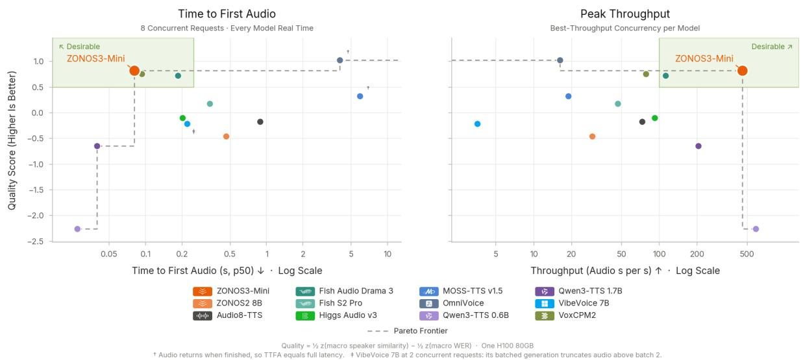
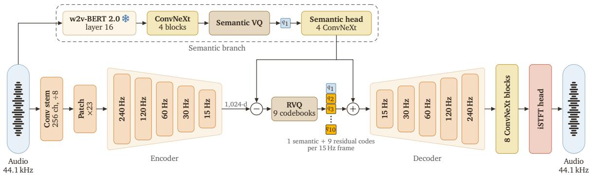
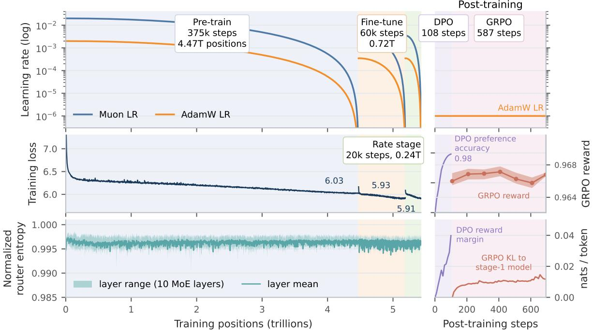
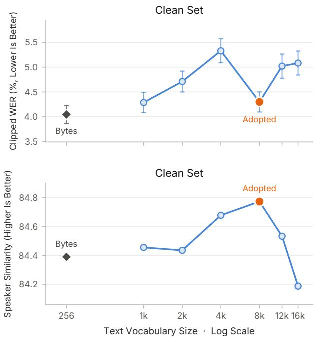
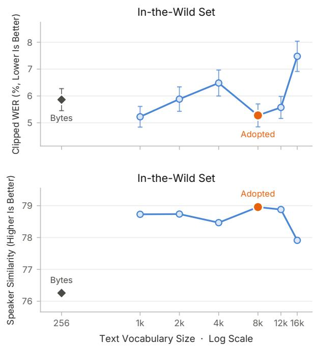

# ZONOS3-Mini Technical Report

Gabriel Clark\* Sofian Mejjoute George Close Beren Millidge\*

Zyphra · San Francisco, CA

\*Corresponding authors

Model huggingface.co/Zyphra/ZONOS3-Mini

Code github.com/Zyphra/ZONOS3-Mini

Evaluation github.com/Zyphra/ZTTS2-Eval

Contact gabriel@zyphra.com beren@zyphra.com

## Abstract

ZONOS3-Mini is an ultra-compact, ultra-fast, zero-shot voice-cloning TTS model. The model can run in real time on a laptop or smartphone. For its latency and size, it achieves state-of-the-art accuracy and cloning fidelity. To achieve this we propose a latent MoE backbone with only 886M parameters (100M active per token) and a new audio codec, Zyphra Audio Codec 1 (ZAC-1), which represents 44.1 kHz audio at a 15 Hz frame rate. On the new ZTTS2-Eval benchmark, ZONOS3-Mini reaches a 6.71 % macro-average WER over 55 language sets (35 clean and 20 in the wild), which is competitive with larger and slower state-of-the-art models. We release the model weights, inference, and training code.

## Contents

1 Introduction 2 8.1 Backbone 8   
2 Backbone Overview 2 8.2 Codec Ablations 9   
2.1 Text Tokenization 2 8.3 Text tokenizer 9   
2.2 Backbone Architecture 3 9 Inference 10   
2.3 Speaker Conditioning 3 10 Adapting ZONOS3-Mini 11   
3 Audio Codec: ZAC-1 3 11 Discussion 11   
4 Data Pipeline 5 11.1 Loss and quality 12   
5 Training 5 11.2 MoE for audio 12   
5.1 Pre-training 5 11.3 Reference clips versus embeddings 12   
5.2 Fine-tuning 5 12 Conclusion 12   
5.3 Post-training 5 References 12   
6 Evaluation 6   
A Training hyper-parameters 16   
7 Results 7   
B Per-language results 16   
8 Ablations 7

  
Figure 1 Quality versus speed on one H100 80GB. Left: time to first audio (p50) at 8 concurrent requests; right: peak throughput at each model’s best-throughput concurrency. Quality is $\textstyle { \frac { 1 } { 2 } }$ z(macro speaker similarity) $- \ { \frac { 1 } { 2 } }$ z(macro WER) over the 55 ZTTS2-Eval language sets; the dashed line is the Pareto frontier.

## 1 Introduction

Current state-of-the-art on-device TTS models sacrifice cloning quality, controllability, and multilingual performance for the ability to operate in real time on weaker hardware. We introduce ZONOS3-Mini as a new point on the Pareto frontier of quality and inference performance for on-device TTS models. In this report we detail the architecture and training framework that allow ZONOS3-Mini to operate everywhere from smartphones to laptops, without compromising on quality. The main areas of advancement over ZONOS2 are in sequence compression, text and audio representations, model architecture, voice cloning conditioning, controllability, and evaluation methodology. Across many of these areas of improvement there were two main drivers. The first and most efective change was switching to our new audio tokenizer ZAC-1 and the second was validating all model changes with our new evaluation, ZTTS2-Eval.

ZAC-1 operates at 15 Hz, which shortens audio sequences by 5.7× relative to ZONOS2 (Clark et al., 2026), and it delivers high-quality reconstructions at only 1.80 kbit/s. It adopts a dual-encoding (Li et al., 2025) quantizer design with semantic distillation from frozen self-supervised speech representations. This enables more eficient training and a backbone with roughly a ninth of the parameters of ZONOS2, with higher speaker similarity and a macro Word Error Rate (WER) within 0.5 points of ZONOS2 (Table 4). The use of causal inverse Short-Time Fourier Transform (iSTFT) heads and a novel transformer autoencoder design enables low-latency streaming and eficient inference.

We also report results on and release ZTTS2-Eval, a new Text-to-Speech (TTS) evaluation framework covering 35 languages in the clean subset and 20 in the in-the-wild set, totaling 74,041 utterances. This is significantly wider in language coverage than existing TTS evaluation sets.

## 2 Backbone Overview

## 2.1 Text Tokenization

In a departure from ZONOS2, which used raw byte text representations, ZONOS3-Mini uses an 8,192-entry SuperBPE tokenizer (Liu et al., 2025a) trained on a spoken-language-focused data mix. The text span is bracketed by a beginning-of-text token (BOS) and an end-of-text token (EOS); the audio stream ends with an

  
Figure 2 ZAC-1. One semantic and nine residual codes per 15 Hz frame are passed to the backbone. Discussed on p. 3

end-of-audio token (EOA), and a pad row fills unused positions. The vocabulary size follows the tokenizer sweep of Section 8.3.

## 2.2 Backbone Architecture

The backbone combines recurrent Gated DeltaNet (GDN) layers with two global attention layers for eficient long-context inference. It has 11 layers in total. Layers 4 and 8 use global causal attention with Grouped Query Attention (GQA), QK-normalization (Henry et al., 2020), Rotary Position Embedding (RoPE) (Su et al., 2024) and a learned output gate per head (Qiu et al., 2025, §2.2). These layers have 16 query heads, four key-value heads and head dimension 32. The other nine layers use GDN mixers (Yang et al., 2024a) with four heads and key/value dimension 128. The model uses a latent Mixture of Experts (MoE), reducing the 1,024-dimensional model width to 256 inside the experts. We use full attention residuals (Kimi Team, 2026, §3.1) as their memory I/O remains small in our 11-layer model.

## 2.3 Speaker Conditioning

ZONOS3-Mini supports cloning from both ‘raw-audio’ codec references and from speaker embeddings. Raw references carry prosody and recording conditions as well as speaker identity. Embeddings occupy a single sequence position and score higher on speaker similarity in our evaluation (Section 7).

We train our own speaker embedding encoder with the MECT-B2 architecture (AntSpeaker team, 2026): a convolutional encoder followed by a MoE transformer with an attentive statistics pooling stage. It is trained independently of the backbone with the SphereFace2 loss (Wen et al., 2022). It produces a 192-dimensional vector, which a projection maps to the model’s hidden dimension.

Pre-training uses the codec codes of a 1–60 s reference clip as a loss-masked prefix before the text. The reference comes from another clip of the same speaker in the same recording selected through diarization consensus (Section 4). We omit it in 10 % of training examples to enable unconditioned generation and speaker Classifier-Free Guidance (CFG). Fine-tuning introduces the embedding path together with quality and speaking-rate controls, while retaining examples with raw references.

## 3 Audio Codec: ZAC-1

Our goal in designing ZAC-1 was to produce a codec that is fast to decode and easy for the TTS backbone to model in a delay pattern, without compromising on acoustic quality. ZAC-1 has a 1.99B-parameter encoderdecoder structure and operates at 15 Hz and 1.80 kbit/s, as shown in Figure 2. It uses DualCodec-style dual encoding (Li et al., 2025, §3) with frozen layer-16 w2v-BERT 2.0 features (Chung et al., 2021; Seamless Communication et al., 2023) as the semantic representation to improve multilingual modelability in the downstream TTS backbone. Each frame carries ten codes from 4,096-entry codebooks, one semantic code and nine Residual Vector Quantization (RVQ) residual codes, a configuration that balances speaker similarity and WER in delay-pattern TTS modeling. The encoder and decoder comprise a symmetric cascade of causal local-attention transformer stages at 15, 30, 60, 120 and 240 Hz. The encoder converts audio into patches with DAC-like residual units, and the decoder uses eight ConvNeXt blocks and an iSTFT head to generate 44.1 kHz audio; both are designed to avoid running attention at the 44.1 kHz sample rate. ZAC-1 was trained for 600k steps with 10 s crops and mel, adversarial, feature-matching and quantizer losses.

<table><tr><td colspan="3"></td><td colspan="2">WER↓</td></tr><tr><td>Codec</td><td>Frames/s</td><td>clean</td><td>wild</td><td>clean</td><td>wild</td></tr><tr><td>Fish S1-DAC</td><td>21.5</td><td>4.30</td><td>5.28</td><td>84.8</td><td>79.0</td></tr><tr><td>ZAC-1</td><td>15.0</td><td>4.06</td><td>5.54</td><td>83.8</td><td>76.1</td></tr><tr><td>MOSS, 14 RVQ</td><td>12.5</td><td>5.06</td><td>5.67</td><td>84.6</td><td>80.3</td></tr><tr><td>DAC</td><td>86.1</td><td>42.2</td><td>51.7</td><td>78.8</td><td>63.7</td></tr></table>

Table 1 Downstream codec comparison: 50k-step TTS models on the four-language ZTTS2-Eval sets. Best in bold.

<table><tr><td>Codec</td><td>Frames/s</td><td>kbit/s</td><td>PESQ ↑</td><td>STOI ↑</td><td>Mel ↓</td><td>LSD↓</td><td>SI-SDR ↑</td><td>Sim ↑</td><td>UTMOS↑</td></tr><tr><td colspan="10">ZTTS2-Eval ground truth, 1,600 clips, 16 kHz (original audio UTMOS 2.80)</td></tr><tr><td>ZAC-1, full decoder</td><td>15</td><td>1.80</td><td>2.88</td><td>0.928</td><td>0.179</td><td>0.955</td><td>7.83</td><td>88.7</td><td>2.63</td></tr><tr><td>ZAC-1, keep-2 decoder</td><td>15</td><td>1.80</td><td>2.51</td><td>0.911</td><td>0.202</td><td>1.005</td><td>5.72</td><td>84.9</td><td>2.52</td></tr><tr><td>Fish S1-DAC</td><td>21.5</td><td>2.20</td><td>3.10</td><td>0.941</td><td>0.149</td><td>0.900</td><td>7.25</td><td>90.7</td><td>2.66</td></tr><tr><td>DAC</td><td>86.1</td><td>7.75</td><td>3.89</td><td>0.964</td><td>0.132</td><td>0.926</td><td>12.94</td><td>93.8</td><td>2.71</td></tr><tr><td>MOSS tokenizer, 14 RVQ</td><td>12.5</td><td>1.75</td><td>3.13</td><td>0.940</td><td>0.152</td><td>0.911</td><td>8.81</td><td>92.3</td><td>2.70</td></tr><tr><td>MOSS tokenizer, 32 RVQ</td><td>12.5</td><td>4.00</td><td>3.55</td><td>0.962</td><td>0.133</td><td>0.887</td><td>11.22</td><td>95.5</td><td>2.68</td></tr><tr><td colspan="10">DAPS clean, 200 utterances, 44.1 kHz (original audio UTMOS 3.69)</td></tr><tr><td>ZAC-1, full decoder</td><td>15</td><td>1.80</td><td></td><td></td><td>0.209</td><td>1.212</td><td>8.56</td><td>84.0</td><td>3.70</td></tr><tr><td>ZAC-1, keep-2 decoder</td><td>15</td><td>1.80</td><td></td><td></td><td>0.227</td><td>1.229</td><td>6.55</td><td>78.2</td><td>3.61</td></tr><tr><td>Fish S1-DAC</td><td>21.5</td><td>2.20</td><td>一</td><td></td><td>0.145</td><td>0.822</td><td>8.62</td><td>88.6</td><td>3.72</td></tr><tr><td>DAC</td><td>86.1</td><td>7.75</td><td></td><td></td><td>0.137</td><td>0.832</td><td>12.71</td><td>92.4</td><td>3.68</td></tr><tr><td>MOSS tokenizer, 14 RVQ</td><td>12.5</td><td>1.75</td><td></td><td></td><td>0.331</td><td>2.684</td><td>9.52</td><td>89.9</td><td>3.67</td></tr><tr><td>MOSS tokenizer, 32 RVQ</td><td>12.5</td><td>4.00</td><td>1</td><td></td><td>0.315</td><td>2.674</td><td>11.78</td><td>94.2</td><td>3.66</td></tr></table>

Table 2 Codec reconstruction quality on ZTTS2-Eval clips and DAPS clean. Mel is the log-mel L1 distance. Best in bold, second best underlined. Discussed on p. 5

To compare codecs, we encoded a 2 % stratified subset of the pre-training corpus (Section 4) and trained a copy of our TTS model for 50k steps on this data. Table 1 compares the final checkpoint of ZAC-1 with the public Fish S1–DAC (Liao et al., 2026), MOSS audio tokenizer v2 (OpenMOSS, 2026), and Descript Audio Codec (DAC) checkpoints. We find that ZAC-1 provides competitive performance at a desirable compression rate.

The decoder ends in a Vocos-style iSTFT head (Siuzdak, 2023, §3.2) for inference performance. Originally we tried a symmetrical design for the encoder and decoder, which achieved superior reconstruction metrics; however, during inference at large batch sizes, moving waveform-rate activations through memory was prohibitively expensive. Because batch-size-1 local inference and large-batch cloud inference have diferent optima, two decoders are released. The full decoder removes the large-batch memory bottleneck of the last layer by replacing it with ConvNeXt blocks and an iSTFT head, and the pruned 144M-parameter keep-2 decoder avoids the batch-size-1 FLOP bottleneck of on-device inference by removing the transformer blocks that hold the most FLOPs. In both decoders, eight causal ConvNeXt blocks at the 240 Hz stage produce log-magnitude and phase spectra for two iSTFT heads at diferent resolutions. In decode-only throughput on one H100 the full decoder runs at 1,180× real time at batch 256 while the keep-2 decoder runs at 3,950×, compared with 989× for the MOSS audio tokenizer (OpenMOSS, 2026) and 474× for S1–DAC.

For completeness, we report reconstruction quality in Table 2 against public Fish S1–DAC (Liao et al., 2026), DAC (Kumar et al., 2023), and the MOSS audio tokenizer (OpenMOSS, 2026). The audio used is a subset of ZTTS2-Eval and the clean partition of DAPS (Mysore, 2015), neither of which is included in our training corpus. Reconstructions are scored with Perceptual Evaluation of Speech Quality (PESQ) (Rix et al., 2001), Short-Time Objective Intelligibility (STOI) (Taal et al., 2011), log-mel distance, Log-Spectral Distance (LSD) (Gray & Markel, 1976), Scale-Invariant Signal-to-Distortion Ratio (SI-SDR) (Le Roux et al., 2019), ReDimNet speaker similarity (Yakovlev et al., 2024) and MSR-UTMOS (Nishikawa et al., 2025). The MOSS tokenizer has a variable bit rate and is shown in two modes here. The keep-2 decoder trades 0.4 PESQ and 4 similarity points against the full decoder.

## 4 Data Pipeline

Our pre-training corpus consists of 6.1M hours of naturalistic speech audio sourced from a mixture of public and private corpora. We reuse all of the labels and data from the ZONOS2 data pipeline. To obtain utterance pairs of a speaker from diferent sections of a recording, we diarize each recording with both HDBSCAN (Campello et al., 2013) and spectral clustering over speaker-embedding windows and only use intervals where both methods agree upon the same speaker.

## 5 Training

## 5.1 Pre-training

ZONOS3-Mini was pre-trained for 375k steps on H100 GPUs for a total of 4.5T tokens or ten epochs over the full corpus. We trained using the hyper-parameters in Table 9. Training sample lengths were up to 600 s and the audio reference clips for voice cloning were up to 60 s. We used the Muon optimizer (Jordan et al., 2024; Liu et al., 2025b) for 2-D weights and AdamW for the rest. After adopting Quantile Balancing (QB), router entropy stayed within 5 % of uniform in every MoE layer for all of training (Figure 3).

## 5.2 Fine-tuning

During fine-tuning we keep cloning from codec-encoded reference clips while additionally learning to clone from a MECT-B2-based speaker embedding. We fine-tune the 375k checkpoint for 60k steps with fresh optimizer states and the schedule in Table 9. On 45 % of training samples we provide the embedding to the model, on 45 % we use codec encoded reference clips, and on the remainder we provide no voice cloning reference. A further filtered subset of the data mix was used for this stage by increasing transcript agreement to 3 sources and lowering the CER-agreement threshold to 2 %. After initial evaluation we found that ten speaking-rate buckets were too coarse, so we performed a second fine-tuning stage of 20k steps to refine the speaking-rate control further. In this stage we split each of the ten speaking-rate buckets into three finer-grained buckets and add them as tokens which start initialized from their parents’ representations. This stage restarts the optimizer states and the schedule but keeps the previous stage’s data mix.

## 5.3 Post-training

We then perform two stages of post-training. Both stages use 5,089 training utterances in English, Chinese, Spanish and Japanese. In both stages, each generated candidate is scored with the same Automatic Speech Recognition (ASR) and speaker-similarity models as our evaluation (Section 6): Qwen3-ASR against the prompt text and ReDimNet against the prompt audio.

Our first post-training stage targets early stopping and runaway generation failures with direct preference optimization (DPO) (Rafailov et al., 2023, Eq. 7). Eleven candidates per prompt are generated, eight at speaker CFG 1 and three at 1.5. A candidate is considered a failure when it contains no speech, reaches the default inference token cap, is significantly longer or shorter than the source audio clip, or has a high WER. Each failure forms a pair with the most similar complete candidate of the same prompt. The loss is the DPO objective on the mean log-probability of the audio tokens with � = 0.1, plus 0.05 times the negative log-likelihood of the chosen sequence. Training uses AdamW at a learning rate of $1 0 ^ { - 6 }$ with 8 pairs per step for 4 epochs.

  
Figure 3 Learning rate, training loss and normalized router entropy over pre-training, fine-tuning, the speaking-rate stage and post-training (DPO and GRPO). The fine-tune loss starts higher due to the addition of speaker-projection and control-row tables and a change to the data mix. Router entropy is the mean and range over the ten MoE layers.  
Discussed on p. 5

The second post-training stage applies group relative policy optimization (GRPO) (Shao et al., 2024, §4.1), following the recipe of Audio8-TTS (Cai et al., 2026, §4.3) to directly optimize speaker similarity (SIM) and WER. The first-stage model generates eight candidates per prompt at CFG 1. The reward of a candidate is

$$
0 . 9 \operatorname* { m a x } ( 0 , 1 - { \frac { \mathrm { W E R } } { 2 } } ) + 0 . 1 { \frac { \mathrm { S I M } } { 1 0 0 } } .\tag{1}
$$

The advantage is the reward standardized within the prompt’s group, minus 0.5 times a duration cost. The cost is

$$
\operatorname* { m a x } ( 0 , \log ( \frac { r } { 1 . 3 5 } ) )\tag{2}
$$

standardized within the group, where � is the duration ratio of the generation to the original recording. Groups whose reward standard deviation is below 0.005 are dropped, which leaves 2,348 groups. The loss is the clipped token-level surrogate with $\epsilon = 0 . 2$ plus a Kullback–Leibler Divergence (KLD) penalty of weight 0.04 to the first-stage model, with log-ratios clamped to ±5. Training uses AdamW at a learning rate of $1 0 ^ { - 6 }$ with 4 groups per step and frozen expert routers, for one epoch.

## 6 Evaluation

ZTTS2-Eval succeeds the ZTTS1-Eval benchmark introduced with ZONOS2 (Clark et al., 2026). It includes over 74,000 utterances across a clean set and an in-the-wild set. The clean set uses FLEURS-R read speech (Ma et al., 2024) and covers 35 languages. The in-the-wild set uses a VoxBlink2 subsample (Lin et al., 2024) and covers 20 languages. Prompt and target come from diferent audio clips of the same speaker, such that similarity is measured across recordings.

<table><tr><td></td><td></td><td colspan="2">Clean (35 languages)</td><td colspan="2">In the wild (20 languages)</td><td colspan="2">Macro</td></tr><tr><td>Model</td><td>Conditioning</td><td>WER↓</td><td>Sim ↑</td><td>WER↓</td><td>Sim ↑</td><td>WER↓</td><td>Sim ↑</td></tr><tr><td>ZONOS3-Mini</td><td>embedding</td><td>8.28</td><td>83.1</td><td>7.52</td><td>74.0</td><td>8.00</td><td>79.8</td></tr><tr><td>ZONOS3-Mini</td><td>raw audio</td><td>7.95</td><td>77.7</td><td>12.57</td><td>55.1</td><td>9.63</td><td>69.5</td></tr><tr><td>ZONOS3-Mini + PT</td><td>embedding</td><td>7.79</td><td>83.4</td><td>4.81</td><td>77.3</td><td>6.71</td><td>81.2</td></tr><tr><td>ZONOS3-Mini + PT</td><td>raw audio</td><td>7.39</td><td>76.5</td><td>5.48</td><td>58.1</td><td>6.70</td><td>69.8</td></tr></table>

Table 3 ZTTS2-Eval results at CFG 1 over all 55 parts. Best in bold, second best underlined. · Discussed on p. 7

We score generations with Qwen3-ASR (Shi et al., 2026), except for English, which uses Whisper-large-v3. Speaker similarity is measured with ReDimNet (Yakovlev et al., 2024) and quality with MSR-UTMOS (Nishikawa et al., 2025). We additionally evaluate rhythm and pitch distribution matching, together with a modified Masked Prosody Model (MPM) (Wallbridge et al., 2025) embedding distance that uses a scrambled-input floor. We report WER for most languages, with Character Error Rate (CER) for Chinese and Japanese. Per-utterance error rates are capped at 100 % before averaging. Similarity is the ReDimNet cosine similarity on a 0 to 100 scale. The results use all 55 parts, 35 clean and 20 in the wild. “Macro” is the unweighted mean of the parts.

## 7 Results

Table 3 shows the results of the fine-tuned model and of the post-trained model on both prompt types. The fine-tuned model scores 79.8 similarity and 8.00 WER with embeddings, compared with 69.5 and 9.63 with raw references. On the clean sets the two prompt types have similar WER. The gap comes from the in-the-wild sets, where the raw-audio path has a WER of 12.57 against 7.52 for embeddings. The embedding path has higher speaker similarity, in particular in the wild (74.0 against 55.1). Post-training lowers the macro WER of the embedding path from 8.00 to 6.71 and raises similarity from 79.8 to 81.2. The WER reduction comes from the in-the-wild sets, where it falls from 7.52 to 4.81 and similarity rises from 74.0 to 77.3. On the clean sets WER falls from 8.28 to 7.79. The raw-audio path improves from 9.63 to 6.70 WER with similarity unchanged (69.5 to 69.8). Its in-the-wild WER falls from 12.57 to 5.48.

Table 4 compares ZONOS3-Mini with other TTS systems. Listening samples for all systems are available online.1 Among systems that do not use the reference transcript, ZONOS3-Mini has the highest similarity (81.2 with embeddings) and the second-lowest macro WER after ZONOS2 (6.70 with raw audio, 6.71 with embeddings). Across all systems, the lowest WER is achieved by Fish Audio Drama 3 (4.74), a 35B model with 3B active parameters, followed by ZONOS2 (6.22) and OmniVoice (6.62). The in-the-wild similarity of the embedding path (77.3) is second only to VoxCPM2. In macro similarity, only VoxCPM2 and OmniVoice score higher than ZONOS3-Mini. We evaluate every system on every language. Qwen3-TTS and CosyVoice 3 oficially support a smaller set of languages, which significantly afects their scores here. The raw-audio path of ZONOS3-Mini has a higher similarity than ZONOS2 (69.8 against 68.8) and a higher macro WER (6.70 against 6.22) with roughly nine times fewer parameters.

Table 5 compares ZONOS3-Mini with closed-source systems on a subset (German, English, Spanish and Chinese) of ZTTS2-Eval. ZONOS3-Mini performs competitively, achieving the second-highest similarity on the clean set and the highest similarity on the in-the-wild set, while remaining close to the closed-source systems in terms of WER.

## 8 Ablations

<table><tr><td></td><td>Params</td><td colspan="2">Clean</td><td colspan="2">In the wild</td><td colspan="2">Macro</td></tr><tr><td>System</td><td>total / active</td><td>WER↓</td><td>Sim ↑</td><td>WER↓</td><td>Sim ↑</td><td>WER↓</td><td>Sim ↑</td></tr><tr><td>Ground truth</td><td>一</td><td>9.66</td><td>70.7</td><td>9.19</td><td>79.3</td><td>9.49</td><td>73.8</td></tr><tr><td colspan="8">With reference transcript</td></tr><tr><td>Qwen3-TTS 1.7B (Hu et al., 2026)</td><td>1.7B</td><td>22.80</td><td>80.6</td><td>14.61</td><td>74.5</td><td>19.82</td><td>78.4</td></tr><tr><td>Fish S2 Pro (Liao et al., 2026)</td><td>4.4B</td><td>11.03</td><td>81.2</td><td>5.98</td><td>70.3</td><td>9.20</td><td>77.2</td></tr><tr><td>VoxCPM2 (Zhou et al., 2026)</td><td>2B</td><td>12.47</td><td>86.2</td><td>5.12</td><td>77.8</td><td>9.80</td><td>83.1</td></tr><tr><td>CosyVoice 3 (Du et al., 2025)</td><td>0.5B</td><td>54.85</td><td>76.7</td><td>42.91</td><td>73.0</td><td>50.51</td><td>75.3</td></tr><tr><td>Higgs Audio v3 (Boson AI, 2026)</td><td>4B</td><td>9.42</td><td>79.5</td><td>12.66</td><td>69.2</td><td>10.60</td><td>75.8</td></tr><tr><td>OmniVoice (Zhu et al., 2026)</td><td>0.6B</td><td>7.52</td><td>87.6</td><td>5.03</td><td>75.0</td><td>6.62</td><td>83.1</td></tr><tr><td>Audio8-TTS (Cai et al., 2026)</td><td>0.6B</td><td>13.45</td><td>80.3</td><td>7.33</td><td>67.5</td><td>11.22</td><td>75.6</td></tr><tr><td>Fish Audio Drama 3 (Han et al., 2026)</td><td>35B/3B</td><td>5.62</td><td>82.1</td><td>3.20</td><td>72.5</td><td>4.74</td><td>78.6</td></tr><tr><td colspan="8">Without reference transcript</td></tr><tr><td>ZONOS2 8B (Clark et al., 2026)</td><td>8B/0.9B</td><td>7.10</td><td>75.0</td><td>4.68</td><td>57.8</td><td>6.22</td><td>68.8</td></tr><tr><td>Qwen3-TTS 1.7B (Hu et al., 2026)</td><td>1.7B</td><td>24.46</td><td>69.6</td><td>11.71</td><td>67.1</td><td>19.83</td><td>68.7</td></tr><tr><td>Qwen3-TTS 0.6B (Hu et al., 2026)</td><td>0.6B</td><td>30.39</td><td>69.2</td><td>15.07</td><td>64.3</td><td>24.82</td><td>67.4</td></tr><tr><td>VoxCPM2 (Zhou et al., 2026)</td><td>2B</td><td>13.72</td><td>78.9</td><td>5.25</td><td>73.9</td><td>10.64</td><td>77.1</td></tr><tr><td>MOSS-TTS v1.5 (Gong et al., 2026)</td><td>8B</td><td>10.95</td><td>82.9</td><td>7.22</td><td>72.0</td><td>9.60</td><td>78.9</td></tr><tr><td>VibeVoice 7B (Peng et al., 2025)</td><td>7B</td><td>11.50</td><td>82.2</td><td>13.51</td><td>65.2</td><td>12.24</td><td>76.1</td></tr><tr><td colspan="8">ZONOS3-Mini + PT, embedding (ours)</td></tr><tr><td>ZONOS3-Mini + PT, raw audio (ours)</td><td>886M／100M 886M／100M</td><td>7.79 7.39</td><td>83.4 76.5</td><td>4.81 5.48</td><td>77.3 58.1</td><td>6.71 6.70</td><td>81.2 69.8</td></tr></table>

Table 4 Comparison with external systems on all ZTTS2-Eval languages (35 clean and 20 in-the-wild parts). Systems are grouped by whether they are conditioned on the transcript of the reference clip. Best in bold, second best underlined, within each group. Per-language results for every system are given in Appendix B. · Discussed on p. 2, 7, 16, 17, 18

<table><tr><td></td><td colspan="2">Clean, 4 languages</td><td colspan="2">In the wild</td></tr><tr><td></td><td>Voice WER↓</td><td>Sim ↑</td><td>WER↓</td><td>Sim ↑</td></tr><tr><td>Cartesia Sonic 3.6</td><td>clone</td><td>2.49</td><td>85.0</td><td>3.30 76.4</td></tr><tr><td>Inworld TTS 2</td><td>clone</td><td>2.42</td><td>71.5 3.89</td><td>61.4</td></tr><tr><td>ElevenLabs v4</td><td>clone</td><td>2.07</td><td>82.9 2.97</td><td>一</td></tr><tr><td>Gemini 3.8 Flash</td><td>preset</td><td>2.55</td><td>4.67</td><td>一</td></tr><tr><td>ZONOS3-Mini + PT, embedding (ours)</td><td>clone</td><td>2.55</td><td>83.1</td><td>5.00 77.5</td></tr><tr><td> $\mathrm { Z O N O S 3 - M i n i + P T , }$  raw audio (ours)</td><td>clone</td><td>2.56</td><td>75.5</td><td>5.86 58.1</td></tr></table>

Table 5 Comparison with closed-source systems on ZTTS2-Eval Mini, a subset of ZTTS2-Eval that reduces evaluation cost, restricted to the items every system generated. Best in bold, second best underlined. · Discussed on p. 7

## 8.1 Backbone

We selected the architecture from downstream performance on decoded audio, using the evaluation sets in Section 6.

Table 6 reports a cumulative ablation of the backbone components on the ZONOS2-style 800M/80M-active backbone at 150k steps. Latent experts alone increased in-the-wild WER. A linear router in place of the Multilayer Perceptron (MLP) router with Exponential Depth Averaging (EDA) (Washbourne et al., 2026) reduced it below the baseline. Quantile balancing gave the highest in-the-wild similarity. Attention residuals gave the lowest WER on both sets. ZONOS3-Mini uses all four changes.

Exclusive Self-Attention (XSA) (Zhai, 2026) removes each token’s own value direction from the attention output, which improves text language model performance. In our setting it matched the baseline training loss and increased in-the-wild WER by 10 points (Table 6). We attribute this to the delay pattern, in which the current position contains information about previous timesteps which is needed for the prediction of the current timestep.

<table><tr><td rowspan="2">Arm (cumulative)</td><td colspan="3">In the wild</td><td colspan="3">Clean</td></tr><tr><td>WER↓</td><td>Sim ↑</td><td>UTMOS↑</td><td>WER↓</td><td>Sim ↑</td><td>UTMOS ↑</td></tr><tr><td>Original (ZONOS2 block)</td><td>64.6</td><td>45.1</td><td>2.10</td><td>39.1</td><td>59.2</td><td>2.86</td></tr><tr><td>Latent MoE</td><td>83.2</td><td>44.2</td><td>1.95</td><td>33.7</td><td>69.3</td><td>2.87</td></tr><tr><td>+ linear router, no EDA</td><td>43.5</td><td>54.5</td><td>2.19</td><td>26.9</td><td>65.8</td><td>2.99</td></tr><tr><td>+ quantile balancing</td><td>39.0</td><td>56.3</td><td>2.20</td><td>33.7</td><td>60.0</td><td>2.93</td></tr><tr><td>+ XSA</td><td>49.1</td><td>53.1</td><td>2.19</td><td>31.2</td><td>67.0</td><td>2.95</td></tr><tr><td>+ AttnRes-4 (no XSA)</td><td>36.3</td><td>55.5</td><td>2.18</td><td>22.9</td><td>68.0</td><td>2.95</td></tr></table>

Table 6 150k backbone ablation on the four-language ZTTS2-Eval sets. Best in bold. · Discussed on p.

<table><tr><td>Configuration</td><td>Family</td><td>Frames/s</td><td>Codebooks</td><td>Codebook sizes</td><td>kbit/s</td><td>WER↓</td><td>Sim ↑</td></tr><tr><td>Fish S1 codec (Liao et al., 2026)</td><td>S1-DAC</td><td>21.53</td><td>10</td><td>1×4096+9×1024</td><td>2.20</td><td>4.79</td><td>81.87</td></tr><tr><td>ZAC-1</td><td>dual hybrid</td><td>15.00</td><td>10</td><td>10×4096</td><td>1.80</td><td>4.80</td><td>79.94</td></tr><tr><td>Dual hybrid, 10 s</td><td>dual hybrid</td><td>15.00</td><td>10</td><td>10×4096</td><td>1.80</td><td>5.81</td><td>74.54</td></tr><tr><td>Dual hybrid R1024</td><td>dual hybrid</td><td>15.00</td><td>10</td><td>1×4096+9×1024</td><td>1.53</td><td>6.53</td><td>67.83</td></tr><tr><td>Hybrid, 15 Hz, 10 CB</td><td>hybrid</td><td>15.00</td><td>10</td><td>10×4096</td><td>1.80</td><td>7.25</td><td>68.37</td></tr><tr><td>Hybrid, 12.5 Hz, 10 CB</td><td>hybrid</td><td>12.50</td><td>10</td><td>10×4096</td><td>1.50</td><td>7.22</td><td>65.11</td></tr><tr><td>S1 retrain</td><td>S1-DAC arch.</td><td>21.53</td><td>10</td><td>10×4096</td><td>2.58</td><td>11.07</td><td>78.64</td></tr><tr><td>S1 MoE retrain</td><td>S1-DAC + MoE</td><td>21.53</td><td>10</td><td>10×4096</td><td>2.58</td><td>12.77</td><td>77.67</td></tr><tr><td>MOSS-style, 10 CB</td><td>MOSS-v2</td><td>15.00</td><td>10</td><td>10×4096</td><td>1.80</td><td>10.46</td><td>66.11</td></tr><tr><td>Hybrid, 15 Hz, 16 CB</td><td>hybrid</td><td>15.00</td><td>16</td><td>16×4096</td><td>2.88</td><td>12.47</td><td>71.67</td></tr><tr><td>MOSS-style, 16 CB</td><td>MOSS-v2</td><td>15.00</td><td>16</td><td>16×4096</td><td>2.88</td><td>14.10</td><td>65.10</td></tr><tr><td>Hybrid, 12.5 Hz, 16 CB</td><td>hybrid</td><td>12.50</td><td>16</td><td>16×4096</td><td>2.40</td><td>16.87</td><td>51.82</td></tr></table>

Table 7 Downstream codec ablation.  
· Discussed on p. 9

We selected the 4.5:1 GDN/attention layout from quality and inference-cost comparisons. On an 800M latent-MoE backbone at 50k steps with all other settings fixed, the 4.5:1 GDN layout matched softmax attention in every layer to within 0.1 WER and 0.1 similarity on the in-the-wild set, while Gated Linear Attention (GLA) (Yang et al., 2024b) and Sliding Window Attention (SWA) scored 0.5 to 0.9 WER points worse. On one H100 with CUDA graphs at 16k context, the 4.5:1 layout is 1.22× faster than global attention at batch 1 and 3.2× faster at batch 256, with 4.6 GiB of persistent state at batch 256 instead of 22 GiB.

## 8.2 Codec Ablations

Table 7 lists the codec variants trained on the way to ZAC-1, each scored after 50k steps of downstream TTS training. Our final ZAC-1 matches the WER of the Fish S1 codec (Liao et al., 2026) at a lower frame rate and bitrate, with lower speaker similarity.

## 8.3 Text tokenizer

We trained six 50k-step runs on the S1–DAC codec while sweeping SuperBPE vocabularies from 1,024 to 16,384 entries (Figure 4). The 8,192-entry vocabulary compresses text to 3.49 bytes per token, beats the byte baseline on clean WER, and is best in the wild on both WER and speaker similarity; 16,384 is worst in the wild, driven by Japanese. We therefore kept 8,192.

  
Figure 4 SuperBPE vocabulary sweep: matched 50k-step runs on the S1–DAC codec scored on the ZTTS2-Eval clean and in-the-wild sets (four-language macro over en, zh, es and ja; bars are 95 % confidence intervals of the clipped WER). Discussed on p. 9

## 9 Inference

The Mini-SGLang-based ZONOS2 runtime (Zheng et al., 2024; Zyphra, 2026) is modified for use with ZONOS3-Mini. The decode step is captured in a CUDA graph and the decoder is prefix-streamed, so the first audio bytes arrive 0.25 to 0.36 s after the request. Speaker CFG runs a twin sequence without the reference prefix or speaker row and guides the logits as $\ell _ { \mathrm { u } } + S ( \ell _ { \mathrm { c } } - \ell _ { \mathrm { u } } )$ before sampling, with a default scale of 1.5 for embedding prompts. On one H100 with 128 concurrent requests and whole-clip decoding, the released checkpoint generates 67 seconds of audio per second.

We experiment with low-bit weights on the 375k checkpoint, as shown in Table 8. Each quantized variant starts from BF16. The Quantization-Aware Training (QAT) variants use a short distillation run with KLD against the BF16 model. Four-bit experts with 8-bit mixers and QAT are the smallest tested format without a measurable loss of intelligibility. The same format with Post-Training Quantization (PTQ) instead of QAT, learned-clip 2-bit experts (Liu et al., 2025c, §3.2.2) and ternary experts trained with BitDistill (Wu et al., 2025, §3) all reduce intelligibility. FP8 W8A8 weights (Micikevicius et al., 2022) increase throughput by at most 3 %.

A native C++/ggml runtime (Gerganov & ggml-org contributors, 2023) is released which runs the entire inference pipeline, including both iSTFT heads and the speaker encoder. All tested formats meet internal quality thresholds for WER, similarity, MSR-UTMOS and failure rate. These range from Q8\_0 (1.03 GB) to the 4-bit QAT experts above (0.66 GB). On an H100 the quantized profiles decode about 20 s of audio per second for one stream, and on CPU 129 to 160 frames per second. We also release a WebGPU (Ninomiya et al., 2026) runtime for in-browser inference. On a Pixel 9 and an M3 MacBook Air, the runtime generates speech in real time, with time to first audio below 800 ms and 450 ms, respectively.

<table><tr><td>Arm</td><td>en</td><td>zh</td><td>ja</td><td>ko</td><td>all</td><td>∆ vs BF16 [95 % CI]</td><td>0</td><td>1</td><td>2</td><td>3</td><td>Sim prompt / other</td></tr><tr><td>BF16</td><td>3.16</td><td>4.57</td><td>4.81</td><td>5.86</td><td>4.14</td><td></td><td></td><td></td><td></td><td></td><td>57.99 / 52.16</td></tr><tr><td>Q8_0 mixers, PTQ</td><td>3.20</td><td>4.64</td><td>5.24</td><td>5.97</td><td>4.27</td><td>+0.14 [-0.23, +0.49]</td><td></td><td></td><td></td><td></td><td>57.91 / 52.03</td></tr><tr><td>Q8_0 mixers, QAT</td><td>3.24</td><td>4.93</td><td>4.74</td><td>6.28</td><td>4.29</td><td>+0.15 [-0.23, +0.51]</td><td></td><td></td><td></td><td></td><td>57.97 / 52.01</td></tr><tr><td>Q4_0 exp. + Q8_0 mix., PTQ</td><td>3.71</td><td>4.89</td><td>4.95</td><td>7.45</td><td>4.68</td><td>+0.54 [+0.14, +0.93]</td><td></td><td></td><td></td><td></td><td>57.47 / 51.70</td></tr><tr><td>Q4_0 exp. + Q8_0 mix., QAT</td><td>3.07</td><td>3.94</td><td>5.29</td><td>7.02</td><td>4.21</td><td>+0.07 [–0.34, +0.48]</td><td></td><td></td><td></td><td></td><td>57.75 / 51.88</td></tr><tr><td>2-bit experts (learned clip), QAT</td><td>3.61</td><td>5.24</td><td>5.38</td><td>8.85</td><td>4.97</td><td>+0.83 [+0.43, +1.24]</td><td></td><td></td><td></td><td></td><td>56.24 / 50.71</td></tr><tr><td>Ternary exp. + Q8_0 mix., BitDistill</td><td>4.42</td><td>6.50</td><td>8.76</td><td>14.78</td><td>7.05</td><td>+2.91 [+2.38, +3.43]</td><td></td><td></td><td></td><td></td><td>54.73 / 49.23</td></tr><tr><td>FP8 W8A8, PTQ</td><td>3.72</td><td>5.40</td><td>6.10</td><td>8.02</td><td>5.11</td><td>+0.97 [+0.58, +1.36]</td><td></td><td></td><td></td><td></td><td>57.05 / 51.28</td></tr><tr><td>FP8 W8A8, QAT</td><td>3.19</td><td>4.87</td><td>5.73</td><td>6.94</td><td>4.54</td><td>+0.40 [0.00, +0.81]</td><td></td><td></td><td></td><td></td><td>57.54 / 51.62</td></tr></table>

Table 8 Quantization of the 375k pre-train on the four-language in-the-wild set at CFG 1: clipped WER, paired bootstrap diference to BF16, and similarity to the prompt and to another recording of the speaker. QAT arms are distilled from the BF16 model. The all column scores every language of the set together rather than averaging the four columns shown. Lowest WER per column in bold. · Discussed on p. 10

## 10 Adapting ZONOS3-Mini

The adaptations below retain the backbone architecture. Voice design starts from the final post-trained checkpoint, and the other adaptations start from the 375k pre-train. Each uses a separate evaluation set, specified below.

Voice design applies control directions to the speaker embedding to modify perceived age, gender presentation and vocal texture. Multiple directions can be combined to compose a target voice. Emotion and delivery control uses training-free activation steering (Wang et al., 2026). We compute mean diferences between Expresso (Nguyen et al., 2023) read and conversational styles at the output of the layer-9 GDN mixer. These are combined into six axes: valence, arousal, dominance, loudness, tempo and clarity. For utterance-level steering, the chosen vector is scaled and added to every generated frame at that layer. For word-level steering, alignment attention heads track the target word during streaming generation, and the steering intervention is restricted to its aligned span. For each voice, we calibrate both ends of each axis with a threshold on the ParaSpeechCLAP similarity gain (Diwan et al., 2026) and an Expresso emotion classifier. On a held-out set of generated audio, the three default voices passed these checks for most of the 12 poles. The positive delivery poles were disabled most often.

Accent control uses a separate Low-Rank Adaptation (LoRA) adapter (Hu et al., 2021) for each of 14 accents. Each adapter trains on native-language speech from the fine-tuning subset, presented as English (Lertpetchpun et al., 2026, §3). Its weight � sets the strength of the adaptation at inference. Evaluation uses 200 English in-the-wild prompts per accent, with Vox-Profile (Feng et al., 2025) for target-accent top-1 rate and Whisper for WER. Rank-64 LoRA (8.9M parameters) increases the mean target-accent rate from 0.126 to 0.393 at �=1, and WER from 3.71 to 14.26. At �=0.7, every adapter has a WER near 6 %.

For speech editing, we train the 375k checkpoint for 10k steps on the pre-training mix with VoiceCraft-style masked-span infilling (Peng et al., 2024, §3.1). We remove one to three random spans identified by MMS forced alignments (Pratap et al., 2024) from the target. We append their codes after the context as an infill block with a dedicated span-end ID. On Common Voice English (500 texts, 460 edit-eligible) scored with MMS greedy Connectionist Temporal Classification (CTC), edited utterances reach 13.60 WER, compared with 10.17 for a resynthesis of the original codes, and plain TTS WER increases by 0.8 points.

Multi-turn conversation uses CSM-style windows (Iribe et al., 2025), where the audio and text of prior turns provide context for the target turn. The 375k pre-train receives 25k further training steps. Evaluation uses 252 held-out windows from 45 English episodes and capped Whisper WER. The serving variant reaches 10.7 %, compared with 16.8 % for real recordings under the same protocol.

## 11 Discussion

## 11.1 Loss and quality

Training loss alone did not reliably distinguish the better speech models. Across 75 matched 400M-total/40Mactive runs, the correlation between training Negative Log-Likelihood (NLL) and decoded quality was 0.52. The XSA experiment gives a concrete example: loss stayed unchanged while WER rose by ten points (Section 8). We therefore used loss to monitor training progress and selected models from decoded audio scored with the eight-part ZTTS2-Eval protocol.

## 11.2 MoE for audio

ZONOS2 found expert balancing less stable on audio than on text and used dense boundary layers and a manually tuned bias to stabilize it. ZONOS2 also found expert balancing to be well correlated with model stability, and in ZONOS3-Mini we observe the same. After adopting a linear router and QB, we saw a significant drop in WER. The 375k-step pre-train required no auxiliary loss, balancing adjustments, or dense boundary layers beyond the first.

## 11.3 Reference clips versus embeddings

When deciding between embedding cloning and reference-clip cloning, we weighed trade-ofs in inference eficiency, clone quality, and clone controllability. MECT-B2 embeddings provide a controllable latent space for manipulating speaker characteristics such as age, gender and voice pitch, while providing a compressed representation of the clone audio. Frozen speaker embeddings also let us briefly train with the target audio as the reference, which improves similarity scores in evaluation. We chose to adopt encoded audio references to experiment with a higher-bandwidth channel to the reference and a solution that scales with training FLOPs and model size. Based on early evidence in ZONOS3-Mini we expect strong results when using audio references in larger models and foresee potential problems with frozen speaker embeddings on target audio.

## 12 Conclusion

For its inference speed and size, ZONOS3-Mini is a state-of-the-art TTS system, and it can run anywhere. It combines a 15 Hz ZAC-1 codec with a hybrid GDN/attention backbone, latent experts, attention residuals and SuperBPE text. Pre-training uses same-recording raw-audio references; fine-tuning adds speaker embeddings and control rows; post-training increases reliability and consistency, especially on dificult zero-shot prompt audio. On all ZTTS2-Eval languages, ZONOS3-Mini performs favorably versus larger and slower state-of-theart systems. Experiments also support 4-bit expert weights, emotion and accent controls, speech editing and conversational generation. All components of the system are released open source, including inference and training code.2

## Acknowledgements

We thank Rishi Iyer for discussions on MoE training dynamics and Nathan Kolbas for assistance in setting up and maintaining the ZONOS2 model endpoint on Zyphra Cloud.

## References

AntSpeaker team. MECT: Mixture-of-Experts Speaker Encoders for Robust Speaker Verification, arXiv:2609.24061, 2026.

Boson AI. Higgs Audio v3 TTS. https://huggingface.co/bosonai/higgs-audio-v3-tts-4b, 2026. Technical blog: https://www.boson.ai/blog/higgs-audio-v3-tts. Cited on pp. 8, 17, 18, and 19

Runyuan Cai, Yu Lin, Yiming Wang, and Xiaodong Zeng. Training a Compact, Strong, and Realistic Text-to-Speech Model. arXiv preprint arXiv:2610.14776, 2026. Cited on pp. 6, 8, 17, 18, and 19

Ricardo J. G. B. Campello, Davoud Moulavi, and Jörg Sander. Density-Based Clustering Based on Hierarchical Density Estimates. In Advances in Knowledge Discovery and Data Mining (PAKDD), pp. 160–172, 2013. Cited on p. 5

Yu-An Chung, Yu Zhang, Wei Han, Chung-Cheng Chiu, James Qin, Ruoming Pang, and Yonghui Wu. w2v-BERT: Combining Contrastive Learning and Masked Language Modeling for Self-Supervised Speech Pre-Training, arXiv:2108.06209, 2021. Cited on p. 3

Gabriel Clark, Sofian Mejjoute, Mohamed Osman, George Close, and Beren Millidge. ZONOS2 Technical Report, arXiv:2606.24320, 2026. Cited on pp. 2, 6, 8, 17, 18, and 19

Anuj Diwan, Eunsol Choi, and David Harwath. ParaSpeechCLAP: A Dual-Encoder Speech-Text Model for Rich Stylistic Language-Audio Pretraining. In Interspeech 2026, pp. 4128–4132, 2026. doi:10.21437/Interspeech.2026-1437. Cited on p. 11

Zhihao Du, Changfeng Gao, Yuxuan Wang, Fan Yu, Tianyu Zhao, Hao Wang, Xiang Lv, Hui Wang et al. CosyVoice 3: Towards In-the-wild Speech Generation via Scaling-up and Post-training. arXiv preprint arXiv:2505.17589, 2025. Cited on pp. 8, 17, 18, and 19

Tiantian Feng, Jihwan Lee, Anfeng Xu, Yoonjeong Lee, Thanathai Lertpetchpun, Xuan Shi, Helin Wang, Thomas Thebaud et al. Vox-Profile: A Speech Foundation Model Benchmark for Characterizing Diverse Speaker Traits and Speech Properties, arXiv:2505.14648, 2025. Cited on p. 11

Georgi Gerganov and ggml-org contributors. ggml: Tensor library for machine learning, and llama.cpp (incl. the GGUF file format). https://github.com/ggml-org/ggml, 2023. See also https://github.com/ggml-org/llama.cpp; GGUF specification: https://github.com/ggml-org/ggml/blob/master/docs/gguf.md. Cited on p. 10

Yitian Gong, Botian Jiang, Yiwei Zhao, Yucheng Yuan, Kuangwei Chen, Yaozhou Jiang, Cheng Chang, Dong Hong et al. MOSS-TTS Technical Report, arXiv:2603.18090, 2026. Cited on pp. 8, 17, 18, and 19

Augustine H. Gray and John D. Markel. Distance measures for speech processing. IEEE Transactions on Acoustics, Speech, and Signal Processing, 24(5):380–391, 1976. doi:10.1109/TASSP.1976.1162849. Cited on p. 5

Dawei Han, Shidong Li, Shijia Liao, Jiahua Liu, Songting Liu, Qingzheng Wang, Yuxuan Wang, Xin Chen et al. Fish Audio Drama 3 Technical Report. arXiv preprint arXiv:2610.18010, 2026. Cited on pp. 8, 17, 18, and 19

Alex Henry, Prudhvi Raj Dachapally, Shubham Shantaram Pawar, and Yuxuan Chen. Query-Key Normalization for Transformers. In Trevor Cohn, Yulan He, and Yang Liu (eds.), Findings of the Association for Computational Linguistics: EMNLP 2020, pp. 4246–4253, Online, November 2020. Association for Computational Linguistics. doi:10.18653/v1/ 2020.findings-emnlp.379. Cited on p. 3

Edward J Hu, Yelong Shen, Phillip Wallis, Zeyuan Allen-Zhu, Yuanzhi Li, Shean Wang, Lu Wang, and Weizhu Chen. LoRA: Low-rank adaptation of large language models. arXiv preprint arXiv:2106.09685, 2021. Cited on p. 11

Hangrui Hu, Xinfa Zhu, Ting He, Dake Guo, Bin Zhang, Xiong Wang, Zhifang Guo, Ziyue Jiang et al. Qwen3-TTS Technical Report, arXiv:2601.15621, 2026. Cited on pp. 8, 17, 18, and 19

Brendan Iribe, Ankit Kumar, and the Sesame team. Crossing the uncanny valley of conversational voice. https: //www.sesame.com/research/crossing\_the\_uncanny\_valley\_of\_voice, 2025. Sesame blog post, February 27, 2025. CSM-1B model: https://huggingface.co/sesame/csm-1b; code: https://github.com/SesameAILabs/csm.

Keller Jordan, Yuchen Jin, Vlado Boza, You Jiacheng, Franz Cecista, Laker Newhouse, and Jeremy Bernstein. Muon: An optimizer for hidden layers in neural networks. https://kellerjordan.github.io/posts/muon/, 2024. Cited on p. 5

Kimi Team. Attention Residuals. Technical report, Moonshot AI, 2026. Cited on p. 3

Rithesh Kumar, Prem Seetharaman, Alejandro Luebs, Ishaan Kumar, and Kundan Kumar. High-Fidelity Audio Compression with Improved RVQGAN, arXiv:2306.06546, 2023. Cited on p. 5

Jonathan Le Roux, Scott Wisdom, Hakan Erdogan, and John R. Hershey. SDR – half-baked or well done? In Proc. ICASSP, pp. 626–630, 2019. doi:10.1109/ICASSP.2019.8683855. Cited on p. 5

Thanathai Lertpetchpun, Thanapat Trachu, Jihwan Lee, Tiantian Feng, Dani Byrd, and Shrikanth Narayanan. Accent Vector: Controllable Accent Manipulation for Multilingual TTS Without Accented Data, arXiv:2603.07534, 2026.

Cited on p. 11

Jiaqi Li, Xiaolong Lin, Zhekai Li, Shixi Huang, Yuancheng Wang, Chaoren Wang, Zhenpeng Zhan, and Zhizheng Wu. DualCodec: A Low-Frame-Rate, Semantically-Enhanced Neural Audio Codec for Speech Generation, arXiv:2505.13000, 2025. Cited on pp. 2 and 3

Shijia Liao, Yuxuan Wang, Songting Liu, Yifan Cheng, Ruoyi Zhang, Tianyu Li, Shidong Li, Yisheng Zheng et al. Fish Audio S2 Technical Report, arXiv:2603.08823, 2026. Cited on pp. 4, 5, 8, 9, 17, 18, and 19

Yuke Lin, Ming Cheng, Fulin Zhang, Yingying Gao, Shilei Zhang, and Ming Li. VoxBlink2: A 100K+ Speaker Recognition Corpus and the Open-Set Speaker-Identification Benchmark, arXiv:2407.11510, 2024. Cited on p. 6

Alisa Liu, Jonathan Hayase, Valentin Hofmann, Sewoong Oh, Noah A. Smith, and Yejin Choi. SuperBPE: Space Travel for Language Models, arXiv:2503.13423, 2025a. Cited on p. 2

Jingyuan Liu, Jianlin Su, Xingcheng Yao, Zhejun Jiang, Guokun Lai, Yulun Du, Yidao Qin, Weixin Xu et al. Muon is scalable for LLM training. arXiv preprint arXiv:2502.16982, 2025b. Cited on p. 5

Zechun Liu, Changsheng Zhao, Hanxian Huang, Sijia Chen, Jing Zhang, Jiawei Zhao, Scott Roy, Lisa Jin et al. ParetoQ: Improving Scaling Laws in Extremely Low-bit LLM Quantization. In Advances in Neural Information Processing Systems, 2025c. Cited on p. 10

Min Ma, Yuma Koizumi, Shigeki Karita, Heiga Zen, Jason Riesa, Haruko Ishikawa, and Michiel Bacchiani. FLEURS-R: A Restored Multilingual Speech Corpus for Generation Tasks, arXiv:2408.06227, 2024. Cited on p. 6

Paulius Micikevicius, Dusan Stosic, Neil Burgess, Marius Cornea, Pradeep Dubey, Richard Grisenthwaite, Sangwon Ha, Alexander Heinecke et al. FP8 Formats for Deep Learning, arXiv:2209.05433, 2022. Cited on p. 10

Gautham J. Mysore. Can we automatically transform speech recorded on common consumer devices in real-world environments into professional production quality speech? A dataset, insights, and challenges. IEEE Signal Processing Letters, 22(8):1006–1010, 2015. Cited on p. 5

Tu Anh Nguyen, Wei-Ning Hsu, Antony D’Avirro, Bowen Shi, Itai Gat, Maryam Fazel-Zarani, Tal Remez, Jade Copet et al. Expresso: A Benchmark and Analysis of Discrete Expressive Speech Resynthesis. In Interspeech 2023, pp. 4823–4827, 2023. doi:10.21437/Interspeech.2023-1905. Cited on p. 11

Kai Ninomiya, Brandon Jones, and Jim Blandy. WebGPU. W3C candidate recommendation draft, W3C, September 2026. Cited on p. 10

Go Nishikawa, Wataru Nakata, Yuki Saito, Kanami Imamura, Hiroshi Saruwatari, and Tomohiko Nakamura. Multi Sampling-Frequency Naturalness MOS Prediction Using Self-Supervised Learning Model with Sampling-Frequency Independent Layer, arXiv:2507.14647, 2025.

OpenMOSS. MOSS-Audio-Tokenizer. https://github.com/OpenMOSS/MOSS-Audio-Tokenizer, 2026.

Cited on pp. 5 and 7

Cited on pp. 4 and 5

Puyuan Peng, Po-Yao Huang, Shang-Wen Li, Abdelrahman Mohamed, and David Harwath. VoiceCraft: Zero-Shot Speech Editing and Text-to-Speech in the Wild. In Proceedings of the 62nd Annual Meeting of the Association for Computational Linguistics (Volume 1: Long Papers), pp. 12442–12462, Bangkok, Thailand, 2024. Association for Computational Linguistics. doi:10.18653/v1/2024.acl-long.673. Cited on p. 11

Zhiliang Peng, Jianwei Yu, Wenhui Wang, Yaoyao Chang, Yutao Sun, Li Dong, Yi Zhu, Weijiang Xu et al. VibeVoice Technical Report, arXiv:2508.19205, 2025. Cited on pp. 8, 17, 18, and 19

Vineel Pratap, Andros Tjandra, Bowen Shi, Paden Tomasello, Arun Babu, Sayani Kundu, Ali Elkahky, Zhaoheng Ni et al. Scaling Speech Technology to 1,000+ Languages. Journal of Machine Learning Research, 25(97):1–52, 2024. Cited on p. 11

Zihan Qiu, Zekun Wang, Bo Zheng, Zeyu Huang, Kaiyue Wen, Songlin Yang, Rui Men, Le Yu et al. Gated Attention for Large Language Models: Non-linearity, Sparsity, and Attention-Sink-Free, arXiv:2505.06708, 2025. Cited on p. 3

Rafael Rafailov, Archit Sharma, Eric Mitchell, Christopher D Manning, Stefano Ermon, and Chelsea Finn. Direct preference optimization: Your language model is secretly a reward model. Advances in Neural Information Processing Systems, 36, 2023. Cited on p. 5

Antony W. Rix, John G. Beerends, Michael P. Hollier, and Andries P. Hekstra. Perceptual evaluation of speech quality (PESQ): a new method for speech quality assessment of telephone networks and codecs. In Proc. ICASSP, pp. 749–752, 2001. doi:10.1109/ICASSP.2001.941023. Cited on p. 5

Seamless Communication, Loïc Barrault, Yu-An Chung et al. SeamlessM4T: Massively Multilingual & Multimodal Machine Translation, arXiv:2308.11596, 2023. Cited on p. 3

Zhihong Shao, Peiyi Wang, Qihao Zhu, Runxin Xu, Junxiao Song, Xiao Bi, Haowei Zhang, Mingchuan Zhang

et al. DeepSeekMath: Pushing the Limits of Mathematical Reasoning in Open Language Models. arXiv preprint arXiv:2402.03300, 2024. Cited on p. 6

Xian Shi, Xiong Wang, Zhifang Guo, Yongqi Wang, Pei Zhang, Xinyu Zhang, Zishan Guo, Hongkun Hao et al. Qwen3-ASR Technical Report. arXiv preprint arXiv:2601.21337, 2026. Cited on p. 7

Hubert Siuzdak. Vocos: Closing the gap between time-domain and Fourier-based neural vocoders for high-quality audio synthesis, arXiv:2306.00814, 2023. Cited on p. 4

Jianlin Su, Murtadha Ahmed, Yu Lu, Shengfeng Pan, Wen Bo, and Yunfeng Liu. RoFormer: Enhanced transformer with Rotary Position Embedding. Neurocomputing, 568:127063, 2024. ISSN 0925-2312. doi:10.1016/j.neucom.2023. 127063. Cited on p. 3

Cees H. Taal, Richard C. Hendriks, Richard Heusdens, and Jesper Jensen. An algorithm for intelligibility prediction of time-frequency weighted noisy speech. IEEE Transactions on Audio, Speech, and Language Processing, 19(7):2125–2136, 2011. doi:10.1109/TASL.2011.2114881. Cited on p. 5

Sarenne Wallbridge, Christoph Minixhofer, Catherine Lai, and Peter Bell. Prosodic Structure Beyond Lexical Content: A Study of Self-Supervised Learning. In Interspeech 2025, pp. 4723–4727, 2025. doi:10.21437/Interspeech.2025-2068.

Siyi Wang, Shihong Tan, Siyi Liu, Hong Jia, Gongping Huang, James Bailey, and Ting Dang. CoCoEmo: Composable and Controllable Human-Like Emotional TTS via Activation Steering. In Proceedings of the 43rd International Conference on Machine Learning, volume 306 of Proceedings of Machine Learning Research, pp. 130047–130068. PMLR, 2026.

Robert Washbourne, Rishi Iyer, Tomas Figliolia, Henry Zheng, Ryan Lorig-Roach, Sungyeon Yang, Pritish Yuvraj, Quentin Anthony et al. ZAYA1-8B Technical Report, arXiv:2605.05365, 2026. Cited on p. 8

Yandong Wen, Weiyang Liu, Adrian Weller, Bhiksha Raj, and Rita Singh. SphereFace2: Binary Classification is All You Need for Deep Face Recognition. In Proc. ICLR, 2022. Cited on p. 3

Xun Wu, Shaohan Huang, Wenhui Wang, Ting Song, Li Dong, Yan Xia, and Furu Wei. BitNet Distillation, arXiv:2510.13998, 2025. Cited on p. 10

Ivan Yakovlev, Rostislav Makarov, Andrei Balykin, Pavel Malov, Anton Okhotnikov, and Nikita Torgashov. Reshape Dimensions Network for Speaker Recognition. In Interspeech 2024, pp. 3235–3239. ISCA, September 2024.

Songlin Yang, Jan Kautz, and Ali Hatamizadeh. Gated Delta Networks: Improving Mamba2 with Delta Rule, arXiv:2412.06464, 2024a. Cited on p. 3

Songlin Yang, Bailin Wang, Yikang Shen, Rameswar Panda, and Yoon Kim. Gated Linear Attention Transformers with Hardware-Eficient Training, arXiv:2312.06635, 2024b. Cited on p. 9

Shuangfei Zhai. Exclusive Self Attention, arXiv:2603.09078, 2026. Cited on p. 8

Lianmin Zheng, Liangsheng Yin, Zhiqiang Xie, Chuyue Sun, Jef Huang, Cody Hao Yu, Shiyi Cao, Christos Kozyrakis et al. SGLang: Eficient Execution of Structured Language Model Programs, arXiv:2312.07104, 2024. Cited on p. 10

Yixuan Zhou, Guoyang Zeng, Xin Liu, Xiang Li, Renjie Yu, Jiancheng Gui, Jiaheng Wu, Ziyang Wang et al. VoxCPM2 Technical Report, arXiv:2606.06928, 2026. Cited on pp. 8, 17, 18, and 19

Han Zhu, Lingxuan Ye, Wei Kang, Zengwei Yao, Liyong Guo, Fangjun Kuang, Zhifeng Han, Weiji Zhuang, Long Lin, and Daniel Povey. OmniVoice: Towards Omnilingual Zero-Shot Text-to-Speech with Difusion Language Models, arXiv:2604.00688, 2026. Cited on pp. 8, 17, 18, and 19

Zyphra. minisgl-zonos3: inference runtime for ZONOS3-Mini. https://github.com/Zyphra/minisgl-zonos3, 2026. Cited on p. 10

Appendix

## A Training hyper-parameters

<table><tr><td></td><td>Pre-train 375k</td><td>Fine-tune 60k</td><td>Rate stage 20k</td></tr><tr><td>Nodes × GPUs</td><td>14 × 8 H100</td><td>14 × 8 H100</td><td>14 × 8 H100</td></tr><tr><td>Positions / GPU / step</td><td>106,496</td><td>106,496</td><td>106,496</td></tr><tr><td>Positions / step</td><td>11.93M</td><td>11.93M</td><td>11.93M</td></tr><tr><td>Steps</td><td>375,000</td><td>60,000</td><td>20,000</td></tr><tr><td>Muon / AdamW / bias LR</td><td>0.02 / 0.002 / 0.002</td><td>0.0035 / 0.00035 / 0.00035</td><td>0.0035 / 0.00035 / 0.00035</td></tr><tr><td>Warm-up / schedule</td><td>250 / cosine to 10⁻⁶</td><td>100 / cosine to 0</td><td>100 / cosine to 0</td></tr><tr><td>Weight decay / clip</td><td>0.1 / 1.0</td><td>0.1 / 1.0</td><td>0.1 / 1.0</td></tr><tr><td>Precision / parallelism Data</td><td>BF16, FSDP full shard pre-training corpus evenly weighted</td><td>same reference branch 45 %, embedding</td><td>same same</td></tr><tr><td></td><td>by hours</td><td>branch 45 %, no conditioning 10 % with CER agreement of 2 % across 3 transcripts</td><td></td></tr><tr><td>Reference dropout</td><td>0.1</td><td>0.1</td><td>0.1</td></tr><tr><td>Control-row dropout</td><td></td><td>0.2 each</td><td>0.2 each</td></tr><tr><td>Speaking-rate buckets</td><td></td><td>10</td><td>30</td></tr><tr><td>Speaker encoder</td><td></td><td>MECT-B2 (trained in-house), 192-d</td><td>same</td></tr><tr><td>Init</td><td>random</td><td>375k checkpoint; fresh speaker projection and control tables</td><td>60k checkpoint; rate table expanded to 30 buckets</td></tr></table>

Table 9 Training hyper-parameters of the released checkpoints.  
· Discussed on p. 5

## B Per-language results

Tables 10 to 12 give the per-language results behind Table 4 for every system: the 35 languages of the clean set and the 20 languages of the in-the-wild set, with clipped WER and speaker similarity for each.

<table><tr><td rowspan=1 colspan=19>Model                       Metric    en  zh de es  fr  it  ja ko ru  pt  ar  hi   tr  pl  id th  fil  nl</td></tr><tr><td rowspan=1 colspan=19>ReferenceWER↓   4.30 3.024.642.894.084.05 4.163.205.67 4.1813.6914.61 9.60 4.48 7.315.4413.43 6.83Ground truthSpk. sim. ↑   1    1   1   =   1   =        1   1    1                    一    1         1</td></tr><tr><td rowspan=1 colspan=9>With reference transcript</td><td rowspan=1 colspan=1></td><td rowspan=1 colspan=2></td><td rowspan=1 colspan=1></td><td rowspan=1 colspan=5></td><td rowspan=1 colspan=1></td></tr><tr><td rowspan=2 colspan=2>WER↓   2.37Qwen3-TTS 1.7B (Hu et al., 2026)Spk. sim. ↑80.0</td><td rowspan=1 colspan=1>4.64</td><td rowspan=1 colspan=1>3.17</td><td rowspan=1 colspan=1>2.26</td><td rowspan=1 colspan=1>3.07</td><td rowspan=1 colspan=1>2.36</td><td rowspan=1 colspan=2>3.714.32</td><td rowspan=1 colspan=1>5.21</td><td rowspan=1 colspan=2>3.1831.66</td><td rowspan=1 colspan=1>29.32</td><td rowspan=1 colspan=2>37.4951.17</td><td rowspan=1 colspan=2>8.185.64</td><td rowspan=1 colspan=1>16.18</td><td rowspan=1 colspan=1>7.39</td></tr><tr><td rowspan=1 colspan=1>85.3</td><td rowspan=1 colspan=1>80.4</td><td rowspan=1 colspan=1>84.6</td><td rowspan=1 colspan=1>81.6</td><td rowspan=1 colspan=1>82.3</td><td rowspan=1 colspan=2>86.885.3</td><td rowspan=1 colspan=1>82.3</td><td rowspan=1 colspan=2>83.882.4</td><td rowspan=1 colspan=1>75.5</td><td rowspan=1 colspan=2>80.176.5</td><td rowspan=1 colspan=2>84.186.9</td><td rowspan=1 colspan=1>87.6</td><td rowspan=1 colspan=1>80.9</td></tr><tr><td rowspan=2 colspan=1>Fish S2 Pro (Liao et al., 2026)</td><td rowspan=1 colspan=1>WER↓   2.14</td><td rowspan=1 colspan=1>4.02</td><td rowspan=1 colspan=1>3.10</td><td rowspan=1 colspan=1>1.99</td><td rowspan=1 colspan=1>3.03</td><td rowspan=1 colspan=1>2.48</td><td rowspan=1 colspan=2>3.163.64</td><td rowspan=1 colspan=3>4.772.596.86</td><td rowspan=1 colspan=1>13.04</td><td rowspan=1 colspan=2>7.045.42</td><td rowspan=1 colspan=2>9.419.73</td><td rowspan=1 colspan=1>16.24</td><td rowspan=1 colspan=1>5.46</td></tr><tr><td rowspan=1 colspan=1>Spk. sim. ↑77.2</td><td rowspan=1 colspan=1>83.3</td><td rowspan=1 colspan=1>79.2</td><td rowspan=1 colspan=1>82.5</td><td rowspan=1 colspan=1>77.5</td><td rowspan=1 colspan=1>79.3</td><td rowspan=1 colspan=2>85.184.1</td><td rowspan=1 colspan=1>80.5</td><td rowspan=1 colspan=1>81.9</td><td rowspan=1 colspan=1>84.0</td><td rowspan=1 colspan=1>82.3</td><td rowspan=1 colspan=1>82.1</td><td rowspan=1 colspan=1>80.8</td><td rowspan=1 colspan=2>81.785.2</td><td rowspan=1 colspan=1>85.4</td><td rowspan=1 colspan=1>78.6</td></tr><tr><td rowspan=2 colspan=1>VoxCPM2 (Zhou et al., 2026)</td><td rowspan=1 colspan=1>WER↓   3.93</td><td rowspan=1 colspan=1>4.63</td><td rowspan=1 colspan=1>4.06</td><td rowspan=1 colspan=1>3.21</td><td rowspan=1 colspan=1>4.33</td><td rowspan=1 colspan=1>3.52</td><td rowspan=1 colspan=1>4.44</td><td rowspan=1 colspan=1>4.20</td><td rowspan=1 colspan=1>5.43</td><td rowspan=1 colspan=1>3.38</td><td rowspan=1 colspan=1>8.00</td><td rowspan=1 colspan=1>10.27</td><td rowspan=1 colspan=1>4.67</td><td rowspan=1 colspan=1>4.03</td><td rowspan=1 colspan=2>5.764.40</td><td rowspan=1 colspan=1>9.25</td><td rowspan=1 colspan=1>5.28</td></tr><tr><td rowspan=1 colspan=1>Spk. sim. ↑84.0</td><td rowspan=1 colspan=1>88.2</td><td rowspan=1 colspan=1>86.0</td><td rowspan=1 colspan=1>87.0</td><td rowspan=1 colspan=1>84.7</td><td rowspan=1 colspan=1>86.3</td><td rowspan=1 colspan=1>88.8</td><td rowspan=1 colspan=1>88.2</td><td rowspan=1 colspan=1>86.7</td><td rowspan=1 colspan=1>86.9</td><td rowspan=1 colspan=1>87.7</td><td rowspan=1 colspan=1>86.7</td><td rowspan=1 colspan=1>86.4</td><td rowspan=1 colspan=1>86.7</td><td rowspan=1 colspan=2>88.688.7</td><td rowspan=1 colspan=1>89.4</td><td rowspan=1 colspan=1>84.9</td></tr><tr><td rowspan=2 colspan=1>CosyVoice 3 (Du et al., 2025)</td><td rowspan=1 colspan=1>WER↓   3.14</td><td rowspan=1 colspan=1>3.35</td><td rowspan=1 colspan=1>8.75</td><td rowspan=1 colspan=1>4.15</td><td rowspan=1 colspan=1>6.62</td><td rowspan=1 colspan=1>6.661</td><td rowspan=1 colspan=1>0.74</td><td rowspan=1 colspan=1>6.26</td><td rowspan=1 colspan=1>6.59</td><td rowspan=1 colspan=1>35.09</td><td rowspan=1 colspan=1></td><td rowspan=1 colspan=1>一</td><td rowspan=1 colspan=1>85.80</td><td rowspan=1 colspan=1>88.764</td><td rowspan=1 colspan=1>6.56</td><td rowspan=1 colspan=1>=</td><td rowspan=1 colspan=1>44.50</td><td rowspan=1 colspan=1>53.84</td></tr><tr><td rowspan=1 colspan=1>Spk. sim. ↑85.2</td><td rowspan=1 colspan=1>90.5</td><td rowspan=1 colspan=1>86.5</td><td rowspan=1 colspan=1>88.6</td><td rowspan=1 colspan=1>86.5</td><td rowspan=1 colspan=1>85.9</td><td rowspan=1 colspan=1>89.1</td><td rowspan=1 colspan=1>88.7</td><td rowspan=1 colspan=1>87.4</td><td rowspan=1 colspan=1>78.5</td><td rowspan=1 colspan=1></td><td rowspan=1 colspan=1>一</td><td rowspan=1 colspan=1>78.5</td><td rowspan=1 colspan=1>80.7</td><td rowspan=1 colspan=1>85.1</td><td rowspan=1 colspan=1>1</td><td rowspan=1 colspan=1>87.2</td><td rowspan=1 colspan=1>78.2</td></tr><tr><td rowspan=2 colspan=1>Higgs Audio v3 (Boson AI, 2026)</td><td rowspan=1 colspan=1>WER↓   3.56</td><td rowspan=1 colspan=1>6.29</td><td rowspan=1 colspan=1>5.20</td><td rowspan=1 colspan=1>3.18</td><td rowspan=1 colspan=1>4.74</td><td rowspan=1 colspan=1>4.27</td><td rowspan=1 colspan=1>5.08</td><td rowspan=1 colspan=1>5.69</td><td rowspan=1 colspan=1>6.48</td><td rowspan=1 colspan=1>4.75</td><td rowspan=1 colspan=1>11.65</td><td rowspan=1 colspan=1>13.78</td><td rowspan=1 colspan=1>8.30</td><td rowspan=1 colspan=1>5.81</td><td rowspan=1 colspan=1>5.91</td><td rowspan=1 colspan=1>6.65</td><td rowspan=1 colspan=1>10.78</td><td rowspan=1 colspan=1>8.05</td></tr><tr><td rowspan=1 colspan=1>Spk. sim. ↑72.4</td><td rowspan=1 colspan=1>81.0</td><td rowspan=1 colspan=1>77.1</td><td rowspan=1 colspan=1>79.6</td><td rowspan=1 colspan=1>75.0</td><td rowspan=1 colspan=1>77.1</td><td rowspan=1 colspan=1>81.9</td><td rowspan=1 colspan=1>81.8</td><td rowspan=1 colspan=1>79.5</td><td rowspan=1 colspan=1>80.8</td><td rowspan=1 colspan=1>79.7</td><td rowspan=1 colspan=1>79.3</td><td rowspan=1 colspan=1>79.4</td><td rowspan=1 colspan=1>78.3</td><td rowspan=1 colspan=1>82.1</td><td rowspan=1 colspan=1>83.7</td><td rowspan=1 colspan=1>84.2</td><td rowspan=1 colspan=1>75.4</td></tr><tr><td rowspan=2 colspan=1>OmniVoice (Zhu et al., 2026)</td><td rowspan=1 colspan=1>WER ↓   2.60</td><td rowspan=1 colspan=1>3.34</td><td rowspan=1 colspan=1>3.40</td><td rowspan=1 colspan=1>2.13</td><td rowspan=1 colspan=1>2.81</td><td rowspan=1 colspan=1>2.57</td><td rowspan=1 colspan=1>3.10</td><td rowspan=1 colspan=1>3.44</td><td rowspan=1 colspan=1>4.48</td><td rowspan=1 colspan=1>4.08</td><td rowspan=1 colspan=1>9.19</td><td rowspan=1 colspan=1>12.36</td><td rowspan=1 colspan=1>7.10</td><td rowspan=1 colspan=1>3.49</td><td rowspan=1 colspan=1>8.32</td><td rowspan=1 colspan=1>5.90</td><td rowspan=1 colspan=1>10.96</td><td rowspan=1 colspan=1>4.08</td></tr><tr><td rowspan=1 colspan=1>Spk. sim. ↑84.6</td><td rowspan=1 colspan=1>88.9</td><td rowspan=1 colspan=1>87.3</td><td rowspan=1 colspan=1>85.8</td><td rowspan=1 colspan=1>84.1</td><td rowspan=1 colspan=1>87.3</td><td rowspan=1 colspan=1>89.5</td><td rowspan=1 colspan=1>89.4</td><td rowspan=1 colspan=1>87.2</td><td rowspan=1 colspan=1>88.2</td><td rowspan=1 colspan=1>87.4</td><td rowspan=1 colspan=1>88.8</td><td rowspan=1 colspan=1>87.7</td><td rowspan=1 colspan=1>87.8</td><td rowspan=1 colspan=1>89.1</td><td rowspan=1 colspan=1>90.0</td><td rowspan=1 colspan=1>90.3</td><td rowspan=1 colspan=1>86.2</td></tr><tr><td rowspan=2 colspan=1>Audio8-TTS (Cai et al., 2026)</td><td rowspan=1 colspan=1>WER↓   2.10</td><td rowspan=1 colspan=1>4.32</td><td rowspan=1 colspan=1>3.45</td><td rowspan=1 colspan=1>3.00</td><td rowspan=1 colspan=1>3.45</td><td rowspan=1 colspan=1>3.36</td><td rowspan=1 colspan=1>4.86</td><td rowspan=1 colspan=1>3.96</td><td rowspan=1 colspan=1>7.07</td><td rowspan=1 colspan=1>4.121</td><td rowspan=1 colspan=1>1.65</td><td rowspan=1 colspan=1>12.69</td><td rowspan=1 colspan=1>7.47</td><td rowspan=1 colspan=1>5.52</td><td rowspan=1 colspan=1>8.59</td><td rowspan=1 colspan=1>9.83</td><td rowspan=1 colspan=1>23.20</td><td rowspan=1 colspan=1>5.84</td></tr><tr><td rowspan=1 colspan=1>Spk. sim. ↑77.3</td><td rowspan=1 colspan=1>83.3</td><td rowspan=1 colspan=1>79.2</td><td rowspan=1 colspan=1>80.7</td><td rowspan=1 colspan=1>77.9</td><td rowspan=1 colspan=1>78.8</td><td rowspan=1 colspan=1>84.2</td><td rowspan=1 colspan=1>83.8</td><td rowspan=1 colspan=1>80.2</td><td rowspan=1 colspan=2>80.981.9</td><td rowspan=1 colspan=1>82.4</td><td rowspan=1 colspan=1>82.2</td><td rowspan=1 colspan=1>81.3</td><td rowspan=1 colspan=2>82.084.4</td><td rowspan=1 colspan=1>83.8</td><td rowspan=1 colspan=1>78.1</td></tr><tr><td rowspan=1 colspan=1>Fish Audio Drama 3 (Han et al., 2026)</td><td rowspan=1 colspan=1>WER↓   1.92</td><td rowspan=1 colspan=1>3.52</td><td rowspan=1 colspan=1>2.54</td><td rowspan=1 colspan=1>1.75</td><td rowspan=1 colspan=1>2.56</td><td rowspan=1 colspan=1>1.50</td><td rowspan=1 colspan=1>2.61</td><td rowspan=1 colspan=1>3.23</td><td rowspan=1 colspan=1>4.07</td><td rowspan=1 colspan=2>1.954.27</td><td rowspan=1 colspan=1>9.21</td><td rowspan=1 colspan=1>4.10</td><td rowspan=1 colspan=1>2.20</td><td rowspan=1 colspan=2>6.903.27</td><td rowspan=1 colspan=1>7.35</td><td rowspan=1 colspan=1>3.25</td></tr><tr><td rowspan=1 colspan=1></td><td rowspan=1 colspan=1>Spk. sim. ↑74.8</td><td rowspan=1 colspan=1>84.1</td><td rowspan=1 colspan=1>79.6</td><td rowspan=1 colspan=1>83.1</td><td rowspan=1 colspan=1>78.6</td><td rowspan=1 colspan=1>80.8</td><td rowspan=1 colspan=1>85.9</td><td rowspan=1 colspan=1>84.9</td><td rowspan=1 colspan=1>80.8</td><td rowspan=1 colspan=1>82.0</td><td rowspan=1 colspan=1>84.3</td><td rowspan=1 colspan=1>83.7</td><td rowspan=1 colspan=1>82.7</td><td rowspan=1 colspan=1>82.3</td><td rowspan=1 colspan=1>83.3</td><td rowspan=1 colspan=1>83.3</td><td rowspan=1 colspan=1>86.7</td><td rowspan=1 colspan=1>79.2</td></tr><tr><td rowspan=1 colspan=1>Without reference transcript</td><td rowspan=1 colspan=1></td><td rowspan=1 colspan=1></td><td rowspan=1 colspan=1></td><td rowspan=1 colspan=1></td><td rowspan=1 colspan=1></td><td rowspan=1 colspan=1></td><td rowspan=1 colspan=1></td><td rowspan=1 colspan=1></td><td rowspan=1 colspan=1></td><td rowspan=1 colspan=1></td><td rowspan=1 colspan=1></td><td rowspan=1 colspan=1></td><td rowspan=1 colspan=1></td><td rowspan=1 colspan=1></td><td rowspan=1 colspan=1></td><td rowspan=1 colspan=1></td><td rowspan=1 colspan=1></td><td rowspan=1 colspan=1></td></tr><tr><td rowspan=2 colspan=1>ZONOS2 8B (Clark et al., 2026)</td><td rowspan=1 colspan=1>WER↓   2.45</td><td rowspan=1 colspan=1>11.82</td><td rowspan=1 colspan=1>3.75</td><td rowspan=1 colspan=1>2.09</td><td rowspan=1 colspan=1>3.37</td><td rowspan=1 colspan=1>1.94</td><td rowspan=1 colspan=1>7.20</td><td rowspan=1 colspan=1>5.90</td><td rowspan=1 colspan=1>4.80</td><td rowspan=1 colspan=1>2.87</td><td rowspan=1 colspan=1>5.68</td><td rowspan=1 colspan=1>9.97</td><td rowspan=1 colspan=1>5.32</td><td rowspan=1 colspan=1>3.77</td><td rowspan=1 colspan=1>3.89</td><td rowspan=1 colspan=1>4.93</td><td rowspan=1 colspan=1>7.72</td><td rowspan=1 colspan=1>8.71</td></tr><tr><td rowspan=1 colspan=1>Spk. sim. ↑67.0</td><td rowspan=1 colspan=1>69.8</td><td rowspan=1 colspan=1>72.8</td><td rowspan=1 colspan=1>74.7</td><td rowspan=1 colspan=1>70.6</td><td rowspan=1 colspan=1>73.6</td><td rowspan=1 colspan=1>74.9</td><td rowspan=1 colspan=1>78.3</td><td rowspan=1 colspan=1>75.6</td><td rowspan=1 colspan=1>73.4</td><td rowspan=1 colspan=1>74.3</td><td rowspan=1 colspan=1>75.0</td><td rowspan=1 colspan=1>78.0</td><td rowspan=1 colspan=1>76.3</td><td rowspan=1 colspan=1>78.2</td><td rowspan=1 colspan=1>78.5</td><td rowspan=1 colspan=1>78.6</td><td rowspan=1 colspan=1>73.2</td></tr><tr><td rowspan=2 colspan=1>Qwen3-TTS 1.7B (Hu et al., 2026)</td><td rowspan=1 colspan=1>WER↓   1.89</td><td rowspan=1 colspan=1>3.07</td><td rowspan=1 colspan=1>2.66</td><td rowspan=1 colspan=1>1.77</td><td rowspan=1 colspan=1>2.84</td><td rowspan=1 colspan=1>2.08</td><td rowspan=1 colspan=1>3.56</td><td rowspan=1 colspan=1>3.22</td><td rowspan=1 colspan=1>4.75</td><td rowspan=1 colspan=1>3.313</td><td rowspan=1 colspan=1>3.76</td><td rowspan=1 colspan=1>22.21</td><td rowspan=1 colspan=1>43.245</td><td rowspan=1 colspan=1>3.63</td><td rowspan=1 colspan=1>6.93</td><td rowspan=1 colspan=1>7.62</td><td rowspan=1 colspan=1>19.55</td><td rowspan=1 colspan=1>12.79</td></tr><tr><td rowspan=1 colspan=1>Spk. sim. ↑68.5</td><td rowspan=1 colspan=1>79.8</td><td rowspan=1 colspan=1>71.5</td><td rowspan=1 colspan=1>68.2</td><td rowspan=1 colspan=1>71.2</td><td rowspan=1 colspan=1>75.2</td><td rowspan=1 colspan=1>80.6</td><td rowspan=1 colspan=1>79.1</td><td rowspan=1 colspan=1>73.9</td><td rowspan=1 colspan=1>68.7</td><td rowspan=1 colspan=1>70.6</td><td rowspan=1 colspan=1>74.5</td><td rowspan=1 colspan=1>66.0</td><td rowspan=1 colspan=1>67.1</td><td rowspan=1 colspan=1>68.9</td><td rowspan=1 colspan=1>79.4</td><td rowspan=1 colspan=1>71.1</td><td rowspan=1 colspan=1>61.6</td></tr><tr><td rowspan=4 colspan=1>Qwen3-TTS 0.6B (Hu et al., 2026)VoxCPM2 (Zhou et al., 2026)</td><td rowspan=1 colspan=1>WER↓   2.20</td><td rowspan=1 colspan=1>3.48</td><td rowspan=1 colspan=1>3.18</td><td rowspan=1 colspan=1>2.17</td><td rowspan=1 colspan=1>3.07</td><td rowspan=1 colspan=1>2.71</td><td rowspan=1 colspan=1>5.46</td><td rowspan=1 colspan=1>3.58</td><td rowspan=1 colspan=1>5.92</td><td rowspan=1 colspan=1>4.23</td><td rowspan=1 colspan=1>21.34</td><td rowspan=1 colspan=1>22.54</td><td rowspan=1 colspan=1>60.13</td><td rowspan=1 colspan=1>67.001</td><td rowspan=1 colspan=1>9.13</td><td rowspan=1 colspan=1>6.54</td><td rowspan=1 colspan=1>31.90</td><td rowspan=1 colspan=1>17.09</td></tr><tr><td rowspan=1 colspan=1>Spk. sim. ↑70.1</td><td rowspan=1 colspan=1>81.2</td><td rowspan=1 colspan=1>73.8</td><td rowspan=1 colspan=1>71.8</td><td rowspan=1 colspan=1>73.1</td><td rowspan=1 colspan=1>76.0</td><td rowspan=1 colspan=1>81.8</td><td rowspan=1 colspan=1>80.2</td><td rowspan=1 colspan=1>76.8</td><td rowspan=1 colspan=1>68.5</td><td rowspan=1 colspan=1>77.2</td><td rowspan=1 colspan=1>77.1</td><td rowspan=1 colspan=1>61.9</td><td rowspan=1 colspan=1>63.7</td><td rowspan=1 colspan=1>62.8</td><td rowspan=1 colspan=1>81.4</td><td rowspan=1 colspan=1>65.5</td><td rowspan=1 colspan=1>63.4</td></tr><tr><td rowspan=1 colspan=1>WER↓   3.59</td><td rowspan=1 colspan=1>5.06</td><td rowspan=1 colspan=1>4.50</td><td rowspan=1 colspan=1>3.70</td><td rowspan=1 colspan=1>5.10</td><td rowspan=1 colspan=1>3.94</td><td rowspan=1 colspan=1>5.06</td><td rowspan=1 colspan=1>4.00</td><td rowspan=1 colspan=1>5.84</td><td rowspan=1 colspan=1>4.44</td><td rowspan=1 colspan=1>9.28</td><td rowspan=1 colspan=1>10.17</td><td rowspan=1 colspan=1>5.89</td><td rowspan=1 colspan=1>4.86</td><td rowspan=1 colspan=1>5.82</td><td rowspan=1 colspan=1>5.35</td><td rowspan=1 colspan=1>8.92</td><td rowspan=1 colspan=1>6.53</td></tr><tr><td rowspan=1 colspan=1>Spk. sim. ↑66.1</td><td rowspan=1 colspan=1>77.0</td><td rowspan=1 colspan=1>80.6</td><td rowspan=1 colspan=1>74.8</td><td rowspan=1 colspan=1>76.4</td><td rowspan=1 colspan=1>80.6</td><td rowspan=1 colspan=1>82.9</td><td rowspan=1 colspan=1>83.2</td><td rowspan=1 colspan=1>80.5</td><td rowspan=1 colspan=1>80.1</td><td rowspan=1 colspan=1>80.5</td><td rowspan=1 colspan=1>81.8</td><td rowspan=1 colspan=1>81.5</td><td rowspan=1 colspan=1>80.6</td><td rowspan=1 colspan=1>84.0</td><td rowspan=1 colspan=1>83.8</td><td rowspan=1 colspan=1>85.2</td><td rowspan=1 colspan=1>78.5</td></tr><tr><td rowspan=4 colspan=1>MOSS-TTS v1.5 (Gong et al., 2026)VibeVoice 7B (Peng et al., 2025)</td><td rowspan=1 colspan=1>WER↓   2.83</td><td rowspan=1 colspan=1>3.89</td><td rowspan=1 colspan=1>4.17</td><td rowspan=1 colspan=1>2.52</td><td rowspan=1 colspan=1>4.21</td><td rowspan=1 colspan=1>3.14</td><td rowspan=1 colspan=1>6.74</td><td rowspan=1 colspan=1>5.39</td><td rowspan=1 colspan=1>6.60</td><td rowspan=1 colspan=1>4.59</td><td rowspan=1 colspan=1>14.81</td><td rowspan=1 colspan=1>14.34</td><td rowspan=1 colspan=1>9.87</td><td rowspan=1 colspan=1>6.38</td><td rowspan=1 colspan=1>9.66</td><td rowspan=1 colspan=1>6.29</td><td rowspan=1 colspan=1>13.59</td><td rowspan=1 colspan=1>6.67</td></tr><tr><td rowspan=1 colspan=1>Spk. sim. ↑80.7</td><td rowspan=1 colspan=1>85.9</td><td rowspan=1 colspan=1>80.8</td><td rowspan=1 colspan=1>83.4</td><td rowspan=1 colspan=1>80.5</td><td rowspan=1 colspan=1>81.2</td><td rowspan=1 colspan=1>85.0</td><td rowspan=1 colspan=1>84.6</td><td rowspan=1 colspan=1>81.9</td><td rowspan=1 colspan=1>82.0</td><td rowspan=1 colspan=1>83.2</td><td rowspan=1 colspan=1>82.7</td><td rowspan=1 colspan=1>82.5</td><td rowspan=1 colspan=1>82.3</td><td rowspan=1 colspan=1>83.9</td><td rowspan=1 colspan=1>85.2</td><td rowspan=1 colspan=1>86.8</td><td rowspan=1 colspan=1>80.7</td></tr><tr><td rowspan=1 colspan=1>WER↓   2.81</td><td rowspan=1 colspan=1>3.68</td><td rowspan=1 colspan=1>5.81</td><td rowspan=1 colspan=1>3.02</td><td rowspan=1 colspan=1>6.73</td><td rowspan=1 colspan=1>4.45</td><td rowspan=1 colspan=1>10.59</td><td rowspan=1 colspan=1>5.58</td><td rowspan=1 colspan=1>6.84</td><td rowspan=1 colspan=1>4.961</td><td rowspan=1 colspan=1>5.78</td><td rowspan=1 colspan=1>13.26</td><td rowspan=1 colspan=1>10.16</td><td rowspan=1 colspan=1>8.64</td><td rowspan=1 colspan=1>7.26</td><td rowspan=1 colspan=1>7.52</td><td rowspan=1 colspan=1>12.45</td><td rowspan=1 colspan=1>9.63</td></tr><tr><td rowspan=1 colspan=1>Spk. sim. ↑79.9</td><td rowspan=1 colspan=1>84.5</td><td rowspan=1 colspan=1>78.8</td><td rowspan=1 colspan=1>82.3</td><td rowspan=1 colspan=1>77.4</td><td rowspan=1 colspan=1>80.2</td><td rowspan=1 colspan=1>84.8</td><td rowspan=1 colspan=1>85.4</td><td rowspan=1 colspan=1>82.7</td><td rowspan=1 colspan=1>85.0</td><td rowspan=1 colspan=1>80.5</td><td rowspan=1 colspan=1>83.8</td><td rowspan=1 colspan=1>83.3</td><td rowspan=1 colspan=1>80.6</td><td rowspan=1 colspan=1>83.8</td><td rowspan=1 colspan=1>85.5</td><td rowspan=1 colspan=1>87.4</td><td rowspan=1 colspan=1>78.7</td></tr><tr><td rowspan=5 colspan=2>OursWER↓   2.34ZONOS3-Mini + PT, embedding (ours)Spk. sim. ↑80.9WER↓   2.16ZONOS3-Mini + PT, raw audio (ours)Spk. sim. ↑70.7</td><td rowspan=1 colspan=8></td><td rowspan=1 colspan=2></td><td rowspan=1 colspan=6></td><td rowspan=1 colspan=1></td></tr><tr><td rowspan=1 colspan=1>4.13</td><td rowspan=1 colspan=1>3.56</td><td rowspan=1 colspan=1>2.13</td><td rowspan=1 colspan=1>3.49</td><td rowspan=1 colspan=1>2.43</td><td rowspan=1 colspan=1>3.71</td><td rowspan=1 colspan=1>4.99</td><td rowspan=1 colspan=1>5.61</td><td rowspan=1 colspan=2>2.5912.76</td><td rowspan=1 colspan=1>12.48</td><td rowspan=1 colspan=1>6.51</td><td rowspan=1 colspan=1>3.74</td><td rowspan=1 colspan=1>4.62</td><td rowspan=1 colspan=1>7.66</td><td rowspan=1 colspan=1>11.11</td><td rowspan=1 colspan=1>5.05</td></tr><tr><td rowspan=1 colspan=1>85.3</td><td rowspan=1 colspan=1>81.3</td><td rowspan=1 colspan=1>83.8</td><td rowspan=1 colspan=1>81.2</td><td rowspan=1 colspan=1>81.2</td><td rowspan=1 colspan=1>86.5</td><td rowspan=1 colspan=1>86.3</td><td rowspan=1 colspan=1>82.7</td><td rowspan=1 colspan=2>83.483.9</td><td rowspan=1 colspan=1>83.9</td><td rowspan=1 colspan=1>84.5</td><td rowspan=1 colspan=1>82.5</td><td rowspan=1 colspan=1>85.0</td><td rowspan=1 colspan=1>85.5</td><td rowspan=1 colspan=1>86.5</td><td rowspan=1 colspan=1>82.2</td></tr><tr><td rowspan=1 colspan=1>4.10</td><td rowspan=1 colspan=1>3.80</td><td rowspan=1 colspan=1>1.99</td><td rowspan=1 colspan=1>4.01</td><td rowspan=1 colspan=1>2.10</td><td rowspan=1 colspan=1>3.99</td><td rowspan=1 colspan=1>5.28</td><td rowspan=1 colspan=1>5.39</td><td rowspan=1 colspan=2>2.439.99</td><td rowspan=1 colspan=1>12.12</td><td rowspan=1 colspan=1>7.30</td><td rowspan=1 colspan=1>3.90</td><td rowspan=1 colspan=1>4.67</td><td rowspan=1 colspan=1>7.13</td><td rowspan=1 colspan=1>9.63</td><td rowspan=1 colspan=1>4.88</td></tr><tr><td rowspan=1 colspan=3>77.474.377.8</td><td rowspan=1 colspan=4>72.174.279.979.2</td><td rowspan=1 colspan=3>75.5 78.476.2</td><td rowspan=1 colspan=1>77.3</td><td rowspan=1 colspan=2>77.475.5</td><td rowspan=1 colspan=4>79.479.7 82.2 73.2</td></tr></table>

Table 10 ZTTS2-Eval clean set (FLEURS-R) zero-shot results per language, part one of two: clipped WER (%, CER for zh and ja) and ReDimNet speaker similarity (×100). Systems are grouped by whether the harness gives them the reference transcript, as in Table 4. Best cloning system per language and metric in bold, second best underlined; the ground truth is shown for context and excluded from the ranking. A dash marks a language the system does not support. · Discussed on p. 16, 19

<table><tr><td rowspan=1 colspan=18>Model                       Metric     vi  cs  SV  da   fi  el  hu  ro  uk nb  he  bg  hr  sk  ca  ms  fa</td></tr><tr><td rowspan=1 colspan=18>ReferenceWER↓    4.3512.317.9911.7112.8716.6918.736.85 6.3111.7028.9714.7013.3512.20 7.268.1528.50Ground truthSpk. sim. ↑   1    1    1         1         1    1    1    1    1               1    1    1</td></tr><tr><td rowspan=1 colspan=15>With reference transcript</td><td rowspan=1 colspan=3></td></tr><tr><td rowspan=4 colspan=2>WER↓   26.48Qwen3-TTS 1.7B (Hu et al., 2026)Spk. sim. ↑83.5WER↓   26.96Fish S2 Pro (Liao et al., 2026)</td><td rowspan=1 colspan=3>40.7316.1529.93</td><td rowspan=1 colspan=1>37.75</td><td rowspan=1 colspan=1>76.66</td><td rowspan=1 colspan=2>49.3524.83</td><td rowspan=1 colspan=1>13.83</td><td rowspan=1 colspan=1>20.80</td><td rowspan=1 colspan=2>91.6429.28</td><td rowspan=1 colspan=1>24.10</td><td rowspan=1 colspan=1>34.40</td><td rowspan=1 colspan=3>8.918.0543.65</td></tr><tr><td rowspan=1 colspan=3>74.979.474.4</td><td rowspan=1 colspan=1>81.3</td><td rowspan=1 colspan=1>68.2</td><td rowspan=1 colspan=2>76.982.9</td><td rowspan=1 colspan=1>83.0</td><td rowspan=1 colspan=1>77.7</td><td rowspan=1 colspan=2>71.177.0</td><td rowspan=1 colspan=1>81.9</td><td rowspan=1 colspan=1>77.7</td><td rowspan=1 colspan=3>80.385.7 80.2</td></tr><tr><td rowspan=1 colspan=3>12.536.3413.12</td><td rowspan=1 colspan=1>12.13</td><td rowspan=1 colspan=1>19.09</td><td rowspan=1 colspan=3>11.7119.9711.75</td><td rowspan=1 colspan=1>10.02</td><td rowspan=1 colspan=2>55.6612.67</td><td rowspan=1 colspan=1>12.08</td><td rowspan=1 colspan=1>11.42</td><td rowspan=1 colspan=3>6.619.0630.97</td></tr><tr><td rowspan=1 colspan=1>Spk. sim. ↑ 84.1</td><td rowspan=1 colspan=1>79.5</td><td rowspan=1 colspan=1>82.1</td><td rowspan=1 colspan=1>80.0</td><td rowspan=1 colspan=1>82.5</td><td rowspan=1 colspan=1>76.7</td><td rowspan=1 colspan=1>80.6</td><td rowspan=1 colspan=1>80.6</td><td rowspan=1 colspan=1>81.3</td><td rowspan=1 colspan=1>80.6</td><td rowspan=1 colspan=1>78.5</td><td rowspan=1 colspan=1>78.7</td><td rowspan=1 colspan=1>81.2</td><td rowspan=1 colspan=1>79.0</td><td rowspan=1 colspan=1>78.5</td><td rowspan=1 colspan=1>83.6</td><td rowspan=1 colspan=1>84.8</td></tr><tr><td rowspan=2 colspan=1>VoxCPM2 (Zhou et al., 2026)</td><td rowspan=1 colspan=1>WER↓    5.09</td><td rowspan=1 colspan=1>32.04</td><td rowspan=1 colspan=1>6.34</td><td rowspan=1 colspan=1>8.39</td><td rowspan=1 colspan=1>8.63</td><td rowspan=1 colspan=1>8.90</td><td rowspan=1 colspan=1>64.19</td><td rowspan=1 colspan=1>29.92</td><td rowspan=1 colspan=1>12.98</td><td rowspan=1 colspan=1>8.26</td><td rowspan=1 colspan=1>14.55</td><td rowspan=1 colspan=1>32.26</td><td rowspan=1 colspan=1>24.18</td><td rowspan=1 colspan=1>30.90</td><td rowspan=1 colspan=1>14.64</td><td rowspan=1 colspan=1>6.82</td><td rowspan=1 colspan=1>35.75</td></tr><tr><td rowspan=1 colspan=1>Spk. sim. ↑89.3</td><td rowspan=1 colspan=1>80.2</td><td rowspan=1 colspan=1>88.2</td><td rowspan=1 colspan=1>87.3</td><td rowspan=1 colspan=1>88.0</td><td rowspan=1 colspan=1>86.5</td><td rowspan=1 colspan=1>80.2</td><td rowspan=1 colspan=1>86.2</td><td rowspan=1 colspan=1>86.7</td><td rowspan=1 colspan=1>87.0</td><td rowspan=1 colspan=1>85.4</td><td rowspan=1 colspan=1>80.1</td><td rowspan=1 colspan=1>83.7</td><td rowspan=1 colspan=1>81.8</td><td rowspan=1 colspan=1>83.1</td><td rowspan=1 colspan=1>89.1</td><td rowspan=1 colspan=1>88.2</td></tr><tr><td rowspan=2 colspan=1>CosyVoice 3 (Du et al., 2025)</td><td rowspan=1 colspan=1>WER↓       1</td><td rowspan=1 colspan=1>83.31</td><td rowspan=1 colspan=1>55.14</td><td rowspan=1 colspan=1>64.59</td><td rowspan=1 colspan=1>66.03</td><td rowspan=1 colspan=1>99.84</td><td rowspan=1 colspan=2>81.7061.41</td><td rowspan=1 colspan=1>91.11</td><td rowspan=1 colspan=1>54.44</td><td rowspan=1 colspan=1>–</td><td rowspan=1 colspan=1>40.74</td><td rowspan=1 colspan=1>69.30</td><td rowspan=1 colspan=1>78.90</td><td rowspan=1 colspan=1>19.81</td><td rowspan=1 colspan=1>45.35</td><td rowspan=1 colspan=1></td></tr><tr><td rowspan=1 colspan=1>Spk. sim. ↑   1</td><td rowspan=1 colspan=1>78.7</td><td rowspan=1 colspan=2>82.679.8</td><td rowspan=1 colspan=1>85.2</td><td rowspan=1 colspan=1>71.2</td><td rowspan=1 colspan=1>80.8</td><td rowspan=1 colspan=1>86.0</td><td rowspan=1 colspan=1>83.0</td><td rowspan=1 colspan=1>78.9</td><td rowspan=1 colspan=1>一</td><td rowspan=1 colspan=1>81.0</td><td rowspan=1 colspan=1>84.1</td><td rowspan=1 colspan=1>82.2</td><td rowspan=1 colspan=1>83.7</td><td rowspan=1 colspan=1>87.4</td><td rowspan=1 colspan=1></td></tr><tr><td rowspan=6 colspan=1>Higgs Audio v3 (Boson AI, 2026)OmniVoice (Zhu et al., 2026)Audio8-TTS (Cai et al., 2026)</td><td rowspan=1 colspan=1>WER↓    5.58</td><td rowspan=1 colspan=1>12.12</td><td rowspan=1 colspan=1>7.86</td><td rowspan=1 colspan=1>12.54</td><td rowspan=1 colspan=1>13.24</td><td rowspan=1 colspan=1>14.07</td><td rowspan=1 colspan=1>14.27</td><td rowspan=1 colspan=1>7.36</td><td rowspan=1 colspan=1>7.26</td><td rowspan=1 colspan=1>11.95</td><td rowspan=1 colspan=1>21.461</td><td rowspan=1 colspan=1>2.12</td><td rowspan=1 colspan=1>12.68</td><td rowspan=1 colspan=1>13.21</td><td rowspan=1 colspan=1>7.22</td><td rowspan=1 colspan=1>7.93</td><td rowspan=1 colspan=1>28.57</td></tr><tr><td rowspan=1 colspan=1>Spk. sim. ↑83.7</td><td rowspan=1 colspan=1>79.4</td><td rowspan=1 colspan=1>80.8</td><td rowspan=1 colspan=1>79.9</td><td rowspan=1 colspan=1>80.7</td><td rowspan=1 colspan=1>80.0</td><td rowspan=1 colspan=1>78.9</td><td rowspan=1 colspan=1>81.5</td><td rowspan=1 colspan=1>79.9</td><td rowspan=1 colspan=1>78.9</td><td rowspan=1 colspan=1>75.7</td><td rowspan=1 colspan=1>76.6</td><td rowspan=1 colspan=1>79.5</td><td rowspan=1 colspan=1>77.5</td><td rowspan=1 colspan=1>75.8</td><td rowspan=1 colspan=1>81.7</td><td rowspan=1 colspan=1>82.9</td></tr><tr><td rowspan=1 colspan=1>WER↓    3.43</td><td rowspan=1 colspan=1>10.75</td><td rowspan=1 colspan=1>10.42</td><td rowspan=1 colspan=1>8.50</td><td rowspan=1 colspan=1>7.95</td><td rowspan=1 colspan=1>8.11</td><td rowspan=1 colspan=1>8.93</td><td rowspan=1 colspan=1>5.23</td><td rowspan=1 colspan=1>5.57</td><td rowspan=1 colspan=1>7.18</td><td rowspan=1 colspan=1>33.41</td><td rowspan=1 colspan=1>7.88</td><td rowspan=1 colspan=1>7.98</td><td rowspan=1 colspan=1>8.94</td><td rowspan=1 colspan=1>3.90</td><td rowspan=1 colspan=1>9.88</td><td rowspan=1 colspan=1>21.91</td></tr><tr><td rowspan=1 colspan=1>Spk. sim. ↑90.1</td><td rowspan=1 colspan=1>87.1</td><td rowspan=1 colspan=1>87.0</td><td rowspan=1 colspan=1>87.2</td><td rowspan=1 colspan=1>89.2</td><td rowspan=1 colspan=1>88.3</td><td rowspan=1 colspan=2>86.989.4</td><td rowspan=1 colspan=1>84.8</td><td rowspan=1 colspan=1>86.2</td><td rowspan=1 colspan=2>85.986.4</td><td rowspan=1 colspan=1>87.2</td><td rowspan=1 colspan=1>86.9</td><td rowspan=1 colspan=3>84.789.291.3</td></tr><tr><td rowspan=1 colspan=1>WER↓   24.77</td><td rowspan=1 colspan=1>14.92</td><td rowspan=1 colspan=2>6.9913.89</td><td rowspan=1 colspan=1>11.55</td><td rowspan=1 colspan=1>19.82</td><td rowspan=1 colspan=1>23.042</td><td rowspan=1 colspan=1>1.49</td><td rowspan=1 colspan=1>22.59</td><td rowspan=1 colspan=1>10.68</td><td rowspan=1 colspan=1>53.75</td><td rowspan=1 colspan=1>32.70</td><td rowspan=1 colspan=1>13.40</td><td rowspan=1 colspan=1>14.69</td><td rowspan=1 colspan=2>10.618.80</td><td rowspan=1 colspan=1>42.58</td></tr><tr><td rowspan=1 colspan=1>Spk. sim. ↑83.7</td><td rowspan=1 colspan=1>78.5</td><td rowspan=1 colspan=1>82.0</td><td rowspan=1 colspan=1>80.0</td><td rowspan=1 colspan=1>82.8</td><td rowspan=1 colspan=1>76.3</td><td rowspan=1 colspan=1>79.5</td><td rowspan=1 colspan=1>80.3</td><td rowspan=1 colspan=1>79.5</td><td rowspan=1 colspan=1>80.2</td><td rowspan=1 colspan=1>77.9</td><td rowspan=1 colspan=1>70.7</td><td rowspan=1 colspan=1>81.3</td><td rowspan=1 colspan=1>79.1</td><td rowspan=1 colspan=1>74.8</td><td rowspan=1 colspan=1>83.5</td><td rowspan=1 colspan=1>76.5</td></tr><tr><td rowspan=2 colspan=1>Fish Audio Drama 3 (Han et al., 2026)</td><td rowspan=1 colspan=1>WER↓   2.30</td><td rowspan=1 colspan=1>6.30</td><td rowspan=1 colspan=1>3.79</td><td rowspan=1 colspan=1>5.82</td><td rowspan=1 colspan=1>6.50</td><td rowspan=1 colspan=1>13.33</td><td rowspan=1 colspan=1>7.24</td><td rowspan=1 colspan=1>6.54</td><td rowspan=1 colspan=1>4.91</td><td rowspan=1 colspan=1>5.27</td><td rowspan=1 colspan=1>17.27</td><td rowspan=1 colspan=1>7.49</td><td rowspan=1 colspan=1>6.99</td><td rowspan=1 colspan=1>7.08</td><td rowspan=1 colspan=1>3.71</td><td rowspan=1 colspan=1>6.14</td><td rowspan=1 colspan=1>19.75</td></tr><tr><td rowspan=1 colspan=1>Spk. sim. ↑85.3</td><td rowspan=1 colspan=1>80.8</td><td rowspan=1 colspan=1>82.8</td><td rowspan=1 colspan=1>81.2</td><td rowspan=1 colspan=1>84.0</td><td rowspan=1 colspan=1>80.8</td><td rowspan=1 colspan=1>82.0</td><td rowspan=1 colspan=1>83.3</td><td rowspan=1 colspan=1>81.8</td><td rowspan=1 colspan=1>80.9</td><td rowspan=1 colspan=1>79.6</td><td rowspan=1 colspan=1>80.3</td><td rowspan=1 colspan=1>81.2</td><td rowspan=1 colspan=1>82.0</td><td rowspan=1 colspan=1>79.9</td><td rowspan=1 colspan=1>83.2</td><td rowspan=1 colspan=1>83.7</td></tr><tr><td rowspan=1 colspan=1>Without reference transcript</td><td rowspan=1 colspan=1></td><td rowspan=1 colspan=1></td><td rowspan=1 colspan=1></td><td rowspan=1 colspan=1></td><td rowspan=1 colspan=1></td><td rowspan=1 colspan=1></td><td rowspan=1 colspan=1></td><td rowspan=1 colspan=1></td><td rowspan=1 colspan=1></td><td rowspan=1 colspan=1></td><td rowspan=1 colspan=1></td><td rowspan=1 colspan=1></td><td rowspan=1 colspan=1></td><td rowspan=1 colspan=1></td><td rowspan=1 colspan=1></td><td rowspan=1 colspan=1></td><td rowspan=1 colspan=1></td></tr><tr><td rowspan=2 colspan=1>ZONOS2 8B (Clark et al., 2026)</td><td rowspan=1 colspan=1>WER↓    4.75</td><td rowspan=1 colspan=1>6.85</td><td rowspan=1 colspan=1>5.66</td><td rowspan=1 colspan=1>10.83</td><td rowspan=1 colspan=1>6.63</td><td rowspan=1 colspan=1>11.10</td><td rowspan=1 colspan=1>11.87</td><td rowspan=1 colspan=1>5.56</td><td rowspan=1 colspan=1>6.14</td><td rowspan=1 colspan=1>8.81</td><td rowspan=1 colspan=1>11.75</td><td rowspan=1 colspan=1>8.59</td><td rowspan=1 colspan=1>8.20</td><td rowspan=1 colspan=1>8.56</td><td rowspan=1 colspan=1>7.20</td><td rowspan=1 colspan=1>4.87</td><td rowspan=1 colspan=1>24.96</td></tr><tr><td rowspan=1 colspan=1>Spk. sim. ↑77.6</td><td rowspan=1 colspan=1>75.0</td><td rowspan=1 colspan=1>76.8</td><td rowspan=1 colspan=1>75.8</td><td rowspan=1 colspan=1>78.1</td><td rowspan=1 colspan=1>76.2</td><td rowspan=1 colspan=1>74.8</td><td rowspan=1 colspan=1>78.3</td><td rowspan=1 colspan=1>75.3</td><td rowspan=1 colspan=1>75.4</td><td rowspan=1 colspan=1>69.7</td><td rowspan=1 colspan=1>74.1</td><td rowspan=1 colspan=1>72.7</td><td rowspan=1 colspan=1>74.0</td><td rowspan=1 colspan=1>72.1</td><td rowspan=1 colspan=1>76.4</td><td rowspan=1 colspan=1>79.2</td></tr><tr><td rowspan=2 colspan=1>Qwen3-TTS 1.7B (Hu et al., 2026)</td><td rowspan=1 colspan=1>WER↓   68.55</td><td rowspan=1 colspan=1>45.03</td><td rowspan=1 colspan=1>19.07</td><td rowspan=1 colspan=1>27.16</td><td rowspan=1 colspan=1>50.626</td><td rowspan=1 colspan=1>0.71</td><td rowspan=1 colspan=1>51.702</td><td rowspan=1 colspan=1>7.63</td><td rowspan=1 colspan=1>14.29</td><td rowspan=1 colspan=1>22.89</td><td rowspan=1 colspan=1>88.292</td><td rowspan=1 colspan=1>8.31</td><td rowspan=1 colspan=1>25.55</td><td rowspan=1 colspan=1>37.07</td><td rowspan=1 colspan=1>10.83</td><td rowspan=1 colspan=1>7.67</td><td rowspan=1 colspan=1>41.97</td></tr><tr><td rowspan=1 colspan=1>Spk. sim. ↑68.4</td><td rowspan=1 colspan=1>63.5</td><td rowspan=1 colspan=1>64.8</td><td rowspan=1 colspan=1>63.0</td><td rowspan=1 colspan=1>62.5</td><td rowspan=1 colspan=1>65.5</td><td rowspan=1 colspan=1>65.8</td><td rowspan=1 colspan=1>69.8</td><td rowspan=1 colspan=1>75.8</td><td rowspan=1 colspan=1>57.6</td><td rowspan=1 colspan=1>70.6</td><td rowspan=1 colspan=1>66.0</td><td rowspan=1 colspan=1>71.6</td><td rowspan=1 colspan=1>69.7</td><td rowspan=1 colspan=1>65.5</td><td rowspan=1 colspan=1>71.9</td><td rowspan=1 colspan=1>66.5</td></tr><tr><td rowspan=8 colspan=1>Qwen3-TTS 0.6B (Hu et al., 2026)VoxCPM2 (Zhou et al., 2026)MOSS-TTS v1.5 (Gong et al., 2026)VibeVoice 7B (Peng et al., 2025)</td><td rowspan=1 colspan=1>WER↓   63.44</td><td rowspan=1 colspan=1>59.94</td><td rowspan=1 colspan=1>28.68</td><td rowspan=1 colspan=1>32.71</td><td rowspan=1 colspan=1>66.157</td><td rowspan=1 colspan=1>7.97</td><td rowspan=1 colspan=1>66.493</td><td rowspan=1 colspan=1>6.91</td><td rowspan=1 colspan=1>22.98</td><td rowspan=1 colspan=1>32.69</td><td rowspan=1 colspan=1>87.343</td><td rowspan=1 colspan=1>1.464</td><td rowspan=1 colspan=1>7.36</td><td rowspan=1 colspan=1>56.42</td><td rowspan=1 colspan=1>9.86</td><td rowspan=1 colspan=1>18.93</td><td rowspan=1 colspan=1>42.60</td></tr><tr><td rowspan=1 colspan=1>Spk. sim. ↑70.6</td><td rowspan=1 colspan=1>60.8</td><td rowspan=1 colspan=1>63.1</td><td rowspan=1 colspan=1>63.1</td><td rowspan=1 colspan=1>60.2</td><td rowspan=1 colspan=1>67.2</td><td rowspan=1 colspan=1>62.4</td><td rowspan=1 colspan=1>65.5</td><td rowspan=1 colspan=1>75.7</td><td rowspan=1 colspan=1>57.4</td><td rowspan=1 colspan=1>70.4</td><td rowspan=1 colspan=1>64.9</td><td rowspan=1 colspan=1>66.1</td><td rowspan=1 colspan=1>63.6</td><td rowspan=1 colspan=1>69.7</td><td rowspan=1 colspan=1>65.5</td><td rowspan=1 colspan=1>68.7</td></tr><tr><td rowspan=1 colspan=1>WER↓    4.39</td><td rowspan=1 colspan=1>37.26</td><td rowspan=1 colspan=1>7.66</td><td rowspan=1 colspan=1>9.93</td><td rowspan=1 colspan=1>10.48</td><td rowspan=1 colspan=1>9.25</td><td rowspan=1 colspan=1>65.383</td><td rowspan=1 colspan=1>1.74</td><td rowspan=1 colspan=1>15.23</td><td rowspan=1 colspan=1>10.82</td><td rowspan=1 colspan=1>13.98</td><td rowspan=1 colspan=1>35.44</td><td rowspan=1 colspan=1>28.00</td><td rowspan=1 colspan=1>36.48</td><td rowspan=1 colspan=1>16.26</td><td rowspan=1 colspan=1>7.63</td><td rowspan=1 colspan=1>38.30</td></tr><tr><td rowspan=1 colspan=1>Spk. sim. ↑83.5</td><td rowspan=1 colspan=1>69.7</td><td rowspan=1 colspan=1>82.4</td><td rowspan=1 colspan=1>81.8</td><td rowspan=1 colspan=1>83.4</td><td rowspan=1 colspan=1>81.8</td><td rowspan=1 colspan=1>70.6</td><td rowspan=1 colspan=1>78.2</td><td rowspan=1 colspan=1>77.8</td><td rowspan=1 colspan=1>81.3</td><td rowspan=1 colspan=1>79.2</td><td rowspan=1 colspan=1>71.3</td><td rowspan=1 colspan=1>72.2</td><td rowspan=1 colspan=1>72.5</td><td rowspan=1 colspan=1>73.7</td><td rowspan=1 colspan=1>84.2</td><td rowspan=1 colspan=1>80.8</td></tr><tr><td rowspan=1 colspan=1>WER↓   10.91</td><td rowspan=1 colspan=1>13.47</td><td rowspan=1 colspan=1>8.97</td><td rowspan=1 colspan=1>12.61</td><td rowspan=1 colspan=1>15.28</td><td rowspan=1 colspan=1>12.51</td><td rowspan=1 colspan=1>16.65</td><td rowspan=1 colspan=1>8.31</td><td rowspan=1 colspan=1>12.33</td><td rowspan=1 colspan=1>12.34</td><td rowspan=1 colspan=1>31.99</td><td rowspan=1 colspan=1>17.54</td><td rowspan=1 colspan=1>20.59</td><td rowspan=1 colspan=1>16.41</td><td rowspan=1 colspan=1>10.20</td><td rowspan=1 colspan=1>8.98</td><td rowspan=1 colspan=1>28.54</td></tr><tr><td rowspan=1 colspan=1>Spk. sim. ↑83.4</td><td rowspan=1 colspan=1>82.0</td><td rowspan=1 colspan=1>84.3</td><td rowspan=1 colspan=1>82.8</td><td rowspan=1 colspan=1>84.4</td><td rowspan=1 colspan=1>82.5</td><td rowspan=1 colspan=1>81.0</td><td rowspan=1 colspan=1>84.0</td><td rowspan=1 colspan=1>82.5</td><td rowspan=1 colspan=1>82.8</td><td rowspan=1 colspan=1>80.1</td><td rowspan=1 colspan=1>81.5</td><td rowspan=1 colspan=1>82.5</td><td rowspan=1 colspan=1>81.3</td><td rowspan=1 colspan=1>80.5</td><td rowspan=1 colspan=1>85.8</td><td rowspan=1 colspan=1>86.6</td></tr><tr><td rowspan=1 colspan=1>WER↓   16.76</td><td rowspan=1 colspan=1>14.84</td><td rowspan=1 colspan=1>11.48</td><td rowspan=1 colspan=1>21.09</td><td rowspan=1 colspan=1>20.27</td><td rowspan=1 colspan=1>11.83</td><td rowspan=1 colspan=1>19.29</td><td rowspan=1 colspan=1>11.02</td><td rowspan=1 colspan=1>10.63</td><td rowspan=1 colspan=1>17.84</td><td rowspan=1 colspan=1>15.441</td><td rowspan=1 colspan=1>3.94</td><td rowspan=1 colspan=1>16.22</td><td rowspan=1 colspan=1>16.42</td><td rowspan=1 colspan=1>9.94</td><td rowspan=1 colspan=1>8.99</td><td rowspan=1 colspan=1>27.50</td></tr><tr><td rowspan=1 colspan=1>Spk. sim. ↑84.6</td><td rowspan=1 colspan=1>80.0</td><td rowspan=1 colspan=1>83.0</td><td rowspan=1 colspan=1>81.0</td><td rowspan=1 colspan=1>83.4</td><td rowspan=1 colspan=1>81.0</td><td rowspan=1 colspan=1>81.3</td><td rowspan=1 colspan=1>83.7</td><td rowspan=1 colspan=1>82.2</td><td rowspan=1 colspan=1>80.7</td><td rowspan=1 colspan=1>79.0</td><td rowspan=1 colspan=1>80.5</td><td rowspan=1 colspan=1>81.4</td><td rowspan=1 colspan=1>80.9</td><td rowspan=1 colspan=2>79.484.9</td><td rowspan=1 colspan=1>86.8</td></tr><tr><td rowspan=5 colspan=18>OursWER↓    4.549.237.5410.0510.3110.9811.137.25 6.969.6615.09 9.7310.3111.175.696.6327.50ZONOS3-Mini + PT, embedding (ours)Spk. sim. ↑86.882.683.683.385.183.182.584.3 82.781.780.681.081.681.381.686.186.2WER↓   4.81 8.57 6.8711.28                                               10.00          26.09ZONOS3-Mini + PT, raw audio (ours)Spk. sim. ↑79.875.578.076.477.875.5</td></tr><tr><td rowspan=1 colspan=3>15.09 9.73 10.31</td><td rowspan=1 colspan=3>11.17 5.69 6.63</td><td rowspan=1 colspan=1>27.50</td></tr><tr><td rowspan=1 colspan=4>Spk sim ↑ 86.8 82.6 83.6 83.3</td><td rowspan=1 colspan=2>85.1 83.1</td><td rowspan=1 colspan=2>82.5 84.3</td><td rowspan=1 colspan=1>82.7</td><td rowspan=1 colspan=1>81.7</td><td rowspan=1 colspan=2>80.6 81.0</td><td rowspan=1 colspan=1>81.6</td><td rowspan=1 colspan=3>81.3 81.6 86.1</td><td rowspan=1 colspan=1>86.2</td></tr><tr><td rowspan=1 colspan=2>10.63 9.69</td><td rowspan=1 colspan=2>11.22 6.36</td><td rowspan=1 colspan=1>6.31</td><td rowspan=1 colspan=1>9.58</td><td rowspan=1 colspan=2>13.25 9.04</td><td rowspan=1 colspan=1>9.40</td><td rowspan=1 colspan=3>10.00 4.68 6.04</td><td rowspan=1 colspan=1>26.09</td></tr><tr><td rowspan=1 colspan=3>75.3 77.7 76.0</td><td rowspan=1 colspan=4>74.3 72.8 72.7 74.5</td><td rowspan=1 colspan=4>75.3 73.1 79.6 81.4</td></tr></table>

Table 11 ZTTS2-Eval clean set (FLEURS-R) zero-shot results per language, part two of two: clipped WER (%, CER for zh and ja) and ReDimNet speaker similarity (×100). Systems are grouped by whether the harness gives them the reference transcript, as in Table 4. Best cloning system per language and metric in bold, second best underlined; the ground truth is shown for context and excluded from the ranking. A dash marks a language the system does not support. · Discussed on p. 16

<table><tr><td rowspan=1 colspan=21>Model                     Metric    en zh de es  fr  it  ja  ko ru  pt  ar  hi  id  tr  tl  pl  th  nl  uk  vi</td></tr><tr><td rowspan=3 colspan=20>ReferenceWER↓  3.828.786.255.085.576.25 6.469.029.535.5811.6213.3415.1817.2412.54Ground truthSpk. sim. ↑76.380.677.978.977.779.1 80.4 79.079.280.179.878.078.880.2 78.3 80.2 81.576.180.8</td><td rowspan=1 colspan=1></td></tr><tr><td rowspan=1 colspan=8>10.28</td></tr><tr><td rowspan=1 colspan=1>82.2</td></tr><tr><td rowspan=1 colspan=5>With reference transcript</td><td rowspan=1 colspan=1></td><td rowspan=1 colspan=1></td><td rowspan=1 colspan=13></td><td rowspan=1 colspan=1></td></tr><tr><td rowspan=2 colspan=2>WER↓   2.63Qwen3-TTS 1.7B (Hu et al., 2026)Spk. sim. ↑74.7</td><td rowspan=1 colspan=2>5.792.92</td><td rowspan=1 colspan=1>2.25</td><td rowspan=1 colspan=1>2.69</td><td rowspan=1 colspan=1>2.99</td><td rowspan=1 colspan=1>4.46</td><td rowspan=1 colspan=1>4.78</td><td rowspan=1 colspan=1>5.05</td><td rowspan=1 colspan=1>4.23</td><td rowspan=1 colspan=1>24.766</td><td rowspan=1 colspan=1>7.341</td><td rowspan=1 colspan=1>1.173</td><td rowspan=1 colspan=1>5.52</td><td rowspan=1 colspan=1>10.694</td><td rowspan=1 colspan=1>9.40</td><td rowspan=1 colspan=1>7.19</td><td rowspan=1 colspan=1>7.381</td><td rowspan=1 colspan=1>3.262</td><td rowspan=1 colspan=1>7.78</td></tr><tr><td rowspan=1 colspan=2>79.476.2</td><td rowspan=1 colspan=1>76.4</td><td rowspan=1 colspan=1>75.5</td><td rowspan=1 colspan=1>76.5</td><td rowspan=1 colspan=1>78.7</td><td rowspan=1 colspan=1>78.8</td><td rowspan=1 colspan=1>78.7</td><td rowspan=1 colspan=1>76.3</td><td rowspan=1 colspan=1>75.3</td><td rowspan=1 colspan=1>45.5</td><td rowspan=1 colspan=1>76.3</td><td rowspan=1 colspan=1>73.5</td><td rowspan=1 colspan=1>73.5</td><td rowspan=1 colspan=1>70.4</td><td rowspan=1 colspan=1>79.3</td><td rowspan=1 colspan=1>73.5</td><td rowspan=1 colspan=1>77.7</td><td rowspan=1 colspan=1>73.6</td></tr><tr><td rowspan=2 colspan=2>Fish S2 Pro (Liao et al., 2026)      WER↓   1.66Spk. sim. ↑65.3</td><td rowspan=1 colspan=2>2.362.24</td><td rowspan=1 colspan=1>1.76</td><td rowspan=1 colspan=1>2.39</td><td rowspan=1 colspan=1>2.45</td><td rowspan=1 colspan=1>1.85</td><td rowspan=1 colspan=1>2.58</td><td rowspan=1 colspan=1>3.53</td><td rowspan=1 colspan=1>2.42</td><td rowspan=1 colspan=1>7.141</td><td rowspan=1 colspan=1>0.281</td><td rowspan=1 colspan=1>1.04</td><td rowspan=1 colspan=1>7.19</td><td rowspan=1 colspan=1>10.73</td><td rowspan=1 colspan=1>3.74</td><td rowspan=1 colspan=1>5.70</td><td rowspan=1 colspan=1>4.74</td><td rowspan=1 colspan=1>8.922</td><td rowspan=1 colspan=1>6.95</td></tr><tr><td rowspan=1 colspan=1>73.8</td><td rowspan=1 colspan=1>68.9</td><td rowspan=1 colspan=1>68.8</td><td rowspan=1 colspan=1>67.6</td><td rowspan=1 colspan=1>69.8</td><td rowspan=1 colspan=1>72.4</td><td rowspan=1 colspan=1>72.6</td><td rowspan=1 colspan=1>72.0</td><td rowspan=1 colspan=1>70.7</td><td rowspan=1 colspan=1>71.9</td><td rowspan=1 colspan=1>69.1</td><td rowspan=1 colspan=1>67.5</td><td rowspan=1 colspan=1>72.9</td><td rowspan=1 colspan=1>63.0</td><td rowspan=1 colspan=1>72.9</td><td rowspan=1 colspan=1>75.1</td><td rowspan=1 colspan=1>67.2</td><td rowspan=1 colspan=1>71.6</td><td rowspan=1 colspan=1>72.7</td></tr><tr><td rowspan=2 colspan=2>WER↓   2.68VoxCPM2 (Zhou et al., 2026)Spk. sim. ↑</td><td rowspan=1 colspan=1>3.40</td><td rowspan=1 colspan=1>3.26</td><td rowspan=1 colspan=1>2.66</td><td rowspan=1 colspan=1>3.55</td><td rowspan=1 colspan=1>2.83</td><td rowspan=1 colspan=1>3.30</td><td rowspan=1 colspan=1>3.88</td><td rowspan=1 colspan=1>4.68</td><td rowspan=1 colspan=1>3.12</td><td rowspan=1 colspan=1>7.85</td><td rowspan=1 colspan=1>9.24</td><td rowspan=1 colspan=1>9.32</td><td rowspan=1 colspan=1>6.75</td><td rowspan=1 colspan=1>7.39</td><td rowspan=1 colspan=1>3.80</td><td rowspan=1 colspan=1>4.46</td><td rowspan=1 colspan=1>4.53</td><td rowspan=1 colspan=1>11.14</td><td rowspan=1 colspan=1>4.55</td></tr><tr><td rowspan=1 colspan=1>Spk sim ↑ 73.7</td><td rowspan=1 colspan=1>79.1</td><td rowspan=1 colspan=1>77.0</td><td rowspan=1 colspan=1>76.8</td><td rowspan=1 colspan=1>76.0</td><td rowspan=1 colspan=1>78.0</td><td rowspan=1 colspan=1>78.0</td><td rowspan=1 colspan=1>77.8</td><td rowspan=1 colspan=1>78.8</td><td rowspan=1 colspan=1>77.8</td><td rowspan=1 colspan=1>79.0</td><td rowspan=1 colspan=1>76.6</td><td rowspan=1 colspan=1>77.2</td><td rowspan=1 colspan=1>79.3</td><td rowspan=1 colspan=1>75.1</td><td rowspan=1 colspan=1>80.3</td><td rowspan=1 colspan=1>80.0</td><td rowspan=1 colspan=1>75.0</td><td rowspan=1 colspan=1>79.6</td><td rowspan=1 colspan=1>80.9</td></tr><tr><td rowspan=4 colspan=1>CosyVoice 3 (Du et al., 2025)Higgs Audio v3 (Boson AI, 2026)</td><td rowspan=1 colspan=1>WER↓   2.68</td><td rowspan=1 colspan=2>3.644.12</td><td rowspan=1 colspan=1>2.81</td><td rowspan=1 colspan=1>4.41</td><td rowspan=1 colspan=1>3.93</td><td rowspan=1 colspan=1>7.49</td><td rowspan=1 colspan=1>一</td><td rowspan=1 colspan=1>5.524</td><td rowspan=1 colspan=1>4.05</td><td rowspan=1 colspan=1>一9</td><td rowspan=1 colspan=1>9.105</td><td rowspan=1 colspan=1>1.168</td><td rowspan=1 colspan=1>5.722</td><td rowspan=1 colspan=1>2.438</td><td rowspan=1 colspan=1>8.59</td><td rowspan=1 colspan=1>一5</td><td rowspan=1 colspan=1>5.447</td><td rowspan=1 colspan=1>7.169</td><td rowspan=1 colspan=1>9.36</td></tr><tr><td rowspan=1 colspan=1>Spk. sim.↑78.0</td><td rowspan=1 colspan=2>85.381.3</td><td rowspan=1 colspan=1>80.6</td><td rowspan=1 colspan=1>80.6</td><td rowspan=1 colspan=1>81.3</td><td rowspan=1 colspan=1>83.3</td><td rowspan=1 colspan=1></td><td rowspan=1 colspan=1>82.8</td><td rowspan=1 colspan=1>70.1</td><td rowspan=1 colspan=1></td><td rowspan=1 colspan=1>43.5</td><td rowspan=1 colspan=1>74.2</td><td rowspan=1 colspan=1>72.4</td><td rowspan=1 colspan=1>73.3</td><td rowspan=1 colspan=1>74.5</td><td rowspan=1 colspan=1>-</td><td rowspan=1 colspan=1>69.9</td><td rowspan=1 colspan=1>79.7</td><td rowspan=1 colspan=1>67.9</td></tr><tr><td rowspan=1 colspan=1>WER↓   6.57</td><td rowspan=1 colspan=2>8.689.18</td><td rowspan=1 colspan=1>8.73</td><td rowspan=1 colspan=1>8.69</td><td rowspan=1 colspan=1>7.851</td><td rowspan=1 colspan=1>1.79</td><td rowspan=1 colspan=1>12.87</td><td rowspan=1 colspan=1>9.96</td><td rowspan=1 colspan=1>8.47</td><td rowspan=1 colspan=1>22.36</td><td rowspan=1 colspan=1>20.571</td><td rowspan=1 colspan=1>6.741</td><td rowspan=1 colspan=1>8.66</td><td rowspan=1 colspan=1>16.041</td><td rowspan=1 colspan=1>1.291</td><td rowspan=1 colspan=1>4.681</td><td rowspan=1 colspan=1>1.301</td><td rowspan=1 colspan=1>3.21</td><td rowspan=1 colspan=1>15.50</td></tr><tr><td rowspan=1 colspan=1>Spk. sim.↑64.8</td><td rowspan=1 colspan=2>70.968.0</td><td rowspan=1 colspan=1>68.8</td><td rowspan=1 colspan=1>66.6</td><td rowspan=1 colspan=1>69.4</td><td rowspan=1 colspan=1>69.8</td><td rowspan=1 colspan=1>68.9</td><td rowspan=1 colspan=1>70.5</td><td rowspan=1 colspan=1>71.0</td><td rowspan=1 colspan=1>69.0</td><td rowspan=1 colspan=1>66.1</td><td rowspan=1 colspan=1>69.0</td><td rowspan=1 colspan=1>71.2</td><td rowspan=1 colspan=2>66.172.6</td><td rowspan=1 colspan=2>72.266.8</td><td rowspan=1 colspan=1>70.9</td><td rowspan=1 colspan=1>72.1</td></tr><tr><td rowspan=6 colspan=2>WER↓   2.01OmniVoice (Zhu et al., 2026)Spk. sim. ↑69.9WER ↓   1.49Audio8-TTS (Cai et al., 2026)Spk. sim. ↑63.3WER↓   1.46Fish Audio Drama 3 (Han et al., 2026)Spk. sim. ↑65.1</td><td rowspan=1 colspan=3>3.183.222.39</td><td rowspan=1 colspan=1>2.98</td><td rowspan=1 colspan=1>3.61</td><td rowspan=1 colspan=2>2.662.92</td><td rowspan=1 colspan=1>3.93</td><td rowspan=1 colspan=1>3.44</td><td rowspan=1 colspan=2>7.958.84</td><td rowspan=1 colspan=1>9.47</td><td rowspan=1 colspan=3>10.6310.64 4.01</td><td rowspan=1 colspan=2>4.034.01</td><td rowspan=1 colspan=1>7.95</td><td rowspan=1 colspan=1>2.72</td></tr><tr><td rowspan=1 colspan=2>76.774.8</td><td rowspan=1 colspan=1>72.4</td><td rowspan=1 colspan=1>71.3</td><td rowspan=1 colspan=1>75.2</td><td rowspan=1 colspan=1>75.3</td><td rowspan=1 colspan=1>77.1</td><td rowspan=1 colspan=1>76.2</td><td rowspan=1 colspan=1>74.4</td><td rowspan=1 colspan=2>76.774.9</td><td rowspan=1 colspan=1>73.5</td><td rowspan=1 colspan=2>77.270.0</td><td rowspan=1 colspan=1>79.0</td><td rowspan=1 colspan=2>78.373.1</td><td rowspan=1 colspan=1>75.6</td><td rowspan=1 colspan=1>78.8</td></tr><tr><td rowspan=1 colspan=1>WER|1.49</td><td rowspan=1 colspan=2>2.382.48</td><td rowspan=1 colspan=1>2.47</td><td rowspan=1 colspan=1>2.38</td><td rowspan=1 colspan=1>3.05</td><td rowspan=1 colspan=1>2.26</td><td rowspan=1 colspan=1>3.03</td><td rowspan=1 colspan=1>4.74</td><td rowspan=1 colspan=1>3.83</td><td rowspan=1 colspan=1>14.93</td><td rowspan=1 colspan=1>10.97</td><td rowspan=1 colspan=1>12.87</td><td rowspan=1 colspan=1>8.29</td><td rowspan=1 colspan=1>12.63</td><td rowspan=1 colspan=1>4.38</td><td rowspan=1 colspan=2>6.004.592</td><td rowspan=1 colspan=1>0.362</td><td rowspan=1 colspan=1>3.48</td></tr><tr><td rowspan=1 colspan=1>Spk sim ↑ 63.3</td><td rowspan=1 colspan=2>72.367.0</td><td rowspan=1 colspan=1>64.5</td><td rowspan=1 colspan=1>66.2</td><td rowspan=1 colspan=1>65.8</td><td rowspan=1 colspan=1>70.6</td><td rowspan=1 colspan=1>71.4</td><td rowspan=1 colspan=1>68.6</td><td rowspan=1 colspan=1>66.5</td><td rowspan=1 colspan=1>67.7</td><td rowspan=1 colspan=1>65.4</td><td rowspan=1 colspan=1>63.8</td><td rowspan=1 colspan=1>70.4</td><td rowspan=1 colspan=1>59.3</td><td rowspan=1 colspan=1>70.6</td><td rowspan=1 colspan=1>73.3</td><td rowspan=1 colspan=1>64.5</td><td rowspan=1 colspan=1>67.1</td><td rowspan=1 colspan=1>71.2</td></tr><tr><td rowspan=1 colspan=1>WER↓1.46</td><td rowspan=1 colspan=2>2.442.03</td><td rowspan=1 colspan=1>1.40</td><td rowspan=1 colspan=1>1.85</td><td rowspan=1 colspan=1>1.55</td><td rowspan=1 colspan=1>1.59</td><td rowspan=1 colspan=1>2.28</td><td rowspan=1 colspan=1>3.38</td><td rowspan=1 colspan=1>2.00</td><td rowspan=1 colspan=1>5.19</td><td rowspan=1 colspan=1>7.48</td><td rowspan=1 colspan=1>7.55</td><td rowspan=1 colspan=1>4.74</td><td rowspan=1 colspan=1>5.21</td><td rowspan=1 colspan=1>2.28</td><td rowspan=1 colspan=1>1.78</td><td></td><td></td><td></td></tr><tr><td rowspan=1 colspan=2>75.071.0</td><td rowspan=1 colspan=1>72.1</td><td rowspan=1 colspan=1>70.0</td><td rowspan=1 colspan=1>71.6</td><td rowspan=1 colspan=1>74.5</td><td rowspan=1 colspan=1>73.9</td><td rowspan=1 colspan=1>73.8</td><td rowspan=1 colspan=1>72.9</td><td rowspan=1 colspan=1>74.2</td><td rowspan=1 colspan=1>71.1</td><td rowspan=1 colspan=1>71.3</td><td rowspan=1 colspan=1>74.0</td><td rowspan=1 colspan=1>69.1</td><td rowspan=1 colspan=1>74.9</td><td rowspan=1 colspan=2>76.368.5</td><td rowspan=1 colspan=1>73.7</td><td rowspan=1 colspan=1>77.0</td></tr><tr><td rowspan=3 colspan=2>Without reference transcriptWER↓   2.09ZONOS2 8B (Clark et al., 2026)Spk. sim. ↑48.7</td><td rowspan=1 colspan=3></td><td rowspan=1 colspan=1></td><td rowspan=1 colspan=1></td><td rowspan=1 colspan=1></td><td rowspan=1 colspan=1></td><td rowspan=1 colspan=1></td><td rowspan=1 colspan=1></td><td rowspan=1 colspan=2></td><td rowspan=1 colspan=1></td><td rowspan=1 colspan=1></td><td rowspan=1 colspan=2></td><td rowspan=1 colspan=2></td><td rowspan=1 colspan=1></td><td rowspan=1 colspan=1></td></tr><tr><td rowspan=1 colspan=1>6.53</td><td rowspan=1 colspan=1>2.34</td><td rowspan=1 colspan=1>1.28</td><td rowspan=1 colspan=1>2.53</td><td rowspan=1 colspan=1>1.86</td><td rowspan=1 colspan=1>4.17</td><td rowspan=1 colspan=1>5.05</td><td rowspan=1 colspan=1>3.64</td><td rowspan=1 colspan=1>2.34</td><td rowspan=1 colspan=1>7.12</td><td rowspan=1 colspan=1>8.87</td><td rowspan=1 colspan=1>8.52</td><td rowspan=1 colspan=1>6.12</td><td rowspan=1 colspan=1>6.84</td><td rowspan=1 colspan=1>3.68</td><td rowspan=1 colspan=2>5.134.30</td><td rowspan=1 colspan=1>6.29</td><td rowspan=1 colspan=1>4.93</td></tr><tr><td rowspan=1 colspan=1>61.8</td><td rowspan=1 colspan=1>54.8</td><td rowspan=1 colspan=1>55.4</td><td rowspan=1 colspan=1>53.3</td><td rowspan=1 colspan=1>55.7</td><td rowspan=1 colspan=1>58.6</td><td rowspan=1 colspan=1>59.6</td><td rowspan=1 colspan=1>58.6</td><td rowspan=1 colspan=1>57.3</td><td rowspan=1 colspan=1>58.4</td><td rowspan=1 colspan=1>54.2</td><td rowspan=1 colspan=1>59.2</td><td rowspan=1 colspan=1>61.3</td><td rowspan=1 colspan=1>56.1</td><td rowspan=1 colspan=1>62.4</td><td rowspan=1 colspan=2>63.254.6</td><td rowspan=1 colspan=1>59.9</td><td rowspan=1 colspan=1>63.4</td></tr><tr><td rowspan=3 colspan=2>WER↓  2.52Qwen3-TTS 1.7B (Hu et al., 2026)Spk. sim. ↑74.7WER↓   2.94</td><td rowspan=1 colspan=1>2.19</td><td rowspan=1 colspan=1>2.05</td><td rowspan=1 colspan=1>1.35</td><td rowspan=1 colspan=1>1.70</td><td rowspan=1 colspan=1>1.66</td><td rowspan=1 colspan=1>1.75</td><td rowspan=1 colspan=1>2.39</td><td rowspan=1 colspan=1>3.15</td><td rowspan=1 colspan=1>2.121</td><td rowspan=1 colspan=1>3.91</td><td rowspan=1 colspan=1>9.891</td><td rowspan=1 colspan=1>0.12</td><td rowspan=1 colspan=1>35.95</td><td rowspan=1 colspan=1>11.96</td><td rowspan=1 colspan=1>51.42</td><td rowspan=1 colspan=1>8.181</td><td rowspan=1 colspan=1>0.231</td><td rowspan=1 colspan=1>2.85</td><td rowspan=1 colspan=1>48.82</td></tr><tr><td rowspan=1 colspan=1>73.2</td><td rowspan=1 colspan=1>68.0</td><td rowspan=1 colspan=1>65.9</td><td rowspan=1 colspan=1>66.7</td><td rowspan=1 colspan=1>68.6</td><td rowspan=1 colspan=1>73.4</td><td rowspan=1 colspan=1>73.1</td><td rowspan=1 colspan=1>70.8</td><td rowspan=1 colspan=1>67.7</td><td rowspan=1 colspan=1>67.2</td><td rowspan=1 colspan=1>67.5</td><td rowspan=1 colspan=1>62.6</td><td rowspan=1 colspan=1>61.0</td><td rowspan=1 colspan=1>57.8</td><td rowspan=1 colspan=1>61.8</td><td rowspan=1 colspan=1>72.1</td><td rowspan=1 colspan=1>58.2</td><td rowspan=1 colspan=1>68.6</td><td rowspan=1 colspan=1>64.0</td></tr><tr><td rowspan=1 colspan=1>2.47</td><td rowspan=1 colspan=1>2.18</td><td rowspan=1 colspan=1>1.62</td><td rowspan=1 colspan=1>2.17</td><td rowspan=1 colspan=1>2.11</td><td rowspan=1 colspan=1>2.32</td><td rowspan=1 colspan=1>2.55</td><td rowspan=1 colspan=1>3.66</td><td rowspan=1 colspan=1>2.902</td><td rowspan=1 colspan=1>0.28</td><td rowspan=1 colspan=1>15.281</td><td rowspan=1 colspan=1>5.57</td><td rowspan=1 colspan=1>52.091</td><td rowspan=1 colspan=1>7.896</td><td rowspan=1 colspan=1>1.61</td><td rowspan=1 colspan=1>5.711</td><td rowspan=1 colspan=1>6.032</td><td rowspan=1 colspan=1>2.404</td><td rowspan=1 colspan=1>9.68</td></tr><tr><td rowspan=7 colspan=1>Qwen3-TTS 0.6B (Hu et al., 2026)VoxCPM2 (Zhou et al., 2026)MOSS-TTS v1.5 (Gong et al., 2026)VibeVoice 7B (Peng et al., 2025)</td><td rowspan=1 colspan=1>Spk. sim. ↑73.5</td><td rowspan=1 colspan=1>71.3</td><td rowspan=1 colspan=1>65.7</td><td rowspan=1 colspan=1>63.2</td><td rowspan=1 colspan=1>64.2</td><td rowspan=1 colspan=1>65.3</td><td rowspan=1 colspan=1>70.4</td><td rowspan=1 colspan=1>70.6</td><td rowspan=1 colspan=1>67.3</td><td rowspan=1 colspan=1>64.9</td><td rowspan=1 colspan=1>65.8</td><td rowspan=1 colspan=1>64.4</td><td rowspan=1 colspan=1>54.0</td><td rowspan=1 colspan=1>55.5</td><td rowspan=1 colspan=1>52.6</td><td rowspan=1 colspan=1>57.4</td><td rowspan=1 colspan=1>73.0</td><td rowspan=1 colspan=1>56.7</td><td rowspan=1 colspan=1>66.9</td><td rowspan=1 colspan=1>62.4</td></tr><tr><td rowspan=1 colspan=1>WER ↓   2.17</td><td rowspan=1 colspan=1>2.94</td><td rowspan=1 colspan=1>3.73</td><td rowspan=1 colspan=1>2.41</td><td rowspan=1 colspan=1>3.39</td><td rowspan=1 colspan=1>2.65</td><td rowspan=1 colspan=1>4.65</td><td rowspan=1 colspan=1>3.74</td><td rowspan=1 colspan=1>4.66</td><td rowspan=1 colspan=1>3.98</td><td rowspan=1 colspan=1>9.89</td><td rowspan=1 colspan=1>8.83</td><td rowspan=1 colspan=1>9.33</td><td rowspan=1 colspan=1>6.55</td><td rowspan=1 colspan=1>7.29</td><td rowspan=1 colspan=1>4.37</td><td rowspan=1 colspan=1>4.54</td><td rowspan=1 colspan=1>4.451</td><td rowspan=1 colspan=1>2.36</td><td rowspan=1 colspan=1>3.08</td></tr><tr><td></td><td></td><td rowspan=1 colspan=1>73.1</td><td rowspan=1 colspan=1>70.4</td><td rowspan=1 colspan=1>71.2</td><td rowspan=1 colspan=1>73.3</td><td rowspan=1 colspan=1>74.5</td><td rowspan=1 colspan=1>74.7</td><td rowspan=1 colspan=1>75.0</td><td rowspan=1 colspan=1>72.8</td><td rowspan=1 colspan=1>74.7</td><td rowspan=1 colspan=1>72.7</td><td rowspan=1 colspan=1>73.7</td><td rowspan=1 colspan=1>75.9</td><td rowspan=1 colspan=1>70.6</td><td rowspan=1 colspan=1>76.7</td><td rowspan=1 colspan=1>78.1</td><td rowspan=1 colspan=1>71.3</td><td rowspan=1 colspan=1>75.9</td><td rowspan=1 colspan=1>76.4</td></tr><tr><td rowspan=1 colspan=1>WER ↓   3.06</td><td rowspan=1 colspan=1>3.50</td><td rowspan=1 colspan=1>4.08</td><td rowspan=1 colspan=1>3.00</td><td rowspan=1 colspan=1>4.88</td><td rowspan=1 colspan=1>4.23</td><td rowspan=1 colspan=1>4.86</td><td rowspan=1 colspan=1>4.69</td><td rowspan=1 colspan=1>6.22</td><td rowspan=1 colspan=1>4.821</td><td rowspan=1 colspan=1>9.151</td><td rowspan=1 colspan=1>1.591</td><td rowspan=1 colspan=1>4.30</td><td rowspan=1 colspan=1>10.18</td><td rowspan=1 colspan=1>10.43</td><td rowspan=1 colspan=1>6.18</td><td rowspan=1 colspan=1>3.60</td><td rowspan=1 colspan=1>5.261</td><td rowspan=1 colspan=1>3.91</td><td rowspan=1 colspan=1>6.54</td></tr><tr><td rowspan=1 colspan=1>Spk. sim. ↑69.7</td><td rowspan=1 colspan=1>76.2</td><td rowspan=1 colspan=1>71.4</td><td rowspan=1 colspan=1>71.2</td><td rowspan=1 colspan=1>70.3</td><td rowspan=1 colspan=1>72.5</td><td rowspan=1 colspan=1>72.3</td><td rowspan=1 colspan=1>72.7</td><td rowspan=1 colspan=1>73.4</td><td rowspan=1 colspan=1>71.6</td><td rowspan=1 colspan=1>71.3</td><td rowspan=1 colspan=1>69.3</td><td rowspan=1 colspan=1>70.2</td><td rowspan=1 colspan=1>73.5</td><td rowspan=1 colspan=1>68.1</td><td rowspan=1 colspan=1>74.7</td><td rowspan=1 colspan=1>74.9</td><td rowspan=1 colspan=1>68.6</td><td rowspan=1 colspan=1>73.7</td><td rowspan=1 colspan=1>74.1</td></tr><tr><td rowspan=1 colspan=1>WER↓   5.55</td><td rowspan=1 colspan=1>5.70</td><td rowspan=1 colspan=1>8.63</td><td rowspan=1 colspan=1>7.18</td><td rowspan=1 colspan=1>9.94</td><td rowspan=1 colspan=1>7.231</td><td rowspan=1 colspan=1>8.871</td><td rowspan=1 colspan=1>4.58</td><td rowspan=1 colspan=1>8.66</td><td rowspan=1 colspan=1>8.162</td><td rowspan=1 colspan=1>3.341</td><td rowspan=1 colspan=1>5.042</td><td rowspan=1 colspan=1>1.23</td><td rowspan=1 colspan=1>15.571</td><td rowspan=1 colspan=1>8.46</td><td rowspan=1 colspan=1>11.631</td><td rowspan=1 colspan=1>4.761</td><td rowspan=1 colspan=1>1.991</td><td rowspan=1 colspan=1>4.622</td><td rowspan=1 colspan=1>9.14</td></tr><tr><td rowspan=1 colspan=1>Spk. sim. ↑64.7</td><td rowspan=1 colspan=1>68.7</td><td rowspan=1 colspan=1>64.6</td><td rowspan=1 colspan=1>66.0</td><td rowspan=1 colspan=1>62.3</td><td rowspan=1 colspan=1>66.7</td><td></td><td></td><td></td><td></td><td></td><td></td><td></td><td></td><td></td><td rowspan=1 colspan=1>67.8</td><td rowspan=1 colspan=1>68.5</td><td rowspan=1 colspan=1>63.6</td><td rowspan=1 colspan=1>67.1</td><td rowspan=1 colspan=1>65.9</td></tr><tr><td rowspan=4 colspan=21>OursWER↓   1.942.962.801.862.682.082.684.594.392.8410.8810.559.347.947.403.403.453.867.033.53ZONOS3-Mini + PT, embedding (ours)Spk. sim. ↑75.079.076.277.075.777.679.278.777.878.076.373.977.278.174.579.179.275.478.179.4WER↓   1.994.292.762.402.852.55 4.1310.764.652.7810.239.759.297.71 7.844.286.113.886.00ZONOS3-Mini + PT, raw audio (ours)Spk. sim. ↑52.7</td></tr><tr><td rowspan=1 colspan=3>70.0.76.3, 77.0</td><td rowspan=1 colspan=2>75.7.77.6</td><td rowspan=1 colspan=1>70.2</td><td rowspan=1 colspan=1>78.7</td><td rowspan=1 colspan=1>77.8</td><td rowspan=1 colspan=3>78.0 76.3 72.0</td><td rowspan=1 colspan=3>77.3 78.174.5</td><td rowspan=1 colspan=1>70.1</td><td rowspan=1 colspan=3>70.3 75.4 78.1</td><td rowspan=1 colspan=1>70.4</td></tr><tr><td rowspan=1 colspan=2>4.39.3.76</td><td rowspan=1 colspan=1>3.40</td><td rowspan=1 colspan=2>3.85 3.55</td><td rowspan=1 colspan=1>113</td><td rowspan=1 colspan=1>10.76</td><td rowspan=1 colspan=1></td><td rowspan=1 colspan=3>-3.78 10.23 8.75</td><td rowspan=1 colspan=3>330771.784</td><td rowspan=1 colspan=1>130</td><td rowspan=1 colspan=3></td><td rowspan=2 colspan=1>5.27</td></tr><tr><td rowspan=1 colspan=2>58.7.55.6</td><td rowspan=1 colspan=1>57.5</td><td rowspan=1 colspan=2>54.6.57.5</td><td rowspan=1 colspan=1>59.6</td><td rowspan=1 colspan=1>55.9</td><td rowspan=1 colspan=1>59.1</td><td rowspan=1 colspan=1>59.8</td><td rowspan=1 colspan=2>58.0 55.0</td><td rowspan=1 colspan=3>59.5 61.0 54.7</td><td rowspan=1 colspan=1>61.6</td><td rowspan=1 colspan=3>62.8 54.0 61.2</td></tr></table>

Table 12 ZTTS2-Eval in-the-wild set (VoxBlink2) zero-shot results per language: clipped WER (%, CER for zh and ja) and ReDimNet similarity to the prompt (×100). Grouping and marking as in Table 10. · Discussed on p. 16